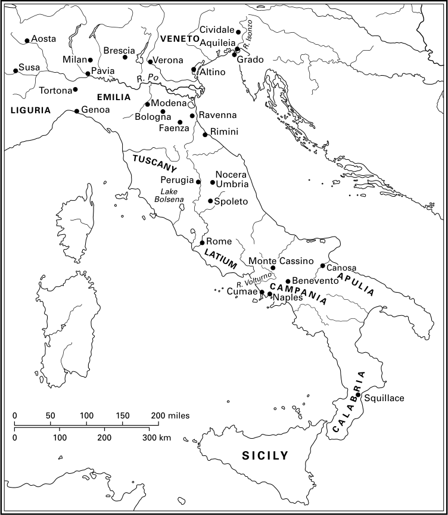

# 第6章 · 东哥特意大利与伦巴第入侵

## 晚期古代的意大利

在我们如今常称为“晚期古代”的这一时期，意大利的处境并不总是令人愉快的。经济正处于转型之中：有人居住的乡村遗址数量从三世纪甚至二世纪就开始下降，agri deserti（荒废田地）已成为地貌中常见的现象，城镇人口不断流失。^1 城市公共建筑——古典文明的显著特征之一——的建造已趋于枯竭，而且早在六世纪初人们就已认识到，罗马城的人口比过去少得多。正如长期在官僚机构任职的卡西奥多鲁斯所写：“古时罗马城人民的庞大数量，从为他们供应粮食的广大行省、从他们宽阔的城墙圈围、从他们巨大的圆形竞技场建筑、从他们宏伟壮观的公共浴场、以及从数量惊人的磨坊——这些只可能是为使用而非为装饰而建——都可见一斑。”^2 意大利在罗马帝国经济生活中所扮演的角色在衰退：早在二世纪，进口的非洲陶器就已主导意大利市场；其政治命运亦然。虽然罗马在数个世纪中始终是一个强大帝国的都城，但一世纪之后出身意大利的皇帝寥寥无几；而自四世纪初君士坦丁时代起，随着君士坦丁堡作为“第二罗马”的兴起，帝国东部更为富庶的部分遂告独立。

正是在这样的背景下，意大利在五世纪接连遭受入侵。罗马城本身先是被西哥特人（410年）、继而被汪达尔人（455年）洗劫，并受到匈人阿提拉（452年）的威胁。455年，最后一位强有力的皇帝瓦伦提尼安三世遇刺——有人将此视为西罗马帝国终结的标志——此后，九位昙花一现的皇帝相继坐镇拉文纳，其中只有两人得以在任内寿终正寝，实权则落入一系列非罗马裔将领之手。476年，其中一位将领奥多瓦克被军队拥立为王，废黜了皇帝——年幼的罗慕路斯·奥古斯都路斯，此人之名不可思议地 combines 了罗马传奇建城者之一的名称与授予首位皇帝的“奥古斯都”称号的小称形式。他被送往那不勒斯附近的卢库鲁姆堡庄园，六世纪时他可能仍然住在那里。意大利就这样进入了后帝国时期。^3

（地图1：六世纪的意大利——图幅地名从略）

## 奥多瓦克与狄奥德里克

但奥多瓦克的同代人并不像现代史家那样看重476年的事件。^4 就实际情况而言，几乎没有发生什么变化。意大利的政治权力继续掌握在一个军事强人手中；虽然奥多瓦克在名义上不再从属于某位西罗马皇帝，但一个元老院使团已奉他之命前往君士坦丁堡向皇帝芝诺陈言：西方无需皇帝。芝诺的回应是授予奥多瓦克贵族头衔，并接受他每年所提名的执政官人选——在每年仍照例任命的两位执政官之列。此外，天主教会与元老院贵族——在意大利事务中日渐重要的两个群体——似乎并未因476年的变故而失去什么，反倒以平静的态度看待之。他们得以在西部帝国覆亡后继续存续，这一点有力地表明了该时期本质上的连续性。

奥多瓦克明智地刻意安抚元老院。^5 483年，大区近卫总长巴西利乌斯代表他参与了教皇斐利克斯三世的选举；斐利克斯出身贵族家庭，在当时的教皇中颇为罕见。奥多瓦克很可能还主持了罗马大竞技场的翻修，前排座位被分配给元老；考古学家已经发掘出刻在座位上的这一时期元老的名字。他还授予元老院铸造青铜钱币的权利。意大利继续像帝国晚期一样由拉文纳治理，国家高级官职在那里得以维持；而且显然，五世纪时元老院名门望族对某些职位的实际垄断也被允许延续。奥多瓦克上台对意大利而言几无改变。

他的覆灭源于外部因素。在其统治早期，他已将普罗旺斯的控制权让与西哥特人欧里克，并同意就西西里向汪达尔人纳贡；在其统治末期，他放弃了诺里库姆——大致相当于今奥地利领土的一个行省——从而为一个解体进程画上了句号；整个五世纪中，一个又一个地区就这样相继脱离罗马的控制。但如前所述，东方悬着帝国这朵乌云，它拥有庞大资源，足以支持其对西方领土可能提出的任何主张。芝诺在位期间叛乱频仍，即便有意直接对付奥多瓦克，也缺乏足够的力量，于是他想出一个主意：派狄奥德里克去对付后者。狄奥德里克是东哥特人的国王，年轻时曾作为人质在君士坦丁堡度过十年，深染拜占庭风气。自阿提拉于453年去世、东哥特人摆脱匈人势力以来，这个民族就对帝国进行着断断续续而令人疲惫不堪的袭扰；487年，狄奥德里克甚至率军直逼君士坦丁堡。因此，无论征讨奥多瓦克之役结局如何，芝诺都毫无损失。

488年，狄奥德里克从旧军镇诺瓦埃——今保加利亚斯维什托夫附近——出发。随行的人们为方便起见可称为“东哥特人”，但极可能还包括其他民族的成员；此次向意大利的迁徙是迁徙群体如雪崩般滚壮大的普遍趋势的一个例证。^6 在这支队伍中，妇女和儿童赫然在列，这显然既是一场迁徙，也是一次军事远征。狄奥德里克进入意大利时在伊松佐河遭到奥多瓦克的阻击，但守军未经交战便逃往维罗纳。奥多瓦克在此遭受失败后退回都城拉文纳，狄奥德里克随即围城。陷入困境的奥多瓦克于493年2月与攻城者展开谈判。双方同意共治，但狄奥德里克立即邀其同僚赴宴，在席间用剑将其刺死。就在这样的 auspices 之下，他开始了漫长的统治（493—526年）。^7

## 哥特人与罗马人

按照当时的套语，此时意大利的居民是“哥特人与罗马人”。显然，哥特人——意味深长地，他们在这个表述中名列首位——并不总是令人愉快的邻人：即便在和平时期，他们的军队也足以在意大利乡村造成浩劫；而一些被指派保护个别罗马人的哥特人，在殴打其保护对象时也毫无顾忌。卡西奥多鲁斯——在哥特人麾下任职的罗马人中最为知名者——曾借其君主之口说道：“对哥特人需要的是战争的暗示，而非对争斗的劝阻，因为像我等这样尚武的民族，以证明其勇气为乐。”^8 坚持要求哥特人以civiliter（守法的）方式生活的狄奥德里克，有理由为两个民族之间的关系担忧。

然而，许多罗马人的日常生活很可能并未受到哥特人的多大影响。虽然无法确定随狄奥德里克前往意大利的人数，但其数量不可能超过当地人口的很小比例；而且从各类证据可以清楚地看出，他们集中于意大利北部。甚至连供养他们的方式也使他们得以悄无声息地融入意大利社会：因为同时代作家所描述的分派给哥特人的tertiae（三分之一份），很可能不像人们普遍假设的那样是成片的土地，而是赋税收入单位。^9 因此，哥特人的到来并未触动土地占有阶级的经济权力。新来者居住的地区是军事上最敏感的区域，哥特人与罗马人可以按他们在社会中履行的职能——一为军人、一为平民——加以区分：“哥特人的军队从事战争时，罗马人可以安享太平。”^10 但这种分工并非罗马成例的改变：数百年来军队已日益由非罗马人组成，文武仕途的分化在晚期帝国早已确立。几乎不会有罗马人不认为意大利社会仍在像帝国时代那样运转。一部已刊布为《狄奥德里克敕令》的法典——很可能确实出自他的授意——几乎完全由晚期罗马立法的摘录构成。如同奥多瓦克的崛起一样，东哥特人的到来也没有给意大利带来重大变化。

但对哥特人而言，定居意大利则标志着显著的变化，他们发现难以不关注罗马人。作为一个少数群体，他们因信奉阿里乌派形式的基督教而被罗马人隔离——意大利人视之为异端——此外还有须在军事法庭受审的惯例；狄奥德里克乐于维持这两项 distinguishing 特征。但一些哥特人渐渐由阿里乌派皈依天主教；由于同时代人视阿里乌主义为“哥特人的法律”，视天主教为罗马人特有的宗教，他们的皈依便意味着放弃了哥特人身份的一项 defining 特征。^11 有些哥特人开始采用罗马人的语言：551年在一份文书上署名的拉文纳十一位哥特教士中，有七人用拉丁文签名。这些教士在拉文纳为一座洗礼堂施洗，其穹顶嵌有马赛克镶嵌画；由于它模仿了附近一座天主教洗礼堂中更早的镶嵌画，这也进一步证明了哥特人易受罗马影响的程度。

似乎惯于创造警句的狄奥德里克曾指出：“贫穷的罗马人模仿哥特人，富裕的哥特人模仿罗马人。”^12 这句话的后半部分由如下事实得到印证：富裕的哥特人往往以罗马式随葬品下葬，这意味着财富与罗马化携手并进。无疑，罗马下层中也存在采纳哥特风俗的风气；540年代，哥特军队因贫穷罗马人的加入而壮大；鉴于狄奥德里克对文武之别的划分，此举不仅可以理解为对哥特人的支持，也可以理解为对他们的某种认同。但在两族的任何融合中，注定失败的是哥特人。事实上我们知道，尽管罗马立法禁止罗马人与蛮族通婚，两族却已开始互通婚姻；考虑到两族在意大利人口规模的对比，这一发展对哥特人的未来绝非吉兆。意大利数百年来同化外来者的能力，再一次显现出来。

## 狄奥德里克的统治

三十余年间，狄奥德里克提供了意大利数代人未曾见识过的一类政府。他以奥多瓦克未能做到的方式巩固王国：与西方所有主要国家缔结婚姻联盟。他的统治还以将领们接连不断的军事胜利为标志。504年，伯蒂茨斯伯爵从格皮德人手中夺取萨瓦河左岸的城邦锡尔米乌姆，不久后又在该地区击败一支拜占庭军队。507年法兰克人在武耶战役中击败西哥特人并杀死其王，这想必不会令其东哥特亲族感到高兴，但狄奥德里克得以扭转局势为己所用：他将边界推进到罗讷河支流迪朗斯河。对新得领土的治理由一位高卢大区近卫总长负责——这是470年代以来首任；而狄奥德里克则以已故国王继承者的名义统治西哥特国家的其余部分。^13 523年法兰克人进攻勃艮第时，狄奥德里克派将领图卢因干预，此次边界似乎被推进到远至伊泽尔河。

成功的外交政策并非狄奥德里克唯一的成就。意大利本土也得益于营造活动：宫殿、浴场、水道、防御工事和一座圆形竞技场得以兴建或至少翻修。的确，除了热衷于建造供奉阿里乌派仪式的教堂之外，这位国王的所作所为完全符合一位罗马皇帝的做派；正如他在取得意大利控制权后似乎不愿亲自统率军队一样，这更近于皇帝而非日耳曼国王的作风。但对于一个年轻时曾在君士坦丁堡做人质十年的人而言，这并不令人意外——人们可以推想，他从这段经历中获得的希腊语造诣远胜于他身边的多数罗马人。尽管信奉阿里乌派，他与教会高层成员关系良好：他裁决了498年发生的一场有争议的教皇选举，并于526年得以将一位候选人强加于罗马主教之座。经历了五世纪的种种灾难之后，六世纪初的成就显得非同凡响，狄奥德里克的臣民将他比作最伟大的罗马皇帝。

他的正式头衔是rex，即国王。我们不知道君士坦丁堡如何看待他的宪制地位；即便在497年与皇帝阿纳斯塔修斯（491—518年）媾和、收回奥多瓦克送往君士坦丁堡的宫殿饰物之后，他的地位也可能始终未经界定。卡西奥多鲁斯以狄奥德里克的名义致函阿纳斯塔修斯，用语刻意取悦帝廷：“我们的王权是对贵国的模仿，以贵国的善意为本，是独一无二之帝国的摹本；顺从贵国之处，我们便超越万邦。”^14 卡西奥多鲁斯安排信函发表的方式也间接表达了同一观点：在其书信集中，致阿纳斯塔修斯的信之后紧接着一封关于为王室制备紫色染料的信。一位拜占庭作家——其古典学修养足以化用修昔底德的一句名言——说他是“名义上的僭主，实际上的真皇帝”。^15

因此，当狄奥德里克于500年到罗马庆祝其即位三十周年时，场面毫无疑义是帝国气派的，还附带晚期古代常见的教会排场：访问圣彼得大教堂——尽管狄奥德里克并非天主教徒；在城外接受教皇、元老院和民众的迎接；造访元老院会堂；向民众发表演说；凯旋入帕拉蒂尼山上的宫殿；举办竞技赛会并分发 annonae（配给粮）。数年后，一位元老在阿皮亚大道上竖立了多份相同的铭文，以一个只能用于皇帝的称谓描述狄奥德里克：“永远的奥古斯都”。^16 帝国，在当时的人看来，似乎仍在意大利延续。

然而，或许也有人对东哥特政府心怀不满。罗马元老院的成员自视为传统的真正守护者，行事一如其先辈：修复古建筑、抄写古代文本、撰写历史、逃避赋税，甚至挪用公共水源以谋私利。如果说他们比祖先更多地卷入了教会政治，那不过是证明了他们想分沾教会日益增长的权力的愿望。其中一人——波爱修斯，著有神学著作以及希腊文本的译注——写下了智识上卓绝无比、影响绵延数世纪的著作；事实上，在意大利世俗文学文化经历五世纪大部分时间的荒芜之后，东哥特时期可视为文运的一次明显复兴。随着五世纪罗马国家权力的衰弱，元老院的威望和影响力上升，狄奥德里克设法安抚其成员。^17 他提名的首位执政官阿尔比努斯——执政官之子、很可能也是执政官之孙——之后又有三兄弟相继出任此职；他似乎还是那位立铭文称狄奥德里克为“永远的奥古斯都”的元老的侄子。已知阿尔比努斯参与拉文纳宫廷的行政事务和竞技场的生活，曾与妻子合力兴建一座教堂，并以关注神学事务著称。多年来，狄奥德里克与旧元老家族的关系时有起伏，但在519年罗马与君士坦丁堡两教会之间的分裂终止后，关系似有改善。522年，波爱修斯的两个儿子共同出任执政官，其父则就任宫廷总务大臣（magister officiorum）；翌年，波爱修斯的老友、执事约翰成为教皇。这批人所代表的集团的优势地位想必看起来已然稳固。

然而，这位伟大国王的统治却以他们的失势告终。^18 523年，狄奥德里克的一位司法官员居普良指控阿尔比努斯与皇帝进行叛逆通信。阿尔比努斯否认指控，由波爱修斯出庭辩护，但居普良随后将指控范围扩大，把这位辩护人也包括在内。525年，教皇约翰在若干元老和教士的陪同下，被迫前往君士坦丁堡为阿里乌派的事业求情；他于次年归来时受到冷遇，不久后去世。波爱修斯与其岳父叙马库斯被处死；前者在狱中写下了他最后也是最著名的著作《哲学的慰藉》。八月，狄奥德里克本人去世，葬于拉文纳那座至今可见的陵墓。这是一段伟大统治的不光彩结局，后来的天主教作家因此散布故事，说他临死前正在策划一场普遍的迫害。狄奥德里克如此反常出手的缘由并不清楚：他年事渐高而意识到缺乏成年男性继承人所引发的拉文纳继承问题上的紧张气氛、北非汪达尔人奉行亲拜占庭政策——他因此于526年下令火速建造一支大舰队——以及拜占庭的阴谋，都可能有所牵涉；但也许最重要的因素是一批廷臣的愿望：他们要削弱以波爱修斯为核心的贵族集团的影响力，因为该集团的骤然擢升危及了他们自身的地位。

## 东哥特国家的覆亡

在狄奥德里克去世约三十年前，执事恩诺迪乌斯——一位作品从淫秽诗篇到礼拜散文无所不包的作家——曾写下一篇颂词，希望国王由儿子继承，但事与愿违。狄奥德里克指定其孙阿塔拉里克为继承人，但此子年幼，大权掌握在其母阿玛拉松塔手中。任何继承者都会发现接替狄奥德里克殊为不易；阿玛拉松塔身为女子又雅好学术，任务便更为艰难。她明智地开始谋求支持：向君士坦丁堡致以示好的信函，将叙马库斯和波爱修斯的产业归还其继承人，并授予教皇对涉及罗马教会成员案件的第一审管辖权。曾在勃艮第战争中获大片领地的哥特将领图卢因被擢升为patricius praesentalis（列席贵族）。

尽管有这些姿态，阿玛拉松塔仍无力阻止政府权力的侵蚀。法兰克人蚕食东哥特在高卢的领地，并消灭了勃艮第人的王国；但更令人警觉的是内部动向——我们通过拜占庭史家普罗柯比的叙述对此有所了解。即便是狄奥德里克也难以驾驭哥特贵族，其女儿更难以胜任。一些哥特人主张，阿塔拉里克应当违背其母的意愿，按哥特式而非罗马式方式接受教育；不久，阿玛拉松塔开始为自己的地位担忧。她与皇帝查士丁尼（527—565年在位）展开谈判，准备逃离意大利，帝国领土上的都拉基乌姆也已准备接待她；但当她发现自己有能力安排谋杀一些敌人后，便决定留下。534年10月，阿塔拉里克——青春放纵的牺牲品——死去，这削弱了她的地位，促使她采用regina（女王）头衔，并以其近亲、富有的文艺爱好者狄奥达哈德为共同统治者。但这一策略适得其反：狄奥达哈德与其敌党结盟，设法将不幸的阿玛拉松塔在博尔塞纳湖畔勒死，时间很可能在535年春。有人认为她的死应归咎于女性嫉妒：人们怀疑查士丁尼之妻狄奥多拉因阿玛拉松塔可能对其丈夫的吸引力而心绪不宁。这种对事件的解释不太可信，但其可取之处在于强调了意大利事务与强大帝国的事务已结合得何等紧密。狄奥达哈德摆脱阿玛拉松塔——她已将自己置于查士丁尼保护之下——的决定并不明智，因为帝国军队在533年的一场短暂战争中已消灭了非洲的汪达尔国家，这场速胜促使查士丁尼将目光投向意大利。535年，帝国与东哥特人之间的战争爆发。其最终结局毫无悬念：当阿玛拉松塔计划逃往帝国时，她掌握着四万磅黄金；而皇帝阿纳斯塔修斯518年去世时留给国库的黄金是此数的八倍。哥特人无法匹敌帝国的资源。

然而，哥特战争的持续时间超出了查士丁尼的预料。战争开始顺利：其将领贝利撒留于536年攻取罗马，540年进入拉文纳。不久，贝利撒留携哥特国王维蒂吉斯返回君士坦丁堡——维蒂吉斯是哥特人选来取代狄奥达哈德的一位富于军事经验的人。但贝利撒留留下的拜占庭行政官过分认真地履行征税职责；541年，哥特人迎来了一位精力充沛的领袖托提拉（又称巴杜伊拉）为王，一场直至查士丁尼派将领纳尔塞斯赴意大利方告终结的冲突就此展开。纳尔塞斯自北进军意大利，于553年击败托提拉；尽管哥特人的抵抗仍在局部继续，直到数年后维罗纳和布雷西亚被攻克。

## 战争的影响

这段战争的历史已在上一章叙述，此处只需指出其若干后果。记述查士丁尼历次战争的拜占庭史家普罗柯比讲了一个故事：他自称不相信，却仍认为值得一述。据说开战之初，狄奥达哈德问一个犹太人战争的结局如何，后者吩咐他将三群各十头的猪分别称作哥特人、罗马人和帝国士兵，分圈关养。数日后打开猪圈，他发现代表哥特人的猪除两头外全部死去，代表士兵的猪除几头外全都活着；代表罗马人的猪约有一半存活，虽然全都掉了毛。^19 这种占卜未来的尝试并不完全准确，因为我们知道战后仍有许多哥特姓名的人生活在意大利。但这个故事表明了一种看法：战争——想必还有543年爆发并反复肆虐的瘟疫——对罗马人造成的冲击是骇人的。当教皇大格里高利在上个世纪的最后十年撰写《对话录》时，他记述了普利亚卡诺萨主教萨比努斯与著名的修士圣本笃之间大概发生于547年的一场讨论。托提拉攻入罗马并造成毁坏之后，主教评论说，此城将被国王毁灭，不复有人居住。本笃不以为然：他说，罗马不会被蛮夷化为乌有，但饱受风暴、雷电、种种灾祸与大地震动之苦，它将自行衰朽。^20

这两种视角恰好概括了理解哥特战争的两种可能方式。鉴于罗马五度易手，一度曾四十天无人居住，城内最早的一些墓葬即始于战争时期，而那些不久前还在自豪地庆祝执政官就职的元老们或遭杀害或已逃亡，人们也许倾向于赋予这场战争灾难性的意义。狄奥德里克与奥多瓦克之间的战争尚且局限于很小范围，而托提拉——本世纪末人们记起他主要是因其残暴——的活动所造成的破坏超过了自公元前三世纪汉尼拔入侵意大利以来的任何战争，加之瘟疫爆发，其冲击更形加剧。557年，教皇贝拉基抱怨罗马赤贫交加，试图以教会在高卢产业的收入在当地购买衣物运回罗马分发给穷人。后来他致函非洲大区近卫总长，抱怨罗马教会的贫困。经济衰退伴随着智识生活水平的下降：说来奇怪，哥特人统治拉文纳期间，该城刊行的希腊文书籍似乎比六世纪其余时间——此时拉文纳已归属拜占庭帝国——还要多。意大利还经历了政治上的无能为力。尽管被并入帝国，却没有一位六世纪的皇帝到访意大利，而它在奥多瓦克和哥特人治下享有的独立却消失了。执政官和宫廷总务大臣等国家官职从拉文纳消失，意大利发现自己同非洲一样由君士坦丁堡的任命者统治；此外，教皇及其他意大利主要主教座的自主权也遭到削减。^21 人们确实可以论证：战争对意大利的冲击是灾难性的。

然而，对战争所带来的变化也可能言之过甚。在沃尔图诺河畔，一座此前繁荣的庄园在本世纪上半叶遭废弃，但其废弃未必是战争的结果。例如在卢尼，广场早在六世纪初就被泥土掩埋；战争带来的经济衰退，或许不过是如前所述延续数百年之进程的暂时加速而已。罗马在战后还有某种复苏：565年，纳尔塞斯立碑纪念他重建一座桥梁——萨尔提亚大道所经，毁于“最邪恶的僭主托提拉”之手。^22 554年查士丁尼颁布的《 pragmática 敕令》中也明显可见对托提拉的敌意，他试图借此整顿意大利事务，尤其是重建在战争中损失惨重的土地占有贵族的地位。^23 阿玛拉松塔、阿塔拉里克和狄奥达哈德所作的让步得到确认，而托提拉的让步则被宣布无效。战争中契据的遗失不得损害财产所有权；战争中从流亡者或被俘者手中夺取的产业应予归还，奴隶主的权利受到保障。连续性的愿望也体现在如下条款中：曾经授予罗马人的annonae，以及文法学家、修辞学家、医生和精于法律之士的薪给，应照旧支付。《 pragmática 敕令》的某些条款过于清晰地反映了一个正在变化的社会：元老可自由觐见君士坦丁堡的皇帝，但须能返回意大利并留在那里以收回其财产；行省总督应由主教和显贵遴选；度量衡应在教皇和元老院在场时核验。但即便这些条款也可以说不过反映了元老院与教会这两根意大利社会支柱日益突出的地位，确认了一个绝非新近的趋势。无疑，托提拉的岁月标志着经济上的倒退，但拉文纳出土的一系列纸草文书表明，至少该地区的土地市场相当活跃；在查士丁尼统治末期，意大利居民完全可以合乎实际地预期一个疗愈时期的到来。

## 伦巴德人的入侵

拜占庭征服之后意大利享有的安全与繁荣注定是短命的。^24 大约自狄奥德里克去世之时起，一个日耳曼民族——伦巴德人——已在多瑙河以南的旧潘诺尼亚行省定居。他们总体上是拜占庭人的盟友，但所受罗马风气的熏染不及东哥特人。没有一位伦巴德国王像狄奥德里克那样在君士坦丁堡度过十年；他们中间虽有天主教徒和阿里乌派，多数人似乎仍是非基督徒。568年，在国王阿尔博因率领下，他们离开潘诺尼亚，迁往意大利。

促使他们作出迁徙决定的原因并不清楚。按照一个早在七世纪便已流传的故事，他们是受纳尔塞斯之邀：这位查士丁尼的将领在征服后留驻意大利，因罗马人对他心怀恶意，遂召来入侵者以求报复。虽然这个故事中归于纳尔塞斯的怨毒无疑并非史实，但现代学者仍可构建一个论据，证明拜占庭官员确实曾邀阿尔博因赴意大利：伦巴德人不久前作为帝国盟友的经历——包括派兵协助纳尔塞斯对东哥特人作战；入侵初期拜占庭人未能认真抵抗；以及法兰克人对意大利北部持续的威胁——这一情况可能促使当局召唤潜在的盟友——凡此种种都可用来支持这种解释。^25 另一方面，伦巴德人也可能是在幸存东哥特人求援的呼吁下来到意大利的。但他们的入侵未必出于任何与意大利相关的考虑，只需觉得那里唾手可得即可。565年，皇帝查士丁二世推翻查士丁尼的政策，拒绝向阿瓦尔人纳贡——阿瓦尔人是在多瑙河中游骤然崛起的民族；567年，伦巴德人与阿瓦尔人联手击败格皮德人。据说阿尔博因亲手杀死了格皮德国王，随后娶了死者的女儿罗西蒙德。击败宿敌固然令伦巴德人心满意足，但阿瓦尔人的崛起想必使潘诺尼亚变得不再那么宜居，这或许足以解释他们迁往意大利的决定。无论如何，568年4月2日，他们开始了迁徙，对意大利发动了一场比东哥特人入侵影响更深、更为持久的进攻。

我们无从估算阿尔博因带入意大利的兵众规模。其部众中包括伦巴德人以外的民族成员，其中以撒克逊人最为突出；耐人寻味的是，古英语诗篇《威德西斯》的作者自称曾随埃德温之子艾尔弗平在意大利，这些名字令人联想到奥多因之子阿尔博因。^26 与先前的入侵者狄奥德里克和纳尔塞斯一样，阿尔博因经威尼提亚进入意大利，似乎未遇任何抵抗。他任命侄子吉苏尔夫为奇维达莱及其周边地区的公爵，并授予他若干farae——一个起源晦暗的日耳曼词汇，八世纪末执笔的执事保罗理解为“氏族或世系”。^27 附近阿奎莱亚城的主教逃往海滨城镇格拉多；次年，米兰陷落，其主教逃往热那亚。在难以估定的时间、出于难以推究的原因，法罗阿尔德在斯波莱托、佐托在贝内文托建立了强大的公国，远在南方。572年，阿尔博因在被围三年后攻入帕维亚，径直来到狄奥德里克在当地兴建的宫殿。

在其进入意大利的最初几年，伦巴德人入侵的某些特征已然显露：他们对社会造成的错位大于东哥特人，其凝聚力也不及前者。阿尔博因未能长久享有其成功：就在他进入帕维亚之年，他遭其妻罗西蒙德唆使谋杀。据执事保罗记载，当阿尔博因在维罗纳的一次宴会上拿出一个以其岳父库尼蒙德的颅骨制成的酒杯，提议她与父亲对饮时，她对丈夫心生仇恨。她趁阿尔博因熟睡时令人将其杀死复仇，但此举在伦巴德人中不得人心；不久，她与其他趁机制投靠敌方的伦巴德人一道逃往拉文纳——拜占庭在意大利的首府。在拉文纳，罗西蒙德受到接替纳尔塞斯的拜占庭统帅、贵族朗基努斯的接待，但后来死于毒药。伦巴德人推举克莱夫接替阿尔博因，但在位十八个月后他被一名奴隶杀死；此后伦巴德人废黜王制达十年（574—584年），期间权力归诸公爵们——据说有三十五位。这段无王时期意大利战乱蔓延，并与高卢的法兰克人交战。皇帝查士丁二世（565—578年）终于介入，派其女婿巴杜阿里乌斯驰援意大利，但他被击败，约于576年死去。教皇本笃（575—579年在位）任内，查士丁安排将满载谷物的船只从埃及运往罗马以解饥荒。577或578年，以及579年，罗马的求援者抵达君士坦丁堡。他们的行程固然可能与新皇帝和新教皇的即位有关，但他们确实是在求援，所得到的回应却寥寥无几。579年贝拉基二世成为教皇时，罗马正被围困；大约同时，拉文纳的外港克拉西斯遭劫掠。

伦巴德人进入意大利的过程文献记载不完善，主要史料是执事保罗——他在伦巴德人到来约二百年后写作，尽管他利用了一部今已佚失的重要早期史料，即特伦托主教塞昆杜斯所撰的历史。其诸多方面仍不明朗。例如，我们不知道保罗所提及的farae应视为家族集团还是游动的武装分队，^28 也不知道公爵职位主要是日耳曼社会的遗存，还是晚近在晚期罗马或拜占庭影响下发展起来的制度。这两个问题显然引出一个总的问题：伦巴德人来到意大利时，已在多大程度上脱离了其蛮族起源；这也可能与伦巴德人在一定程度上配合意大利的帝国军队有关。有人论证说，例如建立斯波莱托和贝内文托公爵领的人是在为拜占庭人效力。^29 这种解释似乎牵强，但伦巴德队伍中确有按帝国利益行事者。人们会想起公爵德罗克图尔夫：他叛投敌方，死后葬于拉文纳圣维塔莱教堂门前——该教堂以查士丁尼和狄奥多拉的镶嵌画著称，构成强有力的帝国宣传。^30 考古学显示，在帝国仍控制的一些意大利地区存在伦巴德墓葬，这或许并非偶然。

然而，如果拜占庭人曾把伦巴德人当作对付法兰克人的一招，那么邀请他们来意大利的试验已惨遭失败这一点必然很快就显而易见了。但随着局势恶化，出现了反其道而行之的可能：召唤法兰克人来对付伦巴德人，一如哥特战争期间所为。早在580年，教皇贝拉基便寻求法兰克人干预；几年后，君士坦丁堡也试图借法兰克人解决其在意大利的问题。皇帝莫里斯向国王希尔佩贝尔特转交了五万索里达的巨款，后者于584年进攻伦巴德人。史料中法兰克远征的细节并不清晰，但已足以震慑伦巴德人：同年，他们选举了一位新王——克莱夫之子奥塔里。很快便清楚，他不同于其先王。公爵们向他献纳一半财富，使王权获得稳固的经济基础；他采用了罗马姓氏弗拉维乌斯；他禁止伦巴德儿童受洗为天主教徒——此举既显示了他自觉拥有的权威，也显示了他为伦巴德人看到的非罗马道路。天主教作家大格里高利讲的一个故事，暗示了这一时期伦巴德人所承受的某些紧张关系。从他的书信之一可知，有一次，一个伦巴德人看见圣彼得的一把金钥匙，想把它改铸成别的东西，便用刀去砍，结果刀刃穿过自己的喉咙而死。在场的奥塔里王和其他伦巴德人大为惊恐，无人敢碰那把钥匙，直到一位身为天主教徒的伦巴德人到来。奥塔里另制了一把金钥匙，将两把一并送给教皇。^31 考古学提供了较为明确的罗马化证据：诺切拉翁布拉——伦巴德人至迟571年已占据的一处遗址——最早的墓葬中随葬品样式与潘诺尼亚伦巴德墓葬所出相同，但几十年之内，人们下葬时已使用模仿罗马器物的用品。

589年，奥塔里通过与巴伐利亚统治者加里巴尔德之女泰奥德琳达联姻巩固了北方地位。鉴于法兰克人——他们已控制阿尔卑斯山口意大利一侧的奥斯塔和苏萨——的持续压力，这是明智之举。590年，奥塔里的敌人们发动大规模进攻。法兰克人自西推进，远至维罗纳；拜占庭人攻取众多城镇，并接纳了若干倒戈的伦巴德人。但盟军未能协调行动，无法迫使据守要塞的伦巴德人出战，法兰克人遂撤军。9月5日，奥塔里去世——据说是中毒身亡。他没有子女，泰奥德琳达选择都灵公爵、图林根人阿吉卢尔夫为新夫，后者因此成为国王。执事保罗讲过一个故事：奥塔里临死前曾骑行至半岛极南部的雷焦，以矛尖触及海中一根石柱，说道：“伦巴德人的疆土将扩展至此。”^32 保罗的故事大多几乎可以肯定是虚构的，这个预言作为谶语也失之宽泛，但随着590年法兰克与拜占庭军事行动的失败，有一点已经清楚：伦巴德人将在意大利长久立足。

## 伦巴德人的意义

提及伦巴德人的早期罗马作家描述他们人数稀少；他们初到意大利后不久墓地规模有限，可视为这一说法的佐证。但在其中一处遗址诺切拉翁布拉，百分之九十以上的男性以武器随葬；而该遗址紧邻从罗马北上翻越亚平宁山脉的干道弗拉米尼亚大道、战略位置重要，暗示了伦巴德人在此定居的可能用意。^33 在君士坦丁堡，人们感到伦巴德人的冲击是可怕的。多位意大利同代人也一致认为他们“穷凶极恶、难以言表”，大格里高利——他在奥塔里去世两天前继任了死于瘟疫的教皇贝拉基二世——在其教任期初年的一次布道中描绘了一幅阴郁的图景：

> 城市被毁，田野荒芜，大地沦为旷野。田间已无耕者，城中居民所剩无几——而这些人类的残余仍在日复一日地被击倒，无一宁日。^34

的确，战乱、随之而来的饥荒以及瘟疫的再度爆发，使格里高利在若干年间相信，圣经中关于世界末日的预言即将应验。

格里高利及其同代人眼中的意大利大体分为两个变动的地带。其一仍处于拜占庭人控制之下。大致说来，它包括一块沿亚得里亚海岸延伸、并向内陆不同程度深入的领土；沿艾米利亚大道，它包括博洛尼亚而不包括摩德纳。这块领土与另一楔形区域相连，后者以罗马为根基；但由于斯波莱托公爵领的建立使弗拉米尼亚大道变得危险，穿越亚平宁山脉的主要通道已西移，改经佩鲁贾一线。拜占庭人还据有以热那亚和那不勒斯为基地的沿海狭长地带，以及意大利的“靴跟”与“靴尖”。这是一个笨重的领土聚合体，其之所以尚存些许地理上的统一，全赖拜占庭人对海洋无可争议的控制——这使交通得以畅通无阻。在其余更大片的意大利土地上，入侵者占据支配地位，而伦巴德人也乐于给生活在缩小的拜占庭区域内的人制造麻烦。罗马和那不勒斯在590年代均遭袭扰；教皇格里高利在安排将木材从布鲁提乌姆内陆运往海边时，发现值得求助于贝内文托公爵。

执事保罗在其叙述的某处似乎赋予伦巴德人的到来以灾难性的意义。他写道，克莱夫杀死了一些显要的罗马人并放逐了其余的人（或“其他人”）；在574—584年的无王时期，许多罗马贵族因伦巴德人的贪婪而被杀，余下的（贵族？还是意大利人？）则被按“客居者”的方式（per hospites）分与伦巴德人，被迫纳贡，须将土地出产的三分之一交给伦巴德人；他还写到教堂遭劫掠、主教被杀、城镇被颠覆、民族（或“人口”）被灭绝。在另一段落中他断言，在奥塔里治下（584—590年），不堪重负的意大利人被按“客居者”方式分与伦巴德人（或“分与伦巴德客居者”）；然而他认为这一时期是伦巴德王国内部享有非凡和平的时期。^35

即便这位作家的语言不那么晦涩，也不是可以不加批判地接受的史料；但伦巴德人的初始冲击无可回避。意大利国家的一些传统职能陷于中断：曾构成历代政府收入主要部分的土地税不再征收，这意味着伦巴德军队直接由土地供养，而非经由国家征收的赋税。对于他们所征服土地上的地主而言——哥特战争创伤犹新——入侵者的到来必定是毁灭性的，其分量远大于当年哥特人的到来。伦巴德人对教会生活的冲击，不仅表现在他们摧毁了圣本笃在卡西诺山的修道院，还表现在一个非同寻常的事实：在大格里高利卷帙浩繁的书信中，他写给半岛上主教的信件，除斯波莱托主教外，全部是写给拜占庭人控制城镇中的主教的。阿奎莱亚和阿尔蒂诺或许属于因伦巴德人而至毁灭的城市之列；而布雷西亚在这一时期城市生活水准发生了显著危机，也是已知的事实。但须谨慎：许多城镇早在伦巴德人到来之前很久就已日趋缩小，凡被他们“颠覆”者或许早已衰弱不堪；很难把伦巴德人视为意大利城市生活非凡连续性中的一个重大中断。至于伦巴德人灭绝民族的说法显然不实，但他们对所夺取地区内土地占有阶级和教会的恶劣冲击却是毋庸置疑的。

然而，那些仍留在帝国版图内的意大利地区，也同样受到新局势的影响，而这不可避免地导致了我们可以称之为社会军事化的进程。584年，史料首次提及总督（exarch）这一官员，他集最高的民政与军事权力于一身，但也不无理由地可以被视为一位权力膨胀到侵蚀民政权威的军队统帅（magister militum）。这一发展在意大利并非全然新颖，因为早在东哥特时期，哥特人伯爵们（comites Gothorum）便已在文官面前颐指气使；而更晚些时候，曾有教皇在处置不听话的主教时，求助于军队统帅而非民政当局。这也并非意大利独有的现象，因为同样的进程也发生于非洲，而且在某些方面可以被视为后来在拜占庭帝国其他地区发展起来的军事“军区制”的类似物。总督的崛起恰值《务实诏令》力图在意大利重新确立文武之别之后仅三十年，它无疑与六世纪晚期意大利环境下民政权威的不足密切相关。

对民政权威衰弱的另一种回应，是主教在社会中日益突出的作用。晚期古代史料中最后一次提及罗马城市行政长官（praefectus urbis Romae）是在599年。这本是一个值得珍视的职位：卡西奥多鲁斯提到其就任者乘坐马车出行，而就哥特时期任职者更迭之快来判断，这是一个竞争激烈的职位。但在六世纪晚期已然改变的世界里，它已不合时宜：例如，已无需官员主持元老院会议，因为这类会议已不再举行。在城市内部，大量权力转移到主教手中，尤其是在罗马和拉文纳等主教区，那里的主教可以动用远离伦巴德人劫掠的西西里地产资源。大格里高利后来从事的慈善活动以及他与伦巴德领袖进行的谈判，便是国家之衰弱的见证，而与之相伴的是主教权威尤其是教皇权威的增长。然而，如果我们想理解意大利局势之变迁，最好的途径莫过于考察地貌的军事化。在卡西奥多鲁斯的书信全集中，提及军事建筑（castra、castella）的仅有三处：利古里亚的托尔托纳、阿迪杰河上的韦鲁卡，以及迪朗斯河上的一处，^36 三处均在东哥特国家边境附近或边境之上。普罗柯比关于哥特战争的著述——尤其是托提拉领导哥特人的阶段——展现了一幅战争影响更为广泛的地貌图景；例如，我们读到森图姆切莱的一处要塞和内皮的一处山寨。^37 但这仍不足以使我们准备面对大格里高利书信中揭示的遍布castra和castella的地貌。例如，我们发现布鲁提乌姆的斯奎拉切有一座修士建立的要塞（castrum）——卡西奥多鲁斯曾评论该地“non habet muros”（没有城墙）；巴尼奥雷阿也有一处，当地居民在那里将与显赫者（vir gloriosus）安斯弗里德——从名字看是一位伦巴德人——共同推选主教。^38 这类建筑的兴建，以及兴建的动议并不总是来自国家这一事实，都表明随着世纪的推进，意大利已经发生了多么深刻的变化。

## 六世纪意大利变迁的程度

关于古代世界何时让位于中世纪世界的问题，产生了令人不安的多样答案，而且这或许是一个提法不当的问题。尽管如此，如果我们要在“古代”与“中世纪”两个时期之间划定一条界线，那么至少就意大利而言，有充分的理由将其定位于六世纪。^39 元老院在奥多亚克和东哥特人治下依然繁盛，但大格里高利宣告“senatus deest”（元老院已不存在）。^40 它的某些成员在查士丁尼战争期间遭哥特人屠杀，另一些人流亡君士坦丁堡，其中一些人的后裔在世纪末仍生活在那里；而返回意大利者面对的是一片惨遭战火蹂躏的土地。有人正确地指出，元老院的毁灭是哥特人毁灭的代价，^41 但索取这一代价的是拜占庭人。事实上，在六世纪统治意大利的诸势力中，哥特人是古典文明最有效的守护者。已知在罗马城举行的最后一场竞技是托提拉于549年主持的；一位近乎同时代的作家虽然敌视这位国王，却援引普林尼描述图拉真的语言，称他如父亲与子女一般生活在罗马。^42 在东哥特掌权时期，卡西奥多鲁斯曾写下称颂城市生活的雄辩文字，描绘一位绅士可以享有的全然古典的日常活动：与同等身份者交谈，去广场一游，观赏工匠的产品，运用法律促进自己的事务，以下棋消遣，与同伴共赴浴场，以及举办午宴。^43 然而，当他在君士坦丁堡度过数年、于550年代返回意大利时，卡西奥多鲁斯过着截然不同的生活：他在意大利半岛最偏僻的地区之一、自家的家族地产上建立了一座修道院。

无疑，这在一定程度上是一个更广泛趋势的症候：贵族的地位在东方和西方都在六世纪期间趋于衰弱。但在拜占庭征服意大利之后，本世纪初前三十年中曾经繁盛的那种文官贵族已几无立足之地，而伦巴德人的到来使传统的文明生活方式更难维系。哥特人——大体上安分地隐居于意大利北部，靠税收凭证为生，容忍天主教徒，遵守罗马形式——与伦巴德人——散布于意大利大部分地区，靠有时被剥夺的土地为生，时而热衷于迫害天主教徒，对罗马方式相对漠然——之间的对比是显著的；而后者给靠地产维持自身的贵族带来的变迁程度，同样不容小觑。

不过，如果说六世纪见证了意大利社会支柱之一的命运的可悲衰落，那么与之对应的教会一翼却在前进。教堂的兴建继续快速推进；而世纪初西马库斯对庞培剧场的一次修缮，是已知最后一次对传统世俗建筑的私人捐资维护。^44 事实上，世俗建筑开始被转作教会用途，例如罗马的一座厅堂——很可能是城市行政长官的接见厅——在526至530年间被改建为圣科斯玛斯与达米安教堂，这一举动预示着609年万神殿更为著名的改宗为堂。知识生活也出现了类似的教士化进程，卡西奥多鲁斯再度提供了例证。他年轻时因发表一篇颂词而受到狄奥多里克的注意，随后以颂词作者和公务书信撰写者的身份服务于狄奥多里克及后来的哥特诸王。而另一方面，他作为虔诚者（vir religiosus）隐居布鲁提乌姆期间所写的作品，在性质上几乎全属教会类；即便如此，他负责撰写的那部教会史仍因眼界过于开阔而不合大格里高利的口味，流传不广。世纪初尚能容纳波爱修斯的智识著作和恩诺迪乌斯的大胆诗作的开阔视野，到格里高利时代已经收缩，此时写作的绝大部分，无论作者身份还是内容，都是教士性的。哥特时期的晚期古代世界，被一个由战斗者与祈祷者主导的世界取代，其轮廓已然是地道的中世纪。

在这些变化发生的同时，意大利在更广阔世界中的角色也在演变。东哥特人占领意大利时，失去诸行省的它或许显得孤零，但东哥特人的领土扩张和狄奥多里克缔结的联姻使它居于地中海地区的中心。查士丁尼入侵的成功剥夺了它的这一地位。留为首都的拉文纳沦为一个由君士坦丁堡操控的机构下设的分部，其高层人员皆非本地人。由此形成的环境助长了邻国的干预。更糟的还在后面：伦巴德人终结了意大利的统一，造就了一个分裂的意大利，这一局面一直延续到近代早期。到世纪末，进行了几个世纪的变迁已然完成：在政治和经济上，意大利既是孤立的，又是分裂的。它所保有的那一点中心地位，属于罗马教会，其最突出的展现便是596年大格里高利向肯特派遣传教士。意大利在更广阔世界中的影响的直接未来，竟系于罗马主教之权威，这足以衡量自狄奥多里克500年在城中庆祝其三十年庆典以来，意大利走过的路程是何等遥远。

## 注释

1. 总体参见 G¨ıardina ed. (1986)。
2. 卡西奥多鲁斯，《 Variae 》ii.39.1 f（据霍奇金译文改译）。
3. Hodgkin (1896); Hartmann (1897); Wes (1967)。
4. Croke (1983)。
5. Chastagnol (1966)。
6. Wenskus (1961), pp. 483ff. 关于后来被称为哥特人的这一族群的“族群生成”，见 Wolfram (1988)。
7. 相关讨论见 Stein (1949), Ensslin (1947), Moorhead (1992)。
8. 卡西奥多鲁斯，《 Variae 》i.24.1（霍奇金译文）。
9. Goffart (1980); Wolfram and Schwarcz (1988)。
10. 卡西奥多鲁斯，《 Variae 》xii.5.4（霍奇金译文）。
11. 阿里乌派作为“哥特人之法”（lex Gothorum）：Tj¨ader, Papyri pap. 31.1, 7, 8, 10（第2卷，第84页以下），pap. 43.108, 122（第2卷，第102页）；关于其阐释，见第2卷，第268页注3。阿里乌派称天主教徒为“罗马人”（Romani）：图尔的格里高利，《殉教者荣耀录》（ Liber in Gloria Martyrum ），Krusch 编本 xxiv.52。
12. 《瓦伦西阿努斯匿名者编年史》（ Anonymus Valesianus ）61（ Chronica Minora 1，第322页）。
13. 关于东哥特人在西班牙的统治，见本卷下文第7章，巴贝罗与洛林撰。
14. 卡西奥多鲁斯，《 Variae 》i.1.3（霍奇金译文）。
15. 普罗柯比，《哥特战记》（ Bellum Gothicum ）i.1.29；参修昔底德 ii.65.9（论伯里克利）。
16. Fiebiger and Schmidt, Inschriftensammlung no. 193（= CIL x.6850–52）。卡西奥多鲁斯，《 Variae 》ii.32ff 提示其年代在507—511年间。
17. Sundwall (1919) 仍是基础性研究。
18. Moorhead (1992), pp. 212–51。
19. 《哥特战记》i.9.2–7。
20. 罗马的格里高利，《对话录》（ Dialogues ）ii.15.3。
21. 参见上文第5章，穆尔黑德撰。
22. CIL vi.1199。
23. Archi (1978)。
24. Delogu et al. (1980); Wickham (1981); Christie (1995)。
25. 尤见博格内蒂的论文集 (1966–68)。
26. 《维德西斯》（ Widsith ），第70—74行。
27. 执事保罗，《伦巴德人史》（ HL ）ii.9.91（generationes vel lineas）。
28. 保罗将 fara 定义为“generatio vel linea”（《伦巴德人史》ii.9），可与之相比的是《阿旺什的马略编年史》s.a. 569（ Chronica Minora ii.238；阿尔博因率其全体部众“举族（in fara）”进入意大利）以及《罗塔里敕令》（ Edictus Rothari ）第177条（“凡自由人在我王国境内有权携其 fara 迁往任何其愿往之处”）。相关争论的概述见 Harrison (1993), pp. 50ff。
29. Bognetti (1966–68), vol. iii, pp. 456–75。
30. 执事保罗（《伦巴德人史》iii.18）称德罗克图尔夫“出自苏维汇人，即阿勒曼尼人”，自幼在伦巴德人中长大。狄奥菲拉克特·西莫卡塔视其为伦巴德人（《历史》ii.7），而由保罗引录的其墓志铭（《伦巴德人史》iii.19）却称他为苏维汇人（第3行），并且还提到他的长髯（longa . . . barba，第6行）！关于圣维塔莱教堂与拉文纳，见上文第5章，穆尔黑德撰。
31. 罗马的格里高利，《书信集》（ Epp. ）7.23。
32. 保罗，《伦巴德人史》iii.22.127。
33. Hessen (1983)。
34. 罗马的格里高利，《以西结书讲道集》（ Homilae in Hiez. ）ii.6.22。
35. 保罗，《伦巴德人史》ii.31–2.108–9, iii.16.123。
36. 《 Variae 》i.17, iii.48, iii.41。
37. 《哥特战记》iii.36.11, iv.34.16（该处亦为一要塞）。
38. 罗马的格里高利，《书信集》8.32（参卡西奥多鲁斯，《 Variae 》xii.15.5），10.3
39. Stroheker (1965), pp. 305–8，将其置于查士丁尼统治结束后不久；关于此前学者的意见，进一步见第279、285页以下、300页以下。
40. 罗马的格里高利，《以西结书讲道集》ii.6.22。
41. Wes (1967), p. 193。
42. 《教宗名录》（LP，维吉里乌斯条）；参小普林尼，《颂辞》（ Panegyricus ）21.4。
43. 《 Variae 》viii.31.8。
44. Ward-Perkins (1984)。
