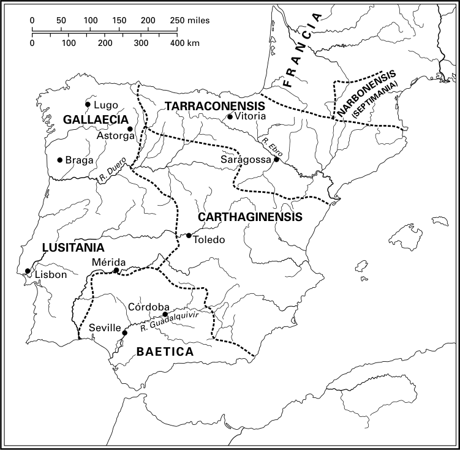

# 第7章 · 西班牙苏维汇与维希戈特王国的形成

455年，狄奥多西王朝的最后一位代表、皇帝瓦伦提尼安三世遇刺身亡，随后汪达尔人盖萨里克洗劫了罗马城，这些事件标志着罗马帝国西部行省一场深刻政治危机的开端。蛮族同盟军（foederati）敌对行动导致军事活动的加剧，以及高卢元老院贵族与意大利—罗马元老院贵族之间利益的分歧，促成了离心倾向的胜利，其结果是西罗马帝国的终结以及罗马—日耳曼诸王国的取而代之。^1 因此，对于西班牙行省（Hispania），正如对帝国的其他西部行省一样，一个政治与军事动荡的时期开始了，这一时期最终使它脱离中央权力网络，为新的地区性强国开辟了道路。这一进程不仅有利于苏维汇人——他们是429年汪达尔人前往非洲之后唯一留在伊比利亚半岛的蛮族民族，当时已牢牢立足于半岛西部——也有利于西哥特人。尽管五世纪中叶西哥特人的利益中心位于高卢南部，他们很快便开始向西班牙行省扩张新的基地，这些基地后来使他们得以在当地确立稳定的政治权力，并最终在六世纪下半叶吞并苏维汇王国本身。

## 第一个苏维汇王国的终结与王国归附西哥特人的保护

五世纪初，苏维汇人仍居住在加拉埃西亚（Gallaecia）行省的西部边界之内，但汪达尔人离开后，他们开始了扩张领土的进程。其结果是，到五世纪中叶，苏维汇人已控制了北起加拉埃西亚、南至贝提卡、途经卢西塔尼亚（Lusitania）的广阔地域，其首府兼教区首府埃梅里达·奥古斯塔（Emerita Augusta，梅里达）似乎一度曾充当苏维汇诸王的王都所在。这一扩张始于第一位苏维汇君主赫尔梅里克（Hermeric）三十年的统治时期，并由其继任者——其子雷希拉（Rechila）与孙雷基阿里乌斯（Rechiarius）——继续推行。这一进程以苏维汇军队屡次击败受命遏制其扩张的罗马将领为标志，但最终于452年，帝国当局达成了一项协议，其确切条款不得而知，但至少成功地遏制了扩张，并将苏维汇人的影响限制在西部地区，因为依据这一协定，苏维汇人从迦太基恩西斯（Carthaginensis）撤出。^2 对于苏维汇人而言，要在这些其挺进所及的广大地域上建立有效的政治控制想必是困难的，但452年的协议将军事事务置于苏维汇君主的独家掌控之下，并为此后苏维汇君主制转变为领土王国奠定了基础。

然而，瓦伦提尼安三世遇刺之后的种种事件打断了这一发展。在瓦伦提尼安横死、狄奥多西家族之外的皇帝继位之前，苏维汇人一直认为契约已经缔结，但这一协议谈判所依赖的个人基础意味着它随着瓦伦提尼安一同消亡；就在同一年，即455年，苏维汇人重新开战，对刚刚收复的迦太基恩西斯行省发动进攻。昙花一现的佩特罗尼乌斯·马克西穆斯（Petronius Maximus）的继任者、新皇帝阿维图斯（Avitus，455—456）在外交失败后毫不犹豫地对苏维汇人宣战，并以西哥特人为盟友。西哥特王狄奥德里克二世（Theoderic II）的干预来得突然而毁灭性：苏维汇军队的主力于456年10月5日在阿斯图里卡·奥古斯塔（Asturica Augusta，阿斯托尔加）附近被击败；当时充当首都的布拉卡拉·奥古斯塔城（Bracara Augusta，布拉加）随即遭到洗劫；逃往波尔图的国王雷基阿里乌斯被俘并被处决；最后狄奥德里克进入卢西塔尼亚并攻占了梅里达。然而，这场战役因阿维图斯被废黜与死亡而中断，这一消息促使狄奥德里克立即撤回高卢，不过在撤退途中其军队洗劫了阿斯托尔加和帕伦西亚。

伊达提乌斯（Hydatius）关于这场战役的记述中有一些关于布拉加和阿斯托尔加遭洗劫的值得注意的信息。这些军队在劫掠之外，还亵渎圣地，屠杀了部分居民，并掳走众多罗马俘虏，其中包括两名主教及其全部教士。这使我们推测，尽管伊达提乌斯把苏维汇人与行省居民的关系描绘成持续不断的冲突状态，但仍有一些阶层——包括天主教教士——曾与苏维汇人合作，参与其扩张计划，并同帝国权力决裂。这可以解释为何在阿斯托尔加被俘的两名主教被押往高卢。与此同时，苏维汇王雷基阿里乌斯被俘并遭处决是一件意义重大之事。伊达提乌斯在记述这些事件之后断言“苏维汇王国被摧毁而终结”，但仅仅几行之后他又指出“加拉埃西亚最偏远地区的苏维汇人拥立马尔德拉斯（Maldras）为王”，此后又提供了关于其他试图自立为王的酋长的信息。^3 这些证据看似矛盾，但雷基阿里乌斯之死无疑终结了赫尔梅里克的王朝，并粗暴地打断了苏维汇王国的形成进程——这一进程本要将一个蛮族出身的制度化君主制与晚期帝国制度形式的吸纳结合在一起。^4

狄奥德里克撤军之后，苏维汇人同高卢—罗马人达成和平，这至少使他们得以继续保有一定程度对加拉埃西亚行省的控制，但他们未能恢复前一时期的稳定局面。首先，马尔德拉斯未能将其权威施加于苏维汇人全体，后者显然已经分裂为对立的派系。此外，狄奥德里克二世继续积极干预西班牙行省，两次派兵进入贝提卡——苏维汇人在这一地区仍保有一定影响力，这或许是因为阿维图斯死后狄奥德里克迅速撤军之故。^5 苏维汇人因此依然四分五裂，这导致了王国的分裂：卢西塔尼亚北部落入马尔德拉斯之手，加拉埃西亚归于雷希蒙德（Rechimund）。第三个王位觊觎者阿吉乌尔夫（Agiulf）则在为争夺王权的斗争中于457年死于波尔图。最后，根据伊达提乌斯关于在卢西塔尼亚乃至加拉埃西亚本地持续劫掠、甚至屠杀居民的记载来看，与西班牙—罗马人的关系似乎进入了明显恶化的阶段。

正是在这一背景下，459年末，一个以帝国和西哥特人名义的双重使团来到加拉埃西亚，向加拉埃西亚人通报新皇帝马约里安（Majorian，457—461）与狄奥德里克二世之间达成的协议。这一消息与马约里安恢复帝国权威的战略相关，其目标之一是对汪达尔人开战，他急欲从西班牙海岸对其发起攻击。这一战略可能还包括对苏维汇人的新一轮攻势。460年5月，马约里安进入西班牙行省，向迦太基恩西斯进发，与此同时，一支由哥特伯爵（comes）苏内里克（Suneric）和军事长官（magister militum）尼波提安（Nepotian）指挥的西哥特部队开向加拉埃西亚，洗劫了卢戈（Lugo）城郊。然而，据伊达提乌斯记载，西哥特军队在亲苏维汇的高卢—罗马势力的阴谋活动面前撤退了，但他们这样做也可能是因为汪达尔战争失败的消息——这一失败终结了马约里安推行的帝国复兴计划。皇帝本人于461年8月在返回意大利途中死去，被其最杰出的将领、近卫步兵长官（magister peditum praesentalis）兼贵族（patrician）里西默（Ricimer）处决——里西默是一名效力于罗马的蛮族军事首领，出身苏维汇人，通过其母系又是西哥特王瓦利亚（Wallia）的外孙。

里西默同样是皇位继承的策划者，他推出了意大利元老院阶层的一员、元老利比乌斯·塞维鲁（Libius Severus，461—465），后者不过是他手中的傀儡。在意大利行省之外，里西默只能依靠西哥特和勃艮第盟友的支持来推行其权威，而就西班牙教区和高卢下层行省而言，这意味着将军事事务的钥匙交到了西哥特人狄奥德里克手中。从那时起，狄奥德里克不仅控制着部署在整个教区的哥特军队和将领，还掌握了其最高军事指挥权。据伊达提乌斯记载，狄奥德里克亲自撤换了尼波提安——此人几乎可以肯定是里西默的对头——并任命阿基坦元老阿尔博里乌斯（Arborius）为西班牙的兼任两种军队的伯爵兼长官（comes et magister utriusque militia），后者主持该职直到465年奉西哥特王之命被免职。

在这种完全自主的条件下，狄奥德里克继续干预苏维汇事务。苏维汇人仍然分裂为最近遇刺的马尔德拉斯的继任者弗鲁马里乌斯（Frumarius）的支持者与雷希蒙德的支持者两派，尽管没有新的冲突的记录，但整个461年确实使团往来不断。西哥特王派出的第二个使团由雷米斯蒙德（Remismund）和公爵（dux）西里拉（Cyrila）率领，后者还率领一定数量的部队。雷米斯蒙德返回图卢兹，但哥特将领与部队留了下来。我们不知道此后几年发生了什么，但哥特的军事保护起了决定性作用：465年弗鲁马里乌斯死后，昔日的使节雷米斯蒙德自立为全体苏维汇人的唯一君主，重建了和平，不久又与西哥特人达成协议，并以相应的联姻加以批准。

总而言之，苏维汇战争爆发十年之后，其结果是苏维汇王国被驱回原有边界，其自主性因干预而削弱——但干预者并非罗马帝国当局，而是西哥特人，后者自此在西班牙行省确立了新的强大利益。也正是在这一时期，发生了苏维汇民众的皈依。尽管其国王雷基阿里乌斯早已不同寻常地皈依了尼西亚派基督教，苏维汇人作为一个民族却一直保持异教信仰。伊达提乌斯将这次民众皈依归于加拉太出身的阿里乌派主教阿贾克斯（Ajax），后者在其传播阿里乌主义的活动中得到了雷米斯蒙德的支持。他还告诉我们，这种“瘟疫般的病毒”是466年从高卢一个哥特人居住的地区传入的。^6 阿贾克斯的牧灵活动发生于苏维汇王国的第二阶段，即465年雷米斯蒙德即位所开启的阶段。一方面，自456年以来一直困扰苏维汇人的分裂在此时得以克服，但另一方面，新王国发现自己处于图卢兹西哥特王国的保护之下，阿里乌主义也开始从那里向苏维汇王国蔓延。

## 图卢兹西哥特王国的形成与西哥特人在西班牙行省存在的巩固

新的西哥特君主尤里克（Euric，466—484）是在刺杀其弟狄奥德里克二世后登上王位的，后世普遍视其为图卢兹西哥特王国的缔造者。在其统治期间，规范西哥特人与帝国关系的同盟条约（foedus）开始彻底失效，其结果是西哥特人越来越多地按照自身利益行事（并塑造一个新的政治实体），而非与帝国合作。这一演变是前一时期进程的自然延续——前一时期已将高卢下层行省和西班牙教区的全部军事权力置于西哥特诸王之手。然而，与帝国的决裂并非一蹴而就，尤里克上台时派遣使团向皇帝通报其即位。^7 与此同时，他另派使节前往汪达尔王盖萨里克——罗马的主要敌人之一——以及苏维汇王雷米斯蒙德处，后者的新近同盟因狄奥德里克二世遇刺而有破裂之虞。

尤里克的即位标志着西哥特—苏维汇关系的变化。据伊达提乌斯记载，雷米斯蒙德毫不迟延地接待了哥特使节，并不仅向图卢兹宫廷、也向汪达尔人和皇帝本人派出自己的使节——这一举措表明这位国王认为西哥特的保护已经结束，并试图与帝国达成自己的协议。此外，468年，雷米斯蒙德率军进入卢西塔尼亚，洗劫了科尼姆布里加城（Conimbrica，科英布拉）。尤里克的回应迅速：469年，一支西哥特军队占领了埃梅里达·奥古斯塔（梅里达），明确表明他不打算让苏维汇人重新控制卢西塔尼亚。

这是重要的一步，因为在此之前没有证据表明西哥特人在半岛上有任何永久性存在，尽管不能排除在此前的军事行动中有一些西哥特驻军留驻当地。^8 无论如何，西班牙—罗马居民此时被迫承认其权力：攻占梅里达之后，里斯本的罗马居民在其市民卢西狄乌斯（Lusidius）的Represent下将该城拱手让与苏维汇人，招致西哥特人的惩罚性进攻，苏维汇人和罗马人均未获宽宥。同年，即469年，苏维汇王与奥农内斯人（Aunonenses）——一个自466年以来一直抗拒苏维汇统治的半独立民族——达成和约，并再次在卢西塔尼亚劫掠。这又招致哥特军队进一步的惩罚性进攻。苏维汇王雷米斯蒙德向皇帝派出使团，其中除苏维汇使节外还包括罗马人卢西狄乌斯。其目标只可能是求取帝国援助。伊达提乌斯的《编年史》（Chronicon）所载资料至此结束，苏维汇王国的历史也随之在相当程度上告一段落。后来的史料保持沉闷的沉默，直到一个世纪后，即王国被西哥特人最终吞并的前夜才被打破。^9 我们难以知晓苏维汇人与西哥特人之间这场新战争的结局，但从西班牙—罗马人卢西狄乌斯的行动可以清楚地看出，某些行省阶层更乐于接受苏维汇而非西哥特的统治。这一观察又使我们得以考虑如下可能：卢西塔尼亚西北部地区和加拉埃西亚内陆（对应于阿斯图里森西斯司法区[conventus Asturicensis]）的并入即发生于此时。因为在六世纪下半叶，这些地区已完全融入苏维汇王国。这一进程是在与西哥特人持续不断的战斗中展开的，后者则巩固了其在卢西塔尼亚南部和中部地区的存在，并以梅里达为其主要据点。一则著名的铭文属于尤里克统治的这些最后岁月：它纪念483年公爵萨拉（Salla）在“强大的埃鲁吉克王（potentis Eruigii regis）时代”修复梅里达的罗马桥梁——该项目是在城墙重建完成之后实施的，主教区主教芝诺（Zeno）亦曾参与协作。^10

这些发展是在帝国权威的边缘发生的。安泰米乌斯（Anthemius，467—472）不大可能有任何干预半岛的能力，因为468年利奥与安泰米乌斯两帝联合远征汪达尔王国的失败，使这位新任西罗马皇帝的复兴计划尚未成形便已告终。这次失败不仅壮大了汪达尔人——他们通过占领西西里完成了对西地中海的控制——也有利于西哥特王尤里克，后者没有错失推行自身扩张计划的机会。

在高卢，西哥特人与帝国之间的公开战争于469年爆发，起因是高卢大区近卫长官阿万杜斯（Arvandus）的倒台——他被控在皇帝安泰米乌斯面前图谋在高卢与西哥特人及勃艮第人之间瓜分高卢。^11 尤里克依靠高卢—罗马贵族中重要一派反对安泰米乌斯中央集权政策的支持，在此后数年中对罗马人及其盟友取得了数次胜利，并借机扩大其王国的领土，将北部边界固定在卢瓦尔河，向东逼近罗讷河谷。至于南部边界，472年夏，其军队征服了塔拉科恩西斯（Tarraconensis）。西哥特军队似乎分成了两部分：一部分由伯爵高特里特（Gauterit）指挥，经龙塞斯瓦列斯翻越比利牛斯山，占领潘普洛纳，再从那里进军埃布罗河谷，攻取了凯撒拉奥古斯塔（Caesaraugusta，萨拉戈萨）及周边其他城镇；另一部分由伯爵埃尔德弗雷德（Heldefred）和西班牙诸行省公爵（dux Hispaniarum）文森特（Vincent）率领，经东部山口翻越比利牛斯山，在攻占塔拉戈纳之后又夺取了沿海城镇。^12 迦太基恩西斯内陆地区的占领很可能也是此时启动的，其目的是把此前在半岛西部——尤其是梅里达一带——控制的据点与埃布罗盆地的据点连接起来。

如此，西班牙教区的一部分被转变为图卢兹西哥特王国的延伸。例外是苏维汇人控制下的西北地区，以及居住着基本未经罗马化民族——如坎塔布里亚人和巴斯克人——的北部地区。尽管贝提卡和迦太基恩西斯的大部分已与罗马隔绝，它们仍继续处于其原有行省建制的管理之下。^13 西哥特人在这一与帝国持续交战的时期内的扩张，是在与高卢和西班牙—罗马元老院阶层重要部分的合作中实现的，首先是那些拥有最显赫文武官职的成员。例如塔拉科恩西斯的占领即是如此：在西哥特将领之外，西班牙诸行省公爵文森特——半岛上最高级别的罗马军事指挥官——发挥了重要作用，尽管如我们所见，自马约里安倒台后他已处于西哥特人控制之下。这一联盟并非没有冲突，奥弗涅元老们对西哥特王扩张图谋的顽强抵抗即为明证，其领袖西多尼乌斯·阿波利纳里斯（Sidonius Apollinaris）的激烈抨击与控诉使这场抵抗名垂青史。但尤里克最终占了上风：安泰米乌斯曾徒劳地试图摧毁这一联盟，而其继任者尤利乌斯·尼波斯（Julius Nepos）则选择接受它。

尤利乌斯·尼波斯（473—480）上台后，尤里克与帝国的关系暂时有所改变。这位新皇帝——他在西多尼乌斯的愤慨声中于473年被东罗马皇帝任命——于475年与尤里克缔结了新的同盟条约。^14 这一新协定使帝国政府得以收复西哥特王新近占领的普罗旺斯领土，^15 后者再次将其军队交由帝国调遣，但同时批准了西哥特人对卢瓦尔河以南、罗讷河以西全部高卢行省的占领，这标志着阿尔维尔纳城（civitas Arverna）抵抗的终结。在某些学者看来，这一协定确认了尤里克对其在高卢和西班牙所控领土的完全主权。然而，尽管尤里克的权力已不再仅是军事性的，该协定仍保留了尼波斯的主权，甚至规定了西哥特军队的援助义务：这些条件与完全主权是不相容的。^16

此后意大利局势的演变不仅为图卢兹王国的进一步扩张提供了机会，也确认了其国王事实上的主权。尤里克是476年西罗马帝国灭亡的同代人，他利用当时的混乱，以尤利乌斯·尼波斯的名义占领了仍依附于拉文纳政府的高卢最后部分，即南普罗旺斯，包括马赛和阿尔勒两城——后者是高卢大区近卫长官官署所在地。取代末代皇帝罗慕路斯·奥古斯都路斯（Romulus Augustulus）在意大利地位的蛮族首领奥多亚克（Odovacer）接受了尤里克的最终征服成果，并以与西哥特人的条约确认了这一局面。^17 这一协定——它表面上得到了西罗马皇帝芝诺的批准——终结了高卢大区近卫长官官署，代表着西帝国行省地区化的胜利。西哥特王尤里克成为旧近卫长官辖区的高卢下层与西班牙领土上的最高权威，尽管从未发生过主权的正式让渡，他实际上以其自身权力填补了帝国当局留下的真空，西哥特统治下的领土遂被置于君士坦丁堡任何行动范围之外。

尤里克尽管以帝国为代价扩张了自己的势力，并对其治下不友善的部分罗马居民表现出敌意，但在某种意义上是罗马传统的继承者。他作为立法者的角色证明了这一点。这一立法活动得益于他身边罗马顾问的法律才能。其立法成果即所谓的《尤里克法典》（Code of Euric），按其最后的编者之一的看法，具有近卫长官所颁布告令（Edictum）的性质，由此可以清楚看到，随着法典的颁布，西哥特王在其控制地域内取代了近卫长官的位置。因此，这并非一部专为哥特居民制定的法律汇编，而是具有属地的效力，即面向其王国的全体居民，无论哥特人还是罗马人；据信其编纂由纳博讷的利奥（Leo of Narbonne）主持，此人是君主的主要顾问之一，其法律造诣曾受西多尼乌斯·阿波利纳里斯的赞誉。^18 另一方面，这一立法工作确认了西哥特君主对全部主权权力的全面掌握。

## 与法兰克人的对抗和图卢兹西哥特王国的终结

尤里克于484年死于阿尔勒，其子阿拉里克二世（Alaric II，484—507）毫无困难地继承了王位。他的统治与高卢北部一个新的蛮族强权——法兰克人——的崛起同时。法兰克人的首领克洛维（Clovis）是阿拉里克二世的同时代人和对手，他成功地将所有法兰克人统一于自己的王族世系之下，并在486年摧毁了高卢北部最后一个罗马据点：一个以苏瓦松（Soissons）为中心、位于卢瓦尔河与索姆河之间的飞地，自465年起由该地区最后一位罗马大员的之子叙阿格里乌斯（Syagrius）统治。^19 从那时起，法兰克在高卢扩张的最大对手便是西哥特人，而这两个蛮族民族之间的对抗以后者的失败告终。阿拉里克寻求与意大利的新主人东哥特人结盟，并于494年迎娶东哥特王狄奥德里克大帝之女提乌迪戈托（Thiudigoto）。这未能避免约494—495年敌对时期的开启，冲突集中于阿基坦，498年法兰克人在那里夺取了波尔多。尽管该城很快收复，这对西哥特利益仍是一记重击。这一战争时期于502年结束，这一年阿拉里克与克洛维在卢瓦尔河中的一座岛上会面，达成的协定将两王国之间的边界重新确立于该河。^20

在同一时期，西哥特人还不得不镇压塔拉科恩西斯的一场叛乱，其领袖为布杜内卢斯（Burdunellus），他于496年夺取政权，一年后被俘并押往图卢兹，被关在铜牛中烧死。^21 从他被处死的方式和地点可以清楚看出，叛乱波及相当广泛，同时塔拉科恩西斯的西哥特统治尚未扎下足够的根基。与此相关的记载中，《凯撒拉奥古斯塔编年史》（Chronica Caesaraugustana）指出，494年“哥特人进入了西班牙诸行省”（Gothi in Hispanias ingressi sunt），497年“哥特人在西班牙诸行省之内获得了驻地”（Gothi intra Hispanias sedes acceperunt）。鉴于西哥特人当时已经征服了卢西塔尼亚和塔拉科恩西斯的一部分，这被解释为指一支数量可观的哥特人口进入西班牙——他们不一定是军人，而可能是在法兰克压力下从高卢迁出的移民，他们以殖民者身份在半岛定居，而其定居所引发的问题便招致了布杜内卢斯的叛乱。^22 最近也有人提出把这些哥特人认定为被派去重申西哥特在半岛统治、并为此目的在各城市建立驻军的部队。^23 无论如何，无论是部队还是未被编入军事建制的哥特群体，“获得驻地”（sedes acceperunt）的记载明确表明，阿拉里克二世统治期间西哥特人在西班牙行省的存在不断增长。总之，新的定居点和叛乱的镇压（有资料记载506年托尔托萨城又一起叛乱据点被平定）^24 使人相信，阿拉里克二世时代，比利牛斯山以南的西哥特领地正在相当有效地融入图卢兹西哥特王国。

仍为异教徒的克洛维和法兰克贵族，在496年至506年之间的某个难以确定的日期皈依了天主教。这一事实意义重大，因为在此之前，蛮族民族皈依基督教时采纳的都是阿里乌派信条。与此形成对照的是，此时阿拉里克正与某些来自高卢行省的天主教主教发生麻烦，后者被迫流亡。然而，这些镇压措施似乎出于政治原因，而非出于对其罗马天主教臣民的宗教不宽容态度——后者将与他立法工作中所获得的他们提供的帮助相矛盾。阿拉里克同其父一样是一位立法者之王。他于506年颁布的法典，即《阿拉里克摘要》（Breviarium Alarici）或《西哥特罗马法》（Lex Romana Visigothorum），是一部浩繁的法律汇编，将主要取自《狄奥多西法典》的帝国敕令与评注（interpretationes）相结合，并收录了罗马法律顾问著述的选编。由一位一心传播罗马法、更新罗马法并使其规范具有法律约束力的蛮族国王颁布这样一部法典，是史无前例的事件。法典的内容表明，这项工作是由以戈阿里克伯爵（comes Goiaric）为首的法学家委员会集体完成的，完成后曾提交主教们和一群精选的行省人士核准。因此，《摘要》的颁布代表着一种显著的努力，即使在其制定过程中由其领袖们所代表的罗马居民的利益，与同样参与这一过程、且日益热衷于融入晚期罗马帝国社会经济秩序的哥特人的利益趋于一致。

同样于506年由高卢主教们——其中一些此时已从流放中归来——召开的阿加特会议（Council of Agatha，阿让[Agde]会议），也应在同样的融合语境中解读。这次会议的决议凸显了天主教教会的活力及其经济重要性。除了大规模的与会者——二十四位主教、十位司祭和执事（代表同样多的其他主教）——之外，条文中的对国王的提及，以及总计七十一条教规所处理问题的重要性，都赋予这次会议国家宗教会议的性质。这使之成为已知的首个在蛮族王国召开的教会会议，是罗马—基督教教会融入新政治实体的有力证据。此外，会议闭幕时宣布次年将在图卢兹召开新的会议。我们从其他史料得知，西班牙的主教们也受到了邀请。这样，它就将在首都举行一次完全意义上的全国宗教会议，把王国的全体主教聚集一堂。^25

这一切都发生在与法兰克人大战的前夜。按照图尔的格里高利的记述，西哥特人在冲突中受制于据称存在于哥特人与罗马人之间的宗教分裂，而我们刚刚分析的事件清楚地否证了这一点。统治意大利并在一定程度上代表帝国权力的东哥特王狄奥德里克大帝，如卡西奥多鲁斯的书信所示，曾竭力避免高卢发生战争。然而，复杂的联盟格局再度暴露出其弱点，507年，法兰克人与西哥特人在普瓦捷城附近发生了公开的对抗。^26 一支勃艮第军队与法兰克人并肩作战，而西哥特军队则依靠罗马贵族的成员，如西多尼乌斯·阿波利纳里斯之子，他们无疑带来了自己的扈从和私人武装。^27 狄奥德里克显然曾试图以自己的部队增援西哥特军队，但事态发展仓促，武耶战役（Battle of Vouillé，即Campus Vogladensis）以法兰克人的胜利告终。西哥特王阿拉里克阵亡。法兰克人和勃艮第人占领了西哥特王国高卢地区的大部分，其首都图卢兹遭洗劫，珍宝被劫掠一空。

## 东哥特的霸权与新西哥特王国

战败之后，西哥特军队的一部分得以在纳博讷重新集结，并拥立先王前妻所生之子盖萨里克（Gesalic）为王。然而，这一决定未获狄奥德里克大帝的首肯，他维护其外孙——阿拉里克二世与东哥特公主提乌迪戈托之子阿马拉里克（Amalaric）——的权利，并不惜出手干预以保护他。508年夏，一支由公爵伊巴斯（Ibas）率领的东哥特军队翻越阿尔卑斯山，在攻占马赛、解阿尔勒之围（西哥特守军仍在坚守）之后，从勃艮第人手中夺回了普罗旺斯。次年，东哥特军队攻占纳博讷——盖萨里克数月前已被勃艮第人逐出该地。与此同时，在盖萨里克移驻的巴塞罗那，东哥特军队的推进引发了一场派系斗争，其结果是伯爵戈阿里克奉盖萨里克之命被杀。由此可见，继承问题已使西哥特人严重分裂。^28 最后的对决于510年夏在巴塞罗那城下发生，盖萨里克战败，但得以出逃，避难于汪达尔王国。数月后盖萨里克返回高卢，凭借汪达尔人提供的财政援助，他很快重新聚合其追随者并组建了一支军队，并率领它在巴塞罗那附近与公爵伊巴斯交战。据伊西多尔记载，他再次时运不济，在四面追剿之下被俘并被处决。^29

东哥特王狄奥德里克大帝由此控制了旧西哥特王国的高卢下层海岸地带和半岛领土，并将统治它们直至其526年去世。史学传统一直把东哥特的干预视为保全西哥特王国延续之举——否则它将被法兰克—勃艮第的洪流所吞没。然而，近来有人指出，若无东哥特的干预，巴尔特王朝（Balt dynasty）本会继续在位：当伊巴斯的军队进入舞台时，一切尚未失尽；而且法兰克人的统治遇到了大量抵抗，以至于克洛维死后，一些城市不得不重新占领。^30 同样，狄奥德里克究竟是以其外孙阿马拉里克摄政者的身份治理纳博讷和旧西哥特王国的西班牙领土，还是实际上凭借武力自行掌握了王权、并不打算在522—523年之前让阿马拉里克继承，也是值得质疑的。

许多事件和大量证据支持后一种解释：从西班牙教会会议决议以狄奥德里克在位年份纪年，到阿马拉里克被剥夺权力——尽管他早已成年，却直到其祖父去世才登上王位。最为醒目的是狄奥德里克于515年安排的婚事：他将女儿阿玛拉孙莎（Amalasuentha）嫁给阿马尔家族（house of Amal）的成员尤塔里克（Eutharic），后者的家族数代居住于西哥特王国，并与巴尔特家族有姻亲关系，从而将其家族与西班牙连接起来。这桩政治婚姻旨在促成两王国在一位君主——体现于尤塔里克及其后裔——之下的统一。将尤塔里克与哥特两大王室世系联系起来的亲属关系，使他成为继承大统的最佳人选。然而，他于522年的早逝使狄奥德里克雄心勃勃的计划化为泡影。^31

对从图卢兹王国废墟中收复的领土的治理，狄奥德里克按照晚期罗马的模式加以组织，即军政分离：民政职位授予罗马公民，军职则授予东哥特军事贵族的成员。这样，军事统帅权被托付给东哥特人提乌迪斯（Theudis），他于511年被派来接替伊巴斯；据约达尼斯记载，东哥特王还将保护年幼的阿马拉里克之责托付于他。西班牙民政行政的重组则文献记载较少。没有任何关于任命西班牙代理官（vicarius Hispaniarum）的信息，尽管考虑到狄奥德里克维持乃至恢复晚期帝国官署的兴趣，这本来是合乎逻辑的。其他证据似乎与这种可能相矛盾。将领提乌迪斯娶了一位富有的西班牙—罗马女地主，能够掌握一支由其领地上的农民中招募的数千人的军队。^32 他由此获得了相当程度的独立性，以至于对狄奥德里克召其前来的命令不予理会。然而，双方始终未曾决裂，无疑是因为担心法兰克人会利用任何冲突来扩张领土——这同样有利于那些反对东哥特霸权的西哥特人。

在民政方面，510年狄奥德里克恢复了高卢大区近卫长官官署，并任命了一位意大利—罗马元老——贵族利贝里乌斯（Liberius）——执掌之，但没有任何关于任命西班牙代理官的信息，西班牙领土的行政似乎仍听命于拉文纳的指令。这至少从东哥特王写于523年和526年的两封信中可以清楚看出，收信人是两位罗马出身的高级官员：显赫者（vir spectabilis）、伯爵利维里图斯（Liviritus）和显贵者（vir illustris）安佩利乌斯（Ampelius）。^33 在其中一封信中，国王要求追回产自西班牙、本应供应罗马城需求却被转运到非洲的谷物。在另一封信中，狄奥德里克命令纠正西班牙行政中的主要弊病与滥权行为。他嘱咐其官员保护人命、严惩杀人犯，制止征税中的欺诈与侵吞，并确保平民百姓的地位得以维持，不致沦为奴役状态。

狄奥德里克的这种直接干预值得注意，因为至少在理论上担任拉文纳宫廷与西班牙诸省长官之间中介的利贝里乌斯，当时仍在阿尔勒治理政务。一些学者认为，西班牙领土很快从高卢近卫长官辖区的其余部分分离出来，设立了一个单独的西班牙近卫长官（praefectus Hispaniarum）——这一官职在其继任者阿马拉里克统治时期见于记载，可能即显贵者安佩利乌斯所担任的职位。^34 正如狄奥德里克的书信所示，显赫者、伯爵利维里图斯——王家土地管理中最重要的人物——所担任的官职，很可能就是所谓王家财产总管（comes patrimonii），因为狄奥德里克大帝重组了王家领地的管理，将其划分为“私产”（res privata），并委托给一个称为“王产”（patrimonium）的新部门管理。^35

这两封信合起来反映了晚期罗马制度对新政治和社会经济现实的适应。无疑，权力的地区化使刚刚恢复的高卢近卫长官辖区难以为继，从而促成了西班牙近卫长官辖区的创设。另一方面，尽管从第二封信的内容可以推知，以食粮税（annonae）、商业税（collatio lustralis）和通行税（telonei）为基础的贡赋体系仍保持其生命力，但行政官员和代理人的腐败造成了问题。“私产”的重组和“王产总管”新职的设立表明，在国家的财政组织中，来自王家领地的收入重要性上升了。最后，狄奥德里克对自由人维持其身份的关注——为此他下令废除哥特城市驻军成员向他们索取的劳役——表明军事负担加剧了较贫穷的自由人向奴役或依附状态的沦落。正是这种局面使狄奥德里克说出如下话语：“诚然，力求使自由人沦为奴隶是不名誉的，因为我们正是派他们去为自由而战的人。”^36

## 阿马拉里克的统治与巴尔特王朝的终结

526年8月30日，狄奥德里克大帝去世。随着他的死去，其统一两王国的计划失败，导致哥特诸民族的政治分离。其外孙阿马拉里克于是开始统治西哥特王国，并与他的表兄弟、意大利国王阿塔拉里克（Athalaric）达成协议：他承认东哥特对普罗旺斯的支配权，作为交换，获得西哥特王家珍宝的归还，以及东哥特王放弃对西班牙物资的索取——后者实际上是一种贡赋。双方还商定，驻扎在半岛和纳博讷西斯（Narbonensis）的东哥特军队可以返回意大利，不过在前一时期已经成婚的东哥特人可自行决定去留。提乌迪斯和其他重要人物选择留在西班牙，尽管东哥特军队撤走，他们继续占据支配地位。^37

新王阿马拉里克（526—531）将其宫廷迁往纳博讷，据《凯撒拉奥古斯塔编年史》记载，529年任命了一位名为斯特凡努斯（Stefanus）的人为西班牙近卫长官。如果接受这一近卫长官辖区自狄奥德里克统治末年即已存在的说法，那么斯特凡努斯必然是接替了前任，这就表明宫廷的迁移和斯特凡努斯的任命都可以理解为摆脱提乌迪斯监护的一次尝试。

新王还与法兰克王克洛维之女克洛蒂尔德（Clothild）缔结了婚约，这桩婚事是在克洛维死后、阿马拉里克仍处于提乌迪斯监护之下时安排的。^38 这一联姻旨在终结法兰克的侵扰，作为交换则放弃收复西哥特在高卢旧领地的一切意图。然而，这桩王家婚姻本身很快成为与法兰克人新的冲突根源。图尔的格里高利将其归因于阿马拉里克强迫克洛蒂尔德公主改宗阿里乌派的压力。格里高利的推理过于简单化。有人指出，国王与纳博讷宫廷的罗马天主教圈子之间的关系确实紧张，但这是政治原因而非宗教原因，因为这个圈子与提乌迪斯——联盟的真正缔造者、阿马拉里克的反对者——联系紧密。^39 另一方面，新王也可能对向法兰克人作出的让步提出异议，他迁往纳博讷之举即显露出其欲在高卢南部确立哥特权力的兴趣。

531年春，法兰克王希尔德贝尔特（Childebert）率军进入后来被称为塞普提马尼亚（Septimania）的纳博讷西斯高卢，在纳博讷附近与阿马拉里克遭遇并将其击败。图尔的格里高利为我们提供了这次凯旋的法兰克战役的细节：希尔德贝尔特带走了其姊克洛蒂尔德——后者死于归途——法兰克人还获取了巨额战利品。^40 战败后，阿马拉里克退往巴塞罗那，在那里在不明情况下遭暗杀，因为各史料的记述互不相合，不过伊西多尔暗示，凶手是他自己军队中的士兵。阿马拉里克之死的情形以及同年近卫长官斯特凡努斯被免职，使人怀疑提乌迪斯的介入，并澄清了据塞维尔的伊西多尔所述、提乌迪斯临终时所说的话——他自责以欺诈手段毁掉了自己的主人。总之，巴尔特世系最后一位代表阿马拉里克之死，与内部冲突的关联大于与法兰克问题的关联，尽管他被希尔德贝尔特军队击败无疑刺激了他的对手们。

## 西哥特王国的“西班牙化”

自531年起，随着西哥特王提奥德里克一世（Theoderic I）最后一位后裔的死去，王国进入一个新阶段：巴尔特家族消失之后，争夺王位的派系斗争达到更大规模，并造成更严重的后果。^41 在巴尔特家族消失之后的岁月里，西哥特人由两位东哥特出身的人物统治：提乌迪斯和提奥迪斯克卢斯（Theodisclus）。提乌迪斯登上王位不过是前一时期东哥特霸权的自然结果。在他的统治下，王国不再追求与东哥特人的统一，反而体现出日益增长的西班牙化，甚至连纳博讷西斯即哥特高卢（塞普提马尼亚）也被置于次要地位。提乌迪斯如我们所见，是狄奥德里克大帝信任之人，一位其权力由狄奥德里克授权、但行事高度自主的军事领袖。他的权力和军事经验，加上通过联姻与依然强大的元老院阶层建立的联系，使他成为接替阿马拉里克的理想人选，无论他是否如约达尼斯所指出的那样以暴力手段取得王位——约达尼斯说，这位老监护人在其被监护者死后“侵夺”（invadit）了王国。^42

在提乌迪斯（531—548）及其继任者提奥迪斯克卢斯（548—549）统治期间，可以察觉西哥特君主制在西班牙领土控制上取得显著进展，尤其是在中部高原和南部地区。531年，即仍在阿马拉里克治下时，召开了第二次托莱多会议，其决议颇具启发性。它们不仅表明天主教教士与阿里乌派君主制之间的关系仍保持着与早期阶段同样的流动性，还清楚地表明，到此时西哥特王国已将半岛的中部地区完全纳入其中。借这次会议之机，托莱多崛起为一个新设的、称为卡尔佩塔纳（Carpetana）或凯尔提贝里亚（Celtiberia）的教省的首府主教座，其管辖权扩展至中部两大区域。这一新辖区显然是从迦太基恩西斯行省中分离出来的，以便为西哥特王国提供一个首府主教座——王国此时尚未控制迦太基恩西斯的沿海地区及其都会。^43 这一新教省也反映在民政行政中，其存在意味着西哥特的统治此时已从纳博讷西斯不间断地延伸至卢西塔尼亚。托莱多升格为王都主教座——这一事件通常与提乌迪斯的统治相联系——乃是其相对于构成王国整体诸领土的优越位置使然。

【地图2】西哥特人统治下的西班牙（图例：加拉埃西亚[GALLAECIA]、卢戈[Lugo]、阿斯托尔加[Astorga]、布拉加[Braga]、塔拉科恩西斯[TARRACONENSIS]、萨拉戈萨[Saragossa]、维克托里亚[Vitoria]、迦太基恩西斯[CARTHAGINENSIS]、托莱多[Toledo]、卢西塔尼亚[LUSITANIA]、梅里达[Mérida]、里斯本[Lisbon]、贝提卡[BAETICA]、科尔多瓦[Córdoba]、塞维利亚[Seville]、埃布罗河[R. Ebro]、杜罗河[R. Duero]、瓜达尔基维尔河[R. Guadalquivir]）

其他军事性质的证据证实，在提乌迪斯和提奥迪斯克卢斯统治时期，政治重心似乎已最终转移到伊比利亚半岛。伊西多尔说，提乌迪斯在位期间，数位法兰克国王进入西班牙，劫掠了塔拉科恩西斯行省，围攻萨拉戈萨，但在提奥迪斯克卢斯指挥下的哥特人使法兰克军队遭受惨败。据《凯撒拉奥古斯塔编年史》，这次入侵发生于541年，其失败是西哥特人自506年以来取得的第一场胜利，也是冲突首次在比利牛斯山以南展开。伊西多尔接着叙述说，在这一喜事之后，西哥特人却对拜占庭人遭受挫折：哥特军队渡过海峡，试图收复塞普滕姆（Septem，即休达）城。这一信息，至少以其经伊西多尔传给我们的形式，存在疑问，因为西哥特人是否曾经占据休达相当可疑。该城在查士丁尼的军队于533—534年征服汪达尔王国之后立即落入拜占庭人之手。从收入534年查士丁尼《法典》中一则涉及休达城的敕令可知，该城由一位保民官控制，他掌握着用于防御西班牙方向的军队和船只。^44 因此证据相互矛盾，不过两种记述在强调一点上是一致的：拜占庭人与伊比利亚半岛邻近以及他们对直布罗陀海峡的扼制，是他们与哥特人之间持续紧张关系的动因。^45

关于与拜占庭人这些冲突的信息表明，提乌迪斯统治期间西哥特人已推进到贝提卡。可能在533年夏，提乌迪斯已将其宫廷设于伊斯帕利斯（Hispalis，即塞维利亚），因为那些渡过直布罗陀海峡、显然沿一条河道上行前往王家宫廷的商人，向国王通报了贝利撒留将军的军队占领迦太基的消息。^46 迦太基恩西斯沿海地区也在提乌迪斯时期并入西哥特王国，546年在瓦伦西亚举行的一次宗教会议可以证明这一点，该会议即处于这位国王的统治年代。这些领土上的成功无疑是提乌迪斯善于整合旧罗马行省的结果，其联姻及其立法活动都凸显了这种能力。后者最引人注目的是他关于诉讼费用的法律，它奉国王明确之命被纳入阿拉里克《提要》。由此，蛮族国王首次完善了一部罗马法律汇编，将自己的立法置于与帝国敕令同等的地位。

至此，我们已分析了有关西哥特人在伊比利亚半岛建立军事或政治—行政控制的全部信息，特别关注了这一过程的渐进性质。现在我们将转向哥特人自身定居的问题，对此我们所知较少。经典论说起始于1945年赖因哈特（Reinhart）的研究，它们基于梅塞塔高原北缘墓地的陪葬品，提出哥特人主体密集定居于杜罗河和塔霍河上游盆地。这一论说获得广泛接受，并经梅嫩德斯·皮达尔（Menéndez Pidal）和桑切斯·阿尔博诺斯（Sánchez Albornoz）充实，他们将这类定居点与《凯撒拉奥古斯塔编年史》中关于494年哥特人集团一次重要入侵及其497年后来定居的记载联系起来。^47 阿巴达尔（Abadal）也特别重视《凯撒拉奥古斯塔编年史》的信息，尽管他认为定居点位于塔拉科恩西斯。近几十年来，越来越多的学者质疑在高原上密集定居的可能性。^48 这一视角的转变是考古学研究发展的结果，后者深刻修正了赖因哈特出发的部分前提。然而，这一领域的进展缓慢，人们只能希望进行中的工作将得到系统的整理，以便能够提供另一种总体图景。

此外，这些定居如何进行也不易确知。可以论证，它们建立在无主财产（bona vacantia）或绝嗣财产（caduca）之上，甚至建立在如今已成为西哥特诸王财产的帝国国库土地之上。另一种可能是，它们依据“客居权”（hospitalitas）制度分配私人地产。前引纪念483年修复梅里达桥的铭文表明，由公爵萨拉（Salla）领导驻扎于此的卫戍部队，奉王命获得了可耕种的土地。这些土地可能具有类似于该城无主财产的财政来源，但似乎并非私人财产分割的结果。然而，其他场合很可能确实采用了这种制度，因为七世纪中叶雷塞斯文特（Reccesuinth）颁布新法典《裁判法书》（Liber Iudiciorum）时，其中包含两条被称为“古法”（antiquae）的法律，用以调整哥特人与罗马人之间地产分割中地块引发的纠纷。这两条法律以如下标题收入：De divisione terrarum facta inter Gotum atque Romanum（论哥特人与罗马人之间的土地分割）和De silvis inter Gotum et Romanum indivisis relictis（论哥特人与罗马人间未分割而留存的林地）。^49 由于被称为“古法”，人们认为它们源自莱奥维吉尔德的《修订法典》（Codex Revisus），但莱奥维吉尔德保留了欧里克关于土地分割的训令。它们后来被纳入《裁判法书》，意味着至少在某些情况下，定居是按“客居权”制度管理的。

提乌迪斯的统治以暴力告终。这位君主于548年遇刺，据伊西多尔所述，垂死的国王让所有人起誓不得杀害刺客，因为他所受的死亡是他应得的，他曾以欺诈手段毁掉了自己的主人。这似乎暗指提乌迪斯参与了其前任阿马拉里克之死。战胜法兰克人的将领提奥迪斯克卢斯继位，但他在王位上仅维持了不到一年，因为他也在549年于塞维利亚被暴力暗杀。毫无疑问，我们应将这两起暴死与西哥特一派延宕的反应联系起来，该派随阿马拉里克之死而下台。

## 内部分裂与拜占庭人的建立

此后数年西哥特王国的历史以若干相互关联的事件为特征：内战、西哥特人对贝提卡控制的削弱，以及拜占庭人在半岛南部和东南部的存在。这一时期最重要的史料尽管有其局限，仍是塞维利亚的伊西多尔的《哥特人史》；遗憾的是，普罗柯比——其著作是格外丰富的史料来源——并未论及拜占庭人在西班牙的战争。

提奥迪斯克卢斯的继承者是阿吉拉（Agila，549—554）。在其统治最初几年，他不得不应对贝提卡科尔多瓦城的叛乱。他被科尔多瓦人击败，失去了儿子和钱财，被迫逃往卢西塔尼亚的梅里达避难。随后，一位哥特贵族阿塔纳吉尔德在贝提卡的另一座城市塞维利亚设防自固，并策动又一次起义。他击败了阿吉拉从梅里达派来攻打他的军队。伊西多尔将拜占庭军队在半岛的登陆置于这一内战背景之中，即他们是应阿塔纳吉尔德之请前来援助的。阿塔纳吉尔德的起义可视为对自赫萨里克（Gesalic）死后以来西哥特诸首领为控制王位而展开的派系斗争的回应。然而，贝提卡元老们的背离才是内战的真正背景，且唯有依靠他们的合作，拜占庭军队才可能将军事胜利转化为稳定的领土统治，尽管这种统治仅限于半岛的极东南部。

拜占庭人的出现或许以援助阿塔纳吉尔德起义为借口，但必须将其置于查士丁尼在西部帝国旧行省重建帝国统治的计划之中。在西班牙，与北非和意大利的情形不同，拜占庭人仅得以占领旧帝国领土的一小部分。拜占庭领地沿卡塔赫纳与瓜达莱特河口之间的海岸延伸，外加内陆若干据点，他们控制着巴斯蒂（Basti，即巴扎）和阿西多纳（Asidona，即梅迪纳—西多尼亚），不过其主要中心是地中海城市卡塔赫纳和马拉加。与流行的观点相反，科尔多瓦并未处于拜占庭统治之下，而是由罗马行省居民控制，他们成功地维持独立直至572年该城被莱奥维吉尔德攻取。^50 拜占庭人占领的领土连同巴利阿里群岛被并入新设的“西班牙行省”（Spania），隶属于查士丁尼在汪达尔王国征服完成后于534年设立的非洲近卫长官辖区。

主力部队于552年在贵族利贝里乌斯指挥下抵达半岛，此人曾在东哥特人狄奥德里克时代担任阿尔勒的近卫长官。^51 内战的天平倾向阿塔纳吉尔德一方，555年阿吉拉在梅里达被其追随者杀死，后者随即投效其对手。阿塔纳吉尔德（555—567）与其旧盟友拜占庭人作战，试图在贝提卡重建西哥特权威，在其统治末期他得以攻取塞维利亚——这座曾是他自己起义基地的城市。据《凯撒拉奥古斯塔编年史》记载，他还屡次进攻科尔多瓦。^52 内战的主要后果之一是半岛南部地区影响力的丧失，这些地区其时处于君士坦丁堡或西班牙—罗马行省居民自身的控制之下。另一方面，与法兰克人的关系是和平的，阿塔纳吉尔德安排其两个女儿与墨洛温诸王联姻：布伦希尔德嫁与梅斯的西吉贝尔特一世，加尔斯温莎（Galsuintha）嫁与苏瓦松的希尔佩里克。^53 这两桩婚姻都旨在孤立勃艮第国王贡特拉姆（Guntramn），并保护哥特高卢/纳博讷西斯。最终，国王于567年在托莱多寿终正寝。

## 莱奥维吉尔德的时代

据伊西多尔所述，阿塔纳吉尔德死后，王位空悬五个月，直至567年柳瓦（Liuva）在纳博讷被拥立。在其统治第二年，他提名其弟莱奥维吉尔德为共治者。莱奥维吉尔德执掌西班牙的统治，而柳瓦为自己保留了塞普提马尼亚。在其统治第一年，已有前婚所出二子的莱奥维吉尔德迎娶了阿塔纳吉尔德的遗孀戈苏温莎（Gosuintha），据比克拉罗的约翰（John of Biclaro）记载，他恢复了因多次叛乱而大为缩减的王国的原有边界。人们会感到这两件事相互关联：与戈苏温莎——该时期一位重要的政治主角——的婚姻促成了王国的平定，带来了已故君主政治—军事恩庇集团的归附。^54 柳瓦不久死去，自572年起莱奥维吉尔德成为独任君主。

莱奥维吉尔德的时代（568—586）标志着托莱多西哥特王国阿里乌阶段的鼎盛。对此有充分的证据，因为伊西多尔《哥特人史》的局限可由比克拉罗的约翰的《编年史》弥补：约翰是一位哥特出身的天主教徒，在君士坦丁堡完成学业，并在那里居留十七年。返回西班牙后，他因其信仰被莱奥维吉尔德放逐到巴塞罗那，后来创立了比克拉鲁姆（Biclarum）修道院。^55 莱奥维吉尔德死后，约翰的生涯以担任赫罗纳主教而达顶点。所有这些境况，加上他的学识和政治独立性，使涵盖567—590年时期的比克拉罗的约翰的《编年史》具有无可估量的价值。^56

在其统治最初几年，莱奥维吉尔德将其注意力集中于半岛南部，即因内战和拜占庭占领而使西哥特统治陷于危境的那些地区。据比克拉罗的约翰记载，570年这位西哥特君主率军进入拜占庭领土，蹂躏了巴扎和马拉加地区，并于次年在海峡附近收复了阿西多纳城。同一时期科尔多瓦城起义，并于572年被他占领：这场起义似乎是独立于拜占庭统治的事件，其先兆须在阿吉拉和阿塔纳吉尔德时代更早的叛乱中寻找。科尔多瓦城的归服以占领其周边的城镇和要塞而完成，还伴随着对大量乡村民众（rustici）的杀戮。

在对拜占庭人和贝提卡行省居民重建权威之后，莱奥维吉尔德将战争带到半岛北部地区。573年，这位西哥特国王进入萨巴里亚（Sabaria），与其居民萨波斯人（Sappos）作战，并将该地区重新纳入其控制。萨波斯人是罗马化程度很低的民族，保留着其古老的部落名称，分布于今日的萨莫拉省。575年，莱奥维吉尔德进入阿拉亨西斯山区（Aragenses），在那里俘获“该地区之主”阿斯皮迪乌斯（Aspidius）及其家眷，重建了他对该领土的统治。阿拉亨西斯山区被认为位于奥伦塞省南部，距萨巴里亚不远。^57 从其地理位置看，这些战役似乎旨在巩固西哥特人对苏维汇人的统治。576年，莱奥维吉尔德将战争推进到加拉埃西亚边界，迫使苏维汇国王米罗（Miro）缔结有利于其利益的和约。

莱奥维吉尔德的扩张政策因半岛北部两个民族——坎塔布里亚人和巴斯克人——的抵抗而遇到困难。自帝国末年起，他们已将其不稳固的同化转变为事实上的独立。^58 574年，莱奥维吉尔德进入坎塔布里亚，如比克拉罗的约翰的简略记述所言，他在那里摧毁了入侵者（pervasores），占领了阿马亚（Amaya），并将该地区归服（revocat）于其权威之下，或者更确切地说是“恢复”归服。《编年史》随后又记述了莱奥维吉尔德在北方的另一次远征，这次是581年针对巴斯克人，其结果是占领了巴斯孔尼亚（Vasconia）的一部分并建立了维多利亚库姆城（Victoriacum，即维多利亚）。莱奥维吉尔德的胜利并未终结坎塔布里亚人和巴斯克人的独立——其继任者们对他们的新一轮征伐接连不断——但莱奥维吉尔德成功地平定了这些民族所占据的领土，因为阿马亚和维多利亚库姆都是位于坎塔布里亚和巴斯孔尼亚南部的要塞。驻守其间的军队旨在防范入侵，这似乎与编年史家用以描述坎塔布里亚人的pervasores一词相合。^59

在其统治最初数年的诸战役中，比克拉罗的约翰告诉我们，577年莱奥维吉尔德进入奥罗斯佩达（Orospeda），占领要塞与城市，将该地区据为己有。他还补充说，稍后发生了农民起义（rustici rebelantes），哥特人对其施以惩处。由此哥特人得以支配奥罗斯佩达。对这一位于贝提卡东部地区的征服^60 似乎分两个阶段完成：第一阶段哥特人征服城镇和要塞，使占支配地位的社会集团臣服；但后来在第二阶段爆发了农民起义并被镇压。西哥特人反对地方领主的战争可能曾暂时促成农民的解放。类似情形想必也发生在572年莱奥维吉尔德平定科尔多瓦起义之时，因为叛乱平息后，其周边更多的城镇和要塞也不得不处死大批乡村民众，以使其支配行之有效。

比克拉罗的约翰的记述似乎表明，到目前为止，莱奥维吉尔德的军事与其说是扩张性的，不如说是面对拜占庭人和苏维汇人以及利用前些年斗争摆脱西哥特控制的地方领主，旨在重建王国统一的行动。科尔多瓦的元老们（dominium revocat）、萨巴里亚的居民（redigit dicionem）、阿拉亨西斯山区（redigit potestatem）乃至坎塔布里亚的pervasores（revocat dicionem）皆属此列，因为《编年史》中的所有这些措辞似乎都指西哥特权威的恢复，而非全新的兼并。唯一的例外是奥罗斯佩达地区，据称在征服其城镇和要塞之后，莱奥维吉尔德将其立为“己省”（suam provinciam）。^61 比克拉罗本人重申了这一观念，他告诉我们，578年，这位君主在翦除僭主、击败入侵者之后，驻足与“平民”共享安宁，建立了一座城，以其子之名命名，称为雷科波利斯（Recopolis）。

## 埃尔梅内吉尔德的叛乱

然而，重建计划受到新问题的威胁，这些问题于翌年在贝提卡爆发，并导致国王与其子埃尔梅内吉尔德之间的内战。573年，莱奥维吉尔德已使其前婚所出二子埃尔梅内吉尔德和雷卡雷德成为王国共同参与者（consortes regni）。有他们继承王位，他是在仿效其兄柳瓦的做法，为未来的继承作准备。据比克拉罗的约翰记载，579年，埃尔梅内吉尔德以摄政王（ad regnandum）的身份被委派治理一个行省，无疑是贝提卡。同年，他迎娶墨洛温公主英贡德——梅斯的西吉贝尔特与布伦希尔德之女，后者是阿塔纳吉尔德与戈苏温莎之女。莱奥维吉尔德授予其子王权，既出于近距离控制一个自550年起即被持续叛乱震撼的地区之需，也是出于阿塔纳吉尔德强大的恩庇集团的压力——他们乐见一位因姻亲关系而与其旧主相系的亲王近在肘侧。然而，如果目的是巩固王国，这一措施恰恰适得其反。不久，其子起而叛父，在王后戈苏温莎一派（factione Gosuinthae）的煽动下夺取了塞维利亚的政权，众多城镇和要塞也卷入其叛乱。图尔的格里高利补充了全貌：埃尔梅内吉尔德受英贡德感召，放弃阿里乌派，取名约翰，并向拜占庭人求援。叛乱迅速蔓延，达到卢西塔尼亚的梅里达城。

莱奥维吉尔德并未立即发动军事反攻，而是在两年多时间里寻求其他办法，以期和平了结冲突。580年，他在托莱多召集阿里乌教会宗教会议，会上通过了便利天主教徒改宗的措施，显然取得了一定效果。581年，对巴斯克人的战役展开。这与墨洛温国王苏瓦松的希尔佩里克的另一场战役同时进行，此时莱奥维吉尔德与他保持着紧密联盟。此举旨在使奥尔良和梅斯两位国王——后者是英贡德之兄——可能的干预归于无效。最终，582年，在买通拜占庭人保持中立之后，莱奥维吉尔德进兵讨伐其子埃尔梅内吉尔德。他先于582年攻取梅里达城，这一胜利以铸币加以纪念；583年又挥师塞维利亚，经长期围攻后将其降服。苏维汇国王米罗也参与其中并战死，但难以确定他属于哪一方——是如比克拉罗的约翰所主张的莱奥维吉尔德一方，还是如图尔的格里高利所断言的埃尔梅内吉尔德一方；格里高利还补充说，莱奥维吉尔德后来制服米罗，迫使其加入己方阵营，并令其宣示效忠誓约。583年城陷之后，埃尔梅内吉尔德出逃，但最终于585年在塔拉戈纳被俘并被处决，而英贡德与其子阿塔纳吉尔德则落入拜占庭人之手，被送往东方。英贡德死于途中，阿塔纳吉尔德的踪迹则在君士坦丁堡消失。^62

埃尔梅内吉尔德的叛乱与死亡自事件发生之时直至今天一直是争论的主题。对图尔的格里高利和教皇大格里高利等人而言，这场战争具有强烈的宗教动机，埃尔梅内吉尔德之死近乎殉道。另一方面，西班牙史家如比克拉罗的约翰和塞维利亚的伊西多尔则将这场叛乱描述为“僭政”（tyranny），即以武力对权力的非法僭取。今天人们认为，多种因素促成了埃尔梅内吉尔德的叛乱及其一时的成功，其中必须强调的有：以阿塔纳吉尔德家族之领袖王后戈苏温莎一派（factione Gosuinthae reginae）为代表的内部分歧；贝提卡及其大城对西哥特统治的敌意；以及拜占庭的援助。此外还须加上宗教因素，它虽不像图尔的格里高利所渲染的那样具有决定性，但无疑为叛乱参与者提供了意识形态上的凝聚力。我们还可以断言，内战的结束标志着贝提卡诸城传统性叛乱的终结，并开启其领导集团全面整合的开端。它终结了贝提卡元老们的离心倾向，遏止了一个原本可能像墨洛温高卢那样导致哥特诸王国增生的进程。

## 苏维汇王国的兼并

埃尔梅内吉尔德僭政的一个间接后果是苏维汇王国的兼并，这无疑是托莱多西哥特王国从领土扩张角度看来最重大的事件。苏维汇王国自希达提乌斯《编年史》终止的469年至伊西多尔在《苏维汇人史》中就狄奥德米尔（Theodemir，561—570）统治提供的最初信息之间，其历史湮没无闻。六世纪下半叶，在并入西哥特王国之前，苏维汇王国似乎是一个相对稳定的君主国，其领土边界一如上节所述，仍局限于旧罗马行省加拉埃西亚和卢西塔尼亚北部。在宗教领域，它正处于深刻变革之中，这导致苏维汇人在狄奥德米尔统治期间皈依天主教、放弃阿里乌派。^63 这次皈依反映了王国的内部凝聚力，因为由此结束了信仰（fides）的双重性，为其苏维汇与罗马领导少数群体的整合开辟了道路。据比克拉罗的约翰记载，570年继狄奥德米尔之位的米罗在统治之初对“伦科内斯人”（Runcones）或“罗科内斯人”（Roccones）——一个半独立且鲜为人知、被认为定居于苏维汇王国东南部的民族——发动了一次战役。这似乎表明某种领土扩张的意图。然而数年之后，如我们所见，米罗遭受莱奥维吉尔德的敌对行动，被迫于576年接受一个有利于西哥特人利益、或许还包含军事义务的和约。因此才有比克拉罗的约翰所记米罗率其部队出现在塞维利亚援助莱奥维吉尔德之事，尽管如前所述，图尔的格里高利对事件提供了不同的版本。米罗在贝提卡死于塞维利亚围城期间，其死引发了王位继承之争，从而便利了西哥特君主国对苏维汇王国的兼并。

这场继承之争的根源在于对苏维汇王国对西哥特王国外交政策未来的对立立场。图尔的格里高利说，莱奥维吉尔德强令米罗宣誓效忠，其继承者埃博里克（Eboric）也是在他向莱奥维吉尔德宣示效忠誓约之后方才领有其王国。^64 这一信息表明，苏维汇诸王在与莱奥维吉尔德的关系中处于人身依附状态。若接受比克拉罗的版本，也会得出同样结论，因为米罗提供的军事援助指向类似的依附关系，尽管这种依附必定是在更早时强加的。或许苏维汇王国从未逃脱一种由西哥特国王欧里克在雷米斯蒙德（Remismund）国王时代强加的有效保护形式，其在莱奥维吉尔德治下的逻辑结局便是这一兼并进程。

米罗的继承者起初是其子埃博里克，但埃博里克不久被其姐夫奥德卡（Audeca）废黜并被囚禁于修道院，目的是将他永久逐出王位。这一事件为莱奥维吉尔德——以被废黜国王保护人的身份——提供了585年进攻苏维汇王国并废黜奥德卡的借口。据比克拉罗的约翰记载，这位西哥特国王虽未复位埃博里克，却攫取了他的财宝，并将苏维汇人的“人民”（gens）和家园（patria）置于自己的权力之下，使之成为西哥特王国的一个行省。西哥特国王还须击败一位试图登上王位的名为马拉里克（Malaric）的人物，方才最终兼并苏维汇王国。

莱奥维吉尔德统治期间，与各法兰克王国的关系得到悉心维系，尽管由于这些王国彼此处于冲突之中，这种关系有时承受压力。西哥特国王如其先辈所做的那样，寻求通过婚姻联盟建立更紧密的联系。在此背景下，埃尔梅内吉尔德与英贡德的婚姻——这意味着与梅斯王国的靠拢——已如前述。此后还存在一个最终未能实现的计划，即使雷卡雷德与另一位墨洛温公主——苏瓦松的希尔佩里克之女里贡特（Rigunth）——联姻。这桩拟议的婚事经由多次使节往来磋商，图尔的格里高利对此有详尽记述。^65 其目的再次是使奥尔良的贡特拉姆中立化——由于其王国毗邻，他对纳博讷西斯构成持续威胁——同时防止英贡德之兄、梅斯国王可能为埃尔梅内吉尔德而进行的干预。^66 然而，584年末，正当其女儿在赴西班牙途中时，苏瓦松的希尔佩里克遇刺，婚礼由此告吹，里贡特被夺去嫁妆并囚禁于图卢兹。

翌年585年，勃艮第的贡特拉姆入侵纳博讷西斯。这次进攻发生于西哥特国王在加拉埃西亚与苏维汇人作战之际，其目的可能有二：以牺牲纳博讷西斯为代价扩大贡特拉姆的领土，同时阻挠莱奥维吉尔德对苏维汇王国的行动。据图尔的格里高利，此前苏瓦松与托莱多两宫廷已互派使节，布拉加与奥尔良之间也是如此。^67 莱奥维吉尔德将击退法兰克军队的任务托付给其子雷卡雷德。雷卡雷德获胜，不仅将法兰克人逐出其入侵的领土，还占领了位于纳博讷西斯边界之外的法兰克阵地。尽管经由婚姻联盟使可能的法兰克攻势中立化的意图存在，法兰克人此时并未对西哥特人构成严重威胁，这在很大程度上是因为困扰各墨洛温王国的同室操戈的冲突。

## 王国的巩固与重组

莱奥维吉尔德作为西哥特王国的巩固者与重组者的功业和人格，以及他在实现目标、战胜敌人过程中所展现的精力，并未逃过其同时代人的注意。数年后，塞维利亚的伊西多尔将这些事件总结如下：

他对自己的一些人也是有害的，因为凡是他看到出身高贵、势力强大者，他都将他们斩首，或放逐流亡。他也充实了国库，国库因取自公民的战利品和对敌人的劫掠而增长。他还在凯尔提贝里亚建立了一座城，以其子之名命名为雷科波利斯。此外，在立法方面，他订正了欧里克建制中似乎遗留混乱的一切，增补了许多法律，删削和去除了许多冗余之法。

伊西多尔还说：“他是第一位身着王服、御座临朝接见其人民者；因为在他之前，无论对人民还是对国王而言，服饰和座席都是共通的。”^68

伊西多尔的话反映了西哥特国家是如何构成的，以及莱奥维吉尔德为强化它做了什么。君主处于国家顶端，但原则上不过是最有权势的贵族中的一员，同样拥有恩庇集团和以土地与贵金属构成的庞大产业。因此，如自阿马拉里克时代以来屡屡发生的那样，凡有能力挑战国王地位、成为觊觎者和竞争者的贵族，往往就会这样做。结果，莱奥维吉尔德不仅面对王国之外的敌人和与半岛上多少独立诸民族的战争，而且据伊西多尔的证词，他还不得不翦除贵族中最危险的分子，包括他自己的儿子——他将其杀死或放逐并没收其财产。凭借这些没收，他充实了国库；国库还因被称为“取自公民的战利品”的苛重贡赋而得到滋养。这些措施使得以特里恩斯或特雷米西斯（相当于索里达三分之一的钱币）的形式——源自罗马原型——重新铸造优质金币成为可能。这些钱币首次以西哥特君主的名义发行，由此放弃了以往复制皇帝肖像的做法。这是一项大胆且在政治上意义重大的举措，因为莱奥维吉尔德借此表明，将西哥特君主制与罗马帝国联结在一起的最后纽带已经断裂。雷科波利斯的建立是蛮族国王建城的首例，莱奥维吉尔德借此将自己置于其制度楷模——诸皇帝——的同等地位，从建城之举及其名称中选用的希腊语后缀“波利斯”（polis）即可清楚看出。莱奥维吉尔德欲赋予君主制的威望也投射到王国内部，王座和王服等新的可见象征开始清楚地标示国王凌驾于其他贵族之上的至高地位。

伊西多尔也证实了莱奥维吉尔德作为立法者的角色，描述他如何完成欧里克的事业，纳入一条允许哥特人与罗马人通婚的法律，尽管罗马法有禁止罗马人与蛮族结合的规定。^69 这条法律赋予早已在实践中发生、且必定相当频繁的事情以法律地位，尽管我们可能只知道高层人物之间的通婚，例如东哥特人提乌迪斯与其所娶富有的女地主。宗教统一是这一罗马—哥特身份认同进程中的另一个重要步骤，因此它是莱奥维吉尔德政策中的优先事项并不令人意外。然而，他试图通过让所有人接受阿里乌信经来实现统一的抱负，招致了伊西多尔的严厉批评，后者指控他煽动迫害、放逐众多天主教教士，并削夺教会的收益与特权。哥特出身的天主教教士也在被放逐者之列，如编年史家比克拉罗的约翰和梅里达主教马索纳（Masona）。毫无疑问，伊西多尔在此有所夸大，如今学界倾向于弱化这次迫害的规模。

一个国家内部的宗教分歧向来是当时政府的严重政治问题。东罗马帝国因宗教论争而饱受众多冲突之苦，诸帝试图维持统一，却未能成功地调和对立立场。^70 另一方面，各蛮族王国——法兰克人除外——也因其部分人民的阿里乌主义与大多数人口的尼西亚基督教相抵触而陷入紧张。半岛上另一个曾有同样问题的蛮族王国——苏维汇王国——已在莱奥维吉尔德即位前不久的时期，通过放弃阿里乌主义、采纳尼西亚信经而实现了统一。在寻求宗教统一的过程中，这位西哥特国王试图吸引天主教教士皈依阿里乌派。最重大的举措出台于580年，即埃尔梅内吉尔德叛乱爆发之后，莱奥维吉尔德在托莱多召集了一次阿里乌派宗教会议。据比克拉罗的约翰记载，这次会议上通过了便利天主教徒改宗阿里乌派的措施，并明确规定无须重新施洗，只须简单行按手礼并诵读一个信仰程式——gloria patri per filium in spiritu sancto（通过圣子在圣神中荣耀圣父）——即已足够。这一程式淡化了各信条在三位一体位格上的某些旧有分歧，是一种达成一致的程式。伊西多尔称有众多人改宗阿里乌派，并提及改宗者所得的物质利益，其中他提到萨拉戈萨主教文森特（Vincent）。总之，这次托莱多会议所作的让步，以及国王提出的、由图尔的格里高利提及的其他让步，如允许在非阿里乌派教堂中崇敬殉道者的圣髑，^71 都不足以使宗教统一的努力取得成功。所期望的统一直到其子兼继任者雷卡雷德——此时已处于一种不同倾向的支配之下——统治时期方才实现。天主教在雷卡雷德治下的胜利，将预示西哥特王国历史新阶段的开启。

## 注释

1. 施泰因所用“罗马—日耳曼诸王国”这一表述，最能反映早期蛮族王国的性质，Stein (1959), i, p. 365。另见本书上文Gerberding第1章与Halsall第2章。

2. 西班牙—罗马人伊达提乌斯于427年成为加利西亚阿夸埃·弗拉维埃的主教，其《编年史》涵盖379—469年，对探究苏维汇王国形成问题尤为有用，伊达提乌斯本人即卷入这些事件之中。

3. Hydatius, Chronicon, 175：“苏维汇人的王国已被毁灭并告终结”；181：“留在加利西亚边远之地的苏维汇人……拥立马尔德拉为王”。

4. Díaz Martínez (1986–87), p. 213。

5. Hydatius, Chronicon, 192, 193, 197。这些战役系狄奥多里克二世亲自负责；因此伊达提乌斯未提及罗马当局的介入，况且这些战役发生于458年及459年的某个时候，肯定在西哥特人于459年承认马约里安权威之前。

6. Hydatius, Chronicon, 232：“这种致病的……病毒从高卢的哥特人居住地传入加利西亚。”

7. Hydatius, Chronicon, 238。这一使团可能是在君士坦丁堡出现的，因为466年利比乌斯·塞维鲁的继位问题尚未解决，尽管伊达提乌斯将该使团记于468年，而那时利奥已在西方指定安特米乌斯为其共治者。

8. 西班牙史学传统倾向于将最早的西哥特人在卢西塔尼亚的定居归于狄奥多里克二世于456年领导的战役，但目前无论是文献信息还是考古发现都无法支持这一论点。

9. 塞维利亚的伊西多尔的《苏维汇人史》，其史料来源为伊达提乌斯，在此处中断，直到特奥德米尔在位时期（561—570年）才恢复。

10. Vives, Inscripciones Cristianas, no. 363。

11. Sidonius, Epistolae i.7.5。

12. Chronica Gallica, a. dxi, 651–652。蒙森以此名称呼一些具有编年史性质的札记，其作者可能是一位高卢人，其中包含奥罗西乌斯和伊达提乌斯的摘录，记事延续至511年。

13. Thompson (1976–79), iii, pp. 4–9，倾向于将西哥特人对贝提卡的占领归因于458和459年的战役，尽管他承认缺乏证据。

14. Sidonius, Epistolae vii.7.1。

15. Chronicorum Caesaraugustanorum Reliquiae s.a. 473。蒙森以此名称呼一组页边注释，它们见于图恩纳的维克托与比克拉罗的约翰两部编年史得以传世的手抄本中，涵盖450至568年间的事件，特别涉及西班牙；该编年史亦称Chronica Caesaraugustana。

16. 支持完全主权假说的有：Demougeot (1979), ii, p. 640；M. Rouche (1979), p. 42；反对者有Wolfram (1990), p. 201。

17. Stein (1949), ii, p. 59；Demougeot (1979), ii, p. 612。

18. D'Ors (1960), pp. 6–7。西哥特立法的属地的抑或属人的问题至今仍是争论的主题。关于尤里克的法典，García Gallo (1974), p. 435、Collins (1983), p. 29与Wolfram (1990), p. 211支持属地性质假说。另一方面，Thompson (1969), p. 57、Rouche (1979), p. 37、King (1980), pp. 131–5与Pérez-Prendes (1991), p. 73则倾向于其属人性质（民族性质）的假说。

19. 见本书下文Van Dam第8章。

20. Gregory, Hist. ii.35。

21. Chron. Caesaraugustanorum s.a. 496与497。

22. Abadal (1960), pp. 45–6；Orlandis (1977), pp. 61–3；Wolfram (1990), p. 206。

23. García Moreno (1989), p. 80。

24. Chron. Caesaraugustanorum s.a. 506。

25. Barbero de Aguilera (1989), pp. 171–3。

26. 见本书下文Van Dam第8章。

27. Gregory, Hist. ii.37.87。

28. Fuentes Hinojo (1996), pp. 12–15。

29. Historia Gothorum, 34–7, 281–2。塞维利亚的伊西多尔的《哥特人史》是关于西哥特诸王的唯一连续性史料，但其作为史料的价值有限，因为其具有颂扬的功能，且除在位年数外几乎没有年代学上的指涉。

30. Wolfram (1990), pp. 257–8；关于阿基坦对法兰克统治的抵抗，见Rouche (1979), pp. 51ff。

31. 关于所有这些问题，见García Moreno (1989), pp. 89–90；Fuentes Hinojo (1996), pp. 15–17。

32. Procopius, Wars v.12.51。

33. Cassiodorus, Variae v.35, 39.162–6。

34. García Moreno (1989), p. 92与Fuentes Hinojo (1996), pp. 17–18。

35. 关于西方世袭产业（patrimonium）的设立，参见Delmaire (1989), pp. 691–2；关于西哥特的世袭产业总管（comes patrimonii），见García Moreno (1974a), pp. 35–8，他将该职位的出现——首次见于雷卡雷德在位时期的记载——定于其父莱奥维吉尔德在位时期。

36. Cassiodorus, Variae v.39.166：“哥特人定居城中时被过度摊派的各种劳役，一律免除十分之一。因为由生而自由之人充任的劳役不应当由我们为自由而战的人来寻求。”

37. Procopius, Wars v.13.4–8。

38. Gregory, Hist. iii.1.97–8。

39. Fuentes Hinojo (1996), p. 21。

40. Gregory, Hist. iii.10.106–7。

41. 依据约达尼斯《哥特史》对巴尔特世系的重建，见Heather (1991), pp. 28–32。

42. Jordanes, Getica, 302, p. 45。

43. Barbero de Aguilera (1989), pp. 173–6。

44. Cod. Iust. i.37。

45. Barbero de Aguilera (1987), pp. 137–8。Thompson (1969), p. 15、Orlandis (1977), p. 75与García Moreno (1989), p. 98在此处遵循伊西多尔的记述。

46. Procopius, Wars iii.24.7–18。

47. 见前文，p. 172。

48. 关于该问题的研究现状，见Olmo Enciso (1992), pp. 185–7。

49. LV x.1.8与9, pp. 385, 386。

50. 其地理边界由Stroheker (1965), p. 211与Thompson (1969), pp. 320–3重建。

51. 关于利贝里乌斯的信息见Jordanes, Getica, 303；关于年代，见Stein (1949), ii, pp. 820–1。

52. Chronicon Caesaraugustanorum s.a. 468；编年史中的年代必定有误，因为除比克拉罗的约翰外，其他史料与证据一致将阿塔纳吉尔德之死定于567年，参见Grosse, Fontes Hispaniae Antiquae, pp. 141–2，学界通常接受此年代。

53. Gregory, Hist. iv.27, 28.106–1，其中也记述了希尔佩里克下令残酷暗杀加尔斯温莎之事，其行径受其情妇弗雷德贡德唆使；这一暗杀使西哥特人与法兰克人的关系复杂化，并使苏瓦松王国与梅斯王国之间的关系更加恶化。

54. Orlandis (1977), p. 94。

55. 塞维利亚的伊西多尔，De Viris Illustribus xxxi。

56. 我们此处依据Campos (1960), pp. 77–100的版本。

57. 萨巴里亚与阿拉根塞斯山脉的位置，见Campos (1960), pp. 118, 123。

58. Barbero与Vigil (1974), pp. 13–50。

59. Barbero与Vigil (1974), pp. 54–67, 74–80。

60. Campos (1960), p. 126。

61. 比克拉罗的约翰，s.a. 572、573、574、575、577。我们排除巴斯克地区的情形，对其征服是在579年埃尔梅内吉尔德叛乱爆发之后。

62. 若干史料将埃尔梅内吉尔德的叛乱及其镇压视为重大事件。此处我们主要依据：比克拉罗的约翰，s.a. 580–5；Gregory, Hist. v.38.243–4, vi.18.287–8, vi.40.310–12, vi.43.314–16, viii.18.384；伊西多尔，Historia Gothorum, 49。

63. 关于皈依发生的具体条件的确定，见Thompson (1980), pp. 77–92。

64. Gregory, Hist. vi.43.314–16。

65. Gregory, Hist. vi.18.287–8, vi.40.310–12, vi.45.317–19。

66. 有人提出，这一联姻计划或许正是埃尔梅内吉尔德叛乱的导火索，因为希尔佩里克是西哥特公主加尔斯温莎遇害的责任人；加尔斯温莎是布伦希尔德的姊妹、英贡德的母亲、国王阿塔纳吉尔德与戈斯温莎之女，而戈温莎后来成为莱奥维吉尔德之妻，参见Isla Frez (1990), pp. 24–5。

67. Gregory, Hist. v.41.248, viii.35.404。格里高利还讲述了莱奥维吉尔德如何劫掠从高卢驶往加利西亚的法兰克商船。

68. 伊西多尔，Historia Gothorum 51：“他对自己的某些臣民而言是祸害，凡被他视为最高贵、最有权势者，他或将其斩首，或将已被宣判者放逐。他也是第一个充实王室财库的人，第一个以劫掠臣民和敌人之战利品扩充国库的人。他还在凯尔特伊比利亚建立了一座城，以其子之名命名为雷科波利斯。他还修订了尤里克所立法律中看来制定粗糙之处，增补了许多被忽略的法律，删去了大多数多余的法律……他是其诸王中第一个身着王服登基者，因为在他之前

69. LV iii.1.1。

70. 见本书上文Louth第4章及下文第11章。

71. Gregory, Hist. vi.18.287–8。
