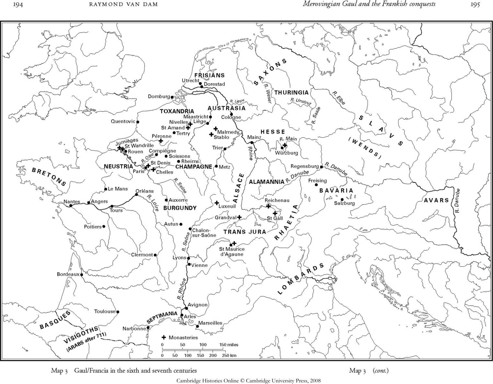

# 第8章 · 墨洛温高卢与法兰克征服

晚期罗马帝国几乎没有任何迹象表明，早期中世纪欧洲的未来将系于法兰克人之身。从三世纪后期起，文献资料中称为法兰克人的日耳曼人便与其他蛮族一道，挑战罗马在高卢的统治。这些法兰克人包括先前定居于莱茵河下游以北和以东地区的各个族群。尽管敌对行动持续不断，到四世纪初，一些法兰克人已被重新安置于罗马帝国境内的高卢北部各地。尤其是，到该世纪中叶，萨利安法兰克人已定居于托克桑德里亚，即莱茵河诸入海口以南的一个地区。作为回报，法兰克人提供兵员，有时是整支的部队，在地中海世界的罗马军队中服役。法兰克人也开始充任军官，与其他日耳曼人一样，其中一些人升至重要将领之位，左右帝国政治。例如，法兰克人博尼图斯曾在四世纪初的内战中支持皇帝君士坦丁；其子西尔瓦努斯学会了“罗马文化”，皈依基督教，并在高卢担任将领。355年在皇帝君士坦提乌斯的宫廷遭人诬告诽谤之后，西尔瓦努斯甚至在科隆短暂自立为僭主——这是查理曼之前唯一的法兰克人皇帝。法兰克人里西默成为东方的军队总司令，也是帝国各地显贵的朋友；其侄阿尔博加斯特则作为西部帝国的军队总司令，继续沿北部边疆讨伐其法兰克同胞，并率罗马军队最后一次成功渡过莱茵河远征。阿尔博加斯特是个极具威慑力的人物，以至于逼得年轻的皇帝瓦伦提尼安二世走上了绝路，随后又拥立欧根尼乌斯与狄奥多西争夺帝位，后者最终于394年击败了他们。无论是作为敌人、兵员还是雇佣兵，法兰克人从一开始就以战士的形象出现在罗马帝国之中：“甚至在孩提时代，他们对战争的热爱便已 fully-grown（发育成熟）”。^1

军事服役并非法兰克人与罗马人之间的唯一联系。由于罗马帝国的边界历来是相互交往的地带，而非不可逾越的线性壁垒，法兰克人的定居不过是将一直在进行的蛮族化进程延伸到了高卢北部乃至中部。^2 尽管四世纪的大部分时间里帝国宫廷设于特里尔，高卢北部还是逐渐脱离了罗马的影响。五世纪初，罗马行政机构最终承认了这些离心的文化与社会力量，南迁至阿尔勒。法兰克人利用无政府状态扩展自己的优势。411年，一些法兰克人支持莱茵兰地区的僭主约维努斯；另一些则劫掠了特里尔；一个名叫克洛吉奥的无名法兰克酋长一度短暂夺取康布雷与阿拉斯；451年，法兰克人协助罗马将领埃提乌斯击败阿提拉及其匈人联盟。^3 由于罗马官吏不再常驻高卢北部和中部以提供中央权威的表象，高卢贵族与罗马将领便同蛮族酋长一道各自伸张地方影响。五世纪中叶，埃吉迪乌斯——一个高卢本地人，名义上仍是罗马将领——建立了一个以苏瓦松为中心的割据公国，甚至高卢北部的一些法兰克人也接受他为自己的“王”；其子西阿格里乌斯继承了他，头衔是一个奇妙的混合体：“罗马人的王”。^4 在特里尔，阿尔博加斯特（可能即那位将领阿尔博加斯特的后裔）于470年代以一个显然自治的“伯爵”身份实行统治。尽管阿尔博加斯特是法兰克人，仍有一位主教称赞他写的拉丁文不带“蛮族腔”，另一位主教则称许他接受了基督教。^5 希尔德里克是另一位著名的酋长，显然属萨利安法兰克人，或许曾一度是埃吉迪乌斯对抗西哥特人的盟友。通过短暂的结盟与持续的征伐，他逐步扩展了自己作为军阀在高卢北部的影响，并且很可能取得了对旧罗马行省第二比利时高卢的控制。他在图尔奈的墓葬醒目地纪念了他显赫地位的双重性质：墓中既有法兰克武器，也有罗马钱币、罗马官员的饰物，以及一枚刻有他身穿罗马军装形象的印戒。^6 “法兰克化的”罗马人与“罗马化的”法兰克人，都是高卢北部文化同化——如今又是政治同化——的产物。

克洛维追随其父希尔德里克的好战榜样。他的近邻包括已在高卢东部立足的勃艮第人，以及久居莱茵河上游的阿勒曼尼人。阿勒曼尼人最终被他击败；对于勃艮第人，他则通过迎娶公主克洛蒂尔德建立了联系。他还开始通过夺取西阿格里乌斯的“罗马王国”向高卢中部扩展影响。此时他的新邻居是西哥特人，罗马当局曾将其安置于阿基坦，而他们已逐渐扩张其王国，尤其是在国王尤里克新近的统治时期。起初，西哥特人以及意大利的近亲东哥特人似乎曾试图将克洛维纳入其政治势力范围：他的一个姊妹嫁给了东哥特国王狄奥多里克，另一个则皈依了哥特人的阿里乌派。但克洛维本人始终与西哥特人保持距离，时而交战，时而谈判，直到507年终于在普瓦捷附近的武耶将其击败。^7 当一支法兰克人与勃艮第人的分遣部队围攻纳博讷与阿尔勒时，克洛维挺进南高卢，在波尔多过冬，夺取了西哥特人在其旧都图卢兹的财宝，并攻占昂古莱姆。在高卢北部的军事地带，其父希尔德里克曾披上罗马将领的某些装束并承担帝国官吏的职责。而在造访了罗马化程度更深的高卢南部社会之后，克洛维于508年回到图尔，在那里他不仅接受了拜占庭皇帝阿纳斯塔修斯授予的名誉执政官的委任状（或许还有贵族的头衔），而且身着紫袍、披风并戴上王冠，如皇帝一般举行游行。^8 随后他将住所定于巴黎，恰好处于北方法兰克人定居地与其新取得的中部高卢罗马地区之间的交界处。

此外，克洛维还以典型的血腥方式巩固他对法兰克人的控制。拉格纳哈尔是他的亲戚，本人是康布雷的王，曾在对抗西阿格里乌斯的战役中帮助过他；克洛维后来却以谋杀他及其两个兄弟来报答这份情谊。查拉里克是另一位法兰克王，在克洛维与西阿格里乌斯的战争中保持中立；克洛维先强迫他及其子出家为教士，最终也把他们杀了。西吉贝尔特是另一位亲戚，科隆的莱茵兰法兰克人之王，曾助克洛维对抗阿勒曼尼人；其子克洛德里克则助克洛维对抗西哥特人。克洛维后来唆使克洛德里克弑父，然后又为西吉贝尔特复仇，杀了这个儿子。通过铲除对手，克洛维得以建立后来所称的墨洛温法兰克王族王朝；511年他去世时，只剩他自己的儿子们作为继承人。^9 他们继承的已是一个大国，因为通过击败或支配周边的蛮族王国，他们的父亲已将其影响扩展至高卢的大部分地区。但尽管克洛维竭力铲除任何可能成为对手的亲戚，他的儿子们和孙子们仍以内部阋墙延续着家族纷争。当图尔的格里高利在六世纪末开始撰写其《史集》时，他指出该隐是第一个杀死兄弟的人。^10 早期的墨洛温诸王则确保他不是最后一个。

## 法兰克诸王国的形成

格里高利卷帙浩繁的著述是关于早期法兰克王国迄今最重要的史料来源，尤其是他的《史集》提供了基本的叙事框架，将书信、诗歌、编年史、圣徒传、神迹故事、教会法规、法典、铭文、钱币以及考古证据串联起来。本章后续各节在讨论法兰克诸王国的形成、王权的运作、贵族与主教的角色以及墨洛温统治的限度时，都会用到他的著述。不过，格里高利本人主要关注的是基督教在高卢的扩展与成功，因此他在《史集》第一卷末尾写到397年主教马丁的去世——他是格里高利本人教区的主保圣人，格里高利认为正是他将基督教传播到了高卢中部。但由于克洛维的受洗似乎也使他变成了天主教基督教的另一位捍卫者，格里高利便以这位国王之死结束第二卷。尽管克洛维的冷酷无情无可否认，格里高利仍将他描绘为一位“行正直之事、做耶和华眼中喜悦之事”的旧约君王。^11 这一基督教君王的形象笼罩着格里高利对克洛维之子与孙辈诸王统治的评价；很少有人达到期望。

提乌德里克是克洛维与一名情妇所生的长子，早已参与其父的征伐，且已有一子；但由于显然没有长子继承制的预期，继承的先例也很少，他最终与三个年幼的异母兄弟瓜分了克洛维的王国。克洛蒂尔德通过确保自己亲生儿子们的份额，不仅在丈夫遗产的直接分割中，而且在为后续分封确立模式上，都发挥了决定性影响。提乌德里克得兰斯；克洛维与克洛蒂尔德所生的三个儿子中，克洛多梅尔得奥尔良，希尔德贝尔特得巴黎，克洛塔尔得苏瓦松。因此每个儿子都在北中部高卢这一法兰克利益的核心地带获得一座“都城”；每个人还拥有一片小王国，与其说是由地理、民族志或旧罗马行省边界连贯界定的区域，不如说是一批城市的集合。^12 提乌德里克的王国包括高卢东北部、勃艮第王国以北的城市，以莱茵兰为核心。克洛塔尔的王国自苏瓦松向北延伸至莱茵河口，包括萨利安法兰克人久居的地区。希尔德贝尔特的王国包括高卢西北部的城市。克洛多梅尔在中部高卢的王国位于勃艮第王国以西，穿过阿基坦北部一直延伸到大西洋。即便不计各位国王另行控制的中部与南部阿基坦分散的城市飞地，这些小王国的建立也加剧了罗马行政崩溃所造成的政治碎裂。

这些王国的边界也并不稳定。战争是主要的动摇因素；如果说墨洛温诸王起初选择主要与其近邻蛮族交战，联姻则实际上使许多这类战争演变为扩大的家族仇怨。克洛蒂尔德怂恿其子克洛多梅尔杀死她的表亲西吉斯蒙德——一位勃艮第王，其父曾杀死她的父亲；西吉斯蒙德之弟戈多马尔随即于524年杀死克洛多梅尔。相比之下，由于提乌德里克娶了西吉斯蒙德之女，他拒绝协助异母兄弟对抗戈多马尔；但由于其子兼继承人提乌德贝尔特参与了最后的战役，他于534年得以与叔父们分享对勃艮第王国的瓜分。提乌德贝尔特得到王国北部的城市，希尔德贝尔特得到中部（包括里昂与维埃纳），克洛塔尔得到南部。提乌德里克以及最终克洛塔尔也开始插手图林根人的事务——后者居于莱茵河以东的德意志地区——以及定居于更北面北海沿岸的撒克逊人的事务。撒克逊人在某个时候开始向提乌德里克及其继承者纳贡，并可能连同弗里斯人一道协助抵御丹麦人的劫掠。某次战役之后，克洛塔尔掳走了图林根公主拉德贡德，提乌德里克则谋杀了她的叔父。尽管克洛塔尔最终娶了拉德贡德，但当他因图林根人协助撒克逊人叛乱而最终蹂躏图林根时，仍然杀死了她的兄弟。因此，获取勃艮第王国将法兰克人的控制扩展到了旧罗马高卢残存的大部分地区，而瓜分则导致现存法兰克诸王国的重新布局；对图林根人和撒克逊人的征伐则为法兰克人其后向德意志东北方向的扩张确立了先例。^13

由于最初诸王国的扩张颇为随意，加上他们在阿基坦的分散利益，几乎所有的墨洛温国王最终都与西班牙和南高卢的西哥特人、或意大利与高卢东南部的东哥特人比邻。对于哥特人，法兰克人将偶发的入侵与外交相结合。四位国王刚继位，便同意将一位姊妹嫁给西哥特王阿马拉里克，但这并未阻止希尔德贝尔特最终进攻这位新姻兄。提乌德里克与克洛塔尔派儿子们去夺取西哥特人在南高卢的属地；约十年后的541年，希尔德贝尔特与克洛塔尔入侵西班牙并围攻萨拉戈萨；此役失利后，法兰克人近一个世纪未再入侵西班牙。与此同时，所有墨洛温国王都声讨东哥特王提奥达哈德，因其纵容了对克洛维侄女——伟大的东哥特王狄奥多里克之女——的谋杀。一旦皇帝查士丁尼派遣拜占庭军队重新征服意大利，东哥特人便于536—537年冬与法兰克人谈判求援，同意割让普罗旺斯以及由阿勒曼尼人定居的莱茵河上游地区。然而提乌德贝尔特最终仍于539年率军进入意大利北部，与东哥特人和拜占庭人同时交战；几年后再次入侵时，他从意大利西北部的部分阿尔卑斯地区索取贡赋；同时他还向拜占庭人勒索津贴。^14 某个时候，法兰克人还支配了阿尔卑斯山以北的巴伐利亚人。^15 因此，在逐步整合高卢东北部这片地理上最为连贯的王国的过程中，提乌德贝尔特还将其利益扩展到意大利北部和莱茵河彼岸；克洛塔尔的兴趣则更广泛地指向撒克逊与图林根；他和希尔德贝尔特还入侵了西班牙。尽管墨洛温家族与其许多蛮族邻居有姻亲关系，他们也常与其交战；正如克洛维通过谋杀法兰克亲戚建立家族王朝一样，他的继承者也常常以牺牲新姻亲为代价扩张王国。与墨洛温家族联姻更像开战的信号，而非和平的保证。

但分歧的对外利益并不足以阻止克洛维的儿子们和孙子们内部相争。524年，提乌德里克蹂躏了试图转而效忠希尔德贝尔特的奥弗涅，并在与克洛塔尔共同出征图林根之际密谋对付他。希尔德贝尔特与克洛塔尔合谋，通过谋杀克洛多梅尔的两个幼子、并允许第三个儿子出任教士，成功夺取了亡兄王国的大部分。但在533年未能阻止其侄提乌德贝尔特继承其父提乌德里克的王国之后，希尔德贝尔特转而将提乌德贝尔特当作亲生儿子看待，并联手进军讨伐克洛塔尔。然而几年后，希尔德贝尔特与克洛塔尔又一同围攻萨拉戈萨。548年提乌德鲍尔德继承其父提乌德贝尔特；555年提乌德鲍尔德死后，克洛塔尔既吞并了这位侄孙的王国，又占有了他的妻子。希尔德贝尔特继续通过联结克洛塔尔之子克拉姆恩来算计其兄，并利用克洛塔尔与撒克逊人的战争攻占他的一些城市。558年希尔德贝尔特死后，克洛塔尔夺取了其兄的王国，并将其妻女放逐。随后他在战场上击败了自己的儿子克拉姆恩，将其连同家人烧死。墨洛温诸王之间这种充满杀戮的亲属关系，本身就足以使其邻居们有理由抱怨他们的残暴与背信。^16

克洛塔尔对待亲人的冷酷不亚于克洛维；他也像其父一样，如今在统治下重新统一了法兰克王国。这次统一仅持续到561年他去世，他的四个在世之子随即重新开始上一辈的仇怨。在瓜分王国时，他们最初也沿袭先祖之例指定都城：夏里贝尔特得巴黎，贡特拉姆得奥尔良，希尔佩里克得苏瓦松，西吉贝尔特得兰斯。他们的王国大体自都城向外辐射——夏里贝尔特向西和西南，希尔佩里克向北，西吉贝尔特向东北——同时也包括阿基坦的城市飞地。四位新王没有一位长久满足。由于贡特拉姆的王国如今包括旧勃艮第王国和普罗旺斯大部，实际上阻断了西吉贝尔特通往其南高卢领地之路。希尔佩里克立即利用西吉贝尔特出征图林根讨伐阿瓦尔人（他们控制着匈牙利平原）之机夺取了兰斯；西吉贝尔特回师后暂时夺取了苏瓦松，并俘获希尔佩里克之子提乌德贝尔特，后者甚至被迫宣誓效忠。567年夏里贝尔特死后，在世的三兄弟不仅瓜分了他的王国——希尔佩里克得到其位于高卢西北部的核心地带——还瓜分了巴黎，如今各持三分之一权益。

由于511年和561年两次瓜分后不久便有一位国王死去，早期墨洛温高卢通常并存三个分王国。夏里贝尔特死后出现的三个王国，其地域认同与文化认同具有持久的影响。高卢东北部的王国有时径称“法兰西亚”；它也被称为奥地利或奥斯特拉西亚（后者是现代史家常用的名称）。^17 尽管其最初的都城是兰斯，但由于东部征伐的缘故，西吉贝尔特及其继承者越来越多地驻于梅斯，以及莱茵河畔的科布伦茨和美因茨。随着重心渐次东移，奥斯特拉西亚的核心地带开始与莱茵兰法兰克人旧王国的范围趋于重合——后者直到六世纪初才接受克洛维为王。事实上，墨洛温家族以 some sons 命名为西吉贝尔特——即那位莱茵兰法兰克人的前王之名——以此对法兰克人残存的影响作出明确让步。由于奥斯特拉西亚控制着奥弗涅，这个王国始终向南方法兰克人及其古典文化敞开影响。但鉴于其对撒克逊、图林根和阿勒曼尼亚等旧罗马帝国以外地区的利益，王国也日益“日耳曼化”；因此西吉贝尔特曾率“莱茵河彼岸诸族”的军队进击希尔佩里克，其孙提乌德贝尔特二世也曾集结“撒克逊人、图林根人以及其他莱茵河彼岸诸族”的军队。^18 相比之下，希尔佩里克原本以苏瓦松为中心的王国，其形状在不断的获取与削减过程中剧烈变动。其王国的遥远前身包括萨利安法兰克人在高卢北部的最初定居地、西阿格里乌斯的罗马王国，以及希尔德里克向北中部高卢扩张所获取的城市；希尔佩里克本人则始终觊觎巴黎。但他死后，鲁昂成为主要的王室驻地，到七世纪初，其子克洛塔尔二世的王国已被称为纽斯特里亚，主要集中于高卢西北部，“位于高卢边缘、毗邻【大西洋】”。^19 一旦克洛塔尔二世于613年扩展其影响，巴黎最终成为纽斯特里亚的都城。与此同时，以奥尔良为中心的王国变化最大。511年之后，克洛多梅尔的王国曾延伸至高卢西部；但561年之后，贡特拉姆的王国向奥尔良以东和以南延伸。它之所以获得独立的认同，很大程度上是因为它复兴了一个先前的独立王国。由于贡特拉姆越来越多地驻于索恩河畔沙隆，其王国的重心逐渐与先前以罗讷河与索恩河交汇处为中心的勃艮第王国相似。因此尽管国王与王驻地有变，三个各具特色的“法兰克王国”——奥斯特拉西亚、纽斯特里亚与勃艮第——终究形成。阿基坦或许可以算作第四个，尤其因为它本身也是五世纪后期高卢涌现的另一个蛮族王国的基础。西哥特人败亡之后，阿基坦起初大致保持完整，它与克洛维在高卢西北部利益的结合，暗示了一种可能性：由克洛维支配西部高卢，而东部高卢则自北向南由莱茵兰法兰克人、勃艮第人和东哥特人支配；因此511年克洛维在奥尔良召集的宗教会议上，与会的所有主教要么来自阿基坦，要么来自后来成为纽斯特里亚王国的地区。但克洛维死后，阿基坦的城市被北方的各位墨洛温国王瓜分，与旧勃艮第王国不同，旧西哥特王国再无机会重新凝聚为一个法兰克王国。由于王室死亡与仓促的婚姻导致阿基坦诸城的瓜分不断变动，567年之后的二十年间，仅以卡奥尔为例，其控制权便在五位国王与两位王后之间辗转。^20 六世纪该地区的根本特征就是政治碎裂。世纪末执笔的图尔的格里高利从未提及一个“阿基坦”。

阿基坦的利益冲突引发了更多的内战；纽斯特里亚王国的孤立位置也是如此。与其兄弟们一样，希尔佩里克也曾与弗里斯人、撒克逊人和丹麦人等北方邻居交战；但由于其王国的核心在高卢西北部，他只能通过对抗兄弟们来扩充资源。在他派其子提乌德贝尔特入侵属于西吉贝尔特的图尔、普瓦捷等城市领地之后，贡特拉姆试图充当调停人，时而联结希尔佩里克，时而联结西吉贝尔特。至575年末，西吉贝尔特已夺取巴黎，提乌德贝尔特则阵亡。然而就在凯旋之际，西吉贝尔特被希尔佩里克之妻弗雷德贡德派来的刺客暗杀。尽管西吉贝尔特的幼子希尔德贝尔特继位为奥斯特拉西亚国王，希尔佩里克之子墨洛维希却通过迎娶其叔父西吉贝尔特的遗孀布伦希尔德而自居为竞争者。但此时轮到希尔佩里克——或许是在弗雷德贡德的怂恿下——感到威胁，于是将自己的儿子剃发以备进入修道院。希尔佩里克本不必担心，因为奥斯特拉西亚的权贵们不久便安排了墨洛维希的死亡。最终，由于疾病与阴谋使贡特拉姆和希尔佩里克都失去了儿子，两人都决定收养年幼的侄子希尔德贝尔特为继承人。希尔德贝尔特的谋士们便趁机挑动他的两位叔父相争，直到584年希尔佩里克也遭暗杀。

在格里高利的圣经视角中，这些国王大多未能效法克洛维；因为他们“未曾在上帝眼前行正路”，上帝便将他们“交在仇敌手中”。但格里高利确实赞赏贡特拉姆——克洛塔尔一世唯一在世的儿子——他自任为侄辈的监护者。他已收养了希尔德贝尔特，而当弗雷德贡德请求保护时，贡特拉姆最终支持其幼子克洛塔尔二世的统治，并最后也收养了他。作为两位侄子的“父亲”，贡特拉姆与克洛塔尔一世相似，在王国中享有“尊位”。^21 于是贡特拉姆迅速试图扩张自己的领地，声索巴黎以及其兄夏里贝尔特曾拥有的整个王国，并夺取克洛塔尔二世王国的部分土地。

作为叔侄，又因收养而成为父子，贡特拉姆与希尔德贝尔特得以大体并行统治。贡特拉姆曾警告希尔德贝尔特有人谋害其性命；587年两人签订了一份盟约，最终确认了各争议城市的分配。^22 然而，双方更广泛的利益仍引发摩擦，部分原因在于几乎任何对外征伐或外交似乎都会侧翼包抄贡特拉姆位于法兰克诸王国中枢的勃艮第王国。作为奥斯特拉西亚国王在中欧利益的另一面，他们曾与伦巴德人建立外交联系乃至部分姻亲关系。但伦巴德人进入意大利之后，希尔德贝尔特利用对意大利北部的间歇性征伐，从伦巴德人和拜占庭人双方勒索津贴与礼物。然而贡特拉姆拒绝援助其侄，尽管劫掠的伦巴德人偶尔袭击其王国的城市。他转而对塞普提马尼亚——南高卢罗讷河与比利牛斯山之间仍在西哥特控制之下的沿海小区——发动了徒劳的征伐；但希尔德贝尔特与布伦希尔德此时却乐于接待西哥特王雷卡雷德的使节。^23 尽管仍是克洛塔尔二世宫廷中主导人物的弗雷德贡德也利用她与西哥特人的联系算计贡特拉姆，贡特拉姆仍准备在巴黎主持克洛塔尔的受洗礼。希尔德贝尔特当时的疑虑是不必要的，因为贡特拉姆死后，他通过继承叔父王国的大部分，确认了奥斯特拉西亚与勃艮第的联盟。592年，只剩下堂兄弟希尔德贝尔特与克洛塔尔二世为墨洛温诸王；但此时他们的影响已从属于其母亲布伦希尔德与弗雷德贡德之间的对抗，以及各自王国中日渐坐大的大贵族势力。

## 法兰克王权的塑造

图尔的格里高利曾对一位能凭记忆背诵旧约中“多数人觉得难以记住”的复杂世系的主教印象深刻；^24 而现代读者面对早期墨洛温家族令人眼花缭乱的阴谋诡计，恐怕也会有同样茫然的反应。尽管阴谋不断，六世纪的墨洛温家族还是在高卢大部分地区逐渐确立了一种王权——或者不如说数种王权——融合了不同传统的要素。其一是日耳曼传统。^25 墨洛温家族或许以武力建立并维系王权，但随后各种仪式与象征将其与民众区分开来。王权通常的仪仗包括宝座、长矛和盾牌；贡特拉姆收养希尔德贝尔特时，让他坐上自己的宝座，并示意一面盾、一杆矛护卫他们两人。^26 最显眼的区分象征是国王的长发。尽管图尔的格里高利对“长发诸王”出自法兰克人“最尊贵显赫家族”的解释过于简单而不甚明了，这一标志却成为王权有形的徽记，将其与“四周剪发”的臣民区分开来。克洛维曾把教会剃发当作阉割某些对手的手段；王位觊觎者必须等待长出必需的长鬈发；一具已腐尸骸头上的长发，使人得以辨认出那是希尔佩里克王的一个儿子。^27 王后克洛蒂尔德深知长发对她所嫁入的墨洛温家族意味着什么：某次面对剑与剪刀、被迫裁决几个孙辈的命运时，她坦言宁可一死也不肯剪发。六世纪中，墨洛温国王为儿子使用的唯一非日耳曼名字，不出所料，是参孙。^28 这些长发诸王还保留着一套价值体系——虽非日耳曼所独有，却无疑暴露了他们出身边疆地带的背景。为维护权威，法兰克诸王必须证明自己“强势压人”，尤其是在保护亲族和赢得战斗胜利方面。因此，尽管两人曾交恶，希尔佩里克遇刺后，贡特拉姆仍认为自己必须复仇：“若今年我不为我兄弟之死复仇，我就不配称为男人。”诸王担心自己显得像“软弱的女人”；反过来，布伦希尔德王后曾“像男人一样武装自己”以制止一场战争，弗雷德贡德王后则因建议其部队伪装成树木而赢得一场军事胜利的美名。^29 由于军事成功与雄性气概的意识形态巧妙地强化了王权的战士象征，意大利诗人福图纳图斯得以精明地以一个人人艳羡的头衔——Victor（征服者）——开篇为其第一部献给墨洛温国王的颂词，从而确保自己在法兰克宫廷受到欢迎。^30

影响早期法兰克王权性质的第二个传统是圣经传统。^31 尽管到五世纪，正统基督教已在高卢罗马人中提供了一种主导的世界观，法兰克人向高卢扩张时仍保持其异教崇拜，甚至到六世纪他们仍继续在异教圣所祭祀，尤其是在高卢北部。但克洛维最终皈依了正统基督教，由兰斯主教雷米吉乌斯为其施洗。作为回报，基督教教士开始将法兰克诸王比作旧约诸王。如前所述，格里高利经常援引这一圣经典范来说明墨洛温家族，其友人福图纳图斯甚至盛赞夏里贝尔特王兼具大卫的仁慈与所罗门的智慧。其他主教则明确称墨洛温诸王为“天主教君王”，或许是对他们应如何对待教会的一种委婉告诫。有些言论则是较为露骨的威吓：普罗旺斯的一位主教曾提醒提乌德贝尔特勿忘末日审判，届时一位“基督教领袖”须向上帝交账。^32

但这种圣经类比虽使墨洛温诸王更易为罗马基督徒人口所接受，却也给诸王自身带来了两难。在当时的书信中，雷米吉乌斯建议战士克洛维转而看顾寡妇与孤儿；维埃纳主教阿维图斯则劝国王以其甲胄换取“救恩的头盔”；据较晚的传统，雷米吉乌斯还称许过克洛维的“温顺”。^33 格里高利不断提醒墨洛温诸王：唯有展现仁慈与善良，他们才成为“好王”；而他们最珍视的战场武勇，实际上正是高卢社会中最具破坏性的东西。福图纳图斯——他后来成为教士并最终任普瓦捷主教——也强调，成功须以“不事杀戮的统治”为前提。^34 这些剃发教士的圣经理想显然与长发诸王的战士信条相冲突。因此，影响早期法兰克王权塑造的第三个传统，是罗马——亦即如今的拜占庭——皇帝的先例，他们将基督教信仰与军事胜利的意识形态相结合。^35 君士坦丁早已树立了凯旋的基督教皇帝的榜样，而克洛维受洗时显然被颂为“新君士坦丁”。战胜西哥特人之后，克洛维甚至在图尔摆出某些帝国排场，被欢呼为“奥古斯都”。福图纳图斯进一步提供了墨洛温诸王与罗马皇帝之间的比附。由于他在北意大利——查士丁尼皇帝的军队刚从东哥特人手中重新征服之地——长大，他熟知拜占庭文化及其关于皇帝的政治理论。他庆祝西吉贝尔特与布伦希尔德联姻的诗歌，展示了对古典神话的典故与罗马皇帝长期享有的某些美德的混合。在后来的一首颂诗中，他径直将图拉真的虔敬归于夏里贝尔特。在另一首赞诗中，他将希尔德贝尔特比作麦基洗德——那位旧约中的王兼祭司，他已被用来代表拜占庭皇帝的神权诉求。^36

对于习惯于皇帝与官吏的罗马人，以及习惯于小酋长的法兰克人而言，构想“王”并非易事；整个六世纪，这种相互竞争的观念的混合如同高卢城市迎接国王驾临时使用的嘈杂纷乱的多种语言一样 simmering 不息。^37 在一个异质社会中确立王权还面临其他更实际的困难。尽管克洛维及其继承者铲除了敌对的法兰克王族，却无法化解自己家族内部的紧张。接二连三的婚姻与纳妾产生了众多兄弟、异母兄弟与堂兄弟，他们与父亲、叔父相互竞争，彼此倾轧；而511年初次分地给所有墨洛温诸子所遗留的未决问题，也持续挑战着强势王权的确立。克莱蒙与奥弗涅的早期治理便是这种持续不确定性的一个例证。克洛维死后，提乌德里克继承了克莱蒙，作为其奥斯特拉西亚王国的边远属地。但由于阿基坦诸城划分的随意性，其他国王在该地区也有利益，不忠之风盛行。当有传言说提乌德里克已被杀时，一些当地罗马贵族提议将克莱蒙出卖给希尔德贝尔特王。524年，提乌德里克实施报复。尽管他未能攻克克莱蒙城本身，却纵兵劫掠奥弗涅。随后他留下“以保护为名”的一位亲戚西吉瓦尔德，后者出任公爵。但几年后，提乌德里克让人杀了西吉瓦尔德，并试图说服其子提乌德贝尔特也杀了西吉瓦尔德之子。擢升一位亲戚——尤其是在边远城市——对墨洛温国王的权威而言或许仍是过分的挑战。555年，克洛塔尔继承了克莱蒙，立即派其子克拉姆恩赴奥弗涅。克拉姆恩很快便表现得像个自主的国王：任命新伯爵并恐吓主教。但当克拉姆恩夺取普瓦捷与利摩日“以自专领主之权”时，其父派另外两个儿子讨伐他，最终将他处死。^38 在边远地区擢升一子同样暗藏着对墨洛温国王的挑战可能性，尤其是在位过久的国王，尤其是当地贵族舍父而拥子之时。然而有时国王别无选择。贡特拉姆再婚时，将一位前情妇所生之子派往奥尔良；希尔德贝尔特二世后来也应当地权贵之请，将一名幼子派往苏瓦松与莫城。格里高利将克洛塔尔与克拉姆恩之战比作押沙龙的僭乱——又一位长发的王室之子！——精当地概括了墨洛温诸王努力巩固权威时所面临的两难。^39 尽管多重宫廷的存在通过阻碍地方贵族自立为自主统治者而保全了墨洛温家族的统治，却也加剧了墨洛温家族内部仇怨的可能。

每位墨洛温国王都通过任命官吏扩展王权——“伯爵、内侍、宫相、监护官以及推行王室控制所需的其他一切人员”。服务于宫廷的官员包括宫相、宫廷伯爵、马厩伯爵和内侍，他们都可兼任将领、法官或使节；掌玺秘书（referendarii）——保管国王印戒的秘书——以及速记员和文书；还有管理王室财库的总管。由于墨洛温诸王常常统军征战，或在各处行宫与庄园间巡行，这些廷臣既是旅伴，也是王室的代理人与行政官。其他王室官吏则在宫廷之外任职。由于墨洛温诸王国并不遵循旧罗马行省的边界，罗马帝国残存下来的最大行政单元是城市——每座城市通常仍包含一个城镇中心及其周围广大的乡村腹地。对于其治下的许多城市，国王任命伯爵，负有多种职责，包括司法、征税，以及征募并常常统率当地兵员。国王还任命公爵，他们常常统率军队，有时出任使节，但不久便成为王国中较大区域的地方行政官。六世纪，奥斯特拉西亚诸王任命了香槟公爵、图赖讷与普瓦图公爵、东阿基坦（尤其是奥弗涅）公爵，以及马赛与部分普罗旺斯的公爵。纽斯特里亚诸王任命了苏瓦松及周边地区公爵、索姆河与卢瓦尔河之间地区的公爵，以及图卢兹和包括波尔多在内的部分阿基坦的公爵。勃艮第诸王任命了奥尔良及周边地区公爵、阿基坦一批城市的公爵，以及阿尔勒与部分普罗旺斯的公爵。在普罗旺斯，长官通常以rectors、prefects或patricians（长官、总督或贵族）等罗马头衔相称。公爵通常监督其区域内的伯爵——至少品级更高——尽管奥斯特拉西亚大部与普罗旺斯很少有伯爵。因此，由于这些王室行政混合了新旧要素，它们必然既不系统也不统一。在高卢塑造并推行一种墨洛温行政体制，是贯穿整个六世纪的持续过程。^40

墨洛温王权还依赖于诸王积累财富的能力。敌对与战争是两个重要来源。征战期间诸王积累大量战利品，一些邻居战败后缴纳贡赋。他们的财富部分也来自高卢境内或多或少的系统岁入征收。在接管旧帝国产业、没收政敌与对手的财产、接受大量赠礼之后，诸王首先是大地产所有者，从自己的庄园收取给付与劳役（或消费其产物）。国王的代理人还征收各种通行税与罚金，以及为国王或其代表在司法争端中仲裁所需收取的费用。最后，国王的代理人还向个人以及教会、城市等机构所拥有的土地征税。在某些方面，墨洛温家族似乎延续了旧罗马税制的若干方面，尤其因为其代理人保存着登记册并定期重估。但在权力重新界定的更大背景下，岁入的征收正是诸王向全高卢扩展影响成功与否的精确标尺。由于诸王的军队在全高卢无休止的征战中常常劫掠城市、教会与个人，或许最好将这些税看作掠夺的礼貌形式、威吓与臣服的信物，而非一种正当财政体系确立的标志。纳税是效忠誓词在货币上的对应物，而效忠誓词正是诸王向其控制下的城市所要求的。国王派伯爵赴各城，既为索取效忠誓词，也为征税；反过来，某位伯爵曾造访希尔德贝尔特的宫廷，呈上其征收的税款，称之为“欠付王室财库的臣服之责”。^41

因为墨洛温诸王有时似乎更多将自己视作维护自身利益与产业——无论私产还是公产——的大业主，而非行政层级中的国家元首或首席长官。例如，司法常常成为人们购买的商品，而非由国王及其代理人统一执行一套价值或规章的结果；即便诸王颁布敕令或法典时，他们关心的似乎主要也是模仿罗马皇帝并在臣民中营造共识。^42 他们的王国同样与其说是领土国家，不如说是岁入来源。当贡特拉姆与希尔德贝尔特就各城的瓜分达成协议时，他们似乎更关注岁入而非实际的领土边界，他们对城市的 fractional 权益所代表的正是税款的比例。由于以资源和权益来界定自身与权威，这些国王不得不持续与其他觊觎同一资产者谈判（或开战）。因此，授予财政豁免权的政策便是一种与其他强势权贵和机构的外交形式。教会与圣所请求——有时坚持要求——其财产免税。例如提乌德贝尔特以免除奥弗涅教会的税款来展示其王室的公正与慷慨。由于这些教会与其他各地的教会一样不断获取仍需纳税的财产，六世纪末希尔德贝尔特再度免除了它们的税。克洛塔尔二世似乎最终授予教会与教士一项更广泛的特权，将豁免也及于将来获取的土地。^43 法兰克人同样抵制对其土地征税，因为这可被视作臣服的标志，从而悄然改变他们与国王的关系。因此他们曾用乱石砸死一名对他们强加赋税的王室官吏；一名伯爵强令一些法兰克人缴纳“公共税”之后，这些法兰克人以烧毁其宅邸回应对其“自由”的侮辱。^44 随着“法兰克人”的概念逐渐更多与免税而非族源相关联，获取豁免权便成为融入法兰克人的一种途径。

墨洛温诸王积累财富之后，还必须找到花钱的方式。在罗马帝国之下，皇帝的主要开支是庞大的军队，其大部分军团驻扎于各处边疆。但墨洛温诸王不维持大规模常备军，每次征伐依靠的是地方征募兵、驻军和武装扈从。

若按罗马标准衡量，墨洛温诸王的军队规模相对较小，通常只有数千人乃至数百人；而且由于其征伐——无论在高卢境内还是针对邻邦——产生了大量战利品与可供赎回的俘虏，军队几乎可以自给自足。与罗马军队不同，法兰克诸王及其官吏的军队 moreover 并非用来戍守边远边疆。相反，军事征伐往往只是王室（及贵族）对男子气概与威望之关切的体现，而诸王及其官吏的军队也常常恐吓自己的臣民。一支军队横越高卢西部时所造成的破坏，堪比《圣经》规模的一群蝗虫的肆虐。在图尔的格里高利看来，这支军队不过是又一“天灾”，与霜冻、风暴或干旱无异。在许多方面，墨洛温诸王及其军队似乎把战争当作竞技；因此，当西吉贝尔特的一名支持者撞见希尔佩里克的一个儿子时，“他吹响号角，像追逐一只逃窜的牡鹿一样追逐他”。^45 法兰克人及其诸王显然酷爱追猎，他们的一些小规模军事行动与狩猎远征颇为相似。事实上，克洛塔尔王杀死其子克拉姆恩之后，还曾请求宽恕，随即外出狩猎。而克洛塔尔恰因这次狩猎染上热病而死；其侄提乌德贝尔特在狩猎中因一桩离奇事故身受重伤——被一头野牛撞倒的树压死；希尔佩里克同样是在狩猎时遇刺身亡。六世纪间，在王室仇杀中幸存下来的诸王，更可能死于狩猎而非征战。

由于墨洛温诸王的军费开支有限，他们便用财富来支撑自身的威望与权威。贵重物品的纯粹积累即是其地位的可见表征。希尔佩里克曾以展示其从拜占庭皇帝处获得的金币来震慑格里高利主教；他还向主教展示一面巨大的镶嵌宝石的金盘，称此盘是“为法兰克人民增光”而打造的。于是，诸王以馈赠的方式分散其财富，以确认其与扈从和臣民的关系。为了获取或确保地方贵族的支持，诸王分赐地产与珍宝；鉴于双方对战争与狩猎的共同兴趣，所赠之物往往包括马匹、猎犬、猎鹰，乃至猎号。由于诸王又常将同一批人任命为廷臣、伯爵与公爵，他们显然更多依赖这些个人纽带所生的义务，而非较为非人格化的官僚权威与效率观念，来维系官吏的忠诚。财富是确保这些个人联系、维持王权的手段；当一位国王想吞并另一国王的王国时，其首要之事便是夺取对手的金库。因此，561年克洛塔尔死后，希尔佩里克立即夺取其父的金库，寻访最有势力的法兰克人，试图以馈赠换取他们的效忠。王室金库还包括王室档案，诸王在其中保存馈赠的记录，与其说是为确保法律上的所有权，不如说是为了记录自身影响的扩张与义务关系的建立。^46

凭借财富，诸王还能资助一些高雅文化的装点。虽然图尔的格里高利或许哀叹过文学研究的衰落，事实上，对古典文化的熟稔在高卢——无论在贵族还是教士之中——绝未消失。^47 许多人互通书信；有些人，包括一些主教，以诗人闻名。像福图纳图斯这样曾在北意大利受过正统古典教育的杰出诗人，自然深为叹服，尤其因为这些贵族与主教也主动索求他的作品。他的恩主包括墨洛温诸王，其中一些甚至成功地把自己塑造成博学的君子。克洛维曾请求东哥特王狄奥多里克为他派来一名琴师；两代人之后，希尔佩里克鼓励其国内的男孩受教育，下令重新抄录古书，甚至提议为字母表增加字母。他还尝试作诗，尽管格里高利坦承自己写拉丁文颇为吃力，却仍讥评国王的诗作不合韵律！^48

墨洛温诸王炫耀财富的另一种方式，是资助各城市兴建建筑与创设机构。例如希尔佩里克在其都城苏瓦松和巴黎都修建了竞技场。就后者而言，他不仅是在模仿曾亲临竞技赛会的罗马皇帝的做派，也是在公然违抗其兄贡特拉姆与其侄希尔德贝尔特的威胁，对其已故兄弟夏里贝尔特王国的整个都城提出权利主张。^49 克洛维还树立了支持圣徒崇拜的另一先例。他曾与王后克洛提尔德在巴黎圣热诺维法（圣热纳维耶芙）——一位与他们同时代的苦修者——的墓旁建造一座教堂。他们本人及若干王室后裔都葬于这座教堂，该教堂最终也奉献给“神圣使徒”，或许是仿效君士坦丁堡中第一位基督教皇帝君士坦丁安葬的教堂，以及罗马城显赫的主保圣人圣彼得。如此，克洛维在推广一位地方圣徒崇拜的过程中，公开地将自身及其王朝与罗马帝国诸大都会的帝国意涵联结起来。其继承者又推广了其他崇拜。还是在巴黎，希尔德贝尔特建了一座敬奉圣文森提乌斯的教堂，此人是一位西班牙殉道者，其圣髑显然是希尔德贝尔特征讨西哥特人时获得的。在苏瓦松，克洛塔尔及其子西吉贝尔特建了一座敬奉圣梅达德——努瓦永前任主教——的教堂，希尔佩里克还为这位圣徒作过一首诗。在沙隆（索恩河畔），贡特拉姆为一位默默无闻的地方殉道者圣马塞卢斯建造（或重建）了一座教堂，并对其及一座修道院施以丰厚的捐赠。^50

**贵族与教士**

尽管墨洛温家族在高卢立身为王颇有成就，王权在根本上依然脆弱。诸王与圣徒崇拜的关系提供了最初的线索。墨洛温诸王更愿意资助新圣徒的新崇拜，其中一些——如圣梅达德可以确定，圣热诺维法也很可能——甚至有法兰克祖先。相反，他们难以取悦于根基深厚的旧有圣徒崇拜。人们相信克洛维507年出征西哥特人时有普瓦捷的主保圣人圣希拉里的护佑；但没有任何证据表明，其六世纪的王室继承者曾资助普瓦捷的圣徒教堂或该圣徒在高卢其他地方的崇拜。战胜西哥特人后，克洛维曾造访图尔及圣马丁教堂——晚期罗马与墨洛温早期高卢最显赫崇拜的主保圣人。但克洛维不久便退居巴黎；据一则较晚且很可能出于虚构的故事，国王为从圣徒教堂牵回自己的马不得不付出双倍于预期的价钱，随后承认圣马丁的援助索价甚苛。其王室继承者似乎心照不宣地认同：圣马丁支持的代价太高了。当他们对图尔征税的企图受到质询时，一贯退让并授予豁免。克洛塔尔曾在559年圣马丁教堂焚毁后出资修缮其锡皮新顶，但六世纪间他也是唯一到过图尔、在圣徒墓前祈祷的在位国王。即便其他诸王想请示圣马丁，也不亲自前往。希尔佩里克代之以一封信，置于圣徒墓上，随信附一张白纸供圣徒作答；耐人寻味的是，圣马丁没有回复。整个六世纪，圣马丁崇拜与法兰克诸王并无紧密关联。面对这样一个影响巨大且根基深厚的崇拜，墨洛温诸王确实有所忌惮；他们在巴黎、苏瓦松和沙隆资助自己偏好的圣徒崇拜，实际上在图尔的圣马丁权力中心与其自身在北高卢、东高卢的主要利益之间，筑起了一道圣所缓冲带。^51

这种对圣徒崇拜的矛盾心态，也再现于诸王与主教之间的紧张关系。诸王常试图使主教屈从于自己的控制，尤其是干预主教的选任。尽管教士和宗教会议或许一再主张新主教应由民众与教士选出，诸王的意向却日益成为决定性因素。549年，奥尔良一次宗教会议承认了诸王的地位，宣布在选任新主教时，不仅“古代教规”，国王的意愿与教士及会众的选举同样具有效力。作为王室任命者，一些主教与伯爵、公爵一样，甚至向国王宣誓效忠。^52 正如诸王召集显贵举行集会，他们也召集主教召开宗教会议。早在511年，克洛维便召集众多主教至奥尔良开会，众主教恭称他为“天主教教会之子”。其后的诸王试图通过颁布自己的敕令来强化（并据有）宗教会议的决议。^53

但主教们面对王室对教政事务的干预并非全然被动。首先，强大主保圣人的支持也使主教本身成为自主的、至少令人生畏的人物。如前所述，历代国王曾多次进军克莱蒙。然而524年，提乌德里克王先听说环城的圣徒教堂犹如“巨大要塞”，又听说该城主教“在上帝面前大有影响力”，便迅速撤军。倘若法兰克诸王可比作以色列诸王，那么主教便相当于劝诫他们的先知；因此图尔的格里高利一针见血地指出：所罗门虽为诸王中最智慧者，其王位仍须归功于一位先知的支持。当福图纳图斯将拜占庭帝国意识形态套用于希尔德贝尔特时，他也谨慎地通过强调国王行其“宗教之事”（此处即资助巴黎大教堂）时仍是一介俗人，来保护主教与教士的权威。主教们不会让诸王忘记：通往圣徒神异之力的门径，唯在他们掌握。贡特拉姆是唯一被认为施行过神异治愈的墨洛温国王；但即便如此，格里高利仍巧妙地改写了这一神迹的意义，指出国王不过是“像一位好主教那样”行事。^54

其次，随着罗马行政体系的崩溃，主教已成为重要的地方领袖，部分原因在于其主教座区与教区同城市及其辖境重合。罗马军队消失之后，教会不仅是墨洛温高卢最庞大的机构，其影响显然还超越王国的边界。其主教经常在行省与地区宗教会议上相聚，其教阶体系包括数以千计的司铎、执事及低级教士。事实上，服务于十五位左右的大主教和一百多位其他主教麾下的教士，恐怕与两三处王家宫廷各自的官吏人数相当。此外，由于主教还管理着其教会与圣所名下往往为数众多的地产与庄园，他们也完全有资格声称端坐于各自大教堂的“宝座”之上。希尔佩里克王有一次盘点教会财富时，曾略带无奈地抱怨说，只有主教在其城中“称王”。这些巨大资源使主教得以承担众多社会与市政职能。他们出资兴办大量工程，最显见的当然是教堂与圣所；他们资助医院、收容所与济贫院；他们还赎买奴隶与囚徒。^55

最后，高卢的许多主教出身古老的罗马贵族世家，这些家族将出任教阶体系中的职务作为维系地方影响的又一策略。他们中的一些人不仅有可远溯至罗马时期的显赫谱系，而且许多人所属的家族自五世纪起便已把持特定主教座区。六世纪初，一位罗马贵族的妻子宣称自己“怀着一位主教”，她坦率道出的不仅是自己家族、更是众多古老罗马贵族世家的期望。尽管王室政局变幻，她的预言也终成事实；其夫曾谢绝勃艮第王贡多巴德对其出任日内瓦主教的任命，而她的儿子则在法兰克王希尔德贝尔特的支持下，继其叔父之后出任里昂主教。“家族座区”的出现，由此对诸王任命主教的权力构成了无形的限制。^56

此外，一些主教本人先前曾任王室官职，其亲属也仍以官吏、顾问或统帅的身份效力于法兰克诸王。罗马贵族显然并未消失。尤其在中高卢和南高卢，若干曾在罗马帝国崭露头角、继而在西哥特与勃艮第统治下维持其地位的家族，在法兰克人治下直至六世纪仍保持影响。不仅定居于卢瓦尔河以南的法兰克人为数甚少，而且墨洛温诸王在这些地区也常任命罗马贵族出任伯爵。例如，尽管克莱蒙与奥斯特拉西亚王国关系密切，六世纪可考的伯爵中除一人外皆为当地罗马贵族家族成员；在图尔，希尔佩里克王还一度允许民众自行选举其伯爵。即便在北高卢，罗马贵族也颇为兴旺，如艾留泰里乌斯，他在出任图尔奈主教之前曾任伯爵。^57 直至七世纪初，罗马贵族还主宰着特里尔、科隆和美因茨等北方重镇的大主教座区。罗马人也开始与法兰克人通婚，并采纳其习俗与命名方式。尽管包括墨洛温家族在内的法兰克上层学得了古典文化，四世纪以后他们不再取罗马名字；相反，日耳曼名字在罗马人家族中日益常见。例如图尔的格里高利有一位名唤贡杜尔夫的叔祖，生于六世纪初。法兰克新主子对狩猎与战争的嗜好甚至影响了保留拉丁语名字、或至少拉丁—日耳曼混合名字的罗马人；因此，曾在西吉贝尔特与希尔德贝尔特麾下出任公爵的罗马人卢普斯（“狼”），有一位兄弟名马格努尔夫（“大狼”），还有一个儿子名罗穆尔夫（“罗马狼”），后者成为兰斯主教。^58

除这些罗马贵族之外，墨洛温诸王还须应付其他有权势的显贵——尤其在北高卢——他们来自诸王最初的法兰克追随者、其他法兰克人集团，或新近才纳入墨洛温统治的非法兰克各族。随着获得土地与官职，这些人也逐渐转化为地方贵族——“以门第显赫之人”、“居首之人”、“族中最尊贵者”、“在宫廷中有影响力者”。法兰克人中贵族阶层的发展过程虽仍晦暗不明，但格里高利所用的这些描述——尽管不甚精确——已着重指出某些家族的成员生而享有的特权。这些法兰克显贵也步罗马贵族的后尘，积累对土地的控制与占有。他们的许多地产与庄园通过购买或没收取得，也有一些是墨洛温诸王的封赐；这些土地随后经由继承与婚姻在家族成员间流转。贵族积累了大量财富。例如公爵夫人——劳辛之妻——佩带着珠宝金饰招摇过苏瓦松；而劳辛本人的财富之巨，令希尔德贝尔特王的扈从惊叹，竟超过王室金库。此外，法兰克贵族还招纳依附者，在仇杀与战斗中作为武装扈从效忠其主。在许多方面，这些新兴贵族家族不仅酷似古老的罗马贵族世家，也酷似最成功的法兰克家族——墨洛温家族；他们与之宴饮、狩猎、交战，有时还向其提供妻室。国王与贵族锁结为相互依存的伙伴关系，彼此撑持。^59 国王需要贵族出任官吏、顾问、将领与士兵，而贵族则仰赖国王赐予土地、官职与声望。然而贵族与国王同时也在争夺同样的有限资源，尤其是对土地与依附者的控制；主教们作为教会土地与财产的管理者，同样等同于大地产所有者。于是，有权势的主教与有权势的贵族——无论罗马人还是法兰克人——与墨洛温诸王共享政治舞台，有时甚至独占风头。

国王、贵族与主教之间的互动，早在奥斯特拉西亚已见端倪。克洛维死后，提乌德里克继承了兰斯王国，不久便派其子提乌德贝尔特赴南高卢征讨西哥特人。提乌德贝尔特在当地结识的一些罗马贵族，在他即位后成为其顾问或官吏。其中之一是帕尔特尼乌斯，其先祖与亲属中包括一位前皇帝、一位前罗马城市行政长官，以及中、南高卢的数位主教。他本人曾在拉文纳求学，后以罗马的贵族头衔返回提乌德贝尔特的宫廷。或许由于这些罗马顾问的影响，提乌德贝尔特开始滋生帝国式的抱负。他是第一位侵犯帝国特权的法兰克国王——铸造印有其本人肖像的金币；他入侵意大利；他还客气地告知东罗马皇帝查士丁尼：其王国也包括莱茵河与多瑙河之间的许多民族；据说他甚至曾考虑横越中欧进攻君士坦丁堡！提乌德贝尔特因此是北高卢又一个“罗马化的法兰克人”的例证；事实上，534年即位时，他与罗马籍妻子已育有一子。^60

但由于其父死后叔父们密谋反对他，提乌德贝尔特的继位主要仰赖其leudes——以效忠誓言与他绑定的法兰克支持者——的保护。这些扈从很可能也属于不久后迫使提乌德贝尔特抛弃罗马籍妻子、改娶伦巴德公主的法兰克人之列；他们最终还因帕尔特尼乌斯向其土地征税而将他私刑处死。提乌德贝尔特之子及继承者提乌德巴尔德或许是半个法兰克人半个罗马人，但起初左右其宫廷的同样是权势煊赫的法兰克人。阿基坦的主教们心中有数：551年他们会商为克莱蒙遴选新主教时，所关心的不是国王的意向，而是其“权贵与首要之人”的意向；事实上，后者确实强加了自己的人选。^61 因此，提乌德巴尔德是年轻的国王在贵族支配之下实际无权的一个早期例证。

然而，并非所有主教都在这些大贵族面前如此恭顺。提乌德里克留给其继承者的遗产之一，是特里尔主教尼塞提乌斯。尼塞提乌斯于525年在提乌德里克及其他“在宫廷中身居高位之人”的支持下获得其座区。其教士中有来自提乌德里克及其继承者所控制的阿基坦诸城之人；他还与北意大利的教士及一位伦巴德王后通信；他甚至给皇帝查士丁尼写过一封劝诫信。尼塞提乌斯广泛的势力和声望，很大程度上正反映了奥斯特拉西亚诸王在中高卢、中欧和拜占庭意大利的广泛利益。但尼塞提乌斯还在俯瞰摩泽尔河的山丘上建造了一座大堡，以圣徒圣髑（为防不测，还有一架弩炮）加固之。凭借这座堡垒，他的势力足以向历任法兰克诸王挑战，甚至迫使他们变得“更加温顺”。他威胁提乌德里克的支持者，因其纵马践踏贫者的田地；他将一些被控犯有杀人及性行为不端的提乌德贝尔特手下逐出圣餐礼；他多次将克洛塔尔处以绝罚，克洛塔尔则将他放逐以作报复；他还一度宣称，主的使者向他启示了对每位国王统治的评价。他的一位意大利通信者巧妙地承认了尼塞提乌斯多层的影响力，既请他协助与提乌德巴尔德王交涉，又请他协助与天上的诸位圣徒交涉。奥斯特拉西亚诸王的外交联系或许多于其他墨洛温国王，但即便是他们，也无法匹敌尼塞提乌斯与天国之王的宫廷的联系。西吉贝尔特最终似乎明白了其所面对的是什么，因为561年继承奥斯特拉西亚王位后，他立即请求尼塞提乌斯的祝福。^62

权势贵族与主教各派系之间的竞争，在年轻的希尔德贝尔特即位后再度变得格外激烈，尤其是在应当与哪位叔父结盟的争执期间。575年西吉贝尔特遇刺后，贡杜瓦尔德公爵立即宣布希尔德贝尔特为奥斯特拉西亚国王。希尔德贝尔特的首任nutricius（监护人）是戈戈，又一位“罗马化的法兰克人”，他对古典文化的熟稔足以亲自撰写书信与诗篇。^63 戈戈想必属于支持与勃艮第王贡特拉姆结盟的国王“首要之人”之列。但王国中另两位权势人物是兰斯主教埃吉狄乌斯与公爵贡特拉姆·博索。二人都曾是西吉贝尔特的显赫支持者：埃吉狄乌斯为国王试图控制的城市祝圣主教，贡特拉姆·博索则统率杀死希尔佩里克一子的军队；二人显然都不在希尔德贝尔特早期的顾问之列。然而到581年，埃吉狄乌斯已成为希尔德贝尔特宫廷的主导人物，并作为“首要之人”使团的成员，与希尔佩里克谈判缔结新盟。与此同时，贡特拉姆·博索公爵在其他显贵的支持下，邀请自称克洛塔尔另一子的贡杜瓦尔德从君士坦丁堡的流放地返回；贡特拉姆王对这一僭位者的挑战尤为恼怒。埃吉狄乌斯与贡特拉姆·博索日益得势，导致希尔德贝尔特宫廷重新定向：由贡特拉姆转向希尔佩里克。但二人的影响很快开始衰退。583年，希尔德贝尔特的军队因埃吉狄乌斯“出卖”其王国而哗变；此后不久，希尔德贝尔特又与贡特拉姆缔盟。一年后，当埃吉狄乌斯与贡特拉姆·博索代表希尔德贝尔特出使贡特拉姆宫廷时，贡特拉姆大怒，命人向使节泼粪泼泥；次年他又警告希尔德贝尔特勿纳埃吉狄乌斯之谏。与此同时，围绕希尔德贝尔特之母布伦希尔德又形成了一派。其子年幼期间她的影响有所衰减。一些权势的法兰克人曾强硬地提醒她：希尔德贝尔特如今受他们保护，而贡特拉姆·博索还屡屡羞辱她。但希尔德贝尔特成年后，其母重掌支配地位并着手复仇。尽管贡特拉姆·博索请求一些重要主教相助，希尔德贝尔特与贡特拉姆王仍一致同意将其处决。埃吉狄乌斯起初以向希尔德贝尔特献礼而成功转移猜忌，直至590年他被控叛国，最终被一次教会会议免职。

在奥斯特拉西亚王国，法兰克贵族、罗马贵族与主教的种种组合在宫廷中争夺影响力。就他们而言，幼王当政颇具吸引力，因为可以自居为幼主的捍卫者。事实上，587年一些奥斯特拉西亚贵族曾密谋杀掉希尔德贝尔特——他虽年仅十七却已成年——以便拥立其尚在襁褓中的诸子为受其控制的国王。然而，即便是成年国王，对其名义上臣服的贵族与主教的不羁与自主，也会感到惊愕与恼怒。奥斯特拉西亚诸王变幻不定的盟约，与其说是其深思熟虑的政策之体现，不如说是各地与其他显贵结盟的各贵族派系影响消长的表征。

即便文献记载较少，其他法兰克王国也存在类似的贵族与主教派系，那里的国王同样需要其支持。561年其父克洛塔尔一死，希尔佩里克便立即试图以馈赠赢得重要法兰克人的支持。西吉贝尔特遇刺后，希尔佩里克得以将先前效力于其兄的法兰克人罗致麾下。当这些法兰克人后来转投希尔德贝尔特时，安索瓦尔德接收了他们在苏瓦松周围的部分地产。安索瓦尔德想必属于581年与巴约主教勒杜瓦尔德一道确认希尔佩里克与希尔德贝尔特结盟的“首要之人”；三年后，他与另一些显贵确保了襁褓中的克洛塔尔二世在其父希尔佩里克遇刺后即位。与奥斯特拉西亚贵族早期对布伦希尔德的轻蔑不同，这些显贵起初似乎支持克洛塔尔之母弗蕾德贡德。因此当贡特拉姆迅速试图将弗蕾德贡德放逐至鲁昂附近一处庄园以削弱其影响时，“希尔佩里克王国中所有以门第显赫之人”都随她一同流放。但弗蕾德贡德随后的所作所为分裂了这一共识。一些法兰克人（如安索瓦尔德）继续支持她；但鲁昂的法兰克领袖因怀疑她串谋刺杀该城主教而愤怒，图尔奈的法兰克人则因她致命地干预一场地方仇杀而不满。由于弗蕾德贡德仍在克洛塔尔的宫廷中占据支配地位，这些法兰克人只能求助于他处的王家宫廷。例如589年，苏瓦松与莫城的“首要之人”请求希尔德贝尔特立其一个儿子为王，以助他们抵御敌人（意指的大约正是弗蕾德贡德及其支持者）。^64

作为养父，贡特拉姆可以自居为希尔德贝尔特二世与克洛塔尔二世的仲裁者。然而，对于这两位侄子以及法兰克人移民更密集的北方诸王国而言，他也是一位颇为奇特的调解者，因为他偏居沙隆而弃奥尔良，似乎也已疏远法兰克支持者，转而倚重其他地方显贵。与被克洛维击败后即放弃阿基坦的西哥特人不同，勃艮第人作为独特的族群留居于中高卢东部；贡特拉姆对其支持颇为敏感，以至为长子取名贡多巴德。贡特拉姆还渐次倚重于在东高卢依然显赫的旧罗马家族成员。一些人出任其高级官吏，如穆姆奥卢斯，十余年间历任伯爵、贵族或公爵之职；另一些人出任主教，如图尔的格里高利的先祖曾任职于朗格勒与里昂。甚至穆姆奥卢斯在580年代初叛投僭主贡杜瓦尔德，也不足以动摇国王与这些旧罗马家族的关系。只有在贡特拉姆死后，法兰克显贵才开始在勃艮第王国谋求支配地位，部分是对西吉贝尔特之遗孀布伦希尔德持续倚重罗马贵族的反应。^65

**墨洛温统治的边界**

环绕法兰克诸王国核心的，是另一些或多或少臣服于墨洛温诸王的地区。在一些地区，墨洛温诸王任命、或者或许只是承认各类公爵，如阿勒曼尼人的公爵、西比利牛斯山巴斯克人（瓦斯科尼人）的公爵，以及巴伐利亚人的公爵。正如高卢境内一些家族把持特定主教座区或伯辖区一样，在巴伐利亚，阿吉洛尔芬家族垄断了公爵之职。由于这些公爵不同于在墨洛温宫廷任职或治理墨洛温王国特定区域的公爵，他们统治着不同的族群，拥有大量地方支持，倾向于自行其是，甚至不时对墨洛温诸王开战。^66 一个明显保持地方自治的外围地区是不列塔尼。六世纪间，在不列塔尼各自统治一小“王国”的四位伯爵名义上处于法兰克支配之下，却也屡屡攻击邻近城市，甚至为逃避墨洛温统治的人提供庇护。尽管法兰克服饰与武器的使用在其余中高卢的罗马居民中传布，布列塔尼人却保留了独特的族群发型与装束。^67

墨洛温统治的局限在大片阿基坦地区尤为明显，该地区很少被牢固地置于法兰克控制之下。如前所见，早期墨洛温诸王采取过不同策略，例如派遣一位亲属或一个儿子去维护其利益。克洛维的孙辈们决定倚赖地方贵族与主教，即便他们这样做时心里并不踏实。他们显然并不总是信任自己的官吏。当希尔佩里克任命一位在阿尔比附近拥有土地的罗马人德西德里乌斯为西、南阿基坦一些城市的公爵时，他也在其中一些城市同时任命法兰克人（或至少是名字日耳曼化的人）为伯爵。当贡特拉姆·博索出任东阿基坦诸奥斯特拉西亚城市的公爵时，其中一些城市则由罗马人出任伯爵。僭主贡杜瓦尔德的兴起所构成的挑战，是这类平衡贵族利益的企图注定失败的一个尤其耐人寻味的例证。贡杜瓦尔德自称克洛塔尔王之子，一度流亡于君士坦丁堡，直至582年应贡特拉姆·博索及希尔德贝尔特二世王国其他主要显贵之邀返回高卢。因此，贡杜瓦尔德的回归起初似乎是贡特拉姆·博索及其支持者针对贡特拉姆王的阴谋的一环。但希尔佩里克遇刺之后，贡杜瓦尔德便可用于其他目的。当贡特拉姆王与希尔德贝尔特王都试图将其控制扩展至阿基坦时，前贡特拉姆朝官吏穆姆奥卢斯与前公爵德西德里乌斯（他先前曾与穆姆奥卢斯交战）在利摩日附近宣布贡杜瓦尔德为王。贡杜瓦尔德从曾属西吉贝尔特的城市获取了以希尔德贝尔特之名所作的效忠宣誓；从曾属希尔佩里克或贡特拉姆的城市，则获取了以其本人之名所作的宣誓。他还宣布计划定都巴黎。由此看来，贡杜瓦尔德似乎意图以牺牲襁褓中的克洛塔尔二世为代价自立为纽斯特里亚国王，并同样以牺牲贡特拉姆为代价复活纽斯特里亚与奥斯特拉西亚的同盟。更多显贵这时转而支持他，其中有希尔佩里克的前伯爵瓦多、前公爵布拉达斯特，以及包括波尔多的贝尔特拉姆在内的多位主教。585年，贡特拉姆终于击败并杀死贡杜瓦尔德及其一些主要支持者。^68

贡杜瓦尔德僭位未遂一事表明，贵族利益往往凌驾于王室关切之上；它还表明墨洛温诸王同样无法指望主教的忠诚。波尔多的主教们尤其难以抑制，以在其主教座区内“如王般统治”而闻名。例如莱昂提乌斯主教具备了获取地方权威的全部合适条件。他继承了“罗马元老院昔日曾拥有的那种高贵门第”；他曾在一次法兰克人对西哥特人的征战中作战；他娶了一位罗马皇帝的后裔；他拥有数处雅致的庄园；他还两头下注，既为明显属于王家的圣徒圣文森提乌斯建堂，又为明显非王家的圣徒圣马丁建堂。因此，当他有一次向夏里贝尔特宣布其更换桑特主教之意图时，其使者自称代表“宗座”（尽管这次国王巧妙地挫败了莱昂提乌斯的自负——经由一个故意的误解，假装以为使者来自罗马城！）。^69 其继任者贝尔特拉姆更直接地卷入王室政治。577年他支持希尔佩里克王，后者因鲁昂主教普雷泰克塔图斯为梅罗维克与布伦希尔德主婚而恼怒。希尔佩里克遇刺后，贝尔特拉姆支持僭主贡杜瓦尔德。贡特拉姆王尤为恼怒，不仅因为这对他的统治构成挑战，还因为——如他后来向该主教一针见血地指出的——他与贝尔特拉姆有姻亲关系（大概是表亲）。六世纪间，墨洛温诸王偶尔通过联姻与重要的法兰克贵族家族结盟；贡特拉姆本人就曾短暂迎娶一位法兰克公爵之女。因此，贡特拉姆原指望贝尔特拉姆——已知最早在南高卢出任主教的法兰克人之一——更为忠诚。^70

墨洛温诸王并未放弃阿基坦。至六世纪后期，他们开始邀请年幼的贵族子弟到宫廷受教育，几乎如人质一般担保其家族的善行，然后再予任用。例如来自阿尔比的三兄弟在克洛塔尔二世的宫廷中长大：一人成为宫廷司铎，后任卡奥尔主教；一人成为阿尔比伯爵，后任马赛总督；第三人德西德里乌斯曾任王室财库总管，先继一兄任马赛总督，又继另一兄任卡奥尔主教。^71 因为在阿基坦确立王室控制的问题，未必是族群或区域意识存续的结果，而不过是表明：从北高卢遥远的王家宫廷控制边远地区何其困难。墨洛温家族的兴起标志着政治视野的逆转而非行政效能的衰退。罗马皇帝怀有地中海视野，曾担忧北高卢出现自治的“高卢帝国”；墨洛温诸王依然担忧叛乱，但如今主要是在南高卢。^72

尽管公爵与伯爵拥有地方关系，他们的处境有时也不见得更好。“没有人畏惧国王”，一些公爵曾对贡特拉姆说；此外，“也没有人敬重公爵或伯爵”。尤其在一些在墨洛温高卢举足轻重的城市，如巴黎和图尔，主教可能比国王或其官吏更具影响力。早在克洛维时代，巴黎已成为法兰克利益的重要中心，并最初充当希尔德贝尔特王国的都城；556年，希尔德贝尔特支持推举日耳曼努斯出任该城主教。然而希尔德贝尔特死后，其后的诸王无法在巴黎建立持久控制；567年夏里贝尔特死后，他的三个兄弟瓜分了这座城市，并约定未经其他兄弟许可任何人不得入城。巴黎或许仍是一座“王城”，但在诸王分裂控制的同时，唯有主教的权力始终如一。诸王于是竞相博取日耳曼努斯的欢心。例如，克洛塔尔一次患热病时曾求日耳曼努斯相助；亲吻主教的斗篷后，热病即愈。克洛塔尔因此是六世纪唯一一位通过接受治愈而表明自己屈从于一位主教的法兰克国王；多数国王甚至拒绝将患病的幼子送往圣徒圣所求治。后来，日耳曼努斯又从克洛塔尔处为一些囚犯求得赦免。再往后，当西吉贝尔特与希尔佩里克争夺巴黎控制权时，日耳曼努斯转而拜访贡特拉姆，以示自主。在这件事上，他本人的家族与私人关系可能是决定性的，因为他先前曾在故乡欧坦一座敬奉圣桑福里安的修道院任院长，而欧坦属于贡特拉姆的王国。贡特拉姆显然明白这层关系的重要，于是此时在欧坦庆祝该圣徒的节日。^73 576年日耳曼努斯死后，巴黎对法兰克诸王而言既具吸引力，又在名义上属禁地。例如，希尔佩里克或许想让拉格莫主教为其子施洗，但他入城时须有圣徒圣髑开路，以期化解背弃与兄弟盟约的诅咒。因此，尽管巴黎对墨洛温诸王具有历史与地理上的重要性，政治仇怨与主教的支配使巴黎在此后数十年间仍游离于王室控制之外。

图尔是另一座在整个六世纪始终游离于王室控制边缘的城市，部分原因在于它已成为一个家族维系其中高卢地方地位之努力的焦点。573年格里高利出任主教时，他不仅继承了其母之表兄弟的职位，还指出其历任前任主教几乎都是他的先祖。这种持续的影响当然是成功的婚姻策略之果；就格里高利而言，其父出身奥弗涅的名门，其母则出自勃艮第更为显赫的家族。这些家族通过将族中成员安插为朗格勒、里昂、克莱蒙及图尔的主教，得以在从西哥特人与勃艮第人到法兰克人的政权更迭中保全地方地位。因此克洛塔尔也承认这是“国内最显赫的家族之一”；贡特拉姆甚至还会梦见格里高利在其王国中任主教的某些先祖。图尔保持外围地位的第二个原因，同样在于诸法兰克国王之间无休止的仇杀。由于图尔恰在各都城纽带之外，它通常处于各王国的边缘。格里高利就任主教初期，诸王仇杀给这座城市及其新主教都带来了深重苦难。格里高利其实是在试图对抗希尔佩里克、争取图尔的奥斯特拉西亚王西吉贝尔特的支持下就任主教的。575年西吉贝尔特遇刺后，希尔佩里克重获控制，此后十年间，他的及其他王室军队周期性地劫掠图赖讷。希尔佩里克对格里高利对奥斯特拉西亚宫廷的忠诚疑虑之深，以致580年他召集一次主教会议，审理指控格里高利密谋将图尔归还希尔德贝尔特一案。格里高利处境尴尬。由于图尔主保圣人圣马丁威望极高，诸王不敢轻易到访该城，格里高利只有在自己前往各宫廷时才能与其会面；而诸王无休止的仇杀又使他无法经常造访以积累影响。580年，其主教权威所受威胁之大，以致一个偶然流浪到图尔的痴迷圣髑之徒也能以希尔佩里克王的报复相要挟。

但格里高利挺了过来。希尔佩里克遇刺后，贡特拉姆很快将图尔归还希尔德贝尔特。由于这两位国王大体上试图合作，图尔的边缘位置使格里高利得以充当中介。格里高利的主教地位此时也与其家族的影响交织：其母系在里昂、朗格勒等属于贡特拉姆王国的城市有关系，其父系则在属于希尔德贝尔特王国的奥弗涅有关系。此外，两位国王都敬重圣马丁崇拜。贡特拉姆曾警告一名使节勿亵渎图尔的圣徒教堂，希尔德贝尔特或许还为该圣徒建过一座教堂。因此，在一次访问希尔德贝尔特宫廷期间，格里高利曾作为国王的发言人回应贡特拉姆的使节。最终，格里高利似乎取代兰斯主教埃吉狄乌斯，成为希尔德贝尔特的主要主教外交家之一，受派为使节前往贡特拉姆处。^74 由于其城市的独特地位，巴黎的日耳曼努斯与图尔的格里高利等主教因而处于有利位置，可以在互不信任的诸王之间充当调停人。

然而从长远看，巴黎与图尔的命运走向了不同的方向。巴黎作为王城太重要，不容忽视，历代国王死后葬于此地，使该城重获显要王居的地位。相反，尽管一些墨洛温王室寡妇后来移居图尔，诸王仍继续与圣马丁之城保持距离。即便七世纪后期他们因获得圣徒的斗篷而赢得其护佑，他们也将圣髑保存在自己的宫廷而非图尔。^75 尽管命运殊途，巴黎与图尔的不同际遇共同昭示了王室政治的一项重要转变。六世纪末，贡特拉姆的显赫及其与希尔德贝尔特二世的同盟表明了勃艮第与奥斯特拉西亚的优势；但重振巴黎地位、并获得圣马丁斗篷的国王，却出自纽斯特里亚。

**王室女性：弗蕾德贡德与布伦希尔德**

在各分王国中，无论法兰克贵族、罗马贵族，乃至教会层级，都未在政策或利益上团结一致。由于一个国王的资源与昔日罗马皇帝所掌控的相比相当有限，积累了财富并能纠集一队武装支持者的大贵族便构成切实的挑战。积累的财富同样能提升女性的权力，尤其是与墨洛温诸王有亲缘或联姻的女性。整个六世纪，墨洛温王朝的妻子与女儿通过嫁妆、晨礼、日常馈赠或继承获得“城市、田地与岁入”。与富裕的男子一样，她们随后将这些资源用于对城市和教会的捐献，或赏赐自己的支持者。例如克洛维的遗孀克洛提尔德将一些财产赠予克莱蒙的一位司铎，以慷慨闻名。拉德贡德在离开其夫克洛塔尔后，以自有资源在普瓦捷创办一座女修院，并建了一座敬奉圣母马利亚的教堂。克洛提尔德因此势力足以影响图尔一些主教的选任；而拉德贡德不仅在高卢仍受尊重，足以吁请诸王结束内战，她还向耶路撒冷牧首和拜占庭宫廷请求并获得了圣髑。在一个以墓茔的奢华与壮丽作为身份永恒见证的文化中，拉德贡德的棺椁是寻常尺寸的两倍。^76

作为妻子，这些王室女性获得了财富与影响。一旦失去丈夫，她们或许更具威胁性，因为她们可以通过其支持、甚至通过再嫁，造就其他国王的对手。起初克洛提尔德仍积极参与王室政治，先是鼓动其子进攻勃艮第王国，继而策划使其子克洛多梅尔的幼孙继承其王国。但当她的另外两个儿子克洛塔尔与希尔德贝尔特杀死了这些男孩中的两人后，这位太后领会了暗示，迁居图尔——如前所述，一座实际上处于王室管辖之外的城市——从而退出了王室政治。有时国王娶王室寡妇为妻，部分是为了掌控其财宝，部分是为了确保无人能通过娶她们而觊觎王位。另一些王室女性——包括寡妇与未嫁的女儿——或出于国王的坚持，或出于自己的选择，进入女修院。拉德贡德是六世纪唯一一位自愿抛弃丈夫、转而追随另一位“王”的墨洛温王后。

但尽管她因宁取“天国之王的怀抱”而或有损克洛塔尔的男人自尊，^77身为修女的她将不再嫁与敌手或诞下继承人；因此她虽然影响犹存，如今也已游离于王室政治之外。

相比之下，其他王室女性如布伦希尔德与弗蕾德贡德却不甘于在修院中退隐，即便在丈夫死后仍力图保持政治上的活跃。六世纪上半叶，墨洛温诸王常从邻近的王室王朝——勃艮第人、东哥特人、图林根人或伦巴德人中迎娶王后。奥斯特拉西亚诸王尤其被视为应娶异国公主：566年西吉贝尔特迎娶了西哥特公主布伦希尔德。希尔佩里克不甘落后，随即坚持娶布伦希尔德之妹加尔丝温莎。这两桩婚姻是最晚的几桩异国联姻之一；希尔佩里克的婚姻不久失败后，他杀了加尔丝温莎，娶了弗蕾德贡德。后世传说称弗蕾德贡德此前曾是王室仆役；^78若果真如此，她便体现了墨洛温王朝日益限制将联姻用作外交工具的趋势。早期墨洛温诸王尚不够强大，需通过与邻近王室王朝联姻来增强权势；至六世纪后期，墨洛温王朝已足够稳固，可以选纳情妇与出身低微的妻室，尤以先前的婚姻无子嗣为然。诞下子嗣优先于外交联系与贵族盟约。

因此，布伦希尔德与弗蕾德贡德不仅代表不同的墨洛温王国，也代表不同的婚姻策略。但两人都积聚了巨大财富，也都压倒了众多权倾一时的同代人——国王、贵族与主教无一例外。一些贵族甚至承认，布伦希尔德“掌控着她丈夫的王国”。然而，就在西吉贝尔特将其控制扩展至巴黎、功业最盛之际，他被弗蕾德贡德派来的刺客杀死。希尔佩里克最初关注的事——耐人寻味——是财富与女人：他夺取布伦希尔德的财宝，将她放逐，并扣留她的女儿们。但他使布伦希尔德失去作用的企图并未成功，因为她很快嫁给了他前妻所生之子墨罗维克。因此，尽管布伦希尔德或许一度在其子希尔德贝尔特二世的宫廷中失势，她对希尔佩里克仍是祸患。弗蕾德贡德亦然。她阴谋算计继子；她怂恿丈夫控诉为布伦希尔德与墨罗维克主婚的主教；她还被指控与波尔多主教贝尔特拉姆通奸。最后一项指控尤为严重，因为它使合法的王位继承蒙上疑云。希尔佩里克深知其中利害：“指控我的妻子就是对我本人的丑化。”关于弗蕾德贡德的流言挥之不去。其夫遇刺后不久，她令贡特拉姆王大吃一惊，宣布（结果证明是虚假的）自己再度怀孕，而此时距克洛塔尔二世出生不过数月。次年，她不得不召集三百名显贵与三位主教，以誓言确认希尔佩里克确系克洛塔尔之父。^79

布伦希尔德重新对其子希尔德贝尔特施加影响之后，她与弗蕾德贡德的争斗也随之再起。希尔德贝尔特曾试图让弗蕾德贡德对西吉贝尔特与希尔佩里克两桩谋杀负责；这位姑母则以派刺客作为回击。贡特拉姆死后，希尔德贝尔特继承了其王国；他本人595年死后，长子提乌德贝尔特二世继承奥斯特拉西亚王国，次子提乌德里克二世继承勃艮第王国。克洛塔尔二世与其母弗蕾德贡德或许夺取了巴黎，但奥斯特拉西亚与勃艮第的同盟看似强不可摧。弗蕾德贡德死于597年。对克洛塔尔打击更重的是他被提乌德贝尔特与提乌德里克的联军击败，二王随即将其堂兄弟的王国压缩至仅余数城。纽斯特里亚王国眼看就要消亡。

与此同时，被逐出奥斯特拉西亚的布伦希尔德正力图稳固自己在提乌德里克位于勃艮第的宫廷中的影响。她怂恿孙子满足于众多情妇而不必娶妻；她默许罢黜一位不友好的主教并擢升自己的亲信，尤其是出自罗马家族的贵族；^80她还敦促提乌德里克进攻克洛塔尔之子统率的军队。她及其支持者还怂恿他进攻其兄提乌德贝尔特，公然违抗雷蒙德·范·达姆其他地方要人的意愿。提乌德贝尔特于是不仅考虑与克洛特拉同盟，还考虑与西班牙的西哥特国王维特里克及意大利的伦巴德国王阿吉卢尔夫结盟。与西哥特人拟议中的同盟是布伦希尔德影响衰退的又一迹象，因为她虽与早期西哥特王朝有姻亲关系，且一个女儿曾嫁与某位西哥特国王之子，她却曾阻止勃艮第贵族安排的维特里克之女与提乌德里克的婚事 consummation。为保全自己在孙子身边的地位，她同时得罪了西哥特人与部分勃艮第贵族。然而，对布伦希尔德图谋最公开的反对来自科伦巴努斯——一位在勃艮第东部创建多座修院的爱尔兰修士，他拒绝为提乌德里克的庶子祝福。^81布伦希尔德最终安排将科伦巴努斯放逐之后，提乌德里克于612年击败提乌德贝尔特，将勃艮第与奥斯特拉西亚重新合并。当他开始纠集军队进攻克洛塔尔及其纽斯特里亚王国时，提乌德里克似乎将成为在其治下重新统一法兰克诸王国的国王。

## 重新统一

提乌德里克死于613年，而一如既往，最后的发言权归于地方贵族。在奥斯特拉西亚，以兰登的丕平与梅斯主教阿尔努夫——两人都是摩泽尔河谷的大地产主——为首的贵族派系主动与克洛塔尔结盟。布伦希尔德此时正力图拥立提乌德里克之子之一的西吉贝尔特二世为唯一国王。她拒绝墨洛温王朝将王国分予所有在世诸子的惯常做法， presumably 是为了将其在勃艮第与奥斯特拉西亚两地的支持者联合起来。但曾任勃艮第宫相的法兰克人瓦尔纳哈尔与奥斯特拉西亚的要人们联手，将布伦希尔德及其曾孙出卖给克洛塔尔；后者将二人处死，但在此之前先控其姑母与多达十位法兰克国王之死有涉。出人意料，纽斯特里亚国王重新统一了法兰克诸王国。作为其新近显要地位的一个标志，614年克洛塔尔得以从奥斯特拉西亚、纽斯特里亚、勃艮第与阿基坦召集近八十位主教，在其都城巴黎、在克洛维王本人昔日所建的圣彼得教堂举行宗教会议。编年史家弗莱德加提供了一个轻巧的类比：克洛塔尔二世治下“整个法兰克王国重归一统，恰如克洛塔尔一世之时”。^82

克洛塔尔一世仅在位为唯一法兰克国王三年——那是克洛维死后仅有的由一位国王统治的三年。

## 墨洛温高卢与法兰克人的征服

地区主义、地方自治以及大贵族与倨傲主教们的权势，是六世纪墨洛温高卢的特征，此后亦依然影响深远。因此克洛塔尔二世须为这次重新统一付出代价：先是重新任命瓦尔纳哈尔为勃艮第宫相、拉多为奥斯特拉西亚宫相，继而在十年之后任命其子达戈贝尔特一世为奥斯特拉西亚国王，尽管后者处于丕平与阿尔努夫主教的影响之下。^83墨洛温诸王尤其力图在纽斯特里亚伸张其权威，其手段之一便是庇护圣狄奥尼修斯（圣德尼）崇拜，巴黎城外该圣徒的教堂与修院成为王家陵墓的首要所在。但贵族们——无论法兰克、罗马还是勃艮第出身——也开始运用类似手段光耀自己的家族。科伦巴努斯等人在高卢东部与北部引入的爱尔兰修院制新风，使他们得以在远离主教所支配诸城市的乡村创建并捐设修院。由于他们仍是这些新建修院的领主，其家族成员成为有权势的院长与修士——有的先曾任王室官职，有的随后进而出任主教。最终，其中一些人被尊为圣徒，其圣德反过来也为他们家族的显要地位提供了凭证。^84因此，法兰克领地的“重新统一”虽看似悖论，实则也标志着对地方贵族权势以及对各分王国和其他重要地区之独特身份的明确承认。克洛塔尔二世、达戈贝尔特一世及其后继者或许更愿与《旧约》中的典范君王大卫与所罗门相比拟；但对七世纪初的墨洛温高卢而言，更贴切的圣经类比毋宁是所罗门死后的局势：两个王国勉力维持着对以色列众多支派的控制。^85

## 注释

1. 西多尼乌斯，《颂歌集》（Carmina）v.249–50。早期法兰克人：措尔纳（1970），第1–25页；巴恩斯（1994）。任职于罗马的法兰克人：施特罗赫克（1955）。

2. 惠塔克（1994）。

3. 措尔纳（1970），第25–43页。

4. 图尔的格里高利，《历史》（Hist）ii.12.61–2, ii.27.71；詹姆斯（1989）；亚尔努特（1994）。

5. 西多尼乌斯，《书信集》（Epistolae）iv.17；图尔的奥uspicius（欧斯皮基乌斯），《奥斯特拉西亚书信集》（Epistolae Austrasicae）xxiii，第132–7页；海因泽尔曼（1982），第558页。

6. 兰斯的雷米吉乌斯，《奥斯特拉西亚书信集》ii，第113页；海因泽尔曼与普兰（1986），第97–103页。墓葬：詹姆斯（1988），第58–67页。

7. 格贝尔丁（1987），第41页，现在提出武隆（Voulon）为战役地点。尽管图尔的格里高利，《历史》ii.35, 37. 84–8，试图将这场战役解释为天主教法兰克人与阿里乌派西哥特人之间的冲突，但其起因仍不清楚：参见卡西奥多鲁斯，《书信集》（Variae）iii.1–4. 12–13。关于狄奥多里克的调停尝试，参见维埃纳的阿维图斯，《书信集》xlvi，第75–6页；关于阿里乌派对克洛维的影响之线索，参见《致主教书》（Epistola ad episcopos），MGH Cap. i，第1–2页，其中载有克洛维对其军队的训令。西哥特人与教会：沃尔夫拉姆（1988），第197–202页。法兰克人与狄奥多里克：穆尔黑德（1992），第51–4, 175–194页。年代与政治：伍德（1985），（1994），第41–9页；戴利（1994）；斯宾塞（1994）。关于法兰克人与西哥特人关系的总体情况，参见本书第七章，巴贝罗与洛林所著。

8. 格里高利在其正文中声称，克洛维此后被尊称“如同执政官或奥古斯都”，但他在《历史》ii.38的标题中却称克洛维为贵族（patrician）：参见麦考密克（1989）。在普罗旺斯的战役：克林什恩（1994），第106–112页。

9. 尽管当时仍有其他“亲属”：参见格里高利，《历史》iii.13–14. 109–12, iii.16. 116–17, iii.23. 122–3；《教父行传》（Vita Patrum）i.2，第262–3页。后世传统称墨洛维——该王朝以其得名的祖先——为克洛吉奥的亲族和希尔德里克之父：参见格里高利，《历史》ii.9.52–8；其他传说见弗雷德加，《编年史》（Chron）ii.9.95；《法兰克人史》（Liber Historiae Francorum）第5章，第245–6页。

10. 格里高利，《历史》i.2.6。巴黎的日耳曼努斯，《奥斯特拉西亚书信集》ix，第122–4页，引用了同一事例以警告王后布伦希尔德。

11. 格里高利，《历史》ii.40。格里高利著述在史学与圣徒传记方面的意义：华莱士—哈德里尔（1962），第49–70页；德尼（1987）；戈法特（1988），第112–234页；范·达姆（1993）；海因泽尔曼（1994）。

12. 王位继承：伍德（1977）。此次及此后历次瓜分的详情：隆农（1878）；埃维希（1953），（1963），第46–53页。

13. 勃艮第：阿旺什的马略，《编年史》，纪年534年，第235页。萨克森：格里高利，《历史》iv.10.141, iv.14.145–7；弗雷德加，《编年史》iv.74.158；关于法兰克人对英格兰南部可能拥有权利主张，参见伍德（1983）。

14. 希腊史家普罗柯比与阿加提亚关于拜占庭对东哥特人征战的记述，是研究法兰克人介入意大利事务的重要史料，往往比格里高利在其《历史》中零散的评论更具信息量；卡梅伦（1968），（1985），第210–13页。

15. 格里高利，《历史》iv.9.140–1；执事保罗，《伦巴德人史》（HL）iv.7，第146页；丹海默与多普施（1998）。

16. 对法兰克人性格的贬低性评价：《奥古斯都史》（Historia Augusta），Firmus 13.4；普罗柯比，《战史》（Wars）vi.25.2；塞维利亚的伊西多尔，《词源》（Etymologiae）ix.2.10。

17. 埃维希（1953），第693–4, 710–15页。

18. 格里高利，《历史》iv.49.185–6；弗雷德加，《编年史》iv.38.139。

19. 博比奥的约纳斯，《高隆班传》（Vita Columbani）i.24.98，这显然是关于“纽斯特里亚法兰克人”最早的记载。苏瓦松：凯泽（1973）。

20. 鲁什（1979），第51–85页。

21. 格里高利，《历史》v.14.212，将《列王纪上》9:4, 9用于梅罗维；vii.13.334，“王国的统治权”（regni principatus），并参见尤森（1991），第64–97页。

22. 格里高利，《历史》ix.20.434–9，即所谓的“安德洛条约”。

23. 塞普提马尼亚：詹姆斯（1980）。

24. 格里高利，《历史》v.42.248–9。

25. 关于日耳曼王权，参见本书下文第二十一章，沃莫尔德所著。

26. 格里高利，《历史》v.17.214–16。

27. 格里高利，《历史》ii.9.52–8，长发诸王；阿加提亚，《历史》i.3.4，剪短头发。格里高利，《历史》ii.41.91–2关于克洛维；v.14.207关于梅罗维；vi.24.291–2关于贡杜瓦尔德；viii.10.376–7关于贡特拉姆。

28. 格里高利，《历史》iii.18.117–20，克罗提尔达；v.22.122，尽管希尔佩里克与弗蕾德贡德之子参孙于577年夭折。

29. 格里高利，《历史》vii.8.331，“出自我族之健者”（de genere nostro robustus）；viii.5.374，贡特拉姆；vi.4.268，“软弱的妇人”；ix.19.432–4，布伦希尔德。弗蕾德贡德与伪装，见《法兰克人史》第36章，第305页。关于此事，参见格贝尔丁（1987），第165页；关于布伦希尔德、弗蕾德贡德与女性暴力，参见格拉多维茨—潘瑟（2000）。

30. 福图纳图斯，《诗集》（Carmina）6.1a，566年为西吉贝尔特所作的颂词；麦考密克（1986），第335–42页。

31. 参见本书下文第二十一章，沃莫尔德所著。

32. 维南提乌斯·福图纳图斯，《诗集》vi.2.77–80；格里高利，《历史》ix.16.505–9，“在天主教诸王治下”（sub catholicis regibus）；《奥斯特拉西亚书信集》x，第124–6页。

33. 兰斯的雷米吉乌斯，《奥斯特拉西亚书信集》ii，第2页；维埃纳的阿维图斯，《书信集》46，第75–6页；格里高利，《历史》ii.31.76–8。

34. 格里高利，《历史》iii.25.123, v.序言193–4；福图纳图斯，《诗集》vi.2.38。关于王权的观点：华莱士—哈德里尔（1968）；雷德莱（1981）；布伦南（1984）；乔治（1992），第35–61页。

35. 关于罗马对中世纪早期王权的影响，参见本书下文第二十一章，沃莫尔德所著。

36. 格里高利，《历史》ii.31.77，“新君士坦丁”，显然源自某部雷米吉乌斯传记。福图纳图斯，《诗集》vi.1–1a；vi.2.81–2关于图拉真；ii.10.21–2关于麦基洗德。

37. 福图纳图斯，《诗集》vi.2.7–8，沙里贝尔特在巴黎受到以其各自语言致意的“蛮族”（即法兰克人）与罗马人欢迎；格里高利，《历史》viii.1.370–1，贡特拉姆在奥尔良受到以“叙利亚人、拉丁人甚至犹太人的语言”发出的欢呼。

38. 西吉瓦尔德：格里高利，《历史》iii.13.109–10, v.12.201；《教父行传》xii.2.262–3。“克拉姆努斯王”（Rex Chramnus）：格里高利，《历史》iv.13.144。

39. 格里高利，《历史》iv.20.153，押沙龙；iv.25.156，贡特拉姆；ix.36.457，希尔德贝尔特。

40. 格里高利，《历史》ix.36.457，名单；塞勒—霍斯巴赫（1974）；魏德曼（1982），第一卷，第24–106页。伯爵：克劳德（1964）；默里（1986），（1988）。公爵：刘易斯（1976）。普罗旺斯：布赫纳（1933），第15–25, 86–108页。

41. 格里高利，《历史》x.21.519。王家庄园：埃维希（1965），第152–5页。岁入：戈法特（1982）；杜尔利亚（1990），第97–121页。钱币：格里尔森与布莱克本（1986），第811–54页；亨迪（1988），第59–70页。

42. 沃莫尔德（1977）；伍德（1994），第102–19页。

43. 格里高利，《历史》iii.25.123, x.7.488；克洛塔尔二世，《训令》（Praeceptio），MGH Cap. i, 8, c.11.19。豁免权：默里（1994）；福拉克雷（1995）。

44. 格里高利，《历史》iii.36.131–2, vii.15.336–7。

45. 格里高利，《历史》vi.45.319，关于蝗灾；iv.47.183–4，关于鹿；巴赫拉赫（1972）。

46. 格里高利，《历史》vi.2.266与vii.4.328，餐盘；iv.22.154–5，克洛塔尔的宝库；x.19.510–13，档案。开支：杜尔利亚（1990），第122–30页。

47. 参见本书下文第二十七章，方丹所著。

48. 克洛维：卡西奥多鲁斯，《书信集》ii.40.70–2。希尔佩里克：格里高利，《历史》v.44.253–4与vi.46.319–21；存世诗歌一首，参见Ymnus in solemnitate S. Medardi，施特雷克尔编，MGH Poetae iv.2.455–7。关于中世纪早期教育与文化的最佳概述仍是里歇（1962）。

49. 格里高利，《历史》v.17.214–15。

50. 范·达姆（1993），第22–8页。

51. 交易：《法兰克人史》第17章，第271页。克洛塔尔：格里高利，《历史》iv.20–1.152–4与vi.9.279；波多尼维娅，《拉德贡德传》（Vita Radegundis）第6–7章，第382页。希尔佩里克的信：格里高利，《历史》v.14.211。

52. 549年奥尔良宗教会议，教规第10条，第151–2页。誓言：格里高利，《历史》x.9.492；勒芒的贝尔特拉姆，《遗嘱》（Testamentum），魏德曼编（1986），第15页。

53. 511年奥尔良宗教会议，《致国王书》（Epistola ad Regem），第4页。贡特拉姆的王室敕令，MGH Cap. i, 5，第11–12页；克洛塔尔二世敕令，MGH Cap. i, 9，第20–23页。

54. 格里高利，《教父行传》iv.2.225，克莱蒙；《历史》i.12.13–14，所罗门；ix.21.441–2，贡特拉姆。福图纳图斯，《诗集》ii.10.22，“平信徒完成了宗教之功业”（conplevit laicus religionis opus）。

55. 主教的统治：格里高利，《历史》vi.46.319–21；《殉道者荣耀录》（In Gloria Martyrum）第33章，第58–9页。主教权力：沙伊贝尔赖特（1983）；范·达姆（1985）；克林什恩（1985），（1994）。教会财富：蒂勒（1969）。

56. 格里高利，《教父行传》viii.1.214，怀孕；福图纳图斯，《诗集》iv.3.2，“家园之所在”（patriae sedes）。主教的家谱：海因泽尔曼（1976）。

57. 格里高利，《历史》v.47.257，图尔的伯爵；魏德曼（1982），第一卷，第70–3, 77–80页。埃莱乌泰里乌斯：《梅达尔传》（Vita Medardi）第6章，第68页。罗马贵族的存续：施特罗赫克（1948）；海因泽尔曼（1975）。

58. 姓名与族群身份：吉尔里（1985），第101–114页。

59. 格里高利，《历史》ix.9.421–4，劳欣；福图纳图斯，《诗集》vi.1.19，论西吉贝尔特及其诸公爵：“众领袖之巍峨竞聚于一峰”（culmina tot procerum concurrunt culmen ad unum）。法兰克贵族的形成：伊尔西格勒（1969）；格拉恩—霍克（1976）；哈尔萨尔（1995），第33–9页。贵族墓葬考古：詹姆斯（1979），（1988），第58–67页。一个显赫家族：农（1975）；魏德曼（1986）。

60. 帕特尼乌斯：海因泽尔曼（1982），第663页。提乌德贝尔特：普罗柯比，《战史》vii.23.5–6，金币；《奥斯特拉西亚书信集》xx，第133页，致查士丁尼的信；阿加提亚，《历史》i.4.1–4，拜占庭人的猜疑；柯林斯（1983）。

61. 格里高利，《历史》iv.6–7.139–40。

62. 格里高利，《教父行传》xvii.277–83，尼凯提乌斯传；福图纳图斯，《诗集》iii.11–12，城堡；《奥斯特拉西亚书信集》v, vi, xi, xxi, xxiv，第116–18, 126–7, 133–4, 137–8页，致尼凯提乌斯的信；vii–viii，第118–122页，尼凯提乌斯致查士丁尼及一位伦巴德王后的信。

63. 《奥斯特拉西亚书信集》xiii, xvi, xxii，第128, 130, 134–5页，戈戈的书信；xlviii，第152–3页，以希尔德贝尔特之名写就的一封信。福图纳图斯，《诗集》vii.2.3，称戈戈为又一西塞罗。

64. 格里高利，《历史》vii.9.331，对弗蕾德贡德的支持；ix.36.457，向希尔德贝尔特提出请求。

65. 埃维希（1953），第703–8页。

66. 阿勒曼尼亚：凯勒（1976）。瓦斯孔人（巴斯克人）：柯林斯（1986），第82–98页。巴伐利亚：亚尔努特（1986）。

67. 格里高利，《历史》iv.4.137–8与x.9.491–4；加利乌与琼斯（1991），第128–147页；并参见本书下文第九章，戴维斯所著。

68. 戈法特（1957）；鲁什（1979），第70–77页。

69. 福图纳图斯，《诗集》i.6–20, iv.10；格里高利，《历史》iv.26.158，“宗座”（apostolic see）。

70. 格里高利，《历史》ix.33.451–4；埃维希（1974），第52–6页。

71. 《卡奥尔城主教德西德里乌斯传》（Vita Desiderii Cadurcae urbis episcopi）第7–15章，第567–574页；杜尔利亚（1979）。另参见本书下文第十四章，福拉克雷所著。

72. 北高卢与南高卢之对比：范·达姆（1992）。

73. 福图纳图斯，《日耳曼努斯传》（Vita Germani）第68–70章，关于克洛塔尔；格里高利，《历史》viii.30.393–7，诸公爵的评论与贡特拉姆。

74. 格里高利的家族与主教职位：彼得里（1983）；范·达姆（1985），第202–229页；（1993），第50–81页。

75. 范·达姆（1993），第25–8页。

76. 格里高利，《历史》ix.20.436，贡特拉姆赠予其女的礼物；波多尼维娅，《拉德贡德传》第14、16章，第386–9页；福图纳图斯，《诗集》附录2，圣髑；格里高利，《忏悔者荣耀录》（In Gloria Confessorum）104，第364–6页，圣髑匣。妇女的财富：温普尔（1981），第44–50页；哈尔萨尔（1995），第61–73页。

77. 波多尼维娅，《拉德贡德传》第4章，第308–311页；布伦南（1985）；格贝（1989）。

78. 《法兰克人史》第31章，第292页。王室婚姻模式：埃维希（1974），第38–49页；温普尔（1981），第38–43, 56–7页。

79. 布伦希尔德：格里高利，《历史》vi.4.267–8；纳尔逊（1978）。弗蕾德贡德：格里高利，《历史》v.49.258–63，指控；vii.7.329–30, viii.9.376，传闻。

80. 维埃纳主教德西德里乌斯的废黜与遇刺：西塞布特，《德西德里乌斯传》（Vita Desiderii）；方丹（1980）。

81. 博比奥的约纳斯，《高隆班传》i.18–19.86–90；普林茨（1981）；里歇（1981）。

82. 弗雷德加，《编年史》iv.42.142；埃布林（1974），第235–8页。

83. 关于稍有不同的视角，参见本书下文第十四章，福拉克雷所著。

84. 圣德尼：塞姆勒（1989）；“自我圣化”：普林茨（1965），第489–503页；另参见本书下文第十四章，福拉克雷所著。

85. 《墨洛温时代书信集》（Epistolae aevi Merowingici collectae）xv，第457–460页，七世纪中叶大卫与所罗门的主教晋升；埃迪乌斯·斯蒂芬努斯，《威尔弗里德传》（Vita Wilfridi）第33章，第68–9页，将达戈贝尔特二世比作罗波安王。
