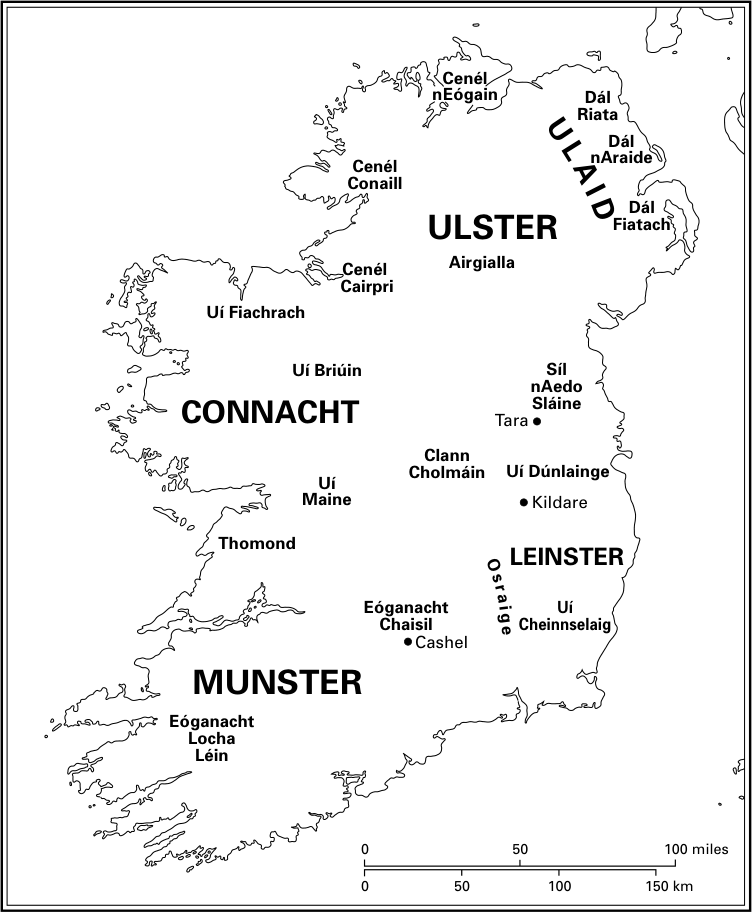
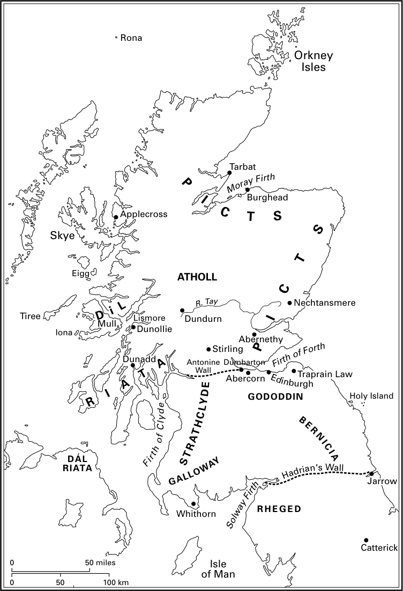
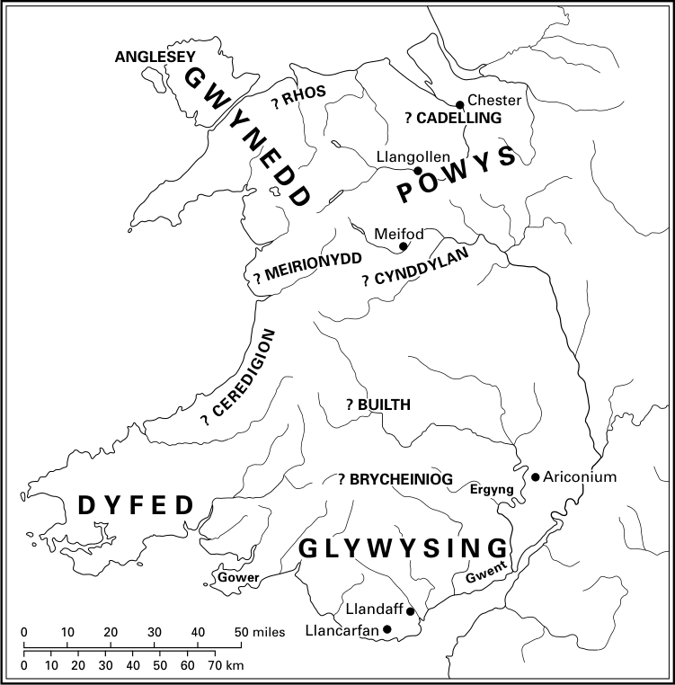
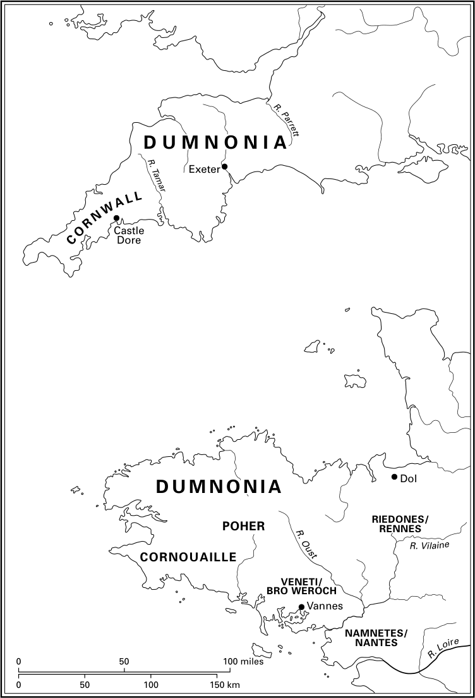

# 第9章 · 凯尔特诸王国

凯尔特诸王国  
温迪·戴维斯

爱尔兰、苏格兰、马恩岛、威尔士、不列颠西南部（康沃尔和德文）以及布列塔尼，是六、七世纪主要的凯尔特地区，尽管当时西欧其他一些地区仍在使用凯尔特语的方言土语。西班牙西北部肯定属于这种情况，英格兰部分地区亦然，法国中部可能也是如此。这些凯尔特地区是从语言上界定的：即通常并以凯尔特语为主要使用语言的地区。这些语言本身分为两大群：布立吞语支（一种P型凯尔特语）和戈伊德尔语支（Q型凯尔特语），分别是不列颠和爱尔兰的语言群。在这一时期，布立吞语支内部诸语言之间产生了一些差别，但这些差别相对轻微，并不妨碍该语群内部的交流；因此，原始坎布里克语——苏格兰南部和英格兰西北部的语言——与原始威尔士语差别很小，而后者与原始康沃尔语的差别也很小。^1 原始布列塔尼语在这一阶段与康沃尔语无从区分，不过布列塔尼语究竟是由不列颠移民传入法国西北部的，还是曾经通行于西欧大部地区的P型凯尔特高卢语的自然的（或被强化的、被布立吞化的）延续，至今仍有争议。^2 皮克特人的主要语言——苏格兰东部和北部的语言——似乎是一种相当不同的P型凯尔特语形式（可能更接近高卢语），南部说坎布里克语的人是否能够直接听懂它，尚难断定。尽管我们可以预期戈伊德尔语群内部存在某些地区差异，但说该语群语言的人主要局限于爱尔兰，说的是单一的原始爱尔兰语。^3 不过，在不列颠西部部分地区也讲爱尔兰语：尤其是苏格兰西南部，此外还有威尔士西部和康沃尔西部。

## 凯尔特诸王国

因此，尽管这些地区无疑都是凯尔特地区，我们不应期望它们比当时讲日耳曼语的地区更具政治或文化上的同质性。它们并未构成一个单一的政治单位；甚至每个凯尔特“地区”都不止一个王国，而是数个或许多个；有些地区则不属于任何王国。事实上，它们的政治结构在某些方面受到了罗马过去经历的影响。布列塔尼、英格兰西南部和威尔士都曾是罗马帝国的一部分，尽管各地参与罗马物质文化和城市生活的程度差异极大，且某些地区常有驻军；布列塔尼东部和威尔士东南部受影响较深，至少威尔士沿海在四世纪末建有并翻修过堡垒。低地苏格兰，或更确切地说，哈德良长墙与安敦尼长墙之间的土地，在二世纪也曾时而属于罗马帝国，此后似乎与帝国总督保持密切关系。安敦尼长墙以北的苏格兰处于帝国之外，尽管阿格里科拉在遥远的过去曾在东部征战，而爱尔兰和马恩岛则始终处于帝国之外。鉴于背景差异如此之大，如果后罗马政治体全都呈现相同的形态，那反而令人意外。^4

当然，凯尔特各地区之间的地理环境也存在根本差异，因此不能期望其经济、政治和社会处处相同。威尔士大部为高原，苏格兰大部为高山。这些地区不可能居住很多人，聚落必然集中于沿海低地——就苏格兰而言尤其集中于西部群岛——以及威尔士东南部和苏格兰东部有限的可耕低地地带。爱尔兰和布列塔尼则截然不同；两者虽都有多山之处，但高地远少于威尔士和苏格兰，没有理由认为其人口不是大致分布于全区；两者也都有大面积优质可耕地。康沃尔在地理上与布列塔尼西部非常相似，而马恩岛则微缩地囊括了爱尔兰的各种地貌。可见，地区内部和地区之间都存在差异。因此，横穿威尔士和苏格兰的交通异常困难，横穿布列塔尼的交通也如西欧任何地方的陆路运输一样艰难（不过七世纪时罗马的东西向路线很可能仍在使用）。在这三处，水路交通都远比陆路可行，因此沿海地区具有特别重要的意义。爱尔兰是一个由主要水道贯穿、湖泊星罗棋布的国家，这里的交通必然比其他凯尔特地区便利得多。

中世纪极早期是气候恶化的时期。自晚期罗马时期以来，气温下降、降雨增加，高地比以前更不宜耕作，各地的边际土地则完全弃用——威尔士西北部罗马农庄Cefn Graeanog的发掘非常精确地证明了这一点：那里曾是谷物种植区，但在中世纪早期已不再如此，正如今天一样。^5 这使得优质的农业低地更加重要。这一时期经济决定因素的另一重大变化是人口方面的：六、七世纪是瘟疫反复流行的时代。我们知道540年代的瘟疫波及威尔士和爱尔兰各地，而660年代的瘟疫据信在爱尔兰造成了重大社会后果；它确实使有记载的活动减少了一代人。^6 当我们想到中世纪晚期瘟疫的根本性后果时，对这个更早时期应有类似重大影响的心理准备。

尽管存在地理差异，凯尔特地区的经济基础仍是混合农业，辅之以适时的狩猎和采集。混合农业经济中诸要素的比重当然会因地面异，有理由认为爱尔兰农业更侧重养牛，而布列塔尼东部的农业更侧重谷物（并且还促进了葡萄栽培的某种专业化）。这些都是商业交换相对稀少的经济体，许多经济单位很可能大体上自给自足。但这并不意味着这些地区缺乏财富或富人：剩余产品被生产出来，并且在此地一如在其他地方一样为贵族所垄断。因此，某些集团、家族或个人有能力在六世纪乃至七世纪的大部分时间里赞助从大陆进口陶器。^7 交换肯定存在，这种陶器流动是其最显眼的表现，但一切迹象表明，其数量及其占总生产的比例都微乎其微。因此不足为怪，这些是城市化程度很低甚至没有城市化的地区；它们几乎完全是乡村性的，大部分地区根本没有城镇；到六世纪晚期，罗马城市卡尔文特几乎可以肯定已供养着一座修道院，但已无城市生活；罗马的埃克塞特和卡莱尔大概还留有规模大为缩减的准城市社区；罗马的卡马森可能只剩下残破的建筑物。只有在布列塔尼东部，城镇才继续保有某种城市性质，雷恩、南特和瓦讷在整个这一时期仍是城市中心。爱尔兰完全没有城镇，但并不缺乏发展。在凯尔特各地区中独树一帜的是，七世纪已有迹象表明生产日益增长并日益专业化，尤其是在根基稳固的修道团体恩庇的背景下，这足以表明到700年，爱尔兰正处于经济发展趋势之中。当时布列塔尼东部可能也是如此，但我们缺乏材料加以证明。康沃尔、威尔士和苏格兰则似乎并非如此。

六、七世纪凯尔特社会的结构还因迁徙因素及其不均衡的作用而变得复杂，西欧许多其他地区的社会亦是如此。一些不列颠人（以及一两个英格兰人）去了爱尔兰，尤其是在基督教传教活动的背景下，但总体而言爱尔兰未受移民影响。然而，在四、五世纪，人们已离开爱尔兰，去西不列颠劫掠并定居，这一流动一直延续到六世纪晚期。560至580年代阿尔斯特统治家族在苏格兰西南部和马恩岛的定居，对那些地区的未来发展至关重要，而且六世纪初西威尔士部分地区很可能也由一些南爱尔兰人统治。^8 这些首领是否随有足以构成大规模迁徙的移民，是一个有争议的问题；苏格兰西南部和马恩岛的爱尔兰语人口可能定居于六世纪晚期，也可能在此前两个世纪，甚至更早；然而，当时首领的流动是确凿无疑的，那些地区的人口是或成为爱尔兰语使用者，这一点同样确凿无疑。

也有充分理由认为，五世纪曾有不列颠人的重大流动，而且其中一部分很可能在500年之后的几十年里继续进行。如今没有人相信所有不列颠人（不列颠的土著居民）都被盎格鲁人和撒克逊人移民推向西方，因为七世纪乃至更晚的一些文本清楚表明，在英格兰人定居之后很久，英格兰中部和东部部分地区仍在讲某种布立吞语。一些不列颠人的王国也在英格兰中部和北部存续至七世纪中叶以后。然而，拉丁语词汇早期借入威尔士语的情况表明，不列颠人的一部分——或许是富人和贵族，或许是较高级的教士——确实西迁了，尽管我们完全无法猜测其在总人口中所占的比例。^9 同样清楚的是，他们中有些人渡海去了法国北部：到五世纪中叶，卢瓦尔河中部和法国西北部已有了不列颠人；到六世纪晚期，定居在西北部的人数已相当可观，以至于该半岛将其名称从阿摩里卡改为小不列颠（Britannia Minor）——“小不列颠”，即我们今天所知的布列塔尼。^10 我们无法精确描绘这次迁徙，但它似乎在560年代之前已经结束。我们对其具体情形也知之甚少，尽管威尔士有一份传统称是瘟疫迫使人们渡海：^11 我们不知道五世纪散布于法国各地的几支不列颠人最终是否逐渐回流到西北部，还是越来越多的人不断从不列颠前来。我们也不知道不列颠人对阿摩里卡的定居在西部是否远为稠密，尽管七世纪“布立吞人之地”与“罗马人之地”的区分或许暗示了这一点。^12 不过，布列塔尼东部有布立吞语使用者是再清楚不过的了，因为九世纪的人名和地名命名法压倒性地是布列塔尼式的；尽管六世纪的法兰克作家把维莱讷河视为布列塔尼人与法兰克人之间的边界，但该线以东也出现布列塔尼语。维莱讷河或许确实构成了布立吞尼亚（Britannia）与罗马尼亚（Romania）之间的边界；若果真如此，这条边界深入半岛东部。六世纪的不列颠人/布列塔尼人和九世纪布列塔尼语使用者的祖先中，究竟有多少人实际来自不列颠，又有多少是罗马时期大陆凯尔特人的后裔，已无从断言。这在布列塔尼学者中是一个激烈争论的问题，其论证很容易陷入循环。^13

迁徙问题所引发的各种难题——无论涉及布列塔尼、英格兰还是苏格兰——都非常棘手，且大多看来无法解决。这些流动无法精确定年。我们对所涉人数——无论是相对数还是绝对数——几乎没有概念；对其社会构成也知之甚少（是整个社区迁移，还是成群的独立冒险者，或是贵族和未来的统治者，抑或在不同的地方有不同的组合？）；而且我们对语言变化与定居之间的关系也了解不足。大规模迁徙无疑能够改变一个地区的语言，但我们几乎不知道实现这种变化所需的最低人口比例。^14 地名证据对提示某种语言/方言使用者的所在地极有帮助，但即便在这里，我们也必须谨慎对待关于命名者的假设：是当地居民，还是他们的邻人，还是出于财政、产权或航行目的而做记录的某个外来者？我们无法解决这些问题固然令人沮丧，但我们不应忘记它们：迁徙本身在当时显然具有巨大的政治重要性，随后又产生了巨大的社会后果。

## 史料

用于研究六世纪凯尔特地区的文字史料异常稀少，某些地区到七世纪也好不了多少，尽管那时爱尔兰材料已丰富多样。现存的史料可能是残缺的、讹误的且难以解释的。因此我们不能忽视这一事实：研究中世纪极早期的凯尔特地区存在极其严重的史料问题；这意味着，对六世纪上半叶任何地方的政治史都无法做出有充分证据的评估，而某些地区在七世纪的大部分时间里依然如此。从六世纪中叶起，北爱尔兰和苏格兰西部有相当好的史料覆盖，七世纪时爱尔兰其他地区亦日益如此；关于威尔士和苏格兰东部，我们能发现这样那样的事情，但几乎无法充实“某地有一王、某处有一死”这类枯燥的记载；我们对康沃尔和马恩岛的了解则极为零碎；我们在六世纪晚期得以窥见东布列塔尼事务的详细面貌，但此后一个半世纪几乎一无所见。

在这种情形下，石刻铭文的证据具有特殊的重要性，因为许多铭文以原物形式保存下来（几乎是唯一以原物存世的文本），并且可能出人意料地详尽，提供有关身份、品性和事件的材料，以及人名和丧葬悼念之辞。并非所有铭文都有精确的年代，但有些有，许多可以合理地定在约半个世纪的范围内。威尔士铭文集研究充分且尤为重要，但康沃尔和苏格兰也有大量刻铭石碑，布列塔尼有一些，爱尔兰和马恩岛则有这一时期的少数几件。大多数铭文以拉丁语刻成，但有些使用爱尔兰的欧甘字母，或单独使用，或与拉丁语并用。^15

编年史——按年份编排的当时记录——显然自六世纪晚期起就在某些凯尔特宗教中心得到维护，尽管这些记录通常简短，有时晦涩，且常常中断。这一时期它们的特点是包括国王和教士的讣闻，以及对战斗、灾难和气候或天文现象的记录。北爱尔兰的系列编年史——《阿尔斯特编年史》的基础，常被称为“爱尔兰编年史”——因其对北爱尔兰、苏格兰西部和马恩岛的覆盖而重要，不过其中一些材料也进入了威尔士文集《威尔士编年史》。^16 极有可能，艾奥纳修道院是这些记录的最初来源，从563年建院后不久一直延续到约740年，但到七世纪晚期，阿尔马、克朗弗特等爱尔兰中心的记录得以保存下来，其中一些后来被收入《阿尔斯特编年史》，一些则收入《因尼斯法伦编年史》等其他大型文集。这些世纪里存世的威尔士编年史数量极少，有些出自威尔士，有些出自北不列颠；我们也不应忘记，英语《盎格鲁—撒克逊编年史》的编年记录有时也会提到苏格兰、威尔士和西南部。

这一时期存世的当代圣徒传记数量很少，但其意义超出纯宗教事务。它们是：穆尔丘的《帕特里克传》和蒂雷杭的《帕特里克传》，科吉托苏斯的《布丽吉特传》，而另一部《布丽吉特传》的部分内容可从所谓的《第一传记》中重构——这些都出自爱尔兰，且都作于七世纪下半叶；出自艾奥纳的有阿多姆南约700年写成的《科伦巴传》，出自布列塔尼的有佚名的《参孙传》，可能写于约七世纪中叶（虽是布列塔尼作品，但主要叙述参孙早年在威尔士的生活）。^17 七世纪爱尔兰存有大量教会材料——悔罪书、教规、论著——但此处不予讨论；此外还有涉及布列塔尼的六世纪教会会议的记录。还有各类学术著作，尤其出自爱尔兰，涉及推算、语言和语法，也有旨在展示文学技巧的作品，如《玄妙文辞》以及拉丁语诗歌和圣歌。^18 此外还有对历史学家有价值的各种叙述性作品——论著和史书：关于西不列颠的，有吉尔达斯约540年或稍早写成的论不列颠现今“毁灭”的小册子；主要关于不列颠和苏格兰的，有比德两个世纪后写成的《英吉利人教会史》；关于布列塔尼的，有图尔的格里高利六世纪晚期写成的《史集十卷》（常称《法兰克人史》），以及七世纪中叶写成的《弗雷德加编年史》。^19 九世纪初在北威尔士以《不列颠人史》为题汇编的杂糅材料中，对本时期有用的内容很少，尽管其中收录了一些源自北不列颠的简短注记，异常重要。^20 还有一些涉及法律和政治的爱尔兰论著，如拉丁语的《十二种弊政》论著和本土语的《摩兰训诫》与《阿多姆南法》。^21 不过，本土语爱尔兰法律材料这一庞大的语料大部分属于八世纪。^22

最后，还有来自爱尔兰和威尔士的大型谱系集，后者包括来自苏格兰南部和马恩岛的谱系；德文、康沃尔和布列塔尼也有一些。这些材料与七世纪乃至六世纪的政治结构可能相关，但难以利用，因为与皮克特人或塔拉诸王的王表一样，它们大多是在本 period 之后数个世纪才编成的。它们自称记录了每一部谱系编纂之时统治各王朝的漫长世系；例如，大英图书馆哈雷抄本3859号中的文集出自十世纪中叶的威尔士，以十世纪威尔士两大主要统治家族的谱系开篇，上溯三十余代；接近七至十世纪的各部分至少可信，但某些更早的部分则肯定不可信。在缺乏佐证的情况下，很难评估这些材料所假定的六、七世纪阶段的价值；它们既可能是记录，也同样可能是痴心妄想或错误。尽管如此，也有一些谱系——终止于远在十世纪之前——必然源自早得多的记录，如哈雷文集中马恩岛的谱系；因此它们是潜在相关的史料。《不列颠人史》中所收的英格兰谱系材料和王表与此类材料价值相当。^23

## 爱尔兰人

有两个特殊问题制约着我们对最早的爱尔兰历史的理解，且两者都源于现存文字史料的性质。第一个涉及编年史：《阿尔斯特编年史》与许多主要文集一样，有一系列贯穿五、六世纪的条目，乍看之下似乎为我们提供了那个早期关于人物、地点和事件的极为详细的证据。这极具误导性，因为这些材料大多是编成主要文集的九世纪晚期和十世纪的历史学家编纂并插入的：他们尽力把过去的人物——无论教会的还是世俗的——纳入可信的年代框架。^24 他们做出的成果确实可信，但其在序列中的位置是推定的，其历史真实性无从验证；因此它与起于六世纪晚期的材料相比，证据地位不同。第二个问题与之相关：传说的力量如此之大，以至于它往往决定着对这些早期世纪一切讨论的框架，无论那种讨论发生在九世纪、十二世纪还是二十世纪。有一个故事尤其有影响力，即主导阿尔斯特故事群的那个故事，其最著名的成分汇辑于《库利夺牛记》（“夺牛记”）。^25 故事设定在一个阿尔斯特人（Ulaid）在政治上支配整个北爱尔兰的世界里，丝毫没有暗示涅尔家族（Uí Néill，他们在早期中世纪的大部分时间里确实支配着北爱尔兰）的存在。这一背景十分诱人，很容易使我们假定Ulaid在前时代晚期确实“统治”过北方。

普通读者面临的另一个问题是六、七世纪爱尔兰政治结构的复杂与陌生。此时爱尔兰有许多政治单位，规模极小——也许五十个，也许一百个，也许更多——称为图阿思（tuatha）。每个图阿思都有自己的rí，即国王，他对政体负有军事和全面责任，但——除特殊情况外——并不是立法者。^26 在这一基础之上，政治体制容纳了重叠的上王结构：有些国王同时也是上王。这意味着他们期待麾下诸王提供军事支持和贡赋，但正如我们所见，这既未给他们干涉麾下诸王图阿思的权利，实际上也没有干涉的习惯。上王并非仅仅是一种双向关系：有些上王是“上王的上王”，相应地，有些人既是一组国王的上王，又是另一个更强大的上王的下属王，如此等等。更复杂的是，此时上王地位并未制度化：上王地位随当下政治现实在此处确立、在彼处消失。

我们对这一时期北爱尔兰的了解远多于其他地区。就我们所能辨识的范围而言，其政治由涅尔家族各支系与阿尔斯特人（Ulaid）统治者之间复杂的相互作用所主导。到六世纪晚期，四个主要的Ulaid图阿思占据爱尔兰最东北部（安特里姆郡和唐郡），分别由达尔里阿达、达尔纳拉伊德、达尔菲亚塔赫和乌伊·埃卡赫·科博各王朝统治。通常其中之一也兼任Ulaid上王。涅尔家族，即那些自认为“九质子之涅尔”传说人物后裔的家族，其支系遍布爱尔兰北部和中部。其中，凯内尔·埃俄盖恩、凯内尔·科纳伊尔和凯内尔·凯尔普里（当尼戈尔郡）在北方最突出，而凯内尔·洛伊吉尔和凯内尔·纳尔德盖尔（米斯郡）在中部地区突出；它们分别被称为北方涅尔和南方涅尔。其行为模式表明，涅尔诸王不仅谋求在各自地方成为上王，也谋求彼此之间成为上王。这一进程直到我们这一时期之后才达到其逻辑终点，即自730年代起建立起一个在南北两支之间轮替的单一涅尔上王地位。Ulaid和涅尔并非爱尔兰北部和中部仅有的人民，因为还有许多图阿思，尤其为涅尔人所谋求支配；其中一些构成早期“部落”集团看似零散的残余——例如盖伦加、卢伊格尼、基安纳赫塔——但最著名的是中北部七个图阿思，历史时期称为“臣属诸邦”（Airgialla），即藩属或臣属之邦（见地图4）。

560年以后约一个世纪的政治，乍看之下错综复杂，令人目眩。凯内尔·埃俄盖恩与凯内尔·科纳伊尔交战；达尔菲亚塔赫与达尔纳拉伊德交战；凯内尔·科纳伊尔与南方涅尔的迪尔马伊特·马克·塞尔拜尔（Ardgal的外甥）交战；达尔纳拉伊德与凯内尔·埃俄盖恩交战；凯内尔·科纳伊尔与达尔里阿达和达尔纳拉伊德交战；西尔·纳埃多·斯莱内（南方涅尔）与凯内尔·埃俄盖恩交战，等等。然而，其中存在一个总体模式：首先是涅尔人对所有对手不断取胜的简单模式，其次是较为成功的涅尔支系存续的模式，最终以据有塔拉王权为象征。六世纪晚期和七世纪初是涅尔人与Ulaid统治者之间频繁而势均力敌的冲突时期；此时一方得胜，彼时另一方得胜；此时这一支尝试结盟，彼时另一支又如此；直到637年马格·罗斯战役。例如，来自南方的塔拉王迪尔马伊特·马克·塞尔拜尔于561年在库伊尔·德雷姆内战役中被凯内尔·科纳伊尔的艾恩迈尔联合凯内尔·埃俄盖恩击败，这场冲突显然是由艾恩迈尔的表亲圣科伦巴挑起的，因后者对西部康诺特人的保护受到侵犯；^27 迪尔马伊特最终于565年被达尔纳拉伊德的Ulaid上王“黑埃德”所杀。这是Ulaid统治者渡海远征马恩岛和苏格兰西南部的时代，而达尔里阿达在不列颠本岛的利益（和实力）使争夺Ulaid上王地位的战斗变得极其复杂。艾恩迈尔之子埃德在所谓的德鲁姆·凯特“集会”上及时地支持了达尔里阿达的埃丹·马克·加卜兰，对抗时任Ulaid上王——很可能是达尔菲亚塔赫的拜坦；^28 其结果是达成协议，苏格兰的达尔里阿达不再向Ulaid上王缴纳贡赋。争夺Ulaid上王地位的战斗在570、580年代继续于马恩岛进行，620年代则在爱尔兰进行，直至637年的马格·罗斯；在此次战役中，埃德之子多姆纳尔彻底击败了由多姆纳尔·布雷克率领的达尔里阿达，既在爱尔兰本岛——后者在那里与达尔纳拉伊德上王结盟——也在海上——后者在那里与凯内尔·埃俄盖恩结盟。自那时起，达尔里阿达的利益更加集中于苏格兰，Ulaid上王地位之争不再那么动荡多变，而涅尔人的成功则一致得多。多姆纳尔·马克·埃德在床上安然离世（并且——因其非同寻常的成功——成为被当时编年史家称为“爱尔兰之王”的第一人）。^29

也就是说，尽管涅尔人更为一贯地成功——不断确立上王乃至“上上王”地位——直到世纪末他们仍彼此争斗以图霸权，即确立上王地位。尽管北方涅尔内部和南方涅尔内部的冲突持续存在，但最突出的冲突是南北之间，且日益聚焦于象征性地点塔拉的王权：谁据有塔拉，谁就可以说是所有涅尔上王的上王。于是，南方的迪尔马伊特·马克·埃多·斯莱内与其兄布拉特马克共掌塔拉王权，并于654年击败凯内尔·科纳伊尔的科纳尔；其继任者芬内赫塔在杀死其堂兄国王之后，于675年击败凯内尔·埃俄盖恩的马尔·杜因；而北方凯内尔·科纳伊尔的洛因塞赫·马克·奥恩古索——第二位被当时编年史家称为“爱尔兰之王”的爱尔兰国王——未遇抵抗便取得塔拉王权，统治至703年。^30 最早的塔拉王表恰自七世纪晚期存世，即《昆德的预言》，这本身就凸显了塔拉王权在北方和中部政治中如今至关重要的意义。^31 七世纪期间，涅尔杰出上王们的地理活动范围急剧扩大：最初只是在少数几个图阿思的狭小范围内施展政治，到700年已遍及爱尔兰一半以上的地方。到八世纪，他们的活动范围更广，还确立了塔拉王权的继承制度——自734年起在北方涅尔的凯内尔·埃俄盖恩与南方涅尔的克朗·乔尔曼之间轮替。到700年，仍有其他国王和其他上王——Ulaid和臣属诸邦到九世纪都各有其上王——但北爱尔兰和中爱尔兰最高的上王出自涅尔集团，已是再清楚不过的事了。

到此时，爱尔兰人在苏格兰也已成为一支重要力量。如上所述，我们不知道向苏格兰西部的迁徙始于何时，也不知道其最终规模，但在六、七世纪其活动区域似乎非常有限。尽管如此，达尔里阿达的统治者在六世纪晚期和七世纪初广泛活动于北不列颠，起初在英格兰人建立伯尼西亚时与之冲突（埃丹·马克·加卜兰在道斯顿被英格兰人惨败），随后又与皮克特人冲突。^32 德鲁姆·凯特的会晤在某种程度上是放松与爱尔兰本岛纽带、阻止资源流向Ulaid上王的首次尝试；580年代在马恩岛的战斗是这一争端的进一步表现。但真正使达尔里阿达的注意力集中于苏格兰本岛的，是637年马格·罗斯的惨败。从其位于邓阿德的政治中心——该遗址已被充分发掘——他们在七世纪向北和向东推进，尽管还有其他堡垒，如邓纳弗蒂、塔伯特、邓诺利。^33 这威胁到以邓巴顿（近格拉斯哥）为中心的斯特拉斯克莱德不列颠王国，并使爱尔兰人越山进入皮克特人的核心区法夫。到700年，他们仍处于一个发展进程的早期阶段，这一进程将在八、九世纪把他们带往苏格兰中部的许多冲突，并最终带往苏格兰王权。

即使在七世纪，涅尔人也时而与爱尔兰南部和西部的杰出王朝发生接触。东南部的人民莱金人有对塔拉王权的主张，他们有时北上劫掠，如598年在邓博尔格成功地对抗埃德·马克·艾恩迈尔，他们自身也遭劫掠，如628年遭多姆纳尔·马克·埃德的进攻。在莱金斯特尔内部，两大王朝争夺最高上王地位：北部的乌伊·敦莱因格和南部的乌伊·凯恩塞莱格，尽管乌伊·敦莱因格常常是上王，但这绝非一成不变。他们与基尔代尔大修道院有家族联系，有时谋求与中部地区南方涅尔支系结盟（约700年凯拉赫的女儿们似乎嫁给了涅尔人），其冲突延伸到莱金斯特尔西部边境，那里异常庞大的奥斯拉吉图阿思的国王们对上王的支配极其抗拒，这一模式在700年之后的许多世纪里一直延续。^34 乌伊·敦莱因格与乌伊·凯恩塞莱格之间战斗的拉锯持续到700年以后，直到八世纪中叶前者才成功地确立了延续至十一世纪的莱金斯特尔上王地位。^34 涅尔人在西部也有密切联系——那里被认为是他们的发源地——西部的几个杰出王朝之一乌伊·布里恩曾于561年在库伊尔·德雷姆内与凯内尔·埃俄盖恩和凯内尔·科纳伊尔并肩对抗迪尔马伊特。后来在703年，正是乌伊·布里恩的凯拉赫击败了塔拉王洛因塞赫。另一王朝乌伊·菲亚赫拉赫于603年在斯莱戈——涅尔政治影响的西部边缘——与凯内尔·凯尔普里发生冲突，又于649年与南方的迪尔马伊特·马克·埃多·斯莱内交战，后者击败了他们长寿的国王瓜伊雷。其他王朝也争夺上王地位，尤其是乌伊·梅因和乌伊·艾莱洛，不过七世纪最突出的是乌伊·菲亚赫拉赫，到700年，乌伊·菲亚赫拉赫与乌伊·布里恩在康诺特的主要上王地位上似趋于轮替。但在这里同样要等到更晚的八世纪晚期，乌伊·布里恩才确立了对一贯的上王地位的控制。^35

西南部的芒斯特是六、七世纪最难窥探的地区，因为编年史中几乎没有八世纪以前的当代材料。看来托蒙德（今克莱尔郡）是西南部上王与北部康诺特上王之间争执不下的地区。当乌伊·菲亚赫拉赫的瓜伊雷联合乌伊·梅因于627年被芒斯特的法伊尔贝·弗兰击败时，这很可能决定了托蒙德将由芒斯特诸王支配而脱离康诺特，这次失败也促成了南方乌伊·菲亚赫拉赫的衰落。在芒斯特本土，埃俄加纳赫塔诸王在东部和西部创立了上王地位，但要辨别其相互关系的模式尚为时过早。很可能，后来作为南方上王象征中心的卡舍尔当时已被用作要塞，但尚未获得到九世纪时才有的重要地位。诚然，主张到700年西南部已凝成单一上王地位，是在勉强证据。那种发展尚有待将来。^36

到700年，我们可以看到将在八世纪变得清晰的趋向的轮廓，即建立四个领土范围大致相当的主要上王地位，分别对应北方、西方、东南方和西南方（阿尔斯特、康诺特、莱金斯特尔、芒斯特），尽管争夺芒斯特上王地位的斗争尚未开始。700年时，“中部”的政治与北方联系相当紧密，尽管也有向西和向南的侵袭。700年时，达尔里阿达在苏格兰西南部有非常坚实的政治基础，并在苏格兰政治中已确立影响。这些趋向是清楚的，尽管政治动力机制的框架仍可能令人困惑，观察者不得不问：为何会有这么多战斗？战争是否流行成风？早期爱尔兰是否处于永久的无政府状态？答案既不那么简单，也不那么令人沮丧。记录之所以为战斗所主导，是因为这正是编年史家选择记录的内容。战斗看来确实是军事精英的一种经常性活动，但我们不应忘记这些是精英而非大众的消遣；战斗并不意味着全面战争；生产仍在继续（事实上，正如我前文所述，一切迹象表明它在七世纪还有所增长）；学术亦臻繁荣：正是在这一时期，学者们学习说和写新的语言，钻研复杂的推算，并开创了装饰性制书的高超艺术。^37 上王权力的基础无疑是军事性的；这一时期它几乎没有什么制度化的内容，与治理几乎没有（或许完全没有）关系；它在很大程度上是关于学习如何攫取——并保有——剩余产品的非常粗糙而不稳定的政治。但单纯的王权在当时仍非常有其功能。仍是国王代表并保护其图阿思，应对紧急情况，保证繁荣与好运，其智慧可以被援引以作出裁断，与基督教教士谈判，并且——日益增多地——在兴盛的宗教团体中获得影响的立足点。即便政治进程大半由上王们塑造，普通国王仍保有地方性和区域性影响。位于莱金斯特尔与芒斯特之间的奥斯拉吉人的国王，其图阿思或许异常庞大，但他很好地展示了王权——在没有上王地位之复杂性的情况下——能够做到什么。

正是凭借统治者的公正，他赢得和平、安宁、喜悦、安逸与舒适。  
正是凭借统治者的公正，他向敌对邻人的边境派出（大批）队伍……  
正是凭借统治者的公正，各种高大的谷物才得以丰登。  
正是凭借统治者的公正，丰盈的鱼群才畅游于溪流之中……^38

## 皮克特兰与北不列颠

尽管爱尔兰人在六、七世纪已对苏格兰西部具有重要意义，但北不列颠的主要人口集团是皮克特人、不列颠人和英格兰人。563年艾奥纳修道院在苏格兰西海岸外建立，约一个世纪后贾罗修道院在英格兰极北部建立，而两者都是记录、书写和研究的重要中心，这意味着我们对这些集团在这一早期相互关系的了解——肯定远多于对后来几个世纪的了解。

虽然在此之前我们对它们所知甚少，但到六世纪晚期，在今苏格兰低地和英格兰北部的区域内已有若干不列颠人王国。^39 在600年之前的几十年里，不列颠人的国王们倒在了纽卡斯尔—班堡一带及其以东的英格兰人手中——摩根、乌里恩，或许还有格沃洛格——但一名不列颠国王在南约克郡存续到约617年。^40 尽管有此存续，这基本上是一个失败的故事——军事灾难之后政治身份与政治独立的丧失——这一故事和这种心绪凝结在《戈多丁》一诗之中（尽管在《塔利辛之歌》的诗篇里表述更为简洁，也同样有力）。

武士们奔赴卡特雷斯，他们的队伍迅捷，  
新鲜蜜酒是他们的盛宴，而它苦涩，  
三百人在号令下作战，  
欢呼之后，归于沉寂。  
纵然他们去教堂忏悔，  
与死亡的必然相逢仍降临于他们。^41

武士们从四面八方集结起来保卫雷赫格德——一个大概横跨奔宁山脉、甚至可能延伸到加洛韦的大王国——约在600年后不久，他们在卡特雷斯（很可能即卡特里克）的一场决定性战役中遭遇英格兰人。此后雷赫格德干脆消失了。位于福斯湾一带的戈多丁王国本身——其武士赋予了诗歌以名称——又存续了一代人：其爱丁堡要塞于638年终为英格兰人所陷（见地图5）。

西面的斯特拉斯克莱德王国寿命长得多，其国王的记录一直延续到1034年，长时期与爱尔兰人和皮克特人互动。它位于克莱德湾一带，政治中心在邓巴顿岩。圣帕特里克在五世纪曾提到其国王凯雷迪格，而约700年写作的阿多姆南则知道一位六世纪晚期曾与爱尔兰圣人科伦巴交往的强大的斯特拉斯克莱德国王——老里德雷赫（Rhydderch Hen）。^42 关于这个王国我们所知甚少，只知道其王室成员有时与皮克特人统治家族联姻，而且到八世纪中叶，邓巴顿已强大而富有象征意义到值得皮克特人的奥恩古斯发动攻击、九世纪晚期又遭维京人攻击的程度。斯特拉斯克莱德虽然不大，但显然是一个一贯重要的独立“飞地”，其西、北、东三个方向更强大的邻邦都不能无视它的存在。

然而，我们习惯于把皮克特人视为一个难题。^43 存在着身份、定居区域和政治结构等诸多问题——这还只是最严重者——因为皮克特人自己除了象征石之外没有留下任何文字记录，而这些象征石的解读至今仍有难题；^44 我们对他们的了解几乎完全来自外部的观察。甚至“皮克特”这个名称似乎也是苏格兰以外的作家所创，很可能掩盖了一系列不同的部落身份，因为公元一、二世纪的罗马作家使用的是部落名称而非泛称的“皮克特”。晚期罗马及后罗马时期的皮克特人是从北方基地劫掠罗马不列颠诸行省的人，这一名称很可能被应用于安敦尼长墙以外苏格兰中部和北部的所有居民。这并不必然意味着被如此称呼的人们具有单一的社会或政治身份，甚至不必然有单一的语言，很可能在五世纪和六世纪初存在几个集团。爱尔兰人在西南部、英格兰人在苏格兰低地的确立显然带来了变化，基督教的传入亦然；尽管证据过于零碎难以令人满意，但提出到七世纪——无论其背景如何、构成要素如何——一种单一的政治身份正在形成，并非不合理。^45

皮克特王权的性质是一个相关问题。鉴于规模、空间和交通的原因，五、六世纪不太可能只有单一的皮克特王权，而且晚至739年，我们还听到（苏格兰东部的）阿索尔国王被“皮克特人的国王”淹死之事；更晚的传统则有七个潜在的独立组成地区之说（不过这很可能是由现存行政区划推导出的关于起源的猜测）。^46 相关记载极少，但它们暗示，直到八世纪中叶，皮克特兰有时（即便不总是）同时有几位国王。表面上看，这似乎与皮克特王表相矛盾。皮克特王表是按单一王系列编排的，几乎囊括了任何当代史料中提及的每一位皮克特国王。因此它似乎提供了一个非常绵长的君主制的记录。它在早期阶段明显具有误导性，尽管最终单一的皮克特王权无疑确实确立了。当然，存在这样的可能：王表记录的不是一列君主，而是一列皮克特上王。虽然约700年写作的阿多姆南确实谈到了六世纪晚期的伟大国王布吕德和奥克尼群岛的一位小王（regulus），但这一记载并未明言上王关系，几乎没有其他材料给予积极支持。上王地位是否是皮克特政治结构的核心，虽属可能，仍待证明。^47

无论我们对其背景作何想法，七世纪的大部分时间里都有一位皮克特人的主王，其王权重心位于苏格兰东部的皮克特核心区。尽管许多人质疑，比德关于皮克特王位继承按母系确定的论述在这一时期是有道理的。^48 国王往往由其姐妹之子或其兄弟继位，而非其亲子。皮克特诸王的父亲有时有不列颠人名字，如斯特拉斯克莱德的贝利，有时有英格兰人名字，如（伯尼西亚的）埃安弗里思，可以合理地设想，邻近地区有雄心的男子有时会娶合适的皮克特王室女子，从而或者自己取得王位，或者生下皮克特国王。^49 英格兰人的名字表明了整个七世纪大部分时间里对皮克特兰的持续关注。到六世纪晚期，英格兰人的伯尼西亚王国已在苏格兰低地东海岸稳固建立，其诸王四处征讨；我们已经提到，埃丹·马克·加卜兰于603年被英格兰国王埃塞尔弗里思击败。

到七世纪第二个二十五年，英格兰人已向北征伐，于638年和642年攻取不列颠人的要塞埃廷（爱丁堡）和斯特灵，由此进入皮克特核心地带。^50 伯尼西亚国王、643—671年间的诺森布里亚国王奥苏王大概是所有英格兰国王中最强大者，到660年代其权势似乎至少延伸到皮克特兰南部；他与他的儿子埃格弗里思实际上以上王身份行事，皮克特诸王则为其附庸。^51 因此，皮克特兰在七世纪不仅遭受英格兰人的军事征讨，还受到英格兰人约二十五年的政治控制。这种控制并非没有遇到抵抗：被支配的国王德罗斯特被驱逐，发生了多次叛乱，最终埃格弗里思于685年在著名的内克坦斯米尔战役（邓尼钦）中被皮克特国王布吕德——斯特拉斯克莱德不列颠国王之子——击败并杀死。^52 这实际上是英格兰霸权的终结，尽管698年和711年仍有一些军事冲突，而且在一个世代里，英格兰官员仍试图干涉。

我们听到许多关于七世纪晚期和八世纪初军事活动的记载，以及对军事要塞的围攻——东海岸的邓诺塔尔（681年）、西海岸的邓阿德和中部的邓德恩（683年），稍晚还有斯昆和蒙克里夫。冲突看来至少包含两个因素：皮克特人之间争夺霸权、或许是为确立单一王权而战，以及争夺领土控制——尤其是与西部爱尔兰人的争夺。六世纪晚期，皮克特人曾被来自达尔里阿达的劫掠者击败；到八世纪中叶，他们转而劫掠，并且能够攻陷邓阿德本身——达尔里阿达位于西海岸的中心。^53 685年至约730年间似乎是皮克特王权、皮克特政治身份与权力得以澄清和巩固的时期。尽管皮克特人之间有冲突，奈克坦国王在八世纪初仍能与诺森布里亚人建立外交关系，并能把科伦巴派（即爱尔兰）教士从整个皮克特兰驱逐出去，^54 而八世纪中叶的奥恩古斯国王则能以令人印象深刻的军事力量在苏格兰中部和西部行动。较晚的材料表明，这一皮克特王权开始发展出统治机构。^55

## 威尔士

在六世纪初威尔士现存的少量当代证据中，吉尔达斯的作品对于确立两个主要王国的存在——西北的格温内斯和西南的德费德——异常重要。^56 他明确指出，这两个王国并非晚近的创造，其国王属于对这些王国抱有持续利益的王朝。他提到的与他同时代的其他一两位国王也很可能是威尔士国王，但我们不知道他在何处写作，也无法有把握地重构每个人的地方背景。从六世纪晚期和七世纪，我们拥有——这在凯尔特地区是不寻常的——一些与东南部有关的文书材料，大部分出自《兰达夫书》，少数附于兰卡尔凡的《卡多格传》。^57 这些材料曾被多次抄录重抄，并被历代编者“改进”，不能按其表面价值看待。然而，存世文书文本背后的基本要素是合理的，暗示该地区政治发展的一个连贯可信的模式。^58

兰达夫材料充实了六世纪的政治结构，表明六世纪晚期东南部有若干非常小的王国：格温特、埃尔金格（赫里福德郡西南）、卡迪夫附近一个无名王国以及高尔的一个王国。我们还可以从其他文本中七世纪初的记载相当有把握地推断，另一个王国的中心在东北部；无论当时它叫什么名字，它是波伊斯的先祖。因此我们有相当可靠的了解：到600年，威尔士的大部分地区已属于某个王国，尽管这些单位在规模上差异很大。（当然可能有更多未被零碎史料注意到的微小单位。我们对威尔士中部——尤其是中东部边境——了解最少。例如，可以为以下王国的存在提出论证：罗斯（中北部）、梅里奥尼德和塞雷迪吉翁（中西部海岸）、布伊斯和布莱赫尼奥格（中部以南的东部）以及什罗普郡/威尔士中部。这些在六世纪都没有证据，但至少塞雷迪吉翁、布伊斯和布莱赫尼奥格有八世纪的历史，并且很可能有更早的起源（见地图6）。）^59

我们不知道这些王国是如何兴起的。德费德和埃尔金格都与罗马过去有某种关系：前者得名于德梅塔人的城市（并采取其基本轮廓），后者得名于罗马城市阿里科尼乌姆（佩尼亚德下的韦斯顿），或许与该城市的辖境有关。因此，它们可能在某种意义上是罗马地方行政单位的延续，只是处于不同的政治框架之内，并以新的政治权力为基础。后来统治波伊斯的卡德林王朝很可能源于切斯特。其他王朝可能起源于移民集团的定居，如西部的爱尔兰人。后来的威尔士作家承认一个有力的传统：一些沃塔迪尼人（即戈多丁人）在一位名叫库内达的首领率领下从不列颠北部来到西北定居。^60 关于五世纪的另一传统则把沃蒂根（格弗雷恩）家族与罗马的格洛斯特联系在一起，他们被逐出该地后建立了布伊斯和格弗雷恩尼翁王国。^61 这些是关于起源的观念；它们提示了发展的模式；每一种都是可能的；它们可能与实际发生的事情和真正的形成过程有关，也可能无关。

五世纪的背景异常模糊：我们根本无法察觉从罗马帝国行省（或其一部分）向王国复合体演变的过程，尽管在更地方性的（也是更财产性的）层面上，我们可以看到东南部许多晚期罗马田庄仍作为土地开发的框架延续，而土地也继续被开发（因为它当然是良田）。^63 六世纪仍然十分模糊，尽管我们知道到那时一个独立王国的复合体已经确立，其中一些非常小，一些较大，而且一些——尤其是格温内斯——的国王被认为异乎寻常地强大。我们还知道，政治权力已按王朝方式在王室家族内由父传子；王国的概念是强烈的领土性的：它有边境、有形的疆界，土地必须被保卫；国王往往有一支军事亲卫队，即战团；而且，尽管他们与治理关系不大，却被期望公正并参与作出良善裁断。相比之下，在七世纪，我们终于能够察觉政治进程的某种动力机制。

七世纪，东南部建立了一个新的、更大的王国——格利维辛王国，六世纪晚期的较小王国逐渐丧失独立身份而被吞并。约600年后不久，一位来历不明的新领袖梅里格·阿普·特乌德里格开始在怀河下游地区活动，在整个七世纪中，他和他的家族实际上支配了今格温特和格拉摩根的全部地区。这部分是通过联姻实现的——或许与高尔的统治家族联姻，肯定与埃尔金格家族联姻——部分是通过军事征服。战败的统治者往往继续靠其旧有个人产业生活，但其地位下降：他们不再是国王，而成为显贵。到八世纪第二个二十五年，那些微小王权已无踪迹，梅里格的继承者在整个王国内都获得了个人产业。到八世纪中叶，他们看来即将为一个政治单位建立财政、行政和统治机构，这个单位必定像斯特拉斯克莱德一样自足而显要。^64

相比之下，西北部的诸王在远为宏大的舞台上施展政治，卷入了向英格兰中部和不列颠极北方的远程劫掠。正如《戈多丁》诗篇宣称不列颠武士从四面八方赶来保卫雷赫格德，我们也可以看到卡德瓦隆这样的国王及其追随者从格温内斯远行到赫克瑟姆。卡德瓦隆在七世纪的史学上留下了深刻印象，因为比德用他来刻画背信弃义的不列颠人：“虽然在名义上和信仰上是基督徒……内心与性情却是蛮族”。^65 他与英格兰中部的异教国王彭达联手，对抗基督教诺森布里亚的埃德温；在埃德温劫掠安格尔西岛之后，卡德瓦隆疾趋英格兰中部，然后又到诺森布里亚北部。尽管这些是打了就跑的战役，它们确实意味着格温内斯诸王卷入了整个不列颠岛的政治。卡德瓦隆的父亲卡德凡在一块七世纪铭文中被记载为“所有国王中最睿智最负盛名者”，这不是没有缘由的。^66

在威尔士东北部和中部的边境地带，主要趋势是英格兰人的压缩与围困。616年，盎格鲁人的领袖们在切斯特赢得一场重大战役，由此控制了该城和柴郡平原。^67 这很可能逐出了卡德林家族，并肯定把新生的波伊斯王国压缩到威尔士山地。更南面，金德兰家族似乎在七世纪中叶或晚期丧失了对什罗普郡的控制，因为到700年，麦西亚诸王似乎已在经营西米德兰兹。后来的诗歌把这场败绩视为该家族的灾难：金德兰的姊妹赫莱德被留在雷金山上哀悼她兄弟们的丧失。^68 因此在这里，威尔士人同样被压缩到山地；一个统治家族丧失了统治能力；一个王国崩溃了；而这很可能给了卡德林家族在威尔士中部东部立足的机会。梅福德和兰格伦成为波伊斯的中心地带，而不是切斯特。在这一切中，英格兰人所造成的是收缩与围困，而非入侵。在许多方面，七世纪是威尔士边境和英格兰政治控制西界确立的时期（尽管北部和北部边境的地位在随后两个多世纪里仍不确定）。尽管埃德温长驱直入安格尔西岛，这并不是一个以英格兰人劫掠威尔士为特征的世纪；那要到八、九世纪才会以相当大的、反复的力量到来。

实际上，要概括这一时期威尔士内部政治的趋向是不可能的。我们当然可以注意到七世纪英格兰人的对抗以及“边境”（或边境地带）的界定，但我们对六世纪所知太少，无法多说，对七世纪的了解也不足以赋予其多少意义，除非在非常有限的地区。格利维辛的建立和东南部小王的降格是完全清楚的；格温内斯诸王的利益范围也是如此；什罗普郡王国的崩溃也是。我们至多可以说，许多小王权消失了——它们干脆消逝了（与爱尔兰的情形不同）——而创建更大、更有结构的王权的过程开始了，带有潜在的统治职责和潜在的行政框架。可能性是存在的，但尚未付诸实现。

## 康沃尔与布列塔尼

七世纪，向英格兰人丧失领土既是东威尔士的特征，也同样是康沃尔和德文郡的特征。600年，这两郡都位于单一的杜姆诺尼亚王国之内，该王国起初大概还包括萨默塞特西部和多塞特；到700年，该王国已被压缩到今康沃尔郡。658年，韦塞克斯国王肯瓦尔在萨默塞特的帕雷特河一带作战；到690年，埃克塞特已有英格兰人的修道院；710年，韦塞克斯国王伊尼已在康沃尔传统东部边界塔马河附近授予土地。^69 于是，杜姆诺尼亚迅速而不可逆地丧失了原先一半以上的领土（见地图7）。

正如可以预料的那样，我们对中世纪早期杜姆诺尼亚的创建一无所知，但当吉尔达斯在六世纪中叶写作时，它显然已经存在——而且不是新生的；他提到了它的国王君士坦丁。^70 与西南威尔士的德费德王国一样，这个单位的名称沿续了罗马城市的名称——杜姆诺尼人的城市，其起源或许也与罗马地方行政单位的延续有关。值得注意的是，其六世纪初的国王拥有一个非常著名的罗马皇帝名字：杜姆诺尼亚的统治者似乎受到罗马传统的影响。而且，主教产业似乎在整个晚期及后罗马时期未受干扰地延续，世俗土地所有权或许也是如此。不过，很可能有少量爱尔兰移民扰及北康沃尔和南德文，因为那里有以爱尔兰欧甘字母刻写的石碑。^71

一切迹象表明这个王国是君主制，而且按凯尔特标准是一个异常大的君主国。从来没有任何迹象表明存在过单数以外的国王，权力也是按王朝方式传递的；君士坦丁曾谋杀了两位王族男子，大概是为了减少王位竞争主张的可能性。圣参孙曾遇到一位拥有产业的“伯爵”，此人对当地居民显然有一定影响；王国之内可能有若干这样的人；我们无法知道他们是国王的代理人还是半独立的显贵。^72

一部九世纪文本——布列塔尼的《圣保罗·奥雷利安传》——暗示杜姆诺尼亚至少有一位国王统治着英吉利海峡两岸：六世纪初的科诺莫鲁斯（青法维尔）。这个可能性值得认真考虑，尽管当代材料太少，难以找到充分的佐证。语言学证据清楚地表明，康沃尔人与布列塔尼人在中世纪早期联系密切：两种语言直到十或十一世纪仍无法区分，并且共享六世纪及其后的相同音变。杜姆诺尼亚诸王（诚然较晚的）世系表在君士坦丁上一代包括一位金瓦维尔，该名很可能是青法维尔的讹变；东康沃尔多尔城堡的一块铭刻石纪念一位科诺莫鲁斯之子德鲁斯塔努斯的安葬；因此杜姆诺尼亚看来确有一位六世纪初的青法维尔。海峡以南，我们有《参孙传》的证据：在511至558年间的某个时候，一位“僭主”科诺莫鲁斯出现在布列塔尼北部，杀死了当地的“世袭”统治者约纳斯并将其取而代之，直到约纳斯之子伊德瓦尔被立。碰巧，伊德瓦尔的王朝与布列塔尼的杜姆诺尼亚地区相关联。是否可能这位不列颠的杜姆诺尼亚国王渡海冒险？是否可能正是这次或类似的冒险，使“杜姆诺尼亚”之名从不列颠岛转移到大陆？^73

我们无法确定如此重大的事项——跨海峡的政治联系——这一事实，恰恰凸显了我们对六、七世纪布列塔尼及其相关情况所拥有的材料是何等稀少。五世纪有一些阿莫里卡人“反叛”帝国当局的背景，也有一些从不列颠来到半岛定居的人。到461年，大陆上肯定已有足够的不列颠人，值得在图尔教区由他们自己的主教代表；到567年，他们在阿莫里卡的人数已足以构成一个与“罗马人”相区别的重要文化群体。^74 死于六世纪最后十年的大陆作家习惯上把该半岛称为布列塔尼亚。

对图尔的格里高利而言，布列塔尼始于维莱讷河——这条河发源于雷讷以东很远的地方，流经该城，然后向南入海，在卢瓦尔河口以西30公里处；与中世纪的雷讷和南特两伯国、今天的伊勒—维莱讷省和大西洋岸卢瓦尔省大致对应的里东内斯人和纳姆内特人的罗马城市，大部分位于该边界以东。从格里高利那里，我们对布列塔尼人在560年代、570年代和580年代与法兰克人的纠纷了解得相当多。^75 法兰克人声称统治布列塔尼：他们进军该地，沿维莱讷河扎营；他们正式把瓦讷城交给布列塔尼“伯爵”瓦罗克，以换取年贡；他们收取人质和担保。布列塔尼人则一次次袭击雷讷和南特，从卢瓦尔河谷的葡萄园抢收葡萄，带着酒匆匆返回布列塔尼；瓦罗克则如格里高利令人无所戒备地表述的那样，不断“忘记”他所达成的协议。这种互动显然是暴力而具有破坏性的。但它同样显然局限于布列塔尼东南部相当小的地区。没有任何迹象表明法兰克人到过布列塔尼的西部，甚至中部（格里高利说到他们抵达维莱讷河支流乌斯特河时，仿佛那是某个遥远的哨所），而且他们显然实际上并未统治该半岛。瓦讷或许是在一次远征抵达之后被隆重地交给瓦罗克的，但到589年，法兰克人的领袖们只有与主教达成安排才能进入该城；他们一次次不得不与瓦罗克谈判，甚至有一次派勒芒主教贝特朗作为代表团成员恳求和平。因此，情形似乎是这样：法兰克诸王有效控制了雷讷和南特两伯国，尽管布列塔尼人在那里能够造成令人不安的破坏；他们竭力想控制瓦讷（韦内提人的城市首府），有时成功，有时失败；而对于该国其余部分，他们则完全插不上手（见地图7）。

在布列塔尼内部，即维莱讷河以西，瓦罗克肯定不是为整个地区行事。他是韦内提城市——今莫尔比昂——的统治者，中世纪时称为布罗韦罗克。其他地区还有其他统治者，他们之间存在冲突。瓦罗克之父马克利亚夫及其兄弟伊阿戈被布迪克之子特乌德里赫所杀，这个家族可能来自西部（尽管特乌德里赫名字是日耳曼式的），而北方的约纳斯则被僭主科诺莫鲁斯所杀。在这一时期，证据只允许我们确认两个统治单位——布罗韦罗克和北方的杜姆诺尼亚——以及另外两个统治者：布迪克家族和科诺莫鲁斯。几个世纪之后，我们才听到西部的科努瓦耶和中西部偏西的波埃尔，传统上把其他统治者与这些地区联系起来。这并非绝无可能；但正如上文所暗示的，也有可能科诺莫鲁斯出身于不列颠西南部，并以海峡以北为基地发动进攻。毕竟，（布列塔尼）杜姆诺尼亚的统治家族在六世纪中叶已经复辟，而没有任何迹象表明科诺莫鲁斯的后继者统治海峡以南的这一侧。

无论六世纪布列塔尼内部政治单位有多少——我们能有把握说的只是有若干个——它们行使的是何种政治权威？图尔的格里高利非常坚定地主张布列塔尼人没有国王而只有伯爵，这种政治权威的用语在当代及后世的圣徒传中得到反映和延续。当然，格里高利的取向受制于他要把布列塔尼统治者描绘成依附于法兰克人的愿望，甚至圣徒传也倾向于把法兰克国王表现为最高权威；在布列塔尼东北部多勒写成的《参孙传》无疑反映了法兰克人的视角，其中伊德瓦尔颇为神秘地被希尔德贝尔特囚禁，并因参孙向法兰克国王说情而获释，得以返回杜姆诺尼亚杀死科诺莫鲁斯。^76 有文化的、从事政治的法兰克人相信这一点，这是可以合理设想的，法兰克人的联系也为布列塔尼政治增添了一个其他凯尔特地区所缺乏的维度，但实际上，尽管政治权威的用语大都是依附性的，统治者们被称作什么其实无关紧要：他们行事独立，举止如同斯特拉斯克莱德、格温内斯或格利维辛的国王。他们的权力按王朝方式传递：子继父（特乌德里赫——布迪克，伊德瓦尔——约纳斯，瓦罗克——马克利亚夫，卡纳奥——瓦罗克），弟继兄（马克利亚夫——卡纳奥），甚至《参孙传》也评论说伊德瓦尔立于统治杜姆诺尼亚的长 series 之首。至于政治单位的形状：城市的罗马背景塑造了维莱讷河以东的雷讷和南特，以及以西的瓦讷/布罗韦罗克，但更西面和北面，城市的框架没有延续到中世纪中期，这些地区的形状或许是由移民和/或一段来自不列颠的政治控制时期塑造的。^77

尽管有一些七世纪的考古材料——东、西部的金属制品，雷讷和南特铸造的钱币——关于七世纪布列塔尼的当代文字记载似乎只有两条，它们无法使我们精确地刻画其发展。《弗雷达尔编年史》讲述了布列塔尼统治者尤迪卡埃尔的一个故事：布列塔尼人又一次（或仍然）劫掠，635年达戈贝尔特国王要求赔偿并威胁若不兑现将出兵。尤迪卡埃尔前往克利希商谈局势，虽然拒绝与达戈贝尔特同桌进食，却承诺赔偿损失。一反法兰克史料的常态，该编年史称他为“国王”，并把他呈现为整个布列塔尼的国王。^78 这不应使我们设想590年至635年间有某种布列塔尼统一运动：八、九世纪更充分的文献清楚地表明，布列塔尼在九世纪中叶之前在政治上是分裂的；而且在布列塔尼内部，尤迪卡埃尔及其家族与杜姆诺尼亚地区牢固地联系在一起。九世纪传统把尤迪卡埃尔与（参孙传中的）伊德瓦尔联系起来，把伊德瓦尔与里瓦尔（其曾祖父）——杜姆诺尼亚的假想创建者——联系起来。^79 因此，法兰克统治者似乎在布列塔尼北部有更多影响，并利用他们在那里的关系图谋向尽可能多的布列塔尼人施加压力。（这与《参孙传》中希尔德贝尔特/伊德瓦尔的故事以及杜姆诺尼亚与莫尔比昂统治者之间的长期冲突是一致的。）这当然没有解决法兰克—布列塔尼问题，因为据《梅斯前编年史》，奥斯特拉西亚宫相丕平二世于688年击败了布列塔尼人等，而老式的劫掠和边境战争在八世纪乃至九世纪仍在继续，尽管是在相当不同的政治背景之下。在很大程度上，我们根本不知道七世纪布列塔尼在发生什么。

## 几点结语

尽管可获得的史料不均衡，六、七世纪的凯尔特各地区之间仍可作一些真正的比较。当然有一些相似之处：这些地区拥有的政治体很少或根本没有统治职能，其统治者缺乏在政治体内部和跨越政治体进行经常性联络的手段；然而它们都有孕育王国的倾向；以及对统治权的异乎寻常强烈的王朝利益。非常引人注目的是，从我们开始能够察觉正在发生的事情的那一刻起，统治家族就已遍布整个凯尔特世界；许多延续了若干世代，一些延续了若干世纪。但凯尔特各地区之间也有差异，这些差异需要强调，以免“凯尔特”这个标签被认为暗示某种虚假的同质性。王国是普遍的，但虽然没有一个达到西哥特西班牙或拜占庭帝国的规模，它们之间的差异仍相当可观。大多数爱尔兰图阿思的跨度不可能超过15—20公里；像斯特拉斯克莱德或格利维辛这样的王国跨度接近80—100公里，布列塔尼的政治体略小；而早期不列颠的杜姆诺尼亚从头到尾必定至少有200公里。王权不可能在所有这些王国中都是同一种体验。在爱尔兰，正是上王地位创造了政治的动力机制，或许还得到全国相对便利的通行条件的辅助，并且肯定得到易于支配的剩余产品的滋养。上王地位可能是早期皮克特兰政治关系中的一个因素，但在康沃尔、威尔士以及布列塔尼的布列塔尼人中间肯定不是如此。或许正因如此，到700年，威尔士诸王国看起来蓄势待发，将要像皮克特王权在八世纪那样发展出更复杂的政治制度。

然而，总体而言，这一时期不列颠岛的居民在定居和政治征服两方面都因爱尔兰人和英格兰人的扩张而受害。六世纪仍有多少定居在继续难以确定，但大概还有一些——例如一例在苏格兰西南部，另一例在英格兰中部。征服和军事活动快速推进：爱尔兰人在苏格兰西部，英格兰人在苏格兰东部和不列颠西部。尽管他们的苏格兰冒险最终是短期的，但英格兰人对不列颠人的压缩是七世纪主要的政治发展之一。这听起来像是老生常谈，但仍然属实，无论我们看待的是杜姆诺尼亚的缩减还是雷赫格德的消失。

最后，除了迪亚尔马特·马克·克尔拜尔、埃丹·马克·加卜兰、卡德瓦隆·阿普·卡德凡或马克利亚夫之子瓦罗克的远程军事远征之外，凯尔特各地区之间也还存在人员的往来。正如威尔士和布列塔尼传统所主张的，不列颠人向布列塔尼移民的相当大一部分很可能发生在六世纪中叶，而且在随后的150多年里，不列颠西南部与布列塔尼之间显然往来频繁。在马格罗特之战以前的岁月里，北爱尔兰与苏格兰西部之间也有往来，甚至此后交通也未完全停止——不像维京人到来后那样趋于断绝。一些凯尔特人前往英格兰以及布列塔尼以外的大陆。但他们大多是修士和教士，而且大多是爱尔兰人。归根结底，最引人注目的、对整个欧洲影响最大的迁徙，是完全属于宗教而非政治性质的迁徙。

## 注释

1. 杰克逊（Jackson, 1953），第3–11页。
2. 法尔孔（Falc’hun, 1963）；杰克逊（Jackson, 1967），第21–36页；弗勒里奥（Fleuriot, 1980），第55–78页。
3. 科赫（Koch, 1995）。第232页。
4. 参见哈尔萨尔，本书第2章。
5. 古德伯恩、哈萨尔与汤姆林（Goodburn, Hassall and Tomlin, 1978），第406页；威尔（Weir, 1993）。
6. 《威尔士编年史》（Annales Cambriae），纪年547、682、683年；《阿尔斯特编年史》（Annals of Ulster），纪年545、549、664、665、668年；贝利（Baillie, 1995）。
7. 坎贝尔（Campbell, 1984）及其论文后的评论；托马斯（Thomas, 1990），坎贝尔与莱恩（Campbell and Lane, 1993），伍丁（Wooding, 1996），希尔（Hill, 1997）。
8. 《阿尔斯特编年史》，纪年574、577、580、582年。后世文献记载了一个非常强有力的传统，即部分爱尔兰德西人大约在四世纪迁徙至威尔士。爱尔兰系谱中的若干世代也出现在威尔士西南部德费德王国的系谱中，其时段大约相当于五世纪末至六世纪初；巴特鲁姆（Bartrum, 1966），第4页；托马斯（Thomas, 1994），第53–66页。
9. 杰克逊（Jackson, 1953），第77–86页；达克（Dark, 1993），第91页。
10. 《高卢宗教会议法令集，公元314—506年》（Concilia Galliae A.314–A.506），第148页；《高卢宗教会议法令集，公元511—695年》（A.511–A.695），第179页；图尔的格里高利《历史》iv.4.137, v.26.232, x.9.493。
11. 《兰代夫书》（Book of Llan Dâv），第107–109页。
12. 《高卢宗教会议法令集，公元511—695年》，第179页；《参孙传》（Vita Samsonis）i.61。
13. 参见法尔孔（Falc’hun, 1970），第43–96页；加利乌与琼斯（Galliou and Jones, 1991），第143–147页；托内尔（Tonnerre, 1994），第33–74页；阿斯蒂尔与戴维斯（Astill and Davies, 1997），第113页注12。
14. 关于中世纪早期语言变化过程的若干深刻评论，参见科赫（Koch, 1997），第xlii–xliv页。
15. 麦卡利斯特（Macalister, 1945–49）；纳什—威廉斯（Nash-Williams, 1950）；贝尔尼耶（Bernier, 1982）；奥卡沙（Okasha, 1993）；托马斯（Thomas, 1994），便于查阅，此后还有许多发现分别刊于各类期刊；另见麦克马纳斯（McManus, 1991）。
16. 关于批判性评估，参见休斯（Hughes, 1972），第99–159页，以及格拉博夫斯基与邓维尔（Grabowski and Dumville, 1984）。
17. 圣帕特里克诸传记：比勒（Bieler, 1979），第61–166页；圣布丽吉德诸传记：《圣徒行传》（Acta Sanctorum）二月第1卷（1658），第129–141页，以及《布丽吉德传》（Vita Brigitae），科尔根编（1647），第527–545页（参见麦科恩，McCone 1982）；《圣科伦巴传》：Vita Columbae；《圣参孙传》：Vita Samsonis（参见伍德，Wood 1988）。
18. 休斯（Hughes, 1972），第193–216页；奥克罗宁（Ó Cróinín, 1995），第197–221页；戴维斯（Davies, 1982a），第209–214页；赫伦（Herren, 1974–87）。
19. 吉尔达斯《不列颠的毁灭》；关于比德，参见撒克，本书第17章；关于图尔的格里高利的著作，参见范·达姆，本书第8章；关于《弗雷达加编年史》，参见福拉克尔，本书第14章。
20. 《不列颠人史》（Historia Brittonum）（常被——不准确地——称为“尼尼厄斯”之作）；参见邓维尔（Dumville, 1972–74, 1975–76, 1985）；杰克逊（Jackson, 1963）；科赫（Koch, 1997）。
21. 《莫里恩的教诲》（Audacht Morainn）。迈耶（Meyer, 1965）；此文仅有部分属七世纪：参见尼·唐卡哈（Ní Dhonnchadha, 1982）。
22. 威尔士本土语诗歌，尤其是《安内林之歌》（Canu Aneirin）与《塔利辛之歌》（Canu Taliesin），可能源于七世纪，但现存修订本不早于九世纪，甚至可能晚至十一世纪；问题概述见戴维斯（Davies, 1982a），第209–211页；另见科赫（Koch, 1997）。某些爱尔兰本土语故事可能在七世纪即被写录下来（卡尼，Carney 1955，第66–76页），但通常将其定年为八或九世纪。
23. 奥布莱恩（O’Brien, 1962）；巴特鲁姆（Bartrum, 1966）；奥里亚恩（Ó Riain, 1985）；布列塔尼系谱未有汇集本，但多数见于拉博尔代里（La Borderie, 1896–98）。皮克特人王表：安德森（Anderson, 1973）；塔拉——参见伯恩（Byrne, 1973），第48–69页，并参见本书下文第243页。
24. 休斯（Hughes, 1972），尤其第142–146页；史密斯（Smyth, 1972）；格拉博夫斯基与邓维尔（Grabowski and Dumville, 1984），第93页。
25. 《夺牛记》（Táin）；并参见上文注22的评论。
26. 参见沃莫尔德，本书第21章。
27. 《阿尔斯特编年史》，纪年561年；参见《科伦巴传》iii.3，及本书第71–74页。
28. 传统上定年为575年，但也可能晚至590年，梅克勒（Meckler, 1997）。
29. 《阿尔斯特编年史》，纪年565、574、575、577、578、580、581、582、586、626、627、629、637、642年。
30. 《阿尔斯特编年史》，纪年654、675、703年。
31. 墨菲（Murphy, 1952）；伯恩（Byrne, 1973），第91、104–105、276–277页；欧文（Irwin, 1998）。
32. 比德《英吉利教会史》i.34；另参见撒克，本书第17章；《阿尔斯特编年史》，纪年681、683、694年；科赫（Koch, 1997），第xxxv–xli页。
33. 莱恩（Lane, 1984）；坎贝尔与莱恩（Campbell and Lane, 1992）；莱恩与坎贝尔（Lane and Campbell, 1993）。
34. 《阿尔斯特编年史》，纪年598、628、738年。
35. 《阿尔斯特编年史》，纪年561、703、603、649、754、792年。
36. 《阿尔斯特编年史》，纪年627、721、737、793年；《因尼斯费伦编年史》（Annals of Inisfallen），纪年721、735年。
37. 关于爱尔兰的基督教文化，参见斯坦克利夫，本书第15章。
38. 《莫里恩的教诲》，第7页。
39. 不过关于五世纪的斯特拉斯克莱德，参见下文；相关论述均见科赫（Koch, 1997）。
40. 《不列颠人史》第63章。
41. 安内林《戈多丁》（Y Gododdin），第78–84行；《塔利辛之歌》。
42. 圣帕特里克《致科罗提库士兵书》（Epistola）第2章；《科伦巴传》i，第15章。
43. 参见温赖特（Wainwright, 1955, 重印于1980）；斯莫尔（Small, 1987）。
44. 福赛斯（Forsyth, 1997）。
45. 亨德森（Henderson, 1967），第15–18、34–41页；（1975）。
46. 《阿尔斯特编年史》739年条；《蒂格纳赫编年史》（Annals of Tigernach）738年条（《凯尔特评论》〔Revue Celtique〕第17卷：第243页）。
47. 参见安德森（Anderson, 1973），第77–102页；《科伦巴传》ii，第42章。
48. 比德《英吉利教会史》i.1。
49. 玛乔丽·安德森对这些问题的论述（1973）至今仍极为令人叹服。
50. 《盎格鲁—撒克逊编年史》603年条；《阿尔斯特编年史》638年条；《不列颠人史》第65章。
51. 参见撒克，本书第17章。
52. 比德《英吉利教会史》iv.26。
53. 《阿尔斯特编年史》736年条。
54. 参见斯坦克利夫，本书第16章。
55. 参见巴罗（Barrow, 1973），第7–68页；戴维斯（Davies, 1993）。
56. 吉尔达斯《不列颠的毁灭》第31、33章。
57. 《兰代夫书》，第72a–77、121–127b、140–66号；《圣卡多克传》（Vita Cadoci）第55–68章。关于批判性评估，参见戴维斯（Davies, 1979a）及（1982b），第260页。
58. 参见戴维斯（Davies, 1978）。
59. 更详细的讨论参见戴维斯（Davies, 1982a），第85–102页。
60. 《不列颠人史》第62章。
61. 《不列颠人史》第47、48、49章。
62. 参见达克（Dark, 1993），第78–86页。
63. 戴维斯（Davies, 1978），尤其第24–64页，及（1979b）。
64. 戴维斯（Davies, 1978），第65–95页。
65. 比德《英吉利教会史》ii.20；《不列颠人史》第64章；另参见撒克，本书第17章。
66. 纳什—威廉斯（Nash-Williams, 1950），第13号。
67. 《威尔士编年史》613年条；比德《英吉利教会史》ii.2。
68. 戴维斯（Davies, 1982a），第99–102页；关于略晚的定年，参见罗兰（Rowland, 1990），第120–141页。
69. 参见撒克，本书第17章。
70. 吉尔达斯《不列颠的毁灭》第28–29章。
71. 皮尔斯（Pearce, 1978），第82–92、165页；奥卡沙（Okasha, 1993），第19页；托马斯（Thomas, 1994），第331页。
72. 《参孙传》i，第48章。
73. 《圣保罗传》（Vita Pauli）第8章；巴特鲁姆（Bartrum, 1966），第45页；拉德福德（Radford, 1951），第117–119页；《参孙传》i，第59章；参见拉博尔代里（La Borderie, 1896），卷一，第459–469页。其中一些材料被编入中世纪后期的特里斯坦故事；参见皮尔斯（Pearce, 1978），第152–155页；帕德尔（Padel, 1981），第55、76–79页。
74. 参见上文第235–236页。
75. 图尔的格里高利《历史》iv.4, 20，第137、152–154页；v.16, 26, 29, 31，第214、232–236页；ix.18, 24，第431–432、443–444页；x.9，第491–494页。另参见福拉克尔，本书第14章。
76. 《参孙传》i，第53–59章。
77. 迪姆诺尼亚至少在部分上反映了科里奥索利特人的领地，但很可能还向西延伸更远；关于各城邦的最新地图，参见加利乌与琼斯（Galliou and Jones, 1991），第80页。
78. 《弗雷达加编年史》iv.78.65–67；另参见福拉克尔，本书第14章。
79. 拉博尔代里（La Borderie, 1896），卷一，第350–351页。
