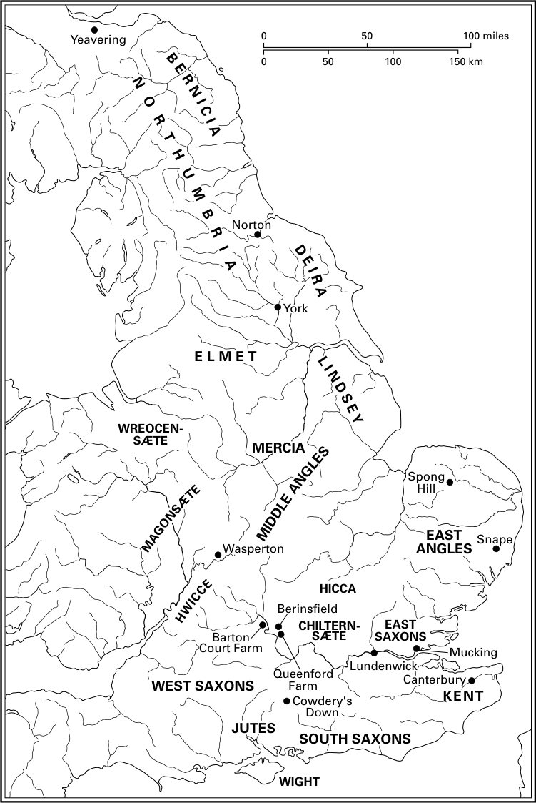

# 第10章 · 最早的盎格鲁-撒克逊王国

## 导言

当比德开始撰写《教会史》时，人们已相信最早的盎格鲁—撒克逊诸王国的起源在于日耳曼入侵者的族谱，主要是《教会史》所记载的三个部落——盎格鲁人、撒克逊人和朱特人，许多最早的王国正是以这些族群命名的。^1 事实上，关于王国形成的传统观点，即以《教会史》和《盎格鲁—撒克逊编年史》中对入侵的记述为出发点，将盎格鲁—撒克逊墓地与居址的分布视为军事征服和政治接管过程的标志，新王国正是在这一过程中被瓜分出来的。^2 这一学派的一个杰出范例，是贝克在1911年出版的《剑桥中世纪史》第一卷中所撰写的“条顿人对不列颠的征服”一章。现代学术研究所掌握的数据——尤其是考古遗存形式的资料——是贝克时代无法想象的；自20世纪70年代以来，随着盎格鲁—撒克逊诸王国的起源重新受到审视，“征服模式”这一英国史学的核心信条已然瓦解。

一种新的理解——即便算不上确切的共识——已经形成。它比贝克的图景更为复杂，却不如后者那样令人满意地全面。这种对六世纪英格兰的看法，源自对四个相互关联问题的持续重新评估：日耳曼移民的规模与性质，以及相反地，不列颠土著的存续；“盎格鲁—撒克逊”社会身份的形成；权力的构建；以及在生产与交换策略中所反映的新经济结构的形成。

本章综述所采取的方法承认并强调，就上述每一个问题而言都存在地区差异。例如，人们早已承认日耳曼移民的影响因地而异。该国的某些地区，即南部和东部的大部分地区，受到了直接而深刻的影响；而在其他地区，如西米德兰兹，日耳曼移民几乎没有产生什么直接影响，尽管其间接影响最终同样重要。此外，人们还认识到，早期文字史料关于六世纪英格兰的事件、族群起源和社会身份所提供的可靠信息甚少，^3 这意味着任何对六世纪发展的概述都不得不严重依赖考古证据；考古证据虽然提供不了多少确定性，却相对丰富且在持续增加。

## 日耳曼移民与盎格鲁—撒克逊英格兰的形成

### 连续性问题：墓地与居址

对移民及其对后罗马不列颠的影响进行重新评估的核心，在于罗马—不列颠墓地居址与盎格鲁—撒克逊墓地居址之间的关系。五、六世纪建立的墓地，绝大多数都是全新设立的，尽管其中许多都位于罗马—不列颠墓葬地附近。一个典型的例子是埃塞克斯郡俯瞰泰晤士河口的莫金（Mucking）居址群，这里不仅有两处墓地和一处规模可观的聚落——均建立于五世纪上半叶——还有四处罗马—不列颠墓地。莫金最晚的罗马—不列颠墓葬可能晚于公元350年，有些甚至可能属于四世纪末，乃至五世纪。^4 因此，罗马—不列颠墓地最晚的墓葬与“盎格鲁—撒克逊”墓地建立之间相隔的时间必定很短——两者的使用期甚至可能有所重叠——然而后者却是建立在全新的、完全独立的地点之上的。一个新的聚落和一个新的墓葬共同体由此被同时界定出来。

然而，我们现在知道，有些罗马—不列颠墓地一直使用到后罗马时期，但由于罗马时期最晚墓葬难以断代，这种情况有多普遍尚不清楚。例如，昆福德农场（牛津郡）的罗马—不列颠墓地位于泰晤士河畔多切斯特罗马小城之外、一处有五世纪早期盎格鲁—撒克逊人活动的地区，然而放射性碳测年表明，该墓地一直使用到六世纪。^5 在这类墓地中，可能埋葬着许多生活并死于五、六世纪的不列颠人，但由于其葬俗不使用耐久的、可断代的随葬品，他们在考古学上是无形的。他们与附近“盎格鲁—撒克逊”墓地中埋葬者的确切关系，以及他们的人数，目前仍是悬而未决的问题。

在绝大多数情况下，如莫金那样，共同体在五、六世纪建立了新的墓地，但这一规则也有少量已知的例外。在沃里克郡的瓦斯珀顿，一处建立于四世纪的墓地到七世纪仍在使用，尽管葬俗在六世纪的某个时候发生了根本性的变化。^6 在瓦斯珀顿发掘的182具土葬中，36具具有典型的罗马—不列颠特征，137具属于盎格鲁—撒克逊人；有学者认为，有9具是“混合型”墓葬。瓦斯珀顿很可能代表一处跨越晚期罗马和早期盎格鲁—撒克逊时期的家族墓地，其人口大体保持不变，尽管葬俗和物质文化已经“盎格鲁化”。该共同体采用崭新而有力的族群象征，表明发生了一场深刻的变化，实际上是一次文化同化——当地人口逐渐自视为“盎格鲁—撒克逊人”。^7

鉴于这类证据，再加上晚期罗马不列颠^8 的人口在数量上被乘坐小舟渡过北海而来的移民所压倒或取代这一说法难以成立，五、六世纪数以千计的火葬和土葬——死者以大陆风格的随葬品和服饰下葬——不再被认为必然属于移民，甚至不再被认为必然属于移民的直接后裔。相反，与可断代为五世纪的墓葬相比，六世纪“盎格鲁—撒克逊”墓葬和墓地数量的大幅增加，必定在很大程度上归因于不列颠人的文化同化。此外，由于耐久的、批量生产的陶器、金属器、玻璃器和石器难以获得，五世纪人口的大部分在考古学上也是无形的。旧物件因此被重复使用，这使得识别五世纪墓葬的工作大为复杂化。

人们曾做过各种尝试，试图在“盎格鲁—撒克逊”墓地中辨认出不列颠人。例如，有人论证说，那些随葬品很少或没有随葬品的墓葬、屈肢葬的个体，或者不带武器的男性墓葬，可能属于不列颠人。^9 然而，无论在早期盎格鲁—撒克逊英格兰当一名*wealh*（字面意为外邦人、奴隶或不列颠人）^10 究竟意味着什么，这显然是一种不利处境；可能许多不列颠家庭试图通过采用“正统”的盎格鲁—撒克逊葬俗来隐瞒自己的血统，以改善其社会地位和经济状况。在七世纪末韦塞克斯的伊尼法典中，*wealh* 的命价大约只有英格兰人的一半，若干条款表明大多数不列颠人法律地位低下——尽管韦塞克斯王族几代成员的名字含有不列颠语成分，这本身就暗示存在通婚。^11 这种情况所暗示的低社会地位，加上大规模的同化，似乎是古英语得以广泛而迅速地推广、而英语中保留下来的不列颠语借词（仅约十个）却微乎其微——即使在该国西部也是如此——的最可能的解释。^12 如果这一推测正确，那么六世纪的不列颠人在考古学上将难以乃至无法辨认。

正如新的葬俗形式在五、六世纪于不列颠以成熟形态骤然出现一样，两种新型建筑也如此。第一种被称为沉坑小屋、沉坑式建筑（SFB）或 *Grubenhäuser*，在民族大迁徙时期西北欧的聚落中几乎无处不在。它们一般规模较小，有下挖的地面，深度差异很大。关于应如何复原这些建筑，曾引发相当多的争论：一些证据表明它们在某种地窖之上架设木地板，而另一些建筑的坑底则有明显的踩踏痕迹。我们可以相当肯定，它们具有多种功能，尽管大多数可能用于储藏和手工业活动。无论如何，它们的大陆渊源从未受到认真质疑。它们通常与另一种木构建筑共存，后者的起源则争议较大。这类建筑呈长方形，墙体由立柱插入柱洞构成，一般有两处相对的门，位于长墙中央，平均长约10至12米，宽约5至6米。其中至少四分之一的建筑在一端有一道隔墙，形成一个小隔间。这些建筑大概是住所，尽管有些可能代表谷仓或其他专用建筑。这种“盎格鲁—撒克逊房屋”到六世纪已出现于英格兰大部分地区，且地区差异很小，以至于诺森布里亚、韦塞克斯和埃塞克斯的某些建筑在尺寸、门的位置与宽度以及内部隔分方面几乎完全一致。然而，这种类型的建筑既不酷似大陆上人畜同住一顶之下的传统长屋，也不酷似晚期罗马—不列颠建筑。目前的共识是，它们代表了某种程度的杂交融合，尽管盎格鲁—撒克逊房屋在西北欧的建筑传统中能找到最接近的类似物。^13

相当数量的早期盎格鲁—撒克逊聚落选址于罗马—不列颠聚落附近，甚至就在同一地点，这与“盎格鲁—撒克逊人回避罗马—不列颠聚落”的旧格言相悖。然而，聚落“连续性”这一棘手问题依然存在。例如，在巴顿庭农场（牛津郡），典型的早期盎格鲁—撒克逊时期的木构建筑和墓葬于五、六世纪间兴建于一片繁荣的四世纪农庄遗址之上，那里的一处窖藏可能晚至约430年才被埋藏。^14 建造这些建筑的人与先前的居住者之间究竟存在何种联系（如果有的话）？盎格鲁—撒克逊聚落的布局在某种程度上受罗马时期界沟的制约，但没有证据表明罗马时期的石构建筑仍被占用；事实上，农舍在四世纪末或五世纪初即被拆毁。然而，尽管巴顿庭农场的两个共同体在时间和空间上都没有任何明显的断裂，用发掘者的话说，它们的物质文化却“截然不同”。^15 至于城镇生活在任何有意义的意义上延续到六世纪，似乎也极不可能。^16 虽然《盎格鲁—撒克逊编年史》记载盎格鲁—撒克逊人在六世纪攻占了巴斯、西伦塞斯特和格洛斯特等一批罗马—不列颠城镇，暗示它们——至少作为设防之地——延续了整个五世纪，^17 但这些恰恰是似乎证实（考古证据亦然）如下结论的例外：大多数罗马—不列颠城镇到五世纪中叶已实际上消亡。

### 六世纪的人口状况与王国的起源

对1911年的贝克来说，“不列颠之被征服竟不借助庞大而有组织的武力”似乎“难以置信”，尽管他冒昧提出，“许多学者认为当地人口被完全灭绝，恐怕走得太过头了”。^18 到20世纪80年代和90年代初，学术钟摆已摆向另一极端，早期关于大规模迁徙的记述被归入神话领域。取而代之的是，从罗马不列颠到盎格鲁—撒克逊英格兰的转变，被视为由一个微小的军事精英借助外婚、同化和交换等过程完成的。^19 然而，到六世纪中叶大陆风格服饰已被广泛采用^20——这本身是群体自我意识与共同血统的有力象征——还有数以千计的个体被葬于与大陆样品实际上无法区分的火葬瓮中，如果不承认移民（至少在百年尺度上累积考察）曾达到相当的规模，这些现象就无法得到令人信服的解释。事实上，来自石勒苏益格—荷尔斯泰因的考古学和孢粉学证据似乎支持比德关于盎古鲁斯（Angulus）在五至八世纪人口锐减的记述。^21 此外，低地不列颠从四世纪到六世纪几乎看不到社会经济连续性的迹象。一个重要的例外是土地利用：日益增多的证据——主要来自孢粉分析——表明，从罗马时期到晚期撒克逊时期，已开垦的景观一直得到维持，五、六世纪的大规模再森林化是例外而非通则。^22

然而，认为这些移民来自族群上连贯而独特的群体或“民族”的看法，却得不到考古证据的支持。五世纪的欧洲显然确实存在至少被外人称为盎格鲁人、撒克逊人和朱特人的群体，当然还有弗里西人、法兰克人等。^23 它们据称居住的那些地区的物质文化也显示出某些独特特征，例如可以区分易北河以东和以西的地区，以及日德兰半岛北部和南部。然而，这些假想的“文化省”之间存在相当程度的重叠，我们不能假定，例如陶器风格的差异与族群身份有任何直接的关系。“盎格鲁人、撒克逊人和朱特人”这类族群标签，至少就数百年后的编年史家为解释当时政治局势而加诸五世纪各族而言，可能反映了源自同一地理区域的群体（比德确实是以地理疆域而非政治或文化归属来界定这些 *gentes* 的），但这些群体是不稳定的、流动的部落联盟。盎格鲁人、撒克逊人和肯特人民的这种文化统一，先于其政治上统一为王国，是在迁徙到不列颠之后实现的。^24

今天已很少有人怀疑，关于五世纪不列颠发生大规模入侵和人口更替的早期记述，在很大程度上是“起源神话”，是为后来各时期统治精英的利益而编造的，旨在提供一种赋予政治合法性的统一、稳定的意识形态。^25 尽管如此，考古学表明，移民在盎格鲁—撒克逊身份的形成中确实发挥了关键作用。然而，向某些地区的大规模迁徙与土著人口的大量存续，这两者并不互相排斥。五、六世纪不列颠南部和东部土著人口的确切命运这一复杂而引人入胜的问题，仍有待解决。族群身份当然不是由生物学决定的，而是由个人际遇和历史境况决定的；在某些条件下，个人可以转换其族群归属，“按照自身的处境需要……更换自己的标签”。^26 人们只能得出结论：大批不列颠人恰恰就是这样做的，因此同化与杂交融合的直接证据将继续难以觅得。在受罗马统治崩溃和蛮族侵袭影响较不直接的地区，例如峰区和西米德兰兹，六世纪盎格鲁—撒克逊风格的墓葬发现极少，当地群体大概维持了自身的地位；在东约克郡，罗马式葬俗一直延续到后罗马时期。^27 总之，同一种人口模式并不适用于整个盎格鲁—撒克逊英格兰。

虽然六世纪英格兰精确的人口构成可能永远无法查明，但我们可以肯定，实际情况远比比德笔下盎格鲁人、撒克逊人和朱特人的叙述模糊。然而，到六世纪中叶，新的、相对连贯的区域身份已经形成；这些身份在考古记录中显现出来的时间，比最早的文字记载还要早好几代。

## 盎格鲁—撒克逊共同体与身份的形成

这些盎格鲁—撒克逊身份是在规模小、间距近的共同体中锻造出来的（参见下文第273—276页），所使用的文化语汇主要源自西北欧。“盎格鲁化”这一过程本身仍然隐而不见，但很明显，到六世纪中叶，英格兰南部和东部的许多人（以及诺森布里亚的部分人）相信——或至少希望别人相信——自己是日耳曼人的后裔。这一时期留存的证据，特别是女性服饰的元素以及陶器和金属器上的装饰风格，表明物质文化被积极地用来标示部落归属。事实上，正是在六世纪，物质文化——尤其是女性服饰——上的地区差异最为显著。这必定与新的集体身份的形成关系更大，而与五世纪任何原初的族群差异关系较小，因为如前所述，后者已经极其模糊。因此，例如在东盎格利亚，“一种崭新、一致而独特的盎格鲁式英格兰文化，在短短几代人之内，就从极其多样的来源中迅速拼合而成”；^28 女性服饰以其独特的斯堪的纳维亚式胸针和腕扣（用于扣紧长袖衣物的袖口），作为这种新文化的表达占据了突出地位。在肯特也是如此，法兰克式时尚的采用使共同体的显赫成员彰显出鲜明的“肯特特色”。女性服饰风格上这些显著的地区差异出现于六世纪早期。它们并非源于五世纪的现实，而是必须被塑造出来的。各个共同体构成了这一文化统一过程乃至最终的王国形成过程的背景，因此有必要检视我们关于六世纪共同体内部社会组织所知的情形。后世文字史料可用于充实图景，但墓葬是六世纪信息量最为丰富的史料来源，而日益增多的居址发掘也在重要方面大大加深了我们对社会组织的理解。^29

### 墓葬共同体

五、六世纪存在两种主要类型的墓地。第一种是大型火葬墓地，相对少见，仅见于盎格鲁人地区。^30 研究最充分的例子是诺福克郡的斯庞丘陵（Spong Hill），据估计那里2000多座火葬墓代表约450至750人的人口。^31 这一数字大大超出了单个聚落的规模（见下文），表明此类“瓮棺墓地”所代表的墓葬共同体至少来自六个大型聚落，或许多达三十个小型聚落。第二种更为常见的墓地仅含土葬，或土葬与火葬混存，规模小得多，从几十座墓到几百座墓不等。这些墓地大概代表单个聚落，尽管在大多数这类墓地中儿童的比例偏低，使人不禁要问：共同体的所有成员是否果真都葬于这种表面上“公共”的墓地。为什么存在两种类型的墓葬共同体（有时甚至在同一地区内并存，例如诺福克郡的诺里奇畔凯斯托和莫宁索普^32），远非清楚，尽管它们大概代表界定“共同体”的两种不同方式，可能涉及不同类型的氏族或半族。

在墓地原始范围已知且已发掘相当比例的地方，可以估计它所代表的共同体的规模，如斯庞丘陵；这类计算虽远非简单易行，但至少能提供六世纪共同体规模的印象。在克利夫兰郡小型的混合葬俗墓地诺顿，估计人口约为28人；在牛津郡的贝林斯菲尔德为30至40人；在莫宁索普约为60人。^33 正如下文所示，这些估计与发掘居址所显示的共同体规模大体吻合。

对盎格鲁—撒克逊墓葬本身的研究表明，这些六世纪共同体的内部结构是分等级且有差别的，与年龄、性别和亲属关系相关——这些因素最明显地解释了服饰风格和随葬品种类的变异。年龄等级的存在既有考古证据，也有文字史料佐证，后者表明等级部分地与若干年龄门槛的跨越有关。死者随葬品的数量和类型所显示的趋势似乎标志着这类门槛。例如，女性随葬品的数量和种类在10至12岁左右显著增加，而男性从12岁左右起便随葬或多或少齐全的成人全套武器。10至12岁左右这一年龄门槛与盎格鲁—撒克逊法典中的证据颇相吻合。^34

在六世纪，性别在决定服饰和随葬品方面所起的作用更为突出，尽管这一领域仍有许多研究待做。^35 儿童通常以“性别中性”的方式下葬，成人中也有超过40%如此。^36 然而某些较为常见的物品几乎只见于某一性别。例如，胸针、项链和腰链（系于腰间的一束金属用具，包括真钥匙和“仿制”钥匙）与女性同葬，而武器与男性同葬。不同形制的火葬瓮似乎也被认为适合不同性别，女性往往葬于较矮的、窄口的器皿中。^37 动物的火化遗骸有时随葬入墓，这里同样可以观察到与年龄和性别的某些关联；例如，马主要与成年男性同葬。^38

随葬品可以表达社会身份的一个很好例证，是随葬武器的墓葬，即通常所称的“武士墓”。六世纪约半数成年男性被授予武器葬俗。对这类墓葬的详细研究表明，所葬武器通常并非实用的成套兵器；^39 换言之，它们不是上阵时携带的那种。它们是经过精心挑选的，而挑选部分取决于死者的年龄。武器葬的随葬财富一般也高于平均水平。然而，一些随葬武器的男性年幼得尚无法在战斗中使用这些武器，另一些则严重残疾。这一证据（结合某些表生遗传特征的分布）表明，以武器随葬并不一定标示死者生前是现役武士，而是象征某一显然处于上升态势的世系或氏族的成员身份，或许还象征移民集团的后裔身份。

因此，社会等级与身份至少间接地反映在土葬和火葬两者之中。随葬品的类型、数量和种类，死者所着服饰以及整个葬俗，都与年龄和性别存在某种程度的共变关系，而年龄和性别自明地属于“社会的结构性原则”。^40 然而，虽然六世纪盎格鲁—撒克逊葬俗显然受到年龄和性别的影响，亲属关系、族群和等级等无形的社会身份层面，或许还有宗教或祭祀，也必定对死者的处置具有关键影响；正因如此，葬俗、年龄与性别之间的关联很少是绝对的，只能提供一扇小小的窗口，让人窥见六世纪社会关系的丰富复杂性。^41

六世纪的大多数墓葬都随葬某种物品；而且在本世纪后期以前，最富有的墓葬可以说只是宽阔的随葬财富连续体的高端而已；^42 大多数按随葬财富为这一时期墓葬分级的尝试都产生了不可靠的结果。在墓葬区划可以辨认的地方，很少发现某一区划的随葬财富明显贫乏于其他大致同时的区划。^43 如果这些区划确实代表各个家庭——这似乎很可能——这就表明等级的体现主要在于家庭内部而非家庭之间；这一论点得到居址证据的支持（见下文）。例如，在蒂斯河畔诺顿的六世纪墓地，数量大致相等的男性武器墓和装备精良的女性墓（各约12座）表明，三代人之中有4对“居于领导地位”的夫妇，分别处于4个家庭的顶端，每个家庭由9或10人组成。^44

文字史料几乎不容置疑地表明，亲属关系在界定早期盎格鲁—撒克逊共同体方面发挥了核心作用，并表明这种关系本质上是双系的（即不区分母方与父方的亲属）、从夫居的和族外婚的（即个人须在自己亲族之外婚配，且大多数女性迁居夫方亲族处）。^45 社会与法律地位部分地取决于一个人对特定亲族的归属，亲族既提供保护，也提供获取资源的途径。^46 然而，尽管或许可以在墓地中辨认出各家之长，要确切辨认完整的亲族或家庭却极为困难。尽管如此，假定一群共享同一朝向或焦点（例如围绕一座中心墓）的墓葬属于生前以某种方式互有关联的个体，似乎是合理的。例如，在贝林斯菲尔德墓地，某些表生遗传特征（如牙齿异常或第六腰椎的出现）——它们很可能是血缘联系的指标——的分布，以及男女老幼的分布，支持墓地不同区划代表不同家庭的理论。^47

### 居址

自20世纪70年代以来，有少数居址经过了规模足够大的发掘，足以提供关于六世纪村落或小村面貌的相当清晰的图景。虽然它们在规模和布局上的差异使“村落”一词的使用都成了有争议的问题，但大多数居址具有某些共同的一般特征。第一，它们相对较小（与土葬及混合葬俗墓地所显示的人口规模相称）且间距很近。在一些进行过密集考古调查和/或发掘的地区，如泰晤士河上、下游河谷的阶地砾土带，早期盎格鲁—撒克逊聚落以约2至5公里的异常近的间距分布。^48

埃塞克斯郡俯瞰泰晤士河口的砾石阶地上的莫金盎格鲁—撒克逊聚落，至今仍是已发表的发掘规模最大的盎格鲁—撒克逊聚落。^49 20世纪60和70年代，考古学家在这里考察了约14公顷的土地，发掘出50多座木构建筑和200多座沉坑小屋。然而，并非所有这些建筑都同时被占用。在大约250至300年间，聚落的重心移动了将近一公里。因此，所揭露的建筑总数极大，但在任一时点平均只代表约10个家庭单位，与莫金发掘的两处同时代墓地所显示的人口规模大体相当。日益增多的证据表明，这种迁徙不定的聚落形态在六世纪相当普遍。^50

大多数六世纪聚落共有的第三个特征——莫金以及萨福克郡的西斯特夫^51 即为其例——是缺乏明显的边缘、界线或其他规划迹象，无论是集体规划的还是外加的，例如共用的道路、标示农庄或地产的成组围合建筑，或明显的焦点性或中心性建筑或设施。偶尔能发现栅栏的痕迹，^52 但迄今发现的稍具规模的围栏几乎没有早于六世纪末或七世纪初的。虽然建筑的成组或成群现象并不罕见，且大多数建筑大体呈东西向排列，但它们并未显示出清晰的规划布局（例如围绕一座庭院），因此几乎无法确定它们是否属于同一时期。

然而，到六世纪末，考古记录中出现了一些具有明确规划布局和标示地产或家庭的实体围栏的聚落。这些特征——它们在七世纪变得更加显著——最早的可以断代的实例见于诺森伯兰郡的耶弗林（伊德温国王的一处王家庄园）^53 和汉普郡的考德里丘（Cowdery's Down）。尽管两者相距遥远，这些聚落都显示出包含惊人相似元素的规划布局：两座或多座建筑的成行排列，以及矩形围栏，其内建筑（出入因而受到控制）呈垂直方式布置，另有建筑毗邻或通向围栏。^54

六世纪建筑留存的证据显示其在形式和规模上差异相对较小，尽管考古学家所能琢磨的往往只是（常常不完整的）地基平面图；当然，地上部分可能存在过更大的差异。对这些平面图的研究表明，至少在某些建筑的营造中使用过标准化的建筑“样板”或模数。这一点明显体现在尺寸和布局上惊人的一致性之中，甚至在比较英格兰与大陆的建筑时也是如此，这暗示存在一种广泛而持久的西北欧木构建筑传统。^55

然而，这种一至两室的盎格鲁—撒克逊房屋究竟如何使用，远非清楚。也许诸如炊事和储藏之类的功能设于单独的建筑中，正如从法典及其他文书写照的十世纪情形那样。^56 尽管壁炉在文字史料中甚为突出，^57 但盎格鲁—撒克逊建筑中却很少能发现壁炉的实例，这一点令人费解，^58 尽管这在许多情况下可能是保存条件不良所致。^59

六世纪末七世纪初，若干建筑技术革新被引入。第一种也是最常见的是使用基础沟槽，将墙木置入其中，这一做法在七、八世纪间广为流行。^59 然而也许最引人注目的变化，是从约600年开始建造的少数异常庞大的建筑（即地面面积超过150平方米的建筑）。这类较大的建筑中有几座在一端或两端山墙处附建耳房，但“附建式大厅”到八世纪已基本消失。

### 一个过渡时期？

六世纪的墓地和居址因此表明，盎格鲁—撒克逊身份在其中发展起来的社会并非严格的等级社会，高等级的个体无论生前还是死后都被整合于共同体之中。对权力和财富的获取主要不是由出身决定的；等级在很大程度上取决于年龄、性别、血统以及积累可移动财富的能力，尽管对土地的控制大概也起了一定作用（我们后文将会看到）。诚然，这一时期大多数墓地都含有随葬品明显比其余墓葬丰厚的墓葬，^60 但这些最容易被解释为地方共同体的领导人物——家庭或亲族的首领，或某种其他形式的半族的首领——而非拥有超地方权力的王朝成员。^61 虽然某些家族确有可能在数代之间维持优势地位，但这只有通过将辛苦积攒的可移动财富投入到宴飨或炫耀性随葬品等昂贵展示之中才可能实现。随葬财富的巨大差异并不明显反映在居址中，这一事实支持如下论点：等级大体被限制在家庭内部而非家庭之间。

这一总体格局发生变化的迹象开始出现于六世纪后期。其中最引人注目的是首批坟丘即冢墓的出现。最早的盎格鲁—撒克逊冢墓出现于六世纪中后期，位于平地墓墓地之内。到七世纪初，一些地区建立了全部或主要由冢墓构成的整片墓地，还有若干孤立的、异常富庶的冢墓。^62 对其内涵的分析表明，冢墓的引入标志着对“等级地位的获取施加了更大的……限制”，尽管直到七世纪的那些孤立冢墓，一个卓越群体才显现出来，其地位想必是生而赋有的而非挣得的。^63 后罗马时期首次使用纪念碑式的葬俗，似乎标志着一种更加规范化、封闭化的等级体系的兴起，以应对资源竞争的加剧及由此产生的社会不稳定。坟丘也是血亲群体确立与祖先的联系并宣示领土要求的一种可见手段。^64

六世纪中后期一些火葬墓地中出现陪葬丰厚的土葬，可能同样具有意义。最清楚的例子是斯庞丘陵火葬墓地东北边缘的57座土葬。^65 其中包括一座墓室墓和四、五座冢墓，由此有人提出，这些墓葬代表一个于六世纪迁入该地区并建立了一个近乎独立的精英墓地的上升群体。^66 这些土葬只代表该墓地使用史上的一个阶段（最晚的墓葬是晚于这些土葬的火葬）这一事实表明，该群体的后裔要么与共同体其余部分同化，要么——这似乎更有可能——在别处开辟了新的墓地。

在萨福克郡的斯内普——距萨顿胡这处推测的王家墓地约18公里——六世纪也出现了一组独特的土葬。斯内普似乎在五世纪或六世纪初建立时基本上是一处小型火葬墓地；到六世纪中后期，若干个体被土葬（不过这些土葬分散于火葬之间，并未像斯庞丘陵那样形成独立区域），其中一些随葬高等级的随葬品。^67 至少有9人原葬于冢墓之下，其中一座异常富庶，且葬于船中。在一座平地墓中，死者被葬于一条独木舟中，并随葬一对饮酒角杯，另外几座则含有似乎是真船或船模型的部分构件。船葬习俗在当时与瑞典的精英群体相关联；或许这些墓葬标示着一个上升中的世系，试图通过采用一种独特的葬俗来宣示其显赫的斯堪的纳渊源。^68

六世纪下半叶还见证了萨林第一风格（Salin's Style I）——一种广泛见于五世纪后期至六世纪上半叶装饰性金属器上的兽形纹饰——被第二风格（Style II）所取代；后者是一种更为流畅的动物绞缠纹样，与第一风格一样起源于斯堪的纳维亚。这也可能与社会变化的问题有关，因为第二风格几乎仅限于高级金属器（最著名的是萨顿胡出土的一批金器）和写本。^69 对斯堪的纳维亚第二风格纹样及第二风格器物出土背景的详细研究表明，它是在政治冲突的背景下引入的，并在公共仪式（墓葬即为其中之一）中被一个谋求立足的新兴强势“阶层”用作纹章式的宣传手段。^70 遗憾的是，英格兰的第二风格器物太少，且其在许多情况下的出土背景太不确定，因而不敢断言这不仅仅是一种诱人的可能。^71

女性服饰——至少是精英阶层的女性服饰——在七世纪发生了变革：以大型厚重胸针在肩部扣紧的佩普洛斯式长裙，被一种仿效地中海时尚、缀以精巧饰针和项链的缝制服装所取代。在此之前，六世纪末出现了一些胸针，它们可能反映出对高等级“徽记”的新强调。^72 这在盎格鲁人地区最为明显，出现了更大、装饰极为繁复的旧形制的所谓“华丽”变体，尤其是十字形胸针和大方头胸针。此外，风格分析表明这类胸针的生产存在某种程度的集中控制。方头胸针尤其见于随葬财富高于平均水平的墓中，可能曾充当显赫家族展示地位的手段。^73

至于居址，目前已有足够数量的放射性碳测年数据表明，大型建筑、独立的高等级居址以及利用围栏和道路的规划布局，都是在六世纪后期至七世纪初陆续引入的（见上文）。然而，对这些现象的解释以及它们之间可能存在的关联，远非明确。这些大厅以其对木材和劳力的大肆耗费，可以毫无争议地被解释为“中枢人物”的宅邸：这些新地主建立了独立的居址，并展示一种设置于独特布局之中的炫耀式建筑风格。但是，虽然耶弗林和考德里丘都建立于六世纪末，直到七世纪它们才呈现出明显的高等级特征，尽管两者从一开始就利用了成行排列和围栏。最后，虽然就耶弗林和考德里丘而言，其精心规划的布局和对围栏的运用清楚地反映出一种 impress 并限制人们进入特殊建筑和区域的意愿，规划却未必一概意味着高等级。彭尼兰（白金汉郡）、里比克罗斯罗兹（林肯郡）、瑟林斯（诺森伯兰）和卡索尔姆（斯塔福德郡）的聚落既没有大型建筑，也没有异常丰富的物质文化（尽管没有一个被完整发掘），然而到六世纪末或七世纪初，它们全部利用了道路或车道以及围绕建筑和畜栏的围栏。^74

六世纪中后期还出现了最早的一批标准化后罗马陶器，即便谈不上大规模生产，至少比早期盎格鲁—撒克逊陶器的一般情况规模更大。在五、六世纪，陶器为手制且差异极大，几乎不可能找到两件形制和装饰完全相同的器物，尽管相似的母题和戳印广泛重现。然而，约200件器物的陶片（显然只是原产器物总数的一小部分）被发现分布于约12处聚落和墓地，这些器物虽然与该时期其他陶器以同样的传统手制，却使用了一套独特的、标准化的母题和戳印进行装饰。^75 这种所谓的伊灵顿—拉克福德陶器分布于东盎格利亚的一个小区域（约900平方公里）内，其边界是三道中世纪早期的线性土工工事。这些器物出自小乌斯河谷某处的一个生产中心，这仍不过是一种假说，其流通机制也不清楚。然而，无论其流通是受礼物交换、贸易还是地方首领的再分配所支配，“它们被用来与控制伊克尼尔大道沿线商路的邻近政治单位维持关系”这一论点是可信且重要的。^76

我们是否应当把葬俗、居址和陶器生产中的这些不同发展视为一环扣一环的连锁现象？它们是否是同一现象的反映，并间接表明条件已成熟，“一种自觉的共同英格兰认同”即将出现？^77 此处必须指出，在盎格鲁人地区之外，这种广泛社会变化的印象不那么清晰；例如，陪葬丰厚的墓葬在肯特直到七世纪仍相当常见，而在东盎格利亚之外没有任何与伊灵顿—拉克福德陶器相当之物。^78 此外，由于考古断代的粗糙，考古记录中看似突变的现象实际上可能跨越了好几代人。最后，由于考古实例数量少，且对这类实际上属于“史前”的发展难以按历史时期所要求的精度断代，甚至无法确定这些现象是否同时发生，因而也无法确定它们是否可视为七世纪更广泛、更显著的墓葬与居址变化的先声，例如“王侯”墓和王家庄园的出现。^79 仅此一点就应当警示我们，不要为这些变化寻求单一的目的论解释，也不要把它们归因于一个影响深远、渐进且不可避免的王国形成过程。变化必定既非平稳亦非革命性的，而是零散而偶然的，在不同地区以不同方式展开，在很大程度上取决于特定事件——大多不见于记载——的时间先后。“过渡时期”这一史学概念已受到质疑，而且 rightly so；^80 然而这些发展所显示的一致性表明，它们不只是七世纪史料投射到六世纪末的朦胧光线所造成的一种幻象。

## 六世纪与王国形成

在缺乏文字史料的情况下处理考古证据的困难之一，在于辨别上述居址、葬俗和物质文化诸发展背后的共同原因。要做到这一点，必须结合后世文字史料详载的政治与军事活动来考察考古证据。此外，在检视了六世纪共同体内部的社会结构之后，尚需考虑共同体之间的关系在王国形成中的作用，这种关系在贸易与交换的证据中表现得最为清晰。

不过，首先提醒自己一点是有益的：除七、八世纪文字史料所载的主要王国——肯特、东盎格利亚和中盎格利亚、林赛、德伊拉、伯尼西亚、麦西亚、萨塞克斯、韦塞克斯、埃塞克斯——之外，还有几个较小的王国（参见地图8）。^81 关于这些王国如何产生，最广为接受的理论以领土征服为核心特征。早期盎格鲁—撒克逊社会结构的流动特性，为雄心勃勃的个人获取等级地位提供了相当大的空间。

*[地图8 《部落藏赋书》成书时期的主要盎格鲁—撒克逊诸部，以及第10章和第17章提及的主要遗址（据约克（1990）地图1和2）]*

以及通过竞争获取权力，而充分的证据表明这种竞争在六世纪甚为普遍。由此产生了如下假说：中撒克逊时期（约650—约850年）诸主要王国，是六世纪许多远为弱小的政治单位之间激烈竞争的产物——较为成功的群体击败并吞并较不成功者，最终在七世纪形成少数几个拥有超地区权威的王朝。^82

这一模型在许多方面与文字和考古证据都颇为契合。在现存的文字史料中，最重要的是《部落藏赋书》，一份年代可能为七世纪后期、出自麦西亚或诺森布里亚的文献，被广泛认定为一份贡赋清单，其中列举了三十四个族群，除诸主要王国外，还包括若干小型的“行省”或“地区”，例如仅有300海得的希卡。^83 人们很容易将这些小群体视为六世纪的“化石”，它们出于某种原因未被较大的王国完全吞并，并得以维持某种独立的身份。^84 虽然这一论点无法被证实，但在六世纪必定存在过许多这样的小型、不见于记载的群体，这一点看来是可能的；其中至少有两个——埃尔梅德萨特纳人（源自埃尔梅特）和威特加拉人（源自怀特岛），各有600海得——拥有自己的统治者，比德称之为“王”。^85 英格兰西南部和威尔士也生活着若干六世纪的统治者，即不列颠教士吉尔达斯在其《不列颠的毁灭》中加以“控诉”的那些小“王”，他们与其东部的盎格鲁—撒克逊同行一样，都是在罗马统治崩溃之后的时期攫取权力的。^86

地名资料补充了这一图景。以-ingas结尾的地名（意为“某人的人民/追随者”）如今被确认兴起于六世纪末至七世纪初，而非如从前所认为的那样兴始于五世纪至六世纪初最初的定居时期。^87 有人提出，这些-ingas群体的基础并非建立在共同血缘信念之上的共识，而是一种“占有式的、强加的称谓”。^88 鉴于《部落藏赋书》中-ingas群体是以海得计算的（例如法尔平加斯人），它们在那时想必已具有某种行政地位，尽管没有理由认为它们从来就是如此。无论其起源如何，这些较低层次的政治实体不太可能占据边界分明的疆域；它们可能仅仅由一群聚落构成，所有聚落通过某种海得摊派制度向同一中心缴纳实物贡纳。

《教会史》和《盎格鲁—撒克逊编年史》等后世文献，是按照当时领袖们希望后世如何看待的方式来描述王国起源的。这使它们对于寻求六世纪事件准确记述的人来说是可疑的史料；然而它们极为清楚地表明了一点：因争夺土地而起的战争甚为普遍，领土扩张是权力的必要条件。战神沃登作为祖先出现在如此之多的盎格鲁—撒克逊王室谱系之中，绝非偶然。^89 这些谱系本身表明各大王朝起源于六世纪，尽管这需要从史料确凿的统治者的年代出发，向前推算其半神话祖先——如韦塞克斯的塞尔迪克和东盎格利亚的武法——的大致年代。有人认为这些谱系仅仅反映了口传传统最初被记录下来时民间记忆的极限，向上追溯若干代而止。^90 然而综观全部证据，六世纪已有国王存在这一结论似乎是难以回避的，尽管其权力的性质与范围仍模糊不清。诚然，肯特国王埃特尔伯特的法典断代为七世纪初，其中表明至少他不仅对其直接追随者，而且“对社会的一切等级：贵族、自由人（乔尔）、不自由农民和奴隶”都拥有权力和责任。^91

这些国王的起源是什么？如果吉尔达斯关于叛乱撒克逊同盟者在后罗马不列颠活动的记述有任何真实成分，那么便存在一种可能（可类比于法兰克人）：六世纪后期某些统治者正是从这类机会主义的劫掠者“演化”而来，这些人开始控制他们一直加以掠夺的特定地域。^92 不列颠东部王国形成的另一可能催化剂，在于肯特和东盎格利亚的精英与墨洛温宫廷之间的联系。六世纪后期肯特精英与法兰克精英之间存在密切联系，法兰克公主贝尔塔与国王埃特尔伯特的联姻即为明证；《萨利克法兰克人法典》（很可能成于五世纪末或六世纪初）中有关逃亡奴隶的条款进一步表明，法兰西亚与不列颠部分地区之间存在着对等的法律安排。^93

六世纪后期考古记录中所发生的变化，虽然不能为领土征服或战争提供直接证据，却与一个新精英阶层、或许还有支配性世系的出现相一致。如前所述，这些变化首先是首批“特殊功能”居址——如耶弗林和考德里丘——的出现，它们共有一种新的建筑风格和布局，以及（下文即将谈到的）首批商站的出现；其次是葬俗的变化，精英在其中获得了新的突出地位。如果说炫耀性葬俗是新近崛起的家族在动荡时代维持自身地位的一种努力，那么富庶墓葬的出现便表明这些地区对地方权力的竞争加剧了。^94 第三是迄今尚未论及、且出了名地难以解释的人口增长的证据。已知属于六世纪的聚落和墓地数量远多于五世纪。这在很大程度上必须归因于两点：一方面是识别五世纪物质文化的困难，另一方面是正如本章前文所见，土著群体在六世纪从考古学的隐形状态中显现出来的文化同化过程。然而，即便六世纪人口的渐进增长也可能在相当程度上加剧对土地的竞争，这一可能性值得认真对待。到七世纪，对土地的控制对于维持地位与权力无疑是不可或缺的；土地因此不仅是经济资源，更是社会资源，^95 而较年幼的儿子为维持并扩大自身权力而获取土地的迫切需要，势必助长那种最终将权力集中于更少人之手的竞争。

如果六世纪的英格兰遍布《部落藏赋书》所载的那类小型政治单位——其中至少有一些可以合理地称为王国——那么晚期罗马不列颠的行政基础设施必定已经迅速瓦解为若干或多或少独立的单位；其疆域在多大程度上受晚期罗马行政组织的制约，乃至是否拥有明确的疆域，仍是一个悬而未决的问题，我们后文将会看到。在这样一种情形下，贸易与交换的网络为日后的整合提供框架的潜力本会相当可观。^96

当七世纪期间若干由王室控制的贸易中心即“沿海商埠”沿英格兰海岸和主要河流建立起来时（主要例子有南安普敦、伦敦、约克和伊普斯威奇），支撑它们的广泛而形式化的贸易网络很可能以先前已存在的交换轴线为基础。^97 五、六世纪贸易路线的证据主要来自聚落和墓葬中非本地物品的出现。虽然这类史前交换网络难以精确界定，但将显而易见的进口品的分布绘制成图所产生的格局颇具启发性。例如，如前所述，伊灵顿—拉克福德陶器的分布勾勒出一个以小乌斯河谷和伊克尼尔大道为中心的交换网络的轮廓。一件远为常见的器物、因而也更有可能阐明交换机制的器物，是琥珀珠，它们广泛见于六世纪的女性墓葬之中。其分布（连同水晶珠的分布——后者是较不常见的六世纪进口品）聚集于若干“节点”，例如林肯郡的斯利福德墓地，那里葬有近1000颗琥珀珠。^98 围绕这些节点分布着众多仅有少量琥珀珠的墓地，这一格局最好被解释为反映了地方首领对琥珀的再分配。对这些墓地的琥珀获取受到严格控制并具优先性这一点的进一步证明，是这些墓地中通常都有一座女性墓随葬的琥珀珠数量超过平均数的十倍。其他非本地商品——如缺乏现成矿源地区的铁——的分布，无疑也值得更细致的研究。^99 即便从如此有限的证据出发，一幅六世纪交换网络的图景已开始浮现：它既非市场驱动，也不以货币为基础，其中许多货物——尤其是能为持有者带来声望的奢侈品——的再分配由地方共同体的首领成员所控制。

经济在六世纪后期日益组织化的一个迹象，可以在进入英格兰东南部的墨洛温金币数量的增长中找到——比第一批真正的盎格鲁—撒克逊钱币的铸造早约100年。少数几副用于评估金币价值的天平和砝码（大多残损）被葬入墓中；它们主要出自肯特——其早期繁荣源自其与法兰西亚贸易的近乎垄断地位——以及上泰晤士河谷，后者如今被公认为韦塞克斯王国的摇篮。^100

交换的证据最好与生产方式的证据一并评估。然而罗马—不列颠经济的迅速瓦解导致约400年前后工业生产的崩溃——罗马不列颠轮制陶器工业的骤然消亡已成老生常谈——此后200年间，生产遗址的缺失极为醒目。例如，早期盎格鲁—撒克逊胸针已出土数千件，而留存至今的用于制作它们的模具和模型却屈指可数。在生产遗址阙如的情况下，早期盎格鲁—撒克逊物质文化的生产方式——无论属于家庭生产、“游动”生产还是兼职专门化生产——在很大程度上仍属推测。我们或许能在六世纪后期看到某种有限重组的迹象，例如伊灵顿—拉克福德陶器，以及可能还有方头胸针之类的金属器，但直到七世纪的贸易中心出现，我们才找到集中化工业活动的明确证据。

上述以“竞争性排除”为要旨的王国形成模型，带着其达尔文主义的意味，略显生硬，也并非没有批评者，^101 但它多年来一直占据主导地位，罕有真正的竞争者。最主要的对立论点（不过两者绝非互相排斥）认为，盎格鲁—撒克逊诸王国在很大程度上承袭了罗马不列颠的政治地理格局。人们早已认识到，某些最早的盎格鲁—撒克逊王国的名称源自罗马—不列颠的部落或地区，如坎特瓦雷纳、伯尼西亚、德伊拉和林赛。由此产生了如下假说：最早的王国建立在既有的领土单位之上，由盎格鲁—撒克逊霸主接管。关于疆域从罗马时期（乃至前罗马时期）到撒克逊时期的连续性，存在一系列证据。^102 诚然，旧有边界和地理划分的连续使用本身是完全可以想见的；但这并不必然意味着这些边界在政治上得到维持。因此，七世纪盎格鲁—撒克逊人接管中西部的证据^103为六世纪更东部地区可能发生的事情提供了一个有趣的模型：即相当程度的领土连续性以及重新组织。然而从考古学上看，这些地区呈现出截然不同的面貌。简言之，界定一处晚期罗马—不列颠庄园宅邸或一处早期盎格鲁—撒克逊王家领地的边界已是极其困难，更遑论判定二者是否相同。一个常被引用的政治连续性可能的考古学例证，是诺森布里亚的耶弗林居址，它建立于六世纪，到七世纪已成为一处王家庄园。耶弗林无疑是不列颠人崇拜中心，且至少自青铜时代以来就有仪式活动，但对遗址布局的细致分析表明，我们不应从选址中读出任何具有实质意义的政治连续性。^104

与其他西部行省不同，罗马不列颠并未完整地落入蛮族之手，也未被迅速征服。旧的社会秩序、制度和权力结构遭受了剧烈的破坏。取代它们的最早盎格鲁—撒克逊诸王国的社会政治结构虽然并非全然崭新，但至少在英格兰南部和东部的大部分地区，它似乎并非以罗马—不列颠政治结构的构件搭建而成。

## 结论

最早的盎格鲁—撒克逊首领无法像罗马国家那样有效地征税和强制追随者，转而通过劫掠和征收食物贡纳来攫取剩余产品。他们以此方式积累的可移动财富，被用于通过炫耀性消费和仪式化的贵重礼物赠予来维系追随者。^105 六世纪后期见证了这种“声望货物”经济终结的开端，同时伴葬墓葬走向衰落，首批王侯墓和高等级居址开始出现。到600年，首批盎格鲁—撒克逊沿海商埠的建立已在酝酿之中。^106 这些贸易与生产中心反映出社会政治分层的加剧和更广泛的地域权威，它使七世纪的精英能够以远比其六世纪前辈所可能做到的更大成效攫取和再分配剩余产品。^107 简言之，公元600年的盎格鲁—撒克逊社会与一百年前相比已判然有别。

然而，若认为这是稳定演化或直线进步的结果，便失之错误了。尽管当前学术界有一种到越来越早的时期中去寻找中世纪早期王国起源的倾向，^108 七、八世纪英格兰的王国在多大程度上真正植根于六世纪，仍是一个可争论的问题。虽然上文提出的许多解释不过是不揣冒昧的推测——就一个本质上属于史前的时期而言，它们也只能如此——但文字与考古证据的综合分量表明，至少某些最早的盎格鲁—撒克逊王国，正是脱胎于六世纪后期一个冲突与竞争加剧的时期，而其结局远非注定。

## 致谢

我非常感谢塔尼娅·迪金森博士、约翰·布莱尔博士、马丁·韦尔奇博士和芭芭拉·约克博士，他们的评论和建议使本章大为改进。

## 注释

1. 比德，《英吉利教会史》（HE）i.15.1。
2. 例如参见 Leeds (1912) 及 Myres (1954)。
3. 参见 Yorke (1993)。
4. Hamerow (1993)；C. Going 的私人通信。
5. Chambers (1988)。
6. Esmonde Cleary (1989)，第201页；Wise (1991)。
7. 伯克郡弗里尔福德（Frilford）墓地于十九世纪末二十世纪初仅经部分发掘，是另一处可能是罗马—不列颠时期墓地延续使用至盎格鲁—撒克逊时期的实例。参见 Meaney (1964)，第46页。
8. 目前估计人口约为三四百万，不过在四世纪末和五世纪初，人口很可能大幅下降。参见 Millett (1990)，第180页及以下。
9. 例如参见 Faull (1977) 及 Härke (1992b)。英格兰西南部现已发掘出若干后罗马时期墓地，显示不列颠人墓葬的真实面貌。参见 Leech (1986)、Cox (1989) 及 Watts and Leech (1996)。
10. EHD i，第402页，注5。
11. 例如参见第23.3、24.2、32、33条。译文见 EHD i，第367–8页。
12. 参见 Hamerow (1991)；Higham (1992)，第181页及以下；Charles-Edwards (1995)，第729–30、733页；Härke (1997)，第149页；Ward-Perkins (2000)。
13. 参见 Hamerow (1999)。
14. Miles (1986)。
15. Miles (1986)，第52页。其他在罗马—不列颠农庄旧址上建立盎格鲁—撒克逊聚落的例子，包括彼得伯勒附近的奥顿霍尔（Orton Hall）和埃塞克斯的里文霍尔（Rivenhall）。参见 MacKreth (1996) 及 Rodwell and Rodwell (1985)。
16. 参见 Biddle (1989) 及 Esmonde Cleary (1989)。
17. 《盎格鲁—撒克逊编年史》（ASC）577年条。参见 Loseby (2000)。
18. Beck (1911)，第388页。
19. 例如参见 Arnold (1984)、Hodges (1989) 及 Higham (1992)。
20. 尤其是在诺福克和萨福克，已知的早期盎格鲁—撒克逊墓地近一百处。参见 Scull (1993)，第69页。
21. HE i.15。参见 Müller-Wille et al. (1988)。
22. 参见 Murphy (1994) 及 Tyers et al. (1994)。
23. 参见 Hines (1995)。
24. 参见 Hines (1995) 及 Wood (1997)，第45页。
25. 参见 Pohl (1997)，第9页。
26. Chapman (1992)，第22页。
27. 关于埃尔姆斯韦尔（Elmswell）的石箱葬，参见 Loveluck (1994)，第140页。
28. Hines (1995)，第81页。
29. 令人警醒的是，在迄今已知的1500余处早期盎格鲁—撒克逊墓地中，就撰写本文之时而言，仅有约五十处经发掘，其规模与水准足以进行有意义的统计分析。此外，仅有约十二处出土了保存完好的骨骼遗存，而这是研究年龄与性别所必需的。参见 Härke (1992a)。
30. 在大陆上，类似的“火葬场”（Urnenfelder）见于德国北部和丹麦南部，尤其是石勒苏益格—荷尔斯泰因和下萨克森。
31. McKinley (1994)，第70页。另参见 Timby (1994)。
32. Myres and Green (1973)；Green et al. (1987)。
33. 参见 Sherlock and Welch (1992)，第107页；Scull (1993)，第72页；Boyle et al. (1995)，第116页；以及 Boyle et al. (1998)。
34. 参见 Härke (1997)。另参见 Stoodley (1998) 及 Crawford (1999)。
35. Stoodley (1999)。
36. 参见 Härke (1997)，第132页。
37. 参见 Richards (1987)，第196页。
38. 参见 Richards (1992)，图22；但有证据表明，马在东盎格利亚火葬墓中的出现可能比通常所认为的更为广泛，另参见 Hills (1998)。
39. 参见 Härke (1992a) 及 (1992b)。
40. Richards (1992)，第144页。然而，大多数随葬品似乎并非为死后来世使用而置放。
41. 参见 Pader (1982)；Richards (1987)，第197页；以及 (1995)。
42. 参见 Shepherd (1979)。
43. 例如参见牛津郡贝林斯菲尔德（Berinsfield）、克利夫兰诺顿（Norton）和苏塞克斯苹果岭（Apple Down）的墓地。Down and Welch (1990)，图2.8、2.9；Sherlock and Welch (1992)，图21、24；Boyle et al. (1995)，第133页及图30；Härke (1997)，第138页。
44. Sherlock and Welch (1992)，第102页。
45. Härke (1997)，第137页。
46. Charles-Edwards (1997)。
47. Boyle et al. (1995)。
48. 参见 Hamerow (1993)，图52；Blair (1994)，图16、24。
49. 参见 Hamerow (1993)。皮克灵谷地（Vale of Pickering）西赫斯勒顿（West Heslerton）的聚落也已大规模发掘，其成果出版后必将大大加深我们对本地区聚落的认识。中期报告显示，其布局与我们在英格兰南部和东部所习见的聚落有相当大的差异。参见 Powlesland et al. (1986) 及 Powlesland (1997)。
50. 参见 Hamerow (1991) 及 (1992)。
51. 参见 West (1986)。
52. 例如苏塞克斯的比肖普斯通（Bishopstone）和埃塞克斯的马金（Mucking）。参见 Welch (1992)，图16；Hamerow (1993)。而在米尔顿凯恩斯附近的彭尼兰（Pennyland）以及西斯托（West Stow），围栏设施最早要到六世纪末才出现。参见 West (1986) 及 Williams (1993)。
53. HE ii.14。
54. 参见 Hope-Taylor (1977)、Millett with James (1984) 以及 O’Brien and Miket (1991)。汉普郡查尔顿（Chalton）聚落显示了类似的布局，可能建立于六世纪，但其年代与地位较不确定。参见 Addyman (1972)。
55. 参见 Zimmermann (1988) 及 Tummuscheit (1995)，图版66、94、95。
56. 参见 Dölling (1958)，第55页及以下。
57. 最著名的例子见比德 HE ii.13。
58. 参见 Hamerow (1999)。
59. 参见 Marshall and Marshall (1994) 及 Hamerow (1999)。
60. 例如格洛斯特郡莱克拉德（Lechlade）的18号墓。参见 Boyle et al. (1998)，图5.43–7。
61. Scull (1993)，第73页。
62. 参见 Shepherd (1979)；另参见 Struth and Eagles (1999)。
63. 参见 Shepherd (1979)，第70页。到七世纪，武器葬似乎日益表示属于一个狭窄的高等社会等级，而非一个宽泛的族群。因此，“上层”群体（即以剑、斧或撒克逊短刀随葬者）的百分比保持在约6%不变，“中间”群体的百分比却从43%降至17%，而以无武器随葬的男性的比例则从52%升至77%。参见 Härke (1998)，第45页。
64. 参见 Shepherd (1979)，第77页；另见 van de Noort (1993)。
65. Hills et al. (1984)。
66. Scull (1993)。然而，斯庞希尔（Spong Hill）火葬群体与土葬群体之间的界限远非截然分明。参见 Hills (1999)。
67. Filmer-Sankey (1992)，第39–52页。
68. 其他早期火葬墓地中兼有六世纪末或七世纪后期土葬的例子，包括同在诺福克郡的卡伊斯特—拜—诺里奇（Caistor-by-Norwich）和卡斯尔埃克（Castle Acre）。参见 Myres and Green (1973)，第171–2页；C. Scull 的私人通信。
69. 参见 Speake (1980) 及 Høilund Nielsen (1997)。
70. 参见 Høilund Nielsen (1997) 及 Hines (1998)，第309页。
71. 参见 Høilund Nielsen (1999)。
72. 参见 Hawkes and Meaney (1970)。
73. C. Mortimer 的私人通信；Hines (1984)，第30–1页；及 (1998)，第34页。在上泰晤士河谷的“撒克逊”地区，自五世纪起使用的铸制碟形胸针，也在六世纪末和七世纪初变得更大。参见 Dickinson (1993)，第39页。
74. 参见 O’Brien and Miket (1991)、Williams (1993)、Steedman (1995) 及 Kinsley (2002)。
75. 参见 Russel (1984)，第525页及以下。
76. 参见 Russel (1984)，第528页。关于陶器另参见 Williams and Vince (1998)：其中部分陶器似乎年代较早，产于莱斯特郡北部的查恩伍德森林（Charnwood Forest）地区，行销于整个米德兰兹东部和东北部，偶或及于更远之地。
77. 参见 Hines (1995)，第83页。
78. 已确认的其他一些所谓“作坊”，但只有伊灵顿—拉克福德（Illington-Lackford）陶器的出土数量足以表明近似“批量”的生产。参见 Myres (1977)。
79. 这些“王侯”墓中最著名者位于萨福克郡萨顿胡和牛津郡阿斯特霍尔（Asthall）。参见 Carver (1992) 及 Dickinson and Speake (1992)。另参见 Boddington (1990) 及 Geake (1997)。
80. 参见 Halsall (1995)。
81. 参见 Yorke (1990)，地图1。
82. 参见 Bassett (1989c)。
83. 参见 Davies and Vierck (1974) 及 Dumville (1989)。关于《部族海德税册》（Tribal Hidage）更持怀疑态度的观点，参见 Keynes (1995)。
84. 参见 Scull (1993)，第68–9页。
85. 参见 Yorke (1990)，第11页；比德 HE iv.16、19、23。
86. 吉尔达斯，《不列颠的毁灭》（De excidio Brit.），Winterbottom 编本（含原文与译文）。
87. 例如，黑斯廷斯（Hastings）源自 Haestingas，即 Haesta 的族人/追随者。参见 Dodgson (1966)。
88. 参见 Hines (1995)，第82页。
89. 参见 Yorke (1990)，第16页。
90. 参见 Yorke (1990)，第4页；及 Scull (1993)，第68页。
91. 译文见 EHD i。参见 Yorke (1990)，第17页。
92. 笔者感谢芭芭拉·约克（Barbara Yorke）提出的这一建议。
93. 参见 Wood (1997)，第47–9页。
94. 同一时期梅斯地区（Metz）的证据也支持以奢侈墓葬作为争夺地方权力之标志的解释。六世纪时，此类墓葬在梅斯周围二三十公里范围内十分罕见：“在梅斯近旁，争端可以通过向常驻当地的国王、主教、公爵和伯爵申诉而解决；再远一些，这就较为困难，因此更有必要公开展示对权力与资源的占有”（Halsall (1995)，第48页）。
95. 参见 Charles-Edwards (1972) 及 Scull (1993)，第77页及以下。
96. 然而，在当前关于王国形成的多数理论中，贸易所受的关注出奇地少。
97. 参见 Scull (1997)。
98. 参见 Huggett (1988)，第89页。
99. 关于上泰晤士河谷、东约克郡和峰区贸易格局的最新研究表明，即使在相当有限的地理区域内，各地区获取商品的渠道也有差异。参见 Loveluck (1994)。
100. 参见 Scull (1990) 及 (1997)。
101. 参见 Halsall (1997)。
102. 关于海德（hide）和百户区（hundred）可能具有的罗马起源，例如参见 Balkwill (1993) 及 Barnwell (1996)。
103. 例如参见 Pretty (1989)。Bassett 在考察第一批盎格鲁—撒克逊主教座选址标准时得出的结论是：虽然“使用那些在罗马时期曾具有区域重要性的地点确实显得有一定分量……但在大多数情况下，这是由于它们在七世纪重新（或仍然）发挥着重要的政治作用，有时还兼有经济作用，而非因为其晚期罗马地位本身”（(1989b)，第247页）。
104. 参见 Bradley (1987)。
105. 参见 Scull (1992)。
106. 有可能早在六世纪，东肯特就已建立起贸易站，位于多佛（Dover）、萨雷（Sarre）、福特威奇（Fordwich）和三明治（Sandwich）。
107. 参见 Scull (1997)，第285页。
108. 参见 Halsall (1995)。这一趋势在丹麦考古学中尤为盛行，例如参见 Axboe (1995)。
