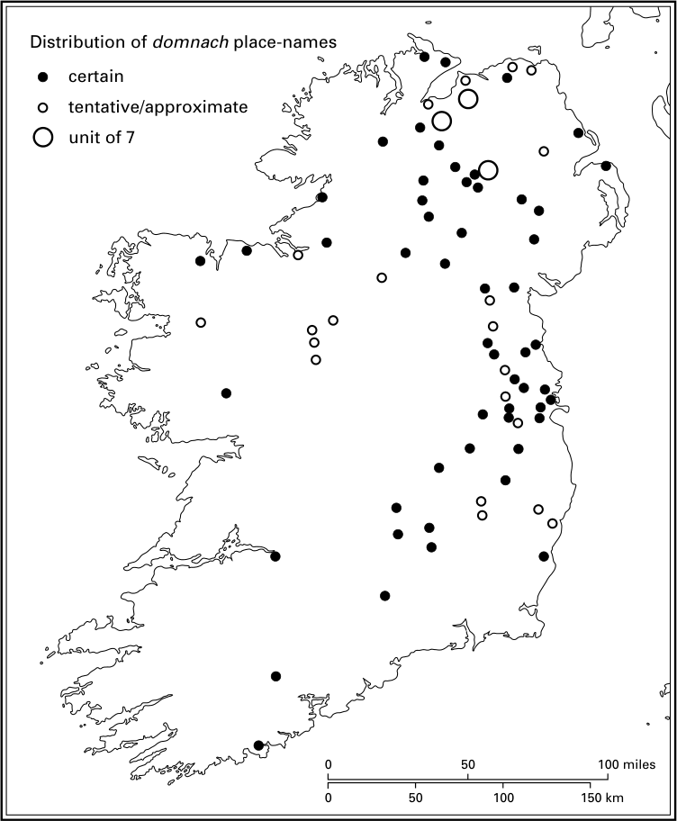
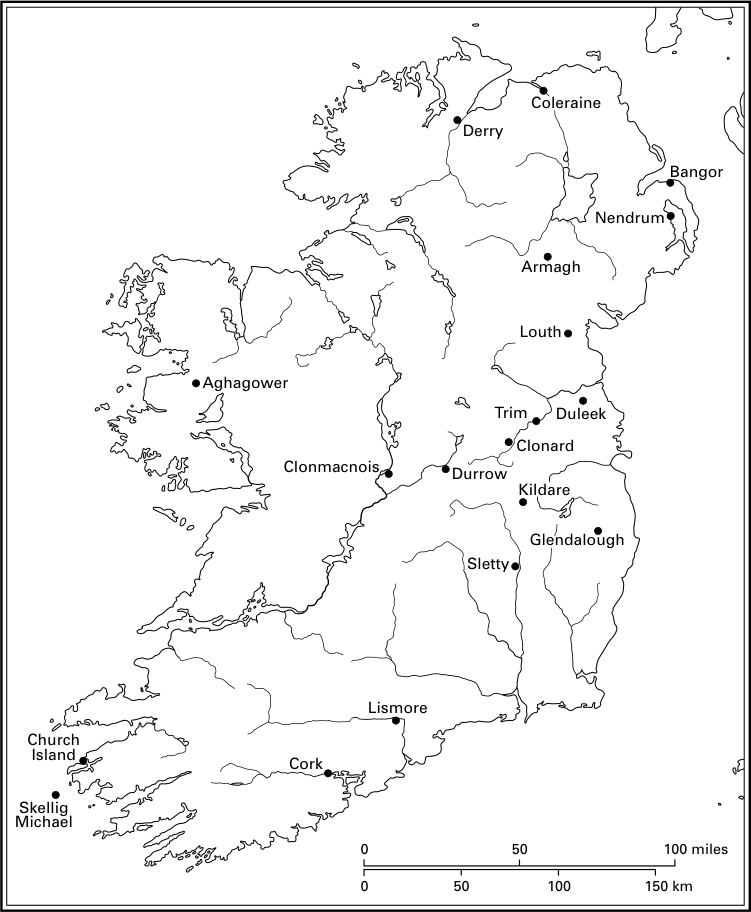

# 第15章 · 爱尔兰的宗教与社会

## 社会、宗教与基督教的到来

基督教最初是在罗马帝国内部，经由环绕地中海的城市网络向西传播的；而爱尔兰位于帝国之外，是一个完全乡村化的社会，没有城市，甚至没有小镇，没有城市中的下层与中层阶级，没有钱币铸造，没有商品的批量生产，贸易也极为稀少。罗马帝国是一个等级严密组织的国家，顶端是皇帝，向下按地理层级依次划分为诸行省，而行省之内则是城市及其附属地域。然而爱尔兰在政治上并不统一；尽管位阶最高的上王可能在广大地域内获得霸权承认，但这种承认依赖于众多单独的部落即图阿思（túatha，单数túath）之王们的认可。^1 这些小小的图阿思是基本的政治实体；人们除非（这种情况常有）自己的图阿思与别的图阿思之间有协议，否则在别家图阿思内不享有任何权利。

然而，早期爱尔兰社会虽与晚期罗马帝国不同，却在许多方面与其他中世纪早期社会颇为相似。基本单位不是个人，而是亲族集团。亲族须为其成员的过错承担责任，并负责保护他们。除维持和平的职能外，亲族之所以具有根本重要性，还因为大部分农业用地都是“亲族土地”：虽可由个人耕作，但未经亲族集团同意，不得转让出亲族之外。^2 除血缘亲属外，普遍盛行的寄养习俗也建立起密切的纽带。^3 至于妇女的地位，爱尔兰社会是强烈的父权制社会：妇女一般处于父亲、丈夫或儿子的权威之下，独立行动的空间有限。^4

爱尔兰社会是等级制的，法律文献列举了若干不同等级，每一等级各有其“荣誉价格”。基本结构是国王、领主与普通自由人，他们都是自由人，享有各自的法律独立地位。其下是半自由人，最底层则是奴隶。然而，爱尔兰的一个独特之处在于：国王和贵族并非唯一的特权群体。还有一个重要的职业阶层，其特权地位源于他们的学问或技艺。一份芒斯特法律文献区分了“高贵”与“依附”的技艺之士。^5 后者包括布雷亨（法律家）、医师、铁匠、工匠、竖琴师、御者和杂耍艺人。唯独诗人属于“高贵”的技艺之士，其中造诣最高者的荣誉价格与图阿思之王相同。^6 他们还享有在各个图阿思之间自由旅行的特权——布雷亨或许也共享这一特权，但这使诗人有别于普通贵族，甚至有别于国王。^7 正因如此，尽管政治上四分五裂，爱尔兰却享有高度的文化凝聚力，以及一种作为整体的自我意识。

将爱尔兰语filid（单数fili）译作“诗人”是误导性的不充分翻译。filid一词在词源上与意为“看见”、“先知者”的词相关，他们继承了异教德鲁伊的地位和许多职能。每位国王都有自己的宫廷诗人，以颂诗抬高君主的声望，并充当对其有利的宣传的主要传播者。fili还掌握数量可观的传说故事，是谱系知识、历史传统和地名故事的宝库。^6 六世纪基督教为社会接受之后，随之引入的新拉丁学问与fili和布雷亨的本土学问之间产生了大量互动。^9 这早在约600年即已开始，产生了大量以拉丁语之外的本土语言写成的材料，其类型在西欧其他地区罕见或闻所未闻。其中大部分属于我们这个时段之后；但我们应当意识到，fili和布雷亨在早期爱尔兰社会中所扮演的重要角色，以及他们在塑造我们赖以了解那个社会的许多史料方面所起的同等重要的作用。

在法律文本被书写下来的基督教时代，德鲁伊至多只被归入“依附”的技艺之士；但种种迹象表明，他们曾经享有后来属于fili的那种特权地位。^10 德鲁伊原本构成一个异教祭司阶层，虽然他们与异教仪式关系过于紧密，无法保住其崇高地位，却一直存续到我们所关注的整个时期。一位七世纪作者认为有必要告诫国王不要听从他们，^11 而在基督教已占主导之后，他们的咒语仍令人畏惧。这种畏惧或许部分地促成了基督教的“护心甲”（Lorica）祈祷文，作为一种防护手段。^12

对于爱尔兰原初的、“异教的”宗教，我们只能间接地了解，但它似乎无处不在：有以女神之名命名的山川，如阿努双峰、香农河与博因河；有神圣的树木和水井。^13 部落将其世系追溯至卢格或其他神祇，^14 而王权是神圣的。国王会定期召集大会（óenach），其民众聚集一堂处理公共事务、进行经济交换，并举行赛马和其他竞技。这些大会一般在一处古代墓场举行，最初似乎兼有宗教和实用两方面的意义。乌伊·尼尔人的大会在特尔敦举行，伦斯特人的大会在卡尔曼举行，都在卢格纳萨德节期间，该节标志着收获的开始，并以神卢格命名。萨温节（11月1日）、伊博尔克节（2月1日）、贝尔坦节（5月1日）和卢格纳萨德节（8月1日）是异教年历的四大节日。^15 所有这些都意味着，基督教以前的爱尔兰社会的“宗教”层面是无法剥离出来的：人们生活的土地、年度循环的历法、作为他们作为独特图阿思存在之焦点的国王、他们聚集的大会——这一切都具有宗教意义。由此推论，皈依另一种宗教将需要一系列复杂的调整。

到公元500年，基督教很可能已传遍爱尔兰全岛，^16 但远不能确定它已为多数人口所接受。爱尔兰的第一位基督教主教是大陆教士帕拉狄乌斯，他于431年由教皇塞莱斯廷派往“信奉基督的爱尔兰人”。可以推想，基督教是以零散的方式传入爱尔兰的：主要（我们可以猜测）通过与不列颠的联系。帕拉狄乌斯的传教团大概前往伦斯特（当时涵盖中东部及东南部爱尔兰），在罗马被描绘为成功之举；而伦斯特人科伦巴努斯约在600年写作时仍能回忆起爱尔兰的基督教得自教皇。^17

五世纪另一位知名的赴爱尔兰传教士是不列颠人帕特里克。他的传教晚于帕拉狄乌斯，可以说是在爱尔兰的北部。^18 阿马后来声称是其主要教会，但阿马很可能只是他的诸多创建地之一，甚至有学者连这一点也提出质疑。^19 帕特里克未曾明确提及帕拉狄乌斯，无法断言他与早先的传教团是否有关联。所幸帕特里克本人的两部著作存世：一封书信和他的《自辩书》。这些文献生动地描绘了五世纪在爱尔兰传教的困难和危险。作为一个身边没有亲族保护的外乡人，帕特里克发现自己受到爱尔兰人的蔑视，不得不培养权势者的善意，以便能自由地旅行和布道：国王可以向外人提供保护（其他阶层也可以，但只能维持短暂时期）。因此我们看到帕特里克向国王和法官（即布雷亨？）赠送礼物，还出资雇用一群王子随行护卫。尽管如此，他仍屡遭袭击，屡陷死亡之险。^20 他成功使“成千上万”的人皈依，其中包括国王的子女和女奴。^21 然而，爱尔兰的皈依是一个缓慢的过程：传教士不得不一个图阿思接一个图阿思地工作。他须寻求国王、贵族和特权阶层的支持（尽管帕特里克肯定未把自己的工作局限于这些阶层）；但爱尔兰国王即便心存好感，也没有废除异教的全盘权力，而德鲁伊很可能有能力组织起连贯而有力的抵制。^22 此外，最早的传教士似乎未能得到海外的充分支持：教廷似乎未与帕拉狄乌斯的传教团保持联系，而帕特里克显然是在至少部分不列颠人的反对下开展工作的——尽管他也从那里获得了一些财力支持。^23 然而假以时日，帕特里克的传教结出了果实：除了他的爱尔兰皈依者——包括他培养以进入司铎职位的本地男孩——之外，他还激励了一些不列颠人追随他。其中只有一位，即劳斯的莫赫特乌斯，有名字传世；但从爱尔兰人从不列颠语使用者那里习得拉丁语这一事实，可以推知五、六世纪不列颠人广泛参与了爱尔兰教会事务。^24

在爱尔兰，异教根基如此牢固，以至于基督教奋斗了一个多世纪才赢得正式接受。显然，各个国王和亲族皈依的速度各不相同。但既然以德鲁伊、fili和布雷亨为代表的特权阶层在全爱尔兰维系着大体相同的教义和法律体系，我们便可以把基督教会及其神职人员被纳入这一社会法律框架，视为基督教获得决定性接受的标志。爱尔兰最早的教规立法，即所谓“帕特里克第一次宗教会议”的教规，把基督徒描绘为仍处于周围异教社会之中的一个群体：他们应将争讼带到教会而非法官处解决；他们不得像异教徒那样在德鲁伊（占卜师）面前起誓；教会不得接受异教亲族捐赠的施舍。最后一项可能暗指那些想同时脚踏异教与基督教两只船的人；^25 但考虑到赠礼交换在早期爱尔兰社会中的作用，它意味着“每个图阿思分裂为两个社会，一个是基督教的，另一个是异教的”。^26 这些教规虽无法精确断代，但将其归于六世纪上半叶的理由是充分的。^27 六世纪异教传统的延续也见于编年史记录：南乌伊·尼尔上王迪亚尔马特·马克·克尔拜尔约在560年举行了“塔拉盛宴”。这是乌伊·尼尔上王的异教即位仪式；虽然迪亚尔马特可能并非未受基督教影响，这仍表明基督教尚未扎根稳固。^28 与此形成对照的是，出自与之竞争的乌伊·尼尔北支的科伦巴于563年创建了爱奥那修院，晚期传说把他描绘为fili的保护者。虽然这些传说的史实性无从验证，但种种迹象表明，到597年他去世时，教会——至少是爱奥那教会——已与fili达成了谅解。这一点由如下事实所暗示：他们中的一员，按传统说法是达兰·福加伊尔，为他的死创作了一首哀诗。这首诗以艰涩的古爱尔兰语写成，文本至今尚存。^29

因此，我们拥有的证据指向六世纪下半叶，即基督教作为爱尔兰宗教赢得普遍接受之时。当法律文献在七、八世纪被写下时，神职人员已与诗人并列于特权阶层之中。^30 与此同时，德鲁伊被降格，但如前所述，他们并未消失。有趣的是，从事díberg活动的团伙也没有消失；díberg似乎是一种异教的、仪式化的习俗，由一群（典型的）九人起誓进行杀戮。^31 因此，活跃的异教贯穿了整个七世纪，尽管很可能已是少数派现象。

除这种公开反对基督教的“硬性”异教之外，还有若干“软性”异教形象或习俗以基督教的外衣存续下来。著名的例子有布丽吉特，她似乎由异教女神蜕变为基督教圣女；还有圣井，如今被置于某位圣徒的庇护之下；以及与卢格纳萨德节相关的庆典（很可能包括攀登克罗·帕特里克山的朝圣），圣帕特里克的形象似乎取代了凯尔特神卢格。^32 与之并列的，还有对仙灵的信仰一直延续到近代，这些仙灵不外乎昔日的异教神祇。^33 这类调和现象在七世纪已蔚然成风。与此同时，如何调和圣经教义与爱尔兰社会规范的问题在七世纪被广泛讨论。一派即“罗马派”试图使爱尔兰与大陆教会的教导保持一致，而“爱尔兰派”则巧借《旧约》为保留一夫多妻和堂亲婚等传统爱尔兰习俗辩护。^34

## 教会与修院的建立

关于爱尔兰最早建立的教会的性质，我们掌握的证据很少。帕特里克本人的著述表明他没有固定教座。^35 他大概是爱尔兰北半部负责分散会众的唯一主教，并在他们之间往来巡行。^36 他有本土爱尔兰神职人员，也鼓励贞女和修士的修院圣召；但他劳作时的境况使其几乎不可能有能力为一个当时方才诞生的教会规划一套组织体制。^37

我们接下来掌握的证据是前面讨论过的“帕特里克第一次宗教会议”的决议。这些决议表明每位plebs（拉丁语，意为“人民”，此处几乎可以肯定指爱尔兰的图阿思）由一位主教主管。^38 后来的文献证实了每个图阿思有自己的（首席）主教这一规范。^39 这意味着爱尔兰有一百多个主教区，因此按北欧标准，每位爱尔兰主教管辖的是极小的教区。有一种颇具说服力的观点认为，“Domnach Mór”（“多纳赫莫尔”）型地名后接一个人口集团之名，代表该人民的首席或“母”教会——即设有主教之处。由cell（“教堂”）加人口集团之名构成的地名大概也是如此。domnach地名特别有趣之处在于：由于这个词表示教会的用法在六世纪中叶已废弃不用，一张domnach地名分布图（地图9）记录了约550年之前创建的教会——尽管并不追求完备。^40 这类地名在东海岸中心附近相对密集，尤为耐人寻味，因为它与奥克西利乌斯、塞昆迪努斯和伊塞尼努斯——可能是帕拉狄乌斯传教团成员的五世纪传教士——相关联的地区相吻合。^41

修院制在早期爱尔兰教会中的作用是一个颇具意义的问题。帕特里克引入了修院理想，其著述表明许多人成为修士和贞女。后者来自社会的最高和最低两个阶层，并经受了许多迫害。不过贞女似乎是在家中生活，而非居于单独的机构。关于修士的证据较少，但他们可能充任独身神职人员，或许生活于教士-修士共同体之中，而非与世俗社会截然隔绝的修院里。^42 在皈依初期，可能既需要神职人力，也缺乏足够规模的土地捐赠来建立单独的修院。

后世追认为爱尔兰著名修院之创建圣徒的那些人，其卒年按爱尔兰编年史多落在537年至637年之间。可以举出的例子有：在香农河畔创建克朗马克诺伊斯的基阿兰，与同样在中部创建克洛纳德的芬尼安，两人皆卒于549年（很可能死于瘟疫，英年早逝）；创建了贝尔法斯特湾畔严苛的班戈修院——科伦巴努斯在此受训——的孔加尔；创立德里、德罗（在中部）和爱奥那（在苏格兰）的科伦巴（或称科伦·基勒）；在威克洛山脉创建格伦达洛的凯文；以及在芒斯特创建利斯莫尔的卡萨克，利斯莫尔距南岸仅溯布莱克沃特河而上不远（地图10）；这还只是最著名者中的一部分。

这一编年史证据所暗示的——即这一时期出现过一股追求修院生活的热潮——得到约600年写作的科伦巴努斯的印证。他提到一个问题：一些修士渴望更严格的生活，便抛弃其初誓之地，并称芬尼安曾就此问题请教吉尔达斯。而且吉尔达斯答复的不少内容尚存，虽是残篇。^43 这一证据表明，先存在已建立起来的、不太严苛的修士团体，继之而起的是追求更严格宗教生活的热潮。后者自约540年起在爱尔兰出现，是受不列颠苦修热衷者的影响。^44 其背后是卡西安和其他高卢基督徒的启迪。激励他们的宗教理想是摆脱世俗社会的种种压力，培养超脱、去除自我主义以及爱等德性，从而开始作为天国的公民、与天使并与上帝自己共融地生活。为此，他们采纳了共同修院制的通行实践。他们中的许多人学习拉丁语以便阅读圣经。这为他们开启了教父著作和古代世界的某些学术成就，而爱尔兰人也以拉丁语和古爱尔兰语对学问与文化作出了自己的贡献。^45

爱尔兰国内只有少数人自身践行了这一宗教理想，但它仍然至关重要。那些最全心奉行者的榜样至少使人们意识到一种全然不同的生活方式。当修院制被科伦巴这样的人——爱尔兰北半部最强大王族乌伊·尼尔的一位王子——所接受时，尤其如此。许多最热忱皈依修院生活的人离开自己的图阿思，作为宗教流亡者或peregrini前往他乡。这是一种斩断根柢的尝试，为追随基督——"贫穷而谦卑，永远传扬真理”——而放弃一切。^46 这种苦行弃绝，或许部分源于一个巨大的困难：在人人皆识其亲族的故土修院里继续生活，很难真正超脱于社会之上。科伦巴563年从爱尔兰到不列颠的peregrinatio，原因可能正在于此。^47 从历史角度看，宗教peregrinatio的意义在于它使许多宗教上最热忱的人迁移他处。有人干脆退隐到难以抵达的地点，如西海岸外散布着隐修所的岩岛。有人前往爱尔兰本岛内的他处；有人如科伦巴那样航行到不列颠北部；还有人走更为严苛的路，完全离开岛内世界而移居大陆，如科伦巴努斯，他于591年从班戈启航前往法兰西亚。更多peregrini追随这些先驱，整个运动促进了不列颠北部的基督教化，也促成了大陆部分地区的基督教复兴。科伦巴努斯在大陆的事业及其在勃艮第的吕克瑟伊和意大利的博比奥创建的修院尤为重要，因为它们铸就了爱尔兰与法兰西亚及意大利之间持久的联系，同时迫使人们思考：爱尔兰基督教的独特之处在大陆上能在多大程度上得到容忍。^48

爱尔兰本土的新修院迅速吸引了新成员和土地捐赠。这些机构通过成为兴旺的教育中心而帮助巩固了基督教在爱尔兰的未来，未来的修士和司铎可在此受训，并为基督教培养必需的圣经与礼仪抄本及拉丁学问。理论上，图阿思的主教教会本可以做到这些。但实际上它们规模可能太小；而且它们值得称道却较为平凡的目标——提供牧灵关怀——未必能吸引科伦巴努斯这样的人才。科伦巴努斯曾赞同地引用哲罗姆的话，大意是：主教应当效法使徒，而修士则应“追随那些完全者，即教父”。^49

修院制还影响了世俗社会，因为许多牧灵关怀由受过修院训练的神职人员承担，他们像在高卢那样，力图把苦行规范强加于整个教会。“帕特里克第一次宗教会议”似乎接受了已婚司铎，而六世纪的苦行者则坚持神职独身，还力求把严格的一夫一妻制和长期的性禁欲强加于世俗民众。^50 无疑大多数俗人并不在意；但修院土地上的佃户处于 conform 的压力之下，也有一些俗人自愿顺从。他们可能造访修院并暂住，可能接受一位灵性导师的指导，而后者多为修士。定期告解为良心的形成提供了广阔空间。^51 爱尔兰人或许效法不列颠的先例，在此作出了革新：他们认为即便是重罪（如杀人）也可以通过悔改、告解和履行补赎来赎清；且如有需要可以重复进行。这与大陆的情况形成对照：在大陆，重罪（包括无处不在的通奸罪）所要求的“公开补赎”不仅是公开的，而且一生只许一次。结果人们极不情愿在临终之前行此礼——即便行了，余生也须过准修士般的生活，以免再犯罪；甚至连与配偶恢复夫妻关系也不被允许。相比之下，爱尔兰的补赎制度允许随时重复补赎，使成功完成补赎者可自由回归普通社会生活。^52 因此它很可能被更频繁地使用；阿多姆南向我们展示了几个忏悔的罪人在爱奥那向科伦巴求教。^53 通过这些途径，苦行者在爱尔兰社会内有相当大的空间去影响基督教规范，但我们不应假定他们始终代表爱尔兰教会中的唯一观点：一份八世纪法律文本表明，主教或司铎拥有一位妻子是完全可接受的，只是其地位低于守贞者。因此，已婚神职人员以及对俗人较为宽松的期待，很可能与苦行理想在我们所论的整个时期内并存。^54

## 教会、家庭与土地

教会要兴旺，就需要捐赠。与中世纪早期欧洲其他地方一样，捐赠主要是土地，但人、牲畜、珠宝等也可捐赠。礼物并非献给作为一个非人格机构的“教会”，而是献给一个个人，无论其生者还是死者。这几个世纪的一个常见模式，是把土地捐给将在其上建立教会的 individual 修士或教士。这样，这位教士便成为该教会的“创建圣徒”——这有助于解释爱尔兰大量以无名地方圣徒命名的奉献。如果一位教士在多处获得建教会的土地，他创建的各教会即便散布爱尔兰全岛，也会组成由他统领的联合体。他死后，它们转归其“继承人”统治，即该联合体主堂的首脑——通常就是创建圣徒安葬之处。现代史家常称这类联合体为paruchiae。有时，特别是在圣帕特里克或修院圣徒的情形中，捐赠是献给一位已故圣徒的。此时实际上就是献给其继承人，并加入该圣徒联合体的其他教会。如下文所述，到七世纪后期，这些联合体还通过兼并既有教会而扩张。

在爱尔兰社会中，世袭原则如此普遍，以至于它在教会内部同样适用也就顺理成章。因此，教会首脑之位在创建圣徒家族内传承是常见现象。^55 这不一定导致已婚俗人院长和世俗化的教会：爱奥那是一个经典例子，这个修院保持了其标准，但其绝大多数独身院长都与其创建圣徒科伦巴同属乌伊·尼尔家族，院长之位传给侄子或堂表亲。另一例中，创建德拉姆利斯教会的贵族菲斯·菲奥明确规定，教会首脑之位应永远归于其亲族之一，前提是能找到合适的人（"良善、虔诚、尽责"）。^56 家族对教会的持续关注也可能为捐赠者家族谋利——这在一个规范是互惠赠礼而非非人格市场的社会中是自然的。有时捐赠者只是期望团体的祈祷，如威比宗教会议（664年）后退回爱尔兰的科尔曼向一位贵族在梅奥购置土地时的情形。捐赠者家族可能还获得安葬权，但接受教会仍可保持其实际独立，如爱奥那那样。^57 然而在某些——或许许多——情形中，捐赠者为自己家族在教会中保留了更广泛的权益。有时，如据说在特里姆发生的那样，捐赠者把土地给了一位近亲，使捐赠者家族与教会创建者家族合而为一。^58 如此一来，虽然土地捐给了教会，实际却保留在家族之内。这在爱尔兰尤为重要，因为通常只有国王才拥有可供捐赠给教会的大片土地。爱尔兰法律禁止转让“亲族土地”，除非获得亲族整体的同意。而且亲族在捐赠后长达五十年内保留收回此类土地的权利。对本人自行获得的土地，一个人有更多自由；但即便如此，他所能转让的数量也有限。^59 保留家族对教会权益的捐赠更可能获得亲族的批准。

最简单的捐赠形式可见于爱奥那。达尔里亚塔国王科纳尔把该岛捐给了科伦巴，^60 而阿多姆南的叙述显示修士亲自耕作；捐赠之时小岛上或许没有（常驻）人口。然而有时，不仅土地，连耕种其上的民众也一并授予教会。此时民众便成为该教会的manaig，即“修院佃户”。^61 Manaig（单数manach）是古爱尔兰语“修士”一词，但manaig之似普通修士，仅在于他们成为一个教会“家族”——以院长为首——的成员，取代了其家族首长。例如，未经院长同意，他们不得订立契约。但他们并不像普通修士通常那样，在日常生活的细节上服从其意志。更重要的是，他们继续与妻子住在自己的屋舍里，照常做农民或武士，有时住在离教会相当远的地方。^62 他们除了承认院长的权威之外，主要特点是：服从严格的性生活规范（一夫一妻，且在大斋期等时期禁欲）；有义务向教会缴纳什一税和安葬费等特定贡赋；以及一项互惠安排，即一个儿子由教会教育，但被允许结婚并继承其财产份额，以manach身份继续耕作。因此，manaig代表了修院与爱尔兰社会紧密联结的多种方式之一。

教会通过土地赠予积累财富的一个后果，是世俗王朝开始 interest 于控制它们。未能取得王位的王族成员可能谋求教会首脑之位，而一个处境脆弱的图阿思可能发现其教会的独立受到政敌的威胁。这种教会与世俗利益的交织在八世纪变得普遍，但七世纪下半叶已在进行之中。^63

## 教会内部的多样性

如前所述，早期爱尔兰教会的主旋律不是苦行主义而是多样性。这一点通过考察单个教会最能体会，先从阿马（地图10）说起。七世纪时，阿马声称自己是帕特里克的主要教会。这不太可能；但它或许要归功于帕特里克的若干创建地之一，而且考古学已证实山脚“纳费尔塔”（“墓葬群”）处有五世纪的活动，先于山顶的教会聚落。^64 阿马的名字中含异教女神玛哈之名，其遗址距传说中的埃曼·玛哈——一处基督教以前的圣地——仅3公里。航空摄影和早期地图显示阿马有内外两重围地，而七世纪的《天使书》表明，阿马当时是一个复杂的教会聚落。其中有贞女、忏悔者和已婚者，他们参加北区的一座教堂；而主教、司铎、隐修者及其他男性修士则参加南区的一座教堂，该堂拥有大量圣髑。凌驾其上的，是那位自封的大主教。文献还提到朝圣者、病人和寻求庇护者。阿马局促的山顶场地，连同其外围区域（suburbana），据说已不足以容纳所有前来寻求庇护的人。^65 到七世纪末，阿马一面谋求乌伊·尼尔王朝的支持，一面同时经营与阿尔斯特的达尔·菲亚塔赫王朝的关系。^66

伦斯特的基尔代尔呈现出类似的图景：内外两重围地，^67 与异教过去的联系，一个庞大的混合团体仰赖教会，以及王室的兴趣——这次是乌伊·邓莱因家族。其独特之处在于，基尔代尔是一座双重修院，相传由圣布丽吉特创建，由修女连同一位主教及其男性教士组成。它由女院长和主教共同主持，到七世纪末已拥有一座内部隔断的大型木构教堂，使修女与教士、以及男女俗人能够同时礼拜而彼此不相见。圣布丽吉特与其首位主教被供奉于祭坛两侧，其墓饰以“悬垂的金银冠冕和各种图像”。与阿马一样，基尔代尔是一座“避难之城”即庇护所，也挤满了寻求丰盛宴席或医治的人，或带来礼物者，或只是围观人群者。^68 这些教会之所以能服务如此多样的需求，靠的是将其广阔场址内部分区，把内圣所专留给沉思者或教士。一项宗教会议裁决规定：最神圣区域仅教士可入（参较阿马的南堂）；次一区域向“不算太邪恶”的俗人开放；最外区域人人可入，包括寻求庇护的作恶者。^69 有时，如在阿马和嫩德鲁姆，这些内部分区至今仍可辨识。^70

与基尔代尔熙攘的人群处于另一极端的，是沿海岛屿上偏远的隐修地。^71 其中最壮观的是斯凯利格·迈克尔，一座拔起于大西洋中、距凯里海岸约14公里的双峰岩石金字塔。主修院址位于东北峰之下，由两座小型祈祷所、六座蜂巢形石屋、一处带石十字架和十字石板的小墓园以及一个小园子组成。它至多容纳一位院长和十二名修士，大概充作一处共修的隐修所。那里的生活必定始终极为艰苦；而斯凯利格还有一处更为苦行的所在。南峰高处坐落着一个微型隐修地，有自己的祈祷所、石屋和集水盆。要到达那里须攀岩而上。^72

斯凯利格的沉思功能是清楚的：它是“海洋中的旷野”。^73 然而并非所有岛屿都无人居住，也并非所有岛屿教会都是沉思型隐修所。就在斯凯利格对岸的近岸处——或确切说，在大陆与贝吉尼什岛之间的水道中——坐落着小小的丘奇岛，最初有木构祈祷所和石屋，后以石重建。此地可能始于隐修所，后来蜕变为一个小型世袭教会。^74 《帕特里克规则》表明，每个图阿思不仅可有其主要教会，还可有若干为当地manaig服务的小教堂，由（至多）一位司铎照管。^75

至于图阿思的主要教会，它们由主教主持，但可能从一开始就是多功能的团体。七世纪末写作的蒂尔尚把科尔库·泰姆尼（西康诺特）的克尔·托克首任主教与其姐妹一并描述为“帕特里克的修士”，而附近更著名的阿加戈尔教会同样以一位主教和一位修女为其创建人物。^76 七世纪期间，这些图阿思主教教会地位下降，被新兴修院赶超。^77 许多被隶属于这些修院；例如克尔·托克隶属于克朗马克诺伊斯。有时这种隶属导致失去自己的主教，如东北部的科莱兰。但教会也常继续作为主教教会运作，主教照旧监管图阿思；只是如今它须效忠——并常须贡纳——于上属教会。那些与阿马建立联合关系的教会保留了主教地位，阿加戈尔也是如此。

现在让我们转向克朗马克诺伊斯、班戈和爱奥那这类修院，它们起初主要是在没有任何先前宗教历史的地点建立的、为过修院生活的场所。就此而言，它们——至少在早期——可能既不同于图阿思主教教会，也不同于阿马和基尔代尔这类拥有庇护权（且或许意义深远的是，位于昔日异教圣址）的教会。^78 爱奥那无疑有着与基尔代尔不同的优先考虑。它有为来访朝圣者准备的客房，但给人的印象是：这些人是寻求灵性指导或希望暂过宗教生活者，而非涌向圣髑期待奇迹的人群——尽管这可能部分缘于院长的视角而非俗人自身的视角。^79 可以肯定，圣科伦巴的遗骸并未被置于吸引朝圣者的专门圣龛中；一位科伦巴系修士担心俗人会涌上岛屿参加其主保圣人的葬礼，而上天以一段风暴天气回应了这一忧虑，使除修士之外无人得以前来。^80 爱奥那的岛屿选址由此既满足了其保持超然之地的愿望，又提供了良好的海上交通。除爱奥那主修院外，在其他岛屿上还有附属修院，其中一些有专门职能，如照管忏悔者或隐修者；同样，爱奥那在人口聚居区的创建地也必然会卷入牧灵事工，如诺森伯里亚的林迪斯凡和梅尔罗斯两个子院所证明的。^81 因此，阿马在同一地点接待从隐修者到教士、俗人、忏悔者和寻求庇护者的各色人等，而爱奥那本身则保持为一个我们通常理解意义上的修士团体，尽管科伦巴系整个团体履行了阿马的大部分职能。

然而，爱奥那在保持与周围社会的距离上或许是特例。爱尔兰本岛上的教会至少须为其manaig和忏悔者提供照顾。一份法律文献表明，一个声誉良好的教会应拥有全套教士以施行施洗、领圣体、弥撒、为亡者祈祷和讲道；应款待宾客，并包括过行动生活的人、过沉思生活的人，以及附属于它、服补赎刑期的人。^82 另一文献简明地指出，教会所需的三样东西是修士、学生和忏悔者。^83 这暗示着学校。基础教育可能相当普及，但更高等的学习或许须寻访名师或修院学校，如科伦巴努斯离开故乡伦斯特去班戈师从西尼利斯。^84 因此到八世纪中叶，爱尔兰大多数有规模的教会可能已是多功能团体；甚至那些起初为过修院生活而建的场所，也已与世俗社会融合到彼此争斗的地步，如764年克朗马克诺伊斯与德罗之争。^85

中世纪早期的爱尔兰因而拥有不同类型和规模的教会；其中远非所有都是我们理解意义上的“修院”。有四点对于弥合中世纪早期的实际情况与流行误解之间的鸿沟十分重要。其中一点——关于主教与院长作为教会领袖的相对重要性——将在后文讨论；其余在此略述。第一，表象可能有欺骗性：几座看似偏远的修院实际上紧邻中世纪干道，克朗马克诺伊斯便是如此。斯凯利格和爱奥那确实分别代表了共修隐修所和共同修院，但两者都未必典型。第二，存在历时变迁的问题。例如丘奇岛可能始于隐修地，后蜕变为家族教会。其他隐修所可能发展为完整修院，威克洛山的格伦达洛或许便是如此。^85 最重要的是这些修院向多功能团体演变的有趣过程，在这一过程中，过宗教生活者可能缩减为整个教会家族中极小的一部分。到700年这一发展走了多远，已无从知晓。但令人不禁猜测：当科吉托苏斯在七世纪中晚期把基尔代尔描述为“我们所谓的一座修院之城（monasterii civitatis）"，并以民众络绎不绝为由为“城”字辩护（尽管基尔代尔四周没有城墙）时，他是在标新立异，是在为描述一种新出现的发展而创造术语。^86 若是如此，很快便有人效仿；虽然阿多姆南偏好monasterium（修院）一词，而爱奥那的早期编年史用eclesia（教会）一词，到八世纪，civitas（城）一词悄然进入编年史，甚至用于爱奥那本身。^87 这或许不过意味着编年史家的更换；但也可能标志着从以宗教生活为核心的团体，向这种关怀已沦为少数者之事的更多元团体的转变。

第三，术语在某些方面能帮助我们，在另一些方面却使现代读者困惑。一个关键问题是“修士”、“院长”和“修院”诸词的含义。如《帕特里克规则》所示，即使一座至多由一位司铎服务的小教堂也由manaig即“修士”支撑，而他们实际上是修院佃农；教堂首脑（或是司铎，或是一位负责延请司铎的俗人）在法律意义上便是这些manaig的“院长”，该教堂由此可被称为“修院”。另一方面，在这些极小的教堂里，并没有任何人在过我们理解意义上的修院生活。^88 因此，说七世纪爱尔兰几乎每座教堂都是修院，在字面上是真的；但它掩盖而非揭示了早期爱尔兰教会的多样性质——其中既有如基尔代尔那样与社会融为一体的“修院”，也有如斯凯利格那样远离社会的，有如爱奥那那样单纯的，还有简陋到只有一位司铎为周围修院佃户服务的小教堂。^88

## 复活节之争

复活节是最重要的基督教节日，日期并不固定；在推算日期时调和阴历与阳历规定的困难，导致出现了确定复活节应落在哪个主日的略有差异的规则。^89 在许多年份，这些不同方法仍会得出同一个主日；但并非总是如此。不列颠和爱尔兰教会采用了八十四年周期的复活节循环，将复活节定为相关阴历月十四日至二十日之间的那个主日。他们的体系显然以阿纳托利乌斯提出的规则为基础，但经过苏尔皮基乌斯·塞维鲁（约公元400年）的修改。^90 然而当科伦巴努斯于591年抵达大陆时，他发现法兰克教会和教廷使用的是阿基坦的维克托里乌斯（457年）的历表。这是对亚历山大十九年循环的一种不尽如人意的改造。随后在约630年代，教廷弃之而改用真正的亚历山大（或称“狄奥尼西”）体系，后者最终取得胜利。虽然维克托里乌斯体系与亚历山大体系在若干重要方面不同，它们对复活节应庆祝的主日通常一致，而不列颠人和爱尔兰人遵循的八十四年周期则更常产生分歧的日期。

科伦巴努斯在大陆事业早期便因其不同的复活节日期而遭遇反对，但他坚决拒绝改用维克托里乌斯体系，他认为该体系有缺陷。他死后，其吕克瑟伊和博比奥的追随者被迫采用该体系。^91 教皇洪诺留通过与博比奥的接触得知整个爱尔兰按不同标准推算复活节，于约628年就复活节问题致信爱尔兰人，显然以绝罚相威胁，要求其遵从。^92 这促使爱尔兰南部基督徒在宗教会议上讨论此事，随后派出一支考察团前往罗马。当考察团约在632年回报说罗马的其他各族都同日庆祝复活节，而爱尔兰的复活节当年（631年）相差一个月时，这坚定了南爱尔兰人采用维克托里乌斯体系的意愿。然而爱尔兰其余地区直到该世纪晚些时候才遵从——而且是改用教廷此时已采用的亚历山大体系。属于科伦巴（爱奥那）联合体的教会直到716年才遵从。因此七世纪的大部分时间都笼罩着这场争议，对立的“罗马派”与“爱尔兰派”成员各自参加不同的宗教会议。他们形状不同的削发式——一种作为教士与修士身份徽记的发型剪法——是其“罗马”或“爱尔兰”归属的可见标志。此外，两派在释经方法与取向上大概也有差异。^93

复活节之争因其连锁影响而重要。这个问题令人困惑，因为有时它仅被当作一种不幸的分歧来处理；但有时，如669年狄奥多尔抵达英格兰之后，遵循“凯尔特”复活节者发现自己被贴上异端和分裂派的标签，其圣事被否认有效。在爱尔兰的语境中，这个问题之所以重要，是因为它提出了爱尔兰须在多大程度上遵从大陆实践，抑或可被允许发展自身习俗的问题。^94 虽然复活节上的遵从最终实现，爱尔兰教会在某些方面仍继续发展其与爱尔兰法律的独特结合，^95 并在组织形态上循相当不同的路径演进。这场争议还引出了相关的两个问题：决议应如何达成，权威应系于何处。^96 或许可以看出，爱尔兰人倾向于在圣经释经和宗教会议讨论中寻求答案，而不是在担任职位的权威者即主教或教皇的裁决中寻求。^97 然而八十四年周期的坚持者有时也和罗马派一样乐于诉诸权威，只不过他们的权威之所以受尊崇，是因其亲近上帝、生活圣洁和释经才能，而非因其教会中的职位。^98 因此，爱尔兰复活节之争还揭示出：他们与大陆教会对教会内权威之所在的理解不同。这有助于解释为何爱尔兰传统派似乎不觉得需要有一个由单一领袖统领全爱尔兰教会的教阶体制。然而，复活节之争以及随之而来的与大陆教会的联系，把这种等级观念引入了爱尔兰罗马派的圈子；而基尔代尔教会随后是阿马教会很快便意识到，这些观念可以被利用来为自己谋利。

## 组织问题

早期爱尔兰教会的组织是一个复杂但重要的课题。它在若干引人入胜的方面不同于同时代——乃至其后——其他地区教会的组织。然而不幸的是，证据过于零碎、分布不均且难以解释，这也说明了它近来为何引发学术争议。^99

一个深层原因是爱尔兰政治权力的流动性质，以及缺乏大陆上罗马帝国结构所提供的那种固定框架和单一的最高教阶体制。例如在七世纪的伦斯特，行省上王地位从威克洛山以南的乌伊·肯塞拉格转到位于该山西北面的邻邦兼对手乌伊·敦莱因格和乌伊·梅尔手中。这种王朝与地理上的转移在爱尔兰上王结构的各个层级频繁发生，这使得难以建立大陆上那种稳定的教会教阶体制——在大陆，一个行省（固定）都城的主教始终是都主教。伦斯特的上王则自视与其他行省上王平级。因此诸行省之间没有公认的首领，也就没有任何一个教会赢得爱尔兰首席教会地位的基础。

当我们转向教士必须被安放其中的社会结构时，发现那里也存在引人入胜的差异。社会无疑是有等级的；但在从最底层的农夫经由各级贵族直至最顶端国王的世俗等级体系之外，还有为博学之士设立的独立等级体系。看起来正是后者为安置教士提供了范本；爱尔兰法律文献所揭示的并非一个基于神职品级的单一教会等级体系，而是三个并行的教会等级体系。第一是神职品级的等级体系，从低微的守门人起，经驱魔员、读经员、副助祭、助祭和司铎，直到顶端的主教。第二是基督教学者的等级体系，从仅仅会诵圣咏者起，经学识渐丰者，直到顶端的教会大学者。第三是教会职事的等级体系，从最底层的磨坊主或类似人员直到顶端的airchinnech，即“埃雷纳”（erenagh）或教会首脑（拉丁语princeps）。^100 因此，在大陆上主教是其教区内教会的唯一首脑，负责教导和捍卫信仰、掌管教会财富；而在爱尔兰，他的职能可能被分割。当然，一个人可以既是受祝圣的主教又是造诣高深的学者，或者既是主教又是教会首脑；但这些角色往往由不同的人担任。就地位而言，这意味着若干领袖或其专门领域的专家与图阿思国王和首席诗人同级：主教、教会大学者、较重要教会的首脑，^101 以及最受尊崇的隐修者——不过就连法学家也没有构建出一个七重的圣德等级体系！

这至少是截至七世纪晚期已演变形成的教士地位的一个略显图式化的描绘。现在让我们回到有证据可考的最早时期。“第一次帕特里克宗教会议”的教规表明，教会连同其财富都处于主教控制之下；而单个主教的司法辖区是plebs，即“人民”，它几乎可以肯定应等同于图阿思。^102 因此我们应当设想，每个图阿思自成一个主教区，拥有其主教母堂。图阿思内部还有小教堂，其中许多是家族教堂，由一名司铎服务。至少在理论上，这些教堂受图阿思主教的监督。到七世纪晚期，这类次要教堂已形成令人惊讶的密集网络。^103

与此同时，六、七世纪还见证了一波苦修与修院热情的浪潮；而且如前所述，这导致若干修院的建立。我们应当记住，历来吸引俗人虔敬之心的往往是圣人而非主教。俗人所关心的是求得一位代祷者的说情——其代祷须能在上帝面前有分量。像圣凯内赫这样的苦修修士，远比养尊处优的地方主教教会首脑更符合这一需求，《圣凯内赫传》中的一个故事便暗示了这一点。^104 此外，由于这类修院有时不像原有的主教教会那样与某一特定人民之统治王朝紧密相系，它们可能吸引更多的恩主。这尤其适用于建立在与前述边境“无人之地”地带，或建立在一个无足轻重（因而无威胁）的图阿思中的教会。位于无足轻重的德尔布纳·贝特拉王国的克朗马克诺伊斯便是一个好例子。它坐落于香农河畔，该河标志着康诺特与南方乌伊·尼尔两个势力范围的边界，因而得以从双方吸引恩庇。^105 修院由此可能被授予位于其他图阿思内的土地；再考虑到同一位创建圣徒所建的各修院可以组成一个以创建圣徒安葬之教会为首的教会联合体，我们便开始明白它们为何会在权势与财富上盖过较古老的、独立的主教教会。另一些促成因素是：爱尔兰的主教教会辖区狭小，而且主教在爱尔兰享受不到大陆上因政治与社会环境而赋予主教的那种地位与权威。提雷尚描述科库·萨伊的古老教堂“杜姆纳赫·萨伊里吉，位于杜利克附近”，说明了爱尔兰一座古老主教教会如何会被邻近修院所压倒。尽管它是一座古老教堂，且原为科库·萨伊的首要教堂，到七世纪晚期它显然已如此默默无闻，以至于人们只能相对于更新、更著名的杜利克修院来描述其位置。^106

在大陆上，主教竭力确保对自己教区内所有人——包括隐修者和修院——的控制。451年的卡尔西顿大公会议明确规定修士处于其教区主教的司法管辖之下，西班牙和高卢的宗教会议也重申了这一规定。^107 然而，爱尔兰没有相应教规的迹象。恰恰相反：当法兰克宗教会议坚持任何修士不得“未经主教许可并经其院长同意”离开修院另建小室时，爱尔兰教规集的同一规定却有一个重要差异：修士如今只需“其院长的许可”。^108 由于科伦巴努斯的著作和阿多姆南的《圣科伦巴传》都印证了院长许可的重要性，而对主教只字不提，爱尔兰的修院创建者似乎从未受制于主教的权威。^109 的确，八或九世纪的《帕特里克规则》赋予主教为统治者、埃雷纳以及其图阿思内的教士充任灵性导师的角色；这曾被视为主教对修院教会具有影响力的证据。^110 然而，此文很可能出自阿马，后者热衷于维护图阿思主教教会的持续权利。^111 没有佐证表明重要修院的首脑们曾接受过其主张；而来自科伦巴努斯在大陆的修院以及比德的关于爱奥那记述的证据，倒更倾向于表明教区主教并未被承认为对爱尔兰修院拥有监督和控制之权。^112 阿多姆南讲述的一个故事也印证了这一点：一位赫布里底群岛的院长召来一名主教，强迫他为一名不合格的候选人授予司铎圣职，公然无视《帕特里克规则》的规定。我们还应当注意到，该院长所受到的是上天的惩罚，而非主教的纠正。^113

至此，我们先前关于并行教会等级体系的讨论的关联性应当显而易见了；因为在普通图阿思主教之旁，还有与之地位同等的重要教会首脑。例如，科伦巴系修院联合体的首脑是爱奥那的院长；这意味着他与图阿思主教平级，尽管就教会品级而言他只是一名司铎。而且我们知道，直到惠特比宗教会议之前，爱奥那的司铎院长负责为其治下位于爱尔兰和达尔里亚塔的各修院任命副院长，还负责为诺森伯里亚遴选主教。由院长任命的主教处于院长权威之下；因此，例如艾丹、菲南和科尔曼都必须遵守爱奥那使用的复活节推算法；即使他们愿意，也无权采用罗马的推算体系。^114

至于在权威分散的情况下教会如何达成决议的问题，答案似乎是宗教会议。这使一个地区内所有主要教会——无论其源于主教制还是修院制——都有代表参与，也使主教、教会首脑、教会学者和隐修者得以聚首。^115 理想情况下，议题应依据可从圣经中辨识的原则来讨论，若不济，则依据教父文献、早期教规和圣徒的榜样；理想情况下，会达成普遍共识。^116 事实上，由于宗教会议是教会事务，其决议并非由国王强制执行，^117 共识——哪怕只是求同存异的共识——便是唯一可行之道。然而在七世纪，复活节争议的余波造成了分裂：一派认为若在爱尔兰内部无法达成共识便应诉诸罗马，另一派则继续倾向于在爱尔兰宗教会议中讨论，而非诉诸这种外部权威。

争议以及与大陆日益密切的联系，为爱尔兰教会组织观念的发展提供了催生环境。到七世纪晚期，我们有证据表明图阿思层级之上有三种不同类型的组织结构。第一种是等级制类型，体现于某一爱尔兰教会自称是全爱尔兰其余诸教会之首的主张。基尔代尔率先宣称其管辖权（parroechia）遍及全爱尔兰，“从这海直到那海”，尽管它并未说明这将如何影响其他教会。^118 随后在七世纪较晚时期，阿马转而宣称在全爱尔兰的至高地位。这可能不仅是针对基尔代尔的回应，也是针对诺森伯里亚对北爱尔兰教会霸权的觊觎——诺森伯里亚投机地利用了北爱尔兰不遵罗马复活节的情形。^119 阿马在《天使之书》（Liber Angeli）中提出的主张表述连贯，且远比基尔代尔的具体。其主张的基础是：由于圣帕特里克使全体爱尔兰人皈依，而阿马是他的特属教会，因此上帝已把爱尔兰诸部落全体划归帕特里克／阿马的管辖权（paruchia）之下。其他独立的教会则被表述为次要的，其地位有赖于帕特里克将上帝所赐一切慷慨分享。但帕特里克／阿马保留了若干特定权利，包括高于爱尔兰境内所有其他教会的地位，以及上诉管辖权——上诉只许向罗马提出；它还宣称与所有原有的主教教会和domnach教会有特殊关系，并邀请所有修士舍弃自己的修院来归附帕特里克。这样，我们在此看到一种真正的爱尔兰教会等级观念，阿马的大主教居于该等级体系的顶端，其他教会则被置于较低的地位。

第二种组织结构类型是把若干图阿思 grouped 成小规模的“行省”。事实上，根据归于“罗马派”宗教会议的一条教规，存在着相当完整的教会等级体系：其含义是不仅将有覆盖约四个图阿思的小规模行省的都主教，而且在其上还有更高一级的主教，可能相当于伦斯特或芒斯特这类主要上王王国（令人困惑的是它们也被称为“行省”）的层级。^120 其细节无须我们关心；我们只须指出，这些教规确实似乎暗示了一种与大陆相似的教会结构，即以上王王国之政治结构作为教会行省。其结果将是少数地位平等的最高级主教，而非爱尔兰教会的单一首脑。

我们的文献所暗示的第三种组织结构则截然不同：提雷尚展示了各大教会相互竞争，力图宣称个别教会应在某种意义上臣属于它们或与之结盟。^121 这种主张的基础往往是公认的原则（同样运作于《天使之书》中），即由同一位创建圣徒或其继承人建立的教会应归组为其paruchia，即处于其管辖之下。野心勃勃的修院便会宣称争议中的教会实为其本圣徒或其某位修士所建立。这在部分程度上——但并非全然——是较强教会强行征服较小教会之事。阿马则偏爱一种更微妙的做法：它力图以荣誉性关系和继续自选首脑的空间来争取主教教会和domnach教会，而非强加阿马提名之人。^122 至少有时，教会觉得接受阿马的邀请符合自身利益。一个经典案例是伦斯特南部乌伊·拜尔赫的首要教堂、主教教会斯莱蒂的决定——到七世纪晚期该图阿思已属中等重要——把自己置于阿马之下。这通常被解释为一种先发制人的举动，以防自己被基尔代尔强行吞并。^123 但无论以何种方式建立，最终结果是若干教会联合体即paruchiae的成长，其中最重要的是以阿马或克朗马克诺伊斯这类最伟大教会为首者。有时，如斯莱蒂与阿马的例子，一个paruchia的成员并不都与首脑教会同属一个行省。可以设想，若把这些敌对的联合体绘成地图，便是一床拼布被：凡标为同一颜色的教会属于（比如说）科伦巴系联合体，另一色的属于（比如说）阿马，依此类推。然而不幸的是，由于证据的缺漏，以及某些教会为敌对主张者所争执，任何此类地图都将极不完善。

至此，读者的头脑想必已经发晕。基尔代尔和阿马怎么能都自称爱尔兰的至高教会？它们的主张如何能与爱尔兰存在行省结构的证据相调和——其中并无统辖全爱尔兰的单一至高主教，而是爱尔兰境内每个主要政治上王王国各有一位最高级主教？此外，个别教会组建可能包括不同上王王国之教会的联合体的证据，难道不与行省模式相矛盾吗？

这些问题中有些可以迅速解决。首先，尽管基尔德和阿马都宣称自己是爱尔兰的至高教会，科吉托苏斯和《天使之书》的断言只是提出主张的证据，而非其主张被接受的证据。恰恰相反，《天使之书》是阿马拒绝接受基尔代尔主张的明确证据；而提雷尚虽然代表阿马写作，也坦然承认爱尔兰其他教会拒绝接受其主张。^124 爱尔兰没有任何一个教会曾被广泛承认为具有优越地位的佐证，可在爱尔兰教规集中找不到任何此类引证这一事实中找到。^125 然而，这并不排除到七世纪晚期阿马已被承认为“平等者之首”的可能性，即便在芒斯特也是如此。^126

直到不久以前，爱尔兰教规集中关于教会行省的那些令人困惑且时有矛盾的裁决，还被斥为属于愿望而非现实的领域。它们大多归于罗马派的宗教会议，并被认为反映了罗马派把大陆式等级结构强加于爱尔兰教会的失败尝试。^127 然而，近来有各种证据被指出，表明这些教规应当被认真对待。例如，某些爱尔兰文献提到“众主教之主教”或“至贵主教”，暗示主教的不同等级确实存在。^128 更有趣的是较晚的编年史卒年记载，记录了一些其主教辖区跨越不止一个图阿思、有时乃至一个行省的人物。然而，“行省最高级主教”的角色并不像大陆那样系于某一特定教会；例如，基莱欣的马埃尔—莫伊多克（卒于917年）和基尔代尔的安姆哈德（卒于981年）都被记为伦斯特的大主教或主教。^129 不幸的是，我们不知道这类“最高级主教”在等级结构中是否拥有固定角色，抑或这些头衔只是作为个人荣誉授予的。^130 这些不确定因素使人难以判断一个层级分明的、连贯的行省教会组织体系是否确实赢得了普遍接受。

至于第三种组织结构，即诸联合体或paruchiae，其证据至少是令人信服的。关于此类联合体的运作方式，还应指出两点。第一，尽管附属教会可以隶属于另一上王王国中的教会，我们不应视之为常态。像阿马、基尔代尔和爱奥那这样最伟大的教会，确实拥有散布四方的附属教会。然而更常见的是，多数附属教会都位于主导教会邻近地区，例如隶属于科克的教会群。^131 因此，行省的纽带与联结教会联合体的纽带往往互相强化。其次，我们不可假定：每当一个较小教会在某种意义上与一个以更强教会为首的联合体建立联系时，它就必然失去自身的身份。碰巧，我们关于教会联合体运作的最佳证据中有些涉及爱奥那；爱奥那的院长确实把整体作为一个共同体（familia）来领导，任命副院长并在各修院之间调派修士。^132 然而爱奥那在这一集权程度上很可能是不寻常的；而且多数时候，当一个教会“持有”一个较小教会时，我们应把这种关系本质上理解为经济关系。较小教会须缴纳某种形式的贡纳，无论这是象征性的微物还是经济性的负担；但它一般会保留自身的地位。因此一个主教教会可以臣属于一个修院，却仍是其服务的图阿思的主教教会——尽管并非在一切情形下都是如此。^133

总之，我们可以说，爱尔兰教会确实拥有一套主教组织形式，并确实组合为行省。然而，横切这一结构的，是最强大的诸修院的地位；它们似乎从未被主教有效控制过，而且其首脑与主教地位相当、其paruchiae内拥有众多教会并掌控着那些教会的资源，^134 这意味着这些首脑与早期爱尔兰教会中最有权势者不相上下。因此到700年，阿马的实力实际上建立在其威望、土地、与之结盟的教会数量以及它能从诸王处争取到的支持之上，而非《天使之书》中提出的宏大主张之上；而且在700年，阿多姆南——学者、科伦巴系联合体首脑，并且——至关重要的是——乌伊·尼尔上王的堂表亲（第四代堂亲）——很可能比领导阿马联合体的主教更具影响力。他在698年比尔宗教会议上的成就证明了这一点。在会上，他成功推动了一部保护教士、妇女和儿童免受战祸的法律；为此集结了数十位国王和高级教士加以担保，由阿马主教领衔。^135 这说明了一位伟大的院长在早期爱尔兰教会中提供领导力的潜在空间。

## 注释

1. 参见Charles-Edwards (1989)，页34–9。另见Davies，本书第9章。
2. Kelly (1988)，页100–2。
3. Kelly (1988)，页86–90。
4. 参见Kelly (1988)，页68–79、104–5。
5. Uraicecht Becc 6、37，译本见MacNeill (1921–4)，页273、277。
6. Uraicecht Becc 37–8；16、20，译本见MacNeill (1921–4)，页277、275；另参Bretha Nemed Toísech 17，译本见Breatnach (1989)，页17、37。
7. Kelly (1988)，页4–5、46。
8. Byrne (1973)，页13–16；Kelly (1988)，页43–9。
9. 参见Ó Corráin、Breatnach和Breen (1984)；McCone (1990)，第1–2章，尤见页1、22–8；Charles-Edwards (1998)，尤见页70–5。
10. Uraicecht Becc 37，译本见MacNeill (1921–4)，页277；另参Bretha Crólige 51，译本见Binchy (1934)，页40–1；Mac Cana (1979)，尤见页445–6、456–60；Stancliffe (1980)，页78–83。
11. De Duodecim Abusivis Saeculi，页51。
12. 例如归于圣帕特里克名下的八世纪《胸甲》：Greene和O'Connor (1967)，页27–32。另见Hisperica Famina ii，页23–31；Kelly (1988)，页60。
13. Tírechán，《杂录》（Collectanea），第39章及51章第1节；Low (1996)。
14. E. MacNeill (1921、1981)，页46–57。
15. Binchy (1958)；M. MacNeill (1982)，尤见第1卷，页1–11、287–349。
16. 帕特里克，《自白书》（Confessio）34。
17. Charles-Edwards (1993a)，页1–10；科伦巴努斯，《书信集》（Epistulae）v.3。
18. Stancliffe (2004)。
19. Doherty (1991)，页71–3；另参Sharpe (1982)。
20. 帕特里克，《自白书》21、35、37、51–3、55；及《致科罗提库士的士兵书》（Epistola）i、10；Charles-Edwards (1976)，尤见页54–5。
21. 参见Mytum (1992)，页44。
22. Stancliffe (1980)，尤见页63–7、77–92。
23. 帕特里克，《自白书》45–54，另参13及26；Stancliffe (2004)。
24. 帕特里克，《致科罗提库士的士兵书》3，《自白书》50–1；Sharpe (1990)；Greene (1968)；McManus (1984)；Dumville (1984c)，页19–20；Stevenson (1989)，页144–7；Dumville等 (1993)，页133–45。
25. 《圣帕特里克第一次宗教会议教规》21、14、13。后者可与Apgitir Chrábaid 19相对照。
26. Charles-Edwards (1976)，页56。
27. Hughes (1966)，页44–50；另见Dumville等 (1993)，页175–8。
28. 《阿尔斯特编年史》，558年、560年条，另参561年条；Binchy (1958)，页132–8；Byrne (1973)，页94–104；另参Charles-Edwards (2000)，页294。
29. 最易得见者为Clancy和Márkus (1995)，页96–128；另见Stokes (1899)；并参Adomnán，《圣科伦巴传》i.42。参见Herbert (1988)，页9–12；Sharpe (1995)，页89–90、312–14。
30. 见下文，页417–18。
31. Sharpe (1979)，尤见页82–92。他们的受害者是否被视为献给诸神的祭品？另参Ellis Davidson (1988)，页58–82。
32. Kenney (1929)，页356–8；Ó Catháin (1999)；Logan (1980)；M. MacNeill (1982)。
33. 参见Tírechán，《杂录》26.3；Danaher (1972)，页121–2、207；Mac Cana (1986)，页66–7、72–4。
34. Bretha Crólige 57；Ó Corráin (1984)，页157–61。关于罗马派与爱尔兰派，见下文。
35. 帕特里克，《致科罗提库士的士兵书》i。
36. 参见帕特里克，《自白书》43、51；Thompson (1985)，页148–9。
37. Sharpe (1984b)，页239–42。
38. 《圣帕特里克第一次宗教会议教规》1、3–5、23–30；Hughes (1966)，页44–51，尤见页50；Charles-Edwards (1993b)，页138–9、143–7。
39. 《帕特里克规章》1–3、6；Críth Gablach 47，译本见MacNeill (1921–4)，页306；Charles-Edwards (2000)，页248。相关问题Etchingham (1999)有讨论，页141–8。
40. Flanagan (1984)，页25–34、43–7；Ó Corráin (1981)，页338；Sharpe (1984b)，页256–7；(1992a)，页93–5。
41. Dumville等 (1993)，页51–3、89–98；另参Hughes (1966)，页68及书末地图。
42. Herren (1989)，尤见页83；Charles-Edwards (2000)，页224–6。
43. 科伦巴努斯，《书信集》i.7；Sharpe (1984a)，尤见页196–9；吉尔达斯，《残篇》（Fragmenta）。这位芬尼安可能并非克洛纳德创立者本人，而是另一个人。
44. 见Stancliffe，本书第16章，页437、439–41。
45. 见Fontaine，本书第27章；Richter (1999)，页137–56。
46. 科伦巴努斯，《书信集》ii.3；见Charles-Edwards (1976)；Hughes (1987)，篇目xiv。
47. 参见Herbert (1988)，页28；《圣恩代传》第6章；Stancliffe，本书第16章，页454及注136。
48. 见Fouracre，本书第14章。
49. 科伦巴努斯，《书信集》ii.8。
50. 芬尼安，《悔罪书》（Penitentialis）46；Hughes (1966)，第5章，尤见页42–3、51–5；另参Markus (1990)，页181–211。
51. Adomnán，《圣科伦巴传》i.32（另参Sharpe (1995)，页293，注144）、iii.7；Frantzen (1983)，页8–12、30–9；Ó Corráin、Breatnach和Breen (1984)，页404–5；Etchingham (1999)，页290–318。
52. 芬尼安，《悔罪书》35；Frantzen (1983)，页5–7；O'Loughlin (2000)，页49–66。另见Scheibelreiter，本书第25章。
53. Adomnán，《圣科伦巴传》i.22及30，ii.39。
54. Hughes (1966)，页135；Etchingham (1999)，页70；另参Doherty (1991)，页65；Cogitosus，《圣布丽吉德传》第32章（AA SS edn. c.viii, 39）。
55. Ó Riain (1989)，页360；Etchingham (1999)，页224–8。
56. 《补遗》（Additamenta）9；Doherty (1991)，页78–9。
57. 比德，《英吉利教会史》（HE）iv.4；Adomnán，《圣科伦巴传》i.8；Macquarrie (1992)，页110–14；Sharpe (1995)，页16–18、26–8、277–8。
58. 《补遗》1–4。Byrne (1984)；另参Etchingham (1999)，页227–8。
59. Charles-Edwards (1993b)，页67–70；Mac Niocaill (1984)，页153–4；Stevenson (1990)，页31–2。
60. 《阿尔斯特编年史》574年条；另参Sharpe (1995)，页16–18。
61. Doherty (1982)；Charles-Edwards (1984)。
62. 既有“依附的”也有“自由的”manaig（修道院依附民）：参见Hughes (1966)，页136–42；Doherty (1982)，页315–18；Charles-Edwards (2000)，页118。
63. Ó Corráin (1981)；Charles-Edwards (1989)，页36；(1998)，页70–4；Doherty (1991)，页63。
64. Liber Angeli 1、7–9、17；Muirchú，《圣帕特里克传》bii.6及ii.4、6（页108–12、116）；Hamlin和Lynn (1988)，页57–61；Doherty (1991)，尤见页72–3；另参Sharpe (1982)。
65. Liber Angeli 6、14–16、19。
66. Muirchú，《圣帕特里克传》i.10–12，ii.4–14（页74–81、116–23）；Moisl (1987)。
67. Swan (1985)，页84–9、98。
68. Cogitosus，《圣布丽吉德传》第32章（AA SS edn c.viii, 39）。另见Doherty (1985)；Ó Corráin (1987)，页296–307。
69. 《爱尔兰教规集》（Collectio Canonum Hibernensis）xliv.5, e；Doherty (1985)，尤见页56–9。
70. Herity (1984)；Edwards (1990)，页105–21。
71. Herity (1989)。
72. O'Sullivan和Sheehan (1996)，页278–90；Horn、Marshall和Rourke (1990)。
73. 参见下文页459。
74. 参见O'Kelly (1958)；Ó Corráin (1981)，页339–40。
75. 《帕特里克规章》11–16。
76. Tírechán，《杂录》第37章；39章第8节；47章第4节。这些地点位于韦斯特波特湾与马斯湖之间。Herren (1989)，页83；上文注42；Charles-Edwards (2000)，页225–6。
77. Doherty (1991)，尤见页60–6、73–81；Charles-Edwards (2000)，页55–60、251–7；下文页418起。
78. 参见Ó Corráin (1987)，页301–3；克朗马克诺斯与爱奥那或许是这些文本中所说“使徒之城”的例证。
79. 参见Adomnán，《圣科伦巴传》i.30、32、44，并与《科伦巴颂》vi、vii相对照。
80. Adomnán，《圣科伦巴传》iii.23。
81. Adomnán，《圣科伦巴传》i.21及30，ii.39，iii.23；比德，《圣库斯伯特传》第9、15–16章；Thacker (1992)。
82. Bretha Nemed Toísech 3、6、12；另参《爱尔兰教规集》xlii.1。
83. 《爱尔兰教规集》xlii.15。
84. Charles-Edwards (1998)，页66–7、74；Ó Cróinín (1982)，页283–6及(1995)，页174–89。
85. 参见奥恩古斯，《奥恩古斯历书》序言193、209；《圣科姆根传》第6、16、24–25章；Henry (1964)，页50–1。
86. Cogitosus，《圣布丽吉德传》第32章（AA SS edn c.viii, 38）。
87. Liber Angeli 17、21；MacDonald (1982)，另参《阿尔斯特编年史》555年、558年、635年条；MacDonald (1984)，页273–81；Charles-Edwards (2000)，页119。
88. Charles-Edwards (1992)，页67。
89. 关于所有这些，见Charles-Edwards (2000)，页391–415。
90. McCarthy (1994)。
91. Stancliffe (2001)，尤见页205–8、213。
92. 比德，《英吉利教会史》ii.19；库米安，《复活节争议论》页90–1。
93. Ó Néill (1984)；另参Sharpe (1992b)，页44–5；Charles-Edwards (2000)，第9章，尤见页396–405、411–15。
94. 科伦巴努斯，《书信集》iii.2–3。另参Charles-Edwards (2000)，页391及注1。
95. 参见Ó Corráin (1984)；Mac Niocaill (1984)。
96. 参见Charles-Edwards (2000)，页411–15。
97. 科伦巴努斯，《书信集》ii.3–5、7–8；《书信集》v.10–12。另参Charles-Edwards (2000)、Hughes (1987)，篇目xv，页6–17；页274–7；Sheehy (1987)。
98. 科伦巴努斯，《书信集》i.5；比德，《英吉利教会史》iii.25；斯特凡努斯，《圣威尔弗里德传》第10章。另参Stancliffe (1999)，页131–3。
99. 由Sharpe (1984b)开创。
100. Breatnach (1987)，页84–5，其中详列了细微变体；另参Charles-Edwards (2000)，页124–36、264–77，尤见页267–71、276–7；Picard (2000)；另见下一条注。可与欧陆的组织制度比较，见Scheibelreiter，本书第25章。
101. 见Charles-Edwards (2000)，页132–3、267：绝非每一座教会的首领都能达到如此高的地位。
102. 《圣帕特里克第一次宗教会议教规》1、4、5、23–7、30（关于年代，见上文注27）；另参Charles-Edwards (2000)，页247–50。
103. 《帕特里克规章》，尤见11–16；Ó Corráin (1981)，页336–40；Sharpe (1984b)，页254–9；(1992a)，页86–109。
104. Charles-Edwards (2000)，页262–4；另参Doherty (1991)，页65。
105. Charles-Edwards (2000)，页26，另参页257。
106. Tírechán，《杂录》第27章。见Doherty (1991)，尤见页54、60–1、65–6、73–5。
107. Bittermann (1938)，尤见页200，注8；另参图尔的格里高利，《历史》viii.15。
108. 奥尔良宗教会议（公元511年），教规22：编入Gaudemet和Basdevant i (1989)，页84；《爱尔兰教规集》xxxix.16。
109. 科伦巴努斯，《书信集》i.7；Adomnán，《圣科伦巴传》i.6。
110. 《帕特里克规章》1、6–7。Sharpe (1984b)，页253；另参Charles-Edwards (1992)，页75。
111. 参见Charles-Edwards (1992)，页69–75；Doherty (1991)，页61–6、73–9。
112. 约纳斯，《圣科伦班传》ii.23；Stancliffe (2001)，页201–2、207–8、212–16、219。比德，《英吉利教会史》iii.4；Stancliffe，下文页456。
113. Adomnán，《圣科伦巴传》i.36；另参《帕特里克规章》3。
114. 比德，《英吉利教会史》iii.4及25。
115. Charles-Edwards (2000)，页274–81。
116. Ó Cróinín (1995)，页152–3。
117. 关于这一规则的例外，见Charles-Edwards (2000)，页280–1。
118. Cogitosus，《圣布丽吉德传》，序言。
119. Charles-Edwards (2000)，页429–38。
120. 《爱尔兰教规集》xx，诠释见Charles-Edwards (1992)，页65–6、72注50，及(2000)，页126、423–6。
121. 例如Tírechán，《杂录》第7、22、25章，47.4–48。另参Charles-Edwards (1984)，页167–9；Doherty (1991)，页62–4。Charles-Edwards (2000)，页250–7。
122. 《补遗》9；Doherty (1991)，页73–81。
123. 《补遗》16；Doherty (1991)，页75–8。
124. Liber Angeli，尤见32；Tírechán，《杂录》第18章。
125. 此处依从Charles-Edwards (2000)，页424–6；相反观点见Etchingham (1999)，页155、160–1。
126. Sharpe (1984c)，页66；Breatnach (1986)，页49–51；Charles-Edwards (2000)，页426。
127. Sharpe (1984c)，页67–8。
128. Etchingham (1999)，页72、156、162；Charles-Edwards (2000)，页259。
129. Etchingham (1999)，页177–88；Charles-Edwards (2000)，页260–1。这些材料表明，此类头衔属于个人而非固定某座教会，正如行省的上王地位也可以轮替一样。
130. 参见Davies (1992)，页14。
131. Hurley (1982)，页304–5、321–3。
132. MacDonald (1985)，尤见页184–5；Herbert (1988)，页31–5。
133. Hurley (1982)，页321–4；Sharpe (1984b)，页243–7；(1992a)，页97–100、105–6；Charles-Edwards (2000)，页251–7；另参Charles-Edwards (1989)，页36。
134. Sharpe (1984b)，页263–4。
135. Ní Dhonnchadha (1995)。
