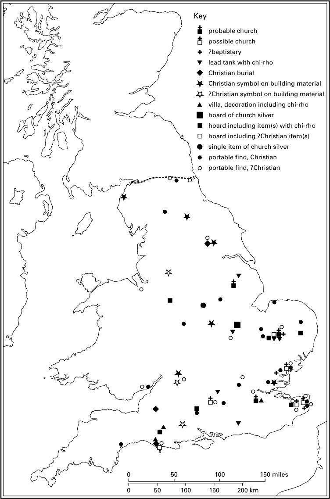
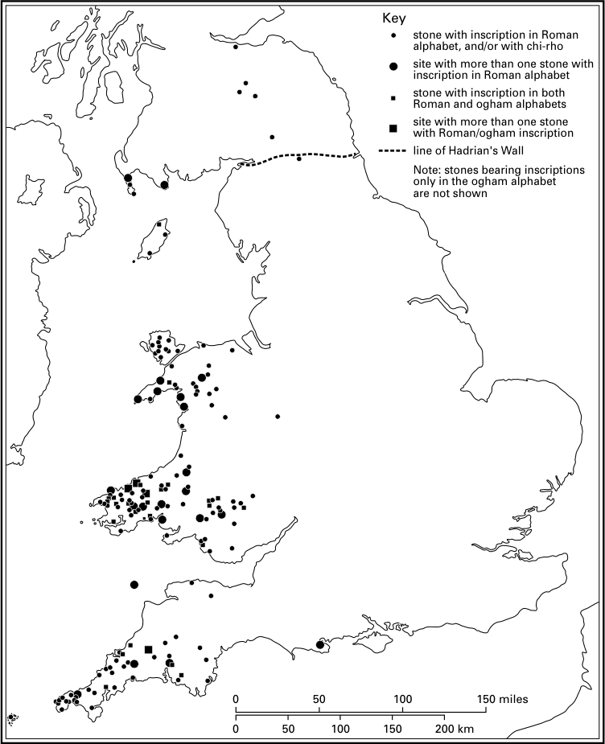
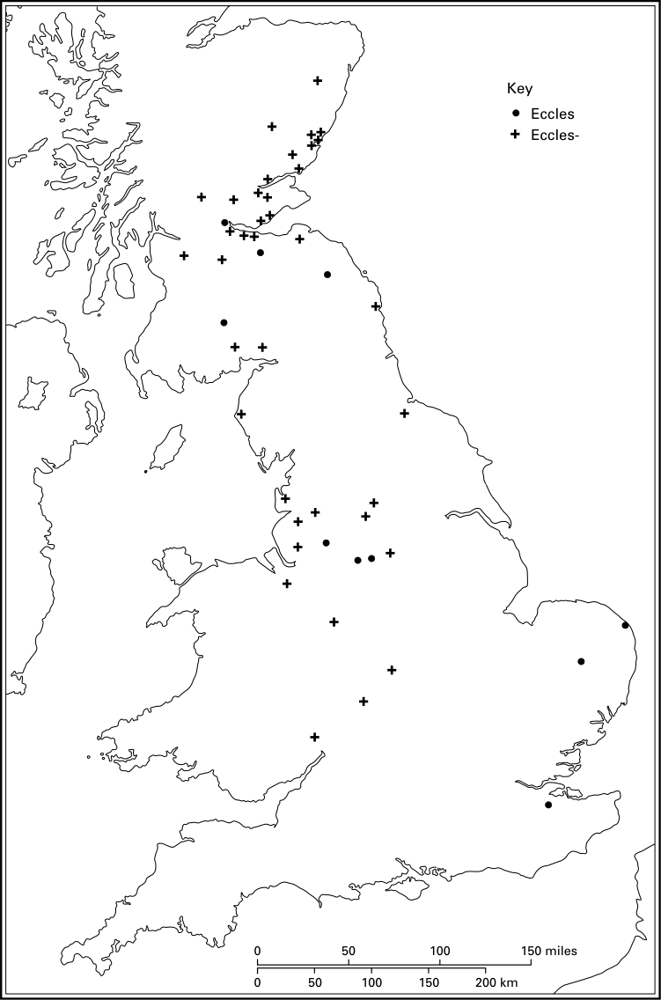

# 第16章 · 不列吞人、达尔里阿达爱尔兰人与皮克特人中的基督教

## 克莱德河/福斯河以南的不列颠与海外的布立吞人

罗马在不列颠的统治终结之后的几个世纪，对于不列颠教会的形成至关重要，正如这几个世纪对于不列颠整体的政治、族群与社会结构的塑造显然至关重要一样。尽管从现有的残缺而极不齐一的史料中拼合出一幅图景是何等困难，我们仍须牢记这几个世纪的重大成就。这几个世纪所见证的，不仅是基督教在那些尚未被新来的信奉异教的盎格鲁—撒克逊人控制的地区得以巩固，而且还有它向更北、更西地区的传播。而且，这一切是在罗马-不列颠的城市与庄园宅邸消亡、盎格鲁—撒克逊人移居不列颠东部和南部广大地带的情况下实现的——而这恰恰是罗马-不列颠教会最为显著的那些地方和地区。由于对罗马之后时期的种种解释往往取决于对基督教在不列颠尼亚罗马行省时期命运的解读，我们将从对后者的一番简略考察开始。

## 罗马时期的前奏

到君士坦丁一世于四世纪初皈依基督教之时，伦敦、约克和（很可能）林肯已有主教。^1 到410年为止基督教进展的程度颇有争议：我们缺乏文字证据，而考古证据也可以作不同解读。除非有明确的基督教符号或铭文作为佐证——如多塞特的庞德伯里那样——我们无法可靠地区分基督教墓葬与异教墓葬。基督徒一般葬于西东向的墓坑中，不随葬器物，但异教徒也可能如此下葬；而且偶尔也有带随葬品或朝向不同的基督教墓葬的证据。^2 在辨认某些建筑是否为基督教教堂时，也会出现类似的问题，如所谓锡尔切斯特的“教堂”。^3 若把较为可靠的基督教证据标在地图上（地图11），可以看到沿不列颠东部自约克向南有一片显著的证据分布；在不列颠南部，这种证据向西延伸到多塞特。相反，西部各郡乃至中部部分地区，除建筑材料上零星的基督教符号和少数可移动的出土物之外，基本是一片空白。^4 然而我们必须追问：这类地图反映的究竟是基督教在不列颠尼亚罗马行省的实际分布，还是仅仅反映了可辨识的考古证据？一个值得警惕的信号是：基督教的考古证据与“文化涵化”或成功罗马化的证据之间存在关联。^5 因此，单凭考古学无法说明不列颠西部的人口是异教徒还是基督徒。

在此，赴爱尔兰传教的不列颠人帕特里克的著述提供了一个可喜的侧证。帕特里克大约生于四世纪末或五世纪上半叶，至少在他那富裕家庭中，基督教已传承了两代：他的父亲是执事，祖父是司铎；而既然他们的田产位于屡遭爱尔兰人劫掠的地区，那想必在不列颠西部某处，距爱尔兰海不远。尽管帕特里克和与他一同被掳的人们“没有听从我们的司铎”，但他们至少在名义上都是基督徒。^6 这令人欣喜地证实：在考古证据稀少的地区，存在着一个寻常的基督教社团。

然而，考古学在揭示何种地点、何等阶层的人皈依了基督教方面颇具价值。一代人之前，罗马-不列颠的基督教仅被视为一种城市和贵族的现象。考古学证实了这一点，最引人注目的是林肯：人们在广场正中央发现了一座确实建于此处的教堂，以及在肯特卢林斯通庄园宅邸发现的“宅第教堂”。^7 但考古学也揭示，基督教已传至里奇伯勒的罗马要塞（肯特），以及一些小镇，如伊克林厄姆（萨福克）、阿什顿（北安普敦郡）和威根霍尔特（萨塞克斯）。^8 这有助于我们理解：在货币经济和精密的分配体系崩溃、城市生活与庄园社会消亡的时代，基督教何以仍能在不列颠存续。

图例
可能的教堂
或为教堂
？洗礼堂
带凯乐符号的铅制水槽
基督教墓葬
建筑材料上的基督教符号
？建筑材料上的基督教符号
带凯乐符号等装饰的庄园宅邸
教会银器窖藏
含凯乐符号器物的窖藏
含？基督教器物的窖藏
单件教会银器
可移动出土物，基督教
可移动出土物，？基督教

当然，即便在有基督教证据之处，它也丝毫不能告诉我们基督徒与异教徒之间的比例，而人们对此所作的假设大相径庭。最可信的方法是参照大陆的平行情况，尤其是异教存续的情形。在不列颠，仍在使用的异教神庙数量似乎在四世纪中叶达到顶峰，远晚于大陆。然而到四世纪末五世纪初，此类神庙数量急剧下降，尽管不及国外下降之速。^9 到吉尔达斯于六世纪上半叶写作之时，其言下之意是不列颠社会已至少在名义上是基督教社会。吉尔达斯痛斥主教们未能谴责罪恶；但值得注意的是，他并未斥责他们纵容异教。^10 这并不排除乡村中仍存有异教飞地的可能——吉尔达斯与主教们看不见之处（正如《圣参孙传》对康沃尔的暗示）；但这使得“高调的”异教不大可能存在。^11

有了这一背景，我们现在可以转向一个长期令考古学家着迷的问题。如前所见，罗马时期基督教的考古证据主要分布在东部。然而，在罗马之后不列颠基督教最切实的证据——即通常被释读为纪念铭文的直立石碑^12，其中许多明确是基督教的（地图12）——的地图上，却出现了截然不同的分布。这些石碑大多属于五世纪至七世纪初，尽管近来有人为杜姆诺尼亚（德文郡和康沃尔）的某些石碑主张长得多的时间跨度。威尔士约有150方，杜姆诺尼亚另有约50方，马恩岛和不列颠北部各处则数量较少；布列塔尼也有若干。^13 这一分布的引人注目之处在于，它远离我们前一幅地图上的基督教证据，而且只是偶尔触及罗马化程度较高的地区。更有趣的是，所用基督教套语在不列颠并无渊源，却可在大陆找到平行例证：hic iacet（“此处长眠”）式套语于四世纪末见于特里尔，约420—450年间见于里昂，此后逐渐让位于稍长的套语，如hic reqviescit in pace（“此处安息于平安之中”）。^14

图例
带罗马字母铭文和/或凯乐符号的石碑
有多方罗马字母铭文石碑的遗址
兼有罗马字母与欧甘字母铭文的石碑
有多方罗马/欧甘铭文石碑的遗址
哈德良长城沿线
注：仅有欧甘字母铭文的石碑未标出

应当如何解释这两幅地图之间的断裂？一代人之前，一位著名考古学家推测：罗马不列颠的基督教只为官方和商业精英所信奉；它未能争取到乡村人口，便随那个精英阶层一同消亡了。因此，不列颠不得不由在大陆受训的传教士重新皈化，他们沿西部海道北上活动——拉丁铭文即是明证——并被认为引入了修院制。所设想的先行者就是尼尼安，他在惠索恩的教堂献给了高卢修士主教圣马丁，那里出土过带铭文的石碑；比德约在三个世纪后（731年）写成《英吉利教会史》，其中以“据说”这一保留口吻提及尼尼安据称在罗马受训并在南皮克特人中间传教。^15

基督教在不列颠完全消亡的理论此后已被令人信服地驳倒。^16 尽管如此，旧有模式仍具影响。例如，盎格鲁—撒克逊人的肯特是由罗马派来的传教士皈化的，而非由土著不列颠教会，人们有时将此归因于基督教在罗马不列颠的扎根不如在大陆那样牢固。^17 又如，修院制的出现有时仍被描绘为与西部海道以及至少部分带铭文石碑的分布相关联，并被视为亚罗马时期与中世纪早期基督教之间真正的转折点。^18 不列颠教会所谓未能使盎格鲁—撒克逊人皈依的问题，我们后面还会讨论；眼下我们先考察最初引发上述理论的证据，并重新审视有关亚罗马时期和中世纪早期不列颠基督教的证据，特别关注不列颠的北部和西部。

## 亚罗马时期不列颠的基督教：连续性还是文化断裂？

罗马-不列颠基督教地图与直立石碑拉丁铭文地图之间的反差起初令人震惊，但我们已经看到，较早的那幅地图只标出了考古上可见的基督教证据。拉丁铭文的地图同样需要正确解读。这些铭文未必都是基督教的，也未必都与高卢相关。其中有些与爱尔兰欧甘石碑（可异教可基督教）更为接近；^19 而南威尔士兼用罗马与欧甘两种字母书写的双语（或“双字母”）铭文则提供了两者之间的联系。凡铭文形式可辨认为基督教的，显然证明了基督教的存在；但我们必须提防一种错误假设，即此类铭文的缺席便意味着基督教的缺席。且不说显而易见的一点——只有富有者才可能以这种方式被纪念——我们还必须认识到，树立此类纪念碑是一种文化现象：那个社会的人们选择以这种方式纪念某些人，其中至少有些是基督徒。然而在往东或往南一百六十公里之外，那里的人口可能同样信奉基督教，却未必采用这种纪念性石碑铭文的风尚。

只要看看第三幅地图——这次展示的是Eccles地名的分布（地图13）——便可证明事实确实如此。这些地名源自通俗拉丁语的eclesia或其凯尔特语派生词，意思都是“教堂”。因此它们的分布证明了在盎格鲁—撒克逊人占领该地区之前已有教堂的部分——当然绝非全部——地点。^20（威尔士和康沃尔之所以刻意留白，并不是因为那里没有这类地名，而是因为这类地名在我们所关注的时期之后很久仍在不断产生。^21）Eccles地名存活率为何如此参差，其间的复杂原因此处不宜探讨，但至少可以指出：除东南部的三例——它们可能代表极早的借词^22——之外，这类地名主要出现在盎格鲁—撒克逊人到七世纪才征服的地区，而那时他们自身正处于基督教化的进程之中。无论如何，凡此类地名存续之处，都为一段大致与带铭文石碑同期的不列颠基督教史提供了无可争辩的证据。有趣的是，Eccles地名在很大程度上弥合了罗马-不列颠基督教的考古证据与随后几个世纪的基督教铭文之间的地理鸿沟。因此，就西部和北部不列颠而言，尽管带铭文石碑的观念——及套语——可能来自海外，却不必认为基督教本身也是如此。它更可能是从不列颠内部的邻近地区传播而来。

图例
Eccles
Eccles-

这一基督教在不列颠境内进一步向西北传播的假说得到了多方史料的印证。连续性在威尔士东南部及英格兰毗邻地区或许最为清晰：那里有罗斯附近的埃克尔斯韦尔，还有吉尔达斯记载的凯尔利恩（纽波特城外）两位公民的名字与安葬之所（殉道者圣髑龛？），他们于罗马时代殉道，显然在作者写作之时（约530年）仍受尊崇。^23 同一地区的基督教也见于《圣参孙传》，传主是六世纪来自南威尔士、最终在布列塔尼终老的圣人，其传记亦写成于布列塔尼。其成书年代争议颇多，但以七世纪成书最为可信，其作者记载了信息的传递以及他本人的不列颠之行。^24 不论我们对《传》中所设想的中威尔士修院制与欧塞尔的日耳曼努斯不列颠之行（429年，或许还有约440年）之间的联系能否给予几分信任，参孙自幼在伊尔图德主持的修院中接受教育这一点，很可能表明伊尔图德的修院创立于五世纪的某个时期，地点想必在兰特威特（即Llan Ilduti）。^25

罗马基督教的连续性及其向西、向北的传播，也由帕特里克的著述得到印证。我们已经看到，这些著述暗示爱尔兰海附近存在一个基督教社团，而帕特里克本人正是基督教向西传入爱尔兰的首要证据。他抨击不列颠酋长科罗提库斯的信函将基督教与罗马社会联系在一起——这种联系我们在下一个世纪的吉尔达斯身上再次见到；^26 此外，该信暗示基督教已传播到以哈德良长城为标志的原罗马边界以北的部分不列颠地区。虽然无法确定，但这位科罗提库斯很可能就是以邓巴顿（在克莱德河上）为中心的不列颠王国斯特拉斯克莱德的统治者；^27 帕特里克的信表明科罗提库斯及其部众是名义上的基督徒。^28 这一关于基督教传入今苏格兰地区的文字迹象可以得到实证：惠索恩的拉提努斯石碑带有新近辨认出的君士坦丁式凯乐符号，证明五世纪那里已有基督教；而其他石碑的散布加上Eccles地名，则表明到约600年，基督教已传播到克莱德河—福斯河一线。^29 尽管基督教的证据不算丰富，那几个世纪的异教证据却几乎不存在，仅有北诺森伯兰的耶弗林一处例外；而那里的异教很可能是盎格鲁—撒克逊入侵者的，而非不列颠人的。^30 因此，实际发生的情况似乎是：原罗马边界已失去意义，基督教传播到所有不列颠王国，或许甚至在更北的皮克特人中间也取得了一些进展。

这些概括性推断背后可能潜藏的复杂性，可以由惠索恩一例来说明——近年来该遗址已得到部分发掘。比德说，惠索恩是不列颠主教尼尼安的教座所在地，尼尼安一反不列颠人的惯例，在那里建了一座石造教堂；至少在比德的时代，它献给了图尔的圣马丁。^31 教堂遗址大概位于发现拉提努斯铭文并建有后世中世纪教堂的山顶。而新近的发掘则集中于山坡较低处的南侧，这一区域起初位于内圣区之外。发掘揭示出一个复杂的发展过程：先是农业阶段，随后运入石灰——想必是为附近（山顶上？）的重要建筑制备灰泥或砂浆。接着在被发掘区域内出现了若干篱笆或立柱墙建筑和金属加工的证据，连同五世纪末至六世纪中叶自东地中海输入的陶瓮残片，以及玻璃器皿残片。陶瓮中装的可能是葡萄酒和橄榄油，精美的餐具则从北非进口。与此同时，惠索恩的内围与外围边界发生移动，被发掘区域的大部分被纳入内围之中，并开始在那里下葬。地中海贸易于六世纪中叶前后中断；但与大陆的国际贸易很快恢复，并贯穿整个七世纪：进口物中包括约55只锥形玻璃杯。^32 在某些方面，文字证据与考古证据是相合的。显然，惠索恩是一个不寻常的高等级遗址。它与地中海、继而与法兰西亚有着遥远而广泛的联系；被发掘区域内出土的若干刻有十字架的石碑证实了遗址至少部分具有教会性质，这也与当地建立的墓地相吻合。但问题依然存在。例如，进口的玻璃器皿是全部供主教体面地宴饮之用，^33 还是其中有些可能属于近旁的一位世俗领主，其废弃物可能扩散到了我们的遗址上？^34 无论如何，这暗示惠索恩属于一个相当文明的、“罗马之后”而非“蛮族”的世界：想到公元400年时它还在罗马帝国边界之外，这一点令人叹异。

## 吉尔达斯的见证与不列颠教会的轮廓

我们对六世纪不列颠的了解，在相当程度上依赖于一位作者——吉尔达斯——的著述。他的主要著作《不列颠人的毁灭》（常称《不列颠的毁灭》）是一篇以绝妙修辞痛斥当权者——世俗权贵与主教——种种弊病的檄文。他大量征引《圣经》，力图使这些人的眼睛睁开，看清他们对基督教上帝的口头尊奉与上帝在实践中的要求之间那道深不见底的鸿沟。吉尔达斯的呼吁有一种紧迫感：他浸透了《旧约》中那位以上灾疫或异族征服来涤荡有罪之民的上帝观——原初的盎格鲁—撒克逊征服即是明证。^35 在他写作之时，大概是530年代初，^36 不列颠已分割为不列颠人与日耳曼人的诸王国或社会群体拼合而成的马赛克，后者在从弗兰伯勒角向索伦特斜画的一条线的东南方占优势。尽管自吉尔达斯出生前四十四年左右以来，不列颠人与盎格鲁—撒克逊人之间一直相安无事，^37 但若不悔改，其同胞的行径足以招致新的灾难。

只要对吉尔达斯的倾向和修辞作适当的估量，便能获益良多。第一，吉尔达斯把不列颠视为一个整体，尽管划分为数个王国；他所论及的范围自西南的杜姆诺尼亚经雷赫格德直至北威尔士的格温内斯。^38 第二，从他历史章节的行文——它把不列颠基督教从殉道者时代到当下呈现为一部天衣无缝的历史^39——他对不列颠人使用cives（“公民”）一词、称拉丁语为“我们的语言”，^40 以及他拉丁散文风格本身的性质——那暴露了他所受的修辞学训练，而修辞正是晚期罗马教育的标志——可以频频看出与罗马不列颠的连续性。^41 通观全书，其预设都是不列颠人至少在名义上全是基督徒：主教受谴责是因为未能谴责罪恶、宣讲上帝之道，而不是因为纵容异教。^42 相反，撒克逊人却是“为上帝和人所憎恶的”。^43

吉尔达斯的著作使我们得以看到一个富裕而根基稳固的教会，拥有教堂建筑和教会层级。权力与职责归于主教；教会职位如此为人觊觎，以致人们向本地诸王购买主教和司铎之职，买不到便渡海去谋取。^44 神职人员的婚姻是被承认的，不过晋升司铎之后 continuing 性关系未必被允许。^45 修院制已经存在，践行者当时人数不多，却深受作者敬重。^46 在后一点上，《毁灭》与吉尔达斯另一部仅存残篇的后期著作有所不同：那是一封回信，就各种问题——尤其是相对安逸的修院与追求更严格生活的个人之间冲突所生的问题——应询提出建议。^47 有趣的是，从《毁灭》到《残篇》，修院制似乎有所扩张并趋于多样化。^48 我们稍后回到这个问题；但在此应当注意其中蕴含的意思：吉尔达斯的一生跨越了一个关键时期——《毁灭》既属古代晚期也属中世纪早期，而《残篇》则属于修院制扩张的阶段，把我们与伟大的爱尔兰苦修者科伦巴努斯的世界联系起来。^49 有人令人信服地论证说，我们在这里看到的是因果相承：《毁灭》中吉尔达斯激昂的布道产生了可察觉的效果，激励许多人投身修院生活。^50 倘若约536年前后的气候扰动和540年代的瘟疫紧随《毁灭》问世之后而来——这似乎很可能——其影响还会大大增强。^51

其他史料或印证或补充了吉尔达斯的证据。我们保有两条约属六世纪的不列颠宗教会议针对各种过犯所议定的惩罚条文。其一题为“北不列颠宗教会议”，为我们提供了吉尔达斯未曾涵盖的地区的可喜信息。其中提及主教、司铎、执事、doctor（教会学者）、院长和修士的地位。^52 然而我们对不列颠教会组织框架的认识仍不完备，因为存世证据残缺不全。有充分的论证表明雷赫格德的每个坎特雷夫各有自己的主教，这提示了一种小规模、按地域划分的教区。^53 有大批爱尔兰移民拓殖的雷赫格德未必是所有地区的典型，但也未必不典型。再往东，兰达夫文书（仅以经编订的形式存于十二世纪的《兰达夫书》中）的证据被用以推证六世纪埃尔金（赫里福德郡西南）存在一个主教区，其规模可与雷赫格德的教区相比。然而后来它或许向西扩张，将格温特也包括在内。^54 指向另一方向证据见于《圣参孙传》——若我们可以信它的话。书中，（我们可以假定是）埃尔金的主教杜布里丘斯在兰特威特修院——位于今南格拉摩根——为参孙行按手礼，甚至任命他在雷赫格德卡尔迪岛上的皮罗修院担任修院职务。这不可能属于以埃尔金为基地的地域性教区；但既然杜布里丘斯每个四旬期都在那里度过，我们看到的或许是卡尔迪与埃尔金之间的一种特殊关系。^55 还有一点：参孙被祝圣为主教时，没有任何迹象表明是就任某个特定的教座。^56 那么，或许有些修院由地理上相距较远的教区的主教监管；而且除了地域教区的主教之外，还有修院主教。后者似乎保有对修院的控制权，与爱尔兰的同类主教不同；但我们不应过分夸大这种对比。^57

至于实际的权力和影响在哪里这个问题，我们应当细味比德所讲的不列颠教会与奥古斯丁打交道的故事。据比德记载，奥古斯丁召集不列颠的主教和教会学者会面，会谈无果之后，他借行一个神迹证明罗马的方式是正确的。不列颠代表团似乎为此折服，但请求再开一次有更广泛代表参加的宗教会议。七位不列颠主教和许多极有学问的人士与会，他们主要来自班戈修院；赴会之前，他们向一位圣洁的隐修士请教。当他们必须作出决定时，遵循的正是隐修士的建议。^58 这里有两点值得注意：第一，doctor——尤其是修院的doctor——与主教一同参加了两次会议。《北不列颠宗教会议》的条文中，doctor出现为主持补赎的裁定者，甚至及于主教。^59 他们与主教一同出席与奥古斯丁会晤的宗教会议，可与七世纪爱尔兰宗教会议上的情形相印证：在那里，同样有可与主教地位相当的教会学者出席。^60 因此，不列颠教会中最重大的事务似乎不仅由主教关切，也由教会学者关切。第二，向隐修士请教并遵行其建议这一事实，意味着他的灵性智慧与道德权威得到了最高层面的承认。这是否是苦修运动的晚近产物，我们无从知晓，但看来可能。因此，尽管不列颠主教继续是不列颠教会的领袖，但在七世纪初他们并不是唯一的权威来源，而且此期也未提及任何“总主教”或都主教。相反，宗教会议显然十分重要，这些会议容许doctor与主教一同参与决策。

## 修院制

修院制极可能是在四世纪末或五世纪期间从高卢传入不列颠的。高卢是两大修院运动的故乡。其一源自图尔的修士主教马丁（卒于397年），经由其门徒以及苏尔皮齐乌斯·塞维鲁斯关于他的圣徒传记著述而传承。另一运动则发端于普罗旺斯的两个中心：莱兰的岛屿修院，以及约翰·卡西安的著述——卡西安是一位来自东方的修士，曾在埃及拜访沙漠教父，定居马赛后于五世纪初撰文记述他们。这两条潮流在五世纪期间很可能都影响了不列颠。

早期不列颠的修院制是一个复杂的课题，部分原因是人们对修院制的起源与成就、以及它与主教和地域教区的关系有过诸多猜测；但同样也因为对“修院制”和“修院”的含义存在混淆。一方面，我们是否始终能区分修院与神职人员社团，这是个问题。至少在六世纪，可能确实存在一些如我们所理解的那样的修院：由依照修院誓愿共同生活、受院长指导的男性组成，其中仅少数人担任执事或司铎之职。^61 另一方面，鉴于神职人员可以合法结婚、想必有自己独立的家庭，且鉴于吉尔达斯《毁灭》中隐含的神职人员的职责与遁世修士的职责之别（这意味着后者不承担牧灵职责），我们可以推断牧灵关怀并非修院的关注所在，而是另立的世俗神职人员之职。^62 然而，也可能存在共同起居的神职人员之家，如大陆那样；而随着时间推移，这类神职人员社团与修院社团之间的区别似乎日益模糊。^63

另一重混淆源于“修院制”与“苦修主义”的交叠，《参孙传》即是例证。参孙幼年被送入伊尔图德的修院（兰特威特）。长大后，他渴望比伊尔图德颇为松弛的院规所允许的更严格、更虔敬的生活，得以转入皮罗在卡尔迪岛上的修院，那里给了他更多长时间祈祷的空间。当被选中接替皮罗任院长——后者醉酒时跌入井中——参孙依照一部会规治理修士，而其个人克己之甚，以致被视为更像“隐修士”而非“共修士”。^64 访问爱尔兰之后，参孙没有回到卡尔迪复任院长，而是带三位同伴，在塞文河附近一处“荒野”的堡垒中建立了一个遁世居所。然而他并未与其他人同住，而是大部分时间独自在洞穴中祈祷，仅在主日回堡垒参加弥撒。后来他被一个宗教会议从隐居地召出，不情愿地受命管理另一座修院，不久被祝圣为主教；但随即宣布自己蒙召作peregrinus，即异乡人或“朝圣者”。^65 在凯尔特诸地，这个词发展出一种专门含义：为基督的缘故弃绝自己的家园，永不返回。于是参孙启程，途经南威尔士自家的一些修院前往康沃尔。他在那里向异教徒布道并建立了一座修院，最后渡海到布列塔尼，又建立了若干修院，并在那里终老。^66 显然，我们在这里看到的是单一的修院圣召，以修士、隐修士和peregrinus等多种形式表现出来；而他探访的那些家庭修院，或许更接近家庭式的苦修而非完全意义上的修院制；有许多迹象表明，这类修院的主持权通常在一个亲族内部传承。在这种情况下，试图在苦修主义与修院制之间作出僵死的区分是不恰当的。^67

参孙希望以较虔敬的社团取代松弛的社团、并投身独自祈祷的愿望，与吉尔达斯《残篇》所反映的六世纪证据相吻合。这些残篇揭示了修院实践的巨大差异。一些历史悠久的修院伙食丰盛，包括肉和啤酒，以及蛋、奶酪、牛奶、蔬菜和面包；在另一些修院，食物匮乏得多；而极端苦修者则以面包和清水为主食。伊尔图德的修士似乎以务农自给，班戈—伊斯—科德的修士则 certainly 都从事体力劳动；但在某些社团中，劳动显然由指定的劳作修士承担，而非人人参与；而在苦修的一端，甚至拒绝使用牲畜拉犁，一切劳作皆由修士以手完成。^68

这正是后世视为威尔士教会“创立圣人”的时代。可惜关于他们缺乏可靠证据，不过解读兰杜伊—布雷菲一处由古物学者记录下来的铭文——关键词现已佚失——或许至少能为威尔士主保圣人圣大卫提供七世纪的见证。威尔士编年史记其卒于601年，各种爱尔兰编年史则提前约十二年，提示其活跃期在六世纪中后期。这可信，但无法验证。^69 里吉法奇的十一世纪《传》中所述其社团极端苦修的生活方式，不像是1090年代的杜撰，且与吉尔达斯《残篇》有有趣的平行之处；但我们不知道其背后是什么史料。^70 然而，即便撇开这些晚期证据，六世纪仍呈现出某些人的苦修热忱，它导致新的修院创建（如参孙所建者），并很可能使修士人数日增。这由吉尔达斯的《残篇》所暗示，并由比德关于七世纪初班戈—伊斯—科德修院的记述所证实——他记载该修院拥有修士逾两千。^71 这必定是一个惊人的社团——至少直到616年诺森伯里亚人屠戮其1200名成员之前是如此。

## 海外的布立吞人

在五、六世纪，布立吞人仍处于罗马的余晖之内，与前罗马帝国的一些地区保持贸易往来。^72 与之相匹配的是文化和教会上的联系。吉尔达斯仍视拉丁语为“我们的”语言；他的一些同胞渡海 abroad 接受主教祝圣；而六世纪中叶出现了名叫戈诺蒂尔努斯的不列颠名字的桑利斯主教，591年又有名叫卡兰托库斯的人在勃艮第任院长。如此看来，不列颠人既与爱尔兰的peregrinus科伦巴努斯同行其大陆之旅，也先于他。^73 最引人注目的是一条记载：560和570年代，在遥远的加利西亚有不列颠人自己的教堂和一位本族主教。^74

移民拓殖最稠密的地区是阿莫里卡半岛的西部和北部，至六世纪末该地已更名为Brittania，即布列塔尼。在体制上，这里仍是一个教会行省的一部分，对应罗马的卢格杜嫩西斯第三行省，都主教驻图尔；453年昂热、461年图尔和462—468年瓦讷的一系列省级主教会议，显示了布列塔尼人到来之前的教会结构：雷讷、南特和瓦讷各城邦设有主教；科里奥索利泰斯人中（或许以滨海要塞阿莱为基地）可能也有主教，西部的奥西斯米人中大概亦然，尽管该教座的位置不明。^75 不列颠教会人士在阿莫里卡的第一份可能证据，是461年图尔宗教会议上一个名叫曼苏埃图斯、“布立吞人的主教”的签名——不过他也很可能只是一位来访的主教。^76 不列颠教会人士积极向（不列颠）人口施行牧灵的确实证据，来自图尔、雷讷和昂热诸主教在509至521年间致两位名为洛沃卡特和卡蒂埃恩的布立吞名字的司铎的一封信。这两位司铎曾携带便携式祭坛四处巡回，在私宅中举行弥撒。触怒主教们的，是有称为conhospitae的妇人随行，由她们递送圣爵。^77 这些细节极为有趣：第一，关于妇女所扮演的突出角色，这可与东方教会的女执事相比，而在西方几乎无证可考。也许埃帕翁宗教会议（517年）和第二次奥尔良宗教会议（533年）禁止任命女执事，应视为对一种正在西方蔓延的东方做法的反应，布列塔尼的conhospitae正是其存在的证据。^78 第二点是便携式祭坛的使用，说明在乡村教堂建立之前牧灵工作是如何进行的。最后，人们得到的印象是这两位司铎自行其是，没有有效的主教监督。因为写信的主教们并非以视之为自己教区内神职人员的口吻致函洛沃卡特和卡蒂埃恩，而事实上，两位司铎的活动范围很可能在科里奥索利泰斯人的领地内；主教们却直接致函他们，而不经由其所在教区的主教。这可能暗示了不列颠人涌入所造成的教区结构的紊乱。^79

在雷讷和瓦讷两教区以西，教会结构的紊乱（如果这种结构曾经完全存在过的话）确实发生了，并与史料的缺环相匹配。567年在图尔举行的一次宗教会议试图规定：未经都主教同意，任何人——无论“布立吞人还是罗马人”——不得被祝圣为主教。^80 这在布列塔尼人控制的地区想必无从执行。到证据重新出现的九世纪中叶，我们发现布列塔尼人手中已有五个主教中心。瓦讷和阿莱两教区存续下来，尽管后者的建立如今被归于威尔士苦修者圣马洛，而另一位主教则以邻近的多勒为驻节地——那是威尔士圣参孙创建的修院。在西部，原奥西斯米人的领地上出现了两位主教，北面在圣波尔—德—莱昂，南面在坎佩尔。^81 只有多勒一例我们有前加洛林时期的史料可据，即《圣参孙传》。但即便此传，除下面将讨论的参孙觐见希尔德贝尔特王一节外，对其在大陆的事迹也无甚记载。然而我们可以说：多勒是作为修院建立的；其创建者参孙自不列颠抵达时已具主教品位；且多勒在参孙死后似乎延续了主教传统，因为《传》中提到一位后任主教勒乌凯鲁斯，而《传》的题献对象是主教蒂格诺马格卢斯。^82 但这些主教究竟是如大陆通例那样对一块地域性教区行使主教监督权，还是仅对多勒分散的隶属教堂行使牧灵监督，我们无从知晓。至于圣波尔传说中的创建者保罗·奥雷利安，其创立圣徒传似乎对其在布列塔尼的事迹提供了更多具体的证据，包括一位地方首领把一座废弃堡垒赠予他作主教驻节地，以及希尔德贝尔特王予以批准的记述。然而，尽管作者可能掌握一些较早的文字材料，这部《传》迟至884年才写成，此时令人信服的起源传说已成为宣传之所需。^83 因此我们不能相信其细节；其他布列塔尼圣徒传也是如此——它们都成于九世纪或更晚。

在地方层面，到九世纪已有一张密布的教堂网络：每个社团或plebs（布列塔尼语ploue即由此而来）都有自己的教堂，由一小群司铎主持。这些ploue教堂或许构成了布列塔尼教会的基本单元，早于九世纪地域主教区的形成；但对此我们须谨防过多的臆测。^84 此外，布列塔尼既有隐修所——常位于近海岛屿上^85——也有共修制修院。创建了多勒修院、而且据说“几乎遍及全省创建了众多修院”的圣参孙，被描绘为前往纽斯特里亚觐见希尔德贝尔特王，为布列塔尼王子尤德瓦尔说情。他成功了；而且，在驱逐了一条龙（！）之后，他被赐予塞纳河口附近的土地，建立另一座修院，即蓬塔勒修院。屠龙的故事显然是一个反复出现的神话；但蓬塔勒修院却是实实在在的，其周围的一块飞地一直保留在多勒手中，直到法国大革命。^86 联系显然是通过海路维持的；整个故事的重要性在于表明：布列塔尼教会并未与法兰克主流完全隔绝。对此的进一步佐证是：约562年举行的巴黎宗教会议的签署者中有一位参孙，很可能就是我们的参孙。^87 大约六十年后，尤德瓦尔之孙、布列塔尼王尤迪卡埃尔被召至达戈贝尔特的宫廷。他拒绝与王共餐，“因为他虔敬而满怀对上帝的敬畏”；但他同意与属科伦巴努斯修院制影响圈子的印玺大臣奥多埃努斯一同进餐。据晚期圣徒传记记载，尤迪卡埃尔最终隐退到布列塔尼森林深处的圣梅安修院，而他年幼的弟弟则北上，创建了后来的滨海约斯修院（在蒙特勒伊附近）。^88

在这一切之中，史料的局限令人痛切地显现。从九世纪回望，六世纪和七世纪初被视为“圣徒的时代”。这些圣徒全被描绘为苦修者；其中大多数人被说成来自南威尔士，穿越康沃尔前往布列塔尼，建立隐修所和修院；不过据说创建朗代韦内克修院的温瓦洛，则被描绘为出生于布列塔尼的移居不列颠人家庭。^89 这些“圣徒”中的多数，其不列颠出身由其名字得到印证，而其崇拜往往跨越英吉利海峡。^90 但是，关于修院创立圣徒的晚期圣徒传记证据，应如何与我们在六世纪致洛沃卡特和卡蒂埃恩书信的证据、以及九世纪小型神职人员社团的证据相互权衡呢？六世纪的布列塔尼确实有过苦修者：有一个名叫温诺赫的人，只吃未经烹煮的菜蔬，于六世纪末前往图尔，打算去耶路撒冷朝圣——尽管他因贪杯在图尔落得个凄惨的下场。^91 也许洛沃卡特和卡蒂埃恩属于不列颠基督教的前苦修时期，即吉尔达斯在《毁灭》中痛斥的那个教会；而像参孙那样的苦修朝圣者则属于从吉尔达斯《残篇》可以推知的伟大修院复兴运动的一部分。^92 既然渡海朝圣被视为一种苦修理想，布列塔尼完全可能在参孙之外还吸引了若干苦修者；他们的许多创建地在九世纪初很可能已演化为小型司铎团体。然而，另一种可能是：ploue教堂代表的是像洛沃卡特和卡蒂埃恩那样的小股世俗司铎所建教堂的后继者。因此，九世纪的圣徒传记把所有创立圣徒都描绘成苦修者，可能给人一种误导。这种误导之所以产生，或者是因为他们只是挑选苦修者圣徒为之立传并加以铺陈；或者是因为他们把所有教堂创建者都写成苦修者——在《圣参孙传》的影响下，九世纪的作者正是选择以这种方式描绘他们。

然而，尽管疑点重重，有几点是清楚的。第一，迁入的布立吞人带来了自己的基督教传统，而非被阿莫里卡既有的传统所吸收。他们似乎带来或发展出ploue教堂、修院主教，以及我们在不列颠西部和爱尔兰所见的岛屿型隐修所传统，而与岛屿世界的持续密切联系在抄本的字体和内容上也显而易见。^93 第二，参与科伦巴努斯传教事业的大陆不列颠人，爱尔兰与布列塔尼的联系得以维系：科伦巴努斯的一位门徒在日后的布列塔尼边界之外、布列塔尼影响浓厚的库唐斯地区建立了一座修院；^94 而西布列塔尼的朗代韦内克修院到818年仍保持爱尔兰剃发式和会规，直到虔诚者路易下令它遵行圣本笃会规。^95 第三：尽管如此，并没有证据表明布列塔尼教会在我们这个时期被视为分裂派。图尔的格里高利毫不犹豫地为一位置笃敬的布列塔尼朝圣者行按手礼，而主教们也经常被用作布列塔尼人与法兰克人之间的使者。^96 约600年时，布列塔尼人大概守“凯尔特”复活节，而非阿基坦的维克托里乌斯的复活节；但法兰西亚内部本也有些分歧，而布列塔尼人既然住在自己隔绝的区域，这或许未引起多大麻烦。我们可以假定他们远在818年之前——也许是在吕克瑟伊于马孔宗教会议（626/7年）之后不久的几年里——就已遵行通例。尽管有这类独特之处，我们不应把布列塔尼教会视为与法兰克教会完全隔绝。虽然它并不受图尔都主教的有效管辖，但以圣德闻名的修士们铸就了联系：多勒和蓬塔勒的参孙，以及后来以其名为名的隐修所的布列塔尼创建者滨海约斯的圣约斯；与此同时，勃艮第的卡兰托库斯和桑利斯的戈诺蒂尔努斯，究竟是不列颠人还是布列塔尼人——在这一时期已无从区分。因此，我们的最后一点是：在这些世纪里，不列颠教会人士并不局限于布列塔尼，也在大陆其他地方零散定居，只是与名声更盛的爱尔兰朝圣者相比，他们往往被遗忘了。

## 不列颠教会、盎格鲁-撒克逊人与罗马传道团

六世纪中叶以后，不列颠人遭遇了重大变故，或许与气候灾变和瘟疫相接续。盎格鲁-撒克逊人的扩张把不列颠人的控制区压缩到杜姆诺尼亚、威尔士和斯特拉斯克莱德王国这些罗马化程度较低、较为贫瘠的土地上；而597年奥古斯丁为归化盎格鲁-撒克逊人而来，则以教会的从属地位威胁他们。奥古斯丁的传道团标志着盎格鲁-撒克逊人有史载之始。与此同时，不列颠人所经历的动荡与失败的一个后果是，出自他们自己一方的材料几乎荡然无存。其结果是，我们只能透过罗马人与盎格鲁-撒克逊人的眼睛，尤其透过诺森伯里亚史家比德的眼光，来看待两种基督教传统的对峙。比德继承了吉尔达斯把不列颠人描绘为罪人的写法，但又加了一条罪状：他们从不曾向盎格鲁-撒克逊人传道。他把不列颠人描绘成一个内向封闭的群体：当奥古斯丁要求他们放弃自己的特有习俗、接受他的领导并加入他的传道事业时，他们拒绝了他。实际上，他们宁守自己的习俗而不取普世教会的习俗；他们如此不具基督徒精神，以至于连盎格鲁-撒克逊人从别处接受了基督教，他们也不予尊重。的确，他们继续拒绝与盎格鲁-撒克逊人共融。^97

比德的解释影响极为深远，但它是有缺陷的。他指斥不列颠人从不向盎格鲁-撒克逊人传道，大概出于他对某段文本的误解；他的其他批评则源于轻易地从个别事例作出误导性的概括。^98 实际上，按当时标准衡量，不列颠人的传教记录是可称道的。^99 至于他们拒绝加入奥古斯丁一行，此处先须追问的是：教皇格里高利初次派遣奥古斯丁时为何无视不列颠教会的存在，又为何挑衅性地规定不列颠诸主教应被当作奥古斯丁的下级而非同僚？他似乎考虑的是把不列颠教会整合进他正在英格兰人中建立的新教会，而不是相反。^100 因此，尽管不列颠人确实拒绝放弃他们传统的复活节日期推算并加入奥古斯丁传道团，但达成一致的真正障碍在于：奥古斯丁要求对他的权威无条件服从，同时又以一位盎格鲁-撒克逊国王的主教身份前来，并且不为不列颠人提供任何保障。后者完全可以理解地担心，不列颠人的教会若隶属于驻坎特伯雷的一位主教，将危及他们未来摆脱盎格鲁-撒克逊人而独立的前景。

不列颠人虽未加入奥古斯丁传道团，但他们实际上很可能在盎格鲁-撒克逊人的归化中发挥过一定作用。这一点已被就赫威赛人和马贡塞坦人提出——这两族定居在自（大约）巴斯至马奇温洛克的塞文河下游一带。比德没有关于他们归化的叙述，但赫威赛人尤其在他的书中以一个信奉多年基督教的族群出现，墓葬证据也表明他们在整个七世纪都是基督徒。此外，已有有力论证认为伍斯特的圣海伦教堂起源于不列颠人的教会，早于约680年的盎格鲁-撒克逊座堂；该地区其他一些教堂可能也是如此。^101 对韦塞克斯西部，人们也论证了类似的模式：不列颠居民在不知不觉间施行归化，而盎格鲁-撒克逊人接管了先前存在的不列颠人教堂——韦尔斯和舍伯恩等教堂的起源即属此类；同时，在特威德河以北和奔宁山脉以西的某些地区，也可以设想不列颠人对诺森伯里亚教会作出过贡献。^102 更东面是否发生过类似情形，可能性要小得多，不过圣奥尔本斯以及林肯的Bail内圣保罗堂（St-Paul-in-the-Bail）或许还能论证崇拜地点的延续性。^103 我们唯一一条明言不列颠人使盎格鲁-撒克逊人归化的文字记载，是一个谜一般的说法：一位名叫鲁恩的不列颠人为诺森伯里亚的埃德温和他的民众施洗。史料年代颇晚，且似乎与比德较早的叙述相矛盾；但该书的这一部分依据较早的材料，并含有一些比德所无的准确信息，因此我们不应断然排除鲁恩与埃德温归化有过某种关系的想法。^104

至少在某些地区、某些情况下，合作是可能发生过的。这一部分源于局势本身的复杂与凌乱，它使“凯尔特人”与“罗马人”之间的彻底隔绝难以实现——尤其是在传教地带。局势复杂的一个原因是：在不列颠人与罗马传道团之外，还有第三方也作为重要角色介入——即由艾丹领导的、向诺森伯里亚传教的爱尔兰传道团；艾丹是爱尔兰人殖民的达尔里亚塔（阿盖尔）境内爱奥那修院的一位修士。此时爱奥那的基督教习俗与不列颠教会的习俗并无显著差别；然而比德自己也告诉我们，艾丹尽管持复活节上的立场，仍受到罗马派主教的敬重。^105 同样，在实际交往中，由爱奥那归化的诺森伯里亚国王奥斯威，与他从肯特来的、按罗马礼归化的王后之间，必然也承认彼此的基督教信仰。凡此都意味着：在664年惠特比宗教会议之前，爱奥那的爱尔兰传教士与罗马派之间存在相互承认；既然前者所守的习俗与不列颠人相同，那么在他们传教的地域——主要是诺森伯里亚和麦西亚——双方便有进行大规模合作的空间。确证此类合作确曾发生的，是约665年有两位不列颠主教与一位盎格鲁-撒克逊主教合作，为查德行祝圣礼。^106

局势复杂的第一重原因，是爱尔兰人与不列颠人、罗马派一同介入；第二重原因则是：600年时，不列颠和爱尔兰诸教会把他们同欧陆基督徒区分开的那些习俗（如复活节日期的推算）固然彼此一致，但各地区改从罗马复活节的时间却先后不同：南爱尔兰约632年；爱尔兰中部大部在640至690年间；由爱尔兰人传教的盎格鲁-撒克逊地区在664年；许多杜姆诺尼亚不列颠人约675年；其余不列颠人（或许即斯特拉斯克莱德的不列颠人）连同除科伦巴联合会诸教会之外的爱尔兰全境约700年；皮克特人和以爱奥那为首的科伦巴联合会约716年；威尔士人则在768年。此外，诸位传教士带给盎格鲁-撒克逊人的欧陆传统与习俗本身也不划一：除来自教廷的传教士外，还有来自意大利其他地方的，也有来自勃艮第的——后者很可能出自欧陆的爱尔兰圈子；而欧陆推算复活节日期的体系也不止一种。^107 因此，尽管欧陆传教士没有一个还在使用“凯尔特”复活节推算法，他们中有些人对此的同情很可能胜过奥古斯丁——或比德；而那些业已改从罗马复活节的爱尔兰人，情形大概也是如此。

以上几段读来不易；但它们应当已传达出664年以前不列颠复活节争议中各种复杂交叉暗流的感觉。这些暗流使他们——也理应使我们——不可能把这一切看成“罗马派”与“凯尔特派”之间的简单两极对立。然而到660年代，发生了三件事；它们合起来正是要导向这样一种两极对立。第一件是664年的惠特比宗教会议，诺森伯里亚国王在会上决定接受罗马复活节，并驱逐拒绝遵从者。第二件是任命主张罗马化的威尔弗里德为诺森伯里亚主教；第三件是教皇任命的西奥多于669年以“不列颠岛大主教”^108 的身份抵达坎特伯雷。其结果是，有人试图强行推行这样一种观点：坚守传统复活节推算法和剃发式的不列颠人与爱尔兰人是异端，他们的圣职授任无效。无论他们的苦修者多么虔诚，都不得当作圣徒来敬奉；毋宁说，他们的圣髑应当焚毁。^109 由此产生了大量怨恨与相互敌视，其影响直到731年仍萦绕在比德对不列颠人的看法之中；不过实际上，双方关系很可能随当权者的个性而有差异。例如，身为主教，埃塔和卡斯伯特的态度就比威尔弗里德缓和；身为诺森伯里亚国王，阿尔德弗里斯与其前任埃格弗里斯也不同。^110 在不列颠人一方，对盎格鲁-撒克逊基督徒的态度也不一致。最极端的是雷赫格德的神职人员。据阿尔德海姆约675年致杜姆诺尼亚国王的信，他们强使来访的盎格鲁-撒克逊人行四十天补赎，才准其领受圣餐。另一方面，信中的言外之意是，杜姆诺尼亚的不列颠神职人员并未走到这般地步。^111

## 结语

鉴于史料匮乏，我们很难为这一时期的不列颠教会描绘出一幅准确的图景。或许最需要牢记的一点是：那个教会内部差异极大。六世纪上半叶，它属于一个与欧陆保持接触的后罗马世界；但到700年，它已被压缩到不列颠罗马化程度最低的地区，而它拒绝参加奥古斯丁向盎格鲁-撒克逊人的传道，也产生了使它疏离于主流教会的效果。^112 不列颠教会同时代内部也包含诸多差异：吉尔达斯所攻击的世俗化神职人员，与开风气之先、倡导属灵复兴的苦修少数派并存。因此，我们切不可既揪住《毁灭》时代神职人员的腐败，又揪住阿尔德海姆时代雷赫格德神职人员的严苛孤傲不放，仿佛前后是同一群人。我们应当认识到：后者是从苦修复兴运动中发展出来的极端形态，而那场复兴正是对吉尔达斯所抨击的神职腐败的反拨；而且其极端之处曾遭到吉尔达斯本人的批评。^113

吉尔达斯和比德的批评广为人知。对此应加以平衡的，是不列颠教会的一些积极成就——这些成就人们习惯归之于爱尔兰、威尔士或“凯尔特”诸教会的名下，但其根源实则在我们这个时期的不列颠教会。首要的是六世纪的苦修复兴，因为凯尔特诸教会许多最重要的进展都以它为根基。^114 可以列举的例子有：从苦修视角看对圣洁生活的高度珍视——它使以上帝为中心的苦修者与身居教会最高职位者享有同等权威，并催生了把两种圣召结合起来的有趣方式。^115 第二项发展是“朝圣漂流”传统，它既是不列颠人远赴海外——其中包括在加利西亚建立团体者——的原因，也同样是参孙、科伦巴努斯等许多人的朝圣之旅的动因。^116 第三，不列颠人似乎还是“私下”可重复补赎制度的发端者，它对培育基督徒良心、使人们的基督教成为践行于生活之中的信仰而非仅仅恪守一套规条，贡献甚巨；最早的补赎书的作者乌伊尼奥乌斯很可能就是一位六世纪的不列颠人。^117

凡此种种，不列颠教会显得是创新者，而非保守者。同样，有充分证据表明不列颠教会中至少有一部分人怀有传教观念，感到蒙召向其他民族传播福音，而不是像比德所描绘的那样背对邻人。这方面最重要的例证是圣帕特里克向爱尔兰人的传道；尽管帕特里克曾受到五世纪不列颠保守教会体制的批评，但从长远看，他的异象激励了其他不列颠传教士追随其后。我们很少知道他们的名字，但语言证据明白无误地指出不列颠是爱尔兰归化的主要来源。^118 同样在北方，不列颠人似乎不仅把基督教传给了自己的不列颠同胞，也传给了南皮克特人。^119 凡此都意味着，我们不应想当然地认为不列颠教会从最初就太过排外，以致从未考虑过加入奥古斯丁向盎格鲁-撒克逊人的传道——倘若那一传道当初的设立方式不曾显得要以从属地位威胁他们、使之屈从于其政治对手的话。^120

除了属灵活力之外，不列颠教会在文化上的成就可能也超乎我们通常的设想：吉尔达斯为《毁灭》采用了一种色彩绚丽的修辞文体，而同样正确、流畅而富于表现力的文体后来又为科伦巴努斯所用；爱尔兰人大概是从不列颠人那里学来的。^121 南威尔士至少有一方纪念性碑铭用的是六音步诗体。^122 不列颠人很可能还写过书信、史书，甚至可能写过圣徒传，只是未能流传下来。^123 在艺术方面，近来有人提出论证，把一件晚期古代泥金写本《罗马维吉尔》视为后罗马不列颠的产物。^124 或许我们还应当学会把某些不列颠悬挂铜碗视为艺术品，而不仅仅是考古器物。所有这些，都应使我们以新的眼光来看待不列颠历史上的这个“黑暗时代”。

## 北不列颠（含今苏格兰）

北不列颠高地广袤、山脉纵横，阻碍东西交通，早在苏格兰和英格兰作为连贯政治实体出现之前，便已自成一格。然而，取“北不列颠”而不取“苏格兰”一名，理由并不只是避免时代错置的命名：不仅因为当时居住在苏格兰的是不列颠人、达尔里亚塔爱尔兰人（拉丁语作Scoti，Scots一词即由此而来）、皮克特人，以及随着我们这个时期推进而出现的盎格鲁-撒克逊人，各族各有自己的语言和政治文化认同（见地图5）。还有一个更微妙的原因：北不列颠是一个弹性术语，可以扩展到涵盖亨伯河以北的全部地区，也可略微收缩以聚焦哈德良长城沿线、即泰恩河/索尔威湾一线以北，还可再收缩以更精确地聚焦短命的安东尼长城沿线、即福斯河/克莱德河一线以北。这种弹性是有用的，因为亨伯河与福斯河/克莱德河一线之间的盎格鲁-撒克逊人和不列颠人同时面朝南方和北方，因而在不列颠南北之间宗教与文化影响的传递中扮演了关键角色。

## 北方不列颠人与南皮克特人

如前所述，五、六世纪间，基督教从罗马统治区向北传播到两墙之间居住的不列颠诸族：帕特里克讨伐科罗提库斯的信件、Eccles类地名的分布，以及自惠特恩、切斯特霍姆北抵“猫石”（Catstane，立于爱丁堡附近一处五至七世纪长箱形墓墓地）的基督教拉丁文碑铭的零散分布，都暗示了这一点。^125 “猫石”以东约50公里处是特拉普雷恩洛，即（不列颠人）沃塔迪尼人（或称戈多丁人）的一处重要要塞；此处的发掘揭示了一座建筑的基址，有人合理地将其鉴定为教堂。^126 一首布立吞语诗歌《戈多丁》把袭击盎格鲁-撒克逊人的沃塔迪尼武士描绘为基督徒（不过必须承认，这首诗数百年后才形成书面定本，细节可能已被改动）。^127

然而，就取其最狭义的北不列颠诸族——福斯河/克莱德河地峡以北的皮克特人和达尔里亚塔爱尔兰人——而言又如何呢？遗憾的是，皮克特人自己留下的文字证据极少；我们因此只能仰赖从其盎格鲁-撒克逊和达尔里亚塔邻居那里搜罗的信息（这两族在皮克特教会发展的不同阶段都曾试图支配它），再加上考古与地名证据。首先是比德的记述：

主历565年……有一位名唤科伦巴的司铎兼院长从爱尔兰来到不列颠……向北方皮克特人的诸王国宣讲上帝之道……山这一侧居住的南皮克特人，据说早已抛弃偶像崇拜的迷误，借着那位可敬的圣洁之人尼尼安主教宣讲圣道而接受了真信仰；尼尼安是不列颠人，曾在罗马接受有关信仰与真理奥义的正统教导。他的主教座所在地……通常称惠特恩。^128

可见按比德的说法，皮克特人是分两个阶段归化的：南皮克特人（即福斯河与格兰扁山脉之间的那些）由在罗马受训的不列颠主教尼尼安归化；北皮克特人则由爱尔兰修士科伦巴归化。可以推断，比德此处依据的是皮克特人的而非科伦巴派的消息来源；^129 关于尼尼安的信息，比德也会是从惠特恩获得的。

比德的记载写于所述事件之后很久，不免引起种种疑虑。第一，这幅图景似乎太过整齐：对皮克特人中两个各自分立的政治集团有两场各自分立的传道。历史现实大概更为复杂：例如，有一份早期史料提到科伦巴向泰河诸部落即南皮克特人讲道。^130 第二，比德歪曲了科伦巴，说他专程以传教士身份来不列颠：阿多姆南的《圣科伦巴传》表明，科伦巴虽然确实曾向某些皮克特家族讲道，但这并非他唯一的关切。比德对尼尼安——关于此人我们的史料本很贫乏——的生平，或许也以大体相同的方式作了歪曲：其向皮克特人传教之事在（历史价值不足的）诸种《尼尼安传》中着墨甚少。第三，比德对这两场对比鲜明的传道的描绘，背后肯定有一套蓄意的议程。他强调尼尼安是在罗马受训、且先于科伦巴的主教，不能不使人想起：约710—715年，皮克特国王曾转向比德自己的贾罗修院索取有关罗马复活节的信息，随后不久便把持敌对习俗的科伦巴派神职人员逐出皮克特兰。对国王而言，宣称自己的教会有一个更早的、无可指摘的罗马起源，与爱奥那的科伦巴教会——在那里主教隶属于司铎院长权威之下——形成对照，自然是极为有利的。

不幸的是，我们关于尼尼安的史料太过贫乏，无法穿透比德的记述。一些现代学者怀疑他是否到过皮克特人那里；另一些人则接受其传道之说，但不把他在罗马受训当真。不过，比德把南皮克特地区描绘成最初从其南面的后罗马不列颠教会获得基督教，这一点似乎是准确的（尽管这不应排除爱尔兰人也有一份贡献）。证据有三：刚提到的关于尼尼安的文字证据；Eccles类地名；以及居于辅助地位的长箱形墓墓地的考古证据。Eccles类地名的意义在于：对不列颠人而言，这个词指教堂，而对曾在苏格兰东南部留下印记的盖尔语使用者 Scoti 和英语使用者来说，这种用法都不典型。这使我们能有几分把握地辨认不列颠人的贡献，尽管我们必须承认，并非所有Eccles教堂都属于科伦巴之前的时期；这类地名晚至约800年仍可能被创造出来。然而加上这一限定，Eccles类地名为不列颠人对南皮克特人基督教的贡献提供了宝贵证据。它们也印证了比德对该教会在南、北皮克特人中间起源所作区分的准确：福斯河与格兰扁山脉之间有十五个Eccles类地名，再往北仅有一个孤例。^131

墓地的证据与Eccles类地名相合：含长箱形墓——尸体头西脚东安放于石砌墓穴——的墓地区域横跨福斯河南北。^132 把长箱形墓贸然解释为必然是基督教的，而不视之为一种始于基督教之前、又与之相容的葬俗，将是轻率的。^133 尽管如此，这类墓地的分布确实证明福斯河南北具有共同的文化特征，从而提供了一个背景，使基督教由此及彼的传播显得可信。这种接触也见于《戈多丁》的描写：在爱丁堡受宴飨、随后出击盎格鲁-撒克逊人的基督教不列颠武士中，就有一位皮克特人。^134 皮克特人的问题我们很快还要谈。但首先，我们须考察比德笔下的第二位传教士科伦巴的事业。

## 爱奥那及其辐射范围

当基督教在东方由两墙之间的不列颠人北传至福斯河以北的皮克特人时，在西方，爱尔兰人的殖民地达尔里亚塔也随着爱奥那修院的建立而获得一个重要的基督教中心。种种迹象表明，达尔里亚塔大部分地区此前已皈依基督教——尽管有若干显著的例外。^135 随后在563年，出身乌伊·尼尔王族的科伦巴离开爱尔兰，名义上是作为peregrinus（“朝圣者”），也许是因为在爱尔兰他无法完全置身于其王族亲眷的权力斗争之外。^136 科伦巴在马尔岛西端外海那座同名小岛上建立了爱奥那修院；此后他虽屡次返回爱尔兰，其安身立命之所却始终在爱奥那，直至去世。爱奥那因此成为横跨阿盖尔与爱尔兰本土的科伦巴诸教会联合体的首座修院，并在597年科伦巴死后继续保持这一地位。

关于科伦巴最早的史料，是他死后不久用爱尔兰语写成的一篇颂体哀歌。出自职业诗人之手，文风极为晦涩；但这首诗因去科伦巴之世甚近，且提供了看待这位圣徒的世俗视角，而颇有价值。^137 与此不同的是《圣科伦巴传》，它写成于科伦巴死后约一个世纪，作者是679至704年间任爱奥那院长的阿多姆南。阿多姆南能够利用共同体内部代代相传的材料，以及一部已佚的较早 written 传记；其著作含有许多历史价值。^138 这使爱奥那成为我们这个时期记载最完备的爱尔兰修院。

传世文学作品、抄本和石刻所存证据显示，爱奥那是中世纪早期主要的文学与艺术中心之一。该地自创建以来所记的历史札记，是传世爱尔兰编年史汇集的基础；^139 而到七世纪，科伦巴派修士已在用拉丁语和爱尔兰语创作诗歌、撰写圣徒传、编述圣地纪行和法学文本。阿多姆南很可能还负责编成了一部维吉尔《农事诗》与《牧歌》的评注，说明那里至少研读某些古典诗歌。^140 在艺术方面，爱奥那及其从属堂区似乎处于岛屿泥金写本传统发展的核心：这一传统以《卡塔赫》（一部诗篇集）和今存达勒姆的残福音书（或新约）为朴素的开端，到可能属于七世纪下半叶的《杜罗书》迎来第一次繁盛。《杜罗书》是一部宏伟的福音书：凯尔特卷纹与螺旋纹的底纹，在一页上加入了交织动物纹——昭示日耳曼人的贡献——在另处则可见地中海与皮克特世界两方面的影响。石刻的主要进展发生在我们这个时期之后，但十字架（大概是木制的）已见竖立，简单的十字也已刻在石上。^141

支撑这些成就的，是卓越的领导、严密的组织，以及王族与贵族的赞助。在阿多姆南笔下，科伦巴是一位真正的属神之人：经历神秘的启示、享有先知式的预知，又以明察与人道治理其修院。他还与诸王就重大政治事务交涉。事实上，科伦巴很可能是在达尔里亚塔与其爱尔兰北方乌伊·尼尔亲族之间缔造同盟的推动者。达尔里亚塔国王为他捐献了爱奥那修院之地，其继承者则得到科伦巴祈祷的回报——甚至当他以侵略者身份出战时也是如此。^142 阿多姆南进而描绘科伦巴为其“祝圣”达尔里亚塔国王，尽管这更宜于解释为反映了阿多姆南而非科伦巴本人的关切。^143 科伦巴的王室人脉，加上其宗教威望，说明了教会创建用地何以在爱尔兰南方与北方乌伊·尼尔地区（克朗马克诺伊斯和德里）以及苏格兰达尔里亚塔获得捐献——在苏格兰达尔里亚塔，提里岛及其他岛屿设有从属堂区，苏格兰本土洛赫阿韦畔还有Cell Díúin。科伦巴亲自任命所有这些从属堂区的首领，通常提名自己家族的修士。^144 这种家族纽带在其死后仍以典型的爱尔兰方式延续：七世纪间八位继任院长中有六位出自乌伊·尼尔。但这并未损害入选院长的素质，他们全都是守贞的修士。^145

比德对爱奥那联合体治理结构的描述很重要：

由这两处〔爱奥那与克朗马克诺伊斯〕衍生出极多的修院……遍布不列颠与爱尔兰；而安放他遗体的那座岛屿修院对其中所有修院都居首位。这座岛屿始终由一位司铎院长执掌，按照一种不寻常的安排，整个provincia——连主教也包括在内——都隶属于他的权威。^146

可见爱奥那院长（尽管与其资深修士商议）行使总揽之权；就诺森伯里亚的证据而言，这包括提名主教，并在复活节争议等重大问题上定调。^147 这未必妨碍主教对其教区行使有效的日常牧灵监督；但它确实使院长占据了权威地位，而在教会其他地方，这一地位属于主教。这一模式在早期爱尔兰教会中有多普遍，其对主教与院长相对地位的含义究竟为何，目前是学界争论的题目。^148

爱奥那辖权的地理范围也须一议，它并未覆盖苏格兰达尔里亚塔全境。有些教堂独立于爱奥那创建，创建者常是与达尔纳雷德（Dál nAraide）有关系的修士——达尔纳雷德是爱尔兰东北部达尔里亚塔的邻族，也是对手。提里岛上既有科伦巴派修院，也有非科伦巴派修院。^149 利斯莫尔岛位于马尔岛以东、通往大峡谷的海湾入口，位置紧要，岛上有穆·卢阿格（Mo Luag，即卢盖德，卒于592年）创建的重要教堂。在埃格岛上，617年一位名叫唐南的修士与同伴一同殉道；更北面，正对斯凯岛处，马埃尔·鲁巴于673年创建了阿珀尔克罗斯修院（地图5）。该修院与爱尔兰本土的班戈相连。^150 这些创建地，以及其他未见可靠记载者，都在爱奥那辖权之外。^151 另一方面，往东南方向，爱奥那的辖权在七世纪间急剧扩张——虽然并非永久。

此处的决定性一步发生在634年：诺森伯里亚国王奥斯瓦尔德转向爱奥那请求派传教士归化他新得的王国——奥斯瓦尔德流亡期间曾在爱奥那受洗。由奥斯瓦尔德的倡议产生了艾丹的传道团：艾丹是爱奥那的一位修士，被祝圣为诺森伯里亚人的主教，并把他自己的修院设在圣岛（林迪斯法恩）。在奥斯瓦尔德国王的积极支持下，艾丹及其同伴得以在诺森伯里亚建立基督教；爱奥那派的修士实际上还在更南面归化麦西亚的过程中发挥了作用。直到664年惠特比宗教会议为止，这片广大的传教地域都属于爱奥那院长治下。^152 类似情形在皮克特人中间可能也发生过；但此处的图景更为不确定，需要单独考虑。

## 基督教与皮克特人

皮克特人的文字史料如此贫乏，以至于学者凯瑟琳·休斯断言：与读写文化密切关联的基督教，在七世纪间在那里进展必定缓慢，直到八世纪初才获得王室的全面支持。^153 然而她对证据的处理曾受到批评。^154 她得出结论时，受到这样一个事实的影响：皮克特兰七世纪的刻符石碑，镌有新月与V形杖或“皮克特象”等皮克特符号，却毫无与基督教相调和的迹象（“第一类”石碑）。到八世纪，我们看到在琢磨过的石料上雕出精美的十字石板：一面刻十字，另一面为狩猎、战斗等世俗场景，并附皮克特符号（“第二类”石碑）。诚然，第二类石碑确实显示出基督教与武士贵族之间的调和。然而我们应当警惕由此推论：第一类石碑上没有十字，就表明它们是异教的而非世俗的。事实上，已经有人指出：这些超群的第二类石碑源自一个深度基督教化的环境，而那样的环境不可能一夜之间凭空出现；由此可以推知，七世纪时基督教在皮克特社会中已在牢固立足。这样看来，我们不能用第一类与第二类石碑的分布来标绘皮克特人的归化。

遗憾的是，考古学对说明皮克特人的归化价值有限。墓葬葬俗的证据只能充当次要角色；^155 而且，尽管我们可以冒险猜测东北部的伯格黑德和南部的阿伯内西在成为基督教地点之前都是异教地点，我们却缺乏断定转变年代的任何手段（地图5）。^156 因此我们只得依靠Eccles类地名的分布和我们手中那样的文字证据。上文已见，南皮克特地区似乎是从其南面的不列颠人获得基督教的，想必在五、六世纪。此外，我们有严格同时代的证据，表明科伦巴在六世纪末使“泰河诸部落”中的某些部落归化。^157 到七世纪初，我们有证据表明基督教在皮克特（或至少南皮克特）社会的上层已经确立：比德暗示，一位诺森伯里亚王子在620年代寄居皮克特人和达尔里亚塔爱尔兰人中间时可以归化基督教。^158 再者，七世纪后半诺森伯里亚与南皮克特兰的交往，也以后者已是基督教地区为前提。^159

以马里湾为中心的北皮克特兰呈现出另一番图景。阿多姆南笔下的科伦巴在这一地区面对的是一个异教社会。当他到因弗内斯附近的要塞拜访皮克特国王布赖德时，遭到国王的养父——一位异教祭司（magus）——的阻挠；据传科伦巴的奇迹之力为他赢得了国王的敬重，但没有任何布赖德接受基督教的记载。^160 我们不知道哪位皮克特国王首先受洗，但如果七世纪后半皮克特社会的最高层仍持异教，诺森伯里亚史料大概会有所评述。科伦巴确实在斯凯岛和因弗内斯一带使若干皮克特贵族及其家族归化；而至迟到七世纪初，迪尔（彼得黑德以西）可能已建立一座修院。^161 科伦巴派修士很可能在七世纪间继续这项工作：谈到660年代与680年代的瘟疫年份，阿多姆南评论说，居住在不列颠的爱尔兰人与皮克特人是仅有的两个幸免于难的民族——他把这次幸免归于圣科伦巴，说圣徒的修院“设于两族疆界之内，至今为两族所极崇敬”。^162 与这段话并置的，有比德称爱奥那“长期以来为北方爱尔兰人及全体皮克特人的几乎一切修院之首，统辖两族”的表述。比德此处用语的精确意味着：无论诸族基督教起源看似如何分歧，到约700年，爱奥那已被视为全体皮克特人的首座教会。^163 一座大型皮克特修院近来在多诺赫湾南侧的塔尔巴特（波特马霍马克）被鉴定出来，目前正发掘认中。^164

除了向个别家族讲道、与诸王交涉之外，爱尔兰修士也很可能通过其“朝圣漂流”——苦修性的放逐——习俗传播基督教。阿多姆南讲到修士们乘船出发，“到海洋中寻找荒野”；科伦巴则借助国王布赖德对奥克尼一位属王的 influence，为这类苦修者若在奥克尼登陆时取得保护——后来他们果然登陆了。^165 隐修所见于偏远岛屿，如刘易斯岛东北端外70公里的罗纳岛，或较不隔绝的马尔岛以南的艾利阿赫—安—诺伊夫。^166 另一些苦修者在维京时代到来之前远航至法罗群岛和冰岛。^167 后两地无人居住，奥克尼却有人居住，其居民很可能正是通过这类航行初次接触基督教。因此，我们必须认识到：在早期中世纪，遁世修士与介入社会的牧灵者之间的界限，远不像今天看起来那么分明：记载详明的爱尔兰朝圣漂泊者常常兼具二者，^168 而隐修所也可能演化为大型修院。^169 除了残存小堂和早期十字石板的考古证据外，Papar类地名的分布标示着斯堪的纳维亚人到来之前的教会地点，或为隐修所（如法恩岛），或为修院（如林迪斯法恩）。苏格兰有二十七个Papar类地名，主要分布在赫布里底群岛、奥克尼群岛和设得兰群岛。^170

## 惠特比会议（664年）之后的诺森伯里亚、皮克特人与爱奥那

在664年的惠特比会议上，诺森伯里亚国王奥斯威决定采用罗马复活节和剃发式，取代爱奥那所主张者。这是一项高度政治性的举动：他一面把自己同其力图支配的南英格兰的基督教传统结盟，一面从其子——德伊拉属王——手中夺回主动权，并宣告脱离科伦巴教会而实际独立。同样重要的是，他还在拥抱一种仿效皇帝君士坦丁、赋予统治者在教会中重要地位的基督教传统。此前，诺森伯里亚的主教都是爱奥那派来的爱尔兰修士；此后则是由国王提名的盎格鲁-撒克逊人。教皇的一封不寻常的信函敦促国王在“把你们的整个岛屿献给基督”的事业中发挥积极作用，奥斯威也作出了回应。^171 诺森伯里亚的霸权向北扩展到不列颠人、皮克特人和达尔里亚塔，与之相伴随的是教会的霸权。^172 在福斯湾南岸的阿伯康为皮克特人设立了一个短命的主教区；卡斯伯特任梅尔罗斯修院副院长时也曾北上巡视更远处的教会。^173

诺森伯里亚在北不列颠的军事优势于685年被皮克特人推翻，这结束了它支配皮克特教会的企图；阿伯康主教区随之崩溃。然而各族之间的密切关系仍延续着，只是如今立足于更为平等的基础。新任诺森伯里亚国王阿尔德弗里斯半是爱尔兰人，曾在爱奥那求学，他之所以能成功问鼎诺森伯里亚王位，多半要归功于推翻其前任的皮克特—爱尔兰同盟。^174 他是679至704年任爱奥那院长的阿多姆南的朋友，其统治的政治稳定使爱奥那、皮克特兰和诺森伯里亚诸教会之间的接触得以全方位流动。复活节正确推算体系的分歧依然存在，但不再是民族对抗的问题：阿多姆南本人采纳了罗马体系，并劝说许多人照办——尽管未能说服爱奥那自己的共同体。^175 他的《科伦巴传》被看作——除其他意义之外——一种示范：在复活节问题上持亲罗马立场，并不妨碍对科伦巴这位属神之人抱有光辉的崇敬，视之为基督最伟大的追随者、堪与教会的圣彼得和圣保罗比肩，无论他们身处教会的何处。^176 在阿多姆南治下，爱奥那臻于鼎盛；其象征是他说服约四十位教会人士和五十位国王签署一项法律，豁免教会人士、妇女和神职人员免遭战争暴力（697年）。以阿马主教为首的签署者多为爱尔兰人，但也包括皮克特国王及其主教库雷坦。^177

八世纪第二个十年出现了重大变化。第一，比德告诉我们，皮克特国王内克坦决意在复活节和剃发式上遵行罗马惯例，向比德自己所在的维尔茅斯/贾罗修院院长索求反驳守旧派的资料，并求取建筑师为他建造一座奉圣彼得的石造教堂。^178 第二，爱尔兰编年史记载：716年爱奥那采用罗马复活节；717年内克坦王驱逐科伦巴派修士与神职人员；718年爱奥那采用罗马剃发式。编年史还显示出爱奥那院长继承上的某些混乱。^179 对这些证据的传统解读，是把内克坦在710至715年间的行为比之于664年的奥斯威：他很可能既被一位名叫埃格伯特的诺森伯里亚朝圣漂泊者的教导争取到罗马习俗一边，也借此机会把皮克特教会的控制权收归己有，而不再仰承爱奥那院长的鼻息。此后，国王及其贵族便对皮克特教会行使实际的赞助与影响。^180 这种解读近来受到一些学者的挑战，他们强调内克坦很可能是顺着爱奥那共同体内部较进步的派别行事——如同阿多姆南一样，他们赞成罗马复活节。按这种看法，内克坦对一小撮不从的科伦巴派神职人员的驱逐是一桩轻微而短暂的事件，并未打断科伦巴影响在皮克特兰内部的实质性延续；而求之于贾罗/维尔茅斯，主要是出于政治原因：皮克特人711年败于诺森伯里亚人，故而在诺森伯里亚教会内部寻求盟友。^181 就内克坦需要确保诺森伯里亚盟友、并终结那些可能为诺森伯里亚干预提供口实的教会习俗而言，我们可以采纳后一种观点；同时也承认爱奥那共同体内部的进步派很可能已为此铺路。但是，由爱奥那控制转为国王治下独立的皮克特教会这一转变的真实性——如传统解读所言——已由比德另一段文字的细察所证实：他在描述爱奥那作为皮克特教会之首的角色时用了过去时态。^182 这意味着，在731年写作之时，爱奥那已不再占据那个位置。因此，内克坦王并非第一位支持教会的皮克特国王，而是第一位对教会宣示王权控制的国王。

## 注释

1. 曼恩（Mann, 1961）；参见汤因比（Toynbee, 1953），第1–4页。426
2. 拉茨（Rahtz, 1977），第54页；法韦尔与莫莱森（Farwell and Molleson, 1993），第137、236页；参见瓦茨（Watts, 1991），第38–98页。
3. 汤因比（Toynbee, 1953），第6–9页；弗雷尔（Frere, 1976）；金（King, 1983）。
4. 托马斯（Thomas, 1981），第106–7、138页；莫里斯（Morris, 1983），第16页；瓦茨（Watts, 1991），第90、144页；毛尔（Mawer, 1995）。
5. 琼斯与马廷利（Jones and Mattingly, 1990），第151、299页。
6. 帕特里克，《自白书》第1章；《致科罗提库斯士兵书》第10章。邓维尔等（Dumville et al., 1993），第13–18页。
7. 汤因比（Toynbee, 1953），第9–12页；米茨（Meates, 1979），尤其第18–19、40–8、53–7页；琼斯（Jones, 1994）。
8. 布朗（Brown, 1971）；韦斯特（West, 1976），第121页；莫里斯（Morris, 1983），第18页。
9. 参见P. 霍恩的图表，转引自达克（Dark, 1994），第33页。另参见索尔韦（Salway, 1981）及（1984），第734–9页。
10. 吉尔达斯，《不列颠的毁灭》。
11. 参见《参孙传》第3章、第48–50章；参见奥尔森（Olson, 1989），第16页。关于耶弗林，参见下文撒克尔的第17章。
12. 但参见汉德利（Handley, 1998）。
13. 莫里斯（Morris, 1983），第28–33页，另参见第20–3页；纳什—威廉斯（Nash-Williams, 1950）；奥卡莎（Okasha, 1993）；托马斯（Thomas, 1991–2）；另参见托马斯（Thomas, 1968）；麦克阿利斯特，《铭文集》第1、2卷；戴维斯等（Davies et al., 2000）。
14. 奈特（Knight, 1981），第57–60页；另见汉德利（Handley, 2001），尤其第186–8页；参见奥卡莎（Okasha, 1993），第116–21页。
15. 拉德福德（Radford, 1967）及（1971）。
16. 威尔逊（Wilson, 1966）；托马斯（Thomas, 1981），尤其第240–74、351–2页。
17. 弗伦德（Frend, 1979）及（1992）；但现参斯坦克利夫（Stancliffe, 1999）。
18. 托马斯（Thomas, 1981），第347–51页。
19. 布洛克（Bullock, 1956）；托马斯（Thomas, 1994），尤其第67–87页；汉德利（Handley, 1998）。
20. 杰克逊（Jackson, 1953），第412页；卡梅伦（Cameron, 1968）；盖林（Gelling, 1978），第82–3、96–9页；巴罗（Barrow, 1983）。关于Eccleshalgh（1471年证实的诺森伯里亚沃克沃思的一个田地名）加入标准词料的情况，参见贝肯索尔（Beckensall, 无年份），第24页。
21. 参见罗伯茨（Roberts, 1992）；帕德尔（Padel, 1985），第91页。
22. 盖林（Gelling, 1978），第82–3页。
23. 卡梅伦（Cameron, 1968），第89页；吉尔达斯，《不列颠的毁灭》x.2；参见温迪·戴维斯（Wendy Davies, 1978），第121–59页及（1982），第141–6页；瓦茨（Watts, 1991），第76、126–7页。威尔士中部地区亦有类似情况，参见奈特（Knight, 1999），第137页。
24. 《参孙传》序言第2节；另参见i.52；i.7、41、48。没有证据表明其作者知晓比德著作，因而也没有证据支持弗洛贝尔（Flobert，第108–11页）所提的应将该传系于八世纪的观点；参见迪纳（Duine, 1912–13及1914–15）；休斯（Hughes, 1981），第4页；伍德（Wood, 1988），第380–4页。
25. 《参孙传》i.7及42；参见奈特（Knight, 1984），第328–9页。
26. 帕特里克，《致科罗提库斯士兵书》ii；参见下文注40与注43。
27. 宾奇（Binchy, 1962），第106–9页；邓维尔等（Dumville et al., 1993），第107–15页，尤其第114页。
28. 帕特里克，《致科罗提库斯士兵书》第5节，参见第2节。
29. 克雷格（Craig, 1997）；托马斯（Thomas, 1991–92）；巴罗（Barrow, 1983）；参见托马斯（Thomas, 1968）；阿尔科克（Alcock, 1992）。
30. 参见霍普—泰勒（Hope-Taylor, 1977），尤其第158–61、244–67、277–8、287–9页，以及斯卡尔（Scull, 1991）。
31. 比德，《英吉利教会史》iii.4。
32. 希尔（Hill, 1997），尤其第3章与第10章。
33. 参见吉尔达斯的证据：下文注44。
34. 参见托马斯（Thomas, 1992），第10–13页；希尔（Hill, 1997），第299、320页。
35. 例如吉尔达斯，《不列颠的毁灭》i.13；xxii–xxiv。
36. 参见邓维尔（Dumville, 1984b）；斯坦克利夫（Stancliffe, 1997），第177–81页。
37. 吉尔达斯，《不列颠的毁灭》xxvi.1。
38. 吉尔达斯，《不列颠的毁灭》xxviii；xxxi；xxxiii.1；参见邓维尔（Dumville, 1984a）。
39. 吉尔达斯，《不列颠的毁灭》iv–xxvi。
40. 例如吉尔达斯，《不列颠的毁灭》xxvi.1；xxiii.3。
41. 拉皮奇（Lapidge, 1984）；奥兰迪（Orlandi, 1984）；赖特（Wright, 1984）；克尔卢埃冈（Kerlouégan, 1987），第559–64页。
42. 吉尔达斯，《不列颠的毁灭》lxxvi；lxxxiii.1–2；lxxxv.2。但参见上文注11。
43. 吉尔达斯，《不列颠的毁灭》xxiii.1；参见xcii.3。
44. 吉尔达斯，《不列颠的毁灭》lxvi–lxvii。W. H. 戴维斯（W. H. Davies, 1968），第140–1页。
45. 休斯（Hughes, 1966），第41–3页。
46. 赫伦（Herren, 1990），第71–6页。
47. 吉尔达斯，《残篇》；夏普（Sharpe, 1984a）。
48. 赫伦（Herren, 1990）。
49. 参见戴维斯（Davies, 1968），第141页；科伦巴努斯，《书信集》i.6。
50. 夏普（Sharpe, 1984a），第199页。
51. 参见（须谨慎对待）基斯（Keys, 1999），第109–18页。
52. 《不列颠北方宗教会议》第1–3条。关于doctor（博士/教师）一义，参见下文沙伊贝尔赖特的第25章。
53. 查尔斯—爱德华兹（Charles-Edwards, 1970–72）。
54. 休斯（Hughes, 1981），尤其第7–8页。参见温迪·戴维斯（Wendy Davies, 1978），第8章，尤其第144–5、149–50、152–9页，她认为趋势恰恰相反：六世纪一个较大的主教区后来缩小至埃尔金格。奈特（Knight, 1984），第341页。
55. 《参孙传》i.13、15、33–6；参见休斯（Hughes, 1981），第15页。
56. 《参孙传》i.43–5。
57. 参见查尔斯—爱德华兹（Charles-Edwards, 1970–72），尤其第260页；夏普（Sharpe, 1984b）；Ó Cróinín（1995），第162页；马克·沙姆雷恩（Mac Shamhráin, 1996），第6章，尤其第168–72、206页；参见休斯（Hughes, 1981）。
58. 比德，《英吉利教会史》ii.2；参见斯坦克利夫（Stancliffe, 1999），第124–33页。
59. 《不列颠北方宗教会议》第1条。
60. 查尔斯—爱德华兹（Charles-Edwards, 2000），第276–7页；凯利（Kelly, 1988），第41页。
61. 《吉尔达斯序传》第1–2节；《参孙传》i.13–15及全书各处。
62. 休斯（Hughes, 1966），第41–3页；吉尔达斯，《不列颠的毁灭》lxv；赫伦（Herren, 1990），第74–5页；维克托里（Victory, 1977），第51页。普赖斯（Pryce, 1992，第51–2页）所引出的不同推论，似乎较少牢固地立足于六世纪的证据。
63. 戴维斯（Davies, 1982），第149–50页。
64. 《参孙传》i.6–10、20–1、36。
65. 《参孙传》i.40–5。
66. 参见下文第443–4页，另见上文戴维斯的第9章；奥尔森（Olson, 1989），第9–20页。
67. 《参孙传》i.14、16、29–31、40、45、52。休斯（Hughes, 1966），第76–7页。参见马库斯（Markus, 1990），第66–8页；斯坦克利夫（Stancliffe, 1983），第30–8页；奈特（Knight, 1984），第328–9页。
68. 《吉尔达斯序传》第1、2、22、26节，另参见第7–10节；《参孙传》i.12，另参见i.35；吉尔达斯，《残篇》第2–4节；比德，《英吉利教会史》ii.2。
69. 格里菲思与欧文（Gruffydd and Owen, 1956–58）；参见纳什—威廉斯（Nash-Williams, 1950），第98页，第116号。另见戴维斯（Davies, 1978），第132页。《威尔士编年史》601年条；参见米勒（Miller, 1977–78），第44–8页；休斯（Hughes, 1980），第67–100页，尤其第90–1页。
70. 里希法尔赫，《圣大卫传》第21–30章。
71. 比德，《英吉利教会史》ii.2；斯坦克利夫（Stancliffe, 1999），第124–9页；参见赫伦（Herren, 1990），第77页。
72. 坎贝尔（Campbell, 1996）。
73. 吉尔达斯，《不列颠的毁灭》xxiii.3；lxvii.5–6。奥尔良第五次会议与巴黎第三次会议，载《高卢宗教会议汇编》，芒尼耶与德克莱尔克编，CCSL 148，第160、210页。约纳斯，《科伦巴努斯传》i.7；13、15与17；邓维尔（Dumville, 1984c），第20–1页。
74. 汤普森（Thompson, 1968）。
75. 彼得里与比亚尔纳（Pietri and Biarne, 1987），第11–16页；迪谢纳（Duchesne, 1910），第245–9页；谢德维尔与吉约泰尔（Chédeville and Guillotel, 1984），第114–15、142–3页；唐居伊（Tanguy, 1984）。一些学者认为，511年在奥尔良会议上以“德乌克苏马教区”主教身份署名的利塔尔德出自奥西斯米人地区：参见德克莱尔克，载CCSL，第13页；戈德梅与巴斯德旺（Gaudemet and Basdevant, 1989），第90–1页；迪谢纳（Duchesne, 1910），第244页，注1。
76. 芒尼耶，载CCSL，第148页。
77. 许利歇尔（Jülicher, 1896），第665页。
78. 参见达尼埃卢（Daniélou, 1961），尤其第22–4页；蓬塔尔（Pontal, 1989），第67页注67，及第264–5页。
79. 参见许利歇尔（Jülicher, 1896），第671页。唐居伊（Tanguy, 1984，第99页）认为朗盖迪亚斯（阿摩尔滨海省）之名源自\*Lann-Catihern。
80. 567年图尔宗教会议，教规第9条：《高卢宗教会议汇编》，德克莱尔克编（1963），第179页。
81. 史密斯（Smith, 1992），第15、70、153–6页。参见谢德维尔与吉约泰尔（Chédeville and Guillotel, 1984），第142–4页。
82. 《参孙传》序言第1节；及ii.1、2、15。
83. 梅德里尼亚克（Merdrignac, 1993），第14、91–2页；杰克逊（Jackson, 1953），第41–2页；参见谢德维尔与吉约泰尔（Chédeville and Guillotel, 1984），第139–40页。
84. 参见温迪·戴维斯（Wendy Davies, 1983）；谢德维尔与吉约泰尔（Chédeville and Guillotel, 1984），第126–9页。
85. 参见谢德维尔与吉约泰尔（Chédeville and Guillotel, 1984），第121、125–32页；乔（Giot, 1982）。
86. 《参孙传》i.52–9；参见弗洛贝尔（Flobert, 1997），第12–13页；参见梅德里尼亚克（Merdrignac, 1993），第95–8页。
87. 《高卢宗教会议汇编》，德克莱尔克编（1963），第210页；参见蓬塔尔（Pontal, 1989），第151–5页。
88. 弗莱德加，《编年史》iv.78；查德威克（Chadwick, 1969），第288–9页；梅德里尼亚克（Merdrignac, 1991），第129页。
89. 弗迪斯坦，《圣温瓦洛厄传》i.1–3。
90. 鲍恩（Bowen, 1969），第92–8、160–90页。
91. 图尔的格里高利，《历史》v.21及viii.34。
92. 夏普（Sharpe, 1984a），第199–202页。
93. 史密斯（Smith, 1992），第167–77页。
94. 约纳斯，《科伦巴努斯传》i.21；参见弗勒里奥（Fleuriot, 1980），第151页。
95. 弗迪斯坦，《圣温瓦洛厄传》ii.12–13。
96. 图尔的格里高利，《历史》v.21；v.26；ix.18。
97. 比德，《英吉利教会史》i.14、22；ii.2、20；v.22。
98. 斯坦克利夫（Stancliffe, 1999），第108–10页。
99. 见上文第400、432–5页；上文戴维斯的第9章，及下文撒克尔的第17章。汤普森（Thompson, 1963）。
100. 比德，《英吉利教会史》i.27.vii及29；斯坦克利夫（Stancliffe, 1999）。
101. 比德，《英吉利教会史》iv.13；西姆斯—威廉斯（Sims-Williams, 1990），第54–91页，尤其第75–9、83–6页；巴塞特（Bassett, 1992），尤其第15–26页。
102. 约克（Yorke, 1995），第177–81页；洛因（Loyn, 1984），第13–15页；斯坦克利夫（Stancliffe, 1995），第76–80页；参见巴罗（Barrow, 1973），第7–68页，尤其第26–7、64–5页，及盖林（Gelling, 1978），第96–8页。
103. 莫里斯（Morris, 1989），第35–9页；琼斯（Jones, 1994）；另参见斯坦克利夫（Stancliffe, 1999），第121–2页。
104. 《不列颠人史》第63章；参见查德威克（Chadwick, 1964）；杰克逊（Jackson, 1964）。
105. 比德，《英吉利教会史》iii.25（第296页）。
106. 比德，《英吉利教会史》iii.28。
107. 坎贝尔（Campbell, 1986），第57–9页；查尔斯—爱德华兹（Charles-Edwards, 2000），第405–11页。
108. 比德，《英吉利教会史》iv.17；另见下文撒克尔的第17章。
109. 比德，《英吉利教会史》iii.25；iii.28–iv.2。提奥多的《悔罪书》i.v及ii.ix；斯特法努斯，《圣威尔弗里德传》第10、12、14–15章；阿尔德海姆，《书信集》iv。
110. 参见柯尔比（Kirby, 1995）。
111. 阿尔德海姆，《书信集》iv；参见拉皮奇与赫伦译本（1979），第140–3、155–60页。
112. 参见坎贝尔（Campbell, 1996），尤其第94–6页。
113. 吉尔达斯，《残篇》第3节；斯坦克利夫（Stancliffe, 1999），第110页。
114. 参见夏普（Sharpe, 1984a），尤其第199–202页。
115. 比德，《英吉利教会史》ii.2；斯坦克利夫（Stancliffe, 1999），第131–3页；科吉托苏斯，《圣布里吉德传》序言；查尔斯—爱德华兹（Charles-Edwards, 2000），第264–81页；斯坦克利夫（Stancliffe, 1989），第39–40页。
116. 查尔斯—爱德华兹（Charles-Edwards, 1976）；参见上文斯坦克尔的第15章，第405–6页。
117. 弗兰岑（Frantzen, 1983），第4–60页；邓维尔（Dumville, 1984c）。
118. 斯坦克利夫（Stancliffe, 2004）；格林（Greene, 1968），第78–85页；夏普（Sharpe, 1990），尤其第92–3页；邓维尔等（Dumville et al., 1993），第139–45页。
119. 参见下文斯坦克利夫，第451–4页。
120. 进一步参见斯坦克利夫（Stancliffe, 1999）。
121. 参见温特博特姆（Winterbottom, 1976）；赖特（Wright, 1984）及（1997），第82–7页；克尔卢埃冈（Kerlouégan, 1987）。
122. 纳什—威廉斯（Nash-Williams, 1950），第77页，第62号；另参见第139号。
123. 参见杰克逊（Jackson, 1964）；休斯（Hughes, 1980），第68–73、88–94页；西姆斯—威廉斯（Sims-Williams, 1998）；斯坦克利夫（Stancliffe, 1999），第124–9页。
124. 达克（Dark, 1994），第184–91页。
125. 托马斯（Thomas, 1991–2），第4页；达兰（Dalland, 1992），第203–4页。参见上文第429–35页。
126. 史密斯（Smith, 1996），第25–6页。
127. 上文温迪·戴维斯的第9章。
128. 比德，《英吉利教会史》iii.4。
129. 参见柯尔比（Kirby, 1973），第21–4页；邓肯（Duncan, 1981）。
130. 见下文第458页。
131. 巴罗（Barrow, 1983）；上文地图13，第433页。
132. 阿尔科克（Alcock, 1992）；福斯特（Foster, 1996），第79页；史密斯（Smith, 1996），第27–9页。
133. 参见阿尔科克（Alcock, 1992），第127页；普劳德富特（Proudfoot, 1996），第440–4页；伯特（Burt, 1997）；约曼（Yeoman, 1998），第83页。
134. 休斯（Hughes, 1970），第13页。
135. 参见阿多姆南，《圣科伦巴传》ii.22及24；夏普（Sharpe, 1979）及（1995），第327–8页，注258；邓维尔等（Dumville et al., 1993），第188–9页。
136. 参见阿多姆南，《圣科伦巴传》第二序言（第4a节）；《阿尔斯特编年史》561年条；伯恩（Byrne, 1973），第95页；赫伯特（Herbert, 1988），第27–8页。另见上文斯坦克尔的第15章，第405页。关于其渡海前往爱奥那的年份，《阿尔斯特编年史》记为563年，而比德（《英吉利教会史》iii.4）记为565年：参见邓肯（Duncan, 1981），第4–7及10页。
137. 克兰西与马库斯（Clancy and Márkus, 1995），第96–128页。
138. 赫伯特（Herbert, 1988），第12–26、134–48页。
139. 史密斯（Smyth, 1972）；班纳曼（Bannerman, 1974），第9–26页。
140. 肯尼（Kenney, 1929），第113号，第286–7页；拉皮奇与夏普（Lapidge and Sharpe, 1985），第1235号，第327页；斯坦克利夫（Stancliffe, 1997），第169页，注371。
141. 阿多姆南，《圣科伦巴传》i.45；《阿盖尔》第4卷，第180–92页。
142. 《阿尔斯特编年史》574年及575年条；阿多姆南，《圣科伦巴传》i.7–8；赫伯特（Herbert, 1988），第28–9页。关于比德所称皮克特国王将爱奥那赠予的说法（《英吉利教会史》iii.4），参见布洛（Bullough, 1982），第82–3页。
143. 阿多姆南，《圣科伦巴传》iii.5，及夏普的注（1995），第355–6页；另参见阿多姆南，《圣科伦巴传》i.9。
144. 麦克唐纳（MacDonald, 1985）；赫伯特（Herbert, 1988），第34–5页。
145. 赫伯特（Herbert, 1988），第310页，另参见第36–56页。
146. 比德，《英吉利教会史》iii.4。关于omnis provincia（整个地区），参见华莱士—哈德里尔（Wallace-Hadrill, 1988），第93–4页。
147. 参见比德，《英吉利教会史》iii.5及25；v.15（第228、294、296、506页）；但关于v.25，参见皮卡德（Picard, 1984）；查尔斯—爱德华兹（Charles-Edwards, 1992），第72–3页。
148. 参见查尔斯—爱德华兹关于比德《英吉利教会史》iii.4的简明注释，载华莱士—哈德里尔（Wallace-Hadrill, 1988），第230页。夏普（Sharpe, 1984b）及（1992a），第97–109页，以及埃钦厄姆（Etchingham, 1994）强调主教在爱尔兰规范性文本中的持续重要性，但未能充分讨论比德的这段文字，也未充分讨论阿多姆南《圣科伦巴传》i.36。进一步参见上文斯坦克尔的第15章。
149. 阿多姆南，《圣科伦巴传》i.36及iii.8；参见夏普（Sharpe, 1995），注107、182，第279–80、303页。
150. 《阿尔斯特编年史》592、617、673年条；安德森（Anderson, 1965），尤其第29–30、32页；麦克唐纳（MacDonald, 1974）；麦克莱恩（Mac Lean, 1997），第173–6页。
151. 参见下文第459页及注163。
152. 比德，《英吉利教会史》iii；下文撒克尔的第17章。
153. 休斯（Hughes, 1970）。
154. 亨德森（Henderson, 1987），尤其第48页；福赛斯（Forsyth, 1998），第39–42页。
155. 与史密斯（Smith, 1996，第27–9页）意见相反；参见上文注133。
156. 里奇（Ritchie, 1989），第12–16页；普劳德富特（Proudfoot, 1997），尤其第58、61页。
157. 《哀歌》第1、8节：克兰西与马库斯（Clancy and Márkus, 1995），第104–5、112–13页，另参见第118–19页。
158. 比德，《英吉利教会史》iii.1；关于伊恩弗里斯与皮克特人的联系，参见柯尔比（Kirby, 1976），第289页；米勒（Miller, 1978），第47页。
159. 比德，《英吉利教会史》iii.25；iv.3；柯尔比（Kirby, 1973），第10–11页。
160. 阿多姆南，《圣科伦巴传》ii.33–5（及i.37）。参见安德森（Anderson, 1973），第100页及注95，及第248页；比德，《英吉利教会史》iii.4；邓肯（Duncan, 1981），第7–10、27页。
161. 阿多姆南，《圣科伦巴传》i.33；ii.32；iii.14。奥拉希利（O'Rahilly, 1946），第373页。
162. 阿多姆南，《圣科伦巴传》ii.46。
163. 比德，《英吉利教会史》iii.3；亨德森（Henderson, 1967），第79页。
164. 哈登（Harden, 1995）；卡弗（Carver, 1999）；参见希吉特（Higgitt, 1982）。
165. 阿多姆南，《圣科伦巴传》ii.42；另见i.6及20。
166. 尼斯贝特与盖利（Nisbet and Gailey, 1960）；《阿盖尔》第5卷，第170–82页；另参见兰姆（Lamb, 1974）及（1975–6）。
167. 拉德福德（Radford, 1983），第14–21页。
168. 例如科伦巴努斯与弗西：斯坦克利夫（Stancliffe, 1989），第39–40页；参见查尔斯—爱德华兹（Charles-Edwards, 1976），第54–8页。另见上文斯坦克尔的第15章，第405–7页。
169. 例如约纳斯，《科伦巴努斯传》i.6及10。
170. 麦克唐纳（MacDonald, 1977）；克劳福德（Crawford, 1987），第164–7页；普林格尔（Pringle, 1994），第21页。
171. 比德，《英吉利教会史》iii.29（第320–1页）。
172. 比德，《英吉利教会史》iv.3；斯特法努斯，《圣威尔弗里德传》第21及53章；柯尔比（Kirby, 1976），第289–91页；莫伊斯尔（Moisl, 1983），第117–20页；查尔斯—爱德华兹（Charles-Edwards, 1992），第66页，注19。
173. 比德，《英吉利教会史》iv.26；比德，《圣卡思伯特传》第11章；柯尔比（Kirby, 1973），第9–12页。
174. 莫伊斯尔（Moisl, 1983），第120–4页。
175. 比德，《英吉利教会史》v.15；皮卡德（Picard, 1984），第60–70页；赫伯特（Herbert, 1988），第48–50页；查尔斯—爱德华兹（Charles-Edwards, 1992），第72–3页。
176. 阿多姆南，《圣科伦巴传》ii.32；赫伯特（Herbert, 1988），第142–4页。
177. 尼·唐纳哈（Ní Dhonnchadha, 1982），尤其第191、214页。
178. 比德，《英吉利教会史》v.21。
179. 《阿尔斯特编年史》716、717年条；《蒂格纳赫编年史》第1卷，第185–6页；赫伯特（Herbert, 1988），第57–62页。
180. 亨德森（Henderson, 1967），第82–4页；柯尔比（Kirby, 1973），第19–20页；福斯特（Foster, 1996），第90页；关于埃格伯特的作用，参见邓肯（Duncan, 1981），第20–3、26–7、34–5页。
181. 维奇（Veitch, 1997），第635–42页；另参见史密斯（Smyth, 1984），第137–9页。
182. 比德，《英吉利教会史》iii.3。
