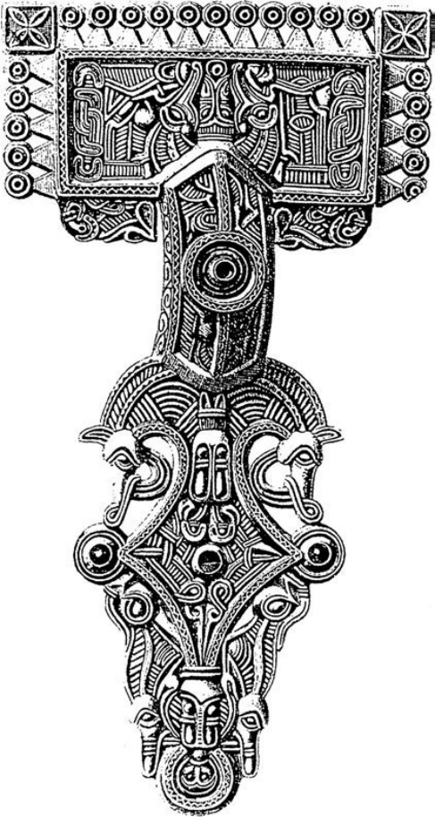
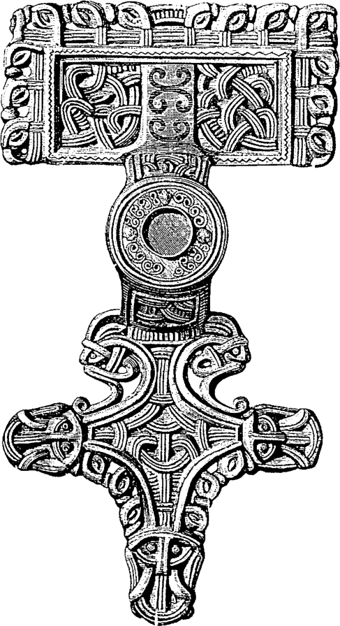
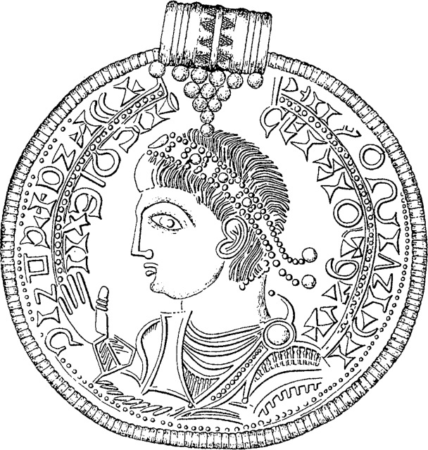
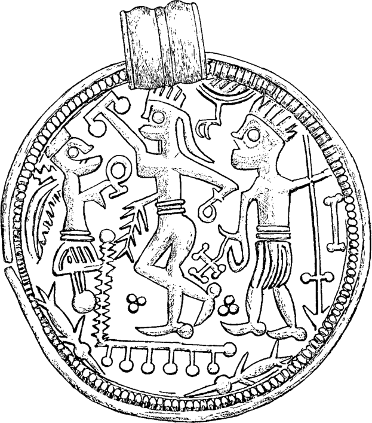
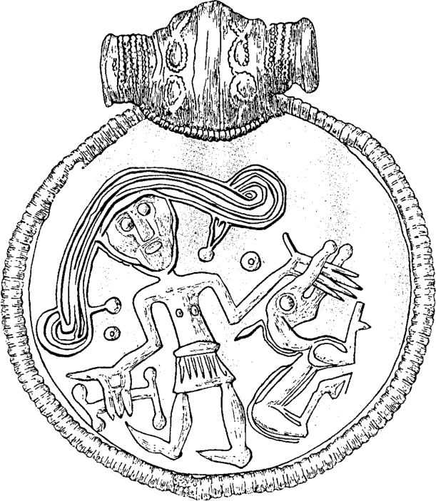
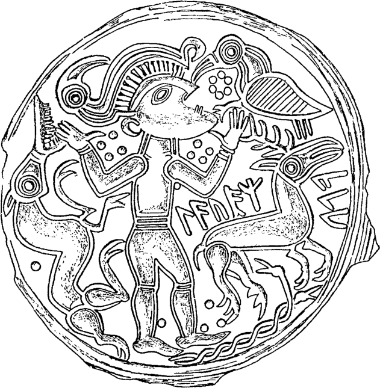
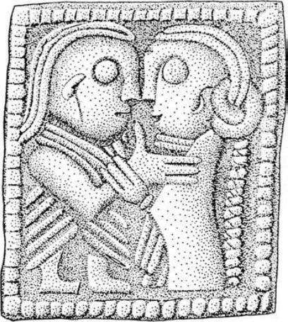

# 第18章 · 斯堪的纳维亚

我们对斯堪的纳维亚（今丹麦、瑞典和挪威）铁器时代晚期社会的认识，主要建立在其经济特征之上，涉及农业与聚落、经济与社会、贸易与城市化等方面。结合对墓葬证据的研究，这些课题一直是关于社会与政治局势——包括斯堪的纳维亚最早的国家形成形态——诸种模型的出发点。^1 然而近年来，前基督教晚期社会的意识形态层面也开始受到关注。^2 一系列新的发掘促进了对“祭祀遗址”的浓厚兴趣，而黄金窖藏的重大新发现则推动人们使用“意识形态”、“王”、“贵族”之类的术语进行阐释。^3 这为古诺尔斯语文献提供了具体的对应物，也为宗教史和地名研究开辟了新的方向。一个新的跨学科研究运动正围绕这些问题发展起来，在其中，宗教、司法和政治状况被视为紧密交织，并且形成了一种对政治权威、神话与记忆、祭祀活动、精良手工业生产与权力行使之间关联的替代性理解。^4 在下面的概述中，我决定主要集中在这种新取向上。不过，首先要特别关注斯堪的纳维亚作为中世纪早期欧洲一部分的地位。

## 斯堪的纳维亚铁器时代晚期的历史背景

斯堪的纳维亚所谓的“中世纪”始于约公元1000年，比西欧和中欧其余地区晚了五百年。只有从这个时代起，斯堪的纳维亚才形成统一王国，基督教才在异教的斯堪的纳维亚确立为一股重要力量。因此，也只有从这个时代起，斯堪的纳维亚才拥有自己的书面历史。到此时，冰岛已被纳入斯堪的纳维亚诸地，而关于斯堪的纳维亚历史的诸多著述实际上正来自冰岛。

诚然，在此前的几个世纪里，斯堪的纳维亚并非完全没有文字。如尼文字被用于魔法目的，也用于传递信息、护符、纪念物等，主要刻于木头上，但也见于骨、金属和石头。然而，这种文字形式中没有长篇的文学文本。如尼文字也并非斯堪的纳维亚特有的：欧洲五、六世纪的许多日耳曼民族——在英格兰、尼德兰、德意志和中欧——都已知有早期如尼文。^5 然而在那些地区，罗马字母很早就被采用，只有斯堪的纳维亚在维京时代继续发展如尼文字。这就是如尼文字在该地区如此著名的原因，但这也解释了为什么我们要等到迟至十二世纪，斯堪的纳维亚才拥有自己的书面历史。不过，这并不意味着斯堪的纳维亚人没有历史，或对古代事件一无所知。事实恰恰相反，只是他们的历史传统是口头的，在创作与表演的规则和传统的约束下代代相传。

自20世纪90年代以来，斯堪的纳维亚铁器时代考古学的研究传统，一直与十二至十四世纪的古诺尔斯语文献（其中包含大量来自冰岛的材料）并置考察。这源于考古学的一种新取向，专注于认知结构、心态、宇宙观和信仰体系。然而，将十三世纪古诺尔斯语文献用作铁器时代晚期（六至十一世纪）的解释框架，显然需要保留。这些文献源自早期基督教时代，因此不能被视为“真正异教”的反映。尽管如此，若把所有书面文本都斥为无用而加以抛弃，就会走得过远，使考古学家失去北方任何相关的书面证据。若谨慎使用，古诺尔斯语文本能提供宝贵的信息。此外，一种基于非西方前工业社会的人类学取向为考古学家提供了一个总体理论框架，使他们能够超越考古与文本证据。由于缺乏经济、政治和宗教制度的现代式分离，前基督教的斯堪的纳维亚可以与传统社群相比较；在两种情形中，特定社会的世界观都倾向于将这些不同的领域融合为一个连贯的整体。由于大量宇宙观信息被认为包含在神话之中，^6人们特别关注古诺尔斯语文学中的神话，主要体现在《诗体埃达》以及冰岛人斯诺里·斯图鲁松的《埃达》（一种供欲颂扬国王的诗人使用的教科书）之中。这些中世纪盛期的文本当然未必与铁器时代晚期的物质证据相吻合，但它们可以营造一个可信的背景。代表前基督教世界的智慧与知识的核心神话，可能包含历经时间而延续下来的核心要素，尽管被包裹于新的意义层中并适应了新的语境。例如，宗教改革前的冰岛社会中仍存在大量异教智慧，以传统秘传知识的形式出现，后来在十七世纪被转化为撒旦崇拜和巫术。^7 加尔德（galdring，咒歌）、加德拉阿斯塔菲尔（galdraastafir，魔法符杖）、伦斯（runs，秘密或隐秘之物）、斯卡尔德斯卡普（skaldskapur，诗歌）和哈姆拉姆（hamrammr，能随意变形之人）深深植根于日常生活与思想之中，不致失去其作为有意义概念的地位。卑尔根布吕根出土的如尼符杖也表明，《埃达》诗歌在中世纪晚期的挪威仍广为人知。从另一个角度看，已有令人信服的论证指出，《诗体埃达》、某些斯卡尔德诗句和斯诺里的《埃达》等神话文本，包含了阐释北欧社会生死根本观念的神话。当冰岛多数人口已皈依基督教时，这些观念仍保持着其现实意义。^8

斯诺里在撰写《埃达》中的作用长期存在争议。一些学者视他为有创造力的文学艺术家，另一些学者则视他为前基督教神话远为可靠的传达者，^9 他没有明显的理由去贬低祖先的信仰，尽管他自己可能并不信奉它。^10 虽然斯诺里的著作受基督教影响——因为他生活并写作于一个基督教社会中——但人们不禁要问，他是否真能将古老而为人熟知的神话操纵到对其听众仍然知晓的前基督教宇宙观造成歪曲图象的程度。在一个基督教化的社会中，前基督教传统依然存续，可能经由基督教视角被感知，因而被扭曲。此外，我们也不应排除某种“传统的发明”的可能性，即像斯诺里这样的作者渴望把传统神话纳入一个新框架之中，强调“旧时代”与他们所居住的新世界之间的连续性。顺便说，斯诺里的叙述在许多细节上与来自斯堪的纳维亚不同地区的其他中世纪早期文本相吻合。尽管存在所有这些问题，我们不能无视斯诺里提供的信息以及《诗体埃达》中的信息。我们面对的是根本性的神话和信仰体系，不应将其仅仅视为斯堪的纳维亚前基督教晚期时代的产物。相反，其根源必定深深植于传统的异教宇宙之中，^11 即铁器时代晚期，因而对研究这几个世纪的考古学家来说，必须将其视为宝贵的史料。

斯堪的纳维亚早期用古诺尔斯语但以罗马字母书写的伟大文学，还包括斯诺里·斯图鲁松的其他著作，如约1230年在挪威国王鼓励下写成的《-heimskringla》（《挪威王列传》），其目的是呈现一幅关于挪威诸王及其出自瑞典传说中的因格林加王族的连贯叙事（《因格林加萨迦》）。在丹麦，约1200年，萨克索·格拉玛提库斯用拉丁文写成了《丹麦人业绩》：从史前到当代的丹麦民族史，同样是在丹麦国王的鼓励下写成的。尽管这些历史记述追溯久远，讲述的国王、英雄和事件可能与历史现实有——也可能没有——某种遥远的关联，但它们并非可以简单用来洞察斯堪的纳维亚五、六、七世纪历史的史料。唯一可能的途径，在于其他中世纪早期欧洲文本中所包含的关于斯堪的纳维亚的种种信息。

## 欧洲史学中的斯堪的纳维亚

“我的舰队从莱茵河口出海，朝日出方向驶向辛布里人的土地[大概是日德兰]，无论陆路还是海路，此前从无罗马人到达过那里。”皇帝奥古斯都在基督诞生前后于《安基拉纪念碑》中如此写道，此文是其现已散佚的自传的节录，复刻于小亚细亚安基拉（今安卡拉）一面神庙墙上。那时，斯堪的纳维亚开始以其公认遥远的位置进入罗马人的世界观。尽管我们在早期希腊史料和罗马史家老普林尼（卒于公元79年）的著作中能找到零散的“信息”，但直到罗马史家塔西佗于公元一世纪末所著《日耳曼尼亚志》，我们才第一次能谈到对罗马帝国北方邻人——日耳曼地区（即莱茵河与多瑙河罗马边界以北、维斯瓦河以西的欧洲）——的真正描述。《日耳曼尼亚志》的写作大概应视为奥古斯都关于遥远未知之地辛布里人国土的信息在军事上的逻辑结果。塔西佗描述的是边界之外但处于罗马势力范围之内的地区，他的《日耳曼尼亚志》区分了日耳曼领土的各个部分和不同的日耳曼民族，其中许多，如哥特人、斯维尔人、伦巴第八、苏维汇人、赫鲁利人等，在中世纪早期重新作为部族名称出现。塔西佗提供的许多事实性民族志细节，在五六个世纪后的伦巴第传统中几乎原封不动地再度出现。^12

对斯堪的纳维亚更实质性的地理描述来自二世纪中叶，出自希腊地理学家、天文学家和数学家托勒密之手，他约于公元90至160年间居住在亚历山大里亚。作为地理学家，他力图测绘和丈量当时已知的世界，其中包括欧洲西北部。他的世界地图比中世纪晚期的地图更接近地理实际——后者是一幅以耶路撒冷为中心的精巧构图。在其共八卷的《地理学》（“地理学指南”）中，托勒密指出辛布里半岛以东有四个岛屿，“阿洛基埃群岛”（北日德兰）和萨克森岛（日德兰以西和以南）。这些岛屿被称为斯坎迪艾（Skandiai），三小一大，最大的在最东面，位于维斯瓦河口对面，后者即真正的斯坎迪亚。他还给出了几个不同民族的名称（《地理学》2.11）。

托勒密的信息约在公元550年被东哥特史家约达尼斯重复，他在君士坦丁堡写成了《哥特史》（De Origine Actibusque Getarum，哥特人的历史）。《哥特史》部分基于现已散佚的罗马元老卡西奥多鲁斯关于哥特历史的著作，卡西奥多鲁斯是六世纪上半叶意大利拉文纳东哥特宫廷的大臣。

约达尼斯以一篇地理引言开始其叙述，其中对斯坎扎（斯堪的纳维亚）作了相当透彻的描述。这不仅参考了托勒密，还包括对大量具名部族区域的惊人详尽的记述，从最北端的阿多吉提人开始。约达尼斯细致地描述了他们生活的非凡环境：在夏季有连续十四天不落的阳光，而冬季则有四十天没有真正的白昼。他解释说，这是因为夏季太阳在其全程中始终可见，而冬季太阳则不会升出地平线（《哥特史》iii.19–20）。无论这对居住在君士坦丁堡或拉文纳的人来说多么不可思议，这都是对斯堪的纳维亚北部情况的相当正确的描述。

在约达尼斯提及的众多部族群体中，有芬兰人、拉普人、斯维尔人、东哥特人、高特—哥特人、瑞典人、丹麦人和赫鲁利人。这些名称在中世纪早期欧洲的其他语境中都广为人知。这一详细描述可能应归于约达尼斯提到的罗杜尔夫国王：他离开了自己的兰尼人王国——可能是挪威南部的罗姆斯达尔——去投奔东哥特国王狄奥德里克寻求庇护。^13 很可能正是他（或他的一些臣民）在六世纪初向卡西奥多鲁斯提供了关于斯堪的纳维亚诸民族的信息。尽管其中几个群体至少可以大致通过语言学或考古学证据定位在地图上，^14 但约达尼斯的文本绝非简单明了，其作为史料的价值颇有争议。^15 然而，它确实证明了部族群体的存在是斯堪的纳维亚地理划分的基础，而关于罗杜尔夫的记述则表明国王是部族的政治枢纽。

这一认识尤其得到图尔的格雷戈里对一件看似真实历史事件的描述的支持。在其写于六世纪末的法兰克人史《历史十书》中，提到了丹麦国王克洛希拉伊克（希格拉克），他约在515年率舰队袭掠弗里西亚海岸，但被国王提乌德里克之子提乌德贝尔特所杀，后者被派遣率大军前往该地区（《历史十书》iii:3）。对这一插曲的记述包含几个有趣的要点。^16

首先，这一事件本身必定非同寻常，因为格雷戈里——他 otherwise 对斯堪的纳维亚和东北部地区着墨甚少——竟然记录了它。其次，值得注意的是格雷戈里对丹麦国王使用了rex（王）一词。格雷戈里对王室称谓的使用非常谨慎，对于边远地区或臣服于法兰克霸权的地区的统治者——如布列塔尼人、弗里西亚人、大陆撒克逊人、图林根人、阿勒曼尼人和巴伐利亚人——他总是使用dux（公爵）一词。因此，当他称克洛希拉伊克为rex时，他同时承认丹麦舰队的领袖实际上独立于法兰克国王。最后值得注意的是，515年之后，无论格雷戈里还是其他法兰克史料都完全没有再提及丹麦人。解释可能是，对克洛希拉伊克的胜利对丹麦人是一次如此惨重的失败，以至于在此后几个世纪中他们放弃了对法兰克控制的弗里西亚沿海地带的袭掠和统治企图。这个故事在日耳曼史诗传统——例如晚得多的古英语诗歌《贝奥武甫》^17——中的流行，有助于凸显这一事件所受的重视。斯堪的纳维亚南部从未落入法兰克霸权之下，因为它太遥远了，但515年之后丹麦人远离法兰克领土，因而在随后几个世纪里完全退出了欧洲历史。

## “斯坎扎”——一个欧洲的起源神话

尽管如此，在六、七世纪，斯堪的纳维亚在欧洲迁徙时代日耳曼诸民族的心目中占有相当特殊的地位：许多民族——或至少其王室家族——宣称源出于此。在中世纪早期的大陆民族和英格兰民族之间，存在三种可供选择的起源神话：追溯特洛伊和特洛伊英雄（如同罗马起源神话），追溯巴勒斯坦和圣经民族，或追溯斯坎扎即斯堪的纳维亚。^18 前两者可以用古典晚期的希腊—罗马和基督教影响来解释；而最早的第三种，却不能直接从这个角度加以解释。

在《哥特史》中，约达尼斯把对斯堪的纳维亚的描述置于引言之中，随后是对始于那里的哥特人漫长迁徙史的叙述。约达尼斯自己声明，他的知识来自阿布拉比乌斯（《哥特史》iv.28），后者在五世纪中叶写了哥特人的历史。这或许被卡西奥多鲁斯吸收，后者又传给约达尼斯，后者于551年完成《哥特史》。但这并不能解释，为什么这段迁徙史会反复出现在多数早期民族/王室的起源神话中，如伦巴第八、勃艮第人、盎格鲁-撒克逊诸族、赫鲁利人等的起源神话。

既然卡西奥多鲁斯写作哥特史是为了使东哥特人及其王族阿玛尔氏与罗马人（其源出特洛伊）门第相当，那么他“采纳”并发展阿布拉比乌斯关于其斯堪的纳维亚起源的记述就更引人注目。但还不止于此。卡西奥多鲁斯还复制了罗马王室谱系——其中埃涅阿斯与罗慕路斯之间有十七代——通过十七代哥特阿玛尔诸王把狄奥德里克之孙阿塔拉里克与哥特人的第一代国王高特/加普特联系起来，而高特尔（Gautr）正是奥丁给自己起的名字。^19

这样，卡西奥多鲁斯和约达尼斯让基督教化的东哥特人及其在意大利的强大国王得以将其世系追溯至斯堪的纳维亚和一位异教神祇；而这是在这个民族皈依基督教两个世纪之后。不过，在这一点上，东哥特人与其他日耳曼民族并无本质区别，例如七世纪意大利的伦巴第八^20 或英格兰的盎格鲁-撒克逊人，^21 在那里，基督教作者以异教的前史来使其基督教民族和基督教国王获得正当性。

中世纪早期欧洲日耳曼诸民族所持有的斯堪的纳维亚起源神话，不仅仅是一系列作者彼此抄撮。神话在欧洲新兴日耳曼军阀和诸王之中政治心态的构建中发挥了至关重要的作用。^22 而当考虑到赫鲁利人的例子时，这个神话呈现出一个特殊的转折。

赫鲁利人是据称来自斯堪的纳维亚的众多日耳曼民族之一。他们自己的部族史从未被写下——或至少没有留存下来——因此我们仅从其他史料得知他们。另一方面，这是命运记录相对完备、且与斯堪的纳维亚的联系看似真实的日耳曼民族之一。早在三世纪，他们离开斯堪的纳维亚故土之后，书面史料便提到他们作为罗马人的辅助部队出现在欧洲和小亚细亚，并于267年与哥特人等一道穿越巴尔干进行劫掠远征。

普罗柯比——生活于约公元490至555年的希腊-拜占庭史家，与约达尼斯同时代——大量记述了赫鲁利人。512年被伦巴第八击败后，他们获得了皇帝查士丁尼的许可定居于伊利里亚（近代的前南斯拉夫），尽管在此情形下，他们中的许多人宁愿北迁，回到故土。这导致了分裂：一组留在多瑙河地区，另一组北迁。这次迁徙被普罗柯比相当详细地描述（《战史》vi.14，viii.36，xv.1–4）。例如，书中说“他们到达瓦尔尼人的土地[石勒苏益格地区]，然后迅速穿过丹麦人的土地抵达海边，渡海来到图勒[斯堪的纳维亚半岛]，在那里他们受到高特人的接纳，后者是当地最大的群体之一”。

随后，普罗柯比的记述追溯了南方赫鲁利人群体如何因王族缺少合适的成员而缺乏王室王朝（《战史》vi.15, 27–33）。他们派了一个代表团前往斯堪的纳维亚的赫鲁利人处迎取一位合适的候选人。然而，当被选中者死去时，代表团不得不再次启程，然后带着达提乌斯及其约200名年轻武士的私人扈从队归来。与此同时，南方的赫鲁利人已放弃等待，转而请求皇帝查士丁尼从他们中间选立一位国王。查士丁尼选定了苏阿尔图斯；当代表团带着达提乌斯及其扈从从斯堪的纳维亚抵达时，又引起了新一轮分裂，因为一部分人效忠这位国王，另一部分人效忠那位国王。当查士丁尼支持达提乌斯时，斯堪的纳维亚国王苏阿尔图斯及其支持者离开罗马领土，成为匈牙利格皮德人的盟友。^23

换言之，关于赫鲁利人斯堪的纳维亚起源的历史传统，似乎反映了一段确定的历史现实。自然，问题在于许多其他宣称源自斯坎扎的日耳曼民族是否也可能如此。当然，这些早期欧洲迁徙神话中的事实成分颇多争议。^24 但关键不在于这些民族是否曾以小群体的形式从斯堪的纳维亚迁出，而在于他们的王室认同与斯堪的纳维亚相联系，他们的国王是神圣的，因为他们源自高特尔或奥丁/沃坦，而这个人物与日耳曼异教宗教以及或许还有斯堪的纳维亚神系有着明确的关联。

晚得多的古英语史诗《贝奥武甫》很可能也汲取了根植于五、六世纪的传统。在这里，威尔芬加斯（Wylfingas）统治家族——词源上与东盎格利亚王族伍芬加斯（Wuffingas）相同——与伍尔芬格家族之间可能存在联系，后者被认为在五世纪末和六世纪生活在今瑞典西南部和挪威东南部。此外，还有考古学迹象表明六、七世纪东盎格利亚王室家族与斯堪的纳维亚之间存在亲缘关系，尤其是萨顿胡船葬与中瑞典梅拉伦地区文德尔和瓦尔斯耶尔德船葬之间所揭示的联系。^25

## 斯堪的纳维亚动物艺术

从稀少的书面但丰富的考古材料可以清楚看出，五、六、七世纪期间，斯堪的纳维亚南部王室家族与大陆王室家族之间存在密切联系。同时代书面史料中所表达的日耳曼王室家族/民族的斯堪的纳维亚起源神话，得到了考古证据——尤其是武器、首饰，特别是图像——的支持。^26 在整个迁徙时代的欧洲，在斯堪的纳维亚、大陆和英格兰，一种新的图像风格于五世纪中叶出现。最早的动物风格的演变与斯堪的纳维亚南部密切相关。^27 在五世纪上半叶，这一地区发展出异常丰富的具象与几何图形——常带有人的特征（面具）作为整体的一部分，^28 即所谓尼达姆风格和风格I^29（见图1）。

大陆和英格兰的发现物从五世纪后半期直到六世纪末都很丰富，^30 此时一种新风格——风格II——出现了，从意大利到北欧诸国均属同一风格。^31 风格II与第一种一样异常统一，两种风格都见于欧洲大部分地区的首饰和武器上^32（见图2）。

从大约五世纪初直到七世纪，北欧的具象世界在迁徙的日耳曼诸民族中被用作一种具有象征意义的风格。它被模仿和精心发展，成为一种令人印象深刻的精英艺术风格。^33 风格II延续至七世纪晚期，此后已无法界定一种共同的日耳曼动物风格。当天主教基督教扎下牢固根基后，一种新的图像风格发展起来：它融合了海岛与法兰克元素，与始于678/9年弗里西亚、并在八世纪上半叶到达德国中部和南部的爱尔兰/盎格鲁-撒克逊传教活动密切相关。^34

虽然这种风格无可争议地与传教活动相联系，并且可见于长长一系列不同的教会器物之上，但它并不限于“教会艺术”本身。各种各样与此前完全相同的世俗器物如今饰以这种新的基督教风格：服饰配件、马具、马镫、马刺、手镯等等，从而为其所有者标示了一种新的意识形态正当化形式。南斯堪的纳维亚尤其不免受到欧洲武士精英及其强大统治者对拉丁基督教的意识形态归属的影响。虽然北欧动物风格独立延续，分解的动物形象在某种程度上被重新创造以恢复其兽形特征，但自八世纪起，新风格吸收了一些海岛元素，如装饰性植物母题，不过这只持续了短暂的时间。^35

在维京时代仍保持异教武士精英和分裂国家结构的斯堪的纳维亚，异教神话和图像符号——动物风格——因此在这个武士社会的宇宙观中持续发挥组织性作用，直至这个时期结束。尽管仍在使用，北欧动物风格自约1100年起停止发展。^36 在这一前提下，可以假定风格元素——尤其是图像元素——是经过极其审慎的选择的，正如器物在仪式中被精心选用一样，因为它们被赋予了特殊的品质，是重要信息的载体，传达着例如社会关系、群体成员资格和族群身份。^37 因此，风格也必须被视为参与社会—宇宙秩序的创造与维护，并以此参与权力的正当化。维护风格可以被看作精英策略的一部分，如同维护仪式功能、神话、传说和象征性器物一样——简言之，一切体现群体认同的东西。从这个角度看，日耳曼动物风格获得了一种新的、更为重要的功能。

因此，尽管动物纹饰的表意功能及其精英属性几乎无可怀疑，这并不能解释这些动物象征着什么，或者为什么恰恰是动物纹饰具有如此重大的意义。然而，动物风格作为前基督教物质文化不可分割的一部分，意味着动物在前基督教的世界认知中也占有无可争议的重要地位。^38 如果是这样，那么通过聚焦这些动物及其图像描绘本身，或许就有可能接近六、七世纪斯堪的纳维亚的某些核心认知结构。

## 斯堪的纳维亚社会的核心认知结构

斯堪的纳维亚人的世界观在从四世纪到十一世纪的800年间经历了变化，这毫不奇怪。动物纹饰也经历了同样的变化，这是合乎逻辑的结果。尽管存在风格上的种种变化和新元素，但有一个基本元素将所有风格联系在一起，即动物。从传统历史文化考古学中适用于年代学和风格分类的简单分类元素出发，探究转向了对这门艺术中动物再现的考察，并成为一个对认知考古学具有复杂意涵的课题。再现从来都不仅仅是动物的自然资源是否被复制的问题，动物再现也不能仅从艺术表现的角度来解释。再现运行于一套特定的文化编码之内，因此动物再现成为认知结构的一部分。正因如此，这些风格不仅仅是“为艺术而艺术”，还必须被视为一种文化知识的形式，植根于社会的构成性语境之中。那么，动物再现必然表达了对动物的感知方式以及被赋予的意义。^39

北欧动物纹饰不仅仅是包含动物，它就是动物——也就是说，它完全是对一个多面向的动物母题复合体的转述。完整和半截的动物，小动物和大动物，动物残片和解剖学上完整的动物，还有无身体的兽首和无头颅的兽身。这种远离自然主义动物描绘的复杂再现表明，这些风格并不试图摹写动物本身。复杂合成的动物所能表达的现实，可能比自然主义再现所能表达的更精确、更具启示性，也更暧昧。在这里，通过跨越被视为“自然”的边界，创造出了贯穿一切范畴的物种。^40 这种暧昧性——即细看之下一个形象显示为完全另外的东西——反映了隐藏的意义，可以说一个层面隐藏着另一层面，使这些风格比书面或口头语言所能达到的更为有力。它们的复杂性表明，这些风格在结构上包含着一个统摄性的抽象原则，反映着社会秩序，并且——或许在潜意识中——也反映着宇宙的物质秩序。^41

主要是六、七世纪风格的另一特征，是动物头部彼此嵌套、互为部分的再现，而人的再现又附加于这种复杂性之上。人的身体也被以切割成块的方式再现，人的面孔（“面具”）被纳入动物再现之中，例如带有人的头部的身体，以及作为动物或鸟类一部分（通常是腿部）的人面。这样，这些描绘不仅跨越了不同动物物种之间的边界，也跨越了动物与人之间的边界。

可以论证，动物风格——有意或无意地——反映了六、七世纪前基督教社会的认知结构。即使风格中的结构层面包含反映社会秩序和宇宙秩序的抽象且常常是无意识的原则，它们也几乎不是对神话的有意识再现。另一方面，神话层面是通过显而易见的视觉信息表现的，图像与口述指向同一个“故事”。不过，这个层面也可以反映在这些世纪自然主义的、因而更直接可及的图像艺术中。这里要举两个例子。

首先，可以特别关注金制话题饰牌。虽然其母题和设计无可置疑地是北欧的，但话题饰牌源于古典晚期艺术和拜占庭皇帝的勋章^42（见图3）。

所描绘的若干场景似乎是北欧神话核心神话的图解，^43 例如巴德尔的死亡^44（见图4），以及提尔——为拯救世界而把右手放进芬里斯狼的口中（《斯诺里埃达》第24和33章）^45（见图5）。

两者似乎都属于五、六世纪的核心神话。^46 然而，多数话题饰牌反映的是被解释为奥丁在其权力鼎盛时期的形象，即他化装为鸟前往冥界的旅程（见图6）。

一只巨大的动物——马、驼鹿与山羊的杂交体——为其引路。从它口中常见呼气的记号。也就是说，这只动物是有生命的。鸟和蛇常随行于旅途。这种描绘中的变形（“萨满式”）^47 元素似乎令人信服：一个化装为鸟的“人”和动物随从（蛇、鸟和大型四足动物）是话题饰牌图像世界的基本组成成分。^48 话题饰牌源自晚期罗马皇帝的勋章这一事实，只证实了将罗马皇帝与阿萨诸王相比拟所蕴含的强烈象征意义。^49 在古诺尔斯语文本中，奥丁到处以他人的形象出现；他跨越人与动物、男性与女性之间的边界。他掌握着一种被称为sei∂r的特殊魔法力量，即变形术，而这种特殊技能正是他成为阿萨诸王之王的原因。^50

其次，从迁徙时代到维京时代，都可以发现以动物形态出现的人的描绘，主要附着于六、七世纪精美的武士装备上，例如中瑞典梅拉伦地区的文德尔和瓦尔斯耶尔德，以及东盎格利亚的萨顿胡。最常描绘的是所谓的狼战士，^51 但身着野猪皮或化装的战士也能见到。^52 头盔本身具有完整的动物象征体系，或以野猪或鹰饰于盔顶，或作为头盔构图的一部分。^53 这些华丽的头盔于是由三种动物组成——它们在“萨满式”信仰体系中都意义重大：从冥界收集知识的蛇，飞向世界各个角落以获取信息的鸟，以及护佑前往冥界之旅的大型动物。

作为古诺尔斯语文本中反复出现的主题，我们发现这种人与动物之间的二元关系。它以“胡格尔”（hugr）、“菲尔利亚”（fylgja）和“哈姆尔”（hamr）等词表达。“胡格尔”意为可以化身为动物或人离开身体的“精神”或“灵魂”；^54 “菲尔利亚”意为某种分身或第二自我，^55 或者最终指“皮”、“外衣”或“动物外衣”。^56 它代表附着于个人——常在出生之时——并伴随他们直至死亡的守护神灵，当他们死亡时，这些神灵把其力量转给家族的另一成员。“菲尔利亚”常以动物（或女子）的形态出现，通常只在危机时刻——醒时或梦中——可见。它是一个外化的“灵魂”，同时也是个人运气与命运的体现，这一概念与文献记载较少的“哈姆尔”有许多共同之处。^57

因此，具象艺术、动物纹饰和古诺尔斯语文本展现了同样一种人兽之间形变超越的感知。尤其在六、七世纪，狼、野猪、鹰和蛇是纹饰中人兽形变再现的组织性元素。动物能做人力所不能及之事，即跨过通往冥界的门槛。人只有借助动物的形态才能超越生与死之间的边界。认识到与冥界的沟通经由动物进行，而“菲尔利亚”是个人命运的体现，也有助于我们理解动物纹饰何以能在斯堪的纳维亚——以及日耳曼——社会中维持组织性作用，直至基督教的引入/巩固。^58 最后同样重要的是，它解释了为什么野性和危险的动物对于斯堪的纳维亚、大陆以及盎格鲁-撒克逊人的前基督教武士精英而言是如此重要的艺术表达。

## 赠礼与政治权威

尽管多数日耳曼民族拥有一位或数位国王，但缺乏强有力的中央统治者。部族由大量基于血缘和居住于同一地理区域的相对独立自主的要素构成。一个部族由若干亚部族组成，亚部族又包含各自独立的实体，最终可能拥有自己的国王。部族不仅是政治意义上的实体，也构成一个祭祀共同体，而国王们则是神祇的后裔。虽然国王们是远距离婚姻和馈赠交换网络的成员，但他们在部族之内并不维持政治垄断。武士精英发挥着重要作用，因为像国王一样，他们拥有自己的武装扈从队。国王与贵族之间、国王或贵族与武士随从（“亲兵”）之间的关系，如同诸王之间的关系一样，是互惠的，尽管在性质上多少是不对称的。^59

书面史料——无论古诺尔斯语的还是中世纪早期欧洲的——给人的印象是，赠礼是缔造和维系这些政治联盟——领主与武士随从之间以及武士精英内部——的决定性工具。无论被界定为不可让渡还是可让渡之物，^60 具有特定象征价值的可动财富自五世纪起便作为回报而流通。^61 毫无疑问，赠礼在整个公元第一个千年后半期都是重要的政治工具，但迁徙时代不仅为获取黄金创造了特殊机会，同时也要求对这些价值作出非同寻常的投入。黄金——以及白银——之所以能在政治策略中发挥重要作用，首先是因为它们在很大程度上来自地方体系之外。

赐予荣誉性礼物的观念植根于宇宙观世界和文化价值体系之中，因而高度仪式化，而常饰以华丽纹样的金银，在铁器时代晚期社会的再生产中，对仪式和典礼的使用发挥着重要作用。即便赠礼在整个铁器时代晚期都是高度仪式化的，五、六世纪（以及维京时代）激烈的竞争性炫耀必定尤为突出。

严格说来，斯堪的纳维亚的“黄金时代”是迁徙时代。在五、六世纪的短短几代人中，数量巨大的黄金窖藏被埋藏。这些黄金埋藏令考古学家和宗教史学界的学术世界着迷并深感挑战，因为它们标示着“财富”和“权力”——现代世界的关键词。从利润和经济实力的角度看，我们对黄金埋藏的“理性”态度是容易解释的，尽管对这些窖藏的意义并无共识。大体而言，它们被解释为财宝，即意图重新进入流通的“经济性”埋藏——或者被解释为策略性馈赠，即献给超自然世界的仪式性祭品，是与众神结盟的一种方式。近来，后一种解释已成为主导取向。^62

迁徙时代的窖藏由各种各样的贵重器物组成：话题饰牌、指环、颈环和臂环、所谓的支付环，以及常饰以精美动物纹样的浮雕胸针。如果这些金属器物作为礼物流通，那么考古记录中可能完全不见痕迹。然而，如果赠礼策略包含竞争性炫耀的成分，那么赠礼就会更中心地卷入政治策略的过程，我们应该能在窖藏和墓葬中找到这些器物仪式性消费的某些证据。^63 这在迁徙时代是显而易见的，那里的黄金窖藏反映出一个短暂的“投资地平线”。^64

虽然许多黄金窖藏发现于从现代理性经济学角度看属于边缘的地区，但从总体上看，它们与肥沃的农业区域相联系。这在瑞典尤为清楚，大多数黄金发现物来自瑞典最肥沃的斯科讷和西约特兰两省（约22公斤，即超过此期瑞典大陆黄金总量的一半以上）。^65 这些窖藏发现于中心聚落区，在房屋之内或极近之处，也发现于边缘地区。这些窖藏与一种特殊的边缘区域相关联，即沼泽、溪流、海岸等，作为农业利用区域的某种边界地带。它们必定反映了过去某种仪式实践，因为它们显然被有意埋藏于景观中经过刻意选择的地点。

河流、溪流、沼泽等自然边界在迁徙时代被用于财富埋藏这一事实，表明这些区域在人们对景观的感知中发挥了重要作用。这个时期以聚落结构和土地利用的广泛变化为特征。当旧边界被改变、新土地被纳入农业利用时，文化景观——以及认知景观——必定经历了剧烈的重组。对于生活在——或即将生活在——那里的人们来说，景观必须被驯化，并在话语知识和宇宙观中获得新的位置。窖藏被有意置于耕作/驯化土地与荒野的边界上，^66 常处于陆地与海洋、大地与水域之间的过渡地带，那里也是大多数神圣地名——即含奥丁、提尔、弗雷尔和God之名的地方——所在之处。^67 陆地与水域之间的过渡地带，在人们对文化景观的感知中似乎保持着作为与冥界协商之场所的特殊地位。一旦埋藏，这些窖藏在几代人的时间里通过在人们心目中创造一种神圣地形而塑造了景观。它们代表着过去与现在、此世与冥界之间的联系，并因此通过成为居住于这些地区的人们话语知识的一部分而赋予土地以正当性。虽然隐藏着，这些窖藏在几代人中依然保持“可见”，在人们与过去的协商中持续发挥积极作用。^68

黄金窖藏埋藏于迁徙时代整个斯堪的纳维亚肥沃地区社会压力巨大、定居土地组织发生根本变化的时期。它们可能作为资源消耗型政治联盟和远距离网络中的重要中介发挥了特殊作用，或许还作为一种工具，用以按照宇宙观世界在稍微更具等级性的政治结构中组织——或重组——文化景观。

## 等级化的聚落模式

铁器时代晚期斯堪的纳维亚的聚落结构在规模和功能方面明显呈等级化发展。“中心地点”的概念自20世纪70年代以来在斯堪的纳维亚考古学中被发展出来，用以对这些世纪中特定的富庶聚落遗址进行分类，这些遗址常有大量金属发现物，表明存在广泛的铸造活动。^69 对于800年以前的北欧世界，由于没有任何关于宗教或政治权力特定地点的文字证据，考古材料和地名证据为分析这一聚落结构的等级体系提供了唯一基础。然而，古诺尔斯语文学确实对斯堪的纳维亚某些“有权势”地点的本质要素有所启示。例如，大厅在这些文本所表现的意识形态世界中具有重要地位。^70 鉴于大厅在古诺尔斯语文学中的突出作用，引人注目的是“大厅”（hall）一词几乎从未出现在斯堪的纳维亚地名之中。原因可能是当时的斯堪的纳维亚语言使用了另一个词，如sal，见于乌普萨拉（Uppsala）、翁萨拉（Onsala）、奥登萨拉（Odensala）或仅作萨拉（Sal(a)）：与sal复合的神名总是奥丁——众神之王。^71 sal一词有时与zulr（thyle，祭司发言人）相连，后者是某一类领袖或祭司的称谓。“thyle”被视为诗人、斯卡尔德或讲故事者：换言之，即保存理解《埃达》诗歌所必需、且对维护政治权威至关重要的神秘与魔法知识宝库之人。他是理解祭祀活动并念出适当咒语的祭祀领袖。他的首要职能是言说——无论是吟诵诗篇和神圣故事，还是知晓并宣示法律，或者在宴会上、祭祀节庆中或法律集会上充当国王或雅尔的发言人。^72 换言之，他是代表国王掌控社会秘传知识的专家之一。

显然，“sal”意指国王与雅尔的集会大厅、祭祀大厅或民众议事厅：即“剧场、法庭与教堂”诸职能合一之所。^73 “sal”即大厅，是人类小宇宙的中心，是稳定与善治的象征。大厅也是共同饮酒的场所，其目的在于缔造忠诚纽带与拟制亲属关系；酒是使人达到迷狂、从而与超自然相通的媒介。^74 高座，即带有高座柱的座位，充当着与超自然世界沟通的渠道。既然设有高座的大厅是领导权的地理与意识形态中心，那么如文献所载，雅尔们和国王们仅凭摧毁对手的大厅便能压制并毁灭彼此，也就不难理解了。^75

有一组发现物或可反映与领主权力相关的一种仪式实践，即金箔饰片，“古尔德古贝”（guldgubber）：小片（最大1厘米）薄金箔，常描绘一对男女，但男女单人也作为母题出现，动物亦然。成对母题总是表现为侧身相对而立的一对恋人，衣着华美，常佩戴珠宝及其他器物，如权杖、杯盏等（见图7）。

此类金箔饰片见于整个斯堪的纳维亚，若干情况下与带有宗教名称的地点直接相关，如丹麦菲英岛的古兹梅和博恩霍尔姆岛的古德海姆（“众神之家”），其年代可从六世纪初延续至十世纪。^76 出土情境表明，带成对母题的金箔片与斯堪的纳维亚铁器时代和维京时代一种格外特殊的建筑相关联：仅由一间大室构成的所谓长屋，即大厅。金箔人像片以惊人的频率出土于承重中央柱的柱脚之下：换言之，即高座柱旁，如瑞典西南部的斯勒恩格、瑞典中部梅拉伦地区的赫尔格岛以及可能还有斯温图纳，以及挪威的博雷、梅雷和罗弗敦群岛的博格。^77 迄今为止，整个斯堪的纳维亚三十一处地点共发现2600件金箔人像片。其中约2300件出土于博恩霍尔姆岛古德海姆附近的索尔特穆尔德，几乎全部表现为单人形象，^78 而描绘双人形象的金箔饰片已知有224件。^79

据《埃达诗歌》中的《斯基尔尼尔之歌》，弗雷尔与葛尔德成婚的情节被设定为神祇在高座上就座的场景。这一神话场面可以理解为一种入仪仪式，其作用在于标示新领主的地位与权力。^80 带成对母题的金箔人像片被视为与高座柱有仪式性关联，正如《斯基尔尼尔之歌》中的圣婚（hieros gamos）被解释为在神话上与高座相连。将金箔人像片埋置于高座柱旁，极有可能是一位新王或新雅尔入仪仪式的一部分：即对高座的象征性占有。^81

历史史料与考古材料相互印证了如下解释：高座是行使特殊领导职能的绝对中心，而高座柱本身即是神圣的。^82 这一现象见于相当多的传统文化，在其中柱子或木桩尤其被赋予神圣职能。^83 这与对宇宙秩序的理解相关联，其中“距离”的意义和内涵至关重要。^84 宇宙秩序在物理上即奠基于高座柱之中。

因此，大厅的多功能角色超越了地点本身。大厅处于一组主要农庄的中心；它是铁器时代晚期诸中心地点的心脏。^85 如今人们日益认识到，这类地点遍布斯堪的纳维亚，例如丹麦的古兹梅/伦德堡、索尔特穆尔德、莱雷、蒂索、托夫特高、勒斯隆德、卡尔马高、讷雷斯内兹、斯滕廷格、德伦斯泰兹和里伯；挪威的特隆赫姆、考蓬、哈马尔和博格；瑞典的斯勒恩格、赫尔格岛、比尔卡、乌普卡拉、韦、老乌普萨拉、许古姆、文德尔和瓦尔斯耶尔德。^86 其特征在于，许多这类遗址位于内陆数公里处，依赖位于海岸的一个或多个登陆点或港口。^87 尽管这仍有争议，此类中心地点或曾作为对更大范围地域行使某种政治或宗教控制的基础；其影响半径远远超出地点本身。此外，在其中若干地点，一种特殊建筑似乎曾作为异教“维”（vi）行使祭祀职能，例如西兰岛的蒂索，该名实际上意为“提尔之湖”。^88 根据瑞典和挪威的地名证据，有人主张此类中心地点不应被理解为一个精确界定的遗址，而应理解为一个或小或大的区域，涵盖若干不同却同等重要的职能与活动。^89 地名证据与考古发现均表明这是一种反复出现的模式。这意味着，仅强调其诸多功能中的某一项，而将这些遗址称为“贸易遗址”、“祭祀遗址”或“集会/庭议事地”，是不恰当的。相反，这些地点应被视为多功能复合性遗址。除了作为贸易与市场地点、作为立法和确立祭祀之中心的“官方”职能之外，中心地点或许还与特殊职能相关联，如首饰、武器和衣物的精工制作，^90 此外还有由宗教专家主持的特殊祭祀活动。这些地点也是享有特权的武士或家族侍从的居所。一些中心地点可追溯到四世纪（如古兹梅/伦德堡），但大多数直到400年以后才形成。许多这类遗址在中世纪相当长的时期内仍是权力与经济活动的中心。

## 约500—700年的斯堪的纳维亚：初兴的王国与王权中心

在西罗马帝国之后，墨洛温王朝及随后的加洛林王朝凭借军事征服以及远距离联盟与馈赠网络取得了对邻近诸王的霸权。其以居中位置的生产地点、市场和沿海商埠为特征的政治经济组织形式，在斯堪的纳维亚诸小王国中亦有反映。国王与贵族为履行维系权力所必需的社会与仪式义务，对奢侈品产生了巨大需求。金属器物——主要是武器、首饰和饮酒器具——在考古记录中广为人知，而雕刻木器、华服与毛皮、食物、酒精饮料之类则保存较差，因而较少被识别。对异域原料的需求，既构成了对斯堪的纳维亚北部资源日益 intensive 开发的背景，^91 也促成了与北方萨米人更密切的接触。二者均通过其对此期诺尔斯宗教的影响而显现。^92 初兴的斯堪的纳维亚武士社会，以其基于联盟与军事力量的动态多变的政治构型，也要求为其社会制度提供大量农业资源。可耕地的重组、生产过程的集约化、资源利用的扩张、等级化的聚落结构等等，皆是对这一需求的回应。建筑密度高、且有大量资源消费证据——包括高水平金属加工和进口奢侈品——的庄园正是在这几个世纪中发展起来的。

然而，在这一背景之下，墓葬证据却格外低调。大体而言，铁器时代晚期以火葬墓为主，因此随葬品通常损毁严重，仅存小件残片。不过，它们仍印证了斯堪的纳维亚精英中曾存在丰富物质文化这一印象。此期营建了一些令人印象深刻的墓葬纪念物，主要在斯堪的纳维亚半岛。它们见于挪威东南部内陆，一般位于最优良的农业区，临近河流和重要陆路，以及沿海的战略地点。一个引人注目的遗址是西福尔的博雷，其壮观的墓地上有若干大型冢丘；最早的约建于公元600年，其余则在此后数世纪中直至约900年陆续营建。博雷见于斯卡尔德诗歌《英格林加颂》，被称作英格林加王族的墓地，据该诗称，此王族于七至九世纪统治西福尔。^93 同一时期，瑞典的约塔兰、斯韦兰和梅德尔帕德也营建了 comparable 的冢丘。它们同样位于已开垦景观中最肥沃的区域。在老乌普萨拉旧教堂附近，坐落着斯堪的纳维亚最大的三座冢丘。它们均为约500年至六世纪初的火葬墓，残存随葬品的品质印证了死者的地位。老乌普萨拉在维京时代以斯韦亚诸王的宗教与政治中心著称，很可能自迁徙时代以来便是如此。老乌普萨拉附近有文德尔和瓦尔斯耶尔德两处特殊墓地，其墓冢中含未焚化的船棺葬，随葬品可与东盎格利亚的萨顿胡相媲美。^94 这两处墓地的年代约为500年至800年。^95

在丹麦，丰富的考古材料来自迁徙时代的窖藏和六、七、八世纪的富庶聚落，而此期的墓葬发现则稀少。无疑，这几个世纪中火葬葬俗占绝对主导，唯有博恩霍尔姆岛例外，那里仍有设施完备的土葬墓保存下来。^96 丹麦唯一令人印象深刻的坟丘位于西兰岛的老莱雷，年代为六世纪。老莱雷见于《贝奥武甫》一诗以及萨克索·格拉玛提库斯约1200年所著《丹麦人事迹》，是迁徙时代丹麦诸王王族斯基尔东家族的王权中心。一处新近发掘的规模宏大的庄园遗址，印证了莱雷在丹麦早期历史上作为王权中心的特殊地位。目前已有约五十座房屋的遗迹被发掘出来，年代介于七世纪至十世纪之间。此期存在四座大厅（约50×11.5米）和四座较小的厅堂（约40×6米）。出土小件器物约4000件。在高品质器物——如进口首饰、钱币、砝码、银锭、青铜镶嵌件以及加洛林和盎格鲁-撒克逊来源的玻璃——数量可观，此外还有工具与器具。^97

莱雷展示了铁器时代晚期的王权组织。这个推定的王家驻跸地是在六、七、八世纪的形成时期建立并巩固起来的，博雷和老乌普萨拉的王权中心亦然。无论文字证据是否包含历史真实的内核，考古证据表明，约公元500年前后，一种新的政治结构在整个斯堪的纳维亚确立起来。与此同时，起源神话、王族谱系、神话传说和传奇故事，连同动物纹饰的象征语言，应当被视为这一新兴武士精英的意识形态表达，以及日耳曼王权兴起的先决条件。它们以自身的方式在这些新王国的建立中发挥了组织性作用，并用以展示共同的文化符码。

神话既然是武士精英的政治意识形态，是在特殊场合进行的某种正当性论证，那么动物纹饰的图像学则在公开的语境中发挥功能，描绘着一个前基督教的象征宇宙和精英之间共同的日耳曼身份认同。五、六、七世纪在很大程度上以欧洲各地区之间的联系为特征，南自意大利，北至挪威。一个共享经验的宇宙由此形成，与某些研究者试图从史料中辨识出的那种分割而四分五裂的欧洲形成鲜明对照。

## 注释

1. Mortensen and Rasmussen (1988) and (1991)；Fabech and Ringtved (1991)；Hedeager (1992a)。
2. Myhre (2003) 提供了最新的综述。
3. 在这方面最重要的遗址包括：菲英岛上的古德梅/伦德堡：Nielsen, Randsborg and Thrane (1994)；Hedeager (2001)；博恩霍尔姆岛上的索尔特穆尔德：Watt (1992)；斯科讷的乌普奥克拉：Larsson and H˚ardh (1998)，以及近出的 H˚ardh (2003)；罗弗敦群岛的博格：Munch, Johansen and Roesdahl (1988)、Munch (2003)。
4. 除笔者自1992年以来的著作外，斯堪的纳维亚学者尚有一系列重要研究，例如：Herschend (1993)、(1994)、(1996) 与 (1998)；Kristoffersen (1995) 与 (2000a)；Johansen (1997)；Skre (1998)；Jakobsson (2003)。（第496页）
5. D¨uwel (1978)。
6. 例如 Weiner (1999)。
7. Hastrup (1990)，第401页。
8. Clunies Ross (1994)。
9. 总体而言，现代学者持“肯定”的看法，其中包括 Holtsmark (1964)、De Vries (1970)、Turville-Petre (1975)。
10. Hultg˚ard (1999)。
11. Meulengracht Sørensen (1991)。
12. Ausenda (1995)，第32–33页。
13. 参见 Skre (1998)，第5.1.2章。
14. Callmer (1991)。
15. 尤其参见 Svennung (1967) 与 (1972) 及其所附参考文献。
16. 如 Wood (1983) 所指出的。
17. 例如 Storm (1970)。
18. Hachmann (1970)，第109页以下。
19. 见《格里姆尼尔之歌》（第54节）。此诗的部分乃至全部可能作于九世纪末或十世纪的挪威。与加普特相对应的古诺尔斯语形式是高特尔（Gautr），即奥丁的诸多名字之一（North (1997)）。无论最终将高特尔认定为谁，其与斯堪的纳维亚异教众神殿的关联似乎是清楚的。另见 De Vries (1956)，第41页。
20. 伦巴德人的历史最初于643年——即其统治意大利之时——被记录下来。伦巴德人的故事与罗萨里国王的世系，构成约三十年后写成的法律文献《罗萨里敕令》的一部分。进一步参见 Gasparri (1983) 与 (2000)。
21. 依据比德的《英吉利人教会史》（完成于731年），第一卷第15章。
22. Hedeager (1997)、(1998) 与 (2000)；Geary (2003)；Hill (2003)。
23. Heather (1998)。
24. 例如，从文献学与历史学角度：Weibull (1958)；Svennung (1967) 与 (1972)；Wagner (1967)；Hachmann (1970)；Goffart (1980) 与 (1988)；Gasparri (1983) 与 (2000)；Heather (1989)、(1993)、(1994)、(1995) 与 (1998)；Wolfram (1990) 与 (1994)；Pohl (1994)；North (1997)；Hedeager (2000)；从考古学角度：Hachmann (1970)；Svennung (1972)；Hines (1984)、(1992)、(1993)、(1994) 与 (1995)；Menghin (1985)；Busch (1988)；N¨asman (1988)；Heather and Matthews (1991) 及其所引文献；Kazanski (1991)；Godlowski (1992)；H¨arke (1992a) 与 (1992b)；Hedeager (1992b)、(1993)、(1998) 与 (2000)；Christie (1995)；Bierbrauer (1994)。
25. Bruce-Mitford (1979)；Lamm and Nordstr¨om (1983)；Newton (1993)，第117页。
26. Hedeager (1998)。
27. Roth (1979)；Haseloff (1981) 与 (1984)。
28. Haseloff (1986)。
29. Salin (1904)。
30. Roth (1979)；Haseloff (1981)；Hines (1984)；N¨asman (1984)，地图10；及 (1991)，图8。
31. Salin (1904)；另见 Lund Hansen (1992)，第187页及其所引文献。
32. Karlsson (1983)。
33. Speake (1980)；Høilund Nielsen (1997)。
34. Roth (1979)，第86页。
35. Karlsson (1983)；Hedeager (1999a)。
36. 它未能挺过与新信仰体系及由此带来的政治与社会意涵的相遇。这当然可以用如下观点来解释：人们——尤其是精英——已养成不同的趣味，因而在1200年前后于教会的影响下偏好了一种新风格。然而更有说服力的是，动物风格在基督教语境中缺乏存续与更新的潜能，原因在于它植根于一个全然不同的信仰体系（Hedeager (2003)）。
37. Earle (1990)，第73页；DeMarrais, Castillo and Earle (1996)。
38. Kristoffersen (1995) 与 (2000b)；Glosecki (1989)；Hedeager (1997)、(1998)、(2003) 与 (2004)；Gaimster (1998)；Andr´en (2000)；Lindstrøm and Kristoffersen (2001)；Magnus (2001)；Jakobsson (2003)。
39. Morphy (1989)，第2页。
40. Morphy (1989)，第5页；Ingold (2000)，第130页；Kristoffersen (2000b)，第265页；Lindstrøm and Kristoffersen (2001)；Jakobsson (2003)；Hedeager (2004)。
41. Roe (1995)，第58页。
42. Hauck (1985–89)。
43. Hauck (1986)。
44. Ellmers (1970)，第210页；Hauck (1978)，第210页；及 (1994)。
45. Oxenstierna (1956)，第36页；Ellmers (1970)，第202、220页；Hauck (1978)，第210页。
46. Hedeager (1997)。
47. Price (2002) 考察了北方的仪式实践，并将其与萨米人的“萨满式”文化相关联，二者共享斯堪的纳维亚半岛的大部分地区。
48. Hedeager (1997)、(2003) 与 (2004)。
49. Axboe (1991)；Andr´en (1991)。
50. 例如 Hedeager (1999a)；Price (2002)；Solli (2002)。赛德尔（seiðr）、出神与灵魂之旅之间无可争辩的联系，与被称为“萨满教”的宗教复合体完全一致：Str¨omb¨ack (1935)。
51. Høilund Nielsen (1999)，第332页。
52. Hedeager (2004)，图16。
53. Bruce-Mitford (1979)，第35页；Glosecki (1989)；Hedeager (2004)，图22。
54. Ellis Davidson (1978)。
55. Simek (1996)，第96页。
56. Glosecki (1989)，第186页。
57. Orchard (2002)；Raudvere (2001)，第102页以下；及 (2003)，第71页。
58. Hedeager (2003) 与 (2004)。
59. Bazelmans (1999)，第3页以下。
60. 参照 Parry and Bloch (1993)，第8页。
61. Bazelmans (1992)、(1999) 与 (2000)。
62. 相关讨论尤其参见 Geisslinger (1967)；Herschend (1978–79)；Fonnesbech-Sandberg (1985)；Hines (1989)；Hedeager (1991)、(1992a) 与 (1999b)；Fabech (1994a)、(1994b) 与 (1997)；Wiker (1999)。
63. Barrett, Bradley and Green (1999)，第240页。
64. 可与维京时代的窖藏相比照（Hedeager (1999b)）。
65. Hedeager (1999b)，第246页。丹麦黄金总量约为50公斤；挪威则少得多（估计为三分之一或更少）（Hedeager (1999b)）。
66. 另见 Johansen (1996)，第97页。
67. Jakobsson (1997)，第91页；Andersen (1998)，第26页。
68. Hedeager (1999a)。
69. Larsson and H˚ardh (1998)；Hedeager (2001)；H˚ardh and Larsson (2002)；Jørgensen (2003)。
70. Enright (1996)；Herschend (1997a)、(1997b)、(1998) 与 (1999)，第414页。
71. Brink (1996)。
72. Brink (1996)，第256–257页。
73. 全面论述见 Herschend (1998)。
74. Enright (1996)，第7页。
75. Herschend (1995)，第221页；及 (1997b)。
76. Watt (1992)。
77. Nord´en (1938)；Lid´en (1969)；Munch, Roland and Johansen (1988)；Myhre (1992)；Herschend (1995)；Lundqvist et al. (1996)；Munch, Johansen and Roesdahl (2003)。
78. Watt (1992)。
79. Andr´easson (1995)。
80. Steinsland (1994)，第627页。
81. Steinsland (1991) 与 (1994)，第630页。
82. 尤其参见 Herschend (1994)、(1997a)、(1997b)、(1998) 与 (1999)。
83. Eliade (1989)。
84. Helms (1988) 与 (1993)。
85. 关于这些遗址可能的等级排序，见 N¨asman (1999)，第1页；Jørgensen (2003)。
86. Munch et al. (1988) 与 (2003)；Duczko (1993)；Jørgensen (1995) 与 (2003)；Brink (1996)；Callmer (1997)；Larsson and H˚ardh (1998)；Hedeager (2001)；H˚ardh and Larsson (2002)；Skre (2004)。
87. Fabech (1999)。
88. 提尔/提尤尔（Tir/Tyr）是阿西尔神殿中的战神（Jørgensen (2003)）。
89. Brink (1996)。Fabech 在多篇论文中通过考古个案研究发展了这一模型；最近的是 Fabech (1998)。然而，作为这一总体模型重要组成部分的“文化景观中的仪式性埋藏”模型，曾引发讨论：见 Hedeager (1999b)。
90. Jakobsson (2003)。
91. Myhre (2003)，第91页。
92. Price (2002)；Solli (2002)。
93. Myhre (1992) 与 (2003)。《英格林加列传》（Ynglingatal）最早由斯诺里·斯图鲁松于1230年提及，但其可能源自九世纪（Myhre (1992)，第301页）。
94. Lamm and Nordstr¨om (1983)。
95. Arrhenius (1983)，第44页。
96. Jørgensen (1990)；Jørgensen and Nørg˚ard Jørgensen (1997)。
97. Christensen (1991)；Jørgensen (2003)。
