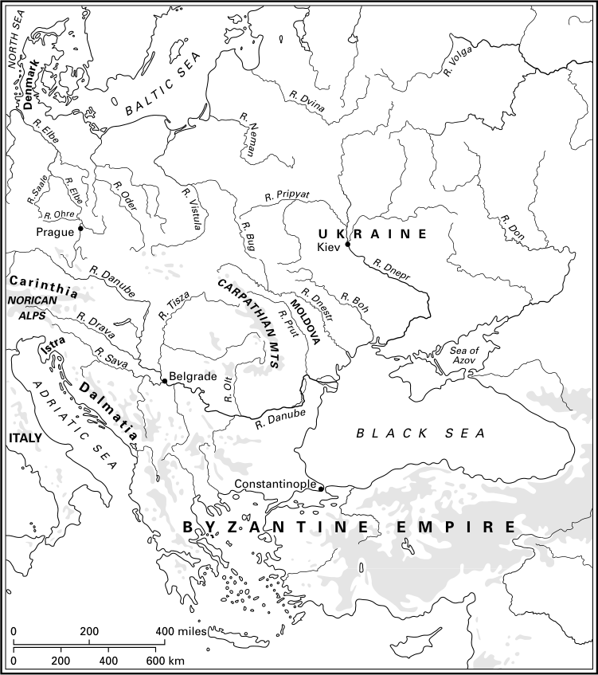

# 第19章 · 斯拉夫人

拜占庭史家凯撒里亚的普罗柯比在其《秘史》中写道，自查士丁尼（527—565年）即位以来，匈人与斯拉夫人（斯克拉文人和安特人）几乎年年侵攻伊利里亚和整个色雷斯，其兵锋所及，从爱奥尼亚湾几乎直抵拜占庭城下。希腊和（色雷斯的）赫尔松涅斯深受其害，入侵者压迫着这些地区的居民。^1 这些突然登上历史舞台、对拜占庭帝国构成威胁的神秘斯拉夫人究竟是谁？他们突破多瑙河防线，在相对短暂的时间内，从易北河下游和北方的波罗的海，一直定居到南方的亚得里亚海，占据了半个欧洲。

关于斯拉夫人最早的描述见于普罗柯比的另一部著作《战史》，该书写于六世纪中叶稍前。他把他们描绘成身材异常高大强壮、肤色黝黑、头发泛红的人，过着粗陋原始的生活方式，身上总是沾满污垢，住在彼此隔离的简陋窝棚里，并经常变换居住地。^2 据普罗柯比记载，斯拉夫人不受一人统治，长期以来生活在民主制之中。他们信仰一位神，即雷电的创造者，认为他是万物唯一的主宰，向他献祭牛和其他牲畜。他们徒步作战，直冲敌阵，手持小盾和长矛，但不穿铠甲。普罗柯比提供给我们的信息，在稍晚时候（六世纪末或七世纪初）由被称为“伪莫里斯”的作家加以补充。伪莫里斯在其《战略学》中描述斯拉夫人时，同样称他们为斯克拉文人和安特人，说他们是人数极多的民族，但生活散漫无序、缺乏纪律、没有首领，不肯屈服于奴役或征服。斯拉夫人吃苦耐劳，能忍受酷暑严寒和风雨，缺少衣物和其他生活必需品。他们栖居于森林之中、河流沼泽和湿地之旁，这些地方外人很难深入。^3

【图14 斯拉夫人：地理背景】

斯拉夫人的故乡在哪里？他们的族群形成发生于何处，他们又从何处踏上迁徙之途？尽管至少从十九世纪上半叶起学界便对这一问题进行了深入研究，它至今仍是史学家和考古学家争论的课题。在这场讨论中，人们援引了各种论证（语言学的、历史学的、考古学的和民族志的），不同的作者把斯拉夫人的起源置于欧洲的不同地区：西起易北河流域，东至乌拉尔山，北达第聂伯河源头，南抵多瑙河和巴尔干。

所谓斯拉夫人“故乡”所在地的问题引发（并仍在引发）激烈的科学论争，相关文献浩如烟海。分歧不仅源于不同学者所利用的信息类型不同，或对相关问题的思考方式不同，也源于直到不久前还左右着斯拉夫人起源问题之认知的强烈政治影响。在中欧，历史学和考古学常常被用来论证现代政治边界的正当性，或论证通过领土兼并改变边界的必要性。关于斯拉夫人本地起源的“土著理论”在不同的时期出现于若干地区，大多是作为对征服或丧失独立的一种反应，例如十九世纪巴尔干地区对奥斯曼统治的反应，或波希米亚对奥匈霸权的反应。最强烈的反应出现在第二次世界大战之后，是对纳粹泛日耳曼主义的自然反拨。到了二十一世纪初，在欧洲一体化、历史论证已不再具有为边界辩护之意义的时代——这些边界如今正在消失——我们或许能够更加客观、不带情绪地看待斯拉夫人起源问题了。

迄今为止，关于斯拉夫人起源的讨论十分倚重语言学论证。语言学家的基本假设是存在一种共同的原始斯拉夫语，它后来在斯拉夫人大迁徙时期分化为各自独立的语言和方言。原始斯拉夫语的出现之前，据说曾存在一个波罗的海—斯拉夫语共同体。寻找斯拉夫人原初故乡的语言学家试图在语文学论证的基础上为这些过程确定年代，并确定原始斯拉夫语的发源地。斯拉夫语与波罗的海诸语言之间异常紧密的关系看来是清楚的，有人据此认为早在公元前第二个千年就存在波罗的海—斯拉夫语共同体；另一些人则认为两种语言的关系是两个民族地域相邻的证据，并主张该语言共同体解体甚晚，仅略早于斯拉夫人的迁徙。至于原始斯拉夫语究竟产生于哪个地区，语言学家们甚至无法达成大致的共识。尽管人们一再尝试依据欧洲广大地区的地名和河流名称来解决这个问题，并依据他们所知的植物、动物名称和地理词汇来界定故乡，仍然无济于事。

“斯拉夫”这一名称在古代文献中出现于其迁徙时期之前，因此对历史文本的分析难以为这场讨论增添多少内容。尽管如此，仍有人尝试把老普林尼、托勒密或塔西佗著作中所见的族群名称认定为斯拉夫人。这里的重点是确定维涅德人/维涅提人的定居地，他们被与斯拉夫人联系在一起。在分析老普林尼（公元一世纪末）和亚历山德里亚的托勒密（公元二世纪）传给我们的关于这些人群的信息时，有人提出维涅德人居住在中欧自奥得河以东、波罗的海以南的广大地区。然而另一些学者则试图证明，这些古代作者所说的实际上是两个不同的民族：维涅德人居住在波罗的海沿岸的一个小区域，而维涅提人则占据中欧和东欧的广大地区。另一方面，一世纪末写作的塔西佗把维涅提人定位于东欧的森林草原和森林地带的某处，位于苏维汇人（斯维比人）以东，介于普契尼人（应定位于黑海草原）与占据欧洲东北边陲的芬尼人之间。塔西佗笔下的维涅提人所占的地域，与托勒密文本中的斯塔瓦诺伊人相同，后者被认定为斯拉夫人。斯塔瓦诺伊人的邻人是萨马尔提亚的阿兰人（位于黑海草原），以及加林第安人和苏多维亚人（波罗的海沿岸的波罗的部落）。他们占据了中欧低地的广大地区。

谈到晚得多的时期（公元六世纪上半叶），约达尼斯在其《哥特史》中将维涅提人（分为斯克拉文尼人和安特人）定位于喀尔巴阡山以北、上维斯瓦河与中第聂伯河及上多瑙河之间的地区。^4 维涅提人（被认定为斯拉夫人）的这一位置，与塔西佗关于维涅提人以及托勒密关于斯塔瓦诺伊人的记载并不矛盾，但要求接受维涅提人与维涅德人确实是两个不同民族的论点。七世纪被称为《拉文纳宇宙志》的著作把斯拉夫人的原初故乡定位于西徐亚之地，以此暗示东欧的草原地带。这一信息虽然不甚准确，但与文献中关于维涅提人和斯塔瓦诺伊人故乡的说法相合，暗示斯拉夫人起源于乌克兰地区。然而，文献所提供的这些零星信息太过隐晦，难以据以提出明确的结论。

面对如此的不确定性，考古学似乎为确定斯拉夫人的原初故乡提供了最好的机会，尽管经考古研究的物质文化遗存与族群属性之间的关系仍不清楚。人们很容易错误地把所谓的考古学文化（即某一特定类型或可界定的类型组合的器物分布的区域）与晚期文献所载诸民族的部落领地等同起来。考古学文献中曾有人尝试把斯拉夫或原始斯拉夫属性赋予不同时期的各种考古学文化。长期以来，这种属性被赋予分布于今波兰境内的青铜时代晚期和早期铁器时代的卢萨提亚文化，以及中欧同一地区此后所有的考古学文化。自二十世纪八十年代以来，一种对立的理论日益流行，它主张在所谓“罗马影响时期”（公元五世纪中叶）结束时，应把今波兰、波希米亚、斯洛伐克和乌克兰地域的居民认定 为日耳曼部落而非斯拉夫部落。

考古学家已经证明，在公元一个千年上半叶行将结束时，中欧和东欧大部地域上普遍发生了此前数个世纪中形成一个特定文化省区的文化与定居体系的解体和消失。后者曾涵盖整个“蛮族世界”（Barbaricum），从黑海和亚速海沿岸的哥特人领地到易北河谷各部落的定居区。既有结构的崩溃和消失波及相继的各地区：东起乌克兰和摩尔达维亚（发生在四、五世纪之交，最早），经波兰东南部、南部而至波兰西部（五世纪上半叶），再到波兰中部（五世纪末或六世纪初）、波兰波美拉尼亚（六世纪头二十五年），最后直至易北河和萨勒河一线（六世纪末）。在这些地区，我们看到或多或少数量的文化组合逐渐出现，它们代表一种全新的文化模式。此前时期典型的、由柱构地面木构建筑组成、带有专门的手工业区和围绕空地的放射状布局、并有推测为祭祀功能的不同构造的大规模聚落消失了。庞大的铁器和制陶制造中心停止运转。含有随葬武器和饰品的丰厚墓葬的大型墓地也消失了。取而代之的是一种简单的、平等主义的物质文化：小型方形半地穴木构建筑、手制陶器、没有装饰性的金属器。大多数研究者认为，这些现象可以用先前居民的更替——被斯拉夫人取代——来解释。

如果我们同意对考古资料的这样一种解释，那么在寻找斯拉夫人原初故乡时，我们首先应转向乌克兰西部。在布格河、德涅斯特河和普鲁特河上游的河谷，最早出现方形带石砌角炉的半地穴窝棚是在五世纪初，甚至可能在四世纪末。其堆积中含有简单手制的蛋形陶器残片。这些发现构成所谓布拉格文化的标志物，该文化被认为与斯拉夫人有关，后来向西北和西南方向传播。一个耐人寻味的现象是，最古老的斯拉夫文化要素出现于所谓切尔尼亚霍夫文化的区域内，而多数考古学家一致认为后者是黑海上一个多族群哥特国家之物质文化的反映。而且，这些斯拉夫特征以其经典形态出现，后来在中欧、东欧和南欧广大地区被复制。这意味着斯拉夫文化模式的创造及后来构成族群识别特征的物质文化要素的发展，是发生在一个异族的多族群文化环境之中的，无疑是为了自我认同、以显示自身与其他群体的差异而产生的需要的结果。

斯拉夫人是自何处、因何来到德涅斯特河和普鲁特河沿岸地区的？最可能的情况是，斯拉夫人或其先民在古代晚期生活于森林地带的上、中第聂伯河流域，此时还不具备明确的族群分化意识。在这里，他们到公元二世纪为止由扎鲁宾齐文化代表，其后（三至五世纪）由基辅文化代表。四世纪末五世纪初，这些陷于停滞的文化经历了不甚明了的文化变迁，导致其文化上更大程度的统一，并对黑海草原上的南方邻人形成压力——这是375年匈奴进攻后埃尔马纳里克国家覆灭的动荡事件所引发的政治刺激的结果。可以假定，在这一背景下于德涅斯特河和普鲁特河流域兴起的斯拉夫分支的族群形成过程中，居住在这些地域的其他族群（日耳曼系和萨马尔提亚系）也参与了。

另一支上、中第聂伯河流域的原始斯拉夫居民，利用匈奴入侵造成的哥特国家衰弱之机，沿第聂伯河南下和东南移动。与以切尔尼亚霍夫文化为代表的既有居民的互动，产生了与布拉格文化相关的Penkovka文化，其标志是五世纪出现的带石砌角炉的方形半地穴居址。这些移动在历史上的反映，可能就是约达尼斯提到的维尼塔里乌斯与安特人之间的武装斗争。^5 从其首领博兹被称作“王”来判断，安特人似乎曾试图在哥特国家的边缘、甚至在其疆域之内建立自己的“国家”组织。留居于上、中第聂伯河谷原初故乡的原始斯拉夫群体，其物质文化组合被考古学家称为Kolochin文化，它由旧基辅文化转化而来。这样，三支考古学文化——Penkovka文化、布拉格文化和Kolochin文化——占据了自东面第聂伯河谷至西面东喀尔巴阡山的广阔地域，标示出五世纪和六世纪初斯拉夫族群所占据的范围。约达尼斯和普罗柯比提到的斯拉夫部落斯克拉文诺伊人和安特人，或许分别与布拉格文化和Penkovka文化有关，这也并非没有可能。正是从这些地域出发，斯拉夫人的迁徙在六世纪沿着两条主要方向展开：沿喀尔巴阡山东弧向西北和西南。Kolochin文化或许也曾向西迁入波兰东部和中部，不过这一点在考古上尚缺乏充分证明。

斯拉夫人口迅速增长的问题在文献中常被讨论。这些以乌克兰为起点的人们，在相对短的时间内殖民了欧洲的广大地区，而并未使其故乡出现明显的人口减少迹象。乌克兰黑土的肥沃，加之对其他族群成员的同化，造成了一次人口爆炸，使他们得以相继定居一系列地域。伪莫里斯在《战略学》中指出，斯拉夫人轻而易举地接纳其他部落的俘虏进入自己的队伍。^6 这里应当指出，斯拉夫人那种看似贫乏、并不起眼的文化模式——立足于自产产品和家庭规模的手工业——对于各种因罗马帝国边缘大政治组织崩溃而无所适从的人群来说，或许具有一种磁石般的吸引力。当日耳曼人建立的是在很大程度上依赖与罗马帝国的交换或在帝国军队中服役的“藩属国”时，斯拉夫人则完全独立于罗马；当他们越过边境时，与日耳曼人不同，他们并不想成为罗马政治经济结构的一部分。他们不像游牧民族那样想剥削当地居民，而是寻找有利于发展农业的定居土地。这样，他们无疑吸收了经历斯拉夫化的当地居民。正是在这一过程中，我们应当寻求斯拉夫人口迅速增长这一现象的解释。

斯拉夫人向西北的扩张沿喀尔巴阡山东缘经波兰南部向维斯瓦河谷推进，并沿河谷继续西进，于六世纪初抵达今克拉科夫附近。据约达尼斯记载，他们深入到维斯瓦河源头；^7 同样在六世纪，他们向北朝波兰中部的肥沃土壤（库雅维亚地区）推进，也可以沿布格河到达那里。然而，六世纪初，整个西里西亚以及波兰中部和西部仍在斯拉夫人定居区之外。普罗柯比的记载似乎表明了这一点：他写道，赫鲁利人于509年被伦巴德人击败后，大约在512年穿行了所有斯克拉文诺伊人的部落，然后经过一片相当广袤的空旷乡野，抵达瓦尔尼人的土地（易北河中游），再由此前往丹麦，在那里登船前往图勒（斯堪的纳维亚）。^8 那片空旷乡野必定是西里西亚。该地区在566—567年想必仍荒无人烟，因为据图尔的格里高利记载，穿越波兰南部领土的对法兰克人的阿瓦尔远征因补给匮乏而受困，这似乎表明他们途经的是荒无人烟之地。^9

然而，早在六世纪，带角炉的方形半地穴窝棚这类典型斯拉夫居址就已出现在中奥得河和尼斯河一带；到七世纪初（或者，按照最新的树木年轮测年，至迟在七世纪中叶之前），它们已见于中易北河。日耳曼部落的撤离使斯拉夫人在这些地域的定居成为可能。531年，图林根人王国被法兰克人和萨克森人的联盟征服；568年，图林根人和萨克森人的若干群体加入了冒险征服意大利的伦巴德人；595年，墨洛温王朝摧毁了萨勒河上瓦尔尼人的国家——这是该地区最后一个独立的日耳曼国家。这样，到六世纪下半叶，易北河和萨勒河谷形成了一个政治的、或许还有定居上的真空地带，可以由斯拉夫人来填补。关于斯拉夫人与日耳曼人接触的考古证据表明，六世纪末日耳曼人放弃其居址与斯拉夫人的到来，以及残存土著居民被同化，之间存在直接关联。到六世纪末斯拉夫人已现身波罗的海之滨，这由西莫卡塔的狄奥菲拉克特的《历史》所证实：他提到约591年被拜占庭军队俘获的两名俘虏，据说来自“西方之海”沿岸。^10 从弗莱德加编年史中我们得知，632/3年，在德尔万领导下的塞尔维亚人（Surbii）加入了文献中所谓“萨莫国家”的部落联盟，尽管他们长期以来处于法兰克霸权之下。据弗莱德加记载，632年之后，被称为文德人的斯拉夫人参加了对萨勒河以西墨洛温王朝领土的武装进攻，并且可能在一段时间内兼并了这些地区的一部分。^11 易北河地区斯拉夫定居的最早期阶段，究竟是从喀尔巴阡山和苏台德山北麓（即经由波兰南部）扩展而来，还是从南面经波希米亚而来——在波希米亚可以推测他们早在六世纪中叶已定居——尚不清楚。在这里，如同在易北河一样，斯拉夫人与残存的日耳曼居民发生了直接的接触和共居。到六世纪中叶，若干斯拉夫人群体从波希米亚向南渗入今奥地利北部地区。

与斯拉夫人渗透相伴随的一个特殊现象，是七世纪初第一批设防居址（要塞）的出现。文献所知最古老的例子，可能就是萨莫抵御法兰克人的沃加斯蒂斯堡。除了军事功能之外，这些地点大概还履行礼仪和祭祀功能。其起源或许应到上第聂伯河地区四、五世纪的堡—庙中去寻找。在更晚的时期，斯拉夫人在今波兰、德国东部和波希米亚地区修建要塞成为典型的定居形式。它们可能是文献中称为“执政官”（archontes）、“霸主”（hegemones）或“族长”（ethnarchai）的首领们所统治的所谓“小部落”的中心（或标志边界）。这类“小部落”一直独立存在到十世纪，此时这一地带出现了最早的稳定的斯拉夫国家组织。按照近来的理论，这一过程的机制是军事征服，而王公扈从队在该地区国家组织兴起中的作用看来至关重要。

斯拉夫人扩张的第二个主要方向——它把他们带入了拜占庭帝国的轨道——大概发端于乌克兰西部最古老的斯拉夫定居区。他们经摩尔达维亚沿喀尔巴阡山东弧南下至多瑙河下游，然后沿该河北岸西进。据普罗柯比记载，^12 对拜占庭的第一次斯拉夫进攻发生在查士丁一世时期，最可能在523年（但据一些作者，早在518年）。古代晚期多瑙河地区和巴尔干半岛的族群图景十分复杂。这些地区的土著居民，除希腊人和马其顿人外，还有色雷斯部落、盖托—达契亚人、伊利里亚人和凯尔特人，他们在政治上被罗马征服之前很久就已处于罗马文化影响之下，从而逐渐罗马化。到四世纪末，北部和西部诸省——诺里库姆、潘诺尼亚、达尔马提亚和默西亚——的居民在很大程度上讲拉丁语，接受了罗马文明的诸多技术层面和罗马生活方式，包括信仰体系。未经罗马化的色雷斯人和伊利里亚人的较大共同体只能残存于巴尔干难以进入的山区腹地。在半岛东南部、巴尔干山脉以南，尤其在黑海沿岸以及色雷斯和马其顿的许多城镇，希腊文化的影响十分强大；尽管政治控制权落入斯拉夫人之手，这些城市中心仍保持着希腊特性。

四世纪末和五世纪，这些行省饱受各种蛮族部落尤其是匈人的侵扰。战争破坏和无休止的进攻特别导致了北部（多瑙河沿岸）行省人口的显著减少。这里聚居着蛮族“同盟者”（foederati）中最众多的定居者。在这里可以遇到萨马尔提亚人、阿兰人、哥特人和匈人的不同群体，他们支配着当地农村人口。在这一地带，只有城镇仍是罗马化的堡垒。四世纪三十年代，匈人接管了多瑙河地区，在征服当地居民之后，建立了以蒂萨河为中心的强大但短命的帝国。453年阿提拉死后，匈人帝国在尼达奥之战中被格庇德人及其盟友摧毁，日耳曼部落、尤其是以旧罗马行省达契亚为中心的格庇德人，以及定居于前潘诺尼亚的各民族——首推东哥特人，还有一段时间内的夸迪人、赫鲁利人和处于衰弱的西罗马帝国边缘的汪达尔人——取得了多瑙河流域的政治霸权。474年，东哥特人从潘诺尼亚迁往下默西亚，489年末在狄奥多里克率领下进入意大利。^13 在击败奥多瓦克尔之后，他们成为意大利及西帝国残存领土（诺里库姆、达尔马提亚和潘诺尼亚一部分）的主人。东哥特人的统治持续到六世纪中叶，此时他们被拜占庭人击败，达尔马提亚成为拜占庭帝国的一部分。潘诺尼亚落入伦巴德人之手，诺里库姆被法兰克人吞并，后者又被东部诸帝逐出。小西徐亚（多瑙河三角洲地区），自四世纪末以来被匈人占据，此时由相关的保加尔人定居。

斯拉夫部落即将渗入这一在族群、社会经济和文化上都多样化的地区。斯拉夫人在多瑙河上的定居，其开端似乎早在六世纪上半叶便已出现。五世纪中叶匈人帝国崩溃及其后的动荡事件之后，条件有利于斯拉夫人向南方有效扩张。这一扩张的第一阶段进入多瑙河下游和中游地区。约到六世纪中叶，该地区的斯拉夫定居已经确立。据约达尼斯记载，“斯克拉文诺伊人居住自诺维埃杜努姆城和穆尔西亚湖至德涅斯特河之间的地域”。^14 利用这条记载来确定斯拉夫人的疆域遇到了一些困难。诺维埃杜努姆城通常定位于多瑙河河口，穆尔西亚湖则被认定为巴拉顿湖，或蒂萨河与多瑙河的泥泞汇流处，或更靠西的奥尔特河河口一带。即使六世纪初斯拉夫定居尚未向西延伸很远，到该世纪中叶，斯拉夫人沿多瑙河已西达铁门和巴纳特。约达尼斯的信息由普罗柯比补充，后者写道：“斯克拉文诺伊人和安特人……把他们的家园设在多瑙河北岸不远处”。^15 同一位作家在另一处说，多瑙河对岸……主要“是他们〔斯克拉文诺伊人和安特人〕居住的地方”。^16 关于斯拉夫人在中多瑙河定居的证据则较不确定。只有普罗柯比关于伦巴德王子希尔迪吉斯与斯拉夫人交往的记载，^17 能让我们察觉到在539年稍前他们已出现在伦巴德人统治地域附近，最可能在摩拉维亚—斯洛伐克一带；考古上，在瓦赫河和摩拉瓦河谷直至中多瑙河发现的布拉格文化居址和墓地证实了他们在那里的存在。斯拉夫人由该地区进一步扩散至波希米亚，从那里他们可以扩张到易北河地区。

关于多瑙河以北斯拉夫定居的文献信息，得到考古证据的证实。在南斯拉夫人与拜占庭帝国直接接触的地带，多瑙河下游以北的瓦拉几亚和摩尔达维亚、东喀尔巴阡山与普鲁特河之间，六至七世纪的考古遗存与布拉格文化和Penkovka文化相似。这些文化是不同要素的特定混合体：斯拉夫的、达契亚—盖特的、达契亚—罗马的和拜占庭的。其中最早的是摩尔达维亚发现的六世纪上半叶Costişa-Botoşana类型组合。这反映了斯拉夫文化与土著文化的交融，是斯拉夫人定居于喀尔巴阡山东麓的证据。六世纪下半叶多瑙河以北罗马尼亚境内的Ipoteşti-Ciurel-Cândeşti文化组合，含有六世纪下半叶斯拉夫类型的陶器，这与文献中关于斯拉夫人在此存在的记载相符。

在这些经喀尔巴阡山隘口渗入特兰西瓦尼亚东南部的混合文化中，与斯拉夫人存在相关的要素主要是陶器，其中包括布拉格类型或相关的科尔恰克类型；我们还能发现先前见于乌克兰的建筑类型（其中包括带角炉的方形半地穴建筑）和涉及火葬的葬俗。达契亚—罗马要素表现为若干类型的手制陶器（与先前达契亚文化相关）、某些建筑类型（如带独立火塘的半地穴建筑），尤其是轮制陶器的频繁出现，其器形令人想起行省罗马器物。这些文化中的第三个要素是拜占庭影响，表现为某些轮制陶器和某些饰品（别针、耳环）及钱币的特征。Ipoteşti-Cândeşti-Ciurel-Costişa文化的混合族群构成已获普遍接受，但六世纪多瑙河下游以北人口中最具活力的组成部分是斯拉夫人。文献还让我们看到另一个成分——自六世纪中叶起被大批从巴尔干地区掳掠、迁徙而来的俘虏，其中许多人似乎留居多瑙河以北之地而未返回家乡。文献所暗示的多瑙河斯拉夫地区在六世纪数十年间保持的相对稳定与和平，以及他们向该地区扩张的和平方式，促进了新来者与当地居民——无论是自愿进入还是被强制带至此地——之间的密切接触。这加速了新来者的涵化过程，也加速了部分外来人口的同化和斯拉夫化。

摩尔达维亚的苏恰瓦—希波特文化，年代为六世纪末或七世纪初，代表斯拉夫定居的第二波浪潮。它具有不同的性质，因为其大部分要素与斯拉夫物质文化相关联。首先，常与安特人相联系的Penkovka文化的影响得到强烈体现。这些组合中出现的饰品被认为是马丁诺夫卡类型，与北黑海地区联系密切。这可能是与阿兰部落、或许还有该地带其他游牧民族接触的证据。自斯拉夫人在多瑙河的定居得到巩固之时起，斯拉夫人向南方扩张的第二阶段开始了。其最初迹象可在六世纪中叶观察到。定居活动在本世纪末趋于加强，至七世纪中叶左右结束，此时巴尔干的相当大面积已为斯拉夫人占据。殖民之前，在六世纪最初几十年甚至五世纪末，先有多瑙河彼岸斯拉夫人的劫掠，这些劫掠或由斯拉夫人自行组织，或借助其他民族的帮助，主要是来自多瑙河三角洲地区小西徐亚（Scythia Minor）的保加尔人。

六世纪上半叶的斯拉夫劫掠具有破坏性质，主要以掠夺为目的。在查士丁尼统治时期（527—565年），由于拜占庭军队忙于恢复罗马帝国边界的大规模远征，这类劫掠有所增加。^18 查士丁尼试图加强东北边界，重建多瑙河上许多被毁的堡垒，并在巴尔干半岛腹地，例如重要的巴尔干山口附近，重新设防既有据点并修建新的堡寨。这些堡垒本身无法阻挡北方蛮族的浪潮，自这位皇帝的时代起，斯克拉文诺伊人和安特人的进攻频繁发生（据普罗柯比，年年如此），他们在整个色雷斯和伊利里亚散布毁灭与荒芜，掳获战利品和牛群，抓捕大量俘虏，攻取堡垒，而帝国军队仅能进行微弱的抵抗。尤其在545—551年间，斯克拉文诺伊人的踪迹见于最偏远的巴尔干行省。550年，一大群斯克拉文诺伊人正准备远征帖撒罗尼迦，但得知拜占庭大军逼近的消息后放弃了这次远征，转而自奈苏斯（尼什）地区出发，“翻越伊利里亚的所有山脉”，进入了达尔马提亚。^19 零星的小股斯拉夫人在上、下默西亚荒废地区的定居，也应定于这一时期。我们还应注意拜占庭帝国境内某些斯拉夫群体以士兵身份存在。^20

阿瓦尔人出现在欧洲这一地区，使事态进一步复杂化并加快了后续进程。这个游牧民族约于558年到达黑海草原，是从中亚躲避突厥人而来，旋即卷入拜占庭、黑海和亚速海沿岸草原民族与波斯之间的政治斗争。他们违逆拜占庭的意愿，进攻乌提古尔人和萨比尔人，并在第聂伯河与德涅斯特河之间击败安特人。随后他们把注意力转向西面的法兰克人，与之交战两次（561/2年和566/7年）。接着他们卷入伦巴德—格庇德冲突，在战胜格庇德人之后占据了其在蒂萨河谷的领土。568年，阿瓦尔人接着夺取了伦巴德人在潘诺尼亚的领土，伦巴德人则移居意大利北部。^21 这样，阿瓦尔人非常迅速地控制了从中欧自东喀尔巴阡山至东阿尔卑斯山的广大地区。他们征服了居住于此的所有民族，尤其是格庇德人、土著居民的残余以及斯拉夫人。除阿瓦尔人本身之外，其王国内还居住着与他们结盟的其他部落，尤其是保加尔人。文献告诉我们阿瓦尔治下有斯拉夫人存在，包括斯拉夫群众在阿瓦尔领导下参加各种军事远征、特别是在巴尔干的信息。

至少到六世纪末，瓦拉几亚的斯拉夫人可能并未处于阿瓦尔统治之下，但他们参加了联合军事行动。拜占庭人试图通过挑拨这些斯拉夫人与阿瓦尔人之间的冲突来阻止这一点。例如578年，拜占庭鼓动阿瓦尔人进攻瓦拉几亚斯拉夫人，以阻止他们进攻巴尔干。阿瓦尔使节告知皇帝，阿瓦尔可汗“希望粉碎斯克拉文诺伊人——他自己与罗马人共同的敌人”。^22 居住于多瑙河谷的其他斯拉夫群体则处于阿瓦尔统治之下并遭受压迫。据约在640至660年间某时写作的编年史家弗莱德加记载，斯拉夫人参加军事远征，承担了作战的主要任务却所得甚少，缴纳贡赋，并在其统治下遭受许多其他重负。^23 然而，斯拉夫人与阿瓦尔人之间关系的性质，依据考古证据或可作稍为不同的解释。在摩拉维亚和斯洛伐克，七世纪出现了一种斯拉夫—阿瓦尔混合物质文化，被解释为阿瓦尔武士与斯拉夫农民之间和平和谐关系的表达。也有人认为，至少某些斯拉夫部落首领可能进入了阿瓦尔贵族阶层。斯拉夫人在中多瑙河地区和东阿尔卑斯定居面积的扩张，正与阿瓦尔人统治多瑙河流域的这一时期相联系。前潘诺尼亚地区，尤其是其西北部和诺里库姆·里本西斯（Noricum Ripensis）的东北部，到六世纪中叶已由来自北方或东北方的斯拉夫移民渗入，我们可以观察到这一时期斯拉夫人在今奥地利东北部多瑙河地区的定居。来自该地区的斯拉夫与日耳曼器物的混合组合表明，此间发生的定居过程具有和平性质。

第二波殖民浪潮自东面循主要河谷渗透而来，与阿瓦尔人向西方的政治扩张——因伦巴德人迁往意大利北部（568年）而成为可能——相关联。约到580年，斯拉夫定居似乎已向北扩展环绕穆尔河谷和东卡兰塔尼亚。到587/8年，他们沿萨瓦河谷上溯，抵达今卢布尔雅那一带。591年之前他们已到达德拉瓦河（德劳河）上游，600年之前已到达索查河（伊松佐河）和维帕瓦河谷。关于阿瓦尔—斯拉夫军事远征的进展及其后殖民活动的推进，我们可从诺里库姆和潘诺尼亚最重要城镇被毁的资料中获得清晰信息。579年之前，波埃托维奥（今普图伊）和维尔努姆（克拉根福附近）两城被毁；588年之前，萨瓦河谷的采莱亚（今采列）和埃莫纳（卢布尔雅那）相继陷落；591年之前的某个时候，德拉瓦河上游的陶尔尼亚（圣彼得伊姆霍尔茨）和阿贡图姆（连茨附近）也遭同样命运。592年和595年，我们听闻斯拉夫人在德拉瓦河上游与巴伐利亚人的冲突。这些事件的考古学证据在于某些伦巴德—罗马定居点的破坏痕迹。例如，克拉尼一处此类定居点在约580—590年被毁，位于齐勒河谷下游的伦巴德要塞Meclariae在585年后不久被毁。东阿尔卑斯地区，尤其是西卡兰塔尼亚，由于山岳地形，居民既不稠密也不均匀。我们应预期此地有相当比例的土著居民存活下来，或许还有日耳曼人口的残余。这体现在该地域所界定的最古老文化群—— dated to the seventh and eighth centuries的所谓卡兰塔尼亚群——的特征之中，其遗物中我们可以找到与古代晚期物质文化有诸多联系的材料，也有与同时代日耳曼文化的类似之处。

六世纪最后数十年和七世纪初，是阿瓦尔人对东部帝国军事活动加剧的时期。谈判进行了多次，支付了高额贡纳，也曾试图把阿瓦尔人的注意力引向东方，但这不足以保护帝国的巴尔干行省免遭毁灭性的进攻，在其中有大批斯拉夫人参加——既包括处于阿瓦尔统治下的，也包括与之结盟的部落。这一时期，斯拉夫群体越来越频繁地在巴尔干定居。约581年，许多斯拉夫部落定居于帖撒罗尼迦地区，在那里形成了一个“马其顿斯拉维尼亚”。正如以弗所的约翰（亦称阿米达的约翰）在581年告诉我们的：

那个被称为斯拉夫人的可诅咒的民族，遍历整个希腊、帖撒罗尼迦人的土地和整个色雷斯，夺取了许多城镇和堡垒，将其摧毁焚毁，奴役居民，使自己成为整个国家的主人。他们强行定居下来，举止如同在自己的家园一般，甚至今天〔即584年〕他们仍居住在那里，在罗马领土上过着无优无惧的和平生活。他们抓俘虏、杀人、烧屋。

据推测，在约586年帖撒罗尼迦大围攻之后，部分斯拉夫部落随阿瓦尔人抵达伯罗奔尼撒，兼并了半岛西部的肥沃土地，并促使希腊居民逃往西西里和其他岛屿。所谓《莫奈姆瓦夏编年史》记载，587—588年间：

阿瓦尔人及其斯拉夫盟友夺取了整个帖撒罗尼迦和希腊、旧伊庇鲁斯、阿提卡和优卑亚，他们进攻伯罗奔尼撒并武力夺取之。他们在此定居，驱逐并消灭了当地的希腊各族居民。那些能从其杀戮之手逃脱的人四散奔逃：帕特雷的居民迁往卡拉布里亚的勒佐地区，阿尔戈斯的居民迁往名为奥罗博斯的岛屿，俄林托斯居民迁往埃伊纳岛……只有伯罗奔尼撒东部，从科林斯到马累亚角，因多山而难以进入，未遭斯拉夫人染指。

582年斯拉夫人攻陷西尔米乌姆，削弱了北部边界的防御，使蛮族得以长驱直入巴尔干。此时许多多瑙河城镇，如卡斯特拉·马蒂斯、拉提亚里亚、奥埃斯库斯和阿克拉，从历史记载中消失，六世纪之后再无提及。阿瓦尔人和斯拉夫人的劫掠远征抵达黑海之滨和亚得里亚海。许多达尔马提亚城镇成为其牺牲品。592年，拜占庭最后一次试图在多瑙河下游一线阻止蛮族。与波斯战争的结束，使皇帝莫里斯（582—602年）得以把军队调往北方边界。对阿瓦尔人和斯拉夫人的战争主要在多瑙河地区互有胜负地持续进行，直至602年，由于军队哗变，莫里斯被废黜并杀害。从那时起，多瑙河防线被认为不再可守，巴尔干对蛮族定居敞开了大门。只有少数多瑙河堡寨和城镇延续至七世纪初的头几十年。七世纪初也发生了阿瓦尔人对与拜占庭结盟的安特人的进攻（602年）。^24 这是文献中关于安特人的最后一次提及，一些学者认为这次进攻导致了该部落联盟的终结。支持这一论点的考古学证据是Penkovka文化在此时的消失。不过，该文化群所占据的地域并未因此荒无人烟，这一点由属于卢卡·拉伊科韦茨卡亚文化（与科尔恰克器物有亲缘关系）的大量器物发现所表明。

七世纪初头几十年，拜占庭发现自己处于极其危急的境地。它在东面受到波斯的威胁，无力阻止斯拉夫人在其巴尔干属地边界上的定居。福卡斯（602—610年）及其继任者希拉克略（610—641年）都试图以高额贡纳收买阿瓦尔入侵者。^25 然而这些并不能阻止阿瓦尔人的劫掠袭击。612—614年间，达尔马提亚尤其因此受害。省会萨洛纳陷落。亚得里亚海沿岸和岛屿上的一系列城镇幸免于难，达尔马提亚其他地区的居民在其中避守。626年，发生了阿瓦尔—波斯联合军事行动，其结果是君士坦丁堡本身遭到波斯人和阿瓦尔人从陆上和海上的围攻，阿瓦尔人带来了大批斯拉夫人。君士坦丁堡得以守住，靠的是海上优势（包括使用“希腊火”等手段），而阿瓦尔人遭受的失败摧毁了他们的力量，终结了其在巴尔干的军事霸权。

与此同时，阿瓦尔人的霸权在其国家的西北和东北边缘受到了挑战。边缘地区的斯拉夫部落爆发了反抗阿瓦尔统治的起义，由此产生了一个昙花一现的政治结构，即文献中所谓的“萨莫国家”。^25 这一政治实体的存在见于弗莱德加的编年史。^26 据弗莱德加记载，法兰克商人萨莫约于623至625年间、克洛塔尔二世在位时期来到斯拉夫人的领土，其时斯拉夫人正在反抗阿瓦尔统治。他加入了这场斗争，并很快成为他们的领袖。萨莫领导下斯拉夫部落联盟的兴起使法兰克人感到不安，因此631年达戈贝尔特国王率军远征萨莫，但在沃加斯提斯堡——那座我们已提及的、位置不明的斯拉夫要塞——被击败。^27 萨莫国家是历史上得到确认的第一个斯拉夫国家组织，延续至658至669年间的某个时期，在萨莫死后解体。弗莱德加编年史中寥寥数语的信息无法使我们确切界定其疆界，但人们常认为其中心位于摩拉维亚。它应具有多个斯拉夫部落联合体的性质，其中包括捷克人、居住在易北河畔的索布人，可能还有卡兰塔尼亚斯拉夫人。此时达尔马提亚大概也摆脱了阿瓦尔的统治。黑海和里海草原上出现了骚动，阿瓦尔国家内部也有纷争。这些事件的结果是，阿瓦尔国家变成了一个其影响不再超出多瑙河地区的政治实体。

斯拉夫人对巴尔干半岛新土地的定居是一个长期过程，历时数十年。不应认为斯拉夫人的定居是以一股汹涌人流涌入原巴尔干行省荒废地区的形式进行的。人类学调查的结果以及对南部斯拉夫人物质文化的分析清楚地表明，这些地区的先前居民在南部斯拉夫人形成过程中作出了重大的生物和文化贡献。但应指出，斯拉夫人显然代表了一支具有相当人口潜力的群体，能够同化先前居民的残余。这一过程的开端可追溯至斯拉夫扩张的多瑙河阶段，同化的一个间接指标是在瓦拉几亚、摩尔达维亚和特兰西瓦尼亚东南部所发现的该阶段物质文化的性质。由不同群体的材料组成的文化之兴起，也见于七、八世纪南部斯拉夫领土西北边缘的物质文化中，即所谓卡兰塔尼亚群以及伊斯特拉。

可推断发生于六世纪中叶的斯拉夫人在巴尔干最初的定居尝试，对族群和定居格局影响甚微，但在六世纪后期，沿自潘诺尼亚通往爱琴海交通线的巴尔干中部地区被永久占据。希腊大片地区的殖民应定于这一时期，这大概也是斯拉夫人在保加利亚多瑙河与斯塔拉平原之间的地区开始定居的时期，尽管六世纪后期在巴尔干半岛只有很少的考古痕迹。保加利亚北部最古老的斯拉夫遗址同样定于六世纪。在波皮纳一号（Popina I）一类遗址上，可见与赫林察一号（Hlinca I）文化的联系，其形式是七世纪中叶起出现于摩尔达维亚、被视为来自东斯拉夫领土的殖民者新波浪潮之标志的陶器。没有迹象表明留下波皮纳一号类型物质文化的人口与其他人口有过共居，这可由多瑙河南北不同的政治与定居条件来解释。六、七世纪是蛮族对巴尔干行省不断攻击的时期，伴随着文献中所生动描述的劫掠与残暴，这并未为攻击者与当地居民之间的密切关系创造合适条件，后者一般逃往可防御之地。因此可以推测，这也是多瑙河以南许多较早的斯拉夫定居点具有相对“纯净”类型器物的原因。尽管如此，较先进文化的影响以及与罗马化和罗马化居民有更密切接触的其他斯拉夫群体的影响，在这些斯拉夫文化的快速发展及其接受文明外饰的速度中仍清晰可见。巴尔干半岛其他地区可与殖民早期阶段相联系的斯拉夫文化表现仍知之甚少。一项重要发现是在伯罗奔尼撒西部奥林匹亚发现的六或七世纪斯拉夫火葬墓地，其骨灰瓮类型与布拉格型陶器关系密切。来自希腊和马其顿的放射状胸针也与斯拉夫人的占据相联系。钱币发现消失的模式同样可作斯拉夫人定居的间接指标：在马其顿，最晚的钱币是查士丁二世（565—578年）的，在伯罗奔尼撒则是君士坦斯二世（641—668年）的钱币。

殖民的较晚阶段落在七世纪上半叶。这是一个新部落抵达巴尔干以及所谓“内部殖民”——即已定居该地的部落在区域内迁移——的时期。新来者中通常包括塞尔维亚人和克罗地亚人。据十世纪君士坦丁·波菲罗根尼图斯的记载，塞尔维亚人和克罗地亚人在希拉克略皇帝在位时期自北方、喀尔巴阡山以外抵达该地区。据说他们把达尔马提亚从阿瓦尔人手中解放出来并自行定居于此。据文献证据，整个达尔马提亚约于641/2年被斯拉夫人席卷。正是在此时，修院院长马丁受教皇约翰四世派遣，为被斯拉夫人掳获的俘虏和圣髑支付赎金。达尔马提亚沿海和岛屿的定居过程又延续了一个世纪。同一时期，伊斯特拉也被斯拉夫人定居，最初自东阿尔卑斯地区扩展而来，但从七世纪初起，来自达尔马提亚的斯拉夫人也开始渗入该地区。尽管较大中心未能幸免于破坏，主要城镇仍得以存续，其中有被伦巴德人放弃但由拜占庭人重建、并保持了对伊斯特拉半岛统治的特盖斯特（的里雅斯特）。相当数量的罗马化人口也得以存续。该地区存在长期的斯拉夫—罗马共生过程，其对伊斯特拉斯拉夫文化的影响比在其他任何斯拉夫领土上都更为显著，导致其接受了一系列源自晚期罗马文化的特质。七世纪初，巴尔干其他地区也被斯拉夫人定居。在这一时期，斯拉夫定居渗入色雷斯。七世纪，我们还观察到斯拉夫殖民自不同方向向特兰西瓦尼亚的扩展。

拜占庭并未阻止斯拉夫人在巴尔干的定居。在总体上已遭蹂躏、人口流失的领土上，新的农业人口的殖民，对东帝国统治者而言本是有利的，条件是帝国能够使这些新人口成为向中央权力缴税的臣民。起初，巴尔干的斯拉夫部落保持独立并拥有自己的政治结构。“斯拉维尼亚”（Sclavinia）一词在拜占庭史料中屡见，其含义很可能是指独立于帝国统治之外的斯拉夫部落领土。相当早的时候就已开始设法改变这种状况。拜占庭对巴尔干斯拉夫人的政策是多样的。早在七世纪后半叶，帝国就试图把居住于距首都较近地区的部落吸纳进宗主国的社会经济体系。这在色雷斯部分地取得成功：色雷斯军区最初仅包括欧罗巴和阿德里安堡的早期行省，于680—687年间组建，代表着帝国权力对这一领土的回归。然而，居住于此的某些斯拉夫部落很可能仍保持了自治。以武力制服马其顿和希腊的斯拉夫人则更为困难。帝国对他们组织了军事远征（君士坦斯二世于656年、查士丁尼二世于686年）。这些远征中俘获的大批斯拉夫人被重新安置于小亚细亚。处于拜占庭统治下的部落须缴纳贡纳、提供军事援助并履行其他义务。对付叛乱的斯拉夫部落，军事行动不止一次地需要重开。在其他领土上，斯拉夫人保持了相对独立。695年组建的海拉德军区包括阿提卡、彼奥提亚和若干岛屿，但不包括已被斯拉夫部落定居的那些希腊地区。

在远离帝国主要中心的边缘地区，拜占庭国家的权力更多是名义上的。较早便可见到社会经济变化的迹象，它们导致斯拉夫部落组织向各自独立的国家转化，尽管这些国家的政治制度相当薄弱。有时外来因素在这一过程中发挥了重要作用，例如在巴尔干半岛东北部，七世纪末出现了保加利亚国家的核心。它是由所谓原始保加尔人组织的，这是一支突厥起源的游牧部落。七世纪末，在大保加利亚瓦解之后，这个民族经黑海和多瑙河三角洲旁的“小斯基提亚”而来。在哈坎阿斯帕鲁赫的领导下，他们沿着草原诸民族的传统路线从亚速海和黑海草原前来。拜占庭觉察到保加尔人构成的威胁，派军征讨，结果帝国军队战败。原始保加尔人迁入下默西亚，据九世纪初忒奥法尼斯·霍莫洛格托斯（宣信者忒奥法尼斯）的记载，于678—680年间降服了已居住于此的斯拉夫部落“七族”和塞维尔人，把他们重新安置于其占据领土的边缘，即阿瓦尔人与保加尔人之间的边境地带以及巴尔干山麓。保加尔人由此加强了对多瑙河、巴尔干山脉与黑海之间领土的控制，并开始威胁拜占庭在色雷斯的领地。这迫使拜占庭人于680/1年与他们签订了一项“不体面的”和约，依约保加尔人获准保有其所占据领土的居住权，但须缴纳贡赋。处于游牧的原始保加尔人政治经济支配之下的斯拉夫部落，仍然保持了其族群与组织的分化以及自己的部落首领。

在南部斯拉夫领土的西北边缘，阿尔卑斯斯拉夫人中间也在形成一种原型国家的政治组织。六世纪末七世纪初，卡兰塔尼亚斯拉夫人依附于阿瓦尔人，但这种依附弱于喀尔巴阡盆地诸部落的依附程度。在630年代阿瓦尔国家危机期间，卡兰塔尼亚脱离阿瓦尔人而独立。“瓦卢克亲王”（Prince Valluk）统治“文内德边区”（与卡兰塔尼亚为同一地）的记载即属这一时期。卡兰塔尼亚与萨莫国家的关系尚有争论，但不能排除双方曾为对抗共同敌人而进行某种合作。萨莫国家瓦解、其大部领土被阿瓦尔人重新夺取之后，位于德拉瓦河和穆尔河谷的卡兰塔尼亚本土保持了独立，并在一段时期内有效抵御了西面的伦巴德人和巴伐利亚人以及东面的阿瓦尔人。正是在这一时期发生了内部整合与社会经济变化的过程，它们将在卡兰塔尼亚导致一种早期形式国家的产生。

至此我们已看到，到700年，斯拉夫人已殖民了欧洲的东半部，并使其定居的西部边界稳定下来：北起易北河与萨勒河，向南几乎成一直线直至亚得里亚海边的伊斯特拉半岛。

## 注释

1. 普罗柯比，《秘史》xviii.20。
2. 普罗柯比，《战史》vii.14, 22–30。524
3. 《战略》ix.3.1；xi.4.1–45。
4. 约达尼斯，《哥特史》iv.34–6。
5. 约达尼斯，《哥特史》xlviii.246–8。
6. 《战略》xi.4.4–5。
7. 普罗柯比，《战史》vi.15.1–4。关于此事件，另见本书上文第18章，黑德亚格。
8. 都尔的格里高利，《法兰克人史》iv.29。
9. 忒奥菲拉克特·西莫卡塔，《历史》vi.2.10–16。
10. 弗雷德加，《编年史》iv.68。关于东部奥斯特拉西亚的局势，另见本书上文第14章，福拉克雷。
11. 普罗柯比，《战史》vii.40。
12. 参见本书上文第6章，穆尔黑德。
13. 约达尼斯，《哥特史》v.35。
14. 普罗柯比，《战史》vii.14.30。
15. 普罗柯比，《战史》v.27.2。
16. 普罗柯比，《战史》vii.35.13–22。
17. 关于查士丁尼的统治，参见本书上文第4章，洛思。
18. 普罗柯比，《战史》vii.40.7。
19. 普罗柯比，《战史》v.27.1–2。
20. 关于伦巴德人进入意大利，参见本书上文第6章，穆尔黑德。
21. 弗助者米南德，《历史》ii.30。
22. 弗雷德加，《编年史》iv.48。
23. 忒奥菲拉克特·西莫卡塔，《历史》viii.5.13。
24. 另见本书上文第11章，洛思。
25. 参见上文第532页。
26. 弗雷德加，《编年史》iv.48, 68。
27. 参见上文第532页。
