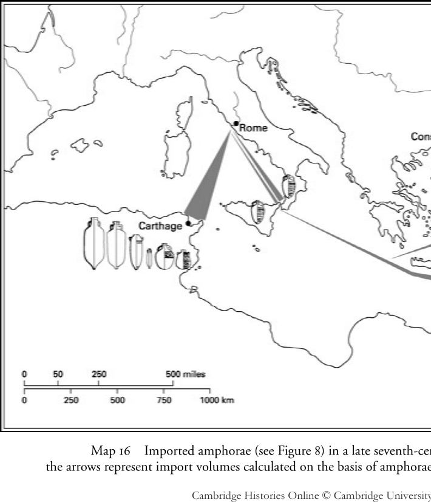
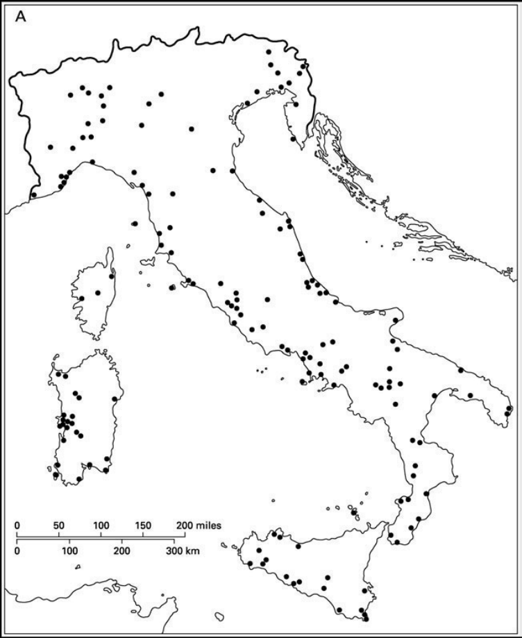
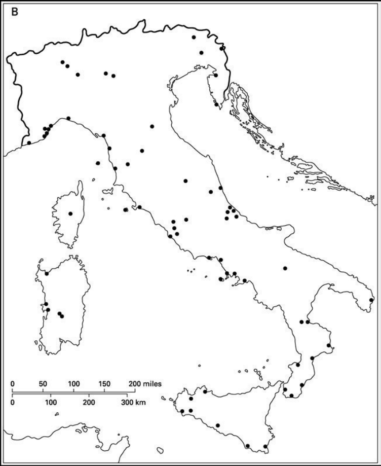
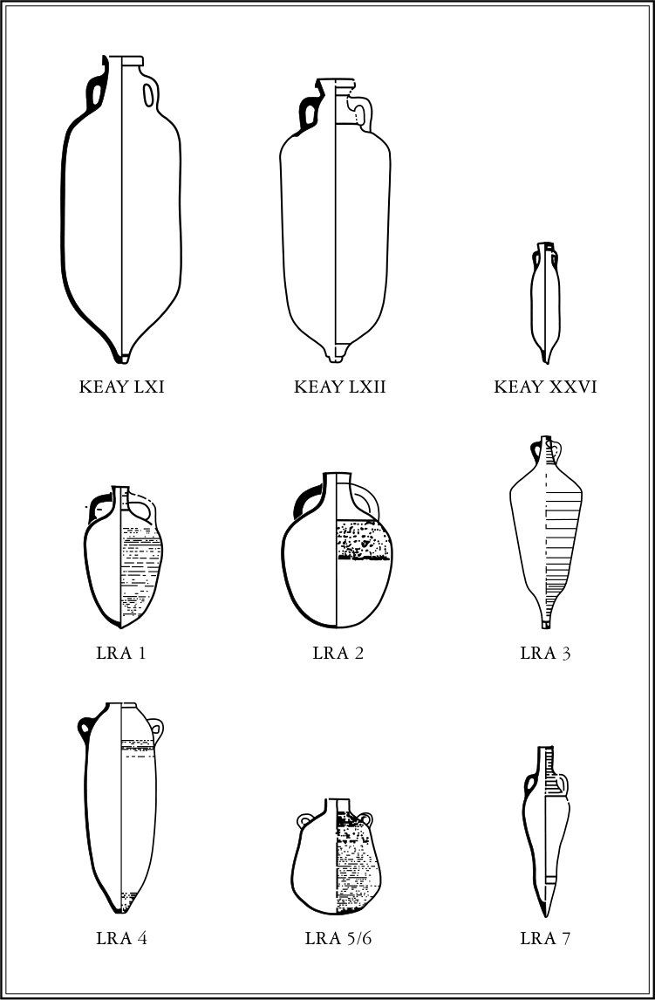
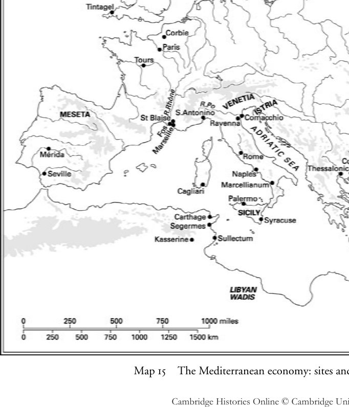

# 第22章 · 地中海经济

## 语境：史料与先声

影响对六、七世纪地中海经济的任何总体阐释的两个问题，一是现存史料的局限，二是此前古代经济的性质问题。文献史料的局限人所共知。尤其是，没有任何一种文献数据留存下来，足以支持严肃的定量分析。我们拥有的通常只是故事，而非作为经济史原料的那些记录。有少数短篇文本全部或部分涉及经济事务。但就总体而言，我们依赖的是一大群作者的轶事式提示，他们唯一的共同点几乎就是对经济事务漠不关心，在其著作中，商人或贸易商品的偶然出现几乎总是题外之笔。例如，都尔的格雷戈里记载，588年一艘来自西班牙的船载着“平常的货物”驶入马赛。他讲述此事是为了给一场瘟疫的爆发提供背景——瘟疫经由购买这批货物而传入港口——但由于该时期关于西班牙与法兰西亚之间地中海交流再无其他直接记载，其性质只能付诸推测。^1 即便是那不勒斯的利奥提乌斯所著《施舍者圣约翰传》，它对七世纪初亚历山大里亚教会的商业关系提供了一系列非同寻常的洞见，其着眼点也主要不在于这些关系本身的重要性，而在于它们可以用来说明传主乐善好施的品行。^2

这一时期的经济史，必然是通过对散落于各种语境中的这类信息珍宝加以挖掘、又为其服务于更繁复的总体论证而精心重新编排才构建起来的。经典而最具雄心的例证是亨利·皮朗（Henri Pirenne）的论题。自其挑衅性著作《穆罕默德与查理曼》在其身后出版以来，皮朗的阴影便一直笼罩着这一领域。他在书中论证，古代经济虽历经五世纪蛮族入侵而毫发无损，却被七世纪伊斯兰教的兴起所摧毁，后者割裂了地中海的统一性。这一论点确立了此后数十年关于后罗马地中海经济史学论战的框架，尽管他的众多批评者已经证明皮朗许多论断的脆弱性。^3 一种较少印象主义色彩的研究路径，是按专题整理零碎的数据，以期辨识出普遍模式；这种方法在中世纪早期西地中海贸易资料汇编（由迪特里希·克劳德编纂）中达到顶峰；该书比其许多前身更为全面、结论也更为审慎，具有双重优点。^4 这类著作为现存证据提供了一个极有价值（且实际上已经定型）的规范库，却无法改变其缺陷仍然巨大、在某些情况下完全无法克服的事实。这部分是由于中世纪早期文献传统中人们熟知的失衡所致：某些地区的数据远多于其他地区。更普遍地说，现存证据数量有限且无休止地呈轶事性质，以致从任何具体故事的特殊性出发来阐发总体经济状况都是极其危险的。我们对中世纪早期交流缘由的知识是一种拼合物，由各类零星信息拼凑而成，这些信息未必典型，也难于比较，而且几乎从不全面。

仅举一例：约632年，一位名叫雅各的犹太商人受该城一位显贵居民之托，从君士坦丁堡出发，去售卖价值两磅黄金的违禁纺织品，作为酬劳他每年获得货物价值约百分之十的定金。^5 雅各曾考虑在阿非利加或高卢寻找买主的可能性，但最终悄悄地把全部存货卖给了迦太基的客户。撇开雅各由犹太教皈依基督教这一牵涉众多曲折的情节（后者很可能是这个虚构故事的主旨）不谈，其中的商业场景似乎极为可信，但许多细节仍属例外或费解。^6 例如，它是我们这个时期唯一有记载的、地中海商人为世俗精英成员从事委托代理的实例，也是唯一明确表现出对替代市场的自觉意识的实例。雅各是否完全代表其恩主行事，他获得的报酬是现金还是实物，以及他是否还打算借这次航行为自己牟利（例如带回一批货物到君士坦丁堡出售），文中都未交代。雅各的故事固然引人入胜，但若无可比信息，其作为正常商业惯例之证据的价值便极难评估。从不同时间、不同地点累积此类轶事的必要性，加上它们各自侧重点与省略之处的差异，鼓励人们用另一个故事的同样独特的细节来填补一个独特故事中的空缺。文献史料使我们得以看到什么是可能的；雅各在630年代初进行这样一次航行的构想本身就颇具意味。但它们提供的信息太过贫乏，无法表明什么是典型的。

关于中世纪早期地中海经济性质的争论一度颇为贫乏，长期围绕着一套不完备的文献资料和皮朗留下的概念框架展开；自1970年代以来，考古新数据的持续注入使之重获生机。城乡聚落形态的变化为经济关系提供了大量洞见，既可以通过对特定遗址的个案研究，也可以通过对更广阔区域的田野调查、乃至在某些条件优越的地区（如叙利亚北部的石灰岩山地）对现存建筑进行考察来获得。^7 对考古发现的分析则就某些制造品的生产与流通提供了更为明确的信息。尤其是，成千上万陶片的出土（对主人而言一旦破碎便毫无用处，但因在土壤中几乎不会毁灭而对考古学家而言极其宝贵），使得我们既能把陶器本身作为贸易商品加以细致研究，也能研究古代惯以陶制双耳瓶运输的那些食品的交换——包括橄榄油、葡萄酒和鱼酱等地中海饮食的主打品。大量艰苦的研究现在已使人们能够将许多这类陶质材料归于特定的生产区域，并以日益精确的方式对最常见、流通最广的陶器类型进行分类和断代。^8 陶器组合可据以进行多种分析，例如揭示某一遗址出土双耳瓶的品类范围所隐含的消费模式（地图16），或某一器形的分布状况（地图17a、17b）。

所有这些提供了文献记录中明显缺席的大量序列数据和统计分析的可能。陶器分布不仅可用于揭示交换网络的存在，还可揭示其随时间的演变。

问题依然在于，考古证据与文献史料一样范围受限，而且同样可能被作出种种解读。文本中最常提及的许多中世纪早期交换品——从香料到奴隶——在考古上是无法找回的。与双耳瓶一同流通的容器类型，如木桶、麻袋和皮囊，通常也无法在地下存留。对其他可回收材料（如玻璃或建筑石材）的生产与流通做更细致的分析，或许终有一天成为可能，但我们对后罗马地中海经济的考古认识，仍将 overwhelmingly 由陶器证据所主导。^9 这远非理想状态，但它给人的印象仍很可能大致代表了更广泛的经济图景。^10 陶器是一种日常商品，在整个古代晚期的世界里都有生产，规格从北非大量输出的标准化细陶器，到家庭内部为满足家用而制造的普通手制器皿不等。因此，陶器生产与流通的模式可以揭示从国际到地方的经济各个层级。陶器工业的相对精致程度，或许也是当代经济总体复杂性的可靠指标。在优质陶器得以批量生产和广泛流通的时期，似乎有理由假定其他专事日用品的产业——如纺织或木材——也能够在类似的水平上运作。反过来，依赖基本的本地制造，则意味着需求的缺失，或者区域陶器流通所需的运输与销售结构的缺失，从而暗示更简单的经济体系。我们这个时期双耳瓶作为容器的广泛使用，加上人们习惯把陶器作为填充空间之物与其他更贵重的货物一同装船，也意味着陶器分布很可能指示的是交换的总体模式，而不仅仅是陶器工业特有的网络。^11 我们对中世纪早期地中海出口生产的考古认识，不可改变地偏向那些产出广泛流通的陶器的地区，如阿非利加细陶器或叙利亚双耳瓶。尽管如此，这种偏向不太可能完全误导人，因为正是这些地区在经济的跨区域层级中的重要性，才使其得以维持葡萄酒、橄榄油和陶器工业规模的生产与流通。

一个更为严重的困难是，无论出土地点分布图和统计证据的积累多么令人向往，它们本身永远无法揭示中世纪早期地中海经济是如何运作的。文献史料至少还讲述故事；考古学家则不得不自行编织。尽管近年来在特定陶器类型的辨识与断代方面取得了显著进展，但此类物品如何、为何以及为谁的利益而在地中海各处流转，仍然是一个解释问题。例如，发掘表明，古代晚期被重新占领的普罗旺斯山顶堡址圣布莱斯（St Blaise）的居民，至少直到六世纪末仍能获得来自地中海遥远地区的舶来品。^12 他们饮用加沙葡萄酒——当日名酒之一——装在一种独特的细长栗色双耳瓶中，专家称之为晚期罗马双耳瓶（LRA）第4型（地图16及图8）。他们用产自今突尼斯作坊的优质碗碟进食；这就是无处不在的阿非利加红釉陶（ARS），该时期占主导地位的国际性陶器，也是所有古代晚期陶器类型中被研究得最充分的。

然而，尽管我们能够以越来越高的精度对圣布莱斯这类遗址出土的部分材料进行分类和断代，这却无助于我们理解它们如何到达那里。假定其中涉及贸易似乎是合理的，但把葡萄酒从巴勒斯坦的生产者运送到普罗旺斯山顶的最终消费者手中所需的交换之性质与次数，则纯属推测。在讨论这一时期考古堆积时，人们习惯上区分“阿非利加”与“东地中海”来源的陶器，下文在缺乏更佳办法的情况下也将以此作为启发性工具加以使用。但任何特定遗址中此类材料的相对比例，不能被可靠地用作生产区与消费区之间直接交换规模的反映；例如，许多东方材料可能是经由迦太基等中转港进入西方市场的。这一时期经打捞的地中海沉船也为数寥寥，其货物一般都很杂糅，这凸显了发现物最终分布背后的交换之多样性与复杂性。^13 这些及其他类似问题确保了诸如圣布莱斯出土的陶器组合所提供的信息——如同商人雅各的故事一样——具有启发意义却不完整。不过，考古材料确实有某些优势。由于它呈现的是历时性变化的图景，它更像一部电影而非一张快照。而且，尽管出土发现本身对其生产与流通的社会经济基础说明甚少，但它们可以更容易地与同时代的其他组合进行比较，从而揭示交换的结果。目前，地中海周围每一个能产出我们这一时期大量层位堆积的重要新发掘——如迦太基的多项联合国教科文组织项目、君士坦丁堡的萨拉乔内（Saraçhane）或罗马的巴尔比地穴（Crypta Balbi）——都意味着考古万花筒的一次急剧转动，其材料碎片重新排列为稍有不同的图案。虽然总体图景仍处流变之中、细节尚显粗略，但某些大轮廓正以日益增强的把握得以确立；它们也可与文本所提供的不同视角进行有益的对照。

考古证据日益丰富的后果之一，是转变了人们对古代经济运作方式的认识。有影响力的史家过去往往对贸易持悲观看法，强调一种生存部门凌驾于商业部门之上的经济体系的原始性。^14 在这种极简主义视角下，市场经济的作用严格局限于地方。普遍的贫困限制了需求；而在供给方面，缺乏专业化、投资与创新，高昂得令人却步的运输成本，以及精英阶层重视土地占有和炫耀性消费甚于生产与利润最大化的心态，都被认为共同扼杀了贸易。只有国家，面对供养其庞大人员和都城膨胀人口的必要性，才从事食品的长距离流通，而且这尽可能通过annona（强制征购与配给制度）来实现。^15 因此，古代世界乃至我们这一时期实际发生的许多交换，被视为并非商业行为，而是国家、精英以及后来教会等其他富裕机构在无须求助于市场经济的情况下对资源的再分配。^16

这种解释基于文本，但考古证据通过揭示交换的无数结果，既暴露了我们史料的局限，也暴露了极简主义观点过于悲观的假设。古代晚期地中海四周各遗址——甚至包括相对寒微的乡村环境——出土的大量ARS，表明一种优质产品的大规模制造，其价格足够低廉，以致即便必须与本地细陶器生产竞争，其海外流通仍然有利可图。ARS之类商品的流通几乎肯定受到国家所产生的交换潮流的影响，但很难说是由其决定的。同样，尽管国家部门直接承担了跨区域食品流通中相当大的份额，但双耳瓶制品的品类范围及其分布之极其复杂，表明至少部分此类流通是对商业需求的回应。既然这些陶器工业的活动大多未见于文献史料，那么诸如纺织品之类的其他制造品在相当规模上的交换同样有可能存在，即便这一点无法如此便利地在考古上得到确认。^17 一些考古学家已明确地对古代经济提出了更受商业驱动的解释；另一些则满足于以惯常的“贸易”一词来描述出土材料的分布，从而隐含地表达了同样的观点。^18

当然，这一切并不否认帝国利益对古代经济中跨区域交换的演变和性质至关重要。即便考古证据有力地表明商业部门的重要性被低估了，罗马国家的需求确实显著扭曲了此类流通的走向。例如，四世纪君士坦丁堡新都的建立产生了新的交换流，这在某种程度上导致了古代晚期地中海东部若干地区农村聚落和农业生产前所未有的密集。^19 与此同时，在西方，已有学者令人信服地论证，支撑ARS国际流通的一个关键因素，是阿非利加在国家经济部门中的主导地位。^20 更普遍地说，罗马国家曾以各种方式间接刺激了商业交换。它向农民征收的赋税要求农民把剩余产品商品化以换取钱币；这些主要为财政目的而铸造的钱币，以一种单一通货的形式提供了遍及帝国的交换媒介。annona体系的基础设施和财政支撑或许符合公共利益，但正如我们将看到的，它也为与之并行的私人企业润滑了车轮。^21

在地中海东部盆地，国家部门与商业部门的交织造成了复杂的跨区域交换网络，这些网络在我们的时期内持续了很长时间，直至最终因拜占庭帝国的近乎崩溃而中断。^22 然而在西方，五世纪帝国财政与军事机器的解体延续了既有的衰落格局，而查士丁尼的重新征服虽使西地中海某些地区——尤其是阿非利加——重新并入东部体系，却也几乎无助于阻止这一进程。在西方，六、七世纪的标志不是与过去的根本决裂，而是从古代继承的经济网络的持续收缩。一方面，这支持了如下观点：地中海经济的商业部门一直很重要，因而无论有无帝国都能延续；例如，阿非利加陶器在海外市场上的霸权，既挺过了据称的汪达尔征服之破坏，也挺过了帝国权威自东方的恢复。^23 另一方面，引人注目的是，西方帝国的废墟上没有涌现出任何全新的跨区域交换网络。因此，六、七世纪地中海经济的宏大叙事——如果说存在这样一种东西的话——所讲述的，是罗马帝国军事、政治以及（尤须一提的）文化权威之解体（在西方是渐进的，在东方则更为剧烈）对古代交换体系持续运作的影响。但地中海是诸海之复合体，因而历来孕育着诸经济之复合体。^24 所以，在展开那一宏大叙事之前，必须首先关注潜藏于泛地中海经济表面之下的地方性和区域性交换轨道，以及在这些次级体系内流通的商品。

## 内容：轨道与物品

前工业经济的一个界定性特征，是陆路运输与水路运输成本之间的巨大差异。尽管来自罗马时期的精确信息匮乏，但现存的信息与后世几个世纪保存下来的更佳数据相吻合，表明陆路运输大约比河运昂贵五倍，比海运昂贵二十倍以上。琼斯利用戴克里先价格敕令中核准的运费税率，简洁地说明了这一点：把谷物从叙利亚海运到西班牙，比用大车仅仅运送120公里还便宜。^25 在正常情况下，将谷物这类低价值或大宗物品经陆路运输在商业上毫无意义；国家会这样做以确保基本供给，但在这里，高昂的费用并非主要考量。此外，只要顺风，海运要快得多，尽管地中海被认为在近半年时间里不宜航行，其危险也常被文献史料所强调。^26 例如，在施舍者约翰任牧首期间，亚历山大里亚教会的至少十三艘船只在亚得里亚海遭遇风暴，被迫抛弃全部货物；习惯在启航前用约旦河圣水洒遍船只的亚历山大里亚船长们，实在是采取了合理的预防措施。^27 不过，这些风险是值得冒的，因为地中海为沿海中心或拥有可航水道的地区开启了内陆社群无从企及的商业可能性。纳齐安素的格雷戈里在讲述卡帕多西亚内陆城市凯撒里亚——坐落于距海岸约200公里的群山之中——在饥荒时期的困境时，对贯穿我们整个时期的结构性约束作了一个精辟的概括：“沿海城市不难度过此类匮乏，因为它们可以输出自己的产品并从海上获得补给；而我们身处内陆，剩余无利可图，匮乏无从补救，因为我们既无法处置我们所有的，也无法进口我们所缺的。”^28 水路运输的相对便利不仅在危机中至关重要；从潜在意义上说，它还为剩余产品的处置提供了通向更广阔市场的经常性途径。

这种便利的海上“连通性”，是地中海经济存在的根本前提。^29 然而在实践中，其沿岸各地生态资源相近——差异往往存在于区域之内而非区域之间——这本可能削弱商业的可能性。最重要的是，所有沿岸地区都有能力生产六世纪地中海三大利基食品：谷物、橄榄油和葡萄酒。^30 除了供应帝国都城之外，食品的跨区域运输通常并非维生所必需。当歉收和绝收不可避免地发生时，坏消息和必需的救济通常都无法足够迅速地抵达，以使远方的生产者和供应者得以乘机利用短期危机。^31 而在正常情况下，用船运载数百公里的商品，其价格或许能与相对较短距离陆路运输的同类物品竞争，却几乎无法与当地的葡萄收成或橄榄油压榨竞争。施舍者约翰在亚历山大里亚圣米纳斯教堂被奉上昂贵的巴勒斯坦葡萄酒时，赞叹其浓郁的酒香，但以其一贯的节制，他弃之而选择了马雷奥蒂斯湖的本地酒；后者味道平平，但价格低廉。^32

在六、七世纪，正如整个罗马和中世纪时期一样，运输成本加上人口的相对贫困，确保了对生产者和消费者而言交换网络中最重要的层级都是地方性的。绝大多数人都直接从事劳动密集型的农业生产。他们的首要目标是种植足够的食物，使自己和依赖他们的人得以活过一年（饿死的危险是真实存在的），同时满足国家和地主对赋税或地租的要求；当这些要求以现金而非实物表达时，他们参与市场经济以便将产品换成钱币便是必不可少的。如果他们在此之后还能产出剩余，最有可能的是在当地换取其他食品或制成品。这一层级的交换通常不进入文献史料的视野，尽管偶尔的轶事证实其存在。例如，拜占庭人入侵汪达尔阿非利加之后，就是借助一个简单的办法进入苏莱克图姆的：他们混入拂晓时赶着大车入城的农民中间，这显然是每天都会发生的事。^33 撒丁岛卡利亚里的一方残缺铭文，列出了莫里斯在位期间（582–602）城市行政当局对用驮兽、小船或（最省事的）活畜运入城市辖地的货物所征收的实物关税。在描述各类基本商品从陆路和海路汇聚于一个地方市场时，它难得地让我们瞥见了农民生产者与邻近社群之间必然存在的正常关系。^34 当然，作为回报，这些社群不仅提供农产品，还提供专门技能。查士丁尼时代，生机勃勃的埃及村庄阿弗罗狄托支撑着至少六十名店主、工匠和专业人士，分属十九种明确的行业，其中包括一位相当有家资的陶工。^35 这一地方层级的交换，如今正通过陶器生产与流通的模式变得愈益可见。尽管如此，对这一时期普通陶器的研究仍处于起步阶段，而且许多此类器物一成不变的性质和家庭制造方式意味着进展缓慢。虽然考古学还能通过诸如花粉分析、尤其是最有希望的动物骨骼分析，就特定遗址的补给问题告诉我们许多，但目前，断言地方层级交换——以及地中海经济内部无数微观经济——的根本重要性，仍比对这一网络的实际运作进行有意义的比较分析要容易得多。^36

区域网络——构成地中海交换的中间层级——的情形已不再是如此。六、七世纪陶器组合数量的不断扩充，以及分析手段的日益精细，使这些体系作为特定实体愈益可以辨识。地中海的许多地区在古代晚期都维持着细陶器生产；这些工业往往依托若干区域中心运作，有时也出口到其紧邻地区之外，但从未达到ARS陶器那种遍及地中海的流通，尽管它们有时正是有意识地试图模仿ARS。例如，在南高卢，一类细陶器的大规模生产——其名称五花八门而均不甚雅驯，包括“早期基督教釉陶衍生器”（DSP）或橙／灰印纹陶——始于四世纪末，在某些地方一直延续到七世纪。这些陶器很少大规模出口海外，除非是输往加泰罗尼亚和利古里亚相邻的地中海海岸；即便在高卢境内，其分布也分成明显的亚群，例如朗格多克生产的橙色DSP在普罗旺斯十分罕见，反之，普罗旺斯的灰色品种在朗格多克亦然。^37 同样，在东地中海，越来越多的倾向于在特定区域内流通的细陶器类型可以得到辨识，例如小亚细亚帕加马出产的金属光泽陶、埃及版本的红釉陶，或在君士坦丁堡兴起并将在其后数百年持续主导当地市场的白釉陶。^38 这些区域类型偶尔也会流传得更广，但在东部，唯有小亚细亚西海岸福西亚生产的红釉陶达到了勉强可与ARS相比的国际流通。^39

尽管这种陶器类型的三层分级——地方、区域、国际——略显粗糙，陶器证据却为中间层级经济的持久复杂性提供了有用的说明，尤其因为在文献史料中这类交换网络并不容易辨识。在文献中，地方市场与区域市场的区分很少有如卡西奥多鲁斯描述南意大利卢卡尼亚马塞利亚努姆附近一处圣泉圣西普里安节庆之商业内涵时那样明晰：“勤勉的坎帕尼亚、丰饶的布鲁提乌姆、牛群繁盛的卡拉布里亚、兴旺的阿普利亚的所有著名物产，连同卢卡尼亚本地的产品，皆陈列于此，以彰显最令人赞叹的商业之荣光，以至于你完全有理由认为这大批货物是从许多地区汇集而来。”^40 这类集市想必也促进了装在Keay lii型双耳瓶中的葡萄酒的流通——以及节庆性的消费——现已知道该型双耳瓶产于南意大利和西西里。^41 只有关于外出商人被当地刁滑农民抢劫的报道才稍稍破坏了这节日的图景。另一种很可能曾在此一带进行商业流通的主打品是谷物。例如，教皇大格里高利总是急于为罗马从西西里获取谷物供应，通常通过帝国官吏或庞大的教产庄园，但他也不得不求助于公开市场收购，591年就花了五十磅黄金从该岛购入额外存粮以备罗马歉收。^42 与此同时，在亚平宁山脉以北，亚得里亚海顶端的威尼提亚和伊斯特拉居民经营葡萄酒、鱼酱、橄榄油和盐，以及谷物；其中一些货物是运往拉文纳的，但也在公开市场上交易。^43 两个世纪后，波河顶端的科马基奥商人从伦巴德人那里获得一项协议，以实物通行税为代价换取沿河的贸易权，其中盐再次占据显要地位。^44 盐正是那种可以预期会在一定距离内流通的商品——人人都需要盐，卡西奥多鲁斯如此评论道——但流通不会太远。其开采在地中海周围广泛可行，经海路长途运输有使其毁坏之虞，而且不像葡萄酒那样，特定种类的盐并不享有溢价。它在这些文本中的出现，正是这些文本所描述的交换属于区域性质的一个标志。

因此，中世纪早期的地中海维持着一系列区域经济，其中一些似乎比另一些更为发达或更有活力。尤其是意大利各地区的不同经历已经表明，诸如战争影响或环境危机之类的一般化解释是不充分的。^45 此类研究的拓展，为我们发展比较视野、深入理解早期中世纪交流的全部复杂性提供了最大的希望。但就广义的地中海经济而言，我们必须回到那种 continued to unite 罗马内海沿岸居民（乃至大洋中的某些居民）在政治分裂之后很久仍赖以维系的交换。习惯上用来描述这类流通的“远程贸易”一词并不完全贴切，因为正如我们所见，真正要紧的不是距离，而是是否通达海洋或可航水道。从这个意义上说，西班牙海岸的居民与迦太基或罗马的“距离”，要比与紧邻的梅塞塔高原更“近”；出于同样的理由，如果我们暂时走出直布罗陀海峡，就会发现地中海陶器的零星发现，在后罗马时代的英国西部似乎比在法兰西北部更为常见。一位亚历山大里亚船长——无论多么事出偶然——从埃及航行到不列颠的著名故事很可能是虚构的，但把下埃及凯利亚修院遗址与康沃尔的廷塔哲尔联结于同一个品味海上共同体之中的六世纪ARS和东方双耳瓶却不是虚构的。^46 “远程”交换大多是以沿海岸逐港接力的短程跳跃、或借地中海池塘中便利的岛屿踏脚石跨越外海实现的，我们不应因埃及到不列颠的航程这一概念而忽视这一可能性。^47

交换体系的“远程”层级常被斥为附带现象：性质上属奢侈品，规模上微不足道，重要性上处于边缘。可能属于此类的食品之一，是从东地中海、阿拉伯和印度运抵西方消费者的异域水果、坚果、尤其是香料，它们贯穿我们整个时期源源不断，既满足了某些隐士对正宗埃及苦修风味的热情，也满足了各机构——最明显的是修院共同体——更为可观的需求。^48 法兰克国王克洛塔尔三世（657–673）特许其新建立的科尔比修院的代理人，每年从普罗旺斯港口福斯的王家仓库收取一批按到货情况而定的进口货。^49 与橄榄油、鱼酱、西班牙兽皮和埃及纸草并列，他们的购物清单上还列有十多种不同的东方水果、香草和香料，总重825磅。与清单首位的10,000磅橄榄油相比，这似乎微不足道，但值得记住的是，据称这只是一个共同体的年度消耗量。而且，尽管这类“奢侈品”的最终接收者往往是机构，但毫无疑问，这类交换中的很大一部分是商业性的；塞维利亚的伊西多尔曾告诫人们提防奸商在胡椒中掺入铅屑或银屑，以单凭重量、或因鲜胡椒较重而为人们所知的方式使其更加值钱。^50 六世纪某位法兰克国王收到的椰枣想必只有少数幸运儿才需要提防吃得太多，但这类流通的范围及其经济重要性都不应被过分贬低。^51

然而，科尔比特许状中规定的橄榄油数量表明，地中海跨区域交换的真正重心在别处，在于大宗商品的运输。这一流通的规模如今已被大量出土的双耳瓶残片充分证实——橄榄油、葡萄酒、鱼酱和其他物品正是装在这些双耳瓶中运输的。仍有许多研究有待完成，例如进一步细化较知名双耳瓶类型的分类，以便将它们更紧密地系于特定产区或特定时期，或者辨识某些六、七世纪组合中占相当比例的“未知类型”。^52 不过，双耳瓶数据的持续积累，已经为食品在中世纪早期地中海周围流通之网络的广度与复杂性提供了关键的新洞见，某些大趋势也日益清晰地浮现出来。与陶器一样，某些类型的双耳瓶似乎主要在地方或区域轨道内流通，但另一些则在六、七世纪达到了遍及地中海的分布。值得注意的是，这些双耳瓶或出口自阿非利加，或出口自东地中海海岸，形成一道从爱琴海（LRA 2、3）经小亚细亚（LRA 1）、叙利亚和巴勒斯坦（LRA 4、5、6）直至埃及（LRA 7）的弧形环带（地图16及图8）。^53 因此，这些容器的证据与细陶器的证据大体一致，共同强调阿非利加与东地中海生产在交换体系跨区域层级中的主导地位。

就阿非利加而言，这种霸权至少可以追溯到三世纪，但东方出口的兴起较为晚近；来自该地区的双耳瓶大约从五世纪末才开始大量抵达西地中海。^54 因此，六、七世纪的格局代表着一段可上溯至罗马共和国时代、其间不同地区——意大利、中南高卢、西班牙、阿非利加、近东——相继成为更广阔地中海经济中主导力量的序列的最后阶段。就此而言，也就其他方面而言，我们的时期与其说是一个新时代的曙光，不如说更像是古代经济体系的谢幕演出。古代晚期近东乡村的非同寻常的活力，最早由乔治·特查连科在其对叙利亚石灰岩山地保存极为完好的村庄的开创性调查中予以强调。^55 类似的农村经济蓬勃发展的证据，此后又陆续见于小亚细亚南岸崎岖的吕基亚海岸和邻近的西里西亚、叙利亚以南的豪兰玄武岩台地，以及南巴勒斯坦内盖夫的干河谷。^56 这些地区大多在农业上处于这种或那种边缘状态，唯有以极大的决心和投入才能耕种。但到我们时期开始时，它们所支撑的聚落在广度、密度和繁荣程度上都是空前的，有些地方此后再未重现，这也有助于解释为何相关证据保存得相对完好。

人们很自然会想到，正是其剩余生产经由安条克及其外港塞琉西亚（就石灰岩山地而言）或加沙（就内盖夫而言）等中心整合进地中海经济体系，才使这些边缘土地的开发不仅可行，而且颇有盈利。这些乡村地区日益上升的繁荣与LRA 1型和LRA 4型双耳瓶在海外市场出现之间的巧合是引人注目的：LRA 1出自地中海东北角安条克、西里西亚和塞浦路斯一带的作坊，LRA 4则主要出自加沙附近。LRA 1是所有古代晚期东方双耳瓶中最常见、分布最广的，很可能既用于运输橄榄油也用于运输葡萄酒。^57 LRA 4则可以合理地与文本中不时被突出提及的一种特定商品相联系：加沙葡萄酒。这类双耳瓶在西地中海堆积中的广泛存在证实，都尔的格雷戈里、塞维利亚的伊西多尔等人的著作中对此种商品的记述，绝不只是文学修辞或诗歌想象。^58 这一证据与更早的罗马格局完全一致：一个地区农村聚落与投资的扩展，总是与该地区向地中海其他地区大量出口的证据相伴随。^59

这一现象的若干方面可能永远成谜。许多跨区域交换很可能并非严格必需。考古学无法告诉我们，为什么安条克的橄榄油、加沙葡萄酒，乃至ARS，应当比热切的地中海消费者通常可以从较近的生产者那里轻易获得的压榨油、葡萄酒或陶器更受青睐（而且，就ARS而言，当地陶工还专门试图模仿之）。我们这一时期的文本只提供了关于品质差异的 fleeting 提示。都尔的格雷戈里形容加沙葡萄酒为potentiora（“更为有力”），似乎是相对于本地酒而言，可能指其醇厚度或风味，甚至暗示当时和现在一样，酒类既可以凭精致、也可以凭酒力来销售。^60 但遗憾的是，我们的史料从未提及这些产品究竟带有多大的溢价。一定的加价必然是必需的，以反映运输成本，并（大概）体现稀缺价值，但它是否足以使这些产品超出精英之外所有消费者的承受范围？ARS虽然到六世纪已趋衰落，但其非同寻常的市场渗透力表明，这类跨区域贸易中有些曾经服务于不那么排他的顾客群体，但其真实数量仍然令人沮丧地难以确定。陶器组合可以揭示来自不同地区的进口品相对比例随时间的演变，但要用它们来评估我们时期内跨区域交换绝对数量的变化是极其困难的。^61 尽管如此，乡村调查数据与陶器分布结合起来表明，参与经济的跨区域层级绝非附带现象，而是与大规模专业化生产、大宗商品和区域繁荣密切相关的。它们还表明，地中海沿岸在我们时期的大部分时间里仍然整合在一个总体经济体系之中。是什么驱动了这一经济？它又延续了多久？

## 手段与目的：跨区域地中海交换网络的命运

六、七世纪地中海经济中最大的玩家显然是拜占庭帝国，唯有它持续拥有鼓励大宗商品跨区域运输的手段和动机。地中海周围所有土地中最富庶的埃及，其农业剩余中的一部分长期以来被抽调，以保障帝国都城君士坦丁堡的谷物供应。533年查士丁尼重新征服之后，阿非利加产量中的一部分也被重新纳入国家部门，确立了迦太基与君士坦丁堡之间的固定贸易轴线。^62 在整个东方更广泛的范围内，帝国军事与行政机器的需求继续驱动着钱币流通、税收征缴与支出这一财政周期，而正如我们所见，这正是生产与流通的重要刺激因素。例如，在小亚细亚内陆，据说查士丁尼缩减了从君士坦丁堡通往东部前线的大道沿线的帝国运输体系并撤走了驻军，致使邻近的地主陷于破产，因为这一举措既剥夺了他们以实物缴税的机会，也使他们失去了能把剩余产品变现的消费者。^63 这则轶事简洁地说明了国家如何刺激经济活动，但也证实了通达地中海的持续优势。与先前的纳齐安素的格雷戈里一样，约翰·吕多斯把这一点说得很清楚：“纳税人破产了……因为他住在离海很远的地方，无法出售庄稼。”^64 而在更南边的沿海吕基亚和西里西亚，如前所述，聚落在此期间仍在蓬勃发展。地中海为沿海生产者的剩余产品销售提供了更广阔的机会，无论在与国家的交易中还是独立于国家之外。

然而，在西地中海，国家经济部门在五世纪崩溃了——在某些地区是永久性的，在另一些地区是暂时的；其财政与物质基础设施或许有所留存，但处于不断恶化的失修状态。^65 这里的大部分跨区域交换必然是商业性质的。世俗精英曾从事所谓的“关联贸易”，即将其自身资源在区域之间调拨，或以非商业方式与他人分享，但随着西方政治的碎片化和那种在数省拥有土地的超级富豪贵族阶层的消亡，这类贸易必然也大为萎缩。^66 然而各大教会继续坐拥广袤的土地资源和经常性的国际联系。大格里高利的书信表明，教宗在六世纪末极其活跃地参与地中海交换，不仅为罗马穷人争取帝国食品供应（或日渐取代国家成为这些供应的主要组织者），还重新分配其自身庞大教产的出产。^67 教会以非商业方式交换这些资源原本或许很便利，尽管在实践中并不总是如听起来那么容易。为了满足亚历山大里亚牧主欧洛吉乌斯的请求，格里高利花了八个夏天设法安排把造船木材从南意大利运往埃及；我们始终不知道他最终是否成功。^68

并非所有的“关联贸易”都如此盘根错节，但无论如何，这类性质的交换似乎只能解释教会参与地中海经济跨区域层级的一小部分。在致欧洛吉乌斯的一封信中，格里高利不无讽刺地引用了基督关于善用天分的比喻中的话“等我来到时做买卖”；^69 亚历山大里亚教会无疑是海外交换中特别积极的参与者，这一点从围绕611年——欧洛吉乌斯死后四年——就任牧首的施舍者圣约翰的种种传统中可以看得一清二楚。教会的直接利益通过维持一支可观的海船船队得到保障，但同样重要的是其作为“隐名合伙人”的角色：它以现金、货物乃至船只支持该城商人的贸易冒险，而这些商人屡屡遭遇的不幸往往由神力的显现予以补救。可以推想，这些人情的与天佑的恩惠是以分享利润为代价的，尽管我们的史料选择不涉及这一话题。然而很明显，这些获得教会支持的商人在如何经营方面也享有相当的自主权。从“所谓‘高卢行者’（Gallodromoi）之一”——这些人的事业想必主要关乎高卢——拒绝偿还贷款的故事来看，有些人专门从事跨区域贸易。^70 约翰的其他慈善故事则涉及与巴勒斯坦、亚得里亚海、西西里、阿非利加乃至不列颠的联系。^71 关于这些商人经营多种商品（而且并非人人都能平安返航）的一个简单提示，来自一位名叫彼得的亚历山大里亚亚麻商人的墓志铭，他于602年死于巴勒莫。^72

很少有圣徒传作者像颂扬施舍者约翰之德行的那位那样愿意把主人公与商人联系在一起，也很少有城市像亚历山大里亚那样得天独厚地位于地中海与印度／阿拉伯交换网络天然交叠的港口。^73 因此，人们不禁要问，其他财富和地位相仿的东方教会——如安条克和君士坦丁堡——在多大程度上可能以类似程度支持了跨区域交换。教皇大格里高利确实经常代表罗马教会与商人打交道，尽管教宗是否拥有自己的船队令人怀疑，而且格里高利面临的某些问题是当时的政治形势和罗马制度化食品供应的特殊历史强加给他的。^74 其他西方教会——以及统治者——似乎更倾向于就事论事地与个别商人打交道。六、七世纪西方史料中顺带提及的商人为数不少，其中几人据说是东方出身。例如，早在拜占庭重新征服之前，迦太基就有许多东方商人，六世纪的意大利和西西里也有。^75 从东方抵达西班牙的希腊商人溯河而上到达梅里达，并“依照惯例”拜见主教——另一位东方人，名叫保罗。^76 在巴黎，叙利亚商人尤塞比乌斯击败前任主教的神职兄弟而夺得主教之位（都尔的格雷戈里讥讽说靠的是贿赂），并立即以同乡叙利亚人充任其家臣。^77

尤塞比乌斯之流跃居显位的情形耐人寻味，考古记录中东方出口畅旺西方地中海的鼎盛期，与五世纪至七世纪初西方史料中东方人——其中一些被指明为商人——的客串出场之间的巧合亦然。但应克制从区区数人坎坷的经历中推衍过多的诱惑。^78 我们的文献信息太过贫乏模糊，既无法告诉我们这一时期从事海外贸易的许多人确切的出身，也无法让我们勾勒出一幅令人信服其典型性而非特殊性的活动图景。似乎清楚的是（尽管这并不太令人意外），有些人确实专门从事跨区域贸易，尤其是从东地中海到西方的贸易。我们前面遇到过的雅各便是其中之一。但他们的商业策略似乎与其同俗人和教会庇护人的关系一样千差万别。在我们的时期，大多数人可能既不受雇于国家，也不专属于某个教会或修院，但也无法完全独立。就最简单的层面而言，这些富裕机构中的人员就是商人最可能的顾客；希腊商人抵达梅里达后按惯例拜见主教，既是出于礼节，也是出于常识。更根本地说，商业冒险蕴含着巨大风险；除最富有的商人之外，所有人都需要拥有资本、商品和船只（或至少是舱位）盈余的后盾人，或者能在事情出错时救助他们的人。^79

与此同时，在地中海东部，这种财政支持的最重要的来源仍然是拜占庭帝国。annona体系或许把船主束缚于将埃及谷物定期运往帝国都城的义务，但束缚得并不那么紧，以致排除了他们同时追求私人利润的可能。^80 作为对他们以亏损为国服务的补偿，这些船运商（navicularii）似乎享有一系列财政优惠。其中一些特权提供了极受欢迎的对常见负担的豁免，如土地税和市政议事会义务；另一些则带来更为直接的商业优势，包括造船费用的大部分得以摊销，以及灭失风险转移给国家（随之而来的是种种舞弊的机会）。最重要的是，只要履行了对国家的义务，船运商便可以在一定限制之下附带经营自己的生意，免纳商人通常须缴的各类关税。满帆而行的埃及annona庞大船队使地中海看上去如同陆地；一旦抵达君士坦丁堡，船长们便可以自行备货，其返航实际上得到了国家的补贴。^81

这些返程货物之一，想必就是产自帝国都城近旁福西亚、广泛流通于东地中海并较小规模地远及西方的红釉陶变体。^82 533年帝国对阿非利加控制的恢复，很可能也促成ARS重新流入东地中海。^83 在这两种情形中，这些陶器出口都是与其他货物一同作为次要货物运输的，因而指示的是交换的总体流向；但陶器证据表明，国家利益对分布的影响远非前后一致。在西方，它似乎促进了主要annona供应地区阿非利加的出口；但作为东部对应的埃及，却未见本地双耳瓶或细陶器类似的海外传播，也未见人们在该处本应预期、倘若埃及与君士坦丁堡之间交通纯属对等的话所能找到的PRS的大量进口。^84 虽然围绕君士坦丁堡（很可能还有安条克和亚历山大里亚等其他主要中心）产生的流通无疑有助于构建东地中海经济的跨区域层级，但国家船运与商业船运在这些交换网络中的相对重要性却极难评估。^85 记录船只进入君士坦丁堡外达达尼尔海峡要冲阿比杜斯港和 servicing 安条克的塞琉西亚港所须缴纳费用的两方残缺铭文，为航运来源之多样以及汇聚于主要中心的货物之繁杂提供了罕见的文献佐证，但没有任何东西表明这些涉及的是国家还是私人流通。^86 无论如何，单凭国家利益似乎不足以解释考古证据所提示的跨区域交换的所有复杂分支——它表明东地中海所有沿海地区不仅继续以双耳瓶相互交易食品（这意味着存在几个相互嵌合的区域体系），还跨越到西方。在西方，某些五、六世纪组合中东方双耳瓶比例的上升只能源于商业交换，很可能代表私人船商发现的新而有利可图的市场。^87 对于东边更为活跃的经济内部的大部分跨区域交换，情形想必也是如此，尤其是考虑到私人企业的空间以及参与annona者享有的商业优势。把交换截然划分为“国家的”或“关联的”（亦即非商业的）与“私人的”（商业的）两类，未免过于僵硬；它忽视了这各种类型的交易相互依存的程度。

---

**译注（人名地名索引性说明）：** 文中 Saint Blaise = 圣布莱斯；Kellia = 凯利亚；Tintagel = 廷塔哲尔；Sullectum = 苏莱克图姆；Aphrodito = 阿弗罗狄托；Phocaea = 福西亚；Abydos = 阿比杜斯；navicularii = 船运商（annona体系下的义务运粮船主）；Gallodromoi = “高卢行者”。^88

## 地中海经济

公私利益的交织意味着，六、七世纪地中海跨区域交换的形态难以轻易地加以综合概括。^86 但必须对东地中海与西地中海作出一个基本区分：如前所见，东地中海的一切证据都指向一场与海外市场出口密切相关的古代晚期农村经济普遍繁荣；而西地中海的跨区域交换在数量与复杂性上已衰退了一段时间，并为阿非利加商品所主导。如果说西班牙、高卢或意大利的生产者定期把剩余产品销往海外，他们很少以双耳瓶运输农业剩余产品，或将细陶器随同装运；而且，尽管阿非利加陶器在整个六世纪乃至七世纪仍在地中海周围广泛流通，但即便在这里，也有迹象表明五世纪末之前生产已经趋于简化。^87 ARS三大主要类别中，只有一类——产于突尼斯北部的D类器——到约550年仍在制造，而此种器物流通中的器形数量在此后一个世纪里大为减少。^88 古代晚期的阿非利加双耳瓶尚不能以类似的精度加以分类和断代，但证据同样暗示生产的多样性与复杂性在收缩。塞格尔梅斯与卡塞林周围以及利比亚河谷诸地的阿非利加田野调查数据进一步表明，在我们这一时期之前乡村聚落已然越过其顶峰，而这一衰退或许自六世纪中叶起开始加速。^89

与此形成对照，东地中海的生产与海外交换形态仍远为多样且多中心，古代晚期的聚落繁荣很可能贯穿整个六世纪。在某些地区，如叙利亚石灰岩山地，此前那种剧烈扩张与投资的时期可能已经结束，但这或许更宜视作整合而非停滞，尤其鉴于类似的地区（如巴勒斯坦内陆）表现出持续的繁荣。无论如何，在600年之前，东地中海几乎没有任何普遍性生产或流通危机的迹象。^90 这里生产的规模与交换网络的复杂性，在令人眼花缭乱的东方双耳瓶制品种类及其分布的异质性中尤为显见。虽然其中许多双耳瓶可归入与特定产区相关联的大类，但这些主要分类掩盖了繁多的亚群，而且相当一部分类型迄今尚不能精确确定产地；所有这一切都意味着存在大量参与海外交换的独立生产者与流通者。

阿非利加与东方陶器相互交叠的流通网络证实，地中海的经济相互依存一直延续到七世纪中后期。然而，在这一共同物质文化的表层之下，裂缝已经开始显现。其迹象最明显地表现为ARS——古代晚期跨区域交换的缩影——先是缓慢而不可逆转地退出内陆遗址，继而又退出地中海某些沿海地区^91（参见地图17a与17b）。不应从望远镜的错误一端来看待这一发展；ARS之可得及于意大利亚平宁山区或阿拉伯沙漠边缘的农民，其所蕴含的经济整合，比它最终的消失更值得注意。但这个时代正在走向终结。以意大利为例——这里的证据既相对丰富又研究充分——内陆乡村遗址出土的陶器组合直到六世纪初仍与城市中所见相似；此后进口品逐渐从除城市或沿海中心以外的一切地方消失。在意大利的某些地区，这只是物质文化更为激进的转型的一个方面，表现为极为粗陋的陶器生产形式、甚至木盘的使用，这不仅意味着海外交换的衰落，还意味着区域生产与流通体系的解体。在意大利其他地区，细陶器的制造与流通表明经济内卷化没有那么剧烈，但这里进口品同样日益罕见。^92 大体而言，其他西部地区的形态与此类似。在地中海西班牙和法兰西亚，陶器证据日益使我们得以辨识出范围与精巧程度不一的地方性或区域性交换网络，但到七世纪，这些地区与更广阔的地中海经济的整合日益呈现零星化。^93

虽然ARS流通范围的缩减是跨区域交换持续收缩的一个特别有价值的指标，但近年的发掘表明，最终的危机直到七世纪方才到来。内战、与波斯的两败俱伤的冲突以及阿拉伯征服所带来的、吞噬拜占庭帝国领土的长期政治动荡，在东地中海经济中引发了深刻的重构。^94 其最重大的影响是把早已为西方所特有的交换区域化强加于东方。在拜占庭控制的领土上，这似乎与生产和组织——或许还有消费者趣味——相对剧烈的普遍变化同时发生。例如，PRS的制造在七世纪中叶前后戛然而止，在君士坦丁堡周围被釉面白陶所取代；后者属于另一种陶器传统，起初流通范围较为有限。^95 然而在阿拉伯人征服的领土上，陶器风格并未发生剧烈转变；例如在巴勒斯坦和约旦，既有的区域细陶继续生产，其品质甚至还有所提高。的确，关于聚落与生产的考古证据表明，把阿拉伯人的冲击作灾难性解读是严重失当的。^96 正如五世纪汪达尔阿非利加的情形一样，这里政治变革与经济变革之间并无整齐的对应关系，被征服地区与帝国控制地区之间的往来也无须中断。香客阿尔库尔夫在680年代游历圣地的目击记述中，提到耶路撒冷有一年一度的集市，“来自几乎四面八方、各族的难以数计的人群”云集于此。^97 尽管如此，各区域品种的红釉陶最终仍然停产；这些地区的双耳瓶虽仍在制造，却不再广泛行销海外，并被其他类型的容器极缓慢地取代。只有埃及，以本地红釉陶和晚期罗马双耳瓶类型为代表的古代晚期陶器传统还将延续数个世纪。^98 到八世纪，东地中海的多焦点交换体系已然解体，留下的是一直存在的一系列区域经济。其中一些发展充分，尤其是叙利亚和埃及的经济，但它们之间的重叠似乎远比从前为少，而且不再以地中海为取向。

与此同时，西地中海并未出现如此剧烈的七世纪中断。经济的跨区域层级继续萎缩，而尚未有新的海外交换网络兴起取而代之。但近年的发掘暗示，它的余晖比先前所认为的持续得更久。在阿非利加，一种已然萎缩的陶器、油灯和双耳瓶的生产一直延续到阿拉伯征服乃至更晚。^99 与此同时，现已知道有数量虽经甄选却在不断增加的西地中海遗址，在整个七世纪内的某些时段里仍在接受来自阿非利加和东方的进口品。例如在法国南部，马赛自六世纪起便已恢复了其前罗马时代作为商埠的角色，充当地中海与西北欧交换的中介。尽管该港到七世纪末显然已经衰落，阿非利加陶器的各色品类以及少数几种类型的东方双耳瓶仍在运抵，这不仅表明陶器与食品的跨区域流通仍在延续，也表明这种流通绝不局限于帝国权威残存的西方前哨。^100

在罗马，巴尔比地穴出土的两个规模可观且年代紧密的陶器组合——该遗址在这一时期与圣洛伦佐·因·帕拉奇尼斯修院有合理的关联——似乎标志着古代地中海经济体系的最终消逝。^101 在第一个组合中（约690年），ARS几乎是唯一存在的细陶，但日用陶器虽然以本地产品为主，也包含少量阿非利加和东方进口品。^102 双耳瓶组合同样以阿非利加类型为主，但也包括种类繁多的东方进口品、南意大利的容器，以及数量与比例都相当可观的未知类型——无论其产地为何，只能暗示交换的更大多样性与复杂性（地图16）。

同一遗址的第二个堆积（年代或在720年前后）则提供了一个直接而惊人的对比。它既不含ARS，也不含任何标准的阿非利加或东方古代晚期双耳瓶类型；相反，所有可辨识的双耳瓶都产于意大利中南部。事实上，陶器组合中双耳瓶残片的总比例从46%降至25%，或许反映了进口的下降，更可能是日益转用其他形式的容器所致。^103 七世纪晚期堆积中约80%的陶器系自意大利以外进口，而后一个组合中的陶器却几乎没有来自西西里以远地方的。看来罗马虽然仍需要进口品，却在更近的地方获取它们，并在此过程中刺激区域经济形成新的、多样的生产形式。^104

过分强调单一遗址，或更笼统地暗示可以完全从陶器分布推断地中海经济的种种脉络，显然过于简单化。但巴尔比地穴的考古证据，以及已出土七世纪堆积的虽少却在增加的其他遗址的证据，日益与某些学者从文献史料那些印象主义的却也更多面的迹象中得出的关于古代交换体系终结时间的结论相吻合。最著名的莫过于，如本章开篇所见，亨利·皮朗曾论证摧毁罗马经济遗产的并非五世纪的蛮族入侵，而是七世纪的阿拉伯征服。^105 他对证据的取舍有选择性，推理亦有严重缺陷，但其年代框架值得认真对待。事实上，迪特里希·克劳德在对中世纪早期西地中海贸易文献证据远为透彻的分析中，审慎地倾向于一个相近的日期，即七世纪末至八世纪中叶之间作为地中海贸易的谷底。^106 但皮朗以伊斯兰教兴起作单因解释是行不通的。西方在七世纪后期之前肯定已非旧日光景。与此同时，在东方，阿拉伯征服只是拜占庭帝国内部结构剧变的一个因素——如今帝国版图大为缩减，而随着其最富庶行省的丧失，其资源更是如此。由此国家对其余剩余产品生产的控制得以收紧；而一旦与迦太基的联系最终断绝，君士坦丁堡便转而依赖黑海和北爱琴海获取补给。^107 相反，在阿拉伯人新征服的地区，变化更具渐进性质。即便如此，这些地区参与地中海交换的证据仍逐渐减少，或是因为倭马亚王朝将权力与赋税下放至地方层面的国家性质，或许是因为主要交换流转向东改道美索不达米亚与印度洋。^108 地中海从未像皮朗所声称的那样变成一道屏障，但它也不再是周围拜占庭或阿拉伯诸地跨区域交换的首要焦点。

回到西地中海，巴尔比地穴两个组合的对比，为古代晚期交换网络的瓦解提供了一个异常鲜明而晚近的例证——这一瓦解自五世纪起已逐步波及地中海沿岸的所有共同体。在我们这一时期之内，代表我们参与跨区域交换之最清晰标志的进口陶器，先是从地中海腹地退缩，继而从某些沿海地区退缩，最终甚至从罗马本身退缩。这种收缩的原因多种多样，但其渐进性质、普遍性技术或环境变革的任何明确迹象之阙如，以及本时期内任何新的跨区域交换网络未能兴起的意味深长的失败，都表明其解释基本上是结构性的。三世纪时，意大利乡村农民既买得起也买得到ARS；七世纪时则不能。在供给方面，流通中ARS的绝对数量几乎可以肯定在下降；政治上的解体终结或限制了国家对流通网络的支撑；而使进口货物得以行销内陆的区域市场经济整合，在一些地方已被持久的战争所破坏——最明显的便是意大利。在需求方面，国家的需求很可能大为缩减，而许多私人消费者日益贫困，在某些地区甚至到了连区域经济体系都受到侵蚀、交换收缩至极简水平的程度。^109 罗马国家那种基本的税收—支出运转机制，首要关切的是自身的存续，但它附带地提供了种种机制，既使农民得以、也鼓励农民把微薄的农业剩余转化为利润、购买力和物质财富。罗马经济远不像有时被设想的那样由国家主导，但在某些重要方面它确实是由国家所激发的。这意味着帝国控制在西方的崩溃虽不能摧毁经济，却能够逐渐侵蚀它。生产缩减、流通成本或难度上升与需求衰退相结合，具有腐蚀性；随着消费者变得更为贫困，进口品便愈加稀缺而昂贵。像ARS这样大批量生产、广泛流通的商品，逐渐变成了一种奢侈品。

因此，尽管交换网络的跨区域层级在西地中海以某种形式存活至我们时期之末，它已更多是一种文化现象而非经济现象。阿非利加商品可得制品范围的缩减表明生产正在衰退，但其分布格局证实，直到七世纪中叶以后，它们在名义上仍可在地中海周围获得。问题在于它们已不再那么容易负担得起。地中海经济的波及范围在退缩，不仅在地理上，也在社会上，或许还在政治上。巴尔比地穴的发掘表明，只要跨区域交换继续存在，罗马就有一些人受其惠泽。他们对进口品的特权性获取，或许是国家主导交换的结果，但普罗旺斯诸港持续可得的大宗海外货物表明，这种往来同样是商业性的，且不限于拜占庭控制的地区。事实上，墨洛温诸王执意把《科尔比证书》中提到的那批品类可观的地中海进口品重新分配给他们选定的受益人——尽管内陆运输费用高昂——表明北方世界的精英几乎令人动容地始终恪守着源自古代的某些根深蒂固的习惯：以油灯而非蜡烛照明的教堂，以埃及纸草而非羊皮纸书写的证书，以外来香料调味的食物，或许偶尔还以一盏浓烈的加沙葡萄酒送服。所有这一切，与对罗马行政惯例的尊崇一样，构成了其物质上的对应物，并说明西方精英对古代晚期与拜占庭文化规范的持久赏鉴。在法兰西亚，这一切出于选择而非经济必需，并一直延续到此类进口的供给最终枯竭。^110 在罗马，阿非利加与东方进口终止所引起的任何危机，都很快通过经济的迅速重构建立了常规的区域供给网络而得以化解。但在西方，任何地方的需求都不足以使跨区域交换成为必需。唯有罗马世界体系曾使地中海经济成为必要；也唯有品味的共同体，才把它作为一种文化现象维系至我们时期的终结。^111

在罗马和马赛，或迦太基和那不勒斯这类享有特权的西部遗址，考古证据表明古代晚期的交换网络以一种衰微的形式延续到七世纪末。在此之前，地中海经济的许多基本特征——主要出口地区、海外流通的陶器与双耳瓶类型、某些主要的交换流——仍可辨认为500年时的样子。但在此期间，整个体系在西方无情地衰落，以致参与跨区域交换逐渐成为例外而非常态。在东方，这一经济层级的崩溃既更为突然也更为复杂，但结局相似。八世纪仍有一些货船往来于地中海，其沿岸的一些区域经济仍在繁荣，尽管另一些——例如南法兰西、意大利部分地区以及很可能还有北非——已深陷衰退。^112 然而，本章所述的跨区域地中海经济在约700年前后不复存在，这一断裂既真实又深刻。在这一有限的程度上，亨利·皮朗的直觉是正确的。当中世纪一个整合的、复杂的地中海经济（有别于一系列偶发的交换）开始缓慢重新出现时，其组织、其活动的枢纽及其流向都将与古代的大不相同。^113

## 注释

1. 格里高利，《法兰克人史》ix.22。

2. 里昂提乌斯，《施舍者圣约翰传》。

3. 皮朗（1939）。皮朗所引发的批评与后续研究不胜枚举，尤其参见Riising (1952)，以及Hodges and Whitehouse (1983)。

4. Claude (1985)。

5. 《雅各教义》v.20，相关评注见Dagron and Déroche (1991)。

6. 关于这一时期商人活动的其他资料，汇集于Claude (1985)，第167–244页。

7. 概述见Ward-Perkins (2000a)。

8. 在浩繁的文献中，尤应指出John Hayes关于非洲红釉陶器（African Red Slip ware）的开创性著作(1972)与(1980)，以及Riley (1979)与Keay (1984)所确立的、被广泛使用的最常见双耳瓶类型的分类。

9. 此类分析目前仅能针对一种易于辨识、但尤为贵重因而非典型的建筑石材——大理石的生产与分配进行：例如参见Sodini (1989)。

10. Peacock (1982)。

11. Peacock and Williams (1986)。

12. Démians d'Archimbaud et al. (1994)。

13. Parker (1992)。

14. 尤其参见Jones (1964)，第824–858页，及(1974)；Finley (1985)。

15. Durliat (1990)。

16. Whittaker (1983)。

17. 埃及留存下来的文献证据是例外：例如参见Johnson and West (1949)；关于纺织业另见Wipszycka (1965)与van Minnen (1986)。

18. Carandini (1981)与(1986)，并参见Wickham (1988)中有益的史学评述；Panella (1993)，对考古证据最精辟的分析；Reynolds (1995)。

19. Abadie-Reynal (1989)。

20. Hopkins (1980)与(1983)；Mattingly (1988)；Wickham (1988)；McCormick (1998)。

21. Kingsley and Decker (2001)。

22. Panella (1993)，尤其第641–654页。已有多种尝试试图从这些政治变动的特定视角解读陶器证据（如Fulford (1980)与(1983)），但这些尝试并不令人信服（Tortorella 1986）。

23. Braudel (1972)，第17页。

24. Jones (1964)，第841–842页；参见Durliat (1998)，第92–93页。关于淡化这一差别的尝试，虽不完全令人信服，见Horden and Purcell (2000)，第377页。

25. Claude (1985)，第31–32页。

26. 里昂提乌斯，《施舍者圣约翰传》第28章；《普莱森提亚的安东尼努斯游记》11。

27. 拿先素的格里高利，《演说集》xliii.34。

28. “连通性”（connectivity）：Horden and Purcell (2000)，第5章。

29. 卡西奥多鲁斯，《书信集》xii.22.1，论葡萄酒、谷物与油为农业的三种“卓越果实”。查士丁尼，《法学总论》iv.6.33引用了同一种货物组合，指出其在不同地方售价不同。

30. 卡西奥多鲁斯，《书信集》iv.5，参见Ruggini (1961)，第262–276页；以及《圣德米特里奇迹记》i.9.76，记述狄奥德里克王与圣德米特里各自以其权力设法绕过这一问题的非凡举措。

31. 佚名，《施舍者圣约翰传》第10章。

32. 普罗柯比，《战史》iii.16.10。

33. Durliat (1982)。参见西里西亚阿纳扎尔布出土的五至六世纪关税表：Dagron and Feissel (1987)，第170–185页（第108号）。

34. 《埃及文物总目录》，Maspero主编，iii.67283, 67288；Jones (1964)，第847–848页；Keenan (1984)。阿弗罗狄托资料的异常留存不应使我们忽视这一事实：作为尼罗河畔一座降级的都城，它并非一个普通村庄。

35. 关于日用陶器（尤其在意大 利）的多种研究，见Saguì (1998)。

36. Reynolds (1995)，第36–37页；Rigoir (1998)。同时代南意大利红绘陶器的分布模式与此相似：Arthur and Patterson (1994)。

37. Hayes (1992)，第12–34页；Panella (1993)，第657–661、673–677页；Sodini (1993)，第173–174页。关于埃及，见Bailey (1998)，尤其第8–58页。

38. 福西亚红釉陶器（Phocaean Red Slip）：Martin (1998)。在东部，PRS仅于埃及罕见。它也西传，但数量从不等同于ARS在东部的数量：Reynolds (1995)，第34–36、132–135页。

39. 卡西奥多鲁斯，《书信集》viii.33。

40. Arthur (1989)；Pacetti (1998)。

41. 大格里高利，《书信集》i.70；Arnaldi (1986)。格里高利对危机的预感似乎是特例：参见上文注30。

42. 卡西奥多鲁斯，《书信集》xii.22、24，后者表明威尼斯尼亚居民如何直接以盐柱换取食品。

43. 关于八世纪初科马基奥“敕令”的文本，见Hartmann (1904)，第123–124页，其翻译与讨论见Balzaretti (1996)。

44. Wickham (1994)，第752–756页；Marazzi (1998b)；陶器方面见Saguì (1998)。

45. 里昂提乌斯，《施舍者圣约翰传》第8章。凯利亚（Kellia）：Egloff (1977)；Ballet and Picon (1987)。廷塔杰尔（Tintagel）：Thomas (1981)，另见Dark (1995)所收论文。

46. 有文献记载的航线：Rougé (1966)，第一部分；Claude (1985)，第131–166页；Reynolds (1995)，第126–136页则根据陶器组合作出富有启发性的推演，主张更为直接的航路。池塘之喻：苏格拉底语，载柏拉图《斐多篇》109b：“我们栖居于大地的一隅……如池塘边的蛙与蚁，环海而居”。

47. 隐士：格里高利，《法兰克人史》vi.6。修道院：Lebecq (2000)，另见下文第23章。

48. Levillain (1902)，第15号，第236–237页。近期讨论（含更早的参考文献）：Loseby (2000)，第176–189页；（较为乐观的）Horden and Purcell (2000)，第163–166页。

49. 伊西多尔，《词源》xvii.8.8。

50. 日期之危险：安提穆斯，第92章。关于水果、坚果与香料的文献记载：Claude (1985)，第81–84页；关于香料贸易更宏观的讨论，见Miller (1969)。

51. 关于“未知者”的高比例，见Arthur (1986)，第655–656页；Panella (1993)，第662–663页；关于双耳瓶资料的一般问题与可能性，另见Arthur (1998)。

52. 在诸多研究中，例如：非洲双耳瓶见Keay (1984)与(1998)；Empereur and Picon (1989)；Panella (1993)，第662–672页。关于东地中海双耳瓶，Reynolds (1995)，第38–85页对资料作了概述。

53. Panella (1993)，第625–648页。

54. Tchalenko (1953–58)，重要的重新审视见Tate (1992)；德埃斯（Déhès）个案见Sodini et al. (1980)。

55. 概述：Sodini (1993)；Foss (1995)与(1997)。吕基亚：Foss (1994)；西里西亚：Eyice (1988)；豪兰：Dentzer (1985)与Sartre (1985)；内盖夫：Shereshevski (1991)，评论见Foss (1995)。

56. Van Alfen (1996)；Decker (2001)。

57. 格里高利，《法兰克人史》vii.29；格里高利，《宣信者列传》64，Van Dam英译，第70–71页；伊西多尔，《词源》xx.3。高卢出土的东方双耳瓶见Bonifay and Villedieu (1989)；西班牙见Gutiérrez-Lloret (1998a)，第165–167页；意大利见Arthur (1998)。文献方面见Mayerson (1985)与Gatier (1988)；葡萄酒贸易总论见Kieslinger (1999)。

58. 例如北非：Mattingly (1988)，投资策略见Vera (1983)。

59. 格里高利，《法兰克人史》vii.29。

60. Fentress and Perkins (1987)对此作出针对ARS的创新尝试，提示自五世纪初起持续衰落，至七世纪中期归于湮没；迄今为止仅Zanini (1996)沿用了这一研究路径。

61. Panella (1993)，第655–657页。文献佐证稀少，但关于因反抗福卡斯起义导致运粮船未能自非洲启航一事，见《忒奥法尼斯编年史》AM 6100，i.296，2–3。

62. 约翰·吕杜斯，《官职志》iii.61；普罗柯比，《秘史》30，1–11（侧重点略有差异，但对查士丁尼同样敌视）。讨论见Hendy (1985)，第295–296页。

63. 例如关于西部铸币见Hendy (1988)与(1993)；另见下文第24章Blackburn。

64. 关于“绑定贸易”在晚期帝国的重要性（依我看被夸大了），见Whittaker (1983)。

65. Marazzi (1998a)。

66. 大格里高利，《书信集》vi.58、vii.37、viii.28、ix.176、x.21、xiii.43（596–603年）。

67. 《路加福音》19.13。大格里高利，《书信集》vii.37。格里高利指出他无法从事贸易（大概指涉当时政治局势），但他为欧洛吉乌斯的成功而欣喜。

68. 里昂提乌斯，《施舍者圣约翰传》第36章。该词后来与暗地交易联系在一起而成为谚语：Claude (1985)，第185页，注137。五世纪亚历山大里亚亦有Spanodromoi（快速信使）：帕拉狄乌斯，《劳西亚史》14。

69. 里昂提乌斯，《施舍者圣约翰传》第18章（巴勒斯坦；参见佚名，《施舍者圣约翰传》第9章）；第28章（亚得里亚海）、第11章（西西里）、第25章（非洲）（参见约翰·莫斯库斯，《灵性草原》76）、第8章（不列颠）。讨论见Hollerich (1982)；更宏观的讨论见Wipszycka (1972)。

70. 《拉丁碑铭集成》（CIL）x.2.7330。

71. Mundell Mango (1996)。

72. 例如大格里高利，《书信集》i.70、iv.43、ix.10、ix.40。

73. 普罗柯比，《战史》iii.20.5（迦太基）。关于意大利与西西里，参见同书iv.14.7（叙拉古）；v.8.21（那不勒斯）；大格里高利，《书信集》iv.43（西西里）；另见上文注69。

74. 《埃梅里塔教父传》iv.3。保罗此前曾为医生，这提醒我们，西方史料中提及的叙利亚人或希腊人（更不用说犹太人）并不应一概认定为商人；参见Ruggini (1959)。

75. 格里高利，《法兰克人史》x.26。欧塞比乌斯及其同伴未必来自叙利亚本土；“西鲁斯”（Syrus）以及较少见的“格拉埃库斯”（Graecus）似被西方作家用作对一切东方人的泛称。

76. 证据：Claude (1985)，第167–200页。针对皮朗等人夸大法兰西亚外国商人的数量及其潜在意义所作的批评，见Devroey (1995)。

77. 查士丁尼试图将海事贷款最高年利率定为12%，之所以似乎不得人心，正是因为损失的风险更大：Jones (1964)，第868–869页。

78. McCormick (1998)，尤其第65–93页，对国粮配给制给贸易带来的益处作了精辟分析，充实了Wickham (1988)的构想。Durliat (1990)则持较为悲观的看法。

79. 关于船队的规模，见忒奥菲拉克特·西莫卡塔，《历史》ii.14.7（记580年代末）；关于回程货物，见普罗柯比，《建筑志》v.1.11。

80. Abadie-Reynal (1989)，尤其第150–157页，并见上文注38所引著作。

81. Panella (1993)，第658–661页。

82. 关于东西部分配体系可能存在的差异，见Abadie-Reynal (1989)。在埃及，本地与塞浦路斯细陶器似乎远比PRS常见：Ballet and Picon (1987)，第26–28页。

83. 除君士坦丁堡外，亚历山大里亚与安提阿的国家供给体系仅有有限证据，尤其见查士丁尼，《新律》vii.8，但其存在于其他各地则属推测：见Carrié (1975)与Durliat (1990)。

84. 阿比多斯（约492年）：Durliat and Guillou (1984)；Dagron (1985)，第451–455页。塞琉西亚（约始于查士丁尼即位之初）：Dagron (1985)，第435–451页。

85. 东部流通圈：Abadie-Reynal (1989)；Panella (1993)，第657–673页；Kingsley and Decker (2001)。东部向西部的出口：Reynolds (1995)，第70–83页。

86. 关于考古材料以Panella (1993)为最佳，但其对七世纪的定性如今显得过于悲观。关于五、六世纪交换的更宏观概述，见Ward-Perkins (2000b)。

87. 然而，这究竟始于何时仍是悬而未决的问题；其起源或可早于汪达尔征服：Panella (1993)，第641–645页。

88. Reynolds (1995)，第12–14、28–34页，引述533年15种形制降至一个世纪后仅3种。这可能过于精确，但趋势是明确的。关于七世纪ARS生产，参见Mackensen (1998)。

89. 有益的概述（及进一步参考文献）见Mattingly and Hitchner (1995)，尤其第189–196、209–213页。

90. 关于石灰岩高原约550–610年的“停滞”，见Tate (1992)，第335–342页，依我看言过其实；陶器的延续性参见Orssaud (1992)。关于六世纪末叙利亚与巴勒斯坦总体状况的热烈讨论超出了本章范围。概述见Foss (1995)；Kennedy (2000)；另见上文第4章Louth。

91. 概述见Panella (1993)，第673–680页；Reynolds (1995)，第31–34页。地区性更新：Tortorella (1998)（意大利）；Gutiérrez-Lloret (1998b)（西班牙）；Bonifay et al. (1998)，尤其第361–365页（南高卢）。

92. Arthur and Patterson (1994)，尤其第425–429页；关于意大利的地区差异，见Fontana (1998)及Saguì (1998b)所收其他论文，以及Wickham (2000b)的书评。

93. 参见上文注91；朗格多克见CATHMA (1993)，普罗旺斯见Pelletier (1997)。

94. Haldon (1990)与(2000)。

95. Hayes (1992)，第12–34页。

96. Sodini and Villeneuve (1992)；Watson (1992)；Schick (1998)；Walmsley (1996)与(2000)。

97. 阿多姆南，《圣地巡礼记》i.7；关于七世纪阿拉伯征服之后很久非洲及其他东方地区的进口品仍持续输入埃及，参见Arthur and Oren (1998)。

98. 关于叙利亚的缓慢变化，见Walmsley (2000)，第317–331页；埃及见Bailey (1998)，第8–58页。

99. Mackensen (1993)，尤其第493–494页；Reynolds (1995)，第31–34、57–60页；Ben Abed et al. (1997)。

100. Bonifay and Pieri (1995)；Bonifay et al. (1998)，尤其第357–358页；Loseby (1998)与(2000)。关于利古里亚圣安东尼诺迪佩尔蒂（S. Antonino di Perti）出土的七世纪晚期遗物，参见Mannoni, Murialdo et al. (2001)。

101. Saguì, Ricci and Romei (1997)；Saguì (1998a)；Bacchelli and Pasqualucci (1998)；Ricci (1998)。

102. 关于本时期日用陶器在地中海周围的低层次流通——经济整合的又一标志——例如见Reynolds (1995)，第86–105页。

103. 关于意大利双耳瓶衰落的观察，见Arthur (1989)与(1993)；关于君士坦丁堡中世纪晚期双耳瓶序列，见Hayes (1992)，第61–79页。

104. Marazzi (1998a)。

105. Pirenne (1939)。

106. Claude (1985)，第303页。

107. Haldon (2000)，尤其第255–260页。

108. 参见上文注96；关于倭马亚王朝国家，见Kennedy (1995)。

109. Wickham (1998)提出了另一种解释层级，强调需求因素。

110. Loseby (2000)，第189–193页。关于照明习俗，见Fouracre (1995)，第68–78页。

111. 关于作为世界体系的罗马帝国，见Woolf (1990)。

112. Horden and Purcell (2000), pp. 153–72, 对持续的地中海交换的一种近期申论，但在我看来，它在否定中世纪早期的变革上走得过远了。McCormick (2001) 对随后时期持更为乐观的看法，尚未得到考古证据的支持。关于区域差异，见Wickham (1998) 及 (2000a)。

113. 我极其感谢Ruth Featherstone、Paul Fouracre、Brigitte Resl、Bryan Ward-Perkins和Chris Wickham对本章草稿提出的意见，也感谢“罗马世界的转型”项目ESF资助的“生产、流通与需求”工作组的全体成员，我从他们那里获益良多。
