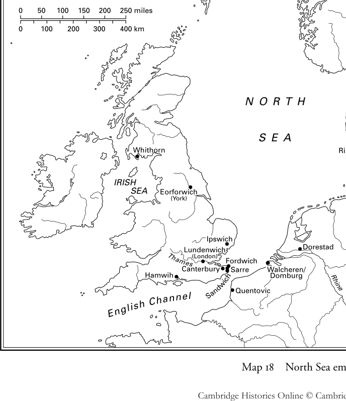

# 第23章 · 北方海域（五至八世纪）

如今众所周知，欧洲北部的海域——从大西洋到波罗的海，途经英吉利海峡和北海——是世界上最繁忙、使用最频繁的海域之一。但它们是从何时起开始在欧欧洲的交通与贸易体系中扮演重要角色的？尽管皮西亚斯、恺撒、斯特拉波、普林尼、塔西佗、托勒密等人在其旅行记或地理著作中给我们留下了大量记述，但显而易见，在古代，北欧是一片遥远的地平线。它几乎就是最遥远的所在，正如它的某些居民一样——例如加来海峡地区的莫里尼人，维吉尔曾称之为extremi hominum（人类中最终端者）。^1 当时，地中海是贸易与交流的主要轴心，不仅沟通东西，也沟通南北。北方海域在当时只是一个遥远的目的地，处于一个交通体系之中——仅举一例——罗马不列颠与大陆之间的往来主要是为了满足帝国的军事需求及其对金属供应的需要。通过研究文字史料以及考古与钱币遗物可以清楚地看到，正是在中世纪早期，北方海域才开始在西方世界的交通体系和经济中发挥关键作用。

中世纪欧洲经济史的奠基人亨利·皮朗首先提出，西方世界的政治与经济重心正是在八世纪由南方向北方转移的。当时，伊斯兰教的闪电式征服成功地封锁了地中海沿岸的大部分海岸和沿海地带。正是在那时，北方海域开始在欧洲交通体系中发挥积极作用——尽管直到十一世纪初，其作用还相当有限。^2 最新的研究——考古学与钱币学在某种程度上已开始填补相当零碎的文字证据的空白——在很大程度上证实了皮朗的总体年表，但质疑了他的解释。^3 事实上，首先，真正的海洋经济在北欧的首次发展，看来是在六世纪末（北方海域盆地中凯尔特人和日耳曼人的大迁徙结束时）与九世纪期间（日益加剧的维京海盗活动开始扰乱西方交通）之间。其次，这一现象不能用地中海世界的转型来解释。第三，它可以由北方海域沿岸地带自身特有的原因来解释，尤其是其族群、政治和社会环境的变迁，以及其自身的经济发展。但在讨论这一新兴海洋经济的出现之前，有必要回顾一下六世纪末北方海域究竟发生了什么。

## 古代晚期的遗产

自三世纪末以来，北方海上航道的交通，尤其是不列颠群岛与大陆之间的交通，已被海上迁徙及伴随的海盗活动所打断。这种状况持续了两三个世纪之久，尽管这些迁徙运动中有很重要的一部分是由罗马帝国自己为了海防目的而发起和控制的。^4 然而，凯尔特各民族在西部海域的迁徙（从爱尔兰到不列颠西部；从苏格兰到不列颠南部；从不列颠西南部到布列塔尼）在六世纪下半叶开始放缓。^5 而在东部，经历了两个世纪的所谓“撒克逊人”迁徙与海盗活动（事实上，与撒克逊人同行或继其后的是来自丹麦北部的朱特人、来自石勒苏益格—荷尔斯泰因的盎格鲁人、来自尼德兰的弗里西亚人，甚至还有来自莱茵河—马斯河三角洲地区的法兰克人）之后，^6 约525年Danus rex Chlochilaichus（很可能就是《贝奥武甫》诗中的许格尔拉克）对高卢北部海岸的袭掠，是文字史料中明确记载的日耳曼民族的最后一次海上行动。^7

当然，不安全的局势使北方和西部航道上的和平往来更加困难，但未必完全不可能，一些古代航线仍然繁忙。例如，我们知道，在450—650年间，存在一条从东地中海通往欧洲极西北部的、相对重要的联系通道，沿西班牙和高卢海岸延伸。《施舍者约翰传》（约翰是亚历山大牧首，卒于619年）记载了一艘商船满载谷物，在二十个昼夜之间从亚历山大里亚航行到“不列颠诸岛”（即很可能是指古代所称的锡滞地斯群岛——锡利群岛和不列颠西南部大陆），然后满载黄金和锡返回。^8 在罗马帝国崩溃和罗马治世结束如此之久以后，读者很容易把这则记述当作寓言而不予理会。然而，在爱尔兰（加拉内斯和克洛赫）以及不列颠极西部（康沃尔的廷塔杰尔、威尔士的迪纳斯波伊斯）和北部（邓巴顿岩）的若干贵族和/或王侯遗址中，发现了大量五、六世纪的罐、碗和双耳瓶（即考古学家所称的"A"陶和"B"陶），来自东、中、西地中海，这证明此类联系在“黑暗时代”仍然延续。^9

但这样一个（姑且可以说是）文献翔实的例子实属罕见，因为文字史料通常非常简略。除了某些爱尔兰圣徒传记中对大西洋高卢与欧洲西北部遥远凯尔特诸国之间关系的少数晚出且有时存疑的暗喻之外，^10 六世纪的史料对大陆与不列颠群岛之间的任何商业往来只字未提。最重要的罗马港口（如大陆上的盖索里亚库姆—博诺尼亚（布洛涅），或如不列颠的杜布里斯（多佛）或鲁图皮埃（里奇伯勒））不再被提及。这些是军事港口，在第一时期（一至三世纪）与控制帝国与不列颠尼亚行省关系的“不列颠舰队”相连，后来（四至五世纪）则与“撒克逊海岸”防御体系相连。^11 而且，即使罗托马古斯（鲁昂）、纳姆内特斯（南特）、伦蒂尼乌姆（伦敦）或埃博拉库姆（约克）等古代城市之名仍见于史料，它们也不再被称作港口。

当然，这并不意味着群岛与大陆之间的一切联系都已终止——远非如此，因为迁徙的结果是使积极从事海上活动的各族人民定居于西北欧的所有沿海地区。自此以后（大约从六世纪中叶起），沿西部航道形成了几乎连续不断的凯尔特人定居带。来自希伯尼亚（爱尔兰）的斯科提人（爱尔兰人）在喀里多尼亚（苏格兰）——尤其在达尔里亚达（苏格兰西南部）——以及在坎布里亚（威尔士）——特别是在德费德——越来越多；^12 来自坎布里亚和敦莫尼亚（康沃尔及西南半岛）的不列颠人越来越多地出现在古阿尔莫里卡，后者在六世纪下半叶开始被称为布列塔尼亚（布列塔尼）。^13 至于海上日耳曼人，他们不仅定居于不列颠的东部和南部——尽管近来有相反的论点，^14 我们仍须承认盎格鲁—撒克逊人在沿岸的存在是密集而众多的——^15 在大陆的某些海岸上他们的存在也很显著，尤其是在布洛涅地区、贝桑（巴约一带）和卢瓦尔河下游河谷，撒克逊人的定居早已通过文字证据和地名证据得到确认。在蓬蒂厄（皮卡第北部沿海地区，位于康什河与索姆河之间）和卡昂地区也很明显，那里的墓 地发掘最近揭示了撒克逊人的存在，特别是在弗龙和努维永（蓬蒂厄境内），或在弗雷努维尔、埃鲁维耶特、日贝维尔和圣马丹德丰特奈（诺曼底境内）。^16

这些迁徙与沿海定居造成了一种相对的文化和语言同质性（西部地区为凯尔特的；中部和东部地区为日耳曼的，或者按当代语言学所称，为“北海日耳曼语”）。事实上，这种广泛的语言共同体的存在促进了西北欧各海岸之间的接触，无疑也有助于解释某些特定器物的考古分布，例如源自西高卢的"D"陶（碗和盘）与"E"陶（轮制罐和瓮），它们在爱尔兰、苏格兰、不列颠西南部和锡利群岛的许多六世纪遗址中都有发现；^17 同样，某些所谓的“盎格鲁—撒克逊”胸针（圆盘胸针或纽扣胸针），不仅在英格兰南部（肯特、萨塞克斯和怀特岛的墓地）有发现，在蓬蒂厄和卡昂地区已发掘的所有墓地中也有出土。^18

如果存在这样的交流，那就意味着存在某种运输体系，有人、有船、有登陆点，也许还有某些贸易工具。但支持性的考古证据相当匮乏——在英格兰和大陆的墓葬中只发现了少量天平，^19 文字证据也所说不多，除了关于船的记载。例如，吉尔达斯在其《不列颠的毁灭与征服》中谈到凯尔特人的currucae（著名的皮舟curagh），并谈及撒克逊人的到来："tribus ut lingua eius Saxonum exprimitur cyulis, nostra longis navibus"（“三艘cyul，如撒克逊人以其语言所称，即我们语言中的‘长船’”）。^20 因此，据吉尔达斯所言，六世纪的不列颠人或罗马—不列颠人知道两类船只。皮舟或皮革船，公元前一世纪恺撒、八世纪爱奥那的阿多姆南都有描述。皮舟可用桨和帆推进，其形制可能近似于在布罗伊特（爱尔兰德里郡）发现的公元前一世纪黄金模型，或雕刻在基尔纳鲁安石柱（爱尔兰科克郡）上的船。^21 其次是longae naves（长船），很可能是木板船，以帆推进，如克诺贝林在一世纪发行的钱币上所示，或如三世纪的圣彼得港（根西岛）沉船所示。^22 正如我们所见，盎格鲁—撒克逊人拥有他们称为cyul(i)的古英语ceol、现代英语keel）的长船，这个词很可能指诸如著名的四世纪尼达姆船之类的船只，该船发现于石勒苏益格—荷尔斯泰因，大致即古代的盎格鲁人或盎格尔尼亚之地，据贝德所言，盎格鲁人正是从这里迁出的。这些是长条形的、采用搭接式结构建造的木船，在迁徙时代，它们更可能以桨而非帆推进，这可以从西多尼乌斯（五世纪）和普罗柯比（六世纪）的著作中看出。^22 从船头到船尾，所有这些船都具有对称的外形和相对平坦的船底，因此几乎可以在任何地方抢滩登陆。

因此，登陆点必定为数众多，尤其是在北方海域南部海岸的沙滩上。而且，往来必定极为分散，以致难以确认从三世纪末（罗马港口开始衰落）到七世纪初（港口活动真正复兴开始）之间存在真正的贸易港。但在此处或彼处，找到海滩市场或商栈的遗存并非不可能，它们很可能与高层定居点或地方权力中心相关联，如丹麦的古兹梅/伦德堡原型，它在波罗的海的菲英岛上已被发掘，出土了三至六世纪的丰富遗物，尤以黄金制品为多。^23 达尔基岛的堡垒或许也是一例，它位于都柏林湾南端，那里发现了来自地中海和阿基坦的五、六世纪进口遗物。^24 其他例子还有伯努维尔（奥恩河口、卡昂附近），考古学家在那里发现了可与附近腹地墓地遗物相联系的器物；还有肯特万特苏姆水道岸边的萨尔，那里发掘出一处六世纪的大型墓地，出土了包括天平在内的各类遗物；^25 或者弗里西亚的韦纳尔杜姆的海堤丘（即滨海平原上的人工土丘），那里出土了六、七世纪大量经进口和/或加工的丰富遗物。^26

然而，新定居的滨海各族没有一个铸造钱币。如果他们需要货币，他们仍使用晚期罗马、继而拜占庭的钱币，如索里得，或称trientes或tremisses的三分之一索里得，这些由高卢的法兰克铸币匠人仿铸。不过，他们是否需要货币并不确定，除非是为了其金属重量（这或许可以解释天平的使用，如肯特某些墓地中所见）。根据对蛮族社会早期历史的人类学认识，黑暗时代北欧各民族之间的交流主要由分散的或偶然的接触、以物易物、互惠的礼物交换构成——这些都是外交、联姻或社会习俗与仪式的一部分。^27 因此，五、六世纪到达不列颠群岛的少数大陆钱币，看来主要被用作装饰品。

这很可能就是约625—630年间一位东盎格利亚王侯（或许是雷德沃尔德王）被葬于萨顿胡时的社会背景，这也解释了其墓中出土器物之所以呈现异质性的原因，即著名的“一号船葬”。^28 除了墓中发现的来自东方、斯堪的纳维亚和莱茵河地区的器物之外，还发现了由三十七个不同法兰克铸币厂铸造的三十七枚tremisses组成的窖藏。这表明了这一收藏的人为性质，可能是一件外交礼物（何尝不能是一位法兰克妻子给逝者带来的嫁妆呢？）。菲利普·格里尔森曾提出，^29 这一加上三枚钱币坯和两枚小锭的收藏，或许是为死者的灵魂前往另一世界支付给四十名桨手和摆渡者的报酬。这一财宝似乎使萨顿胡成为这一时期群岛与大陆之间和平但尚未商业化交流的最佳例证。但它也是此类交流最后的重要考古例证之一；因为从七世纪初开始，情况开始发生变化。

## 海洋经济的发展

事实上，约在公元600年前后，北方海域的贸易开始呈现出更明确的结构。自迁徙时代以来对此几乎保持沉默的文字史料，开始重新提及独立的职业商人。这些史料提到古代海上城市商业的复兴以及此前不为人知的港口活动，而考古学往往证实了后者的存在与扩展。最后，人们看到这场复兴的主要推动者——大陆的弗里西亚人和海岛上的盎格鲁—撒克逊人——开始铸币，其范本是法兰克的铸币，而法兰克铸币本身又是仿效晚期罗马和拜占庭的范本。

要解释这场复兴，必须提到海上迁徙运动的结束以及共享同一文化视野的各民族在北海沿岸的定居，因为显而易见，仅用族群因素来解释是不够的。气候的显著改善惠及西北欧，它不久即摆脱了来自古代的最后一场大疫的威胁（即瘟疫，因其源自东方有时被称为“查士丁尼瘟疫”，它在南欧远比在北方致命）。^3 该地区开始出现自三世纪以来未曾有过的人口与经济增长的开端。^30 在北方海域四周，人们到处可见日益强大的贵族与王权的兴起。这些势力（例如法兰克人之于英格兰南部）试图通过外交或联姻渠道行使某种海外霸权。^31 但最重要的是，他们想要刺激、支持和影响生产与贸易活动，从而通过在从此能够更好控制的地点发展港口活动，将未来的剩余产品导向外部市场。

因此，在六、七世纪之交，整个北方海域盆地——从欧洲的大西洋海岸直到马斯河与莱茵河大三角洲（今荷兰腹地）——似乎都受到这场商业活动复兴的影响。只需提及爱奥那的阿多姆南，他在《科伦巴传》中提到六世纪末经常出没于赫布里底海域的"Gallici nautae de Galliarum provinciis"（来自高卢诸行省的高卢水手）；^32 或提及博比奥的约纳斯，他在《科伦班传》中提到南特（卢瓦尔河口）存在"naves quae Scottorum commercia vexerant"（载运爱尔兰人货物的船只），正准备满载葡萄酒启航。^33 贝德本人在《英吉利教会史》中把约604年的伦敦变成一个"multi populi terra marique venientes"（由陆路和海路而来的众多民族）云集的商埠，几十年后，他还在其中辨认出一名弗里西亚奴隶贩子。^34 考古学家已发掘出七世纪初最早一批港口设施，如东布赫（旧称瓦拉克拉斯，即荷兰泽兰的瓦尔赫伦）^35 或伊普斯威奇（旧称吉佩斯威奇，萨福克境内）。^36 最后，钱币学家看到约600年前后铸币活动增加，不仅在塞纳河口的鲁昂等古址，而且在此前从未铸币的新族群——弗里西亚人、盎格鲁—撒克逊人——中间也是如此。^37

最初的情况是，低地国家的弗里西亚人在仿铸了法兰克人在马斯特里赫特铸造的金质tremisses之后，开始铸造更具原创性的钱币。钱币学家根据发现重要窖藏的荷兰遗址，将其描述为“德龙赖普型”。随后轮到盎格鲁—撒克逊人铸币，先是肯特（很可能在坎特伯雷），然后是伦敦。这些thrymsas——以古英语中意为tremisses的词称之，甚为恰当——的铸造起初是零星的。但在七世纪期间逐渐增多，或许是受到那些名字出现在某些钱币上的国王的推动，如616年继肯特的埃特尔伯特而立的埃德鲍尔德。^38 弗里西亚人与盎格鲁—撒克逊人首次铸币时间的这种巧合令人瞩目。如果仍可以用发行当局对权力与威望的主张来解释其生产与流通的发展，那么这一现象的同时性很可能要用贸易的需要来解释，尤其是英格兰东南部与马斯河、莱茵河河口之间的贸易。证据是：作坊往往设立于港口遗址，而最重要的钱币出土也正是在这些遗址。

七世纪初，港口活动的增长所影响的不仅是前述的南特、伦敦或鲁昂等古城，更重要的是新遗址，而后者一般预示着远大的前程。这第一代港口主要兴盛于英格兰东南部与马斯河—莱茵河大三角洲之间的地带。^39 在文献中它们被称为portus、emporia，或最常见的vici——源自拉丁语vicus，其日耳曼形式为wik，出现在大量以-vic、-wich、-wijk、-wig结尾的地名中。主要港口如下：

**昆托维克**（意为康什河——拉丁语作Cuenta或Quantia——之wik）位于蓬蒂厄，布洛涅以南约二十公里处。最早的文字记载见于七世纪末的英格兰史料。然而，萨顿胡财宝一枚钱币上的Quantia之名，以及克龙德尔窖藏（约640年）一枚钱币上的Wic in Pontio（蓬蒂厄之wik）之名，表明其历史可追溯至七世纪上半叶。铸造昆托维克钱币的早期铸币匠人的名字——达古尔弗斯、杜塔、安格卢斯、唐娜、埃拉——显示出盎格鲁—撒克逊渊源，这突出了英格兰南部与后来成为墨洛温王朝纽斯特里亚重要港口之地之间的联系。据雷朋的斯蒂芬在《威尔弗里德传》中记载，使其同胞得以前往罗马的via rectissima（最直接之路）即经过此地。^40

**瓦尔赫伦/东布赫**位于荷兰泽兰的一座岛上。根据非常依赖经验的考古学，约600年前后一座新港口开始在那里发展。它邻近一处古代圣所，该圣所毁于二世纪末的一场大洪水，在那里发现了许多来自整个北高卢和英格兰的七、八世纪钱币。^41

**多雷斯塔德**位于莱茵河三角洲的某一起点，邻近一座罗马堡垒，正处于该河主流转向北（即朝向斯堪的纳维亚）而莱克河转向西（即朝向不列颠）之处。与昆托维克一样，^42 多雷斯塔德之名仅见于七世纪末以后的文献，但它出现在铸币匠马德利努斯和里莫阿尔德约630—640年所铸钱币上。尽管该港的起源无疑属于弗里西亚人，但它在七世纪末以后才得到更大发展，当时该地连同整个莱茵河弗里西亚一起落入法兰克人的权力之下。考古发掘表明，多雷斯塔德拥有一处大型港口复合体，由沿莱茵河岸展开的庞大的码头/栈桥系统构成。^43 由此它将成为莱茵兰、英格兰东部与斯堪的纳维亚之间贸易的主要枢纽。到九世纪，其名声之大，以至于文献将多雷斯塔德描述为vicus famosus，甚至vicus nominatissimus（最负盛名之wik）。^44

**伦登威奇**是伦敦的一个郊区，由八世纪受新地名风尚影响的史料如此命名。如果可以相信过去三十年间大量撒克逊遗物的发现，它似乎位于泰晤士河与河滨大道之间，因而仅在古城上游不远处。^45

**伊普斯威奇**，前文已提及，与多雷斯塔德一样经过了系统发掘。发掘揭示出一处自七世纪初即被占据的遗址，出土了数量可观的陶器，主要源自东盎格利亚，但也有来自莱茵兰、马斯河流域和佛兰德斯的。^46

**肯特诸港**围绕坎特伯雷发展：福德威奇，见于675年的一份契据；桑威奇，在斯蒂芬的《威尔弗里德传》中被视为portus salutis（安全之港）；萨尔，其活动早在六世纪已被提及，若相信当时授予该地区教会的运输税豁免，则似乎至少延续到八世纪；还不应忘记坎特伯雷东北郊，最近在那里确认了斯托尔河畔的一处vicus。^47

七世纪晚些时候及八世纪期间，这一海上活动的范围扩大到更遥远的地区，《维利布罗德传》（贝德与阿尔昆所留传）的记述即暗示了这一点。^48 这位盎格鲁—撒克逊修士首先离开诺森布里亚前往爱尔兰，与一些同乡一起在拉斯梅尔西吉（即克卢安·梅尔西格，今爱尔兰西南部卡洛郡的克洛纳梅尔什）修院隐修。约690年，他从那里出发前往弗里西亚，走遍各地。他前往瓦尔赫伦与异教作斗争，前往乌得勒支建立其主教座堂。从这一地区——当时交通体系的中枢，因而成为独立的弗里西亚人与征服者法兰克人争执之地——维利布罗德不仅向南，沿莱茵河和摩泽尔河而上，建立了他的修院避难所埃希特纳赫（今卢森堡境内），而且向遥远的东北方进发，最终有一艘船把他送到丹麦，他试图使国王翁根杜斯（安甘提尔？）归化。这次把维利布罗德从北方欧洲海域一端带到另一端的漫长朝圣漂泊，只能用当时的商人/航海者所开辟的交通视野的扩展来解释，正是他们保证了运输体系。这一商业视野的扩大，以传教士旅途中可能到访的诸遗址港口活动的发展为标志。这一发展是双重的：一方面是自古代以来发展迟缓的古址的振兴，如昔日的埃博拉库姆；另一方面是新港口的创建，如哈姆威赫、里伯，以及稍晚的斯利亚斯威奇—海泽比。

**埃博拉库姆**，确切地说它的某个贸易郊区，遵照新的地名用法（如同伦登威奇），被改名为埃奥福威奇。后来维京人把它变成约维克，即约克。毫无疑问，这个vicus位于罗马城墙以南、乌斯河与福斯河汇流处的菲舍尔盖特一带。考古学家在此不仅发现了许多七至九世纪的工场建筑，还有大量进口遗物，尤其源自莱茵兰。这表明，正是在这里，阿尔特弗里德的《吕德格尔传》中提到的弗里西亚商人在八世纪下半叶建立了他们的社区。^49

**哈姆威赫**，位于后来南安普敦所在地，约720年前后在文字史料中被提及，是韦塞克斯与塞纳河之间交通的门户。然而，发掘揭示出一处约700年前后规划（布局？）的港口聚落，与大陆（塞纳河下游河谷、巴黎地区，其次是莱茵兰）联系密切，尤其与近旁的腹地、特别是温彻斯特的王家遗址联系密切。正因如此，我们得以把哈姆威赫的创建归于688—726年在位的韦塞克斯国王伊尼的倡议。^50

**里伯**，位于西日德兰山脚下一条注入北海的小河上，最可能创建于八世纪初。它不太可能像较早的假说所认为的那样由弗里西亚人建立，而更可能由一个新兴的丹麦王权所建。（为什么不能就在维利布罗德会见的翁根杜斯王的时代呢？）这个聚落似乎没有等待多久就迎来了西方商人及其钱币——其出土数量之多，几乎令人以为它就铸于当地。^51

**斯利亚斯威奇**，即施莱湾之wik，是西方人于八世纪中叶前后在波罗的海设立的第一个商栈，更确切地说是在石勒苏益格—荷尔斯泰因一处峡湾的尽头。这个聚落（考古学家所称的“南聚落”），加工埃菲尔山的玄武岩和波罗的海的琥珀，勉力维持至九世纪初。此后它被丹麦国王戈德弗雷德系统性地重建于以北数百米处（“聚落A”）。由于斯堪的纳维亚史料和后世的缘故，该址以其斯堪的纳维亚名称海泽比而闻名。^52 它将控制一条通往东波罗的海的新航线，尤其通往瑞典腹地的梅拉伦湖，新的商埠赫尔格（八世纪中叶起）和比耶卡（九世纪初接替前者）将在那里相继发展。^53

用理查德·霍奇斯的话说，这份“商埠地名录”^54 几乎可以无限扩展。如果说考古学显示了贸易流动，那么文献，尤其是圣徒传记，则清楚表明传教士、修士或主教如何利用那些似乎日益常态化的航线。^55 例如，《科伦班传》揭示了约600年前后阿莱（今圣马洛）和南特在与爱尔兰交通中的作用；雷朋的斯蒂芬所撰《威尔弗里德传》显示了七世纪末桑威奇、昆托维克与弗里西亚（可能是多雷斯塔德）之间的联系；维利巴尔德的《博尼法斯传》显示了八世纪初伦登威奇、昆托维克与多雷斯塔德之间的联系；修女于格贝尔克的《维利巴尔德传》显示了约720年哈姆威赫与鲁昂之间的联系；《安斯加尔传》显示了九世纪上半叶多雷斯塔德—斯利亚斯威奇/海泽比—比耶卡航线的重要性。因此，人们可以相当容易地勾勒出七、八世纪北欧海上交通网络的主要线路：从爱尔兰和不列颠西部海岸通往布列塔尼诸港（主要是南特）和大西洋高卢；从韦塞克斯海岸（尤其哈姆威赫）通往塞纳河谷和巴黎盆地；从英格兰东南部诸港（伦敦及坎特伯雷诸卫星港）通往昆托维克——通往北高卢和纽斯特里亚的真正门户；从英格兰东部和东南部（又是伦敦，以及伊普斯威奇、埃博拉库姆）通往马斯河—莱茵河大三角洲（瓦尔赫伦/东布赫，尤其多雷斯塔德，通往弗里西亚、奥斯特拉西亚和莱茵兰的门户）；从莱茵河三角洲，尤其从多雷斯塔德，通往丹麦，再横渡到斯堪的纳维亚和波罗的海。^56

不仅北方欧洲各海域的海上联系成倍增加，航运技术在七、八世纪也发生了变化。从这时起，大陆、不列颠和斯堪的纳维亚的船只日益装备船帆。萨顿胡“一号墓”中的船或许尚不属于此类，它仍处于尼达姆船的航海传统之中；尽管如此，其长宽比暗示存在一具原始的帆。^57 八世纪哥特兰岛上雕刻的石碑以及八世纪末九世纪初昆托维克和多雷斯塔德所铸钱币上的船只形象则确凿无疑地展示了这一点。前一类钱币铸于查理曼统治时期，在船型上或许仍受古代钱币的影响。后一类铸于“虔诚者”路易时期，非常详细地展示了九世纪北海船只的模样——它们仍采用古日耳曼人传统建造方法的搭接式结构。这种建造方式保证了船体的柔韧与弹性，但帆的索具要求相对长度增加船宽。这些船只如今在水线上部呈低矮轮廓，正如长期主宰北欧水域的两大船型所示。它们是东弗里西亚人的平底船——柯克船的前身——以及莱茵河三角洲和英格兰南部水手的圆底船——或许是胡尔克船的前身。^58 可以推测，从大三角洲开始，帆的使用最初向英格兰水域扩展，随后伴随着西方人向东方的扩张，进入斯堪的纳维亚和波罗的海水域。无论细节如何，其传播具有重要的经济后果：它使所需船员数量得以减少（此后在约20米长、载货10—20吨的船上只需四或五人）；它使船上能够装载更多货物和乘客；它使横渡更加容易、快捷，尤其是更加廉价。

这一运输体系使得七至九世纪商人/航海者所经航线上及其终点考古学家发现的各种产品得以传播。例如，有拉隆德陶器，其生产中心最近在鲁昂附近得到确认。这种陶器是哈姆威赫遗址发现的主要进口品，证实了《维利巴尔德传》中关于塞纳河下游河谷与韦塞克斯海岸之间联系重要性的记述。^59 还有莱茵兰的产品：所谓“巴多夫”陶器或“塔廷”陶器，分别产于科隆和科布伦茨附近；埃菲尔玄武岩制成的磨石；玻璃器；武器。它们的发现似乎勾勒出“弗里西亚大贸易”的路线——法兰克人征服莱茵河三角洲之后，这种贸易实际上变成了法兰克—弗里西亚贸易。^60 这些产品自然流向多雷斯塔德——无与伦比的枢纽，但也流向伦敦、伊普斯威奇、哈姆威赫、约克，流向爱尔兰的拉戈尔湖上居址，流向里伯和斯利亚斯威奇—海泽比这些新的丹麦港址，甚至稍晚流向瑞典中部的赫尔格和比耶卡。^61 还有弗里西亚人和盎格鲁—撒克逊人引入的新银币的流通，它或许比其他一切更好地显示了七世纪末及八世纪海上贸易的强度。

正是在此时，西方货币史上发生了一场真正的革命。^62 直到约670—680年，整个西方一直忠于古代或拜占庭的标准，铸造trientes、tremisses或其他thrymsas。这些钱币名义上是金币，但由于黄色金属日益短缺，白银在其制造中所占的比重越来越大。此时，英格兰东南部和弗里西亚的作坊开始铸造纯银钱币。它们起初并不比最早的tremisses轻多少，但公认更适应市场的需要（当然是贵金属生产市场，但也是对购买力被完全高估的钱币难以应对的流通市场）。最早的样品虽常无铭文，但系仿照既有范本，只是采用了或许与凯尔特或更宽泛的原史传统相衔接的风格化雕模。这些钱币由于对古盎格鲁—撒克逊法律的误读，自十七世纪末以来被称为sceattas。事实上，对其盎格鲁—撒克逊同时代人而言，它们是“便士”（pennies），对其大陆同时代人而言，则是“德尼厄尔”（deniers）。

毫无疑问，这些最早所谓的sceattas——其实应称为原便士或原德尼厄尔——是在肯特铸造的。但生产几乎立即被英格兰南部和诺森布里亚的所有作坊，以及正被纳入法兰克统治的弗里西亚和莱茵河三角洲（尤其多雷斯塔德）的作坊所承接。这表明这些地区在经济上相互依赖到了何种程度。窖藏（据此可建立相对年表）和零散钱币出土之多，表明sceattas的使用几乎立即得到普及。最重要的是，它们可用于小额交易。这种新货币从北海盆地中部出发，在七世纪末至八世纪中叶之间传遍整个西方。最早的几类原便士（700年以前铸造）主要发现于肯特和埃塞克斯的窖藏中。较晚的见于弗里西亚和欧洲其他地区，最后的则发现于明显扩大的范围内，从斯堪的纳维亚到整个高卢，甚至南高卢。诚然，一些铸币厂设立在远离最初生产中心的地方，例如下卢瓦尔河谷。^63 继其英格兰和弗里西亚同行的先例，法兰克诸王和铸币厂也很快完全放弃金币，只铸造银质“德尼厄尔”。查理曼币制标准化与规范化的措施出台之后（八世纪末），在整个西方几乎全部地区，金币和古代地中海货币标准便告终结，直到十三世纪。

这种货币的成功，可以用新钱币满足了当时的需要并反映了当时的经济现实来解释。另一个原因是来自北方的航海者和商人从此对整个大陆施加的影响。他们的活动以新兴wiks和重获活力的古城为其基地，开始补偿南方路线的缓慢衰落以及地中海作为贸易中介地位的逐渐丧失。

## 北方海域及其腹地

约600年前后席卷北方海域的旋风式活动之所以对整个西方产生如此影响，是因为在整个七、八世纪期间，沿海地区与其更遥远的腹地实现了逐步整合。这一方面是由于沿海地区对腹地社会经济精英的吸引力，另一方面是由于海上族群对内陆市场的逐步渗透。

首先，必须提及自古以来滨海地区对修道运动、尤其是爱尔兰修道运动所施加的魅力。后者发展出一种独特的滨海或海岛修道主义，是海洋所施加的吸引/排斥辩证关系的纯粹产物。海洋的严酷（孤独、风与水的严酷）激发了最英勇的苦修和禁欲形式。斯基利格·迈克尔修院便是一个很好的例子，它大约创建于七世纪，坐落于克里海岸外海中一块孤立的岩石上。^64 由于爱尔兰修士奉行“为上帝而朝圣漂泊”的理想，他们把这种独特的修道观念随身携带，先传入苏格兰诸岛（563年的爱奥那），再传入英格兰（635年的林迪斯法恩），最后传至大陆。这种修道主义竭力在一种独特的海洋环境中调和共同生活与隐修生活、苦修与社会生活这些矛盾的德性。即使在本笃会灵修已成为西方修道主义主导力量之后，滨海地点的吸引力依然十分强大。法兰克和盎格鲁—撒克逊精英对这一新型宗教生活模式的皈依，以及王权——它们往往就是沿海荒地的所有者——的刻意支持，导致七世纪期间海上离岛、大陆海岸、河口末端或其附近、乃至注入河口的下游小河沿岸的修院建置成倍增加。其中最著名者，在英格兰有惠特比、维尔茅斯、贾罗和克罗斯兰；在大陆有努瓦尔穆捷、丰特奈勒/圣旺德里耶、瑞米耶日、桑蒂拉/圣里基耶、圣贝尔坦，以及根特的圣皮埃尔与圣巴翁修院。^65 此外，每一次建院的记述都乐于称颂其地点既能受到通航水域的便利、向世界开放，又能获得苦修所必需的孤独。正因如此，这些机构成为经济发展的支柱，配备了港口设施以及与腹地良好的交通体系。不仅同盟家族的网络，而且它们获得的、日后将成为避难所的土地，都可以在那里找到。

也是在此时，内陆的诸王权试图掌控那些wiks——其发展起初往往是自发的，此前一直未受他们控制——否则诸王就试图或多或少凭空创建新的wiks。^66 无论如何，对统治者而言，问题在于控制wiks所扼守的航线，支持和推行海外交往与未来扩张的政策，便利其自身田庄剩余产品的出口，并将wiks所产生的部分利润据为己有。我们略可窥见韦塞克斯诸王和丹麦诸王于八世纪初分别创建哈姆威赫和里伯，或于九世纪初重建斯利亚斯威奇—海泽比的情形。然而，法兰克诸王（尤其在达戈贝尔特时代）以及后来的宫相们力图掌控昆托维克和多雷斯塔德这两处wiks的努力，我们却所见甚少。它们是一个广袤富庶腹地的海上出海口，而法兰克统治者在腹地拥有大量财政与祖产财富。^67

因此，一旦法兰克统治者于七世纪末前后完全控制了昆托维克和多雷斯塔德，便立即为两者建立了关税和货币制度。这些制度被托付给重要官员，查理曼后来授予他们在各自辖区内对所有关税和所有货币的全权。其辖区最可能包括：昆托维克辖整个纽斯特里亚海岸，多雷斯塔德辖整个奥斯特拉西亚和弗里西亚海岸。^68 正如七世纪末肯特王洛特雷的法律中提到的wic-gerefan（“wik之庄头”）^69 一样，法兰克王权在昆托维克和多雷斯塔德的官署中支配着由一名procurator或praefectus统辖的直属武士。他们不仅负责维持当地治安和交易的合法性，还负责向过往船只征收靠港税，并对卸岸货物征收关税（据九世纪史料，很可能是一种什一税）。^70

国王与诸侯，连同其王国中的权贵们，并非唯一被这种港口与海岸活动吸引的人。他们急于确保自己在来世的救赎，也想让教会从中受益。因此，从八世纪初开始，法兰克统治者将其从多雷斯塔德港贸易中获得的总收入的十分之一赠予乌得勒支主教座堂。主教座堂几乎立即在当地建立了一座重要的堂区和施洗教堂，或许相当于后世史料中提到的Upkirika（“高堂”）。^71 在昆托维克，这方面的证据更多，因为可以看到许多宗教机构都为自己配备了一扇面向各种贸易的真正的“向海之窗”。不仅邻近的大修院，如圣瓦斯特、圣贝尔坦和桑蒂拉/圣里基耶，已在wik内部以mansi或setici之类地块的形式，或在紧邻的地方（如蒂贝桑和康皮涅勒）获得了财富，一些更遥远的修院也因王室特许而被吸引至此。例如加蒂奈的圣伯努瓦——腓里耶尔修院，查理曼把邻近的圣若斯小修院赐给了它。还有丰特奈勒/圣旺德里耶修院，它不满足于在塞纳河下游河谷拥有自己的portus，还获得了in portu Wiscus（维斯科斯港内）的若干mansi，并在其中一处上或许建起了quae vicina est emporio Quentovico（邻近昆托维克商埠）的圣彼得教堂。九世纪，它成为修士们逃避诺曼人侵袭的避难所之一。^72

由此人们便可理解，为何八世纪末被任命代表查理曼驻于昆托维克、监管该地区全部关税活动、甚至与盎格鲁—撒克逊诸王（尤其是麦西亚的奥法）谈判的procurator，是地位极高之人——圣旺德里耶修院院长热罗阿尔德。^72

即使是像圣日耳曼德普雷这样已经拥有villa supra mare（海上田庄，很可能是塞纳河下游河谷的基勒伯夫）的修院，也没有获得昆托维克或多雷斯塔德的实际收入的一部分。因此它最迟在779年^73 便设法在那里获得了运输税豁免——同样也在鲁昂、亚眠和马斯特里赫特，即北高卢所有向海上贸易开放的港口。显然，这座巴黎修院想从这一特权中获利。如果接受目前对约820年《伊尔米农地产清册》某些段落的解读，^74 该修院命令其来自维勒莫（博斯地区）和孔布拉维尔（布里地区）的农人定期承担远至昆托维克的运输劳役。^75 人们很容易想到，这些大车把田庄的剩余产品运抵港口——例如北方人所需求的葡萄酒。人们同样可以想到，这些大车并非空车而返，圣日耳曼德普雷的修士正是在昆托维克的市场上找到了回程货物。这很可能是由那些原材料构成，例如矿产品或纺织品——我们的史料毫不吝惜地强调其不列颠来源；或者是那些礼仪典籍，岛式缮写室的名声正是建立在其上的。

但是，当腹地的领主和机构纷纷进驻海岸与港口地点之时，那些开创了北方海域商业复兴的商人／航海者，则凭借其可随处抢滩登岸的船只溯河而上，开始探察大陆市场。其中尤以塞纳河流域的撒克逊人和莱茵河流域的弗里西亚人为典型。可以想见，吸引韦塞克斯人进入塞纳河流域、尤其是巴黎地区的，是葡萄酒，而非在哈姆威赫发掘中大量出土的拉隆德陶器。在634—635年授予的一份特许状中，法兰克国王达戈贝尔特准许圣德尼的修士们在其主保圣人瞻礼日，即10月9日——恰逢新酒上市的时节——举办一年一度的集市。起初它只是一个地方性集市，但很可能后来发展为整个巴黎地区的大型葡萄酒集市。无论如何，圣德尼的修士们从中获得了巨大利益，因为根据王室特许状的条款，在集市举办期间，teloneum（“通行税”）的唯一受益者是他们。^76 北方诸国严重缺乏葡萄酒，因此当709年的一份证书将撒克逊人（很可能是西撒克逊人）——史料中提及的唯一外来者——列为圣德尼集市最殷勤的主顾之一时，人们并不感到惊讶。^77 753年的一份证书在这些主顾的名下又加上了弗里西亚人，其地位大约居于从属。^78

弗里西亚人主要是在其紧邻的腹地，即莱茵兰，养成了前去寻求这种海运平原极度匮乏的葡萄酒的习惯。此外，他们还获取木材、谷物和莱茵兰的土产——即在多雷斯塔德及北欧所有大型遗址中大量出土的陶器、玻璃器或武器。正因如此，我们在八世纪的一条史料中瞥见弗里西亚人出现于摩泽尔河畔的特里尔，继而在九世纪的史料中，又见于克桑滕、杜伊斯堡、科隆、美因茨、沃尔姆斯、斯特拉斯堡及莱茵河上的其他地点。在其中的若干城镇，他们建立起规模可观的定居点，往往与大宗教机构相联系。例如在特里尔，一名弗里西亚人带着sua substantia（一笔肯定包括船只和奴隶在内的财产）加入圣马克西敏修院，为的是此后为教会所为，一如他此前为自己所为，即漂洋过海。在科隆，弗里西亚人定居点在城郊圣格勒翁教堂的荫庇下成长，无疑依附于该教堂并受其保护。在杜伊斯堡，弗里西亚人为普吕姆修院效力，后者在鲁尔河与莱茵河的交汇处拥有一处码头。在沃尔姆斯，弗里西亚人是唯一经营由主教座堂俯临的集市的外国商人。^79 鉴于这些情况，我们可以相信，埃莫尔德·勒努瓦约于826年针对Frisionibus atque marinis（“弗里西亚人与航海民族”）提出的抱怨——他们深入莱茵河上游河谷，运走阿尔萨斯和孚日山的全部物产，尤其是葡萄酒、谷物和木材——并非单纯的修辞。^80

在所有这些情形中，来自北方的商人／航海者的存在及其需求，只可能刺激这些古城、其城郊教堂及其河畔港口地点的活动，而他们是成群结队前来光顾的。其结果之显著，以致从七世纪起，北方海域的整个腹地在贸易条件方面都享受到了切实的改善，并享有相对和平的好处。最重要的是，它得益于生产点向有组织地产的逐步整合；在这些地产上，依附农民和小农被授予真正的经营自由，人们认定他们在经济上比耕种旧有大地产的寄食奴隶更有生产力。显然，这两种经济主体（腹地的生产者和来自海上的商人）各自对对方的活动与绩效都施加了决定性的影响。尤其是——仅举我们史料中文献最充分的例子而言——商人／航海者刺激了葡萄酒生产者的生产力，而葡萄酒生产者又促使商人／航海者改进其运输体系。

## 结语

在八、九世纪之交，北欧诸海构成了一个统一的经济盆地。它的活力来自往来于各港口之间、且毫不犹豫地溯河而上深入腹地生产区腹心的商人／航海者。从大陆向北，输出的有卢瓦尔河、塞纳河和莱茵河流域的谷物、木材，尤其是葡萄酒；阿基坦、巴黎盆地和莱茵河谷各工场的制成品或半成品；弗里西亚及他处的亚麻；更不必说如今在加洛林王权控制下于宫廷、多雷斯塔德、昆托维克及许多其他作坊铸造的银币。来自北方的则有奴隶、金属、皮革与毛皮、海兽油、海象牙、波罗的海的琥珀，以及所有那些几乎没有留下任何考古痕迹的其他产品。这种多样的贸易并非没有混乱，诸王不满足于维持港口的治安，还被迫立法、甚至采取措施保护本国臣民免受最不择手段的商人之害。围绕这一问题，查理曼与麦西亚的奥法之间往来的书信，于796年促成了弗兰克·斯坦顿所谓“英国历史上的第一份商业条约”。^81

与六世纪北方海域最初那些跌跌撞撞的贸易尝试相比，我们已经走出多远。归根结底，自七世纪起北欧真正海上经济的发展，并非源于地中海被伊斯兰封锁（这是后来才完成的），而是三个因素相结合的结果。首先，必须认识到腹地的活力，它受到自三世纪以来未曾见过的农业增长的激励，由日益强大的贵族和宗教机构加以组织，并受益于加洛林早期相对和平的pax Carolina（加洛林和平）。其次，是海洋环境的活力，它从位于不列颠东南部与莱茵河口之间的北方海域中部地区出发，继而延伸至新的视野，从爱尔兰直至斯堪的纳维亚。这一环境受益于航海技艺上的技术革新，并向四面八方推广了银币的使用——银币远比旧币更适合贸易的规模与价值。最后，是这两股动力在贸易中介之地——大型滨海修院、市场、集市、拥有城郊区与教堂的河畔城市、河港尤其是海港——的汇聚。

亨利·皮朗的理论所剩下的，只是西方的重心确实已从南方移向北方，而地中海在六世纪所扮演的角色此后由北欧诸海承担。后者在七、八世纪成为远距离贸易的主轴；八世纪以后，这一主轴延伸至波罗的海，从而预备着经由俄罗斯河道与近东和远东连接起来。这条将在此后数世纪取代旧地中海路线的新商路上交通的增长，或许在一件考古发现中找到了最好的表达：在瑞典腹地的赫尔戈遗址上，一件爱尔兰产的牧杖和一尊源自克什米尔的佛像小雕像，相距数米，同处于八世纪的地层之中。^82

然而，西方的商人／航海者凭借葡萄酒、武器和白银这些威力惊人的“名片”渗入斯堪的纳维亚水域，所做的不只是向维京人引进了帆的使用，他们还把维京人贪婪的目光吸引到自己的船只、航线、港口、教堂乃至土地上。这些北方海盗对诺森伯里亚海岸（林迪斯法恩，793年）和弗里西亚海岸（810年）的最初袭击，无疑标志着另一个时代的开端。正是经过这两个世纪海上联系被这些来自北方的劫掠者所扰乱之后，一个新的贸易版图才于1000年前后被勾勒出来。它的视野将拓展至与维京人的探索航行相匹配（从纽芬兰到白海，再到俄罗斯的诸河流）。港口将出现新的分布，旧的港口因暴露而过于脆弱，让位于更好地扎根于其环境、防护更为完善的新地点，还将出现新一代的商业推动者。弗里西亚人、盎格鲁—撒克逊人、法兰克人和凯尔特人将让位于爱尔兰—斯堪的纳维亚人、盎格鲁—丹麦人、佛兰德人、默兹河畔的人们，以及稍后的汉萨诸地的人们。

## 注释

1. 《埃涅阿斯纪》viii.727。
2. 皮朗（1939），通篇。639
3. 霍奇斯与怀特豪斯（1983）。
4. 海厄姆（1992）；琼斯（1996）；詹姆斯（2001）。
5. 托马斯（1986）；麦格雷尔（1990）。
6. 迈尔斯（1989）；琼斯（1996）。
7. 格里高利，《历史》iii.3。
8. 那不勒斯的利奥提乌斯，《施舍者约翰传》，费斯蒂埃编，第353–4页及452–3页。
9. 托马斯（1988）及（1993），第93–6页；富尔福德（1989）。
10. 詹姆斯（1982），第375–8页；约哈内克（1985），第227–8页。
11. 约翰逊（1976）及（1977）。
12. 托马斯（1986）。
13. 弗勒里奥（1980）；卡萨尔（1998），第15–57页。
14. 海厄姆（1992）。
15. 迈尔斯（1989）；琼斯（1996）。
16. 勒贝克（1989）；韦尔奇（1991）。
17. 托马斯（1990）。
18. 韦尔奇（1991）。
19. 施托伊尔（1987）。
20. 《不列颠的毁灭与征服》，第19、23章，温特博顿编，第94页及97页。
21. 麦格雷尔（1987）及（1990）。
22. 埃尔默斯（1972）；麦格雷尔（1990）。
23. 特拉内（1987）；克拉克与安布罗西亚尼（1995）。
24. 霍奇斯（1982），第67页；爱德华兹（1990），第41–3页。
25. 霍奇斯（1982），第69页及（1989），第55页及92–3页。
26. 海丁加（1997）；贝斯特曼等，即出。
27. 格里尔森（1959）及（1961）。
28. 埃文斯（1986）；卡弗（1998）。
29. 格里尔森（1970）。
30. 勒贝克（1997）。
31. 伍德（1983）。
32. 阿多姆南，《圣科伦巴传》i.28；托马斯（1990）。
33. 约纳斯，《科伦班传》i.23。
34. 比德，《英吉利教会史》ii.3及iv.22。
35. 勒贝克（1995）。
36. 韦德（1988）；霍奇斯（1989），第97–101页。
37. 格里尔森与布莱克本（1986）。
38. 格里尔森与布莱克本（1986）。
39. 霍奇斯（1982），第47–65页；克拉克与安布罗西亚尼（1995），第5–45页；费尔胡尔斯特（1999），第44–7页。
40. 勒贝克（1993）；采德利乌斯（1991）。
41. 勒贝克（1995）。
42. 勒贝克（1991）。
43. 范埃斯与费尔韦尔斯（1980）；范埃斯与黑辛（1994）。
44. 勒贝克（1983），第一卷，第149–150页（据柳德格尔所撰《特里尔的格里高利传》及《克桑滕编年史》834年条）。
45. 文斯（1990）。
46. 韦德（1988）；霍奇斯（1989），第97–101页。
47. 霍奇斯（1989），第92–4页；勒贝克（1999）。
48. 比德，《英吉利教会史》iii.27；及阿尔昆，《维尔布罗德传》。
49. 霍尔（1978）及（1988）。
50. 霍奇斯（1980）及（1989），第80–92页。
51. 本卡德（1981）；延森（1991）。
52. 扬库恩（1986）。
53. 克拉克与安布罗西亚尼（1995），第68–76页。
54. 霍奇斯（1982），第66页以下。
55. 勒贝克（1999）。
56. 约哈内克（1985）。
57. 埃文斯（1986）。
58. 埃尔默斯（1972）；麦格雷尔（1987）及（1990）。
59. 霍奇斯（1980）及（1991）。
60. 勒贝克（1986）。
61. 勒贝克（1983），第一卷。
62. 希尔与梅特卡夫（1984）；格里尔森与布莱克本（1986）。
63. 希尔与梅特卡夫（1984）。详见布莱克本，本书下文第24章。
64. 爱德华兹（1990），第116–120页。
65. 勒贝克（1989）及（2000）。
66. 索耶（1977）。
67. 勒贝克（1986）。
68. 勒贝克（1991）。
69. 惠特洛克译，《英国历史文献》，第一卷，第395页。参见索耶（1977）。
70. 勒贝克（1983）。
71. 勒贝克（1983）；范埃斯与黑辛（1994）。
72. 勒贝克（1989）及（1993）。
73. 《古代拉丁文书》第十六卷，阿茨马与韦赞编，第625号，第38–41页。
74. 德弗鲁瓦（1984）。
75. 《圣日耳曼德普雷田产清册》，黑格曼编，第58页及139页。
76. 勒贝克（1989）及（2000）。
77. 《古代拉丁文书》第十四卷，阿茨马与韦赞编，第586号，第49–54页。
78. 《古代拉丁文书》第十五卷，阿茨马与韦赞编，第598号，第15–21页。
79. 勒贝克（1983）。
80. 埃尔莫杜斯·尼盖卢斯，《致国王丕平书第一》，第97–120行。
81. 斯坦顿（1971），第221页。
82. 霍奇斯与怀特豪斯（1983）。
