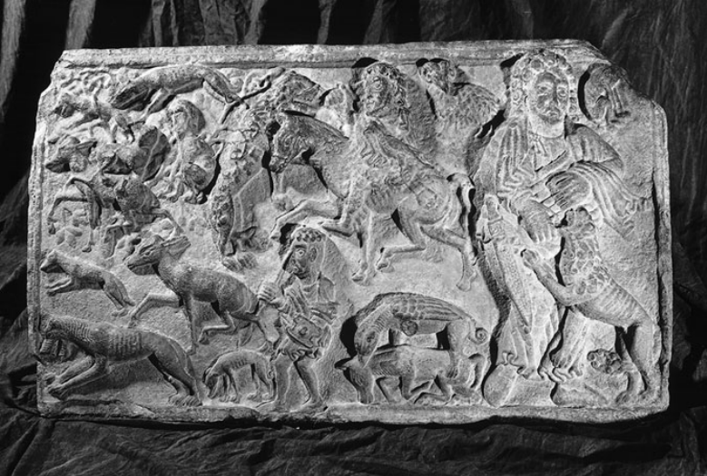

# 目录

插图清单 xi
缩略语 xii
体例说明 xiii
导言 1

## 基础篇

一、言说与书写 13
巴别塔 15
权威的语言 28
地方读写能力与精英读写能力 40

二、生与死 51
居住环境 52
出生与死亡 59
对灾祸的应对 72

## 亲缘篇

三、朋友与亲属 83
身份 88
血亲朋友 94
荣誉与复仇 100

四、男性与女性 115
性别差异 116
婚配观念 125
女性、家庭与继承 135

## 资源篇

五、劳作与领主权 151
奴役与自由 153
农民与领主 160
探寻身份地位 173

六、获取与给予 183
权力的景观与财富的景观 186
财宝、馈赠与恩庇 198

## 意识形态篇

七、王权与基督教 217
基督教的传播 220
异教徒与基督徒 231
贤君与暴君 239

八、罗马与欧洲各族 253
罗马，公元500年 257
帕德博恩，公元799年 268
罗马，公元1027年 277

结语 293
注释 298
延伸阅读 314
年表 344
索引 353
