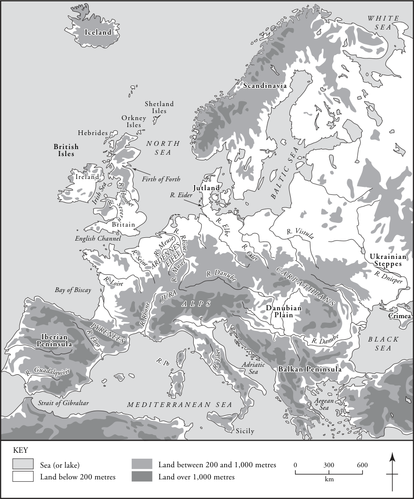
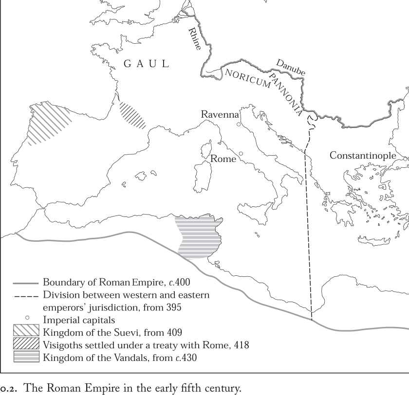

# 导言

“古代”与“中世纪”这两个源于意大利文艺复兴的概念，深深植根于历史意识之中，几乎无人怀疑这两个流行语代表着欧洲历史上的不同阶段。然而，文艺复兴时期的学者们使这两个术语广为流传，将它们塑造成欧洲文化相互对立的两极——前者为正，后者为负。当历史学在十九世纪中叶成为一门独立的大学学科时，为研究过去而研究过去的事业得以制度化，其方式是将古代与中世纪彼此隔绝，分别置于不同的博物馆、美术馆、图书馆和院系之中。诚然，严肃学者已不再将所谓的中世纪视为古代世界的惨淡对立面，即便“黑暗时代”的观念仍在新闻界流行不衰。然而，关于“古代”与“中世纪”何者对“欧洲文明”这一复杂而充满争议的现象贡献更大的争论，仍持续将二者相互对立。在这类论说中，介于两者之间的几个世纪始终处于次要地位，被轻蔑地贴上贫瘠、野蛮、迷信或落后的标签。如果将欧洲历史的宏大进程理解为线性或进化式的，这几个世纪便被视为各民族起源的时期，服务于那些需要单纯美德、明确身份认同以及为后续进步奠定适宜基础的历史叙事。反之，在循环史观的框架下，它们又沦为罗马帝国与十二、十三世纪普世性基督教欧洲这两座政治文化高峰之间意义不大的插曲。这两种框架都强加了植根于启蒙后欧洲政治需求与文化偏好的价值判断。本书摒弃这些根深蒂固的范式，提出：欧洲文化在古代与中世纪之间的动态转型本身即具有根本性的重要意义。

这一转型发生于何时？分期问题堪称历史学家的噩梦。学者们各持己见，将古代世界的终结定位于五世纪至十世纪末或十一世纪初之间的任何时点。断限置于何处，取决于分期时优先考虑的是政治、制度、社会、经济还是文化标准：我副标题中那整齐的五百年是有意为之的人为设定，仅作为本书内容的大致指引，因为这一充满争议的时期正是本书的主题。在其开端，约公元500年，罗马帝国统治在西部已然终结，但罗马文化与实践中大多数其他方面依然延续，几乎未受政治结构变迁的影响：500年的欧洲已属后帝国时代，却并非后罗马时代。至公元1000年前后，迥然不同的帝国政体主导了政治格局，罗马文化遗产既经历了自身转型，又对欧洲广大地区产生了改造性的影响。这些变化同样明显地体现在罗马城本身、原西部帝国各行省以及远在其外的土地上。为了勾勒其主要轮廓，我对公元500年和公元1000年这两个整数年代之前与之后的时期都加以考察。这使我得以证明：在这些世纪的社会文化发展总体格局中，变化在不同地区以不同的时间和速度发生。

争议纷呈的分期伴随着多种多样的术语。古代史家的“古代晚期”、中世纪学者的“中世纪早期”、非罗马欧洲考古学家的“历史时期早期”或“铁器时代晚期”，反映了不同学科的预设与分析视角，却可以指称同一世纪。为求简便，我在本书讨论的全部内容中一般倾向于使用“中世纪早期”一词，但这同样是一种任意的选择。

地理范围也远非我的书名所能一目了然。就神话起源而言，欧罗巴是一位腓尼基公主，但宙斯神化身公牛将其劫掠，携她渡海而去：她的名字由此成为古代所知三大洲之一的称谓。至九世纪，“欧洲”一名逐渐摆脱其地理描述功能，转而获得强烈的意涵，用以指称拉丁基督教传统赢得忠诚的地域。事实上，在中世纪的大部分时间里，“欧洲”一词让位于“基督教世界”——以罗马为中心的基督教之地——成为首选的文化认同称谓。地理意义与文化意义之间的混淆自此延续至今。在十九、二十世纪的大部分时间里，“欧洲”可沿政治、宗教和社会断层线划分为“西部”与“东部”，而“中欧”则被赋予一种模糊的角色，其位置悬而未决地处于两者之间。如今，进入二十一世纪初，“欧洲”的含义正受到重新审视，其地理、文化、宗教和政治内涵所引发的争论空前激烈。即便在最简化的定义层面——即欧洲联盟成员国——本书撰写期间欧洲本身也在发生变化。

我的参照框架大致相当于2004年5月1日形成的扩大后的欧盟，但有两点重要限定。其一是排除希腊（连同其非欧盟的巴尔干邻国）。保持对第一个千年末逐渐形成拉丁基督教认同之区域的关注，意味着将拜占庭世界置于幕后角色。其二是现有史料所施加的限制。“欧洲”的某些地区在这些世纪的部分时间或大部分时间里由前文字民族居住，另一些地区则存世文献匮乏。斯堪的纳维亚、斯拉夫地区和多瑙河平原属于前一类；苏格兰和威尔士的大部分地区属于后一类。因此，本书的轮廓不可避免地是现存文字的轮廓。我曾避免以后世号称揭示前代面貌的文本填补空白的诱惑，转而时常求助于实物证据以补充文字记录。即便如此，考古研究及其出版物覆盖面的极不均衡也构成了自身的限制。

从古代到中世纪的过渡史，传统上分两部分叙述。第一部讲述帝国衰落、蛮族入侵、经济停滞与城市文化的衰败；其续篇则颂扬民族君主制的兴起与跨国组织的基督教会，伴随着经济繁荣与城市生活的逐步复苏。在这一宏大叙事的诸种形态中，今日最熟悉者以法兰西、德意志和英格兰为主线，偶以篇章赋予意大利。它以对民族国家建构与高雅文化的后中世纪历史的意义来界定其研究对象，从而几乎完全忽视了一切不符合十九世纪民族国家范式的地方。尽管这种明目的目的论自二十世纪六十年代以来已然式微，独特的各国史学传统仍影响着二十一世纪对中世纪早期的研究取向。此外，无论探讨何种具体专题，大量学术著作仍以现代政治体、或被认为先于其存在的中世纪早期族群或政治集团作为分析单位。本书的读者若欲寻得这些取向的任何踪迹，唯有一处可觅，即书末的延伸阅读部分。

我代之以三种修正主义的取向，其选取标准在于三者结合后所具备的分析力度。首先，我重新平衡通常的史学上对“核心”地区的强调，此处代之以对广阔得多的地理视野的关注，涵盖从斯堪的纳维亚到西班牙、从匈牙利到爱尔兰的范围。如图0.1所示，这是一个自然环境差异极大的地区：南方与北方、高地与低地、沿海与内陆各不相同；这种差异构成了以下各章的背景。其次，我不断地在中世纪或近代的各政治体之间穿行，跨越各国史学的固有关注点，无视近代的政治边界。最后，我拒绝任何将中世纪早期的欧洲描述为同质文化区的观念。我的前提是经验的多样性，而非历史结果的相似性。

我以中世纪早期的比较民族志取代目的论的决定论。这种方法尽管是间接的，却大量借鉴了社会人类学家和文化人类学家的成果；其目的在于使具有普遍适用性的问题得到带有地方特殊性的回答。这些回答累积起来，形成了对中世纪早期社会的跨文化分析，并便于在它们之间进行比较与对照。我以这种方式处理的核心问题可以概括如下：生活于500年至1000年之间的男男女女，是如何在社会、文化和政治层面上安排他们自己的世界的？在回答这一问题时，我通过突出地方主义和微小区域的无所不在，以及性别与身份区分中固有的多样性，来强调中世纪早期经验的丰富多样。

那些权力凝聚于其身的人物——豪强、领主、国王、皇帝——是我分析的目标，而非出发点。因此他们往往出现在每一章的末尾，尤其是全书的结尾。我选择通过探讨几乎所有社会群体都涉及的议题来接近他们：语言与交流；亲族与性别；财富的积累与象征；宗教实践与意识形态；个人与群体认同；政治合法性与身份地位。这些关切不只是解释发生了什么，而是分析事情如何发生、为何发生，共同体如何组织起来，人们如何赋予自己的生活以意义，并使其自身的行事方式获得正当性。

本书首先为后续各章确立“基本规则”：不仅涉及我们对中世纪早期所知的一般界限以及我们如何获得这些知识，还涉及地形、气候和农业技术所施加的限制。因此，头两章介绍了人们言说、书写、思考、生与死的多样环境；这两章共同确立了经验的多样性和对变化的回应这两个反复出现的主题。接下来的两章论证：社会关系——一方面是基于亲族的关系，另一方面是男女之间的关系——组织着从家庭到帝国的各个层次的共同体，无论地方上具体的社会组织形式为何。第五、六章从亲族与性别区分所固有的权力关系，转向围绕不动产与动产财富——即土地与珍宝——组织起来的权力关系。同样，情境的多样性表明，对于维持地位与等级制、将资源转化为持久的政治与精神优势这一普遍问题，存在着广泛的回应方式。最后两章聚焦于宗教与政治变革的经验，并提请注意这些变革如何通过大量意识形态投入而显得“自然而然”。这两章都强调基督教作为文化价值传承者的重要性——这些价值源自更早的罗马时代——以及罗马文化资源被加以利用的种种富有想象力的方式。

所有章节都具有相同的地理和时间参数：500年至1000年的欧洲。它们像透明的叠加图层一样发挥作用：每一章都为复杂整体的一个侧面提供示意性的速写，而当它们一层层叠放时，下层的图形仍然可见。每一章都自成一体；这些相互交错的视角合在一起，构成一幅完整而细腻的图景。愿意以不同于我所安排的顺序阅读这些章节的读者，会发现章与章之间有充分的相互参照，但不会重复出现定义、在位年代等内容。

这是一部多方面意义上的欧洲新文化史。诚然，“新文化史”是一个界定宽泛的史学写作类型，通常指一群多样的史学取向，其中许多都影响了我的著作。首先，它意味着在最广泛意义上与“文化”的对接，即人们借以建构对现实的理解、组织其经验、决定其行动的意义、认知与价值的表达。言下之意，这一取向倾向于赋予过去的男男女女以能动性，而不是把历史变化理解为一连串的力量、趋势或运动，将个人贬为非人格化进程摆布下的被动棋子。其次，新文化史建立在对语言的敏感之上。它强调文本与文本所声称要表现的历史“现实”——或某些历史学家力图发现的历史“现实”——之间不确定的关系。虽然这种敏感有时近乎否认二者之间的任何关系，但我采取较为温和的立场，同时仍提请读者注意研究这一时代的历史学家所遭遇的某些文本问题。由此引出这样一个命题：文化服务于权力，无论它是遮蔽、转移还是合法化权力的赤裸裸现实。因此，按这种论证，文化史有助于揭露权力的现实，使支配策略现出原形。最后，从上述各点——无论单独还是总体来看——可以推知，新文化史对宏大叙事持怀疑态度。取而代之的，是对微观历史价值的信念，以及对历史经验多元性的清醒尊重。

基于这些理由，本书论述的不是欧洲文化，而是欧洲的诸文化。我的进路使我得以反复强调三条同样居于核心地位的阐释线索。我已经表明，我坚持从许多不同的视角认识中世纪早期的特殊性。第二条线索是我对罗马遗产在中世纪早期权力建构中所起作用的关注。无论是在罗马昔日的行省，还是在从未处于帝国疆界之内的地区，我都主张，对这份遗产的接受、重新诠释或弃绝，对中世纪早期欧洲的所有文化都做出了具有形成性的贡献。图0.2所标示的前政治边界的遗迹影响了这一过程的发生方式：无论在文化形成还是在史学分期上，中世纪都以古代为前提，二者不可分割。第三条线索是中世纪早期社会的活力。证明1000年的欧洲与500年的欧洲大不相同，并不是要为任何演化的宏大叙事辩护，而是承认：无论从何处、以何种方式观察，变化与流动都显而易见。衰落、停滞与兴盛在这里没有位置；取而代之的是多重转型、延续、创新与嬗变的万花筒。

一件文物比冗长的导言更有力地概括了本书。在八世纪晚期或九世纪初的某个时候，一位雕刻大师为苏格兰东部皮克特人的王室教堂坎里格蒙奈德（Cennrígmonaid）制作了一个大型箱状结构（宽177厘米、深90厘米、高70厘米）。其当地砂岩雕成的嵌板拼接成一个用途有争议但无疑具有基督教功能的物件——或许是墓葬、祭坛或圣髑匣。其雕刻华丽的正面描绘了大卫与狮子搏斗的《旧约》场景，在此处以基督教的诠释表现为君王与救主（见卷首插图）。他的两侧分别是古老的东方王室象征——一名骑马的猎狮者——以及一名带着猎犬徒步追逐苏格兰鹿的猎人。在艺术上，它呈现了不同风格传统的精妙融合：东地中海、罗马、爱尔兰、盎格鲁-撒克逊与皮克特。

在这件文物制作之时，罗马对不列颠的统治在少数受过教育者的心中已退隐为遥远而模糊的记忆；而且即便在二世纪中叶罗马统治曾短暂延伸到苏格兰南部时，未来坎里格蒙奈德（今圣安德鲁斯：见图1.1）的所在地也位于帝国边疆之外。然而，一种起源于罗马地中海东缘的城市宗教——基督教——已经成为皮克特人北方政治、社会与想象世界不可分割的组成部分。因此，所谓圣安德鲁斯石棺体现了我的三个主题：地方认同、文化活力，以及对罗马遗产的接受。

这件文物还以第二种方式成为此处所论问题的象征。皮克特人是罗马边疆以北欧洲大西洋与北海地区诸多民族的典型，这些民族的政治体，其内部社会政治组织与罗马帝国相比有着根本的不同，而且要简单得多。从罗马的视角看，这是一种文明与野蛮的对比，是一种建立在古老地中海信念之上的“我们”与“他们”之间的分界：即城市共同体及其所维系的公民文化，天然优于技术和政治上较不复杂的乡村武士社会。从二十一世纪的视角看，这种分类的人为性显而易见。“文明”与“野蛮”是主观的指涉，基于旨在通过确认文化差异与道德高下的等级来使一个群体凌驾于其他群体之上的认知与传统。坎里格蒙奈德的雕刻师将身着古典服饰的大卫与按传统方式武装的皮克特武士并置，这完全否定了“文明”与“野蛮”之间的任何对立。欧洲史学同样需要超越这一古老的两极：本书正是对这一努力的贡献。

