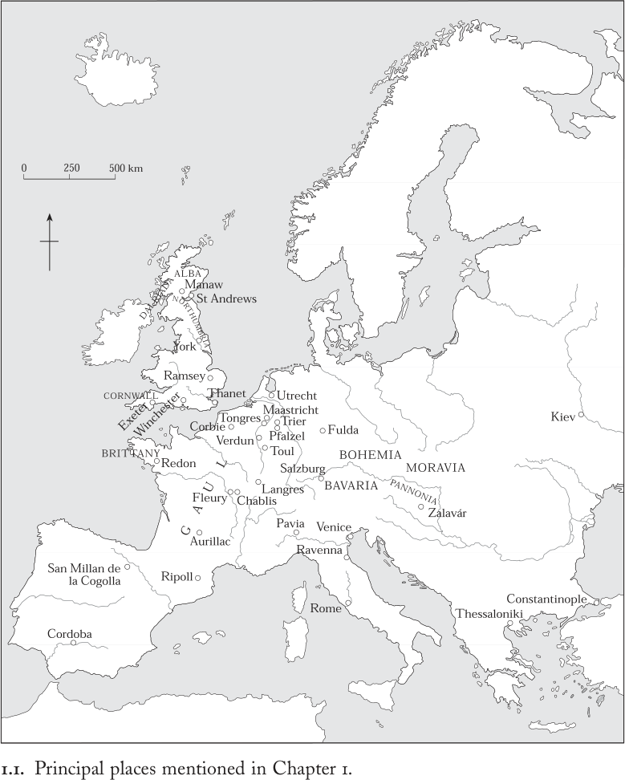
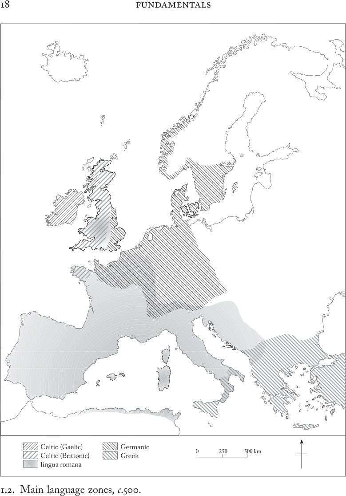
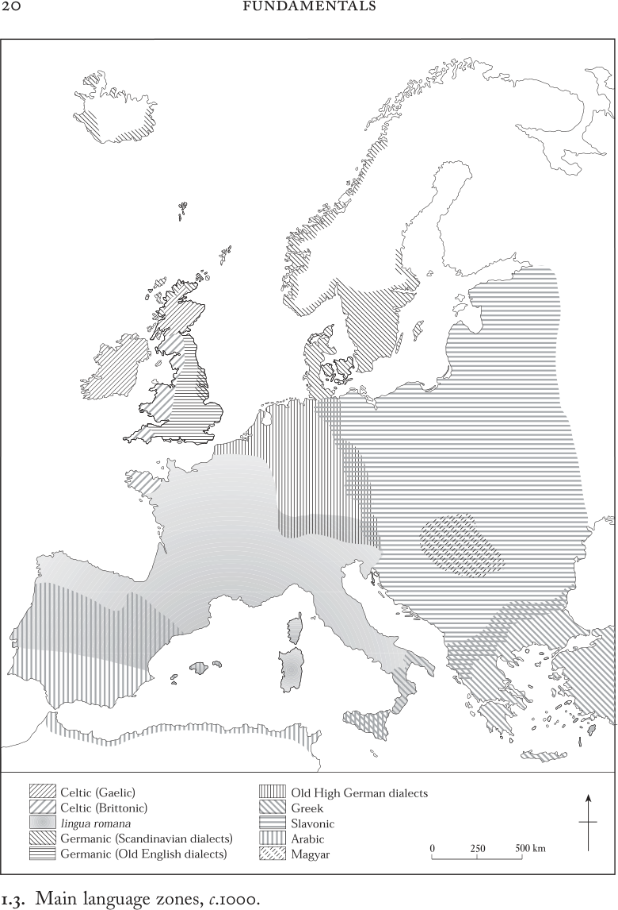

# 第1章 · 言说与书写

我们所说的话转瞬即逝，我们写下的文字却留存于世。^1

我们聆听人们讲解和诵读上帝的书籍，聆听福音的宣讲，见证祂的荣耀昭示于世人。^2

书面遗存是历史学家技艺的核心。粗刻的铭文、干瘪的官样文章、灵感的诗篇、税册名录、抽象的神学思辨，或装帧华美的手抄本：这些以及许多其他形式的文字，都是历史学家赖以重构过往社会的材料。在思考500年至1000年间欧洲历史时，我们首先面临一个困境：大量书面材料未能留存下来。中世纪的作者有时会提及或引用他们曾经得以寓目的文本和文献，而这些东西后来已告散佚。抄写员在誊抄文献时，可能难以辨认笔迹，也可能有意改动并更新面前的文本，一旦新本完成便将旧本弃之不顾。数百年来疏于保管、潮湿、火灾和战乱的摧残，更加剧了有意的销毁与意外的散失。由于这一切原因，我们可以肯定，现存的中世纪早期书面记录只是曾经存在过的全部资料中的一小部分，尽管我们无法确切估量它小到何种程度。本书各章正是从这些得以留存的书面材料出发的。

然而，文献存佚的偶然性并非制约我们研究的唯一因素。即使什么都没有散失，我们仍无法回答所有想要探究的问题。因为在所讨论时期的部分时段或全部时段内，欧洲某些地区的人们根本没有使用任何形式的文字。即使在那些熟悉读写技术的社群中，掌握这些技能的也仅占人口的一小部分：我们只能通过生活在那些世纪里的少数男性——女性则更少——的言辞来研究欧洲早期中世纪的历史。

认识到这些局限，应当促使我们在探究中世纪早期文化之初，先考察书写在其中的地位。首先让我们记住，书写总是在某种特定语言中进行的。它把言语编码为一套广泛共享的视觉符号系统，这些符号代表组合成词语的声音。因此，书写从来无法与说话、阅读、思考等其他言语活动截然分开，它只是任何社会可用的众多交流与表达手段之一。研究现代世界的历史学家往往能够利用范围广泛的传播媒介，而研究中世纪的学者所能利用的媒介则较为有限。视觉图像无疑十分重要，数字、手势和象征性动作亦然，但本章聚焦于语词——包括口说的与书写的——因为我们无法离开一方而谈论另一方。中世纪早期的作者通常以口述方式向抄写员口授进行创作，而且他们一般都预期自己的话语将通过向听众宣读，或由独自静读的读者低声念出而得到传播。对一个社群的身份认同和正常运转至关重要的知识，可能世世代代口耳相传，无论其成员是否熟悉读写技术。这一口头传统与信息的宝库中的材料不时被转化为书面形式，而书面文本也常常在向听众高声诵读时获得其社会意义。就这样，由语词承载的意义、思想和观念，在口说与书写这两种相辅相成的媒介之间来回流动。

尽管言语与书写无法彼此割裂，历史学家必须时刻记住，留存下来供我们分析和品味的只有书面文字：正如教皇格列高利一世“大帝”（590—604年在位）那句广被引用的名言所说：“我们所说的话转瞬即逝，我们写下的文字却留存于世。”^3 研究任何前现代文化的学者都面临这样的困境：非书写的语词虽然至关重要，却无从探究。

因此，本章从口语的角度切入书写问题。中世纪早期的人们说什么语言？他们彼此理解的难易程度如何？欧洲的语言版图在这些世纪中为何以及如何发生变化？这些问题本身就具有界定性的重要意义，构成了我们的出发点。它们还引出贯穿全书的一大主题——中世纪早期经验的多样性，这与古代世界的普遍化倾向截然不同。

本章第二部分通过考察什么东西被付诸书写、用何种语言书写，来分析拉丁语——罗马帝国扩张与文化的语言——与中世纪早期欧洲各地语言之间的相互关系。一个习俗与地方做法千差万别、各个社群各有自己生活方式的世界由此获得清晰的焦点。在西罗马帝国政治崩溃的背景下，拉丁语在新语境中的种种用途，展现出一种变动不居、充满活力的文化进程，它促成了权力与权威的新形态。本部分的结论是：中世纪早期的欧洲人在采纳、改造或拒绝罗马帝国语言的过程中，是在就自身的身份认同以及在自己世界中组织和表达权力的方式作出选择。在这里我们遇到本书的第二个总体主题：与罗马传统的互动对所有地区都具有根本性的重要意义，包括那些远在前罗马疆界之外的地区。这份遗产对中世纪早期欧洲文化形态的贡献不容忽视；本章的讨论即从语言和书写用途方面证明了这一点。

贯穿本章乃至其后各章的第三个主题是权力。在第二部分对不同语言相对声望的分析基础上，最后一部分将论证：识字能力必须被理解为一种权力技术。这包含两个层面。第一层关乎个人及其掌握相关技术技能的途径，这些技能使权威的行使成为可能。第二层具有制度性的维度，因为禁欲的基督教社团逐渐成为规范性精英文字文化的维护者，这种情形在古代世界虽无先例，却延续着古代的文化偏见。本章的总体目的在于阐明：留存下来的中世纪早期史料在构思上绝非天真，在意图上绝非透明：其语言、形式和内容的选择，都暴露出隐含的文化价值判断与权力关系。这一论证对后续内容至关重要：一旦我们意识到这些存世史料本身就是在建构意义和组织权力的方式，我们便能在其后各章中出于不同的目的来利用它们。

## 巴别塔

约850年，朗格勒伯爵亨格里乌斯之妻诞下一个又聋又哑的女婴。父母嫌弃她，“视之为怪物，视之为禽兽不如的牲口，比家中婢女的奴隶还要可怜”，将她抛弃。这女孩不知怎的活了下来，成年后辗转来到沙布利圣马丁的圣祠。圣徒在此对她说话：“热诺薇法，我的女儿，不要害怕。”鲜血从她的耳中口中涌出，她随即痊愈。她此前从未听过人言——热诺薇法是她的名字吗？此后不久，她兄弟的婢女恰巧来到圣祠，认出了这个女人。婢女称她为“我的女主人热诺薇法”，并证实了这一奇迹。摆脱了残疾的热诺薇法重新回归了人的行列。^4 对于记述这一奇迹的修士，如同对中世纪早期的其他作者而言，言语的能力正是区别人与动物的标志。语言是上帝赐予人类的礼物。

但在基督徒从犹太人那里承袭的一个起源神话中，世上万民原本说着同一种语言。这个故事讲道，建造了奇伟的巴别塔之后，建造者们为自己的成就而心生傲慢。为惩罚他们，上帝“使世上居民言语各异，以致他们无法通晓彼此的语言……一民不识他民所言”。^5 对这位翻译圣经神话的盎格鲁-撒克逊译者来说，各民族各说各的语言似乎是不言自明的。其他人则不那么确定，例如塞维利亚主教伊西多尔（约560—636年）。他确信语言先于民族而存在，却拿不准两者如何对应。“起初，语言的数目与民族的数目相同，后来民族多于语言，因为许多民族源自一种语言。”^6 这实际上默认了语言与民族之间流动多变、摇摆不定的关系。

伊西多尔的直觉无疑是正确的。我们必须摒弃十九世纪的错误观念，即曾存在过一个民族或一个政权对应一种语言的整齐关系。同样错误的是这样一种看法：任何自认为构成单一民族或单一国族的中世纪群体内部都存在语言的统一性。中世纪早期语言与民族的关系远比这类简单公式复杂得多。我们将看到，语言并不随政治疆界而始终：它们以种种方式相互交叠，全然不顾政治归属。此外，它们总是带有显著的内部方言差异，并处于不断的演变之中。当然，语言的变化在我们这个时代之后仍长期延续，因此必须记住，此处考察的变迁只是一个漫长故事中的一个片段——但这是欧洲语言史上具有奠基意义的时代，也是自十八世纪以来关于欧洲诸民族身份认同之争的核心所在。

牢记这些要点之后，我们可以纵览本书所聚焦地区的语言状况。图1.2显示了本时段开始时的四大语言区。不列颠群岛是凯尔特语的主要区域，其主要形态在罗马帝国后期已开始发生重要分化。到八世纪，出现了两种彼此无法相通的变体：盖尔语（或称Q-凯尔特语）与布立吞语（或称P-凯尔特语）。尽管现代语文学已经确证二者的密切亲缘，中世纪却无人知晓这一点；从实际效果看

就当时的目的而言，它们是两种截然不同的语言。约公元500年，盖尔语通行于爱尔兰，也为爱尔兰海对岸的移民所使用。五、六世纪时，盖尔语在康沃尔和威尔士西部沿海地区的使用较为短暂，但在更北的地方，即今日苏格兰西部，情况则不然。我们稍后将回到这一话题。

不列颠语（Brittonic）是罗马征服时不列颠的土著语言，在罗马统治的数个世纪中与拉丁语并存使用，但在中世纪早期发展出鲜明的地域形态，包括威尔士语、康沃尔语、坎布里亚语和皮克特语。地域性的语言差异以及各异的政治命运，都未能摧毁不列颠人之间共同身份的意识。十世纪的一位威尔士诗人曾预言，终有一日，说不列颠语的基姆里人（Cymry）将再度：

……拥有从马瑙[爱丁堡附近]到布列塔尼的全部土地，
从德维德到萨尼特……
从长城到福斯河……
^7

五、六世纪时，不列颠语使用者还散布于欧洲大陆大西洋沿岸的许多地区，其中尤以西班牙西北端和今法国最西端的半岛最为集中。只有在后一地区——布列塔尼——他们的语言影响才得以延续：十一或十二世纪，一位威尔士作者评论说，威尔士人和布列塔尼人“语言相同、民族相同，尽管地理上彼此分离”。^8 这就是中世纪对欧洲这一地区语言亲缘关系的认知极限，因为“凯尔特语”这一称谓是十八世纪语文学的博雅学识，并浸透着浪漫主义时代的政治与文化抱负的产物：它在中世纪的认知中并无根据。

如图1.2与图1.3的比较所示，在中世纪早期，不列颠语在不列颠岛内的使用范围大为收缩。它面临两大挑战。说盖尔语的人将“达尔里阿达”（Dalriada）一名既用于爱尔兰东北端，也用于他们在苏格兰西部的定居地。盖尔语从约公元500年起在达尔里阿达较为有限的发源地出发，逐渐扩散到索尔威湾和福斯河河口以北几乎整个地区。其最大范围约在1100年前后，与中世纪苏格兰王国的大部分疆域相吻合，当地居民称之为阿尔巴（Alba）。在这一地域内，盖尔语先是与当地坎布里亚语和皮克特语形式的不列颠语竞争，继而逐渐取而代之。这一切究竟如何发生，至今仍远未明朗；虽然我们知道爱尔兰修士科伦巴（生于约521年，卒于597年）只能“通过翻译”向苏格兰北部和东部的皮克特人宣讲基督教，但至少在苏格兰中部部分地区，似乎确实存在一个兼说盖尔语和皮克特语的双语精英阶层，并延续至约900年。^9 此后，阿尔巴王国的主导语言便是盖尔语。

日耳曼语是第二个需要考察的语言群，尽管这同样是中世纪以后的语文学分类。正是这一语言构成了对不列颠语的第二重挑战，导致后者从不列颠南部和东部消失。说日耳曼语的精英们——被笼统地（但属时代错置地）称为“盎格鲁-撒克逊人”——无疑在五世纪已在这座岛屿的东部沿海站稳脚跟。此后，他们逐步建立起政治霸权，至约750年已控制福斯湾以南、塞文河以东的全部不列颠领土。然而，他们的政治成功如何引发了如此彻底的语言转变，以致在这一整个地区根除了不列颠语，至今仍争论激烈。

盎格鲁-撒克逊人所讲的一组方言被统称为古英语。评价这些方言，最好将其置于围绕北海的广阔日耳曼语言区内考察。该区域包括欧洲大陆的西北象限，即斯堪的纳维亚南部，如图1.2所示。在公元最初几个世纪，日耳曼语是沿罗马帝国边疆（沿莱茵河与多瑙河一线）及其以北居住的各民族的语言，其使用范围东北远至易北河的泛滥平原，东南远至乌克兰草原。四、五、六世纪的动荡将其使用者——无论作为孤身个人、军事分遣队、整支军队乃至整个民族——带到了帝国西部各省的四面八方。其中有自称哥特人、法兰克人、撒克逊人、伦巴第人、弗里西亚人、巴伐利亚人的群体，此处仅举其最重要者。我们将在本书中频繁遇到他们，以及他们在罗马帝国故土上建立的诸王国。中世纪早期日耳曼语世界语言统一性的一个例证，是保罗执事（Paul the Deacon，生于约720/730年，卒于约799年）的一段话。他从意大利来到法兰克国王查理曼（768–814年在位）的宫廷，在那里逗留期间想必熟悉了阿尔卑斯山以北日耳曼方言的语音。他回忆说，伦巴第国王阿尔博因（约560–572年在位）的功业“不仅在巴伐利亚人和撒克逊人中间，而且在其他同语之人的歌谣中”被传颂。^10

除在不列颠东部以及高卢北部一片宽阔地带之外，日耳曼语使用者逐渐被同化入当地社群，在数代之内放弃了他们的传统语言。日耳曼语言区内的社会与政治剧变促进了语言的迅速演变，凯尔特语言区亦然：在这里同样有一个标志，即日耳曼语言连续体内地域分化日益加剧，至该千年之末已产生显著后果。随着日耳曼语各支日益分化，一种变体的使用者要理解另一种变体的使用者，势必需要付出越来越大的努力，尤其当双方各自来自方言谱系中相距较远的地域时。然而，我们绝不应设想使用者们对其语言同一程度会持相同看法。九至十世纪斯堪的纳维亚人定居英格兰之后，一些英格兰作家将斯堪的纳维亚语与英语区别开来，但迟至十二世纪，定居冰岛的斯堪的纳维亚移民的一位后裔却评论说，冰岛人和英格兰人“同操一语”。他强调这一点，尽管也承认“两种语言之一已变化很大，或二者皆有所变”。^11 使用者对语言同一或差异的感知，在中世纪一如今日，都是主观的。图1.3显示了斯堪的纳维亚语、古英语与其他日耳曼方言形式（统称古高地德语）之间日益增长的分化。

影响凯尔特语和日耳曼语的种种日益扩大的分歧，是由语音、词汇和词形方面的重大变化所推动的，而这些变化在四、五、六世纪尤为迅速。对这些语言变化，任何单一的解释都不充分：必须将复杂的社会和政治变革全部纳入考量。在所有促成因素中，人口迁徙所起的作用可能相对次要。更有说服力的解释包括征服与基督教化，因为二者都是语言变迁的有力动因——有时也是语言消亡的动因。此外，这些语言书面形式的发展，以及拉丁语——权力、声望与基督教的语言——的影响，也是额外的推动因素；拉丁语对凯尔特语和日耳曼语均有影响。

说到拉丁语，我们便触及中世纪早期第三个重要的语言区。在后帝国时代，拉丁语继续通行于那些受社会或政治动荡影响较轻、基督教社群得以安然延续的行省。在不列颠西部，拉丁语无疑在六世纪仍被使用，但此后便消亡了。大约在同一时期，拉丁语在巴尔干地区也不再占主导地位，而集中于地中海西部及其伊比利亚、高卢和意大利的广大腹地，如图1.2所示。

图1.2标注的第四种也是最后一种语言是希腊语。在古代，希腊语通行于东地中海各地并用以书写。巴尔干中部和意大利最南端早已稳定为其西界；虽然希腊语知识曾普遍为西罗马行省受教育精英所掌握，但至约500年，这种造诣已属罕见。然而，希腊语使用的衰落还有一个额外原因，即斯拉夫语的出现。尽管在中世纪早期丧失了大量地盘，希腊语仍是巴尔干半岛南部的主要语言，并在六世纪进程中取代拉丁语成为拜占庭（东罗马）帝国都城君士坦丁堡的行政语言。在意大利，其最南部行省仍在拜占庭统治之下，只要与君士坦丁堡的行政纽带延续，希腊语便与拉丁语并存，作为精英文学文化的语言。

斯拉夫人最早见于拜占庭作家的记载是在六世纪中叶，他们把斯拉夫诸王国定位于多瑙河下游以北。然而，斯拉夫人是否曾经共有某种共同身份意识，尚存争议。虽然斯拉夫人对巴尔干北部和中部的征服显然促进了其文化和语言的传播，以致希腊语的地盘被压缩到远至爱琴海顶端的塞萨洛尼基，但与其他地区一样，这种文化转型的原因仍存争议。到八世纪，斯拉夫语的诸变体似乎已通行于易北河以东中欧大部，包括 formerly 曾属日耳曼语的一些地区——其中某些地区在后世数百年间又将重新日耳曼化。到约1000年，越来越多的证据使斯拉夫语的分布范围更为确凿，如图1.3所示。

图1.3上还标注了另外两种语言，二者皆由文献翔实的征服所传播：阿拉伯语和马扎尔语。穆斯林军队于711年越过直布罗陀海峡，在八世纪初征服了伊比利亚半岛南部和中部诸省；他们把阿拉伯语引入了西班牙。虽然拉丁语在当地继续使用，但随着当地居民逐渐皈依伊斯兰教，拉丁语丧失了其地位与威望。到十一世纪初，拉丁语仍是残存基督教社群的礼拜语言，但彼时阿拉伯语已稳固地确立为政府和精英文学文化的语言。最后是马扎尔人（其对手称之为匈牙利人），原本是来自亚洲草原的游牧民族，于九世纪末至十世纪间越过喀尔巴阡山脉，四处劫掠，随后在多瑙河平原建立永久定居地，并将其独特的语言引入该地。

虽然拉丁语在前西罗马帝国的许多地区受到其他语言的竞争，它仍值得细加考察。古代晚期及其后，lingua romana，即“罗马语”，指拉丁语，兼指口头和书面形式。在古代，拉丁语口语的发音因地区而异，精英与非精英使用者之间亦不相同。作为书面文学语言，古代拉丁语则远不易发生变化，保持着内在的保守性、标准化和精英主义倾向。lingua romana一词涵盖了所有这些形式。然而到了十二世纪，lingua romana仅指口头形式，即“罗曼语”——无论其法语、瓦隆语、加泰罗尼亚语、西班牙语或意大利语形态——以区别于书面的拉丁语。我们可以通过将中世纪早期所说的形态简单地称为lingua romana，来回避关于口语拉丁语何时、如何以及为何终止而罗曼语肇始的种种争论。

它在中世纪早期也发生了显著演变。口语lingua romana的地域分歧逐渐变得比古代更为强烈，发音也发生了变化，但尚未达到不同地区使用者之间无法理解的程度。这种情况约在1200年前后才开始出现。这意味着，当讲阿拉伯语的科尔多瓦哈里发阿卜杜勒-拉赫曼三世（912–961年在位）于953年与德意志国王奥托一世（936–973年在位）互派使节时，双方沟通毫无困难。哈里发的代表是科尔多瓦当地基督教社群的成员，兼通阿拉伯语和当地lingua romana的男子。如果他们在北上旅途中留心观察，或许会注意到口音和词汇的地方性渐变，直至最终抵达图勒——这座城镇仍处于lingua romana东北延伸范围之内，但也在奥托王国境内。奥托选定的使节是戈尔泽修士约翰（生于约900年，卒于974年），他出生之地正是lingua romana与日耳曼语混杂交错之处。约翰很可能兼通这两种当地语言，他与科尔多瓦使团中的一位一同南行：一路上他们以“无所不谈”来消磨漫长的旅程。^12 尽管存在一些地域差异，从瓜达尔基维尔河直到摩泽尔河沿岸通行的仍是同一种语言，一如罗马时代。到此时，建立五、六世纪诸王国的日耳曼语使用者的后裔早已放弃了其祖先的语言。正如一位成为意大利某城主教的西班牙人在九世纪初所写：“拉丁语虽为一种语言，却涵盖众多民族，一如我们时代那些著名而高贵的民族：法兰克人、高卢人、意大利人（或罗马人）、伦巴第人；还有西班牙人、阿非利加人、阿斯图里亚斯人和巴斯克人。”^13 此处隐含着一种语言帝国主义的成分，因为巴斯克人说着——至今仍说着——一种与拉丁语毫无关系的古老语言；但尽管如此，都灵的克劳迪乌斯仍恰当地表达了一个不言自明的道理：罗曼语仍是一种由许多不同族群共同使用的单一语言。

然而，拉丁语作为书面语言的发展轨迹却截然不同。要追溯这一轨迹，我们必须从地中海盆地回到爱尔兰。五世纪基督教在爱尔兰的传播，将整个西罗马世界通行的基督教礼拜语言引入了此地。爱尔兰学者对待拉丁语，是把它当作一门需要在学校里通过读书习得的语言，而不是在家中从与父母的交谈中学来的语言。他们很快发展出一套将其作为外语来教授的方法，不列颠日耳曼地区的新兴基督教团体也热切地采纳了这些方法。因此，对爱尔兰人和盎格鲁-撒克逊皈依者而言，拉丁语是一种书面的、习得的语言，而非活的口语。他们坚守传统的拼写和语法规则，这与罗曼语母语者灵活多变的用法形成了鲜明对比。只有那些前往欧洲大陆的修士和修女，才会接触到这种语言的口语形式。当他们真的接触到时，都惊讶于它与自己在学校里学会读、写、发音的拉丁语竟如此不同。博尼法斯（约675年生，754年卒）是来自英格兰南部的传教士，一生大部分时间都在大陆的日耳曼诸民族中传教，他显然能够毫不费力地听懂当地人各种日耳曼语方言。但722年他访问罗马时，对教廷中所说的罗曼语感到不适应，宁愿以书面形式交流重要事务。博尼法斯的书面拉丁语对教皇的对话者来说不成问题，但他的经历凸显了作为母语的拉丁语与作为课堂习得语言的拉丁语之间日益扩大的鸿沟。

博尼法斯之后半个世纪，盎格鲁-撒克逊学者阿尔昆（约740年生，804年卒）应召来到查理曼的宫廷，成为一位颇具影响力的教师和顾问。归于他名下的成就之一，是对他在大陆所见书面拉丁语的拼写与语法进行改革。通过将其恢复到他在约克学校所学的古典晚期规范，阿尔昆发动的改革以一种高度保守的方式稳定了书面语言。尽管这些改革对口语毫无影响，却进一步加剧了口语与书面语之间日益扩大的鸿沟。看来，使用学术性的“阿尔昆式”拉丁语布道的传教士，很可能让塞纳河以北讲口耳相传之罗曼语的听众无法听懂。

这种口语与书面语之间的分化，即“乡野”或“通俗”言语与受过教士教育的精英所操拉丁语之间的分化，在地中海地区发展得要晚得多。直到千年之交，这种区别才在罗马显现。999年教皇格里高利五世去世时，圣彼得大教堂他的墓上方安放了一方铭文，纪念这位出身日耳曼的教皇短暂的在位。铭文对他教任期内的动荡政治避而不谈，只称赞他以“三重雄辩之术教化民众，使用日耳曼语、通俗语和拉丁语”。^14 在这里，在罗曼语的发源地罗马，到我们所论述的这一时期末，“拉丁语”已不再是该城居民的语言。

格里高利是布鲁诺所选的教皇名号，此人是日耳曼皇帝奥托三世（983–1002）的表亲和宫廷司铎。作为在德意志任职的职业教士，他的拉丁语知识必然完全来自课堂。登上教皇宝座使他脱离了日耳曼世界，进入了罗曼语的世界，而他显然轻松掌握了这种语言。日耳曼语、凯尔特语和罗曼语彼此并不相通；除了两种语言在频繁使用中相互重叠的地带之外，任何双语能力都是后天努力习得的，而非成长环境的产物。但在接触地带，情况必然颇为不同。两种口语同时通行的任何地方，社会结构很可能都很复杂。通常，一种是统治精英的语言，享有更高的声望，另一种则沦为农民的语言。这就限制了广泛而完全的双语现象出现的可能。一种可能是能主动使用一种语言而对另一种只有普遍的被动理解；同样可能的是对第二语言的有限掌握，例如仅限于商业活动或庄园管理等受限的生活领域。社会地位的差异还会使图景更加复杂。此外，还可能出现少数语言在局部占主导地位的分散社群，即所谓的“语言孤岛”。

尽管任何两个言语社群重叠的地区必然具有复杂的语言细节，但在罗曼语逐渐过渡到日耳曼语的地带，这些细节最易于证实。五世纪日耳曼人在莱茵河以南和以西地区的密集定居，使日耳曼语的主导地位远远向南延伸，越过今天法语与德语之间的语言边界，并且在一段时间内，日耳曼语在前罗马高卢省北部一半以上的地区成为少数语言。然而，从九世纪到十三世纪，主导语言的边界后退到大致相当于今天的位置，更南地区对日耳曼语的了解也随之消失。尽管日耳曼语在高卢北部和东部边缘占主导地位，罗曼语仍在一些城市继续使用，如通格雷、马斯特里赫特和特里尔，以及阿登山脉和汝拉山脉的偏僻山谷。复杂的语言状况如何影响农民，已无从知晓，但有充分的证据表明，该地区的一些贵族成员至少到九世纪仍然通晓双语。这无疑便利了他们参与查理曼建立的遍布四方的帝国权力网络，实际上也帮助这些网络得以运转。只要这个帝国维持不散，讲罗曼语的人就可能被派去学习日耳曼语，或嫁给一位母语不同的丈夫。但九世纪末开始的加洛林帝国的解体，削弱了通晓两种语言所带来的政治优势，只有莱茵河南岸持续存在的双语地带除外。一个能说明这种变化的例子是：981年，当日耳曼皇帝奥托二世（973–83）会见西法兰克的首要权贵于格公爵（绰号于格·卡佩；987–96年为法兰西国王）时，双方都不通对方的语言。为了交流，奥托用拉丁语讲话，于格扈从中的一位主教为公爵翻译。显然，于格唯一的语言是法国北部的口语罗曼语，他既没有学过拉丁语，也不懂日耳曼语。

总之，我们必须认识到早期中世纪欧洲语言的多样性。在这种背景下，有些人比别人更容易费神听懂自己语言的方言变体，或学习完全不同的语言。我们可以对比两位意大利传教士的努力：他们于1001年前往“语言听起来可怕的异教徒之地”——波兰。两人中只有一人“挥汗如雨”地应对语言挑战，学会了听懂斯拉夫语，但口语也只能达到勉强应付的程度。^15 尽管讲日耳曼语的奥托一世学过一些罗曼语和斯拉夫语的词汇，他却始终缺乏开口的信心，至少在公开场合如此。在第六章中，我们将遇到定期前往科尔多瓦的凡尔登奴隶贩子，以及翻越阿尔卑斯山到帕维亚经商的日耳曼商人：这些人显然不会让语言障碍妨碍牟利。无论语言多么多样、多么丰富，语言始终是人性的标志。九世纪传教士里姆伯特向波罗的海南岸周围的居民布道时，遇到了奇特的、长着狗头却有两足的生物。在寻求建议后，他得到安慰：一个关键的判别标准是它们发出的声音——“人说话，狗吠叫”。^16 人类共有语言能力，因而也共有理性：这使人类联结在一起，远胜于任何语言差异所造成的隔阂。

## 权威的语言

几个世纪以来，拉丁语一直是罗马市民谈情说爱、涂鸦留言、以铭文纪念帝国征服、制定法律、发布税册、创作并保存丰富文学传统的语言。随着基督教在二、三世纪向西传播，在那些无法理解基督教圣典所用希腊语的社群中，宗教领袖自然选择用当地语言进行辩论、布道、礼拜和写作。四、五世纪罗马帝国西部行省的教士们将犹太—基督教圣经——即构成圣经的希伯来文《旧约》和希腊文《新约》——译成拉丁语，并用同一语言进行礼拜，正是要使他们的宗教尽可能广泛地为大众所接受。到约500年时，拉丁语不仅意味着一种宗教，还意味着整套的学问体系、一种社会规范和一种权力技术。

随着帝国统治的崩溃、政治体制从古代向早期中世纪形态转变，拉丁语作为文化、控制和交流媒介的特权地位受到了怎样的影响？在昔日帝国疆界之外遥远之地的基督教新皈依者用什么语言礼拜？拉丁语的社会意义以何种方式发生了变化，其他语言又获得了怎样的政治或宗教重要性？这些问题本身就很重要；而合在一起，它们有助于我们理解早期中世纪历史存世文字材料为何呈现如今的形态。本节首先评述晚期罗马官僚体制在后帝国时代的命运，继而探讨不同书写体系所附有的文化声望，最后以对语言与权威关系的详细讨论作结。这一讨论特别关注在意识形态和身份认同与语言意义传达同等重要的情境下，书面语言的选择。通过追踪拉丁语相对于欧洲各地语言使用上的区域差异，本节强调：神圣权威与世俗权威都以多种不同的书面形式呈现。论证的关键在于一个悖论：就地理范围而言，拉丁语的使用在扩展，而能够理解它——更不用说能够读写它——的人数却在减少。到第一个千年末，拉丁语已成为精英的标志，在早期中世纪西方的大部分——但非全部——地区，与国王和教士的权威密不可分。

首先，有必要区分以下三者：作为政治和领土实体的西罗马帝国；其行政与法律体制；以及作为维系交流和施加权威之语言的拉丁语。在后帝国时代数百年间，三者的命运各不相同：政体、文书程序与语言之间的这种脱钩，有助于解释早期中世纪文化的某些典型特征。政体的命运此处不必赘述，因为那将是第八章的重点。目前只需指出：476年最后一位西罗马皇帝罗慕路斯·奥古斯图路斯的被废并无多大政治意义，西部帝国解体为由地方军阀统治的一群王国，这一过程早在五世纪就已开始。

要理解中世纪早期语言与权力行使之间不断变化的关系，就必须关注四世纪和五世纪初高度复杂的罗马官僚体制的命运，因为它并未随着帝国在西部的统治终结而停止运转。它在西部和东部行省的显著特征相同，都包括将政府行政与一种由初等和高等拉丁语教育体系支撑的精英文学文化联系在一起。文书、速记和公证技能支撑起各种卑微的职业，这些职业维系着从军需供应、法庭到图书贸易和庄园管理的一切事务。同样重要的是，艰难习得的拉丁语古典正典的精通，是通往高官显职及其声望的途径。这种教育的传统内容由此提供了一种同质的文化规范，抹去了地域和社会出身的异质性。与此同时，这种教育的高昂成本将穷困者拒之门外，在很大程度上强化了统治精英的社会排他性。

虽然治理始终依赖直接的人际接触和恩庇关系，晚期罗马皇帝也广泛使用书面的行政、财政和法律程序。总体而言，低效与内部矛盾同偏袒与腐败一道，构成皇帝（自324年起君士坦丁堡有一位，自408年起西部另一位驻于拉文纳或罗马）与地方臣民之间居间协调的官僚机器的主要特征。在边远的西部行省，尤其是不列颠和北高卢，这套体系大概在五世纪较早时候就已大半崩溃；再往南，在西班牙、中南部高卢和意大利，罗慕路斯·奥古斯图路斯被废并未打断官僚运作的习惯。五世纪在大陆兴起的诸王国都直接依赖这些继承下来的统治技术。五、六世纪的武士诸王通过挪用传统的政府机制为己所用，来宣示合法性、征收赋税、制定法律并彰显权力。

然而，从长远视角看，很明显，继承下来的罗马官僚体制并未延续下去。断言它“衰朽”，便是采取了一种不恰当的“衰亡与没落”叙事。不如说，其构成要素——文书格式、法律规范、税务核算、司法与档案程序等——逐渐解体、流失。在某些地方——但仅在部分地方——曾经浑然一体的官僚体制的某些碎片随之消亡；另一些碎片则获得了新的生命。有产者释放奴隶、订立婚约、捐建教堂、以正式文书安排遗嘱遗赠，这些文书的措辞和形制在很大程度上承袭罗马先例，但他们所处的是任何罗马官员都无法辨认的政治环境。

然而，由于证据保存残缺不全，以及现有材料的断代困难，为这些变化建立精确的年表极为困难。尽管不免有过于简化之嫌，仍可做出若干大致的概括。就约500年至约750年这一时期而言，这种解体在南部地区较其他地方缓慢，而在罗马城的教皇官僚机构中最为缓慢。与此同时，政治精英的性质也在变化。武勇逐渐取代长期的文学教育，成为国王在世俗顾问身上所寻求的品质——并以此授予土地和官职。晚期罗马政治精英所特有的官僚专业技能和文学文化，日益成为基督教神职人员的专属领域，因为对文字的掌握对于基督教崇拜而言一如既往地至关重要。教士由此成为新的识字精英，是运用文字作为权力协商媒介的专家。

如果现在把我们的概览延伸至本时期的后半段，即约750年至约1000年，还可以做出更多的概括。八世纪中叶以后，我们看到源自罗马的法律和行政程序被采纳、改造并移植到广大的地区，其中部分地区从未属于罗马帝国。八世纪的巴伐利亚公爵以自觉的罗马风格颁布法律；十世纪的德意志国王以与晚期罗马范本有着可辨认承袭关系的文书，向在斯拉夫人中建立的教堂授予土地和法律特权的正式赐予，十一世纪早期波希米亚的普热美斯王朝统治者所铸钱币亦然。一种明显得益于罗马先例的权力表达方式帮助新的王国得以诞生，而教士则扮演了助产士的角色，第七章将对此加以阐明。简而言之，罗马的官僚制度和法律程序自五世纪起逐渐被拆解，但并未消失，而是以零散的方式延续下来，构成一套行使权威的备用手段，欧洲中世纪早期的权力掮客可从中各取所需。

在此背景下，我们可以转向语言的文化意义，尤其是书面语言。在整个古代世界，拉丁语意味着文化上的优越。与希腊语一样，罗马语（lingua romana）被视为学问、法律和理性的语言——罗马人认为，正是这些特质使他们的世界高出周边世界一个层次。在罗马人眼中，生活在帝国疆界之外的人群蓬头垢面、凶猛残暴，是“蛮族”，其生活方式与帝国居民相比相形见绌。“蛮族”一词承载着沉重的文化和语言偏见：四世纪晚期的诗人普鲁登修斯写道：“蛮族与罗马人之别，犹如四足之兽与两足之人之别，犹如哑女与能言男子之别。”^17 最重要的是，这道鸿沟是教育上的，正如萨尔维安所告知我们的。他是边境城市特里尔的一位基督教司铎，406年莱茵河防线被日耳曼语人群等突破后流离失所者中的一员，这些人在罗马境内定居下来（见图0.2）。他在五世纪中叶写作时，将这些移民描述为“缺乏罗马学问，乃至缺乏任何文明的人类教育”、“对一切文学和知识一无所知”。^18 教育——在西方是掌握书面和口头的拉丁语，在东方是希腊语——包含着支撑罗马政治霸权的全部文化养成。从帝国的视角看，希腊语和拉丁语标示出一个优越的社会，它对无知与未受教育者毫无敬意。

这种罗马人与“蛮族”的区分建立在教育的基础上，是文化性的而非种族性的，因而从未构成一道不可逾越的屏障。除了作为罗马精英思想装备的一部分外，我们不应过分认真对待这种偏见。更有成效的做法是关注政治疆界如何作为密集互动和文化渗透的地带发挥作用，使发源于界外的人们得以接触希腊语和拉丁语，或者将自身同化于晚期罗马世界，或者为其自身目的而挪用书写的技术和用途。某些族群的领袖可以与皇帝缔结外交关系和条约，将其属民作为一个整体加以约束。一些军阀在秘书和译员的协助下与帝国当局进行书面往来，其中包括匈人领袖阿提拉（卒于454年），他们利用罗马的书面外交沟通规范来协商其全体部众的地位。个人也常常通过与帝国贸易或为之服军役而获得个人的进身之阶。出使阿提拉的希腊使节普利斯库斯注意到，在阿提拉治下各族所说的语言之外，还有“蛮语”，而“与西罗马人有商业往来的人[说]拉丁语”。^19 可以肯定，相当数量的军人和商人在其职业生涯中也获得了至少初步的实用书写技能。虽然无法评估这对个人事业成功有何助益，但凯尔特语和日耳曼语中吸收的有关战争、书写和贸易的拉丁词汇，是这种文化涵化的明确标志。

在另一些情境中，生活在帝国边界之外的人群以颇为不同的方式挪用书写文化的某些方面为自己的目的所用——最突出的是对构成言语的语音之符号表征这一观念的挪用。卢恩文字和欧甘文字都与此相关。卢恩字母是公元一或二世纪从希腊和拉丁字母改造而来的一系列字形，用以表示日耳曼语的语音。它被设计用于刻写在木头、金属或石头上。现存最早的卢恩文字零星散布于日耳曼语区的器物上，用于各种实用和祈愿的目的：或在珍贵的胸针上刻写女子的名字，或在珍爱的剑刃或矛头上标明其名，或祈求好运，甚至呼告神灵之名。尽管往往难以释读，早期卢恩铭文却体现了一个重要主题的例证——书写作为罗马世界周边文化渗透的一种形式。

较晚的卢恩铭文则体现了这种互动的新形式。盎格鲁-撒克逊修士将卢恩字母表标准化，并于七世纪晚期和八世纪的诺森布里亚修道院和教堂中将其用于基督教纪念铭文，作为罗马字母拉丁铭文的补充。另一方面，在十世纪和十一世纪的斯堪的纳维亚，一种新兴而蓬勃的刻铭纪念石碑传统似乎是当地对外来传教士压力的反应。在挪威，卢恩文字与基督教拉丁书写文化并存至中世纪晚期，被转用于新的行政目的，尽管始终主要是用于镌刻而非书写的文字体系。虽然卢恩文字在与基督教司铎引入的更具威望的拉丁字母表和权威文本的竞争中逐渐落败，但它从未因其基督教以前的起源而受到谴责。恰恰相反：卢恩文字被吸纳用于基督教用途的方式，尤其是在诺森布里亚，显示出一种书写实践的谱系和适应的意愿，我们稍后还会回到这一点。

欧甘文字的历史与此颇为相似，但把我们带到罗马帝国遥远的西部边界之外。在爱尔兰海周围，四世纪讲盖尔语的人与晚期罗马不列颠的拉丁文化有着密切接触；很可能在该地区东部的不列颠海岸上，一些对拉丁语语音系统和拼写惯例有精确了解的人创造出一套全新的符号序列来表示盖尔语。欧甘文字是专为石头纪念碑设计的，直接模仿罗马墓志以纪念精英阶层的逝者，它证明了以本地方式挪用书写与权力之间明显关联的冲动。在威尔士西南部的德费德王国以及不列颠西部的其他地区，欧甘文字被用于双语古爱尔兰语—拉丁语墓志中的爱尔兰语部分，直至七世纪，公开宣示这两种少数语言的直接对等和崇高地位；在苏格兰，则既有盖尔语也有皮克特语的欧甘铭文。在爱尔兰海的另一侧，爱尔兰西南部众多五、六世纪的欧甘石碑，是在回避罗马语言和文字的同时效仿罗马纪念方式的一种表达。它们表明，在帝国西部早已不复为政治实体之后很久，罗马霸权在帝国之外的回响依然存在。与卢恩文字一样，欧甘文字也被改造以适应基督教语境，在苏格兰延续最久，直至十世纪。它在八世纪的爱尔兰被放弃、由拉丁语取而代之作为展示世俗地位的语言，只有在拉丁语本身不再与隔爱尔兰海相望的强大邻邦联系在一起时才成为可能。到那时，拉丁语已获得一种完全不同的意义，即基督教的标志。无论如何评价，这一罗马宗教在帝国边界之外的传播在欧洲历史上具有决定性的文化意义；此处的关键在于这种以书本为基础的信仰对阅读和书写的刺激，因为基督教促成了此前完全或大体尚无文字的本地语言的书写方式的发展。它还引入了比卢恩文字或欧甘文字所曾表达的更多的利用书写以增进权力和权威的方式。

在中世纪早期的数百年间，形成了一套丰富多样、地域差异显著的权威语言库，拉丁语只是其中之一。我们最好逐个地区加以考察，尤其关注基督教崇拜的语言、法律的语言以及表达土地财产主张的语言。首先，我们应留在爱尔兰，在那里基督教书本学问的影响令人惊叹，原因有二。第一，尽管五世纪爱尔兰人皈依的细节大部分已不可考，但可以肯定的是，到约600年，爱尔兰人已掌握了“作为外语的拉丁语”。在此后的一个世纪里，他们不仅开始用拉丁语创作自己的文本，还将拉丁字母改造用于书写自己的语言。爱尔兰的费里德（filid）——学者、诗人和法律专家——不再仅仅能在石头上刻写短铭，而是如今能以流畅的文书字体书写长篇古爱尔兰语文本，他们将罗马字母挪为己用，在与基督教拉丁文本并行的同时创造出大批古爱尔兰语文本。其形式多样，包括古爱尔兰语诗歌、族谱、神话故事，还有大量的法律论著，阐述爱尔兰社会组织的复杂性，详列规范从养蜂到人质待遇、乃至不同等级诗人之资格的一切事务的准则。这些法律书的作者并非制定新法的立法者，而是将过去的程序和现存的社会实践系统化为一般性规范陈述的法官和学者，这些陈述对日常生活的影响不得而知。爱尔兰人究竟在多大程度上以实用的行政书写形式补充这些法律论著，也无法断言。几乎完全不存在贡赋清单、土地文书之类的东西，这究竟是由于文书的大量散佚，还是由于对记忆和管理社群事务的口传方式的持久偏好，已无从判定。留给我们的，只是对受过高度训练的学者—诗人和法学家精英如何设想其社群应当运作的生动洞见，而关于其社群实际上如何运作的证据却寥寥无几。我们稍后还会遇到这些理想社会中的若干。

第二，爱尔兰人宁愿以外国语保存其《圣经》和崇拜仪式。此前，基督教向罗马帝国边界之外的渗漏总是伴随着将《圣经》译为当地语言，往往还伴以新文字的创制，以使每种语言保有各自的文字。四世纪中叶，司铎乌尔菲拉（约311年生，383年卒）正是为生活在多瑙河下游以北和黑海以北草原的哥特基督徒做了这件事。^21 但在爱尔兰，没有发生类似的事情。爱尔兰人选择以拉丁语保存其圣书。他们热忱地接受了塞维利亚的伊西多尔的格言，即在巴别塔之后的诸种语言中，有三种“神圣语言”，即钉在垂死基督十字架上方的牌子上的语言（约翰福音19:19–20）以及《圣经》的语言：希伯来语、希腊语和拉丁语。^22 对爱尔兰人而言，圣书保持在神圣语言之中。诚然，以古爱尔兰语创作的诗歌、赞美诗、圣徒行传、布道文以及一系列其他宗教文本，向未受教育的听众传达了基督教的故事和价值观，基督徒作者所写的世俗英雄故事也在间接地起到同样作用。此外，古爱尔兰语词语有时会被标注在艰深的拉丁语词语上方或旁边以助理解（旁注），但崇拜的核心文本——弥撒礼仪、信经、主祷文和福音书——对所有人而言仍然难以理解，唯有那些在课堂上经受长期艰苦学习拉丁语的人除外。

到了六世纪后期，爱尔兰基督徒本身已开始在爱尔兰以外充当布道者和传教士，他们携带着以自己的神圣语言写成的圣书，前往苏格兰西部、欧洲大陆以及不列颠中东部和东部的盎格鲁-撒克逊人地区。在盎格鲁-撒克逊人中间，他们的足迹与七世纪传教士的路线纵横交错；这些传教士或来自罗马，其母语是罗曼语（lingua romana），或来自法兰克高卢，后者所讲的日耳曼语方言对盎格鲁-撒克逊人来说相当容易理解，但他们也通晓拉丁语。在早期盎格鲁-撒克逊基督教这一文化熔炉中，权威语言经历了又一次重新配置。

与不列颠西部不同——那里的基督教、口语拉丁语以及记录财产权的罗马技术在六世纪始终未曾中断——不列颠东部的宗教与官僚体系的罗马文化装置在五、六世纪期间大半或全部崩溃了。在爱尔兰传教士和大陆传教士的共同协助下，盎格鲁-撒克逊人也为其自身的日耳曼方言发展出了书面形式，在拉丁字母之外补充了几个如尼文字符。英格兰早期皈依的国王们将其转向法律。然而，与爱尔兰法学家们的法律书不同，他们的法律书不仅包含对既有社会惯例的规定，还包含王法——一种带有罗马色彩、却以本地语言阐明国王命令的权力颁告。此外，最迟从七世纪末开始，盎格鲁-撒克逊诸王开始认可正式的拉丁文文书，用以重组并永久记录土地财产的权利主张。这些以国王名义颁发、却由教士起草的文书——即所谓的“特许状”（charters）——改造了大陆传教士所熟悉的罗马行省官僚文书的形式。七世纪的盎格鲁-撒克逊国王既读不懂也听不懂这些拉丁文文书，这一点无关紧要：从王权的角度看，这是一种象征性书写，是对一种新型权力的宣示；从教会的角度看，这是保障土地赠与、确立持久性制度结构并提升教士政治影响力的手段。

与爱尔兰人一样，最早的盎格鲁-撒克逊基督徒把新宗教当作一种拉丁宗教来接受。但他们对这一文化与语言鸿沟的处理方式有所不同。到八世纪初，基督教文本开始获得一层新的、古英语的外围形式，有时表现为加写在华丽的拉丁福音书行间、以小号字母书写的古英语行间注释或“对照释义”，有时表现为受过教育的神父“用他们自己的语言”向民众解释《信经》和《主祷文》的含义。^23 比德（Bede，约673年生，735年卒）是早期盎格鲁-撒克逊学者与教师中最具影响力的一位，他甚至为不通拉丁语的神父和修士提供了这两篇核心文本的古英语书面译文，“以便信众学会如何做信徒”。^24

在此我们遇到了核心问题。基督教是否是一种仅限于象征性、享有威望的语言的宗教，除了少数像比德那样自幼便接受其 intensive 训练的人以外，对所有人均不可理解？还是应当努力使其圣典直接可懂？即便到了十、十一世纪——此时古英语已发展出精密的书面形式，可广泛用于法律、行政、牧灵、历史和诗歌等用途——弥撒本身的祷文始终保留拉丁语。至于《圣经》，其策略包括将圣经叙事改写为古英语，或以传统诗歌形式，或以布道文形式。到盎格鲁-撒克逊时代晚期，《旧约》和《新约》中最常被诵读的部分已存在古英语译本，尽管这些译本不太可能广泛流通。翻译也并非没有争议。埃尔弗里克（Ælfric，约950年生，约1010年卒）确实曾为其贵族庇护人埃塞尔沃德（Æthelweard）翻译了《创世记》的前半部分，但他警告说，这是一件“极其危险”的事情，因为《旧约》族长们的多妻习俗与基督教教义相悖，需要由经验丰富的解经者加以“安全化”处理。^25 埃尔弗里克是塑造了盎格鲁-撒克逊晚期英格兰独特的古英语文化的那一代学者之一。盎格鲁-撒克逊人从未像爱尔兰人那样走得那么远——爱尔兰人声称自己的语言是诸语言中最好的，因为他们的神话祖先费尼乌斯·法尔赛德（Fénius Farsaid）融合所有其他语言的优点而创造了它。但他们远比爱尔兰人更乐于将其母语——王权与法律的语言——用于基督教，作为教导与布道的工具，而这种情形在爱尔兰似乎从未出现过。^26

简言之，早期盎格鲁-撒克逊英格兰输入的拉丁文化稳步演变为一种双语文化，其中拉丁语与古英语作为权力与权威的语言互为补充。十世纪和十一世纪初的国王及其谋臣以古英语立法，却以拉丁语参加弥撒。他们颁布以拉丁语撰写的特许状，其中涉及的财产则以古英语载明。他们发出以古英语写成的行政信函（令状，writs），或许还同时用古英语和拉丁语诵读《主祷文》。国王阿尔弗雷德（Alfred，871–899年在位）酷爱古英语诗歌书籍——但这些诗句所咏唱的，与传统的日耳曼英雄相比，同样可能是圣经中的英雄。另一位国王埃德加（Edgar，957–975年在位）向受宠的教会赠送装饰华丽的拉丁福音书，并委托这些教会的神职人员将关键的拉丁文本译成古英语。强大的盎格鲁-撒克逊晚期政体正是从这些精心调校的语言策略中汲取力量。

八世纪，博尼法斯（Boniface）等盎格鲁-撒克逊传教士开始在欧陆的日耳曼语地区——莱茵河以北和以东——布道并建立教会。自然，他们带去了对使用本地语言辅助培训神父、讲解基督教教义之益处的重视；在盎格鲁-撒克逊人的影响下，古高地德语的各种方言开始以拉丁字母书写。与英格兰的情形一样，先是宗教与法律文本的词汇表和注释，然后才出现完全以本地语言创作的作品。这些作品多为课堂和牧灵用途，有助于理解而不取代宗教仪式中的拉丁语。因此，在《信经》、《主祷文》和洗礼仪文之外，我们还发现了一些布道文、祈祷文和祝祷文。稍晚，以德语诗歌对《圣经》部分篇章尤其是福音书的改写，扩展了基督教德语文学的门类，不过，与英格兰和爱尔兰一样，弥撒本身始终保留拉丁语。

然而，博尼法斯及其同胞在大陆建立的教堂和修道院，位于以拉丁语立法的统治者领地之内，这与盎格鲁-撒克逊诸王不同。五、六、七世纪的哥特人、勃艮第人、法兰克人和伦巴第人的国王以拉丁语立法和施政，这本是不言自明之事，不仅因为他们常常依赖晚期罗马法学专家的协助，也因为他们有意坚持自己作为罗马皇帝继承者的角色。此外，他们的日耳曼追随者们都在或多或少地迅速放弃自己的传统语言，转而采用罗曼语。以拉丁语颁布法律和特许状，就是以他们的大多数——若非全部——臣民的语言行事；即便国王本人不完全理解，译者也总是随时可寻。因此，751年夺取法兰克王位的加洛林王朝诸王，尽管本人讲的是日耳曼语的法兰克方言，仍以继续用拉丁语立法来宣示其合法性。随着其王国在八世纪末通过政治运筹与公开征服而扩张，它成为一个庞大的多民族、多语言的聚合体，最终远远超出盎格鲁-撒克逊传教活动的范围。加洛林诸王和皇帝的臣民讲着种类繁多的语言，从布列塔尼的布立吞语，到罗曼语的全部方言谱系，再到莱茵兰、萨克森和巴伐利亚的日耳曼语，直至帝国东部边境地区的斯拉夫语使用者。王室官员和布道者无疑都使用本地方言和语言与各地的听众交流；而一旦抵达宫廷，他们便进入一个多语言的环境。但拉丁语界定了每个人更广泛的文化认同，尤其是其宗教认同。拉丁语的法律和拉丁语的礼拜赋予加洛林帝国一种它原本缺乏的凝聚力：神圣语言同时也就是帝国权力的语言。

从九世纪中叶起，加洛林传教士活跃于帝国东翼沿线的斯拉夫诸公国之间。这些土地也吸引着拜占庭传教士，其中最著名的是君士坦丁和美多德兄弟，二人均通希腊语和斯拉夫语，是出色的语言学家。正是他们首次赋予斯拉夫语书面形式，那是在863年，拜占庭皇帝派他们前往摩拉维亚向斯拉夫人布道。出发之前，君士坦丁发明了一套全新的字母，并开始以这套字母——即格拉哥里字母——撰写希腊文《圣经》、礼仪书和其他宗教典籍的斯拉夫语译本。869年他去世后，其兄美多德继续其传教与文字事业，先在潘诺尼亚工作，直至885年去世。此后，德意志传教士逐渐成功地排挤了初生的斯拉夫礼仪，代之以拉丁礼仪和拉丁字母；君士坦丁与美多德的文化事业仅在东南巴尔干的保加尔人中延续，并自十一世纪起在遥远的东北方基辅罗斯人中延续。在保加尔人和罗斯人中间，另一种直接改编自希腊字母的文字——西里尔字母——与格拉哥里字母竞争用于书写斯拉夫语，最终赢得了更广泛的接受。对斯拉夫人而言，皈依基督教带来了以本族语言写成的礼拜用书，以及可适应广泛用途——包括法律、编年史、灵修与解经著作和铭文——的独特文字。

君士坦丁与美多德的成就引发争议，而这恰恰鲜明地揭示了中世纪早期语言与权力之间的关系。对拜占庭人来说，以本地语言和文字进行基督教礼拜是常态；正如乌尔菲拉斯的活动所表明的，东方基督教以语言多元主义为特征。然而加洛林教士坚称，神圣语言只有三种。此外，他们视摩拉维亚和潘诺尼亚为自己独占的势力范围。867年，君士坦丁和美多德在从科采尔亲王的驻地扎拉瓦尔前往罗马的途中在威尼斯停留，该城主教和教士团以敌意相待，攻击君士坦丁的翻译事业，称其“如群鸦扑鹰”。^27 美多德在其兄去世后返回潘诺尼亚时，也遭到批评，萨尔茨堡的教士们贬斥他“摆出一副哲学家的姿态，以一种新发明的斯拉夫字母取代了拉丁语、罗马教义以及受尊崇的拉丁字母，并在该地区向所有人诋毁那些以拉丁语主持弥撒、福音诵读和教会仪式之人所行的礼仪”。^28

争端究竟何在？无论是威尼斯还是萨尔茨堡的教士，都认为以神圣语言之外的任何语言进行礼拜是不可接受的。对希腊兄弟侵入其领地的怨恨无疑助长了他们的敌意，但他们的反应暴露出关于语言与权力的更深层的文化焦虑。与所有讲罗曼语的基督徒一样，威尼斯人是以其日常语言进行宗教礼拜的，尽管所用的语体很可能听起来相当古旧。同样，在罗曼语地带，除伊比利亚半岛由科尔多瓦哈里发的阿拉伯语官僚体系统治的部分之外，各地的世俗统治者和官员均以拉丁语颁布法律、裁决纠纷、管理财产，而拉丁语不过是当地口语的书面形式。在这方面，中世纪早期这里其实没有什么变化。相比之下，萨尔茨堡的教士是德意志人。他们的拉丁语是在修道院学校和主教座堂学校里从教师那里学来的。他们以拉丁语阅读《圣经》、主持宗教仪式，但也用拉丁语管理地产、追念亡者、接收并回复王命、记录诉讼结果，以及履行诸多其他职能。拉丁语知识使他们与其会众、佃户和仆役区隔开来，这些人中有许多讲日耳曼语的巴伐利亚方言，还有一些讲斯拉夫语。威尼斯与萨尔茨堡的教士虽然语言背景迥异，却在此点上同心一致：他们都感到君士坦丁和美多德玷污了拉丁语《圣经》和拉丁礼仪的神圣性。

这两兄弟对他们遭遇的敌意必定感到困惑。但他们关于基督教圣典可以译成任何本地语言的假设，恰恰凸显了西方基督教的特殊性。自爱尔兰人皈依以来，西方基督教无论本地语言为何，本质上都是拉丁基督教。在爱尔兰，继而在英格兰，宗教是一种语言，法律是另一种语言。但在加洛林治下，拉丁语作为神圣权威与世俗权威语言的不可或缺性得到了肯定。在教士的辅佐下，十、十一世纪的德意志国王和皇帝热心地步其后尘，并通过赞助在波兰人、匈牙利人和斯堪的纳维亚人中间的传教活动，确保拉丁语作为德意志王权的语言与象征被输出到与德意志基督教的关系。在日耳曼语与罗曼语(lingua romana)这条语言分界线以北的各地，权威的语言都必须从挥舞戒尺的教师那里学得。戒尺由此灌输了一种权力的技艺，因为拉丁语不仅传递信息、观念和命令：它还承载着地位、威望、身份与忠诚。至于不列颠群岛，则要到1066年诺曼征服的冲击，才促使拉丁语取代当地语言而成为统治之用。

尽管书卷拉丁语继承了文化上的威望，且以其书写的抄本存世众多，但它并非中世纪早期唯一的权力语言。萨尔茨堡的教士们将课堂拉丁语用作宗教、法律和财产事务的语言，这与他们同时代欧洲的广大地区并不合拍。这种情况只是在很久之后才成为常态，但我们不应让这一点抹杀中世纪早期欧洲语言与权威之间流动而多样的关系。

## 地方性读写能力与精英读写能力

721年，后来的乌得勒支主教格里高利拜访了他的姑母阿杜拉，她是特里尔附近普法尔策尔修道院的院长。如同贵族青年常见的那样，他在法兰克国王的扈从中度过了塑造性格的岁月——这是一门关于宫廷礼仪、武艺和初步读写能力的教育。按照修道院习俗，普法尔策尔的晚餐伴有宗教诵读，这一次阿杜拉把《圣经》递给了她十四、五岁的侄子。晚餐宾客中包括传教士卜尼法斯。据格里高利的弟子利乌德格后来讲述，卜尼法斯对阿杜拉的侄子说：“你读得不错，我的孩子——如果你明白你读的是什么的话。”格里高利声称他明白，于是这位圣人进一步追问。少年从头开始重新朗读那段经文，正如他之前所做的那样。“我不是要你那样把经文念出来，孩子。用你自己的语言、用你家人日常的话语，向我解释你读到的内容。”格里高利承认他做不到，于是卜尼法斯开始讲解经文，向全家布道。这次相遇使年轻的格里高利走上了自己的传教生涯。它也引领我们去探究中世纪早期“读写能力”的复杂性。

“读写能力”这一术语含义宽泛，既指个人，也指社会实践。它涵盖中世纪早期分开教授和学习的多种技能：执笔的图形技艺，无论笔画生涩还是书法娴熟；将言语转化为文本，无论作者与羊皮纸之间有无抄写员为中介；读者的认知技能，而这种技能并不总能达到理解文本的程度。这一术语还促使我们探询文本被阅读、书写和查阅的语境，考量这些活动所受到的重视程度，以及与之相关的心态。格里高利与卜尼法斯的相遇正体现了其中若干方面。它提醒我们，凡罗曼语并非当地通行之处，学习阅读就是在一种外语中完成的。此外，他早年生涯所涉的宫廷与修道院这两个场所，使我们注意到读写能力与精英地位——无论世俗的还是教会的——之间的关系。最后，这个故事告诫我们，切勿在“读写”与“口头”之间制造虚假的对立。对格里高利而言，阅读是在听者面前进行的一种口头表演，这是中世纪早期体验书面文本的通常方式。而且，从言语到文字的流动始终是双向的：利乌德格在撰写格里高利传记时，既依赖这位圣徒家人的口述故事，也依赖传教士圣洁的文学范本。因此，读写能力要求我们同时关注社会情境与个人。

显而易见，并非所有社群都以同样的方式看待文字。将书写用于从最平凡到最正式的诸多目的，这种倾向确实是曾经处于罗马帝国之内的许多地区的特征。书写语言的传播对其他地区的这种倾向并无多少推动：有些地方比其他地方更偏向文字。而且，读写能力与权力之间的关系很容易随着政治体内部及彼此之间权力关系随时间的推移而重新配置。对集约化治理的追求，通常比地理上铺开式的权力宣示更能促进行政文书的使用。因此，中世纪早期最强大的两个政治体——查理曼及其子虔诚者路易（814–840年在位）的法兰克帝国，以及埃德加及其后继者统治下的晚期盎格鲁-撒克逊王国——也正是最依赖书面治理方式的政权。在这两个例子中，随后的政治变迁都带来了对书面文字的不同态度和不同用法。当我们转向读写能力的宗教语境时，类似的多样性同样明显。尽管拉丁文《圣经》的神圣性是普遍的，但其地方文化环境各不相同，无论是各教会对晚期古代基督教文学遗产的接受与改造方式，还是它们为实现自身机构目标而使用行政读写能力的方式。简言之，中世纪早期欧洲呈现出一个读写文化万花筒，它们以地方化的模式组合与再组合，随地点和时间而变化，却坚决抵制被排列成一条从“较少”到“较多”识字的线性序列。

区分个人所拥有的阅读和/或书写技能，与本身不具备这些技能者对这些技能的利用，是有益的。个人性读写是直接的，是教育的产物；参与性读写是间接的，通过抄写员或朗读者为中介。即使在宗教语境之内，前者的范围也难以评估：零散的证据不仅容许差异极大的解释，而且不存在普遍适用的评判标准。权衡之下，可以稳妥地得出结论：能够书写自己姓名或朗读纸上文字的修士、修女和教士显著多于俗人；而即使在中世纪早期无疑最“识字”的意大利，也仅有少数人口掌握其中任一技能。由于个人性读写并不普遍，我们暂且聚焦于参与性读写。这要广泛得多，阿尔勒主教凯撒利乌斯（502–542年在任）的一篇布道可资说明。他向会众讲到一些商人，他们虽然自己不会读写，却雇用会读写之人的服务。有了雇员替他们记账，他们获得了巨额利润。以此类推，凯撒利乌斯论证说，不识字并不妨碍通过阅读《圣经》获得属灵的收益。“你们这些不识字的人，无论你是谁，为何不花合理的价钱请人为你诵读圣典，好让你借他们获得天国的赏报呢？诚然，弟兄们，勤于此事的人相信自己能从中获得永恒的益处；而不愿读《圣经》、也不愿听人诵读的人，则肯定不相信这能带来任何好处。”这里是一种个人性读写从未普及、而参与性读写却十分广泛的文化。

另一些时候，个人可能被卷入书面文本的世界，却未必于己有利。布拉加的弗鲁克图奥苏斯（卒于665年）幼年时曾随父亲——一位出身高贵、地位显赫的哥特人——前往西班牙西北部山中的家族牧场。当父亲“记录羊群[的细节]并与牧羊人核对账目”时，这孩子走开了。即使牧羊人自己不能维护书面的牲畜清单，他们 nevertheless 与经营一个大型田产顺利运作所需的管理文书有所接触并有所贡献。

此类例子在整个中世纪早期数百年间、在许多不同的世俗与宗教语境中可以不断列举。但我们不妨继续留在伊比利亚半岛的中北部地区，寻找七八世纪文字意识的进一步证据。在这里，考古发掘出土了150余块用作书写板的石板，揭示了一种独特的地方性读写。尽管这些石板残损严重、难以辨认，无法据以得出关于其书写者或读者的结论，但它们仍然提供了无可比拟的洞见，让我们看到某些人运用文字处理事务的社会语境。它们也例示了那种赋予中世纪早期读写实践以显著区域多样性的特殊性。

其中几块石板正是弗鲁克图奥苏斯之父那样的地产主经营田产所需的——牲畜、奴隶和佃户所欠租赋的清单。另一些涉及财产管理的其他方面，但同样只有短期用途：一份地产管事写给主人的信件，一份被盗家用物品和衣物的清单并附有每件物品的货币价值。有些石板具有宗教而非行政用途：针对点名个人的诅咒、祷文和诗篇的文本、向大天使和圣徒的呼求；还有一些则是课堂书写练习——它们在不再需要时都被遗失或丢弃，却仍然揭示了地方的宗教心态，或个人习得读写能力的努力。有一组石板本应具有更持久的重要性：个人之间土地买卖与交换的正式文书、担保交易的保证细节，以及完成交易时所作誓言的确切记录。最后一类文书符合晚期罗马法关于确认财产交易有效的规定，并使用当地书写此类文书的标准惯例。事实上，法律程序规范是书写的社会运用中区域特殊性的最显著标志之一。

在其他地方，关于区域文书实践的最丰富的现存证据大多涉及土地财产。而由于这些记录仅在教会档案中留存下来，它们揭示的主要是各大教会势力范围内的地方性读写。此类档案能提供的关于地方社会组织和土地经济的洞见将留待第五章讨论；这里让我们聚焦一个地方的文字习惯：九世纪的布列塔尼东部。这是一个崇尚文书的世界，由少数大土地所有者和众多农民地产主构成，他们彼此买卖土地、将财产遗赠给继承人、举借贷款、争论并解决纠纷，或为彼此的行为作保。他们谨慎地在见证人面前进行交易，并以公开的正式形式向邻里宣布。他们还确保当地书吏以久经岁月检验的地方惯例所认可的拉丁公式记录交易，并将见证交易、确认其有效者的姓名写入其中。832年雷东修道院在他们中间建立后，随之而来的捐赠也同样被精确地以文字写明。反过来，修士们为自身利益利用了当地的文书实践，在此过程中为他们的——也是我们的——益处保存了数百份特许状。

里瓦尔是这个小型地产主精英阶层的一员，在830和840年代充当雷东附近村庄的地方头面人物。他与他的家族其他成员集中体现了这一社会群体的参与性读写能力。里瓦尔经常为其邻人的赠与、买卖和抵押作见证。840年，他让捐赠人、见证人和书吏聚集在自己家中，为卡特沃雷向雷东的赠与履行手续并加以记录；几年后，当他的儿子德奥尔霍亚恩杀死卡特沃雷时，他以一笔有翔实文书记录的赔偿金作了公开补偿。他煞费苦心让自己向修士的捐赠有见证人到场，包括让德奥尔霍亚恩到场证明、从而认可其父亲的慷慨。里瓦尔能否阅读、能否握笔书写足以亲笔画下证明记号，这并不重要。以手触碰羊皮纸文书的正式动作，通常即被视为等同于书写的证明记号或签名，因此里瓦尔无需会写自己的姓名也能使事务井然有序。同样无关紧要的是，他大概说布立吞语，因而或许不懂其捐赠特许状中的拉丁文，因为他肯定知晓其要旨。里瓦尔精明地将惯例格式的书面记录视为其活动的核心，并懂得如何使地方文书惯例为自己所用。

在850至860年代，他的儿子德奥尔霍亚恩、儿媳罗扬肯和孙子亚恩沃孔都延续了里瓦尔与雷东的关系，确保他们的赠与按照地方惯例订立有效记录。留存的文书包括一份特许状，记录了罗扬肯在丈夫和儿子同意下所作的一项捐赠：它提醒我们注意妇女在一个这样的乡村共同体的文书读写中的参与。就已婚妇女在多大程度上拥有自己控制下的土地、或在更大范围的家族财产处置策略中居于核心地位而言，她们能够与丈夫或儿子共同出具并见证特许状，罗扬肯便是如此。只有在守寡或立誓独身时，她们才偶尔以自己的名义出具特许状。家族祖产管理的更广泛问题将在后文详述，但在此可略作预告：妇女控制土地的机会普遍有限。因此，她们积极参与读写活动的机会也相应稀少，而各地普遍不愿传唤妇女作证的风气更加剧了这一限制。

他人的交易行为。除了少数几位著名的统治者妻子之外，特许状证人名单表明，那些完成土地交易、解决纠纷、处理社区事务的集会，基本上都是男性的聚会。

由此可见，当时的文化将男性目击证人的口头证词与特许状的书面记录视为证明所有权或解决纠纷的两种相互重叠的方式。在欧洲各地，地方社区可能更偏重其中一种。即使在爱尔兰——源自罗马的文书形式（如雷东地区的那些）似乎影响甚微——“虔诚的古老文字”也与有效证人、担保人以及刻有欧甘文的界石一道，被承认为一种证明形式。^33 而在法国南部，高度重视书面文书的罗马法律程序贯穿整个中世纪早期，证人宣誓作出的口头证词始终是对遗失、伪造、销毁或存在争议的特许状的重要补充：法官只有在“亲见亲闻”证据之后才作出裁决。^34 无论是朗读有争议的特许状，还是记录证人的誓言，文书意识总是以口头言说的环境为前提，从不预设所有参与者都具备个人读写能力。

只要有少数人具备以规范方式起草文书的必要技能，那么无论是对温饱有余的自由持有者，还是对坐拥广大田产的世俗或教会业主而言，广泛依赖文书实践都是可能的。这种文书意识是小型社会精英的特征：他们要么是拥有足够财富和地位持有土地、支配他人服务的世俗人士，要么是代表座堂和修道院机构利益的 bishop、修道院院长（abbot）与女修道院院长（abbess）。这一普遍事实抵消了各地读写能力之间的巨大差异。然而，这里涉及的问题远不止富足的生活方式那么简单，因为书写是政治权力在地方和基督教欧洲各王室宫廷运作的组成部分。无论作为交流的媒介、表达意识形态的手段、传递专门法律知识的工具，还是用于维护国王世系录、宣示王室谱系或保管财政记录，读写能力都广泛参与了中世纪早期欧洲基督教地区权威的阐明与维护。对那些积极寻求一定程度中央集权控制的政体而言尤其如此，但无论何处，读写能力都具有增强合法性、凝聚共识和传递强烈象征意义的潜能。^35 习惯于处理文书并理解其使用所附带社会惯例的人，能够提供统治者所需要的东西。正如身边有私人公证人或村庄书吏的地主一样，擅长起草书信、特许状或田产备忘录的教士，也为地方和中央层面的权力运作作出了贡献。

尤其当拉丁语是权力的语言之一——或唯一语言——而地区社群讲的是凯尔特语或日耳曼语时，唯有精英才具备参与统治、并在宫廷与地方之间充当中介所必需的专门技能或技术协助。因此，无论是个人的还是参与性的文书意识，既是跻身权力斡旋精英的前提，也是其结果。

中世纪早期的读写文化除了文书层面，还具有宗教层面。到五世纪时，基督教崇拜的惯例已结晶为书面形式，再现于礼拜仪式书中，这些书编码了礼仪实践在各地相当大的差异。凡基督教信仰被正式组织为由正式任命的男性司铎领导的地方会众之处，崇拜都需要这类书籍的存在，以及一名能够朗读书中经文的人。正如十世纪晚期一位盎格鲁-撒克逊布道者所言，在崇拜中“我们聆听上帝之书的讲解与诵读，聆听福音的宣示，祂的荣耀得以昭示于人”。^36 基督教礼仪是一场口头与视觉的戏剧，而上帝之书居于其中心。

为完成全年完整的礼仪周期，一名司铎需要若干不同的书籍来满足社群的圣事需求，若他还从事牧灵工作，则还需额外的书籍。在这一时期，有多少乡村小堂——有别于座堂、修道院及其他地区中心——真正拥有全套经籍，尚存疑问，但这一不确定性并不能减损参加教堂礼拜对每个社会阶层的人都意味着的与书面文字的相遇。这种相遇的形式无疑部分取决于崇拜语言在当地是否可理解、主礼司铎受训的成效如何，以及他是否与信众之间隔着屏隔。然而，这里所牵涉的远不止言语内容的传达。书籍在基督教仪式的言辞与姿态中的核心地位，将宗教权威与真理奠基于书写之上。这 thereby 贬低了不成文的意见与口传传统，并给予男性而非女性将其读写技能运用于公共场合的机会。

对基督教书面文字传统的强调，其最充分的表现不在于分散的地方教堂，而在于修道院社群。中世纪早期修道院传统的根源深植于遥远的过去，即早期基督徒弃绝土地、财富、性欲与家庭、转而过践行圣经训诫之生活的冲动，有时伴随着惊人的苦修形式和行奇迹的声誉。这一运动在基督教获得信徒的任何地方都有所表现，无论当地的社会和政治状况如何。到五世纪时，遁入苦修社群的人常常发现，自己需要在苦修所要求的自我约束和与社会保持距离之间，与其名声所吸引的田产馈赠之盛与流之间求得平衡。深入投入圣经文化要求群体中至少某些成员能够阅读并理解拉丁文——但这可能也意味着接触浩瀚的非基督教拉丁文学传统，以及四、五世纪圣经诠释的权威著作。到七世纪时——有些地方更早——修道院社群发现自己已成为古代教育传统与文学遗产的主要守护者。

苦修生活围绕着上帝之道展开——书写于以黄金和宝石装帧的华丽装饰圣经之中，在崇拜中咏唱与宣讲，高声诵读、众人聆听，或默读低吟以沉思其内在意涵。修道院的组织与意识形态有时以书面形式编纂成典，但修道院会规始终作为口头文本发挥作用。“吾儿，请聆听你导师的教诲，倾你心之耳”，^37 这是最流行、且到九世纪时最具权威的一部书面会规的开篇，其作者是努西亚的本笃（约480年生，560年卒）。在修道院文化中，文字在口头与书面形式之间无休止地来回转换，但固定的参照点始终是神圣经文，即以羊皮纸页上的文字所传递的基督的口头教导。

“明辨之根基、形式与圆满，在于圣经理性的知识。”^38 拉巴努斯·毛鲁斯（约780年生，856年卒）于819年如此写道。他是博尼法斯在中德意志森林地带的富尔达所建修道院中颇具影响力的教师。他的父母和兄长是中莱茵河地区典型的使用特许状的地方贵族，但与他们的参与型读写方式不同，拉巴努斯成为其时代最有学问的人之一，是圣经注释、修道院指导著作以及复杂拉丁韵文的多产作者。后来他出任富尔达修道院院长（822–842年），执掌阿尔卑斯山以北最大的修道院社群（约600人）。在任内，他将该院图书馆发展为基督教与古典文本的重要收藏，并监管修士们超过8000处农庄的庞大田产捐赠的经营管理，最终以美因茨大主教、诸王顾问的身份（847–856年）结束其生涯。无论出于诗学、教学、灵修、行政还是政治的目的，拉巴努斯始终以娴熟的拉丁文表达自己。这一切之所以可能，是因为他的父母在他7岁时便将他送入修道院——年纪足够小，使多年的学校教育得以培养他的才能，并灌输对“神圣语言”的完全掌握。

在拉巴努斯的护佑下，富尔达形成了独特的文学文化。尽管修道院学术的共同源头促使各修道院收藏类似的拉丁文法与圣经诠释基础文本，但即便是修道院的读写文化也呈现出鲜明的地方性或区域性形态。这只部分源于从远方获取书籍的巨大困难；同样重要的是，文本为了适应当地需求和偏好而被不断地重述、修订和改动。然而，富尔达还表现出额外的独特之处，因为其院长们也推动了古高地德语书面文学的形成，主要但不完全是为了牧灵用途。他们的勤勉搜求还积累了一批独特的珍稀古典著作收藏，其中若干种得以传世，全赖该修道院九世纪抄写员的活动。尽管与修道院生活的共同理想完全一致，富尔达仍然拥有一种带有自身地方品质的文学文化。

富尔达并非孤例。无论《本笃会规》到九、十世纪时已如何普及，各修道院都保持着地方传统的礼仪风格。它们还在地区文化规范的语境中，尽其所能利用各种资源、机会与人脉，营造自身的知识生活。在西班牙北部的基督教诸王国中，诸如加泰罗尼亚的里波尔与圣米良德拉科戈利亚等修道院，因相对邻近十世纪科尔多瓦哈里发宫廷辉煌的知识文化而受益，获得了拉丁西方其他地方无从获取的科学和数学论著，其中包括一些从阿拉伯文译出的作品。与此同时，在十、十一世纪的英格兰，埃克塞特、温彻斯特、拉姆齐等地的修士和教士抄写和收集古英语书籍的热情不亚于拉丁文著作，既追求圣经注释，也追求古英语英雄诗歌等驳杂的趣味。当欧里亚克的年轻修士热尔贝于967年翻越比利牛斯山前往里波尔，而法国中部弗勒里的修道院教师阿博于985至987年间赴英格兰拉姆齐执教时，两人都遇到了熟悉的修道院生活方式和礼仪，同时也遇到了新奇的学习资源。即便是修道院图书馆这种精英读写文化，也显示出地方特色。

这一切都代价高昂。书籍需要熟练的抄写员和大量优质兽皮以制作羊皮纸。以八世纪诺森布里亚最著名的两部著作为例：今天以290页平装本面世的比德的《英吉利教会史》，制作一册副本约需三十张兽皮，而宏伟巨大的林迪斯法恩福音书则用了超过150张小牛皮。科尔比的希尔德马尔（约850年卒）透露，他的修道院可以60第纳里（银便士）出售一部用三十张皮制成的书，此数约相当于四只长毛绵羊或十五头小猪的价值：科尔比自身的图书馆拥有300多个书目的藏书，其中大多是新近抄写的。维持如此规模的图书馆极为昂贵——这也有助于解释拉巴努斯为何精心组织装订成册的登记簿，以保存见证富尔达土地与收益权利的数千份单份特许状的副本。这还不包括富尔达在九、十世纪也制作的插图礼仪书，其中任何一册可能就要耗费六十多张皮，外加昂贵的进口颜料和贴金。

尽管富尔达社群规模庞大、学校闻名、维系修士及其图书馆的资源雄厚，但在其九、十世纪的修士中，以拉丁文或古高地德语著述的人寥寥无几，且无一人的多产可与拉巴努斯相比。在任何修道院，无论男修院还是女修院，充分参与修道生活都要求具备阅读能力。若有少数修士或修女能抄书和起草特许状，将有助于社群事务。但创作型的读写能力在整个中世纪早期始终罕见，这是一种既需要非凡资源又需要非凡才智的智识成就。难怪这类才能局限于精英阶层，也难怪拉巴努斯及其同类人物为统治者宫廷增光添彩。特权的地位与特权的声音：正是他们的声音最好地穿越了数个世纪而存留至今。

“凡人手所造之物，无不困于疲惫岁月，
终为其所围困攻陷，厄运之日终将来临：
唯书面文字蔑视命运，
复活往昔，戳破死亡的谎言。”^39

拉巴努斯自己的文字也蔑视了命运。若非一位十七世纪印刷商的努力，这些诗行早已失传，与富尔达中世纪图书馆中大多数写本一同毁于久远。在这些诗句中，拉巴努斯表达了一种继承自古代晚期基督教作家的观点，并肯定了许多对加洛林帝国的基督教拉丁文化而言居于核心地位的东西：对过去的承续、对拉丁书籍学问文化的尊崇，以及一种深切的信念——即没有任何其他媒介、任何其他语言能够传达权威与真理。但我们不应让他诱使我们永续中的偏见，或重复其拉丁文字能力必然代表更高文化成就水平的预设。相反，我们应当将其视为政治变革的推动力量。正如本章所论证的，书写及其带来的文字能力深度卷入了权力的行使之中，它强化、塑造并证成了社会等级、教会控制和王权统治。获释奴隶会收到一份确认其释奴身份的文书，这并非偶然，因为书写建构了各种权力关系，并确保这些关系被铭记。我们也不应让赫拉班的声音淹没来自其他地方的其他声音。虽然基督教无疑为书面文字提供了强大的推动力，但在基督教的文字形式传入之后，古老的碑刻体卢恩文字和欧甘文字的传统在大西洋沿岸和北欧又延续了好几个世纪。我们还看到，在实践中，中世纪早期的共同体在选择将什么付诸书写、使用何种文字和何种语言方面极其多样。只有对拉丁文《圣经》和礼拜仪式的共同依恋，才帮助创造了一定程度的共同身份认同，并使通晓拉丁语的人在基督教欧洲的任何地方旅行时都能进行交流。

诚然，如果要寻求概括性的结论，我们可以说，正是在中世纪早期，拉丁语首次成为遍及欧洲大部分地区的国际性“官话”语言；同样，正是在这几个世纪里，教育、书本学问和文字能力成了基督教教会独占的领域。但本章还强调了其他一些结论。它提请注意拉丁语与其他语言之间的互动。它展示了世俗土地贵族如何娴熟地运用书面文书传统，无论使用本族语还是拉丁语。在概述统治者依靠书写进行立法、治理和彰显权威的若干方式时，本章引入了一些主题，本书最后两章将再次回到这些主题。

最后，本章强调了早期中世纪欧洲以千变万化的地方性言说和书写文化为特征。尽管由于过去千年间书籍与文书的散佚无序，我们对这些文化的理解受到限制，但毫无疑问，它们的特征既取决于各地的资源和先例，也同样取决于个人的偏好与需求。例外情况下，统治者会出面兴办学校和推动书本学问，以期培养正统的基督教行为方式并强化王室行政。但中世纪早期的书面遗存把我们引向地方社会，与引向王室宫廷的程度不相上下。下一章我们将继续关注这些地方社会，转而考察与言说同样关乎人类存在的根本问题——生与死。
