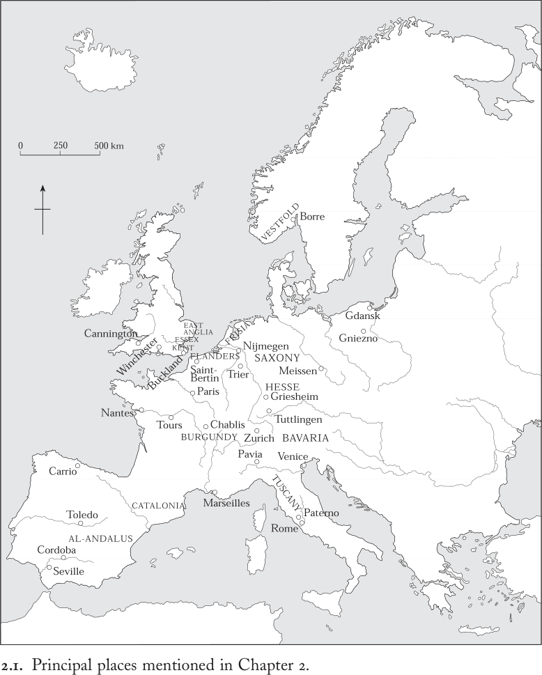
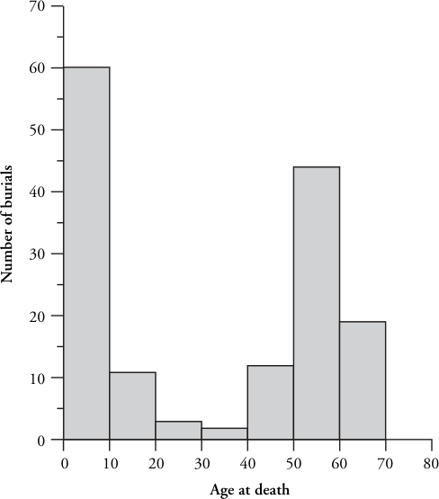
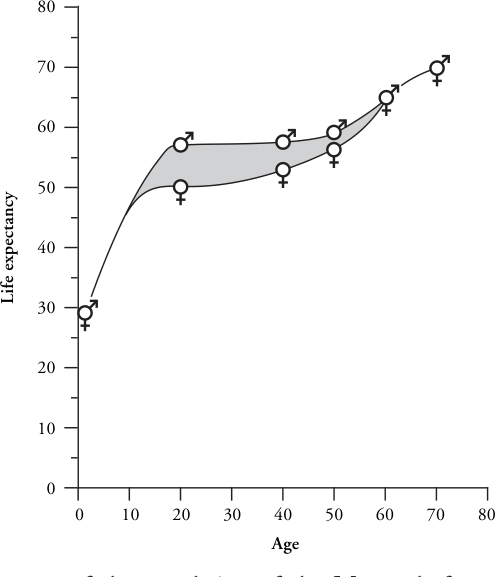
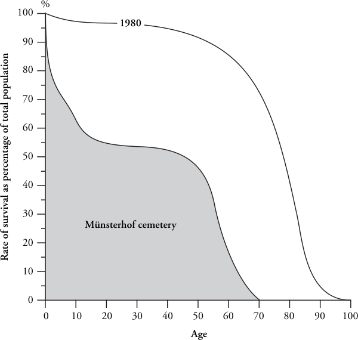

# 第2章 · 生存与死

风暴压弯的枫树，
我为我的儿子悲恸，
我的孩子，他已把
身躯俯向大地：
不幸的人啊，
他的亲族被砍伐，
还须从床上
扛走骸骨。

父亲哀悼溺亡的儿子，婴儿吮吸着饥馁母亲尚有余温的尸体：中世纪早期的欧洲人在匮乏与死亡之中亲密地生活。面对间歇性的气候灾害、周期性的流行病和严酷的日常生活条件，欧洲的人口艰难地靠土地谋生，并抚养子女以延续其劳作。大多数人生活在生存线或其边缘；另一些人则在猝然死亡的恐怖和饥荒的可能之中，思索人类存在的意义及其道德品质。正如所有文化一样，生与死的基本节律构成了人类经验的框架，不仅塑造着任何共同体的年龄结构、成员的预期寿命及其对安全的追求，也影响着政治，滋养着对自然界的理解，并把人类安置于宇宙之中。

本章探讨人类与其自然环境之间的互动，并反思他们对这一环境的理解。它提出的一些问题并非都能通过文本研究解决，却可以借助对物质遗存的考古发掘与科学分析加以探讨。不过，先须作一些提醒。要通过追踪气候、土地利用和人口水平的变化来回答环境与人口问题，所需的考古研究既繁琐又昂贵。它只在有限的若干遗址上进行过：由此向外推衍便有过分概括之虞。虽然新发现中世纪早期前所未知的文献证据之事罕见，但新的考古发掘与调查却经常开展，新的科学分析技术也不断涌现：基于现有数据的结论仍有可能随后的修订。

鉴于上述限定，本章将考古证据与现存文献记录结合起来，以便把中世纪早期男女的感知与社会回应置于他们所居住的景观及其所享有的寿命的背景之中。因此，它把生与死既视为生物现象，也视为文化现象。第一节讨论环境：气候、景观与聚落分布。在此背景之下，第二节转向人口问题，估算人口水平，并试图解释似乎为中世纪早期所特有的生育率与死亡率的波动。最后一部分追问人们如何应对匮乏、疾病与死亡，并在一系列宇宙观念和医疗策略中寻求答案。在所有这些方面，浮现出的是一种强烈的地方性模式。

## 栖居地

中世纪早期的人们在其间生活、劳作与死亡的环境，不仅受自然资源和气候的影响，也受漫长的聚居与开发史前史的塑造。千百年来，人类活动从欧洲复杂的自然地理中造就了众多景观。这一互动始终是一个动态过程，贯穿中世纪早期，从自然界中塑造出人类的栖居地，并赋予中世纪早期生活以鲜明的异质性面貌。

让我们粗略一瞥那个自然世界的丰富与多样。它的某些差异面貌在今天一如在中世纪那样显而易见——例如，不列颠东南角低地的农业潜力与北部和西部山区的山地经济之间的对比，或地中海沿岸的橄榄和葡萄与法国北部谷物种植之间的对比。此类差异反映了地质构造与土壤类型同相关地区特有气候模式的相互作用。在城市的无序蔓延和机械化集约农业的时代，细微的地方性差异——如这块田与相邻田地间土壤的差别，或山谷两侧日照的不同——已不再那么明显。但在中世纪早期，一个微小地方相对于另一个小地方的独特性质，往往与整个地区之间的差异同样重要，因为每个共同体都与其周遭环境的潜力和限制紧密协调。农耕、饮食、纺织、衣着、陶器、建筑材料：在这个微观区域的世界里，一切都因应本地可得的资源而形成。各处之间的联系来自社会、经济和政治的纽带——后续章节将对此加以探讨——也来自河流与海岸、道路与小径，它们使各个聚落得以彼此往来。

中世纪早期景观多样性的其他方面，则反映了人类对自然环境不断演变的影响。其中一个标志是将新土地开垦为耕地的推进。在波河沿岸，古代末期意大利北部平原大部分仍覆盖着橡树林，砍伐森林只是从九世纪起才在此产生重大影响。同样，莱茵河与多瑙河以东的土地仍然林木繁密，虽然新来的移民从八世纪起便开始在这些林区开辟空地，大规模的砍伐直到十二世纪之前尚未推进到易北河以东。到十世纪，排水与河流渠化正在改变那些海岸线迅速变动、地势低洼的盐沼占主导地位的景观，如弗里西亚的圩田、东盎格利亚的沼泽地以及波河三角洲。尽管一位匿名的九世纪作家声称，弗里西亚人“几乎像水中的鱼一样生活，四面八方皆被水环绕”，^3 但考古证据证实，中世纪早期的弗里西亚沿海地区支撑着人口稠密的共同体。居民住在人工堆高的土丘（terpen）上，将集约农业与对周围盐沼和水道的广泛开发相结合。从这些聚落出发，他们开始向紧邻潮汐泛滥平原之上的泥炭沼泽推进，自九世纪起开掘排水沟渠，从沼泽中开辟出小块的耕地，并在新近干燥的土地上建立新聚落。早在十一世纪晚期大规模排水工程开始之前，弗里西亚景观的改造便已进行良久。在这类地区，需要特别发挥想象力，才能设想中世纪早期景观不断变化的面貌。

在另一些情况下，变化源于新作物与新技术的传播。伊比利亚半岛在这方面尤为显著，因为随711年穆斯林征服而来此定居的阿拉伯人和柏柏尔人引进了新的植物与灌溉技术。750年倭马亚王朝在大马士革被推翻后，该家族的重要成员逃往科尔多瓦，并于756年在西班牙建立了独立的政权——安达卢斯。在倭马亚诸埃米尔（如据说曾派人从其叙利亚故乡取来石榴籽和椰枣树的阿卜杜勒-拉赫曼一世，756–788年在位）的鼓励下，西班牙南部呈现出新的面貌，这不仅是由于引进了新的栽培植物，也是由于建立了在伊斯兰世界其他地方广泛实行的集约灌溉体系。在穆斯林统治下，安达卢斯诸城市周围的灌溉田带使得甘蔗、稻米和棉花之类依赖水源的作物得以种植，到十一世纪晚期，这些作物在西班牙南部已被广泛栽种。随着十世纪橙子的引入——它在规整园林中因其观赏价值而备受珍视——科尔多瓦、塞维利亚以及中世纪早期安达卢斯的其他城市令到访者联想起叙利亚的景观。

景观的变迁还须置于气候与天气的背景中加以评估。中世纪早期的作者无疑对气象的正常状态有直觉的认识，极端的反常天气会引起评论。748年，爱尔兰遭受“异常深厚的积雪，以致全爱尔兰的牲畜几乎全部死亡，此后世界又为异常的干旱所炙烤”。874年在法国北部，“漫长而严酷的冬天”带来了“如此巨大的降雪，以致无人记得见过类似景象”。^4 评论者还注意到气候与疾病或歉收之间的联系。据说820年的异常大雨导致了人畜的广泛疾病，使谷物和蔬菜在田间腐烂，并使那一年的葡萄收获量少而味苦。最糟糕的——其记录之精确也Certainly罕见——或许是838年12月26日淹没弗里西亚的“远超寻常沿海潮汐的大洪水”，它冲毁全部沙丘，使泥沙四溢，卷走了房屋、牲畜和2,437人。^5

然而，无论这些中世纪早期的观察者多么敏锐，他们不可能知道此类突如其来的危机标志着长期气候变迁循环的开端，而这一循环极其缓慢地改变了他们所生活的世界。只有将文献见证与现代科学技术相结合，才能大致重构公元后第一个千纪欧洲的气候史。在这个千纪的中段（大约公元400–600年间），整个北半球平均气温显著下降约1.5°C，导致降雨和洪水增多。其他的表现还包括北海低洼海岸线的海平面上升，爱尔兰西南部泥炭沼泽的扩张，阿尔卑斯山冰川的推进，以及冬季多雨的大西洋气候模式向地中海地区的延伸——这与本千年前期特征不同。到约700年，一种更为大陆性的气候模式——炎热干燥的夏季和严寒的冬季——开始留下印记。（九世纪西北欧冬季频繁的大雪和河流封冻即是其表征之一。）直到本千年的最后一个世纪，气温才重新升至长期平均水平之上，并逐渐在十二世纪形成另一个气候最适宜期，北欧的气温比约500年时高出近2摄氏度。

气候变化可能影响边缘土地维持耕作的能力，也无疑促成了中世纪早期聚落遗址的一些明显变迁。弗里西亚早期人造居住丘（terpen）的废弃与异地重建，与海水进退的各个阶段相对应。同样，随着中世纪早期爱尔兰西南部和不列颠西北部高地地区泥炭沼泽的扩张，当地社群停止耕种山坡田地，任其重新变为灌木丛和林地。在爱尔兰，肥沃的中部和东部低地谷物生产与畜牧活动增加的考古证据表明，人口向这些地区重新分布。一个研究得尤为透彻的例子是英格兰南部的白垩丘陵。在这里，七至八世纪地下水位逐渐下降，似乎促成了温彻斯特东南部山顶聚落的废弃。加之山坡土壤的持续侵蚀，这可能促使社群迁往沿海低地较黏重但更肥沃的土壤地带。相反，第一个千年最后三分之一时段的气候改善，或许有助于解释苏格兰谷物耕作的显著增加，以及谷物耕作传入北大西洋岛屿——尤其是设德兰群岛和外赫布里底群岛。

土地使用和乡村聚落的变化也常常源于社群之间及社群内部政治经济关系的改变。例如，考古证据表明，在斯堪的纳维亚南部部分地区，七世纪农业生产集约化伴随着广泛的政治变革。一个研究充分的例子涉及西福尔德郡的博雷，在那里，更大的田块和新作物标志着耕作的加强，这与一个精英聚居中心的兴起相关联，其证据是规模宏大、随葬品丰富的墓葬冢。显然，强大的首领们通过将自身意志强加于该地区的下层农民，正在打造更大的王国，其榨取产物或贡赋的方式我们只能猜测，但他们留下了景观的改变，作为其新获权力的见证。

类似但规模较小的结构调整，也促成了著名的“游动聚落”现象，这一现象影响了西北欧广大地区的许多乡村居住遗址。直到约700年，盎格鲁-撒克逊聚落往往或在其领地范围内逐渐迁移，或整体搬迁；在丹麦，聚落以这种方式持续游移，直至十一或十二世纪。在所有这些情形中，等级性减弱、剥削性增强的社会关系的出现，与不断变化的生态条件相结合，体现为空间重组和农业变革。

在我们所论时期的末期，意大利半岛为这一主题提供了一个研究尤为透彻的变体。文献与考古证据一致表明，从托斯卡纳以南几乎整个意大利乡村在十至十一世纪经历了居住地的重新分布。在一个通常称为“筑堡聚居”（incastellamento）的过程中，分散的农户聚集为单一的设防村落。这些村落通常建在先前无人居住、地势高于原先居所的地点。迁往设防地点，只是部分对十世纪意大利乡村日益加剧的不安全状况的回应——当时的乡村正持续遭受撒拉森人（来自北非的阿拉伯海盗）和机动性极强的马扎尔劫掠队的袭击。王公权威的削弱也是原因之一，因为它使地主得以自筑堡垒并驻兵其上，从中威吓邻里。然而，与暴力威胁至少同等重要的是农业经济性质与组织的转变，它们推动了筑堡聚居。在人口增长的时期，沉重的新地租和劳役强化了地主对乡村劳动力的支配，使得将佃户迁置于领主的直接监视之下成为有利之事。

人口流动的另一个方面是移民，无论自愿还是被迫。人口的暂时或永久迁移很可能伴随着中世纪早期的大部分族群间暴力。例如，我们听说易北河上游迈森附近的达莱明齐斯拉夫人，在906年屡遭马扎尔人攻击。这一地区“沦为如此悲惨的赤贫境地，以致达莱明齐人抛弃了自己的土地，投靠其他民族以求糊口”。^6 这类苦难因缺乏政治意义而大多未见记载，其实际发生频率必然远高于证据所明确显示的。我们也偶尔得知蓄意的种族清洗，它同样必然对聚落和土地使用产生过暂时影响。易北河以东撒克逊人的命运是最广为人知的案例：804年，查理曼通过大规模驱逐成千上万的男女和儿童巩固了他对萨克森的征服，将他们迁往帝国的内地。

诸如此类的迁移是聚落流动性悲哀而直接的体现。争议要大得多的是，五世纪罗马边防体系崩溃时，北欧长距离移民的程度。整个民族南迁寻找新家园的观念，最早由法兰克人、哥特人、伦巴德人和盎格鲁-撒克逊人在成功于原帝国行省境内建立自己王国之后所讲述的起源传说中提出。然而，正如我们所见，对于五、六世纪的社会与文化变迁，还存在其他有力的解释。^7 虽然聚落考古确实表明，五至七世纪之间日德兰半岛根部周围和今德国北海沿岸的人口有所减少，且某些地方森林相应扩张，但移民未必是其唯一原因，甚至未必是主要原因。

如果将注意力转向帝国边境内诸行省所发生的事情，我们的立论就更为稳妥，因为有组织的撤退是帝国公认的施政手段，并补充了难民逃离冲突地带前往帝国较安全地区的自发流亡。多瑙河边防的逐渐瓦解伴随着城镇的有组织撤退：先是五世纪最后二十年间沿该河上游南岸开始，然后约一个世纪之后沿其下游的巴尔干河段展开。480年代，来自诺里库姆的镇民、教士和圣徒圣髑被重新安置于意大利；随后在580至590年代，因斯拉夫人进攻而撤离巴尔干的撤退者和难民在希腊、爱琴海诸岛、意大利南部和西西里找到了更安全的家园。

意大利东北部也未能幸免于这种动荡。来自巴尔干和多瑙河流域、反复翻越东阿尔卑斯山的入侵与劫掠，造成了一种不安全的氛围，一直持续到七世纪后期。亚得里亚海顶端上方旱地上的城市和聚落因易受攻击而日益衰落。其居民在亚得里亚海环礁湖的岛屿上找到了更安全的避难所，新的社群在那里发展起来，最初是临时避难地，继而是永久定居点。从约800年起，位于里亚托岛上独立且日益强大的贸易定居点威尼斯迅速成长：它的兴起标志着该地区岛屿定居点对人口流失的大陆地区的新的主导地位。

在将中世纪早期的男男女女和儿童置于其栖息环境之中时，有两点浮现出来。第一，我们必须将乡村和城市聚落视为动态的、不断变化的，而非静止的、超时间的。居住遗址很少是稳定或永久的：它们坐落于一片遍布前代和前古遗迹的景观之中，无论是建筑物、田埂、墓地还是纪念物。随着人们迁移居所、改变耕作方式，他们在持续演变的欧洲景观上留下了印记。气候、自然资源的开发、可耕地的可得性、作物选择、居住地点、聚落形态和开发方式都在逐渐变化，各自促成了我们今日熟悉的欧洲环境。这种演变的一部分可以通过书面文献记录的逐年事件加以探察，但其大部分经历了数十年乃至数世纪的缓慢过程，唯有通过密集的区域考古才能辨识。我们如今对欧洲景观演变有如此多的了解，是历史学家与环境科学家密切合作的成果，也是历史视野从政治史或教会史事件扩展到对人类社会长期结构性变化的互补关注的成果。

第二，无论我们看向何处，都会遇到构成中世纪早期主导特征的地域性乃至地方性。景观、自然资源、气候、农耕体系、聚落分布和人口密度不仅随时间变化，也因欧洲各地区、各地方而异。栖息环境的差异性和多样性具有根本意义：尽管后续章节将探讨人类为克服微观区域生活的局限而构筑社会联系、经济交往和政治效忠网络所作的努力，但本章下一节将展示人类经验在整个中世纪早期如何仍受地方条件制约。以地方性的而非概括性的视角思考，我们才能理解中世纪早期生存与死亡的动态。

## 生与死

经过三年婚姻，达高尔夫的妻子维莉图塔于约590年去世。年仅17岁的她死于分娩，“身怀自己的厄运”。她的孩子“生于死亡之口”，与她一同死去；她悲伤的丈夫“在一次死亡中……哀悼着两位的安葬”。我们对维莉图塔短暂一生和达高尔夫的悲恸的了解，仅来自她的死所引发的一组慰悼诗，但这首诗仍然提醒我们：尽管生死密不可分，二者既是个人生存与死亡的文化经验，也是人类集体存在随时间延续的生物学基础。^8 维莉图塔和达高尔夫的案例引导我们思考关于500年至1000年间生与死的广泛人口学问题。本节探讨中世纪早期人口变化的性质，继而考察预期寿命和性别比例，以勾勒出本书研究对象诸社群的人口概况：维莉图塔的人生故事原来并不罕见。在上述区域和微观区域景观的背景下，本节还主张，生与死最好在地方情境中加以理解。

由于生与死既是文化现象又是生物现象，原则上可以通过文化证据和生物证据——即文献记载和人类遗骸——加以研究。然而在实践中，这两类证据无论单独使用还是结合使用，都难以轻易解答历史学家想要提出的问题。我们立即发现，在我们看来重要的事情，在中世纪早期很少以同样的方式受到重视。以年龄问题为例。意大利、高卢、西班牙和巴尔干的识字城市精英保持至约700年的一项晚期罗马习惯，是立墓志铭以纪念死者。这些墓碑中有许多注明死者年龄。所载年龄有时全然不可能，有时明确标注为约数——“德米提乌斯在世约三十七年”^9——且常常被凑成整齐得可疑的数字，那是符合社会惯例而非事实准确的年龄。看来很少有人确切知道自己多大年纪，年龄更多是一种社会角色问题，而非精确的时间长度。骨骼遗骸分析提供了另一种途径，但即便如此，对于已发掘的个体遗骸，也只能提供死亡年龄的近似值。

也没有人在意统计人口，因为一个地方住着多少人的问题在中世纪早期从未出现，即便出现了，也没有人有手段精确回答。因此，估算欧洲中世纪早期人口的证据从根本上缺失——但这并未阻止各种猜测的尝试。姑且信之，从斯堪的纳维亚到巴尔干，约1000年的人口估计值在4000万上下浮动。最接近人口普查的，是九世纪加洛林帝国少数几份地产清册和对大教会地产上劳动者状况的描述。如后文所示，若谨慎使用，这些材料可以为相关特定聚落的人口密度、性别比例和年龄结构提供近似估算。即便如此，这些证据仍然稀少而不可靠。

因为编纂者的目的并非人口普查，而是记录财政摊派和劳役，其中个人通常只有在负有赋税或劳役义务时才会被记载。这就是现有证据的核心问题：关于人口及其义务的统计记录，是既具有精细文书文化又拥有强势政府的社会的产物。如上一章所述，此类环境下留存至今的文献仅见于9世纪加洛林帝国的部分地区和10世纪末的英格兰，而来自al-Andalus（安达卢斯）埃米尔高度官僚化政权的文献则完全没有留存。在斯堪的纳维亚，11世纪之前没有任何书面文献，除了从墓葬考古学提供的间接证据进行推论外——且仅限于此类墓地证据得以保存并被分析的程度——别无他法可循。爱尔兰的情况也是如此，因为即使爱尔兰人的书写确实延伸到了某种记录形式，其痕迹也没有留存下来。至于斯拉夫人，至少直到10世纪晚期他们普遍以火葬而非土葬处置死者，对人口问题的考古评估必然无法进行骨骼分析。最好承认：我们无法说出中世纪早期欧洲的人口数量是多少。

虽然我们无法测量人口数量，但我们能够推知中世纪早期人口水平的某些相对变化。追踪这些变化要从6世纪地中海的城市开始：它们无疑很拥挤，但其中许多已不如两个世纪前那样拥挤。每座城镇不仅是其乡村腹地的焦点，也是跨区域贸易网络的枢纽。^10 因此，541年在尼罗河三角洲的珀路修姆爆发的腺鼠疫能够迅速从一个海港传播到另一个海港。这场瘟疫在6世纪余下的时间里频繁复发，此后间隔逐渐拉长，其人口影响在地中海东部尤为严重，因为持续的远程谷物运输助长了它的持续存在。该病于542年抵达西地中海盆地，在随后的两个世纪中反复蹂躏意大利、法兰西和西班牙沿海的城市以及北非，直到767年在南意大利最后一次爆发。但西地中海的远程航运比东部衰落得更早，这可能减轻了瘟疫在此地影响的严重程度。瘟疫偶尔也会沿罗讷河、埃布罗河和波河等主要贸易路线深入内陆，但其毒性随传播而减弱；它只有一次越过卢瓦尔河谷以北。

腺鼠疫症状明显且致死迅速。“那是一种即死。腹股沟或腋下肿起如蛇咬般的疮伤，感染者被其毒素如此吞噬，以至于第二或第三天便死去。毒素的力量夺走了患者的神志。”^11 在毒性最烈之时，疫情可能造成戏剧性后果：棺材短缺、集体掩埋、逃亡、城市崩溃。654年夏，瘟疫袭击了意大利多座城市。近150年后，教会史家执事保罗仍视这场浩劫如末日降临。“死者之多，以至于在罗马城，父母与子女、兄弟与姐妹两两并置于灵床，被送往坟墓。同样，这场瘟疫也使提基努姆〔即帕维亚〕人口灭绝，以致全体市民逃往山区和其他地方，集市和全城街道上长满了青草和灌木。”^12 无论实际死亡人数多少，这样的爆发留下了创伤性记忆和持久的社会失序感受。

从人口学角度看，瘟疫的影响无疑因地区和城市而异。它在罗马和马赛数度造成局部重创，在特里尔和托莱多只是一时之痛，而在南特或巴黎则完全没有出现——这些流行病造成了区域性的而非全局性的人口下降。事实上，腺鼠疫很少超出地中海繁忙的贸易港口及其紧邻腹地的范围，只有那里才具备其传播的前提条件。尽管如此，剧烈的疾病痉挛肯定也曾光顾大西洋欧洲和不列颠群岛更为乡村化和人口稀疏的地区。6、7世纪的爱尔兰和盎格鲁-撒克逊史料中出现过“黄瘟”、“儿童死亡”、“大死亡”和“痘疫”等提法，但这些措辞无法可靠地转换为现代医学术语。无论其确切性质如何，这些流行病都造成了严重后果。数位国王死于疾病，其死亡不可避免地使脆弱的王国陷入动荡。有时，整个地区似乎也遭到毁灭，如664年，其中一次疫情先蹂躏英格兰南部，继而北上，最终蔓延至爱尔兰。据比德记载，在诺森布里亚，“这场极其惨烈的瘟疫……带来了如此严重的毁灭，以至于一些曾经人口稠密的大村庄和庄园，只剩下一小撮流散的幸存者，有时甚至一个不剩”。^13

在评估流行病是否对欧洲人口水平产生重大影响时，我们无法超越比德式灾难的文学印象，去衡量究竟有多少人死亡或逃往未受感染之地。我们也无法确定人口水平是否在超过两三代人的时间内有所下降。我们应避免过度概括的诱惑，与其假设人口总体下降，不如将流行病引起的衰退与失序解释为短期性和局部性的，因地点而异，这才是最合理的解读。

同样的道理也适用于约800年起在史料中如此显著的粮食短缺。整个9世纪，饥荒平均每四年发生一次，10世纪降至每十年一次，但11世纪再次上升。其中许多属区域性影响：例如850年的莱茵兰、853年的萨克森、882年的巴伐利亚、889年的“各地”。^14 相比之下，爱尔兰这个以畜牧业特别著称的国家，在中世纪早期经历了反复的牛瘟爆发，对粮食供应和人类抗病能力产生深远影响。700年，“牛群死亡”在年初爆发，后果极为严重：“爱尔兰饥荒与瘟疫横行三年，以致人食人。”^15 然而，只有一次可以明确看出整个欧洲同时受灾。1005年的饥荒如此严重，“无人记得曾有过如此残酷的饥荒”，^16 又有食人报告：这场饥荒从不列颠群岛肆虐到巴伐利亚。但1005年可怕的饥荒毕竟是例外。总体而言，匮乏与灾难今年在此处，明年在彼处。没有任何远程食品贸易来平滑匮乏与丰裕之间的波动；同样，也没有一场普遍的苦难周期折磨整个中世纪早期的欧洲。

同样强调区域性的观点也适用于那些可能有利于人口增长的条件。维持人口增长的关键前提是定期而充足的食物供应。扩大耕种面积或强化农业技术都可以增加食物的可得性——其程度受气候和土壤肥力、劳动力供给和农业技术的限制。农业变革是否使中世纪早期的耕作更为集约，从而促进了人口增长？最恰当的回答仍然是强调区域差异。以法国的一小块地区为例：至少从8世纪晚期起，巴黎以西地区遍布水力磨坊，而向南仅50公里处，直到11世纪磨坊仍然罕见，因为不同的地质条件和土地持有模式延迟了其引入。无论是重犁的使用还是新作物的引进——二者都在许多不同地方得到印证——都呈现出相同的图景：变革是局部化的，且除技术知识外还依赖于诸多因素。至少，正如第五章将要论证的，一位新的、精力充沛的地主的到来可能带来相当大的变化。唯一似乎在任何地方都没有改变的是极低的谷物产量，即使在最肥沃的土壤上也是如此。尽管收成的质量无疑极不稳定，收获量仅为播种量的两到三倍似乎很常见：而且这批收成中还须留出明年的种子。如果中世纪早期乡村人口有所增长，更集约的粮食生产并非主要原因。

相比之下，欧洲许多不同地区提供的证据表明，开垦土地相当普遍，肯定从8世纪起，某些地方或许从7世纪就开始了。新定居点的考古遗迹、花粉沉积的古植物学分析，以及关于耕种向林地扩展的文献记载，都指向同一方向。无论证据来自爱尔兰、英格兰南部、苏格兰、法国中部、加泰罗尼亚、意大利北部和中部、阿登、黑森、巴伐利亚东部，还是波兰西部的核心地带，都一致表明耕种的扩展，尤其是谷物种植的扩展。无论是个人主动进行的小规模开垦，还是领主、教会甚至国王以充沛精力推动的更大工程，砍伐灌木或森林构成了中世纪早期农业变革的主要形式。可耕地的扩展或许应当与欧洲乡村人口的增长联系起来，因为它既预设了足以胜任此任务的劳动力供给，又带来了粮食供应的增加。当然，少数提供了特定时刻劳动力状况快照的9世纪庄园清册也强化了这样一种观点：到这个时期，土地资源已承受相当大的压力。9世纪中叶，属于圣贝尔坦修道院的南佛兰德土地，人口密度可能达到平均每平方公里二十人。巴黎塞纳河盆地圣日耳曼德普雷修道院的领地，平均密度更高，某些领地高达每平方公里四十人。

除了北欧谷物种植低地在9世纪已支持密集定居这一说法之外，地中海多山边缘地带还提供了更多线索。事实上，在加泰罗尼亚的高地山谷中，乡村人口可能已达到19世纪的水平。唯一容许对人口增长作出估算的文献，来自813–814年马赛圣维克多修道院在普罗旺斯的领地。这份庄园清册的证据表明，该地区某些地产上的人口增长比其他地产更快。据推算，圣维克多领地的总体增长率相当于一个世纪内人口翻了一番。如果这些计算多少可靠，它们意味着至少在9世纪欧洲的某些地区，人口能够以接近工业革命前夕英格兰所维持的速度实现短暂的增长激增。总之，从9世纪起，欧洲部分地区的不同时期都有明确的、虽属短期但相当可观的人口增长迹象。

8、9世纪的总体图景是：农业方法与技术的零散区域性变革、广泛的土地开垦，以及实现可观人口增长的能力。然而这些发展的累积影响有限，因为直到约950–1050年才有广泛而持续的人口增长的明确证据。中世纪欧洲持续的人口回升大约始于千年之交。在此之前的两三个世纪里，土地开垦和人口增长受到疾病爆发、频繁饥荒和气候恶化效应的抑制。

对中世纪早期缺乏稳定人口增长最可能的解释是：以粮食短缺和自然灾害为标志的生存危机的反复发作，打断了增长与扩张的时期。由于饥荒很少普遍发生，又由于暴雨、干旱和其他气候灾害的影响同样具有区域性或地方性，人口增长与停滞（甚至短期下降）之间的波动很可能也是区域性的且不连贯的。这一切表明，在中世纪早期，并不普遍具备支撑长时期稳定人口增长所需的资源。一个濒临生存危机边缘的人口，很难抵御歉收之年或牛瘟流行之时。虽然确实存在人口稠密的聚居区，但那种密度既不均匀也不稳定。简言之，整个中世纪早期，人口水平的变化率在各处都不可预测地波动。如果匮乏与灾难的影响是反复无常且不均衡的，那么人口增长也是如此。

人口要增长，需要持续的出生超过死亡的盈余。在评估生育率和死亡率时，墓地证据极为宝贵，因为细致的分析可以促使中世纪早期的死者遗骸提供大量有价值的信息，包括特定社群中的性别比例、预期寿命、疾病模式和流行的死亡形式。但须附带说明：骨骼分析并非精密科学，而且一座墓地理所当然未必容纳所有人（或即使是某一社区死者的哪怕是具有代表性的）样本，墓葬证据仍然鲜明地揭示出当时的男女生活、繁衍和死亡的具体境况。两处在时空上相距甚远的墓地说明了这种证据的潜力。

第一处是英格兰东南部的一处遗址，使用时间从五世纪末延续至八世纪中叶。在巴克兰（Buckland），至少有20%的社区成员在年满18岁之前便已死亡，而活到60岁或以上者仅约6%。在成年人口中，女性与男性之比为3:2，但女性的预期寿命明显较短：成年女性的平均死亡年龄为31岁，而男性为38岁。这些数字虽属粗略估算，却表明当时的人口面临着极为沉重的儿童死亡率、育龄期女性死亡率高企、女性过剩（这可能意味着男性经常离家在外死亡——死于战争或狩猎），以及老年人远较近几个世纪更少、更年轻的社会状况。此外，既然巴克兰附近的居民将5岁以下的婴幼儿另行埋葬于公共墓地之外，实际的儿童死亡率必然要高得多。位于不列颠西南部坎宁顿（Cannington）的六世纪墓地提供了一个更可信的数字：在那里，全部人口的64%在年满18岁之前死亡，且确实有15%未能活过一岁。

第二个例子是苏黎世市中心的明斯特霍夫（Münsterhof）墓地。它用作853年建立的圣母修道院（Frauenmünster）周边形成的早期城市聚落的葬地，并一直使用至十二世纪末。图2.2展示了其总体人口结构。

与巴克兰不同，年幼儿童及部分婴儿埋葬于此，但似乎在十一世纪之前，死胎和出生数周内夭折的婴儿仍被安葬在别处。在埋葬于明斯特霍夫者中，近50%未能活到18岁，至少30%死于生命的前五年，其中三分之二死于一岁之内。就围产期、婴儿及儿童死亡率而言，九、十世纪苏黎世人口的损耗率与巴克兰或坎宁顿大体相当。相比之下，苏黎世的成年人口则颇为不同。男女比例更为均衡，为五男六女之比，这与中世纪盛期的许多其他墓地一致。此外，成年人口的平均死亡年龄表明，苏黎世的生存保障明显优于巴克兰：大多数成年人死于50至60岁之间，少数人活到60岁以上。尽管如此，图2.3所揭示的男女之间仍存在明显差异：20岁男性的平均预期寿命为57岁，而同龄女性仅为49岁。在这种环境中，分娩始终是一个不容忽视的危险，因为超过三分之一的成年女性死于育龄期。

这些数字虽然只是近似值，却仍可引出几点一般性观察。首先，地区和时间上的差异再次值得注意：人口总体水平的显著波动反映了各地不同的生育率和死亡率。其次，如果平均而言有一半人口死于婴幼儿期或儿童期，这就意味着每一个长大成人的孩子，女性都要经历两次怀孕和分娩。为使人口水平保持稳定，每对夫妇必须生育四个子女，其中两个存活；若要人口增长，则须更多。还有一个不可避免的观察结论：出生与死亡紧密相连。死亡的风险在生命的最初一年——很可能甚至是最初几周——始终最大，而对成年女性而言，则集中在分娩前后。在这一点上，中世纪早期的欧洲与当今缺乏现代卫生条件和医疗的那些社区并无太大区别。因此，这一人口结构与当代西欧形成鲜明对照，如图2.4所强调的那样。

来自巴克兰、苏黎世等地的墓地证据揭示了中世纪早期生活质量的某些方面。骨骼遗骸所暴露的症状包括：龋齿磨损严重和脓肿等牙齿问题；愈合后弯曲或缩短的断肢；关节部位长期炎症和感染，患者因疼痛而终生畸形；以及困扰中老年人生活的关节炎、骨质疏松或脊椎病等令人痛苦的骨骼疾患。墓地有时还暗示某些疾病（如肺结核）在社区中长期流行，并揭示出 otherwise 无从知晓的个人生命故事：图特林根（Tuttlingen）的一位成年女性，其罗圈腿源于童年营养不良；格里赛姆（Griesheim）的一名男子，左腿在膝下截肢，却靠装有一只带防锈青铜盖的木腿活到了50多岁；苏黎世的一名先天畸形儿童，出生时脊柱严重扭曲；肯特郡的一名男子，左眼被刺伤，随后颅后又遭三记斩首打击。骨骼遗骸唤起了一个被疾病、疼痛和畸形所笼罩的世界，而私人仇恨与战争的暴力又不时使之加剧。

然而，单凭墓地证据并不能完全解释中世纪早期的生育和死亡模式，因为二者也受到一种无法通过考古探究的社会习俗的影响。例如，考古学无法阐明生育率是否受到刻意限制家庭规模的影响。从基督教时代之初起，教士们就一直徒劳地抨击避孕和堕胎，无疑，具有有效避孕和堕胎功效的常见草药在整个中世纪早期的欧洲广为人知。杀婴的个别事例也无法完全排除，尽管关于某些九世纪农民社群和维京时代斯堪的纳维亚存在系统性杀害女婴的说法仍然颇难令人信服。

这里有两个相互关联的问题。第一，与许多显示女性占优势的性别比的墓地不同，九世纪的地产清册一致报告男性多于女性。以杀害女婴来解释这一点，等于忽视了在农业地产劳工清册中女性往往被少记的充分理由。第二，刻意限制家庭规模的措施，与其说与性别相关，不如说更可能与贫困的束缚相关。就目前能够估算每对夫妇存活子女的数量而言，只有在王室世系或九、十世纪最富有、最有权势的大陆贵族中，超过三四个子女的家庭才较为常见。一项反复重申的反对堕胎的法令，为有意识地限制家庭规模与贫困之间的关联提供了重要证据：在对怀孕头六周内终止妊娠与胎动之后终止妊娠规定不同处罚之后，该条文继续写道：“但贫妇因抚养孩子之艰难而行此事，与娼妓为掩盖其罪行而行此事，其间大有区别。”^17 其他文本也对杀害孩子的贫妇规定了轻得多的刑罚。贫困可能迫使妇女堕胎甚至杀婴这一认识，逐渐成为教会法的既定内容，但墓地证据永远无法揭示这种现象实际发生的程度。

如果说贫困在社会光谱的一端抑制了生育，那么生活方式则可能影响了另一端的死亡率。对高等地位遗址出土动物骨骼的分析表明，中世纪早期的精英享用富含家畜肉的饮食，这些家畜被饲养至肉质最佳的早期即行屠宰，辅以野禽及野猪、鹿等猎物。而农民遗址的食物残余则表明他们食用的是老得多的牲畜之肉，这些牲畜的主要功能可能是提供羊毛、奶或畜力，而非肉类。更好的饮食以及获得当时有限的医疗资源的机会，或许使精英女性比其他妇女更容易挺过分娩的创伤，但她们的男性亲属却可能比其他社会群体的男子更容易早逝。十世纪德意志贵族为此提供了一个经充分研究且极端的例子。狩猎、战争、仇杀和司法决斗使奥托王朝贵族的男子锐减，他们的女性亲属——无论是献身基督教独身生活的姐妹，还是守寡的妻子和母亲——往往远比他们长寿。在这种背景下，死亡可能产生严重的政治后果。当统治王朝本身涉及其中时，其结果往往是激烈的继承纠纷，或由幼主继位——通常由其母亲监护。

在任何社会中，人口变化都反映了气候灾害和饥荒等外部因素，与家庭规模限制、避孕和堕胎观念、医疗知识以及某些社会群体中危险生活方式的盛行等内部社会习俗之间的复杂互动。中世纪早期的证据虽然零碎而印象化，却足以清晰地展示生育和死亡的主要模式。慢性疾病带来的身体痛苦可能影响大多数人；地方性疾病不时因传染病疫情而加剧，瘟疫只是其中之一。在这些困境之中，婴幼儿、临产的妇女和贵族男子都面临着更高的死亡风险，然而欧洲人口仍在中世纪早期的进程中实现了增长。尽管各个社区经历了起伏不定的生育和死亡模式，但总体上升的曲线是清晰的。

此外，随着千禧年临近，人口变化的无常态势正让位于更为稳定的增长率，因为增长的束缚正在缓解。可以肯定，到公元1000年前后，气候总体上正在改善。文献证据表明，土地开垦工程正以更大的规模展开。地方性和区域性贸易网络不断强化，将粮食运往城镇，而这些城镇的发展——尤其在意大利北部和低地国家——必然依赖于农村剩余人口。^18 到十一世纪初年，欧洲的人口与经济正进入一个持续增长的时代，这一增长将延续至十三世纪。中世纪盛期的发展并非凭空突然出现，但它确实巩固了此前一直踌躇不前或断断续续的变化。

## 面对灾难的回应

对任何中世纪早期的共同体而言，日常生活都意味着面对死亡与灾难。在这种无时不在的威胁下，男男女女不仅要抚养子女、勉强维持生计，还要努力理解他们所生活的世界，并尽其所能改善自身的处境。他们的回应受制于种种观念与假设：关于祸福的成因、人在宇宙中的位置、以及死后会发生什么。然而，要重现这些心态几乎是不可能的，一方面因为从物质文化推断态度、信仰和仪式存在困难，另一方面因为基督教的传播伴随着对旧有人类命运解释的压制。如后文所见，尽管基督教宇宙观在文献记录中占据主导地位，我们仍能捕捉到那些其他观念的一些痕迹。这一考察所揭示的，是中世纪早期的人们在面对制约其生存的种种灾难时回应方式的多样性与灵活性。

关于应对病痛、残疾与疾病的种种方式，证据尤为充分。我们可以将治疗技术与资源作如下分类：研习承自古代世界的书本医学的职业医生；掌握本地草药知识的民间从业者；活着的与已逝的基督教信仰治疗者；擅长运用教会仪式进行治疗的神职专家；以及护身符、符箓、祷文和咒语等传统做法。然而在实践中，这些界限并不分明，因为一些圣人拥有医学知识，而神职人员有时会仔细抄录草药方剂，将其与基督教祈祷及咒语式的念诵混合使用。这些证据通常无法呈现作为实践而非文本策略的治疗，这尤其是因为大多数方法实际应用的直接证据极为匮乏。不过似乎可以认为，专业性较强的资源分布稀疏且不均，因此任何一地所能获得的治疗选择很可能都十分有限。除了少数富人之外，对所有人而言，仅费用一项就足以排除几乎一切形式的外部帮助：职业医生为其服务或稀有药物收取费用；最近的圣髑所可能路途遥远、难以抵达，其看守者还往往期待可观的馈赠。大多数人只能依靠当地可获得且免费的技术。

然而，在诸多治疗方式中，人们对其中一种的了解远远超过其他所有形式，即基督教圣徒圣髑所提供的治疗。其中一些是二三世纪殉教者的坟墓；另一些则是圣男——较少情况下是圣女——的墓葬，这些人生前即以自身的虔敬缓解人间苦难而闻名，其事迹通常包括以祈祷和仪式治愈病人，有时还辨认并驱除基督徒认为居于受苦者体内的魔鬼。无论是否殉教，所有圣徒都被认为有能力成功地代求于基督教传统的上帝，为人类事务赢得有益的干预：其重要性反映了一种明确阐述的宇宙观，即认定某些人在生前与死后是超自然助力的特殊渠道。

随着基督教的传播，神职人员建立了新的圣髑所，或是将既有圣徒的圣髑迁往新的地点，或是推动人们将新近去世的宗教领袖尊为圣徒。在某些地方，这些圣髑所延续了前基督教时代曾寄于灵泉与树木之中或归于当地神明圣所的治疗力量；在另一些地方，则出现了全新的宗教景观，与先前的仪式场所竞争并最终取而代之。由于神职人员有记录圣徒所施治愈、驱魔（驱逐魔鬼）及其他代求事迹的习惯，基督教圣髑所的治疗成为中世纪早期各种治疗可能中文献记录最为完备的。

我们已经遇到过多位圣徒中的一位——马丁，以及通过他的代求而实现的诸多治愈中的一例。在作为图尔主教（371–397）、治疗者和行奇迹者度过了辉煌而富有争议的一生之后，他成为中世纪早期文献记录最完备、最受广泛崇敬的圣徒，其崇拜从苏格兰、爱尔兰一直延伸到西班牙和德意志。尽管位于图尔城外那座装饰华美的五世纪教堂中的陵墓始终是他崇拜的中心，但在约872年至885年间，出于防范来自海上的斯堪的纳维亚劫掠者维京人的威胁，马丁的圣髑曾被转移到沙布利的一座教堂中妥善保管。^19 热纳沃法正是在那里治愈了先天性的失聪与失语：她与其他朝圣者一同聚集在教堂门外，彻夜静默祈祷。记录她造访细节的神职作者，在描述她的治愈时借用了常见的宗教母题，将其表现为一个喷火的魔鬼与白发闪耀的圣徒之间的对峙，而后者轻而易举地取得了胜利。作者如此写作，依赖于基督徒中广泛流传的对于世界的理解：善恶之间的宇宙斗争体现于人体所显现的症状之中，而在这种斗争里，基督徒的救赎与肉体的治愈是同义的。基督教信仰的基本信条——救赎来自对基督的信仰——轻松地将圣徒纳入其中，使其成为神圣恩泽或惩罚流经的渠道。当他的治愈之手作用于热纳沃法时，圣徒宣告：“我是马丁，主耶稣基督藉着我乐意恢复你们的健康。”^20

基督教教义所依赖的宇宙观所解释的远不止个人的肉体疾苦：它也为死亡与灾难提供了解释。首先，《圣经》提供了一个参照与比较的框架。873年，“埃及人的古老瘟疫”席卷欧洲大部——那是一场蝗灾。蝗群飞起时，翅膀的嗡鸣充斥空中：“人们几乎看不见天空，仿佛隔着一面筛子观望。”神职人员抬着十字架和圣徒圣髑在受灾地区游行，“恳求上帝护佑他们免遭此灾”。^21 然而最重要的是，《圣经》呈现了一个典范：苦难与毁灭是上帝因个人道德败坏或社会失序而震怒的表征。在以基督教教义诠释现世苦难方面，无人比格里高利一世贡献更大。他一生大部分时间饱受病痛折磨，从《旧约》约伯的故事中汲取灵感与慰藉——约伯是虽遭疾病与苦难而信仰不移的典范。对格里高利私人生活适用的道理，也同样适用于他周围的世界。590年，当瘟疫肆虐罗马、连其前任佩拉吉乌斯也罹难时，当选教皇的格里高利向会众解释了这场瘟疫的缘由与补救之道：

看哪！上天震怒之剑正击打整个基督徒共同体，他们接连死于突然的杀戮。没有病症预示死亡的临近；正如你们所见，死亡赶在疾病发作之前降临。遭打击者来不及流泪悔改便被击倒。试想，那没有时间为自己行为悔改的人，将如何面对【末日审判时】严厉的审判者。我们的市民并非被零星带走，而是成批倒下：房屋空无一人，父母参加子女的葬礼，继承者先于他们进入坟墓。因此，让我们每个人趁死亡降临之前尚有流泪之时，投身于悔罪与哀恸之中吧。让我们在心中回想自己如何误入歧途、犯下何种恶行，并以泪水惩罚自己。“让我们以忏悔来到上帝面前”，并如先知所劝勉的，“让我们举起双手，将心向主仰望”。^22

无论苦难源于瘟疫、饥荒、维京人的袭击还是任何其他灾难，恰当的回应都是斋戒、祈祷与忏悔。从罗马到爱尔兰，凡基督教信仰找到信众之处，基督徒都会本能地通过忏悔游行与代求祈祷来安抚他们的上帝，正如873年蝗灾肆虐地区的地方神职人员所为。这类措施既可以是地方性的，也可以是普世性的。面对792–793年冬严重而广泛的饥荒，查理曼命令法兰克全境所有主教、司铎、修士、修女和神职人员举行弥撒、咏唱诗篇，命令所有人斋戒，并要求所有世俗与教会的土地所有者施舍赈济、供养其佃户直至下一个收获季节。同样，1009年当其王国因维京入侵而面临迫在眉睫的崩溃时，盎格鲁-撒克逊国王埃塞尔雷德二世（978–1016）命令“全体国民”采取相同的行动，以便“我们得以获得上帝的怜悯与慈悲，并倚靠他的帮助抵御我们的敌人”。^23 祈祷、忏悔与施舍是一种心态的实际体现：这种心态将人类的苦难归于灵性的亏缺，并在人与神之间关系的重新平衡中寻求对生理、环境与政治失序的救治。

在中世纪早期共同体面临的各种危机中，有一种特别引发了大量道德与实践问题：饥荒。一个问题是何为合法的食物。基督教教义倡导一种由多种标记界定社会边界的共同体观念，其中之一便是食物法规——一旦违犯便会污染个人与群体的行为规约。几类动物的肉通常被禁为不洁：与人共居的动物，如猫、狗和老鼠；因不正当接触血液或精液而受污染的动物；吃过腐尸或人尸的动物；以及被发现时已然死去的动物。然而，当食物匮乏时，饥饿的人们中很少有人还会按这些条目思考。例如869年夏，饥荒对法兰西中部的打击尤为严重。“无数人悲惨死去，以至于据说有人吃了人的尸体。据说还有一些人吃了狗肉。”^24 一个颇为不同的道德问题是谷物的公平价格。585年春，谷仓中的存粮远在下次收获之前便已耗尽，商人们“残酷地盘剥民众”，以暴涨的价格出售仅存的酒和谷物。挣扎求生的家庭靠晒干并研磨葡萄籽、榛树柔荑花序、蕨根或田中玉米的幼苗，来勉强补充所剩无几的面粉。我们也知道那些完全买不起谷物的人的境遇：“另有许多毫无面粉之人采集各种草类充饥，结果腹胀而死……穷困者将自己卖身为奴，只为换取一点食物。”^25 正是为了缓解此类境况，查理曼在792–793年对粮价进行了管制，以防止地主追逐暴利而背弃其施舍义务。正如这项立法所表明的，价格与利润更多是宗教关切的对象而非经济规划的事务，但施舍至少起到了向最需要者重新分配食物的作用。

然而，基督教既未垄断对灾难的解释，也未垄断可行的补救之道。在基督教传入未久的地区，新宗教本身的有效性可能成为问题。英格兰南部的政治精英在664年瘟疫之前不过一代人左右才接受新信仰：作为对疫病蔓延的反应，东撒克逊人“背弃了基督教信仰的圣事而叛教……他们开始修复荒废的庙宇、崇拜偶像，仿佛如此便能保护自己免于瘟疫”。^26 数世纪之后，德国传教主教奎德林堡的布鲁诺（1002–1009）向东欧的马扎尔人、波兰人和佩切涅格人传教。他还撰写了布拉格的传教士阿达尔伯特的传记，以自身经历来揭示阿达尔伯特于997年在格但斯克附近殉教之前所遭遇的困境。在描述最终导致阿达尔伯特死于其手的普鲁士人的敌意时，布鲁诺将他们对基督教的抵制表现为将传教士的到来与土地的贫瘠相等同：“‘由于这些人，’普鲁士人说，‘我们的土地将不再有收成，我们的果树将不结果实，新牲畜不能出生，老牲畜死亡。’”^27 像布鲁诺这样敏锐的传教士明白，在争取丰饶的斗争中，宗教与灾难对非基督徒而言正如对基督徒一样密不可分。

然而，中世纪早期欧洲的许多男女，既不具备格里高利大帝那样博学的世界观，也不生活在非基督教共同体之中。毋宁说，他们的基督教在对世界的理解与回应上呈现出丰富的多样性，因为基督教的传播是一个漫长的文化接触过程，其日常内容在数百年间始终处于协商之中。如第七章将要论证的，高级教士固然对应对挣扎于生存线上的乡村人口所关切的紧迫问题——牲畜与田地的丰产、孩子的健康、风调雨顺——有自己坚定的基督教实践主张，但他们在推行这些主张方面收效有限：地方共同体及其乡村司铎坚持使用更为多样的解决办法，以应对严酷生存的种种困难。当我们思考天气问题，尤其是可能毁坏收成的夏季冰雹时，这一点表现得十分清楚。整个中世纪早期普遍存在两种相辅相成的信仰：其一，恶魔是多余的降雨和冰雹的罪魁祸首；其二，存在“制造风暴者”——男人，偶尔也有女人——人们可以求他们转移恶劣天气，或者让冰雹降落在遭人憎恨的邻居的土地上。为实现所期望的天气而采用的方法，包括向圣徒、“制造风暴者”及其他被认为有能力干预者祈祷和念咒；口头的和书写的符咒、勒令和祷文；支付保护费，以及种种其他手段。

其中许多做法主要因教士的一再谴责而为人所知，但西班牙西北部一份特殊的文献确实让我们看到，一个人实际上做了什么来抵御冰雹。在八世纪末或九世纪初，一位“上帝的仆人”奥里奥卢斯撰写——或请人代为书写——了一道护符，以使冰雹远离他和邻居们的田地。他将两片写有文字的石板对折并用文字朝内的方式系紧；在念了九道确保其效力的咒语之后，他将其埋在卡里奥附近自己的田里，直到1926年才被农民挖出。奥里奥卢斯勒令“众族长米迦勒、加百列、塞西铁尔、奥列尔、拉斐尔、阿纳尼埃尔、马尔莫尼埃尔，你们手握云彩者”，要他们“翻越群山而去，无论公鸡啼叫还是母鸡咯咯，无论犁田人犁地还是播种人播种，皆不得返回”。他还勒令撒旦不得伤害树木、庄稼、葡萄藤和果树，并加上了归于圣克里斯托弗名下的向上帝的祈祷文，最后以“以圣父、圣子和圣灵之名，阿门，阿门，永远阿门，哈利路亚”结束。^28 奥里奥卢斯的石板不仅表明了持久的地区性文字习惯的延续；^29 还显示出一种广谱式的消除冰雹的方法：同时呼唤大天使、圣徒和撒旦，将祈祷、咒语和勒令混合成一种由多样的传统做法和地方智慧调制的强力鸡尾酒。

奥里奥卢斯所关心的是实际事务，但对许多中世纪早期的人来说，恶劣天气、瘟疫以及自然的其他反复无常，在人的经验中也占有预兆性的位置。例如，彗星的出现“预示着饥荒或瘟疫或战争或大地的毁灭或可怕的暴风雨”。^30 天文学方面的专家——以及关乎王国罪孽方面的专家——随后会对彗星的意义作出论断，而怀有政治意图的编年史家和评论者也会就彗星的含义发表自己的见解，对蝗虫、疾病和其他此类征兆同样如此。事实上，九世纪加洛林宫廷的作者们如此频繁地将天灾报道为叛乱、维京人进攻或国王死亡的直接先兆，以致其中某些“灾难”很可能是修辞性的信号而非实际的苦难。自然界的失序已成为人类社会衰败的标志，是动荡与混乱的镜像。对于一些思考人间事务应有秩序的博学之士而言，这也是一个可能的迹象，表明善与恶的宇宙斗争可能正按照《圣经·启示录》预言式异象的方式接近终局。

在公元1000年前后的几十年间，对末世的思考（末世论）以及对可能暗示其临近的种种征兆的审视都增强了。约克大主教伍尔夫斯坦（1002–1023年在任）对这一切并不陌生。他在1005年严酷饥荒之后、并在1014年英格兰面临极端政治动荡之际，散发了一篇布道文，总结了中世纪早期关于天灾、社会秩序与世界末日之间关系的思想。

亲爱的人们，请认清真相：这个世界行色匆匆，末日临近；因此在世间，事情每况愈下，而且因民众的罪孽，在敌基督来临之前，情况必然大大恶化，届时全世界四方上下都将充满恐怖与可怕。

……

因为我们所有人都清楚明白，我们以往所犯的罪远多于我们的悔改，所以许多灾祸正侵袭这个民族。无论国内还是国外，长期以来情况都不好，毁灭和饥荒、焚烧和流血在每一个地区一再发生；偷窃和杀戮、叛乱和瘟疫、牲畜疫病和疾病、恶意和仇恨以及强盗的劫掠给我们造成了极大的伤害，苛重的赋税使我们备受煎熬，恶劣的季节也屡屡使我们颗粒无收。因为如今多年来，看来在这个国家里，到处都有许多不义和摇摆不定的忠诚。

伍尔夫斯坦以经过时间检验的药方结束其训诫：“转向正道，在某种程度上停止作恶，并为我们的过犯热忱赎罪。”^31 无论世界末日看起来多么临近，总还有时间忏悔。

关于千禧年究竟何时到来虽有学术分歧，但千禧年来了又去，世界并未终结。这并未推翻灾难自有其意义——无论是作为预兆还是惩罚——这一观点，因为人的行为与自然元素的行为之间的关联实在太过根本，无法如此轻易地切断。无论是探讨博学精英的神学化思考，还是试图理解那些视皈依基督教为招灾引祸之人的心态，抑或考察困顿的农民借以控制充满敌意的自然力量的种种手段，我们处处都发现一种根深蒂固的假设：人间事务不过是远为宏大的宇宙秩序的一个方面，这一秩序可能因错误的行为而紊乱，也可通过适当的精神努力和行动而恢复平衡。据此，本章所考察的对灾难的实际和智识回应在我们看来都是可以理解的，尽管其中许多曾遭到高傲的主教和立法者的否定甚至讥讽。

1002年1月24日，皇帝奥托三世在罗马以北的帕泰尔诺死于突发高烧，年仅21岁，未婚且无子嗣。同时代人将他的死归因于“意大利病”，很可能是疟疾。^32 他自己的早逝以及十八年前他的父亲奥托二世28岁早逝，都尖锐地提醒我们：即使是中世纪早期最强大的统治者，也和常人一样容易死于疾病和猝死。奥托二世至少在六个月前通过让襁褓中的儿子当选共治者而确保了继承，但奥托三世对继承问题毫无安排：他的英年早逝使其帝国——一个从波罗的海延伸到意大利中部的庞杂聚合体——陷入动荡。事实上，在中世纪早期的这一次以及无数次其他场合中，死亡和灾难的政治影响不可低估，因为饥荒和疾病可以像猝死引发继承危机一样，轻易地使一场重要的军事远征半途而废。也许是出于对这种脆弱性的认识，也许是幼年时师傅们灌输的世界观所致，奥托三世将他的统治诠释为对正确的政治、宗教和社会秩序的复兴，以此推迟末日的开启。为此目的，他的行动果断坚决。他使永恒之城罗马成为其阿尔卑斯山以北帝国的首都，成为自四世纪以来第一位在那里停留超过匆匆一瞥的统治者。^33 1000年，他前往格涅兹诺，在那里开创了对新近显圣行奇迹的圣徒——布拉格的阿达尔伯特——的崇拜。而作为对《圣经》预言所说的世界终结时将会发生之事的提醒，他让自己置身于启示录式的意象之中。996年在罗马举行皇帝加冕礼时，他甚至身披一件“其上用金线绣着整部《启示录》”的斗篷。^34

奥托的统治浓缩了本章的许多主题。他因高烧猝死是典型的意大利式死亡——在那个时代，疾病和饥荒一样，几乎总是局部性的而非普遍性的发作，而且发病形式因地区和栖息环境而异。从他在奈梅亨附近的出生到他在帕泰尔诺的去世，他往返跋涉于阿尔卑斯山南北的辽阔地域，亲身经历了构成欧洲的由各种景观和地方拼合而成的马赛克，其范围从今天的荷兰一直到波兰和意大利。他对末世论的关注，是试图以基督教宇宙论赋予其统治以意义，并将自身置于人类历史——过去、现在与未来——的宏大叙事之中。他对布拉格的阿达尔伯特圣髑的分发，表达了普遍的基督教观念：治愈及其他形式的神圣恩泽从受封圣徒的遗骨中流出。然而，尽管他敏锐地意识到自己肩负着引导帝国走向基督教扩张和罗马复兴的使命，奥托不可能知道他统治的人口——正如欧洲其他地方一样——正在稳步增长，也不知道欧洲的气候正在改善。在其短暂的一生中，他也不太可能注意到景观面貌的变化，如森林被砍伐、新定居点建立、旧定居点迁址。而且，尽管罗马是其政治和世界观的核心，奥托不可能意识到，在他与最后几位西罗马皇帝相隔的几个世纪里，这座城市已经发生了何等程度的转变。当我们在第八章造访罗马时，将会看到其人口只剩昔日的零头，城市景观已经乡村化，地貌已经改观。罗马比任何其他城市都更能集中体现那些高度地方性的变化——正是这些变化使得中世纪早期欧洲人生活与死亡于其中的世界如此复杂，同时又如此充满活力。
