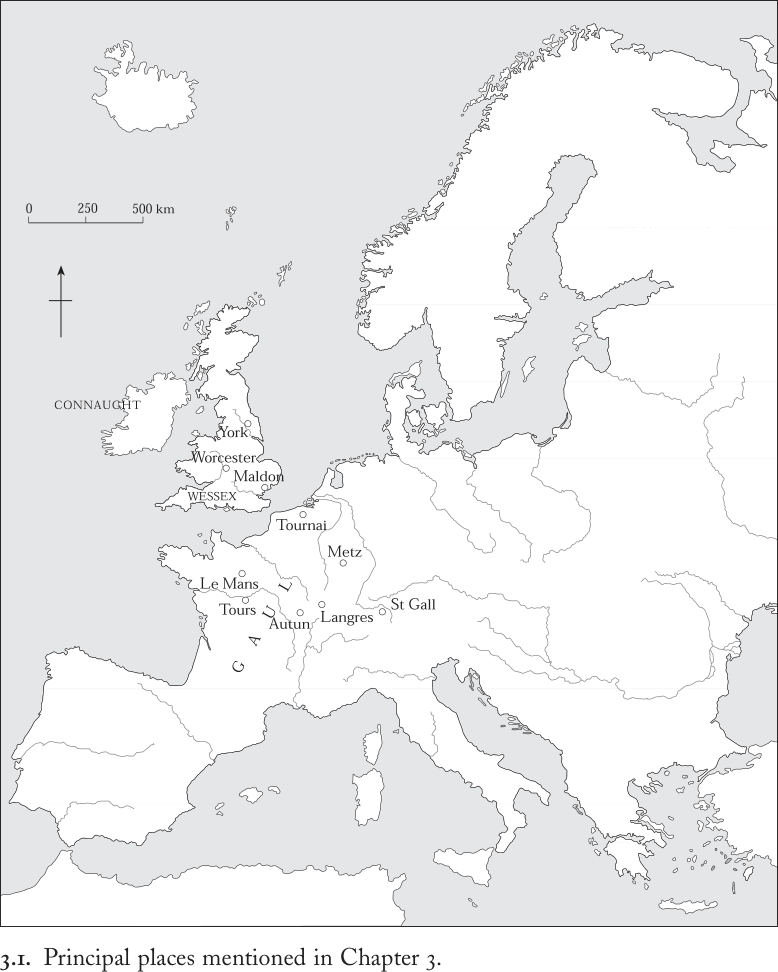

# 第3章 · 亲族与朋友

幸福时光里，一个人的近亲会喜爱他；然而每个人终将彼此分离，因为主的旨意是要把这可怜的躯体交付尘土。^1

凡自然所结合之物，皆宜和谐相处——正是自然将亲属之间的友爱联结起来。^2

诚然，在任何共同体中，一个人的亲属喜爱他，便是幸福时光；但正如一位匿名的盎格鲁-撒克逊诗人所认识到的，死亡会割断并重构家庭关系。同样，亲属之间的情感，尤其是他们彼此间的友谊，或许是合宜的，但现实很少符合所谓“自然的”神话，因为尽管父母与子女、兄弟与姐妹、叔伯与侄甥之间的纽带是人类任何社会中最为有力的联系之一，它们也可能是最令人忧虑的关系之一。因此，探究亲属关系在中世纪早期的意义，就是考察男女构建人际关系、对其社会世界作出选择、表达情感与理想的最重要途径之一。对这些纽带的思考也能阐明个人身份、亲缘形式以及根深蒂固的思维习惯。

本章贯穿三个主题：亲属关系在当地多变的社会形式与文化表达；它们作为宣示——或争夺——权力与权威的普遍框架；以及血缘亲缘与友谊亲缘之间的平衡。每一节探讨不同的侧面。第一节运用命名模式、宗教追思方式以及谱系记录，论证家庭传统有助于构建个体的社会身份意识，并强调父系传统往往优先于母系传统的倾向。第二节转向男女原则上可以期望从亲属处获得支持的种种情境，但同时指出，在实践中，在给予与获取帮助方面，友谊纽带至少与家庭纽带同等重要。最后一部分探讨男女各自不同的荣誉行为规范，论证女性规范比男性规范更加植根于家庭关系。这三节都摒弃将亲属关系作为一种社会过程的运作方式加以笼统假设的做法，而是强调个人选择与具体情境以及更广泛的权力关系的重要性。

然而，我们必须一开始就意识到，“亲属关系”有两种不同但并非无关的含义：其一，是个人与以血缘——即共同的血统——界定的群体的隶属关系；其二，是通过婚姻或其他结合策略在血亲群体之间建立的联盟。在中世纪早期，两者都很重要。此外，我们必须注意，这些亲缘关系既可客观界定，也可主观界定——一方面是依据明确陈述的社会规则被认为与某人有亲属关系的人；另一方面则是个人在特定时刻选择承认为亲属的人。正如将变得显而易见的那样，中世纪早期的男女两者兼用，且往往出于不同目的。研究中世纪早期社会的大部分困难，正源于后一类人通常比前一类人更为重要这一事实。

由此可见，“亲属关系”显然是一种社会建构的相互关系，而非单纯由生物因素决定的关系。这一事实在“谁是你的亲属”这一问题之外的若干层面上同样成立。收养在罗马法下十分常见，但在除爱尔兰之外的其他中世纪早期文化中并不存在，它是生身父亲与法律上承认的父亲身份不相吻合的一个尤为明显的例证。寄养——在中世纪早期的威尔士、爱尔兰和斯堪的纳维亚尤为重要——创造了另一种“人为的”亲属关系：男孩与抚养他长大的成年人之间的情感纽带，并不与他同父母的关系相吻合，而他日后正是从后者继承财产、法定权利与义务。基督教逐渐高度重视在洗礼中所创造的精神亲属关系，即教父母与教子之间、以及孩子的生身父母与精神父母之间的关系。教会认为前一种纽带与孩子同生身父母的纽带一样牢固；而后一种——“共同父母”之间的关系——则被视为等同于亲兄弟姐妹之间的关系。可见，“自然”对中世纪早期的“亲属关系”贡献相对有限，这种关系实际上远比初看之下更为复杂和灵活。

现存史料的性质妨碍了我们充分领会所有这些细微差别。法学家与立法者关注财产、暴力以及对无自卫能力者的保护，因而对亲属之间的互动远比对朋友之间的互动更感兴趣。尽管关于亲属事务的丰富指导得以留存——或由国王颁布，或汇编于法学家的法典之中——但无论在地理上还是年代上，其分布都不均匀。尽管如此，对于某些地区和时期，如六世纪的高卢、七世纪的爱尔兰或十世纪的韦塞克斯，这些史料使我们得以构建一个关于亲属关系（以及社会关系的其他形式）在理想状态下应如何运作的概略模型。然而，要超越规范与期望、深入社会习俗与惯例，则需要截然不同的文本记录。文献形式的证据往往是轶事性的，只能提供一幅宏大图景中的狭窄一瞥。其他史料或是经过戏剧化处理、对貌似可信却非历史情境的诗歌式追忆，或是浸透着作者偏见与狭隘认知的教士谩骂——这些独身精英被训练得蔑视家庭与性爱的一切方面。朋友与亲属之间互动的历史现实极难确切把握，尤其因为即便我们能够把握这种现实，通常也仅限于社会上层——地方权贵、贵族、王室——而对农民则几乎完全无从知晓。

我们可以以七八世纪的伦巴第意大利为例，说明其中的某些困难。涉及家庭互动的王室立法大量留存，其中最著名的是国王罗塔里（Rothari，636—652年在位）于643年颁布的《敕令》。在就自由伦巴第人事务中国王深切关注的问题立法时——如财产继承、订婚与婚姻的正当程序，或指控谋害亲属——罗塔里的法律条条都以与当事人之间的关系来表述：父亲、母亲、继母、兄弟、姐妹、叔伯、堂表亲、侄甥均有提及。法律还频繁提及其他“近亲”，却未具体指明这些人的身份。因此，正如立法者所设想的那样，伦巴第人的亲属关系不仅以个人为参照点，而且顾及具体情境的需要。然而有时，远得多的亲缘关系也可能至关重要，尤其是在涉及财产继承之时。罗塔里颁布法令规定，凡主张财产权利者，必须能够说出七代以内所有祖先的名字，并且必须提供愿在王室法庭法官面前就其亲缘关系的确切性质起誓的亲属。因此，在确保土地仅由能证明有血缘请求权者继承这一至关重要的事务上，伦巴第法将“亲属”界定为一个七代的世系群体。有多少伦巴第人能够说出自己七代以内的世系，追溯到从同一位高祖之父（远至第六代祖先）传下来的亲族，而且——至关重要的是——使自己的说法与亲属们的故事相一致呢？可见，在主张土地所有权时，法律理论将权利界限定在七代之内，尽管有记载的法庭案例表明，亲属关系的主张在实践中可能以截然不同的方式运作。

罗塔里的《敕令》清楚地表明，在同一个共同体中，多重亲属观念可以依据情境与目的同时发挥作用。伦巴第意大利并非孤例：对中世纪早期的所有文化都可以得出类似的结论。但我们不妨暂时停留在伦巴第法律上，因为它例证了另一个一般性观点。罗塔里假定自由伦巴第人居住在包括家内奴隶和半自由的男女以及自由成员在内的家庭之中。国王虽然当然设想这些家庭可能以丈夫、妻子及其子女为核心，但他的法律也将其他家庭模式视为理所当然。例如，一个家庭可能由一个兄弟、他守寡的姐妹以及若干未婚姐妹组成，此外还有奴隶和其他依附者。它也可能是一群兄弟在父亲死后继续同住于父亲家中，或者是父亲与孙子们——已故儿子的儿子们——也可能是父亲与尚未成家的儿子。罗塔里提及的另一种组合是父亲、前妻所生的子女以及他们的继母。最后这种模式可能尤为常见：鉴于我们对中世纪早期死亡率的认识，许多儿童很可能是在缺少生身父母一方或双方的家庭中长大的。

简而言之，罗塔里的《敕令》清楚地表明，中世纪的主要社会单位并非核心家庭，而是家庭户。现代思维将同住户居的世系群体视为一个由父母和子女构成的独立社会单元，偶尔加上第三代的近亲（祖父母）或旁系亲属（例如一个兄弟及其妻子和子女）。但这种思维方式只是从十八世纪起才成为习惯。中世纪的词汇familia最贴切的译法是“家庭户”，而且没有任何术语与现代的“核心家庭”相对应。尽管在实践中一个familia通常以夫妻单元为核心，但这个词及其社会群体都涵盖了仆役、依附者，有时还包括其他近亲。其确切成员是流动不定的：年长者死去，守寡的姐妹回到娘家亲族那里，养子来而复去，或者新购入奴隶、依附者被重新调往别处任职。因此在实践中，一个familia包括任何一个时期处于男性家长权威之下并在其产业上居住的所有人——即便不住在他本人的宅邸，也住在他的地产上的其他地方。

只要我们考察中世纪早期男女老幼的居住模式，就清楚我们必须以家庭户而非核心家庭来思考。即便是王室宫廷也不过是放大了的家庭户。想想查理曼那异常庞大的帝国。其家庭与政治中心是当时的王后或宠妾，他的女儿们（但不含儿子们，因为儿子们度过幼年后便被送往远离父母宫廷的地方去治理副王国），晚年时还有若干孙辈，以及一大批官员、家仆、管事、教士、文书、猎手、厨师，以及维持如此庞大的家庭户和治理庞大帝国所必需的其他人等。而在另一端，中世纪早期的农民也生活在家庭户中，通常与妻子以及或许若干子女同住，有时还包括奴隶或其他半自由的依附者。如果他们是大地产上的佃户，其家庭户甚至可能包括领主或其管家拨给他们的大批或年老的农奴。

因此，现代人对“家庭”一词含义的假设并不容易套用于中世纪；以下各页使用“家庭”一词，仅作为一个宽泛而定义模糊的简称，指个人承认为与之共享血统、祖先、抚养关系或婚姻关系的所有人。

尽管“家庭”在“爸爸、妈妈和孩子”的意义上并非一个被承认的社会单位，但这一群体在所有社会层面上，无论就情感还是法律而言，都构成了大多数家庭户的核心。在这一狭小的群体之内，孩子们在母爱与父权塑造的环境中成长，因为男性家长对其依附者所享有的权利，与家庭生活复杂的情感现实相互交织。中世纪早期的史料展现了一个父母、子女与兄弟姐妹之间情感强烈的世界——一个为平安健康的分娩而欢喜、为孩子的夭折而悲痛的世界，一个充满夫妻恩爱、母亲对踏上自己人生道路的成年儿子安康的牵挂、兄弟间的帮助与友谊的世界。同样，这些史料也表明，同样强烈的失望、竞争与嫉妒，可能导致父母遗弃残疾的婴儿、丈夫抛弃妻子、兄弟之间结仇争斗，或儿子弑父。那时与现在一样，父母、子女、兄弟、姐妹、叔伯、姑姨是亲属，却不一定是朋友。

## 身份

……“或者你出身何种世系？
只需说出一位，其余的我便都知道；
年轻人，所有王国的各个族系我都了如指掌。”^3

在这部九世纪的叙事诗中，英雄希尔德布兰德（Hildebrand）如此向他的年轻对手发难。他表达了一种普遍的情感，因为在中世纪早期，除了像比德或拉巴努斯·毛鲁斯（Hrabanus Maurus）那样在幼年即被送入修道院的人之外，所有人终生都与社会身份紧密地同亲属联系在一起。既然社会人的塑造始于父母为新生儿取名之时，对亲属关系意义的探究就应当从命名开始。影响中世纪早期命名的习俗与偏好因时代和地区而异，但其大致轮廓相当清楚。当然没有必须遵循的硬性规则；相反，父母的决定往往反映了根深蒂固的文化习惯。除了某些王室婴儿的命名——其名字具有至关重要的政治意义——之外，我们通常无法确切得知父母为何选择某个特定的名字。尽管如此，显而易见的是，为婴儿取名赋予了新生儿一种身份，使其置身于一个亲属圈子之中，甚至可能预示着这个孩子未来将成为教士，或将成为祖传土地的继承人。另一种较为罕见但确实被采用的策略，尤其在爱尔兰和苏格兰，是以某位特定的圣人或宗教庇护者为孩子命名。

亲属关系与命名之间的紧密关联值得特别关注。在帝国早期（公元一至二世纪），正式的罗马命名程序使用三个名字来标明每个公民属于特定父系氏族——即一种由父亲而非母亲向后代传递成员资格与身份的世系群体——中的一个分支。为应对社会与政治变迁，更为灵活的用法到四世纪已取代了这些僵化的惯例，使名字不仅能够标示社会等级，而且至少在精英阶层中还能标示母系与父系两方面的世系。在罗马帝国晚期的西部，四、五、六世纪的贵族通常拥有两个、三个甚至更多的名字，其选取旨在传达对显赫祖先的自豪感以及对近亲的强烈身份认同。六世纪史家、图尔主教（573—594年在任）格里高利正是这些做法的典型。他的全名是格奥尔吉乌斯·弗洛伦提乌斯·格里高利乌斯（Georgius Florentius Gregorius），父系与母系双方都是富有而有势力的高卢贵族的后裔。他的名，乔治乌斯，是他祖父的名字（卒于502/6年），此人几乎可以肯定是五世纪高卢最富有、最显赫的贵族世系之一的成员。第二个名字取自他的父亲，而第三个名字——他选择以此为人所知——则是他外祖父的名字。图尔的格列高利以这位母系亲属的名字行世，绝非巧合。

格雷戈里乌斯·阿塔卢斯曾任欧坦伯爵，506年成为朗格勒主教；他卒于539年，距其曾孙出生不过一年或至多十八个月，死后立即被尊为圣人。图尔的格列高利通过自己的名字回溯母系三代之前的一位圣徒祖先，以此强调自己的血统、与圣徒的亲近，以及他对母系一方的认同强于对父系亲族的认同。

图尔的格列高利的多个名字表明，父母可以通过为孩子取名来确定其在家族中的位置。但这也代表了一种日渐衰微的传统，因为即便人们仍自视为“罗马人”，到格列高利的时代，单一名字已渐成习俗，至七世纪末，即使在拜占庭世界也已普遍化。然而，古老罗马精英家族中命名习惯的改变，只是我们这一时期开端时名字与身份之间关系的若干重要变化之一。五世纪间，罗马统治结构的解体以及新兴王国围绕日耳曼语精英的凝聚，凸显了所有日耳曼语言共有的独特命名模式。然而，这两个名字库并未长久地保持分离。在六世纪的高卢，名字反映了旧精英对新政治环境的适应，因为一些罗马血统的个人放弃了传统的命名习惯，转而采用其新法兰克主人的命名方式；相比之下，在西班牙和意大利，哥特人和伦巴德人有时也为自己的后代选取罗马名字。当取罗马名字的父母为孩子起日耳曼名字时（反之亦然），他们是在就文化威望和社会身份做出地方性的决定——这些决定完全出于融入统治群体的愿望，与口头语言毫无关系。

值得稍作停顿，考察一下日耳曼语言中名字是如何构成的。因为尽管“名字将新生儿与其祖先和亲族联系起来”这一惯例，在日耳曼语社群及其后裔中与在罗马人中间同样根深蒂固，但其中起作用的却是不同的语言和社会原则。日耳曼名字（非王室与王室皆然）通常由两个成分构成：词根和后缀。二者以各种方式传承和重新组合，并借此标示血统、族群属性和社会身份。其中一些成分见于所有日耳曼语言，但另一些为某一语言所特有的成分则成为备受重视的族群身份标志。

我们这一时期末尾的一个例子既说明了日耳曼名字的构成方式，也说明了一个名字可能承载的复杂意涵。约1008年，一对富裕的盎格鲁—撒克逊夫妇——教士埃塞尔斯坦及其妻武尔夫吉芙——生下一个儿子，可能是他们的第一个孩子。这个孩子后来成为主教和圣徒，其传记作者记载道：“他被命名为武尔夫斯坦，前半部分取自母亲之名，后半部分取自父亲之名。这孩子有美好的前程，为他取名于双亲的兆头同样美好，因为他注定要将双双方的圣洁汇于一身，或许还将超越之，无可比拟。”^4 这一对未来圣德的预兆强调了父母名字的成分如何被用来构成新名字，但这个孩子似乎也是以其舅父——约克大主教那位名人——命名的。这个名字大概预示了年幼的武尔夫斯坦将走上教会生涯。在为未来主教的两个弟弟取名时，埃塞尔斯坦和武尔夫吉芙再次标示了孩子们的父系出身——为他们取名埃尔夫斯坦和比尔克斯坦——但选取了其他成分来与父系后缀-stan组合。这些关于孩子名字的决定，可概括为围绕共同家族主题而自由选择的变体。

年幼的武尔夫斯坦确实成为了主教（伍斯特主教，1062–95年在任）。他的名字例证了名字成分如何被重新组合成一个新名字，同时又把孩子与父母联系起来；它也强调名字成分是双向传承的——换言之，它们可以同样轻易地取自母亲或母系亲属，正如取自父亲或父系亲属。尽管如此，凡在保存下来的名字样本足以进行统计分析之处，都清楚地表明，父母通常更愿意将孩子与其父系而非母系亲族联系起来。诚然，在加洛林帝国的贵族中，几乎所有孩子都以近亲（父母、叔伯姑姨、祖父母）命名，但可证实以母系亲属之名为名者不足五分之一。法兰克人的命名习惯并非完全排斥其他名字，但偏好近亲之名，而在近亲范围内，又更常标示父系而非母系关联。只有当母系世系拥有更显赫的祖先时，父母才倾向于选取将孩子与其母系亲族联系起来的名字。

到未来的伍斯特主教武尔夫斯坦出生之时，通过变换两个成分来创造名字的习俗已显陈旧。六世纪时，欧洲大陆的统治王朝已开始通过完整重复某位已故亲属的全名而非变换名字成分来为后代命名。这一习俗逐渐从国王传播到贵族，至十世纪末，越过英吉利海峡，开始影响盎格鲁—撒克逊的命名惯例。到约1000年，大陆精英普遍使用一个有限的名字库来标识家族成员，且对名字父系传承的强调愈发突出。当“卡佩”于格在旧加洛林统治王朝覆灭后于987年在法国加冕为王时，他继承的名字清楚地标识了他作为至少自九世纪中叶以来就在法国声名显赫的顶尖贵族家族之一的成员身份。他的男性祖先都名为于格、罗贝尔或厄德；其姊妹通常名为埃玛或阿德拉。到千年之交，名字仍是身份的标志，因为父母继续选取将后代与近亲和直系祖先联系起来的名字。但名字将孩子与父系亲属——而非母系亲属——联系起来的程度，更甚于以往。

如果说在孩子出生时命名将新生儿置于一个狭窄的家族圈子之内——扩展至堂表兄弟姊妹、祖父母，偶尔还有曾祖父母——那么死亡则为亲缘关系和社会身份的模式注入了新的因素。在八世纪及以后的基督教社群中，对灵魂来世福祉的关注促使许多人在修道院名册上登记其生者与死者的亲属之名，为他们请求代祷。这样的祈祷将生者与死者联结于一个礼仪共同体之中，通过在生者中间呼唤死者之名来召唤他们的临在。在法国、德意志和英格兰的数座九、十世纪修道院中登记的大规模名单留存至今，为我们考察个人与亲族关联的方式提供了另一重视角。德意志国王捕鸟者亨利（919–36年在位）即为典型：932年，他请求圣加仑修道院为他本人、他的妻子、他们的三子二女，以及其中一个女儿的丈夫、他妻子的父母及其三个姊妹祈祷。亨利对亲族灵魂福祉的关怀涵盖了三代人，并超出自己的妻子和子女之外，扩展到通过各种婚姻与他产生关联的人。在宗教纪念的语境下，“家庭”超出了个人的出生家庭以及他或她所属的婚姻单元，囊括了一个宽泛但仍具选择性的亲属群体。由于所关涉的是灵魂在来世的命运而非土地或世俗职位的传承，这种亲缘形式毫不迟疑地承认女性——母亲、妻子、女儿——享有与男性同等的地位。

在获取宗教纪念和为孩子命名的过程中，关于亲族纽带的观念各有不同。二者最重要的共同特征，一是承认亲缘关系涵盖两三代人，至多四代；二是接受女性有时可能对家族身份的界定做出重要贡献。这两个特征在个人利用亲缘关联建构社会身份的第三种主要方式——世系谱——中均不成立。世系谱是以《圣经》先例为范本的血统陈述。它们通常采取“X是Y之子，Y是Z之子”的形式，且与本章迄今讨论的大多数史料不同，它们照亮了不列颠群岛——尤其是威尔士和爱尔兰——的文化。大陆上留存下来若干王室的世系谱，但十世纪末之前没有一部追溯非王室人物的祖先；相比之下，在爱尔兰，自八至十世纪留存下来的数以千计的世系谱，不仅涉及国王，也涉及基督教圣徒和贵族。这些世系谱呈现了一种纵向的亲缘形式（可以延伸自数代至三十余代不等），几乎毫无例外地完全是男性的，并且全然无视兄弟姊妹或旁系亲属。

尽管许多此类世系谱中的某些部分所宣称的亲属关系可被证明在历史上属实，但它们更重要的是其所做出的文化和政治宣示。在所有中世纪早期社会中，对世俗权力、财富和地位的主张在很大程度上依赖于血统：世系谱使这些主张合法化。所呈现的亲族纽带是那些具有直接政治意义的纽带，因而只要政治需要，便可能被重塑和重排。这种操纵可能涉及对世系长度及其旁系分支的删削或增补。加洛林王朝（751–987）不仅将自己挂靠到其最终取代的墨洛温王朝（约480–751）之上，还通过一部世系谱将罗马的过去纳入自己的祖先谱系，宣称其圣徒化（且有史可考）的创始人梅斯的阿尔努夫（卒于约643年）是（虚构的）墨洛温公主布莉希尔德与其（同样虚构的）被尊为罗马元老的丈夫安斯贝尔特的外孙。其中有两点值得注意。其一，一位虚构的女性构成了这部原本纯男性的血统陈述中的关键环节。刻意省略王朝在现实中借以确立地位的有史可考的女性，确认了女性被排除在正式权威之外；而纳入一位神话中的女性祖先，却又承认了女性对王朝延续和家族记忆传承的根本贡献。其二，在准确的人类记忆所能及的范围之外，七、八世纪的历史事实渐次融入了创造性的意识形态乐观主义，并借助文本传承的关于遥远罗马过去的知识而得以强化。以任何最适合时机的方式操纵世系谱陈述的政治动机清晰可见。不过，作为一种利用过去宣示当代政治主张的方式，这部加洛林世系谱还算是相对克制的。在爱尔兰，强调世系古老悠长的需要，导致欧莱恩人与达尔·菲亚塔赫人的共同祖先被命名为“极老之子老者、极强之子强者”。^5 至此，我们达到了生物虚构服务于政治合法性的顶峰。

世系谱表明，亲缘关系既可以关乎基因意义上的父母血统，也可以同样关乎社会建构的关系——以生物血统的虚构和神话祖先的形式表达出来。而且，它们比任何其他东西都更清楚地表达了所有中世纪早期文化的父系倾向：被删削为一连串强者相继传承的赤裸陈述后，它们强调唯一重要的是从“父”到“子”的延续。但这些男性规范运作于一个从未有过单一、稳定的亲缘观念的世界之中。命名习俗和纪念仪式提醒我们，在这些情境下，被承认为亲族的包括男系和女系双方的近亲属圈子。实际上，亲缘关系在不同情境下意味着不同的东西。

## 血缘之友

现在是时候转向亲缘关系的更广泛意涵了，因为种类繁多的史料——法律的、文献的、叙事的、诗歌的、圣徒传的——都证实，与亲属的交往通常具有重大的社会和政治意义。这些史料还坚称，亲缘关系无法与友谊相剥离。然而，这些亲缘纽带的实际表现形式极为多样，其成因有助于解释亲属——以及朋友——在彼此生活中可能扮演的众多角色。

中世纪早期欧洲文化异质性的一个表现，便是多元社会规范的并存。我们在这方面的许多具体认识来源于法律记录，其内容与文本形式和权威来源一样纷繁多样。大体而言，可以辨认出三种法律文化，它们对亲缘关系的期待大相径庭。

社会关系，包括亲属之间的关系。在地中海欧洲，只要人口的延续和行政的延续使人们得以继续自视为罗曼人（Romani），晚罗马帝国的法典编纂便仍然有效。在北方，讲日耳曼语的移民带来了他们自己的社会习俗，这些习俗自六世纪起开始采取规范性的成文形式。这两种法律文化之间并没有泾渭分明的界限，因为后帝国时代的诸王所颁布的所有法典，都或多或少地透露出罗马法的影响，这一点在那些源于罗马势力持久存在的较南部地区的法典中尤为明显，特别是勃艮第、伦巴德和伊比利亚哥特诸王国。第三种法律文化——即濒临大西洋欧洲的操凯尔特语地区的法律文化——在形式和内容上都远不易受罗马影响，因为在那里，罗马的直接影响是有限的或根本不存在的。这三种传统各自对亲属关系的社会意涵提出了不同的看法。

需要说明的是，法律始终只能以间接且高度图式化的方式反映社会现实，就此而言，可以说每一种法律文化都大致对应于一种独特的社会组织形式。正如公元五世纪所编纂的那样，罗马法极为关注婚姻的规范以及确认男性家长对妻子和子女的权威；但它明确否定了成年男性的法律身份与其亲属相关联的任何观念。与此相反，世俗的爱尔兰法律论著清楚地表明，亲族集团是最基本的社会组织形式；这些论著对规范和程序的规定如此详尽，以至于可以对亲属之间理想的互动方式进行精细的重构。^6 晚罗马法和爱尔兰法对于亲属在彼此生活中应扮演之角色的预期都清晰可见。然而，在这两个极端之间，关于日耳曼语社会中亲属关系之意义的讨论却众说纷纭。

十九世纪的历史学家构建了关于早期日耳曼社会（一至七世纪）的宏大体系，将其组织为作为政治实体、维持和平与司法机构、征兵单位和聚居群体而运作的大型氏族。他们赋予这些亲族集团（通常以德语术语 Sippe 称之）以宪制上的重要性，并将其置于欧洲社会从氏族到核心家庭、从部落到国家——换言之，从“原始”到“文明”——的进化论进程中的显要位置。这一文化进步的范式早已崩溃，但关于早期日耳曼民族社会组织形式的这一基本观念却瓦解得较为迟缓：它同样必须被彻底抛弃。取而代之的应当是个体：每个人都拥有一张只与其同父母兄弟姐妹共享的血亲关系之网，以及因婚姻而与姻亲发生的一系列略有不同的互动。

在实践中，亲族从未作为一个持久的群体而存在。毋宁说，他们处处以一类人的形式存在，是一张潜在的亲和关系之网，随各个具体情境的需要而被激活和动员。婚姻习俗与继承策略这两个方面将留待下一章讨论。在此，我们将利用诗歌、文书和法律证据，来强调亲属关系在其他一系列情境中所固有的模糊性与不确定性。

现存于约公元1000年的一份抄本中、但起源可能要早得多的古英语史诗《贝奥武甫》（Beowulf），其故事背景设定在神话般的斯堪的纳维亚过去。然而，它的理想和价值观与其盎格鲁-撒克逊听众产生了共鸣，并在中世纪早期西方其他地区的方言诗歌中——例如爱尔兰、威尔士和德意志——也有密切的类似之处。《贝奥武甫》的戏剧张力很大程度上来自亲属之间理论上的义务与实际上的不可靠之间的冲突。虽然“对于一个思想正直的人，亲属的纽带|无论如何都不可割断”，但诗人也十分清楚，终有一天“血仇将再度掀起|誓约亲族间的刀剑之恨”。^7 要洞察亲属之间义务与敌意之间的紧张关系如何上演，我们可以求助于法兰克的《萨利克法典汇编》（Pactus Legis Salicae）。此书大约编纂于克洛维在位期间（约481–511年），是为居住在莱茵河三角洲与卢瓦尔河之间、但其文化尚未过度受罗马规范和法律程序影响的法兰克人所编纂的一部习惯程序与王室法令汇编。《汇编》清楚地表明，亲属应当在多种方面相互提供支持。如果一个人需要以宣誓来确立自己的身份，或证明自己的无偿还能力，他就必须找到与他共同宣誓的人：这些“宣誓助誓人”从他的男性亲属中招募。此外，如果有人被杀，凶手必须为所夺的生命支付金钱赔偿，否则就要冒血亲复仇（本章最后一节将讨论）的风险，而赔偿金要在死者的子女以及父方和母方的亲属之间分配。反之，如果凶手本人无力筹足全部款项，其亲属就必须帮助：首先是他的父亲和兄弟，若义务仍无法履行，则是他的母方和父方亲属。

这里涉及的是哪些亲属？当然有子女和父母——这个紧密团结的婚姻家庭群体，对身份、继承乃至生存都至关重要。除此之外，法律并未明言，只是笼统地提到父方和母方的“亲属”。因此，任何个体都与父母和子女处于特别紧密的关系之中，但也不得不进行协商，以便从更广泛的、双向的亲属圈子中获取所需的任何支持。这个圈子的构成不太可能一成不变，因为死亡会夺走父母和叔伯，而婚姻则在个体生命的不同阶段引入姻亲。此外，《萨利克法典汇编》设想个人可以正式切断亲属纽带，并概述了实现这一点的办法：

凡欲脱离其亲族者，应前往法庭，在郡官（thuningus）或百户官面前，在其头上折断四根桤木棍，将其分作四束掷向法庭的四角，并当场声明他脱离他们的宣誓相助，脱离他们的继承，以及与他们的一切亲缘关系。^8

凡经此程序者，即免除了为亲属提供现金（或以土地和牲畜折算的等价物）、宣誓或其他任何支持的义务，但也会发现此后既无援助亦无继承可得；此人将孤身一人、毫无助力地面对世界。由此证据可见，法兰克的亲属关系并非在特定人群之间的一种凝聚性纽带，使他们在一切情况下都作为一个群体运作。毋宁说，在直接的亲子关系之外，它是一张由潜在支持者构成的、界限不明的网络，需要在需要时加以说服而付诸行动。在其最惨淡的一面，它是一张由不受欢迎的义务和社会尴尬构成的网，需要周旋应对，甚至在万不得已时予以拒绝。

在危难之时，其他潜在的支持者可能是一个人的邻人、领主以及其家内（familia）中的依附者。由于这些人中有些很可能与他有亲缘关系，亲属关系常常与其他高度地方化的关系相互重叠并彼此强化。因此，在危机中可以指望挺身而出的人，都是这一困顿个体的“朋友”，而史料中不加区分地提及“朋友与亲属”的频率之高，令人瞩目。事实上，在盎格鲁-撒克逊英格兰，这种区分有时完全消失，因为在众多意为“亲族”的古英语词汇中，最常用的一个——尤其在法律法令中——是 freond，即现代英语"friend"一词的直接来源。真正要紧的亲属关系，不是精确谱系关系的技术性细节，而是在实践中能够发挥作用的亲属关系。正如十一世纪末梅斯主教狄奥德里克（963–984年在位）的传记作者所断言：“没有善意，亲缘只是一句空话；而友谊与善意密不可分”。^9 用马克·布洛赫的难忘说法，可以依靠的亲属是“血脉上的朋友”。^10

与带有“自然”关系光环的亲属关系不同，友谊完全是社会建构的。正如第五章将要论证的，中世纪早期的社会关系主要以等级方式组织；友谊则提供了横向的团结纽带，缓和了支配与服从的严酷轮廓。《贝奥武甫》的诗人也深知这一点；他让丹麦国王赫罗斯加如此描述他被害的朋友艾什赫尔：

“他是我最亲近的谋士，我心事的守护者，
当我们为性命搏杀、步卒队伍轰然相撞、
枪矛如雨点般落在野猪纹盾上时，他伫立在我的肩旁。
凡出身尊贵、德才兼备者，
都应如艾什赫尔一般！”^11

因此，在中世纪早期，朋友是那些在需要时相互提供忠告和支持、表明忠诚并以适当行动——甚至在战斗中——予以践行的人。他们可能是邻人、姻亲、同侪群体的成员，甚至是亲属。尤其在精英阶层中，友谊可能带来巨大的社会利益，而失去友谊则后果最为严重。赫罗斯加的王厅鹿厅曾经历过欢乐时光，而《贝奥武甫》记述了其终结；正如诗人所预言的，友谊并不比亲属关系更可靠：

鹿厅的地板上
满是朋友：那时虚假
在丹麦人的交往中还无处容身。^12

亲属间的友谊可能具有相当的政治重要性，其后果无法与权力和权威的形式相割裂。这里可以指出两个极端。一方面，五至六世纪的爱尔兰拥有数百个小领地和小王国，其统治者只有有限的行政影响力。在这里，古爱尔兰语的 fine 一词兼有“亲族”和“朋友”之意，亲属的忠诚往往强化领主忠诚，两者共同促进了社会凝聚与秩序。另一方面，在王权强健且大体有效的地区，如加洛林时代的法兰克亚以及到十世纪的盎格鲁-撒克逊英格兰，亲属间的相互支持可能有损于国王所期望的法律与秩序。英格兰国王埃塞尔斯坦只是几位为罪犯所困扰的统治者之一，这些罪犯的亲属保护他们使其免受王室司法的严惩。他面对的难题是盗贼受到“如此强大、如此庞大”的亲族庇护，以致王室官吏无力触及。显然，地方豪强通过将盗牛贼之流收编入自己的扈从和家内，来强化对地方的掌控；埃塞尔斯坦的解决办法是授权由武装人员组成的骑马队去威慑并摧毁这些以亲族为基础的地方保护网。^13

同样地，亲属之间友谊的破裂可能产生严重的政治后果，尤其当裂痕出现在统治家族内部时。德意志皇帝亨利二世于1024年去世，未留子嗣或其他指定的继承人。德意志精英成员相互协商，数周后商定有两名最合适的王位候选人，两人都叫康拉德，且是堂兄弟。在两人之间紧张的讨价还价中，年长的康拉德——他最终获胜并如期加冕为康拉德二世（1024–1039年在位）——据说曾对其亲族言道：“凡是自然所结合的事物都应当和谐一致——自然将亲属间的友谊结合于一身”。^14 然而这一协议十分脆弱，因此当小康拉德在不到一年后成为反叛者之一、并在此后长期对其已加冕的堂兄弟构成威胁时，没有人会感到意外。细察之下，中世纪早期许多最激烈的政治对抗皆是如此，因为没有什么比亲属关系更能滋生竞争了。

那么，那些亲属权利和义务已被切断、实际上变得无亲无族的个人又如何呢？这些人最可能是男性，他们或因惯常偷盗、斗殴、挑起仇杀而耗尽了亲属的善意，或因背叛和暴行转向至亲，犯下弑父、弑兄，甚至与自己母亲乱伦的罪行。在盎格鲁-撒克逊英格兰和欧洲大陆，那些亲属不再愿意通过共同宣誓或分担巨额赔偿金来支持他们的人，只能以他们仅剩的东西——性命——来承担后果，或服苦役，或受绞刑。在爱尔兰，犯有背叛、盗窃或杀害亲族之罪的人被贴上狼的标签，并被如此对待：他被放逐流浪，成为遭人憎恨的弃儿、令人畏惧的局外人，丧失了身份、援助——乃至人性。

归根结底，无亲无族使自由人的社会处境沦落到与奴隶相差无几的卑贱地步，既无权利，亦无亲属。在一个基督教社会中，这是比死亡更悲惨的命运，因为与亲属保持友好关系的人尚可指望体面的葬礼和为其灵魂的祈祷。社会弃民死后被抛上粪堆；无亲可依的流亡者则承受着其在生时的等价境遇。这种彻底的沉沦凸显了亲属关系的核心重要性——不在于其谱系归属，而在于其作为维系共同体之“友谊”的社会意义。

任何地方的亲族都未曾形成一个具有明确成员标准和固定行为规则的明确群体；在任何地方，一个人的亲属都是一种可资援引的社会资源，是随情境需要而提供身份认同与支持的源泉。然而，亲属关系以不确定性为前提，因为支持必须经过协商、恳请方付诸行动。这样一种对亲属关系的解释不做太多理所当然的假设，因为它以不可预测性来平衡互惠，以拒斥来平衡亲和。它承认，原则上，一个人的忠诚和义务同时延伸至父方和母方亲属；它认识到，亲属关系除血统外，还可通过婚姻、教父关系或寄养而建立。它还有助于解释，尽管中世纪早期欧洲在文化和社会上如此异质，亲属纽带为何仍始终是社会凝聚的根本源泉，无论在孤立的村落还是在广布的帝国精英之中。然而，同理，这种纽带的破裂则威胁着社会结构的根本。难怪地狱被描绘成一个“在那里任何至亲都互不相认……在那里母亲不爱其子女，儿子不敬其父”的地方。^15

## 荣誉与复仇

正如《萨利克法典汇编》所详述的，亲属相互扶助的方式之一，是代凶手及其亲族向被害者的亲属支付应付的赔偿金。除罗马法原则仍然行之有效的地区外，所有中世纪早期的共同体都为赎回一条性命规定了金钱价值，在日耳曼诸语言中称为“人命金”（wergeld）。其数额随等级而异，明确宣示了国王或贵族远高于农民或奴隶的价值；妇女和儿童一般享有其父亲的人命金。然而，人命金并不仅仅适用于杀人案件。杀人固然解释了为何人命金是一条性命的代价，但在未致命而遭受伤害的情况下，也须支付人命金或其一定比例。伤害可以是身体的，也可以是言语的：罗塔里（Rothari）的伦巴德法典列出了从砍断小脚趾到挖出眼睛等五花八门伤害所应付的赔偿，而法兰克的《萨利克法典汇编》则规定了从一百零⁰——不，规定了从一百到一千不等的言语侮辱。其中包括指控一名女子为娼妓，以及通过指控一名男子“浑身是粪”、称他为“狐狸”或“野兔”来诋毁他的作战勇气与忠诚——换言之，就是指控他因恐惧而失禁、行为奸诈或临阵脱逃。^16 因此，我们需要评估赋予人的生命的价值如何同时涵盖了社会自我与肉体自我，并探讨对男女行为的不同期待如何影响了亲友的行为。正如我们将看到的，这些侮辱揭示了一个敏感而自尊的世界，其核心在于女性的性贞洁与男性的勇武好斗。

既然伤人的言语与有害的殴打都攻击了社会地位，偿命金就远不止是对肉体损害的赔偿。它以货币形式表达了对家族自豪感、名誉与尊严的冒犯：支付偿命金的义务使加害者及其亲属承受了同等的贬损。实际上，偿命金是对一个人的家族所受集体社会尊严损害的补偿。它兼具损失赔偿与恢复尊严手段的双重性质，通过与爱尔兰的双重离散支付程序相比较而更加清晰：一项支付补偿死者、伤者或受辱者的父系亲属所受的损失或损害；另一项称为“面孔的价值”或“净面”之金，用以抵偿对父系和母系双方亲属的侮辱。“洗净”被玷污的面孔可以消除损失、伤害与侮辱的污点，这暗示了一种将名誉与人身紧密相连的文化：恢复个人的社会地位就是“挽回面子”。偿命金与爱尔兰的“面孔价值”都按等级递增，这一事实表明，社会地位高的人比社会下层的人面临更大的丢脸风险。以下讨论即聚焦于这些记载翔实的高价值精英。

八世纪中叶的巴伐利亚法典让我们更进一步。它列举了五个位列公爵家族之下的精英家族，他们有权获得“双倍补偿”，因为他们被授予了“双倍尊荣”。^17 “尊荣”难以简短定义——只是它不同于赔偿金，并不遵循任何价目表。人类学家用这个词作为一整套复杂的个人社会属性的简称，这些属性共同促成政治影响力和物质财富的积累。其本质将个人的自尊与他人的敬重结合在一起。它既关乎自我，也关乎他人，若不通过日常品行和具体行动不断重申和再确认，便趋于消散。因此，推而广之，它从不稳定，也无法囤积。此外，它与赔偿金的关联暗示，中世纪早期的尊荣既是家族的，也是个人的：它内在于群体之中的人，将个体牢牢置于由亲属、朋友、领主和国王构成的社会关系之网的中心。而且，由于某些行为形式比其他行为更易于肯定或恢复尊严，中世纪早期的精英男女对那些可能玷污乃至彻底摧毁尊严的形形色色的言行后果有着敏锐的意识。大量关于羞耻、恶名、羞辱与耻辱的词汇表明，不光彩的行为如何在他人眼中导致声名狼藉。在社会价值谱系的消极一端，羞耻与损害个人和家族自豪感及名誉的行为相连。而当涉及的家庭是王室时，尊荣的侵蚀可能在政治上是灾难性的。

中世纪早期的作家很少用一个词来概括这一抽象概念。他们更倾向于从行动来思考——尊崇、向某人表示敬意。有尊严的行为强调慷慨、财富的展示、忠诚、性、武勇与复仇。贯穿这些看似互不相关的行为方面的，是两个相互交织的主题：一个涉及人体的正确处置，无论是在性事、军事事务中，还是通过华丽的服饰；另一个涉及对他人的义务，无论是慷慨、忠诚还是复仇。将社会展示与慷慨分别留待第五章和第六章讨论，我们可以利用其他形式的有尊严行为，进一步探讨中世纪早期亲友之间互动这一主题。

性行为最直接地显示了个人活动如何影响其亲族的集体地位。这里涉及的是性贞洁的观念，以及对违反根深蒂固的习俗和禁忌者的责任追究。例如，《萨利克法典汇编》将私生子视为“蒙受耻辱者”。^18 不过总体而言，独身的基督教教士是我们了解中世纪早期性观念最重要的信息来源。虽然世俗的社会行为与那些急于谴责一切不合自身伦理观念之物的教士的抱怨确实难以剥离，但显而易见的是，中世纪早期的严格性行为规范更多针对女性而非男性。“在老萨克森（即仍属异教的德国北部）”，盎格鲁-撒克逊传教士博尼法斯在746/7年报告说：

如果一名少女以通奸玷污她的父家，或者一名已婚妇女背弃婚姻纽带而与人通奸，人们有时会强迫她亲手结束自己的生命，用绳索自缢；当她被焚烧火化之后，人们把玷污她的男子吊在她的火葬堆上。有时会聚集一群妇女，由女眷们鞭打她，带着她走遍整个地区，用棍棒殴打她，把她的衣服割到腰带；并用刀在她全身切割刺扎，留下伤口，把她血肉模糊、遍体鳞伤地从一个村庄赶到另一个村庄。而出于对贞洁的热忱，总有新的鞭打者加入进来，直到她们把她打死，或打得奄奄一息；以便使其他人畏惧通奸与淫乱。^19

诚然，博尼法斯是要向他的基督徒听众说明一个问题——他认为他们的道德过于松弛——但他的话仍然暗示了一种将通奸等同于玷污家族完整性的心态。

并非只有前基督教时代的家族才会以处死有罪女子或施加极端惩罚来回应未经许可的女性性行为。勒芒早已是一座基督教城市，584年，一位出身高贵的女子女扮男装与她的情人——一名教士——私奔。当她的亲属发现后，他们立刻“为家族所受的羞辱复仇”，将那女子活活烧死，并囚禁了那名教士。^20 她的行为损害了所有亲族的名誉，亲族们采取了他们唯一可行的手段来挽回名誉。大体而言，中世纪早期社会把对失范女子的惩罚交由其男性亲属——无论是父亲、兄弟还是丈夫——处置。对女子公然侵害其亲属尊严行为的家族即时报复，与将一名男子逐出亲族并令其沦为被放逐者的程序互为对应。

“如果一名女子在丈夫在世时与另一名男子通奸，并且此事败露，那么她此后将自取其辱，成为公开的耻辱，其合法丈夫应获得她所有的一切，而她将被割去鼻子和耳朵。”^21 女性在被认可的婚姻关系之外的性行为，会招致羞耻、丢脸（无论是字面意义还是比喻意义）、家族蒙羞，甚至死亡。这些构成了规范女性行为的大体不成文的制裁，也标示出家族名誉与控制女性性欲之间的紧密联系。女性与性交对任何亲族的繁衍都至关重要，以致男性亲属的荣誉与其姐妹、妻子和女儿的性贞洁与自我节制密不可分地等同起来。而且，正如通奸通过女子使用身体的方式带来耻辱，报复也同样施加于她的身体之上——石击、毁容或处死。

女性的性过失挑战了一个男子继承人的父系血统，从而威胁其整个家族的社会地位。但女性也可以通过节制自身的性欲作出积极贡献。“一个贞洁而贤慧的妻子，以谦逊的仪态和欢愉的言辞勤勉地打理有益的事务，”一位九世纪的作家如此评述，“会平和地管理她的子女和家庭；并且，为了丈夫的福祉，必要时她会以生命抗衡死亡，以清誉捍卫他的财产”。^22 如果女性的清誉有助于其亲族所受的敬重，那么她的男性亲属也有责任保护她免于风险，捍卫她的好名声。这一点体现在733年伦巴德国王柳特普兰德（712–744年在位）过目的一桩诉讼中。一名女子独自在河中沐浴，将衣服放在岸边。“某个邪恶之徒”拿走了衣服，她被迫赤身裸体走回家，“羞得满脸通红”。但羞辱并非她的过错，柳特普兰德裁定，窃贼必须为如此“可耻”的行为支付其全额偿命金作为赔偿，理由是，如果女子的父亲、丈夫或其他男性亲属在场，他们必定会扑上去杀死他。既然窃贼已隐匿逃脱、毫发无损，他便须提供与其性命等值的金钱。^23 国王裁决中隐含的，是承认女子的亲属既有义务也有权利——必要时以暴力——捍卫她的贞洁，从而捍卫她的清誉。

女子的行为集中体现了尊荣居于家庭成员关系核心的方式。她犯下的任何性行为失当都给她自己和亲属带来耻辱；她贞洁的品行则维系着丈夫、父亲和兄弟的社会尊严。作为维护她——以及他们——荣誉的回报，她可以指望他们保护她免受可耻对待和诬告。维护尊荣、避免羞耻，指示了有助于维系近亲之间融洽关系的行为方式。

在保护妻子、姐妹和女儿免受言语或人身攻击时，中世纪早期的男子会迅速诉诸暴力。的确，男性尊荣与好斗、勇气和武艺的展示紧密相连，正如女性尊荣与性贞洁密不可分。然而相比之下，男性尊荣与家族荣誉的绑定并不那么排他，至少在精英阶层中是如此。它也是内在于武士与其所事奉领主之间正确关系的一种品质，是对将男子与其家族相连的荣誉的补充而非取代。正因如此，它成为社会晋升和政治影响力的途径。

843年，一位名叫杜奥达的阿基坦母亲写信给她深受疼爱的15岁儿子。儿子当时住在西法兰克国王秃头查理（840–877年在位）的宫廷中，学习宫廷社会的处世之道。杜奥达在向纪尧姆倾吐道德与宗教教诲时，触及了尊荣这一主题，及其与家族和领主的关系。在论述如何在九世纪中叶紧张的政局氛围中获得成功的教导章节开篇，她告诫纪尧姆“应当在一切事上敬畏、热爱并忠于［他的］领主和父亲贝尔纳”，继而将对其父的尊崇与对基督教上帝的顺服联系起来，杜奥达阐发了这样一个观点：世俗世界中的尊荣与敬重可以通过这种双重忠诚而获得。她期望儿子忠于其领主查理国王，但也强调其他忠诚同样会给纪尧姆带来尊荣：“我劝勉你，务必在与你共事之人、同侪及忠实朋友之间努力行事，使你的人生持守正道，毫无对领主不忠之耻，而以热忱行善，方式可嘉，得体合宜。”^24 纪尧姆的任务是通过他对父亲、国王以及廷臣的忠诚与行为赢得敬重。如今与家人分离的纪尧姆，必须在宫廷的竞争环境中维护自己和家族的荣誉。杜奥达对其教诲的总结，将尊荣的施予与获取置于她认为应支配这一动荡政局世界中正直行为的训诫之中心。“因此，我的儿子纪尧姆，敬爱和尊重一切你希望其尊重你的人，无论是一人还是多人。爱、敬、扶持并尊崇所有的人，使你配得上在世事变迁之中从每个人那里获得应有的回报及其相应的尊荣。”^25

杜奥达并未详述如何通过武勇赢得敬重。要探究男性尊荣与军事技艺之间的联系，我们最好求助于中世纪早期的史诗。在忠于亲族与忠于领主相冲突的情境中确定有尊严的行为道路，以及主人公面对敌人时展现的无畏勇气，是贯穿中世纪早期各种语言的诗人和听众反复萦怀的双重主题。在《瓦尔特拉里乌斯》这部可能写于九世纪末或十世纪的拉丁语史诗中，尊荣与耻辱、亲缘与领主效忠的焦虑交织在一起，生动地展现了中世纪早期男性气质的诸般律令。诗中所叙述的是传说而非史实，讲的是一位名叫瓦尔特的英雄的事迹，他与杜奥达的儿子纪尧姆一样，是阿基坦人。瓦尔特从少年成长为成人……

在异国宫廷——匈奴王阿提拉的宫廷——充当人质。阿提拉还劫持了勃艮第的女继承人、瓦尔特的未婚妻希尔德贡德，以及法兰克贵族哈根，后者是代替尚在襁褓中的法兰克王子贡纳尔被送来作抵押的。三人共享阿提拉的款待，并逐渐在他的宫廷中位居显要：希尔德贡德成为匈奴王后的侍伴，瓦尔特和哈根则是阿提拉军队战功赫赫的统帅。但当贡纳尔成为法兰克国王后，哈根逃回去为他效力。较晚之后，瓦尔特和希尔德贡德也设法逃走，尽可能带走了匈奴人的财宝。要到达阿基坦，他们必须穿越贡纳尔的王国，但这位法兰克国王得知他们出现在自己的国土上，便率领一队十二名久经考验、勇猛无畏的武士出征，意图夺取瓦尔特和希尔德贡德携带的财宝。哈根被迫随同贡纳尔前往。瓦尔特据守一处狭窄的峡谷，当贡纳尔逐一派出他的十二名武士时，瓦尔特将其一一斩杀。随着贡纳尔怒火渐炽，只剩下一直拒绝与朋友为敌的哈根。哈根在这一抉择中痛苦万分，最终同意协助贡纳尔对付瓦尔特，而在最后这场二对一的决斗中，三位武士皆负重伤，却无一人丧命。

在瓦尔特逐一经历这十二场单打独斗的过程中，有几条主题萦绕在诗人心中。其一是瓦尔特的英雄气概、英勇无畏和似乎无穷的力量，因为他是一个“久经沙场的勇士”，“对任何恐惧全然不为所动”。^26 其二是当武士们接连倒下时寻求复仇的本能，尤其是为亲属之死复仇的冲动。其三是夸耀武艺与勇气的口头豪言所起的作用，以及向对手投掷的讥讽与侮辱；其四则是荣誉与男子气概的强制要求。当十二名武士尽数被杀、只剩下哈根和贡纳尔国王面对瓦尔特时，所有这些线索汇聚到了一起。

在战斗开始之前，贡纳尔就曾试图通过羞辱哈根本人、他的家族，以及——言外之意——他作为一个男人的名誉，来激他出战：

“正如我所见，你酷似你的父亲；
哈加提奥胸中也藏着一颗怯懦的心，
在冰冷的胸腔里，用许多托词回避战争。”^27

但哈根并未被这些讥讽激怒，而是始终在一旁观望，只看战斗而不参与，即便当他的侄子倒在瓦尔特剑下时也是如此。然而当只剩下他们两人时，贡纳尔加紧了奚落：

“这么多朋友和亲族被杀，
你竟不羞于抛弃你的男儿本色吗？”^28

其中的含义十分清楚。如果哈根不肯出战，未能为侄子和战友复仇的代价便是懦夫的耻辱。只有女人才不战斗，因而在这份耻辱中，哈根将被贬低到女人的地位。然而，

哈根仍然犹豫不决，在心中反复思量
曾无数次对瓦尔特许下的信义，他细细掂量
事情的来龙去脉与前因后果。
但如今那位不幸的国王愈发急切地哀求。
在他恳切哀告的感动之下，他避开
君主的目光，思忖自己的
勇武名声，倘若在这件事上
有丝毫退缩保全，名声恐将蒙污。^29

在此，全诗的道德关键之处，所有相互冲突的价值观暴露无遗。哈根勉为其难地作出的决定是：男子汉的荣誉要求他维护自己作为勇武战士的名声，甘愿在追求荣耀的过程中冒生命危险。只有同意与瓦尔特交战，他才能免于耻辱、为侄子复仇、保住国王的恩宠，并保持男人的身份。归根结底，防止自己名誉崩塌这一明白无误的迫切需要，为哈根指明了必须采取的行动。

991年，一队盎格鲁-撒克逊人在埃塞克斯海岸马尔登一场有明确记载的战斗中被维京人击败。首领阵亡后，一些盎格鲁-撒克逊人逃离了战场。一位同时代的古英语诗人以传统史诗价值观重述了这场败绩，强调的不是盎格鲁-撒克逊人的挫败，而是那些选择留下来战斗到底者的英雄气概：

武士们昂然向前推进，
毫无惧色的战士们蜂拥而上，
人人渴求两件事之一：或报那杀戮之仇，
或舍弃自己的生命。^30

剥离其政治上的含混之处后，马尔登的事件提供了一个重申熟悉主题的机会——荣誉、勇气、复仇以及至死不渝的忠诚密不可分——从而提醒这个急速变迁的世界勿忘古老的价值。在现实生活中，不同于诗歌的表现，这种行为既带来了赞誉，也带来了加剧的危险。801年，阿尔昆曾为诺森布里亚贵族托特蒙德——一位“我们的朋友”——向查理曼说情。796年，诺森布里亚国王埃塞尔雷德一世遇刺身亡；阿尔昆为托特蒙德辩护，称他是“埃塞尔雷德国王的忠实仆人，一位忠诚得到证明、武艺勤勉的人，他勇敢地为主公的血复仇”。^31 托特蒙德的复仇行为想必使他别无选择，只能逃亡国外，以躲避进一步的报复。阿尔昆显然确信，查理曼不仅会将这个身处险境的人纳入自己的保护之下，还会把他复仇的勇武视为值得嘉许的品质。

一则爱尔兰的凶兆预言曾预告社会将崩解为一个“女人不知廉耻、男人毫无勇武”的世界。^32 为了维护社会秩序，中世纪早期的男人们依据一种伦理来选择自己的行动方针，这种伦理不同于——但又补充着——施加于妇女的性贞洁约束。男性荣誉不仅是避免耻辱，它还意味着对武艺的积极追求，以及在言语和行动中不断重申男子气概。那些失败者，那些逃离战场的人，其行为“如同女人”。^33 而且，与女性荣誉不同，它并非仅以亲属为中心，因为它要求更广泛的公众——朋友以及亲属、领主以及同侪——的认可。然而它同样最关心在他人眼中的名声，并且与言语、姿态、行动和身体紧密相连，一如女性的荣誉。此外，男性气质常常表现为夸大的自吹自擂和相互辱骂的交锋。有时，尤其在宴饮酣醉的气氛中，言语上的攻击竟成为肉体殴打乃至杀戮之前的前奏。当荣誉要求必须回敬羞辱性的侮辱、伤害或杀人之罪时，世仇的威胁便可能在地平线上隐现。

撇开罗马法中个人须独自且唯一对自己的行为负责这一司法原则在地中海某些地区可能仍然可以执行这一点不论，中世纪早期的欧洲是一个世仇文化，因为世仇是一种将男子气概与复仇联系在一起的荣誉观念的体现。它同时浓缩了亲属之间的道德义务及其脆弱性；因此值得在此加以考察。必须立刻说明的是，世仇既不是一种无政府状态——无论是暂时的还是持续的——也不是一种无休止的血腥杀戮。毋宁说，它是群体之间一种潜在的、隐伏的或实际的敌对状态，在这种状态下，复仇杀戮的威胁本身反而可能有助于遏制暴力，并促成更有序的冲突解决方式。只有当流血似乎比接受体面提出的赎杀金更为荣耀时——或当明智的劝告无法遏制头脑发热的年轻人时——中世纪早期的世仇才变成血腥的报应正义。然而在大多数时候，支付赎杀金似乎正是为了化解仇杀的风险。有时土地被明确变卖以筹措支付赎杀金所需的巨款，这一事实表明，杀人者的亲属常常看到以金钱补偿来安抚死者怨愤亲属的好处。在小型共同体中——其中多数邻人可能同时也是亲属——暴力的威胁想必可怕得令人不敢设想。

因此，世仇是一种管理冲突的形式。它遵循的惯例更多地嵌入于社会实践之中，而非被明确表述为行动原则。世仇既是一种心态，也是一种行为准则，只有在其他修复受损荣誉的方法失败之后，才会导致流血。书面史料很少能让我们追溯一桩仇杀的开端、经过和解决，或对更广泛的社会背景作出充分的评估，但它们确实清楚地揭示出：世仇是敌意的相互交换；而一旦血仇形成，报复的欲望便助长了它的延续，使之难以轻易化解。托特蒙德在寻求查理曼庇护时深知这一点。正因如此，仇杀可能历时短暂，也可能断断续续地爆发多年，有时甚至绵延数代。变卖家族土地以金钱了结的决定不会成为编年史或英雄史诗的素材，只在土地转让文书中得到一笔带过，而那些升级为暴力的冲突却吸引了我们的注意——一如它们吸引了中世纪早期编年史家的注意——因为它们具有非凡的叙事魅力。

两起大致同时发生、却来自截然不同文化环境的事件，浓缩了荣誉、补偿与复仇的复杂性。两者都发生在公元590年前后，一起在爱尔兰西部，另一起在高卢北部。先讲康诺特人利布兰的自述：

在我仍住在自己的家乡时，我杀了一个人。此后我作为罪人被戴上镣铐。但我的一位亲戚——实际上是我的直系亲族——非常富有，在紧要关头前来搭救我。他付出了使我脱罪所需的代价，尽管我身戴镣铐，他救了我这个罪人免于一死。在他买下我的获释之后，我以约束性的誓言向他承诺，我一生都将服侍他。^34

利布兰犯下杀人罪，想必是自首认罪的。他被关押未在外自由活动，最大限度降低了死者亲族外出复仇杀戮的风险，但同样明显的是，利布兰无力筹措爱尔兰法律所要求的补偿及挽回颜面的偿金。因此他的性命掌握在死者亲族手中，他们可以杀死他，也可以将他卖为奴隶。利布兰被一位富有的亲族救出，表明亲族彼此对对方继续生存所抱有的关切。然而，获救的代价却是依附于自己的亲族。事实上，他违背了誓言，几天后便逃亡他乡，最后需要圣徒科伦巴的干预才找到一个既能满足利布兰所有亲族的荣誉、又能涤除利布兰因杀人及背誓而产生的负罪感的解决之道。

在这个事例中，一次杀戮并未引发连锁的报复性杀戮。相反，各种导向和平解决的合力共同作用，在不大扰乱社会秩序的前提下恢复了荣誉。但在另一起事件中，最初的冒犯根本未涉及流血，却升级为一场旷日持久、手段狠毒的世仇。图尔的格雷戈里的记述值得全文引录：

图尔奈的名门法兰克人之间爆发了一场争端，因为其中一人的儿子不断指责另一人的儿子——后者娶了他的姐姐——愤怒地斥责他抛弃妻子、另狎娼妓。由于被告者恶行不改，这位兄长[因姐姐受辱而生的]怒火愈燃愈烈，以至于这年轻人扑向他的姐夫，连同自己的随从一起杀死了他。随后他本人和随他前来的人也都被砍倒，双方无一人存活，只剩一个人，因为无人杀他。结果，双方的亲族彼此结下仇怨。王后弗雷德贡德一再敦促他们终止敌意、缔结和约，以免他们的争斗继续下去，酿成更大的动乱。^35

在此，家族荣誉、恶言相向和头脑发热这一醉人的混合物引发了一连串的复仇杀戮，直到弗雷德贡德趁三名闹事首领酒醉时将他们斩首，才最终了结。

这一事件的戏剧性使我们得以注意世仇的若干复杂性。首先，尽管直接的起因是一个女人被丈夫羞辱，这场仇杀——如同所有仇杀一样——是由男人进行的。妇女的参与至多是间接的，或如本例那样作为引发事端的缘由，或在激起自家男人采取行动方面扮演工具性角色，这一点在冰岛和爱尔兰的记载中尤为翔实。世仇是男人的事务，且由群体而非个人进行。若要实施复仇杀戮，这些群体必须临时召集。正如这个图尔奈的例子再次表明的，在世仇中表现出来的宿怨涉及同一社会网络中的男人，是彼此熟识的邻人。在图尔奈，兄长与妹夫结仇，争端迫使男人们在自家的亲属圈子里选边站队。事实上，发生在彼此有亲属关系的男人之间的世仇，与发生在两个不同亲族群体之间的世仇一样多。此外，可能被卷入世仇的亲属圈子，无论在六世纪晚期的图尔奈还是其他任何地方，都不是由社会实践或明文规则界定的。它取决于主要的争斗者劝说他人加入的成功程度，也取决于那些未直接涉入者的荣誉可能在多大程度上受到质疑。而每当有人被杀，受波及者的圈子就会重新组合。图尔奈事件中从宿怨到暴力的转变，是一个头脑发热的未婚青年所为，他能够动员一批支持者——他们并非明确意义上的亲族。在第一轮厮杀中，他和他的姐夫连同各自所有随从，除一人外全部丧命。至此，结仇者的圈子扩大了，争斗双方的其他（或更年长的？）亲族被卷入其中，暴力程度也随之升级。这一事件完全类似于其他引起中世纪早期编年史家注意的世仇：它似乎不仅涉及亲族，还涉及两位连襟的其他追随者。友谊、情谊、邻里关系或对领主的忠诚，与亲属义务一样轻易地将男人卷入世仇。但正如世仇可能使亲族彼此为敌，它也可能使誓友反目，正如瓦尔特和哈根最终被贡纳尔迫使相对。因此，世仇的爆发催生了一个群体，在这个群体中，亲属关系的强制要求可能与其他形式的联结和义务相互融合，也可能彼此冲突。

最后，这场因一名妇女的荣誉被视为受辱而起的冲突表明，世仇与其他形式的社会规制——在此即王命——是并存的。把世仇视为必然与王权对立是错误的；事实上，关于世仇程序的一些最佳证据恰恰来自特别强势的国王的立法，例如西撒克森国王埃德蒙（939–946年在位）颁布的关于世仇的法令。所有中世纪早期的国王都接受世仇的原则：他们关注的是防止仇杀升级到造成严重政治动荡的地步，并通过就违反相应程序者处以罚金而为自己谋取财政利益。他们并不禁止世仇，而是试图将复仇的冲动收归己用，使之有利于王室。为此，王室立法使接受补偿和解既有利又体面。例如，罗萨里大幅提高了各类伤害的补偿数额，“以使faida，即血仇，得以……为偿金收讫后即可避免，并不得再另行索求，亦不得心怀怨恨。故此案就此了结，双方之间应保持友谊。”^36

一位意志坚定的强大国王能够充分调动王室愤怒的力量，迫使敌对各方彼此和解，从而使双方的荣誉与王权同时得到提升。在王权薄弱的地方（如十世纪的法国南部），或在国王自身卷入世仇之争的地方（如十世纪的德意志），血亲复仇便成为政治运作的一个组成部分，成为在高度竞争且不稳定的环境中宣示支配地位、攫取权力的一种手段。对某些人而言，对资源、追随者、地位——亦即荣誉——的追求助长了世仇之争；而对另一些人来说，仍抱有希望，指望世仇能够削弱地方豪强的权力，重塑当地支配与臣服的现实格局。

最后一句话留给法兰克国王贡特拉姆（561–592年在位），他在584年为兄弟希尔佩里克国王遇刺而哀悼时说：“若今年我不能为他复仇，我就不配被视为一个人。”^37 中世纪早期的国王与其他人一样，同样需要维护自己的男子气概、家族和声誉，复仇既可能是王室政策的原动力，也可能是追求个人或家族荣誉的原动力。在中世纪早期，男性置身于一种鼓励他们通过夸耀、辱骂、殴斗和杀戮来证明自己的文化之中。通过捍卫荣誉，个人宣示了自己在成年武士共同体中的位置；由此，他的声誉也为整个家族增光。反之，他的行为也可能使家族陷入与其他亲族、邻人乃至统治者的紧张关系。利害攸关如此，男性的荣誉便具有易变、好斗和复仇的特点。它必须如此：“血脉之谊”的本质，就是甘愿为家族——或许还有领主——献出生命。没有亲族，一个人便无人协助捍卫自己的荣誉；没有荣誉，他便缺乏男子气概；没有男子气概，他便没有社会存在。

在最基本的层面上，亲缘关系关乎父母与子女、丈夫与妻子，关乎这些根本的人际结合所带来的亲昵、紧张、仇恨与义务。然而，它的意义远不止于此。正如本章反复表明的，把亲缘关系作为一种亲缘纽带（affinity）形式加以讨论，实际上就是在讨论从地方到帝国各个层面的政治。这种契合使我们得以避免把中世纪早期的亲缘关系简单地归入“社会史”的 pigeonhole，而是让我们认识到，它是权力得以分配和争夺、社会控制得以维持或挑战、合法性得以主张和确立的根本方式之一。

显赫的祖先提供了一种极具说服力的合法性言说。亲属之间的关系提供了身份认同、支持和法律地位。在精英阶层中，防止荣誉流失并加以增进的冲动，支配着他们与朋友和亲戚、领主和邻人的一切交往。归根结底，所有这些都是政治与权力的问题，无论国王是否直接参与其中。

然而，自始至终我们都没有给出中世纪早期亲缘关系的简单定义，这是有充分理由的。在命名、“血脉之谊”、荣誉或世仇等事务上，并没有一成不变的规则。毋宁说，亲缘关系是特定文化群体的惯例、当时的形势压力以及个人策略和选择的习惯性混合体。它是一种可供利用的资源，一种有待确认的身份，一种需要遵循的习俗，一种可以挑战的规范。它的具体意义取决于具体的语境。

其社会实践既非千篇一律，也非一成不变。在罗马法延续的地中海地区，个人没有向亲族寻求支持的正式权利。他们唯一被认可的求助途径是司法体系，而这一体系让个人独自面对国家的强制力、孤立无援——但这并不能阻止人们以自己偏好的任何手段，无论是和平的还是暴力的，去追求个人和家族的利益。在其他地方，习惯法则设想由亲缘关系来承担罗马国家昔日曾专擅的部分职能，特别是在约束群体成员行为方面，以及提供解决怨愤与争端的手段方面。在阿尔卑斯山以北和盎格鲁-撒克逊英格兰，亲缘纽带有时与王权和正式的法律程序相竞争，有时又与之相辅相成：在这里，贵族亲缘关系与王权处于一种不稳定的均衡之中，这种均衡既可能造就像查理曼那样权力非凡的统治者，也可能为巩固埃塞尔斯坦或奥托一世的权威的努力设置强大的障碍。在讲凯尔特语的地区，那里几乎没有或完全没有罗马遗产的直接传承，没有日耳曼人定居的贡献，也没有稳定、强大、疆域辽阔的君主政体，紧密亲缘关系的自我约束压力——很可能又因比邻而居而得到强化——提供了有序生活所需的大部分凝聚力。

有人有时主张，王权在中世纪早期的成长，是通过攻击和削弱亲缘纽带而实现的。这种尖锐的对立是站不住脚的，因为亲缘纽带是中世纪早期所有不同文化在一切社会层面上的根本要素：它们从来不是强大王政的对立面。毋宁说，最成功的统治者通常是那些能够化解自己近亲之间的紧张关系、笼络广泛亲属圈子的支持，并把亲缘关系的一切策略转化为自身优势的人。一个有效的国王，就是懂得如何把自己的亲属变成朋友的人。
