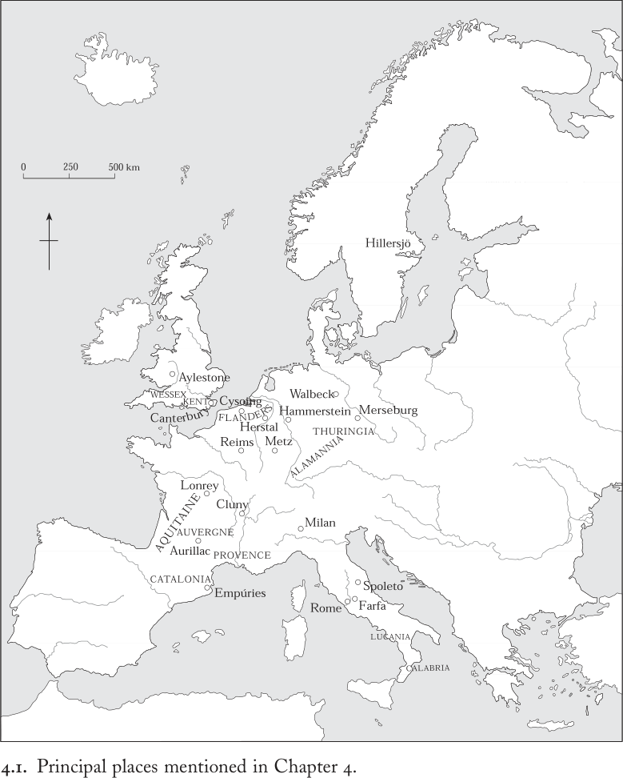

# 第4章 · 男人与女人

“男人”一词指任何意志坚定、有判断力的人，而“女人”则指心智软弱、缺乏判断力的人。^1

两人结为伴侣。一个男人和一个女人通过生育将一个孩子带到世上。^2

“心智软弱、缺乏判断力”之人很少出现在记述伟大功业与政治成就的文字中。按照传统叙述，中世纪早期的历史是男性的政治、经济与宗教史，女性在很大程度上缺席于政治与经济领域，在宗教领域中也处于边缘地位。这种呈现方式不仅建立在前几代学者的预设与偏见之上，也反映了早期中世纪编年史、年鉴和史书的总体基调。但如今情况已大为改观。历史学家们现已认识到，与叙事性史料相比，女性更可能出现在其他类型的中世纪文献中，例如圣徒行传、记录土地交易的特许状以及法典。此外，当研究视野扩展至人们生活的地域与家族背景时，女性便与男性一道，成为历史学与考古学研究的核心对象。开展这项工作，不仅仅是关注编年史中占有显著地位的国王、诸侯、主教与武士们的妻子、母亲和女儿。这种方法要求我们探究男女社会角色之间的差异，并揭示其背后的预设、价值观念与偏见。换言之，它要求我们关注性别，将其视为中世纪早期社会组织与文化表达的一个内在要素。

当我们这样做时，我们会发现自己在研究各种支配与从属的形式——它们存在于日常生活的方方面面，从农民的茅屋到帝王的宫殿皆然。这正是本章的任务。

本章有两个前提。第一个前提已在前面确立：读写能力为神圣与世俗权威提供了辩护、促进与保障。^3 由此可知，中世纪早期的抄写员和作者绝非对周围世界毫无利害关系、中立或纯真的记录者。他们在服务于利益攸关最深者的既得利益时，对报道内容有所取舍，浸透着其所处时代与地域的普遍态度，并善于将注意力从那些部分或完全被排除在权利、资源、声望和权力之外的人身上转移开。这些修辞策略轻而易举地使女性与儿童、奴隶和农民一道，陷入部分或完全的不可见状态；本章将着重揭示中世纪早期作者所玩弄的某些性别把戏。

第二个前提在前一章中已有所暗示，但现在必须予以明确：尽管大多数中世纪早期文本将女性边缘化，她们对于任何共同体的繁衍却至关重要。她们的角色不仅是怀孕与分娩这种生物学意义上的再生产，还包括将文化预设、行为模式与道德规范代代相传的社会性再生产。家族姓氏以及母亲对儿子的训诫，便是我们已遇到过的这方面的例子。^4 同样根本的是，女性以自己的劳动维系着共同体的运转，生产衣物、食物及其他许多物品。目前，只需指出女性的经济贡献与其文化和社会角色相辅相成，就已足够。

因此，本章以前一章所开始的男女行为模式探讨为基础，进一步以性别差异为焦点展开考察。本章的论点是：尽管中世纪早期的性别关系因地域而异、并在所讨论的数个世纪中发生了巨大变化，但在整个中世纪早期，人们在心态和社会实践方面仍存在着根本的共同性。无论我们把目光投向何处，这些共同性都围绕着一个核心：女性之于男性的从属地位。我们将从对男女社会价值差异的明确表述与表现入手，继而考察两性差异尤为显著的两大主题：其一是性伴侣关系与婚姻的缔结，其二是对土地财产的获取。在这三个领域中，罗马遗产都显得至关重要。

## 性别差异

在社会区分可能采取的所有形式中，性别只是其中之一。阶级或等级、年龄、族裔与宗教，同样可以是规范群体成员资格、决定资源获取和构建身份认同的重要范畴。换言之，这些都是使一些人享有特权而限制和贬抑另一些人的方式。在中世纪早期，性别可以说是其中最变幻不定、最普遍存在、也最难以在一生中加以改变的一种。社会、宗教与族裔身份的流动性将更容易

……一旦确立中世纪早期性别秩序的僵化性，这一点便显而易见了。^5 由于性别差异通常以多种方式表现出来，本节讨论将从最明显到最不明显的层面依次展开：先考察可见的差异标志，再转向明确的社会规范表述，最后论及顽固存在的刻板印象与偏见。我们将看到，一张密集而细致的社会区隔与文化意义之网，笼罩着中世纪早期男女的生活。

在任何社会中，最显著的差异莫过于服饰。服装的样式、首饰与个人装饰的形式、剪裁、遮掩或展示头发的方式，都强烈地传达着有关等级、财富、年龄与性别的信息。它们还可能传递有关族群身份、宗教圣召或政治忠诚的信号。所有这些都很容易改变，既可用于宣告个人处境的变化，也可作为刻意的伪装。考古与艺术史的证据表明，虽然中世纪早期的服装呈现出诸多地方性和区域性差异，并且（尤其对富裕精英而言）随时间不断演变，但男女有别的着装规范却始终普遍存在。到公元500年前后，短上衣和长裤早已摆脱了作为“蛮族”服装的恶名，取代古典托加袍成为罗马男性的首选服装；在整个中世纪早期的西方，它们始终是男装的普遍基础，只有教士除外，还有大约800年以后的王室礼仪服装。相反，女性始终穿着长及小腿或脚踝的长袍，对少数负担得起的人而言，丝绸、精纺羊毛织物以及不断变化的展示性首饰时尚则增添了更多的变化。

服装的性别区分无法与个人装饰和衣着所蕴含的其他意义割裂开来。如果我们停下来考察塑造了几乎所有中世纪早期男女经历的生命周期，这一点就会变得清楚。与大多数前工业社会一样，中世纪早期各社会阶层的女性，其一生都由从童年到青春期或青春期稍后出嫁的过程主导：她们离开父母之家，迁往丈夫的居所，无论远近。此后，若未死于难产，便迎来从为人母到老年的又一次转变。如果作为年轻的新娘和母亲而守寡，她们通常会再嫁，甚至三嫁，迁居到新丈夫所在之地。晚年的守寡往往意味着另一种迁移：年迈的农妇很可能被领主迁往其庄园边远处的一处简陋住所，而精英阶层的寡妇则常常进入宗教团体，那里能提供保护和陪伴。只有那些在幼年时就被父母献身于宗教生活的女孩，才可能几乎终生居住在同一地方。

无论社会地位如何，男性的生命节奏则有所不同。早年他们习得与其等级相称的身体技能，无论是使用武器还是农艺，但与姐妹们不同，他们达到身体成熟后并不会立即结婚。此时已具性活跃能力的他们，通常享有一段完全成年却不婚的阶段。在社会上层，他们作为武士效力于领主的扈从队伍，住在领主家中，接受宫廷礼仪与武艺的训练，如乌得勒支的格里高利就曾在王室宫廷中如此。^6 在社会底层，年轻的未婚劳工是领主农业劳动力的重要成员，往往被派往庄园的主要田地劳作，有时则被送往遥远的地方开垦新地。他们结婚的年龄比姐妹们更晚，此后增添了家主和父亲的角色。若妻子早逝，男子很可能会娶一位明显比自己年轻的女人：对他而言，老年带来的是身体的衰老，却很少意味着孤独的鳏夫生活。即便到了老年，男性仍能发挥重要的社会作用，因为“老人知晓最多的事情，岁月使其智慧，往昔经验丰富”。^7 他们是“长者”，在管理社区事务时，人们常常寻求他们的知识和建议。

带着这些性别化的生命周期观念，我们可以回到服饰与个人装束的话题。对中世纪早期众多不识字的社群而言，墓葬考古为这些生命周期以及服饰样式的变迁提供了至关重要的证据。五、六世纪的男子、女子和儿童死后，有时会被葬于随葬品丰富多样的墓葬中，这些随葬品通常极为华美、辉煌、贵重。随葬墓尤其典型地体现了法兰克人、伦巴德人、哥特人和盎格鲁-撒克逊人等民族进入罗马帝国时所伴随的社会失序与流动。较晚的例子则出现在虽远离原罗马领土却正经历深刻政治与社会重组的地区，如九世纪的西斯拉夫诸地和十世纪的丹麦。必须强调的是，这并非一种异教前基督教社会的产物——那种社会的信仰假定死者来世需要日常生活用品——因为基督徒曾小心地将其中一些最著名的墓葬安置于教堂之中。毋宁说，它们是动荡不定的共同体的症候：在那里，经济、文化和军事压力正催生着充满张力的社会变革，以及对地位与合法性的竞争。

在这种情况下，生者常常选择通过这种丧葬形式来确认自身及死去亲属的社会价值。尤其在整片随葬墓墓地被发掘之处，这些墓葬揭示了个人在共同体中的地位如何不仅随等级、也随年龄和性别而波动——换言之，随个体死于性别特定生命周期的哪个阶段而波动。

高卢东北部梅斯周围地区的六世纪墓地便是一个经过充分研究的典型例证。它们展现了一个这样的世界：当一位正值青春期或育龄的女性去世时，家人会以奢华的随葬品予以厚葬，其中包括特定的女性物品—— notably 项链、手镯、耳环和胸针，有时还有纺轮和成串的家宅钥匙。这些随葬品的放置既反映了死者的社会地位及其对家庭的价值，也毫不含糊地表明她的社会价值源自其女性的、生育的能力。相比之下，儿童和约四十岁以上的女性，下葬时要么完全没有随葬品，要么只有几件非性别特定的物品。另一方面，男性直到约二十岁才会获得随葬品的厚葬，此时他们已达到体力的顶峰，并已在成年男性社会中完全立足。他们的随葬品通常是一套武器，如投掷斧、剑或矛；较年长的男性（四十岁以上）随葬品通常少得多，但仍具典型的男性特征。实际上，这些墓葬表明，适婚或育龄的女性以及作为武士的男性家主，在某些意义上比幼者和老者对家庭与共同体更有价值。它们也证实了服饰和个人装束在区分男女、标示社会角色方面的重要性。

如前所述，中世纪早期的法典是社会规范与意识形态的又一重要指标。它们明示了物质记录所暗示的某些差异，并赋予其持久的、权威性的力量。这些法律条款许多涉及等级，但在涉及年龄与性别区分的条款中，有两项与本文尤为相关：命价和法律行为能力。首先是命价。除了按社会等级明确标定一个人的生命价值外，命价还可依年龄和性别而变化。^8 这在《萨利克法典汇编》中尤为清楚：它与上述东北法兰克墓葬大致同时，呈现出惊人相似的图景，并以后期罗马帝国铸币的重金币（索里达，复数solidi）作为价值单位。一名自由的法兰克男子或女子的标准命价为200索里达，但若女子已怀孕或处于育龄，则增至三倍，即600索里达。生育期结束后，女子的命价又回落至200索里达。相反，男子的命价在其十二岁以下或成年后服务于王室时增至600索里达。从法律角度看，一条生命的价值在个体生命周期中变化显著；从性别角度看，一位姐妹的社会价值有时高于、有时低于其孪生兄弟。

在此语境中的第二项重要区分是法律行为能力。中世纪早期法典以自由的成年男性为规范标准，并规定适用于其他群体的变通，包括女性、儿童、半自由人和不自由人。在此语境下，若干法典区分了成年人与儿童、男性与女性的法律行为能力。罗马法赋予成年男性远比未成年人和女性更充分的起诉和作证的权利，而在施加类似限制的后罗马时代法律中，罗塔里《敕令》对女性行动自由的限制最为严苛，尤其是在财产交易方面。罗塔里要求有一名男性保护人或法定代理人——通常是父亲、兄弟或儿子——来规范女性与更广泛共同体的交往，尤其是在任何财产交易中。如无男性亲属，则由国王承担此责——而且无疑会借此机会干预家庭事务。他宣称：“凡依伦巴德人之法居住于我国管辖范围内的自由女性，均不得处于自身的法律支配之下……而应始终处于某个男子或国王的支配之下。女性亦不得在拥有其对之享有mundium者［即对其享有法律管辖权者］同意的情况下，让与或转让其任何动产或不动产。”^9 尽管罗塔里使早期伦巴德意大利的女性承受了比其他任何地方都更重的法律无能力，但存世的八世纪早期文书表明，他的立法并未使伦巴德女性完全陷于被动。在实践中，她们保有比法律条文所示可能的更大的行动自由，对自己的地产也握有更多的控制权。与其他早期中世纪立法者一样，罗塔里视女性的地位为在保护她们的幌子下扩张自身权力范围的机会：女性事务为王家干预提供了有用的借口。孤立地看，罗塔里《敕令》或许会让人以为僵化的性别区分渗透于伦巴德女性生活的方方面面。但置于文书证据所呈现的更为细致的图景之中，它再次提醒我们：法律是对意识形态的宣告，而非对社会现实的描述。

当我们转向农民劳动时，规范与实践之间出现了类似的落差。教会将星期日定为休息日的努力始于六世纪末；随着规定逐渐具体化，其中纳入了关于男女角色不同但互补的明确表述。这些努力的顶点是查理曼那被频繁抄录的宣告：

主日不得从事体力劳动——即男子不得从事乡村劳作：不得耕作葡萄园、犁地、收割、割晒干草、修筑篱笆、开垦荒地、伐木、采石、建造房屋或从事园艺……女子不得从事纺织工作，不得裁衣、缝纫或刺绣；不得梳理羊毛、捶打亚麻、当众浣洗衣物或剪羊毛，以便主日的尊荣［敬重］与安宁得以在各方面得到维护。^10

尽管女性与纺织生产的一切环节——无论以羊毛还是亚麻为原料——的关联在中世纪早期欧洲各地均得到证实，但在实践中，农活的分工因地方传统和不断变化的技术而异。在有些地方，制作面包是男子的事，在另一些地方则是女子的事；而凡是为磨谷而修建村用水磨之处，家用石磨的废弃必将影响家务劳动的分配。同样，收获在某些庄园似乎是男子的工作，但在另一些庄园，女子也下田劳作，有时还被明确指派捆扎麦束并将其堆成麦垛。因此，乡村劳动在实践中是有性别之分的，但既非僵化不变，也非整齐划一。

即便是罗塔里和查理曼这样有权势的中世纪早期君主，也无法使社会现实与规范性准则完全一致。在实践中，女性的生活往往处于意识形态与习俗的夹缝之中。我们将看到，这一鸿沟往往相当可观，对一些人意味着脆弱，对另一些人则意味着机会。那么，基督教的传播在多大程度上影响了这一切？指陈其制度性后果是容易的：对独身生活的推崇颠倒了世俗的男女行为规范；为男性与女性生命周期的某些或全部阶段提供了修道院的替代选择；使男性对神圣权力的独占在司铎圣职中正式化。即将 discussed 的婚姻性质的变迁也与此相关。然而同样重要的是，基督教与罗马文学遗产的互动使根深蒂固的刻板印象重新焕发活力，而育识字率的提升为原本不识字的社群提供了一种表达偏见的新途径。教皇格里高利一世曾评论说：“『男人』(man)一词指的是任何意志坚定、有判断力的人，而『女人』(woman)则指心智软弱、缺乏判断力者”，这番话便是典型代表。^11 他做出此番评论的那部鸿篇巨制被中世纪的抄写员大量抄录，现存抄本约有五百部，使得这一警句获得了持久性和普遍性，掩盖了它的本来来源。实际上，这一评论不过是在重复罗马传统中的老生常谈。

塞维利亚的伊西多尔是我们了解这些老生常谈的最佳向导。他借助一种在翻译中失落的拉丁语双关，将古人对男女特质的传统看法概括如下：

男人[vir]之所以得名，是因为他比女人更有力量[vis]，因此“勇德”[virtus——该词既指体力也指道德正直]一词亦由此而来；或者说，因为他以力量统治女人。而女人[mulier]则得名于柔弱[mollities]，仿佛把“更柔软”[mollier]改一个字母、去掉一个字母便成了“女人”[mulier]。二者在身体的强弱上互有差异：男人的力量最强，女人的力量较弱，因此她应当服从于男人。^12

伊西多尔教导中世纪早期的读者，要把人体视为道德品性的关键，正如古典伦理学所做的。既然女人比男人更柔软、更弱，她们的道德力量便不及男人——因此她们要服从男人。

这一立场通过将男女之间的道德差异论证为自然生理差异的结果而发挥作用。而且，从基督教的视角来看，整个自然界都是神的造物，古代思想便很容易被移植到基督教框架之中。社会分化和性别秩序同样源自上帝与“自然”。米兰主教安布罗斯（374–397年在任）围绕一连串圣经引文展开论述，宣称：

经上这样写道：“妇女不可穿戴男子所穿戴的，男子也不可穿妇女的衣服，因为这样行的是耶和华你神所憎恶的。”倘若细想便会明白，凡是天性本身所厌恶的，便是不和谐的。男人为何不愿以他生来的样子示人？为何要装扮成陌生的模样？男人为何要佯装成女人，而你，女人，又要佯装成男人？自然为两性各自披上了属于自己的衣装。男女在习惯、肤色、举止、步态、力量和声音上都各不相同。其他动物物种中亦是如此：雄狮与母狮外形不同，力量不同，声音也不同……雄孔雀美丽，雌孔雀却没有同样华丽的羽衣。……它们从不改变自己的外形，不是吗？我们又为何要改变自己的呢？

……

但我认为，与其说在于衣着，不如说在于举止、习性和行为，男应有男之为宜，女应有女之为宜。因此，作为[神圣]律法的解释者，使徒保罗说：“妇女在会中要闭口不言，因为不准她们说话。她们总要顺服，正如律法所说的。她们若要学什么，可以在家里问自己的丈夫。”又说：“女人要沉静学道，一味地顺服。我不许女人讲道，也不许她辖管男人，只要沉静。”男人做女人的活计是多么可憎啊！^13

安布罗斯巧妙地将神的诫命与动物世界混为一谈，以此论证衣着与行为上的性别区分不容变通。他与伊西多尔的话语在中世纪早期回响不绝，被众多读者抄录或引用。从古代晚期的基督教作家那里，早期中世纪的学者继承了一套现成的规范性性别关系观念，颠覆这套观念便会威胁神圣秩序，而他们也认为没有什么必要进一步发展它。

但现实生活并不像早期中世纪的道德家们所希望的那样简单分明。有一年春天，神圣的欧里亚克的热拉尔（约855年生，909年卒）遇到一个正在犁地的女人。被问及为何要做这种“男人的活计”时，她解释说丈夫久病在身，她若不播种，便无人代劳。热拉尔的回应是给了她足够的钱雇一个劳工完成这项工作。然而，为他作传的克吕尼修道院院长奥多（927–942年在任）深谙安布罗斯的著作，并从这个故事中提炼出寓意。“正如安布罗斯所说，天性逃避一切人为造作，而自然的创造者上帝憎恶一切违背自然之事。”^14 一个农妇的困境给了虔诚的基督徒一次施舍的机会；而一位修道院的道德家则向读者呈现了一个神圣钦定的性别秩序得以恢复的故事。

诉诸“自然”是中世纪早期乃至其后数百年间教士作者们常用的修辞性性别把戏之一。另一种，我们将会看到，是在文本中不向读者或听众说出女人的名字，因为匿名会抹除身份。诉诸这类文字花招的人无疑是出于习惯势力。但这种习惯本身极具启示意义——它揭示了对女性边缘性、软弱性或劣等性的根深蒂固的预设。作为强大的文化反射，女性天性柔弱的观念服务于多种目的——政治的、法律的、宗教的、文学的。它既能助长剥削，也能促进保护；既可随意用来赞誉，也可随意用来诋毁。它使名声与美誉难以获得而易于失去。最重要的是，它强化了年龄、等级或财富等其他社会差异，使得那些确实凭借各种手段在世上闯出一条路来的女性，始终处于易受伤害的境地，被困在一张并非由自己编织的意义之网中。

## 生育的结合

性伴侣关系对人类社会的繁衍至关重要，不仅是生育的手段，还因为由父母与子女构成的亲密群体正是文化预设与价值观代际相传最常见的形式。然而，不加限定地谈论中世纪早期的“婚姻”过于简单化。这个词不足以完整描述男女自行结成的各种被认可的性伴侣关系。到千年之交，某种与我们现代婚姻观念——即一男一女之间持久的结合关系——可辨识地相似的婚姻形态已在欧洲部分地区形成，但并非没有争议。对这些问题的考察将阐明性别关系的社会组织，并引领我们深入早期中世纪性道德观念的核心。在上一章亲属关系讨论的基础上，本章将进一步审视男女经验的其他形态。

然而，在早期中世纪文化多样性的底层，存在着一种持久而普遍的不平衡。女性获得的法律权利或经济资源越少，她就越处于较高地位男性的性支配之下：各地精英男性都可按自己的条件与地位低下的女性发生性关系。这些非正式的私情与那些用以传递财产和文化价值的伴侣关系无关，也与正式伴侣关系所能带来的情感纽带和家族认同无关；因此它们在史料中很少显露踪迹。由于缺乏政治意义或意识形态价值，这类关系很少进入法学家和立法者的视野，而后者所构建的社会关系模式在婚姻与性行为方面——正如在其他许多方面一样——表达着占主导地位的价值观。

在上一章概述的三种法律文化中，继承下来的罗马传统是我们的出发点，因为它被证明是最根本的。罗马法承认两种互相排斥的性伴侣形式：纳妾与婚姻。前者不涉及任何财产交易，只是高地位男性与地位远为低下的女性之间被承认的长期性伴侣关系；妾所生的子女不享有任何继承权。纳妾是婚姻的替代而非附属，是未婚的年轻男子或不愿再婚的鳏夫的性出路。按照罗马法的界定，婚姻要求夫妻地位平等，需要婚约、双方的正式同意，以及新娘父母对新婚夫妇的嫁资。由此，男性的继承人便被限定为只有妻子所生的子女。四五世纪的帝国立法史无前例地强调婚姻是持久的伴侣关系，只有在配偶一方犯下盗墓亵渎之罪、施行巫术，或妻子与人通奸的情况下方可解除。尽管被理想化为建立在相互爱慕与尊重基础上的自愿伴侣关系，这些法律条文在整个地中海地区的中世纪早期西方一直沿用。我们将看到，这些规定还影响了一代代主教的观点，从而左右了整个中世纪的教会学说。

在这一晚期罗马世界中，讲日耳曼语的移民在婚姻和亲属关系方面都引入了颇为不同的价值观与习俗。值得注意的是，与罗马法的单一界定相反，成文法和社会习俗都承认数种婚姻类型。其中只有一种涉及财产转让并由此产生继承权。新郎的家庭通常要向新娘的父亲支付聘金，新郎还会在完婚次日追加一份“晨礼”。此外，最迟到九世纪，新郎在订婚时从自己的财产中指定一份婚姻赠与已成为惯例。新娘尤其是当她们没有兄弟时，也可以将继承自父母的财产带入婚姻。这份婚事由心怀期望的新郎与女孩的父亲和亲属协商，并在亲友参与的公开仪式上庆贺，它是两个亲族群体之间的交易，不仅为新家庭提供资财，还可能缔结互利的政治联盟，甚至终结仇怨。因此，这种婚姻一般只能由男方解除，且会给双方带来严重的经济后果。^15 这种第一类的结合被恰当地称为“配偶支配”，^15它还有另外两个特征。第一，它还要求父亲将其对女儿的监护权移交给丈夫，使丈夫获得代表其法律利益并对其行使权威的权利。其次，新娘须迁居到丈夫的庄园，无论那里离她的娘家是近是远。就其财产交易的性质而言，这种伴侣关系是富有精英阶层的特征。

另一种同样被认可、同样持久并有公开庆典的婚姻形式中，女子迁居男家并不伴随任何监护权的转让，即使她可能拥有自己的财产。男人们无须在这两种结合形式之间做选择：富人和权贵完全有能力供养不止一个女性，事实上，多重伴侣关系成为身份地位的象征，也是积累社会声望资源的一种方式。这类人中的一个便是莱茵兰富有而有影响力的地主、埃斯塔尔的丕平（约650年生，714年卒），据知他与三个女人生有儿子。他的两位同时并存的妻子普莱克特鲁德与阿尔派达都来自阿登地区势力强大的家族，尽管可能只有极为富有的普莱克特鲁德被移交给了丕平的监护之下。后来，她们的儿子们为争夺父亲的遗产而相争。关于丕平的第三位伴侣我们所知甚少，但她的名字不见于任何记载，她的儿子又被排除在丕平遗产的任何份额之外，这两点都强烈暗示这是一种远为非正式的伴侣关系。

这篇简略的概述并未穷尽男性借吸引女性以争夺地位的所有方式，因为早期中世纪的法律汇编还承认一系列补充性的关系。女性可以在违背父母意愿的情况下被抢婚，也可以在她们自己甘愿配合的诱拐中被带走。虽然父母必须就失去女儿获得补偿，但这种结合仍然得到承认，并且可以通过其后的财产安排而变得更加正式。最后，在社会等级的底层，则由领主自行决定允许其奴隶和农奴之间缔结何种婚姻，以最适合高效庄园管理的需要。

总而言之，日耳曼语族的后裔在融入后罗马行省生活的诸多其他方面之后，仍长期倾向于维持他们传统的性结合谱系。这些结合因其持久程度而有所区别；因女子从娘家亲族转入丈夫之家的方式而有所区别；因随附的财产交易（如果有的话）的性质而有所区别；还因对女子的法律权威与保护的安排而有所区别。虽然女孩是否有多少机会对拟议的婚约发表意见仍不得而知，但高地位男性无疑可以通过策略性婚姻增进自身利益，并在性满足和生育继承人方面找到充分的余地。当不莱梅的亚当（约1083年卒）在十一世纪末评论说，在瑞典人中间，“一个男子依其财力可同时拥有两三个乃至更多的妻子，富人和王侯则不限数目，而且他们也认为这种结合所生的儿子是合法的”，他不过是——或许略有夸张地——报告了一个延续数百年之久的模式：有权势的男性利用这些机会“囤积”女性，从而不仅确认自己对女性的优越地位，也确认自己对那些不那么成功的男性的优越。^16

第三，我们应当回到爱尔兰，在那里，法学家的论著将基督教与晚期罗马婚姻法的要素与本土的……

实践被用来界定各种类型的性结合。七八世纪的爱尔兰学者将九种“生育结合”加以分类，并按其尊贵程度由高到低排序。^17 在最尊贵的结合形式中，女方亲属将女子交给新郎，新组建的家庭由丰厚的财产赠予支持。其中最重要的是双方亲属都出资并贡献牲畜的结合，由此确立新娘作为“共同权威之妻”的地位。^18 较不利于提升地位的方式是，财产仅由男方或女方一方的亲属提供。这三种结合的构成要素是一份契约，用以规范财产条款及管理财产的责任划分。尽管此类契约内容复杂，但仍可解除。与其他早期中世纪文化不同，爱尔兰法律允许种类繁多的分居理由。至少在理论上，如果妻子背叛丈夫、损害他的名誉、持续通奸、杀死他们的子女，或疏于家务，丈夫便可以与她分离。如果丈夫阳痿、不育或是同性恋、肥胖到无法行房、散布关于妻子性表现的闲言碎语、纳妾、传播讽刺她的诗文，或者在行使训斥妻子的权利时出手打伤她致其留下伤痕，妻子也可以离开他。遗憾的是，我们缺乏能够揭示爱尔兰社会现实是否与这些理想化方案大体相符的证据。

在爱尔兰的性结合等级中，其次是女方亲属接受但未积极参与谈判的那些结合。男子经女方父母同意在其家中与该女子“生育结合”，其形式化程度较低，尊贵程度也较低；更不体面的是女子随男子私奔——既无亲属参与亦无亲属同意——或男子偷偷与她相会。等级最末的是女子本人未曾同意的“生育结合”（即强奸），或两个精神失常者的结合。所有这些规定都可能对财产分配产生重要影响，因为只有当女方的亲属不承认该结合时，这种联盟所生之子才丧失从父亲那里继承的权利，但若父亲选择承认他们，这些儿子仍可继承。

这种关系谱系比在继承诸王国中更容易容许多重并存的性关系，因为爱尔兰法区分了“正妻”与地位较低的诸妻。^19 “正妻”缔结了其亲属充分参与的婚约，这一婚约使她与夫家而非娘家的关系更为紧密。因此她受丈夫支配，其法律责任的三分之二由她的儿子承担，仅三分之一由娘家亲属承担；她的儿子与她的亲属按同等比例继承她的财产。而其他妻子在法律责任方面则大部分或完全留在娘家亲属之内，并且仅享有正妻一半的地位与权利。对一位地位显赫的男子而言，拥有一位正妻，再娶第二位妻子（在此附加结合的头三天里，正妻有权对她施加非致命的伤害），同时还探访一位或多位居于娘家的女子，是完全可接受的做法。面对基督教教士的非议，爱尔兰法学家转向《旧约》为传统习惯辩护。“爱尔兰法中存在争议：多重性结合与单一性结合何者更为正当？因为上帝的选民曾生活在多重结合之中，故谴责它并不比赞美它更容易。”^20 对于负担得起的人来说，多重性伴侣关系是常态。

在爱尔兰及其他地方，谴责多重结合的是教士。基督教婚姻学说牢牢建立于晚期罗马帝国的实践之上，正如教皇大良（440—461年在位）的一项裁决所概括的：合法婚姻是自由男子与门第相当的自由女子之间的结合，须由女方亲属通过正式订婚将她交付男方，缔结的婚姻须有财产资助并公开庆祝。大良的观点——“并非每个与男子结合的女子都是‘妻子’，正如并非每个儿子都是其父的继承人”——主张在两种女子之间作出区分：一种是罗马财产法所承认的唯一性结合形式即婚姻中的伴侣，另一种则处于任何其他形式的性关系之中，如妾或情妇。^21 在这一源自罗马的法律定义之上，四五世纪的道德家又加上了浓厚的、主要基于《新约》的严格性伦理。大数人保罗（卒于约65年）宣告：“倘若不能自制，男子当各有自己的妻子，女子当各有自己的丈夫”；又说：“你们岂不知不义的人不能承受神的国吗？不要自欺：无论是淫乱的、拜偶像的、奸淫的、作娈童的、亲男色的、偷窃的、贪婪的、醉酒的、辱骂的、勒索的，都不能承受神的国。”诸如此类的宣告成为基督教男女节欲道德的基础，这一道德将异性婚姻承认为唯一合法的、可以发生性交的关系。^22 由教士宣讲的这种罗马法律前提与毫不妥协的基督教道德的结合，冲击了各地的本土习俗。

然而，教会的意见在多大程度上改变了社会实践？在爱尔兰，指女子非法性交的拉丁词adultrix为古爱尔兰语中“次妻”一词adaltrach提供了来源。然而，词汇的借用绝不意味着多重性伴侣关系的终结。将博学的诗人、教士和法官阶层限制为仅有一妻的种种尝试是否成功已无从查考，而“领主、诗人和平民皆因非法同居而受损害”的观点似乎收效甚微。^23 系谱资料确凿地表明，多重伴侣关系至少在诸王之中依然常见，而当成体系的大陆高调教士改革于十二世纪全面抵达爱尔兰时，改革者们对其在当地发现的婚姻习俗进行了猛烈的谴责。^24

在爱尔兰之外，本土习惯与教会的期望同样存在分歧，七世纪一个名叫巴龙图斯的男子的经历便说明了这一点。他是来自法国中部隆雷的贵族，决定以僧侣身份度过余生。进入当地修道院后，他参与每日的祈祷与诵诗。随后，据记载，他在678/9年经历了一次濒死体验。当他完全恢复知觉后，他讲述了自己如何被魔鬼押着灵魂游历天堂与地狱。在天堂的一重门前，使徒彼得问众魔鬼对巴龙图斯有何指控。“他们答道：‘他有过三个妻子，这是不被允许的。他还犯下了其他通奸行为以及许多我们诱使他犯下的其他罪。’”^25 在退隐修道院之前，巴龙图斯的行为与他同时代的埃尔斯特尔的丕平并无二致。区别只在于，我们是从一位持批判态度的修道院作者的角度得知巴龙图斯的多重婚姻，从这位作者崇高的道德制高点来看，富人的寻常行为俨然是魔鬼的作为。

然而，幻象文学并非唯一的谴责手段，老年男子也并非唯一的目标。当教会的不满指向国王时，利害关系便极为重大，因为王朝继承可能因此受到威胁。“当知这些孩子永不能执掌王权，因他们是在罪恶中受孕的”——爱尔兰苦修士科伦巴努斯于610年如此预言，猛烈抨击墨洛温王朝国王提乌德里克二世（596—613年在位）的婚姻习惯。^26 高卢的许多墨洛温国王，包括提乌德里克在内，都拥有多个性伴侣，并承认其大部分乃至全部儿子为继承人。像科伦巴努斯那样敢于批评的人，矛头所向的正是那些有助于王朝延续的做法。

在八九世纪，利害关系进一步升级，当时意大利和法兰克地区的主教会议发起了一场协调一致的运动，以重新定义婚姻并将其确立为一种宗教的、神圣的事业。从721年罗马的一次宗教会议开始，教会会议逐渐在大良的观念之上增加了三项内容：强调婚姻的永久性与不可解除性；拒绝容许同时存在多于一段的性关系；以及对乱伦禁忌婚姻远为宽泛的定义。在此背景下，主教们极力主张，通过洗礼建立的灵魂亲属关系和通过婚姻产生的姻亲关系均构成婚姻障碍。教父、教兄弟姐妹、共同父母以及一切姻亲由此都落入这个庞大的禁婚对象之列。此外，一些主教还试图强加一项额外的限制条件——血缘禁忌一直上溯至七代以内的共同祖先，远远超出了广为接受的四代限度。

某些加洛林教士为何要将乱伦关系的圈子扩展到如此极端的地步，至今仍有争议，尤其是因为没有证据表明近亲通婚在八世纪中叶之前普遍存在，更遑论成为常态。无论其深层动机如何，结果是在721年起的一个半世纪里，婚姻及各类性关系以一种新的方式被政治化了。这主要有两个原因。其一，到八世纪后期，善治意味着促进基督教行为规范。^27 因此查理曼及其继承者支持教会推行修订后的婚姻道德的努力，同时却也发现自身的性行为与婚姻联盟被置于新的审视之下。事实上，正如洛泰尔二世（855—869年在位）付出惨重代价所发现的那样，主教们可以反过来利用这些禁令对付国王，使其后嗣断绝。其二，在国王寝榻政治这一直接语境之外，主教们若要与统治者结盟，才是改变婚姻习俗的唯一真正机会：他们因此把一件有效武器交到了狡黠的国王手中，使国王得以对其势力强大的臣属施加控制。

860年法兰克主教会议处理的一桩案件，使我们得以罕见地一窥订婚与婚姻所牵涉的社会复杂性、情感纠葛以及相互冲突的政治利益。此案涉及奥弗涅伯爵斯蒂芬，事发的阿基坦正是他的君主秃头查理苦于难以建立稳定忠诚政权之地。此事被称为“对教会之极大丑闻、对王国之严重损害”。用斯蒂芬自己的话说：“在年少轻狂之时，如习俗所然，我与一名年轻女子发生了关系。”随后，大约在857年，“经我的家人与朋友同意”，他与阿基坦另一位显赫伯爵雷吉蒙德谈判，获准娶后者的女儿为妻。双方就斯蒂芬将提供的婚姻财产赠予达成协议，两人正式订婚。但在雷吉蒙德公开交付其女儿之前、亦即斯蒂芬完成财产转移之前，斯蒂芬发现自己的未婚妻与他先前的性伴侣有亲缘关系。他随即咨询了自己的司铎，后者告知他所提议的婚姻将属乱伦，因而为教法所禁。斯蒂芬随后试图退出婚约，激起了国王与雷吉蒙德双方的震怒。由于害怕遭到放逐与倾覆，斯蒂芬感到“为形势所迫”，不得不在公开仪式上娶雷吉蒙德之女为妻，并交付原本为她准备的赠予财产。但他仍拒绝圆房，而他的顽固使他与雷吉蒙德的对抗愈演愈烈。雷吉蒙德因女儿所受的对待而愤怒并深感羞辱，最终于860年向主教们提出控诉。^28

面对这桩牵涉荣誉、财产、契约义务、性及叛乱倾向的复杂案件，会议裁定此案应同时由两个法庭审理：一个是由国王主持的世俗会议，处理财产与政治问题；另一个是由斯蒂芬与雷吉蒙德产业所在两省的大主教领导的教会会议，处理婚姻的性质问题。会议还责成兰斯大主教欣克马尔（845—882年在任）就此案准备一份报告。欣克马尔是整个中世纪最活跃的精通法律的 bishop 之一，而在此事上，一如在许多其他事务上，他同时也是秃头查理的代理人。大主教们的裁决未能留存下来，因此我们无从得知最终结果。但倘若他们听从了欣克马尔的建议，其解决方案对斯蒂芬和雷吉蒙德而言将是一个保全颜面的方案，却极少顾及那位不受欢迎的新娘的福祉——简报甚至懒得提及她的名字。欣克马尔关注的并非婚外之性，而是婚内之性。他建议省教会人士讯问那位女子：如果婚姻确已圆房，那它便属乱伦，因而无效；但由于圆房是完成婚姻的必要条件，若两人未曾性交，它便不是一桩正当的婚姻。无论哪种情形，斯蒂芬都获解脱，而王室会议则必须处理被撕毁的婚约、对雷吉蒙德的侮辱以及政治动荡的威胁。

斯蒂芬为何如此行事？他声称是害怕丢面子并招致国王震怒，但其中似乎另有隐情。他可能是近来针对与先前性伴侣有亲缘关系者结婚的严厉禁令的无辜受害者，也可能是狡猾地操纵法律，以摆脱一桩在政治上已不再有利的婚姻联盟。无论实情如何，秃头查理对阿基坦的控制已成了问题。无论我们如何评判斯蒂芬的行为，这样的冲突在一个世纪之前几乎是难以想象的。无论这个故事讲的是一个倒霉的受害者还是一位机敏的阴谋家，此案都至关重要。

以下几个原因。首先，它提醒我们精英婚姻作为政治谈判手段的重要性。其次，在一个通常把适婚少女当作棋子而非主动策略家的社会中，女性的意见和福祉无足轻重。事实上，对辛克马尔而言，这些与她的名字一样无足轻重。第三，它证明了亲属关系定义被重新表述，以服务于一种不断变化的性伦理和婚姻伦理。

最后，奥弗涅的斯蒂芬是一位地位显赫的人物，是国王扈从中的一员，这并非巧合。他的显赫地位使他的婚姻伎俩暴露在宫廷主教们和一位急于寻找任何手段来控制其追随者的国王的审视目光之下。在远南方，比利牛斯山之外，与他同时代的加泰罗尼亚人、恩普里亚斯伯爵德拉（862–94）娶了他的堂姑母基克西洛娜，即他父亲的兄弟的女儿。堂表亲联姻是九世纪晚期和十世纪初加泰罗尼亚伯爵们的常态，因为它强化了家族对权力的掌控。如果加洛林宫廷的主教们知晓此事，或许会感到不安——但加泰罗尼亚从未与加洛林权力中心保持密切接触，而且到九世纪晚期，它正迅速失去与北方土地的一切联系。当加泰罗尼亚伯爵们在十世纪中叶开始到更远的地方寻找新娘时，那是出于政治利益的考量，而非任何道德压力的结果。同样，在威塞克斯，长者国王爱德华（899–924）通过娶他的堂兄弟兼对手埃塞尔海姆的女儿埃尔弗莱德来确保自己的王位继承权。此后又过了大约五十年，加洛林关于近亲婚姻是不可逾越的婚姻障碍的观念才开始改变英格兰的做法。而且之所以如此，只是因为十世纪晚期的盎格鲁-撒克逊诸国王发现，支持那些熟悉严苛的大陆理想的道德化主教，具有战略性的政治利益。实际上，加洛林对婚姻的重新界定——不可解除、排除任何其他同时存在的性伴侣关系、禁止至少四代以内的亲属之间通婚——只有在国王与教会的全部资源联合起来力图强制推行时，才开始影响人们的行为。

在加洛林权限范围之外，或者在缺乏变革意志和手段的地方，婚姻的定义长期以来保持着更大的灵活性。斯堪的纳维亚便是一个例子，不来梅的亚当为我们提供了可靠的记载。^29 丹麦人克努特于1016年征服英格兰并夺取王位，此后不久又登上丹麦王位：他同时拥有两位妻子——埃尔fgifu和艾玛——维持了较古老的斯堪的纳维亚方式，却仍然屈从于教会人员的压力，立法对那些与近亲结婚或不把性行为局限于婚姻之内的盎格鲁-撒克逊人处以罚金。在更遥远的地方，完全超出加洛林影响范围之外，爱尔兰直到十一世纪末都未受大陆规范的影响。事实上，一位作为父亲唯一继承人的爱尔兰女子很可能被嫁给其最近的男性亲属，恰恰是为了防止她的财产流出亲族；而且，尽管口头上尊奉教父关于四代以内禁止通婚的禁令，爱尔兰教士们显然承认女继承人需要堂表亲联姻。

要改变婚姻习俗，既需要政治上的坚持，也需要强势的国王与主教协同行动时的一致规范。但在加洛林道德说教的高潮过后很长一段时间里，这种联盟和行动的意愿都不太明显。相反，至少在政治精英阶层中，婚姻长期以来一直是政治需要与分歧规范之间的一种不安平衡，只是偶尔被个人道德所调和。一个发生在本时期末尾的中世纪早期动人爱情故事凸显了这些矛盾。哈默尔施泰因伯爵奥托和他的妻子伊尔门加德有远亲关系——伊尔门加德的曾祖父母是奥托的高祖父母。他们长久的婚姻被中断了，因为心怀报复之心的德意志皇帝亨利二世（1002–24）害怕奥托成为一个权势过大的臣属，决意毁灭他。亨利通过鼓励德意志主教们重新兴起道德严苛之风来实现这一目的，其中一些主教正试图为九世纪提出的以七代来界定乱伦的方案注入新的力量。1018年，亨利二世主持了一次教会会议，将这对夫妇绝罚并命令他们分居。然而，奥托“燃烧着盲目的爱”，仍与伊尔门加德在一起，并于1020年袭击了他主要的教会对手美因茨大主教。^30 亨利二世进行报复，围攻奥托在哈默尔施泰因的城堡，将其夷为平地，然后夺取了奥托全部广袤的土地。这对夫妇仍然相依不离，直到1023年，另一次教会会议再次对他们作出不利裁决。奥托因畏惧皇帝而终于屈服，但伊尔门加德依然不从。德意志主教们拒绝让她向教皇申诉，她却于1023年动身前往罗马，并成功地为她的案件进行了申辩。本笃八世（1012–24）确认了她婚姻的有效性，并谴责那些宣告其婚姻无效的德意志主教，因这一干预而引发了一场抗议风暴。次年，国王和教皇双双去世，这场争议也随之消散：奥托和伊尔门加德维持了婚姻，并受到新国王康拉德二世的恩宠，而康拉德本人的婚姻曾招致教士们的强烈批评。

奥托和伊尔门加德的磨难揭示了公元千年之交婚姻的许多情况。首先，他们本人接受婚姻是永久性和一夫一妻制的，表明了在中世纪早期欧洲大部分地区于基督教影响下发生的漫长而缓慢的社会观念转变。他们体现了教会教导所提倡的理想：婚姻是平等者之间的排他性伴侣关系。其次，尽管在婚姻应缔结于毫无亲缘关系的伴侣之间这一原则上存在共识，但关于亲属关系的界限应设在哪里，不确定性依然存在。第三，国王、主教和教皇争夺仲裁婚姻的权利。一种独特的婚姻观念发轫于加洛林道德理想主义的蓬勃时代，其前提对关于可容忍的性伴侣关系的性质和数量的地方惯例，以及对女性抚养其子女的社会单位，都具有巨大的影响。这一观念有时通过王室颁布得以强化，凡是加洛林教会立法手册被抄写之处便传播开来，主要在大陆，到十世纪晚期也传入英格兰。但是，正如我们所见，这一观念的形成是一回事，其贯彻实施则完全是另一回事，而在1050年之后的很长一段时间里，将愿望变为现实的努力仍然是断断续续、争议重重且前后不一的。

## 女性、家庭与继承

如果说婚姻长期以来更多地是一件政治事务而非基督教道德事务，那是因为它所牵涉的远不止是对性行为的规范。至少，妻子和儿媳进入一个男人的家中，扩大了女性劳动力的储备——即各社会阶层的女性倾注精力的纺纱、织布、缝纫、刺绣，以及奴隶和农妇所从事的食物准备和其他工作。在精英阶层中，婚姻还涉及对家族财产的保存、分配和增殖的盘算，以便安排其在代际之间的处置。有了土地，便有了生存的手段，而对于所有高于仅能维持生计的小农的财产所有者来说，也有了产生盈余的可能。下一章将强调对土地财产的权利如何开启通向地位、政治权力和影响之路；此处则聚焦于作为协商性别差异手段的祖产继承。本节的分析认为，虽然资源在继承人之间的分配强化了男性和女性在财富、影响力和权力获取上的差异，但女性获得财产的途径对于中世纪早期的家族互动仍然至关重要。

中世纪早期的继承习俗受政治压力、教会意见、不断演变的地方法律程序以及变化中的家族观念的影响，各地差异极大。然而，尽管存在广泛的地域和时间上的差异，一些总体要点是清楚的。第一，性伴侣关系将财产（动产和土地）从父母传给子女，而继承权通常与父母伴侣关系的性质密切相关。在早期爱尔兰，正式且公开承认的结合所生的儿子比非正式结合所生的儿子对父亲财产拥有更大的权利；在其他地方，不断发展的基督教婚姻观念强化了一个男子与其妻子所生子女相对于非正式结合所生子女的继承权。第二，继承土地的正常模式不同于继承诸如牲畜、奴隶或珠宝等动产的模式，而继承政治职位的程序可能又有所不同。第三，父母的财产原则上是可以分割的——换言之，由部分或全部子女共享，尽管份额通常不均。然而，到十一世纪，随着家族和身份观念的继续演变，一些家族开始发展出将大部分或全部祖产传给单一儿子的策略。第四，财产由一代向下一代的传承，很少只是父母与子女双方的事务。国王们密切关注，急于寻找干预的借口；而且，除罗马财产法持续存在的地方外，更广泛的亲族群体也参与其中。因此，本节的讨论将男性与女性置于其亲属之中加以考察，同时也关注他们生活于其中的更广泛的政治环境。最后，也是最根本的一点：男性继承土地的权利是所有中世纪早期文化的共同特征之一；而另一方面，女性获得家族祖产的途径则因地区和世代而有很大差异。通过考察女性相对于其兄弟在土地获取上的差异，一种具有重大政治意义的性别模式便浮现出来。

确认继承策略不可避免地依赖于存世的文献。在此背景下，重申前文提到的几点是切题的。一方面，法典中阐述的关于财产传承的规范并不是人们实际行为的充分指南：要了解这一点，我们必须将其与记录具体、有名有姓的地产转让的文献并列考察，如捐赠特许状、遗嘱和遗赠。此外，不仅文书意识的程度因地区而异，而且文献保存率在某些地方也远比其他地方好。最后要记住的一点是，起源于罗马的遗嘱 practices 在北欧的逐渐采用，这些做法影响了财产所有权的传承和记录方法。^31 总体而言，详细记载土地转让的记录，通常只有在意大利和法兰克地区的七世纪晚期以后、西班牙北部的九世纪晚期、英格兰的十世纪中叶以后，以及其他地方更晚的时期，才有相当数量的存世。

尽管如此，我们仍可以勾勒出继承习俗中一些最明显的地区差异。如往常一样，两个极端是一方面的爱尔兰，和另一方面的欧洲大陆南部持久保留罗马传统的地区。在爱尔兰，父系土地在所有被承认的儿子之间平均分配，但女儿有权获得动产的均等份额，尤其是奴隶和牲畜。如果一个男人去世时只留下女儿而无儿子，她可能对其地产享有终身权益，但在她死后，财产将归还给她父系的男性亲属。这些习俗运作于一种强调土地属于四代亲族群体（称为derbfine）的文化之中，在这种文化中，土地脱离derbfine而让渡是不被鼓励且难以实现的。女性继承将对亲族群体及其土地构成威胁，因为被承认的儿子属于其父亲的derbfine而非母亲的：如果一名女子继承了土地并将其传给她的儿子，土地就会从一个derbfine转移到另一个。这就是为什么女继承人会受到压力，被迫嫁给其父亲最近的男性亲属。^32 相比之下，五、六世纪的罗马财产法建立在两个截然不同的原则之上，这些原则在整个中世纪早期乃至更久之后都保持不变。首先，土地只能由个人完全和绝对地拥有：不存在对土地的任何集体利益或权利的概念。其次，晚期罗马帝国的法律基于这样一种假设：在无遗嘱继承的情况下，女儿有权与其兄弟享有平等的继承权。总体而言，罗马法对女性不受任何监护人约束而完全控制和自由处置财产，没有设置任何法律障碍。在诸如意大利南部的卡拉布里亚和卢卡尼亚，或法国南部的阿基坦和普罗旺斯等罗马习俗贯穿整个中世纪早期的地区，女性获得财产的权利原则上赋予了她们相当程度的经济独立，这在早期爱尔兰是完全不可想象的。

那么，在爱尔兰和意大利南部之间的那些地区，换言之，在日耳曼语系的定居者及其后裔坚持自身习俗的诸王国中，情况又如何呢？在这里，重要的是要承认各地存在广泛的差异，但也有两个重要的共同因素。首先，私人个人财产所有权与亲族的利益相互平衡，亲族可能希望主张财产，或在所有者欲向任何人出售或捐赠土地时须征询他们的意见。

除了自己的后代之外。其次，这些传统明显地优先将土地传给男性继承人，只有在缺少儿子的情况下，才普遍承认女儿或姐妹的继承权。八世纪中叶编纂的图林根法典对女性拥有土地的敌意甚于任何其他法典，明确规定：在没有儿子的情况下，财产将归父亲最近的男性亲属。图林根法典还有一大用处：它比任何其他法典都更明确地规定了动产与土地截然不同的传承途径——它规定，尽管土地归父亲最近的男性亲属，但牲畜和奴隶则归女儿们所有，而女儿们同时也是母亲衣物、首饰和个人饰品继承人。

然而，为继承订立成文规则、为确认个别土地交易而制作文书，这两者都是从罗马传统中采纳的做法。其结果是，从书面记录最早使我们得以一窥后帝国时代诸王国继承策略之时起，这些策略就已经带上了罗马规范的印记。这一趋势在七、八、九世纪才逐渐加强。北意大利的伦巴德王国是一个格外清晰的例证：在罗马邻人习俗的强大压力下，伦巴德妇女的继承权发生了显著变化；到八世纪末，伦巴德女儿继承父亲一部分财产的机会远大于生活在罗塔里统治下的前辈。实际上，只要文书材料尚存、能够揭示财产交易的具体细节，在诸继承王国中，妇女都既能且确实继承了土地和动产。

然而，这并不是说妇女获得财产的机会曾与男子同等或同样稳固。相反，她们的权利始终有限、不稳固，且容易受到质疑。尽管统计推断在前中世纪素来不可靠，但几个粗略的估算有助于聚焦本讨论。有人乐观地提出，罗马晚期的妇女可能拥有帝国全部土地财产的30%至45%。诚然，这几乎只是猜测，但可以将其与后世几个世纪由不同类型材料得出的数字相对照。首先，对欧洲大陆自八世纪起特许状的分析表明，妇女获得土地的机会存在显著的地区差异。在罗马法律传统影响仍然强大的地区，妇女可能控制着大量土地——十世纪西班牙北部约为17%，相邻的法国南部地区约为13%。在卢瓦尔河以北、德意志以及伦巴德意大利，妇女拥有不足10%、很可能不足5%的土地。就英格兰而言，证据类型颇为不同：这是为征服者威廉（1066–1087年在位）编制的全国土地清册《末日审判书》。《末日审判书》除了报告1086年的土地持有状况外，还记载了“爱德华国王生而复死之日”（即1066年）盎格鲁-撒克逊英格兰的土地所有权格局，为诺曼征服前夕的财产权利提供了一幅快照。盎格鲁-撒克逊习俗强烈偏好土地由男传男，总体而言，妇女的获得权是有条件的、受限制的。《末日审判书》记载，1066年英格兰全部土地中仅有约5%为妇女所有；而且有充分理由相信，到1066年，掌握在妇女手中的土地比公元1000年前后略有增加。这些数字——无论多么粗略地——表明：在法律文化和地方传统的影响之下，女性财产权利差异极大；即使就在最有利 于女性财产权利的地区作最乐观的估计，绝大部分土地仍处于男性的控制之下。

获得土地财富不仅受到地方社会惯例或法律限制的制约。具体的家庭境况同样重要，对男女的影响可能一样大。首先，出身的偶然性或猝死的无常，甚至能使最精心规划的财产分配陷入混乱。肯特的王室总管阿巴（Abba）婚后无子。在833年至839年间，他立下一份遗嘱，为若干种可能的未来作了安排。“我的心愿是”，他开宗明义地说，“如果上帝赐我一子，他将在我之后继承这片土地，与我的妻子共同享用；同样，在他之后，只要上帝愿意，只要他的后裔中还有人有能力、有资格持有土地，他们应继续持有它。”但阿巴也设想过无子的晚年：“然而，如果我命中注定没有子女，那么我希望我的妻子在她的有生之年拥有它〔我的土地〕，只要她愿意不再改嫁而保有它。”^33 另一种可能的未来是他的遗孀埃里吉丝（Heregyth）再婚。在这种情况下，土地将归还他自己的亲族，她只保留自己带入婚姻的财产。最后，他还为埃里吉丝可能入修道院作了安排，以确保她有足够的财富被修院团体接纳，而土地则仍归他的亲族。阿巴还考虑过，如果他确实无子而终，他的哪些亲属可以期望受益。他的兄弟们若有继承人，则将财产传给自己的继承人；若无，则由一位名为弗蕾欧松德者（表亲？叔伯？）在尚在人世时继承；若其已亡故，则阿巴姐妹的儿子之一可以主张这片土地。如果他的家族完全断绝，土地将归当地的主座教堂——坎特伯雷的基督堂。阿巴凝视着一个不确定的未来，不知道妻子是否会怀孕，也不知道哪些亲属可能先他而去。

事情究竟如何发展？我们确实知道，寡居的埃里吉丝将阿巴的土地交还给了他的亲族，但以某种方式将其中一部分产出转给了坎特伯雷基督堂，以便他们夫妇二人的亡故都能在那里得到恰当的纪念，并通过定期的代祷为其灵魂祈福。她自己可能退居修道院，或许也可能隐居回娘家。这种寡妇的归宿绝非罕见。阿巴留给她的是土地的终身用益权，但规定所有权应仅限于他的男性血亲。阿巴的安排体现了一种在盎格鲁-撒克逊英格兰尤为普遍（但并不局限于该地）的做法：通过妇女将财产由男传男。埃里吉丝和阿巴的姐妹们能够传递产权，却不能以自己的权利持有它。

偶尔，家庭境况也可能非常有利于遗孀。早期中世纪社群特有的人口结构必然意味着，成年子女先于父母而亡并非罕见。^34 每当没有子女的后代先于父母去世时，其继承人通常是兄弟姐妹或父母。由子女向父母的逆向继承有充分的证据，可能也并非那么罕见。瑞典希勒舍的一处十一世纪如尼铭文反映了此前两个世纪北欧普遍流行的惯例。铭文如下：

读吧！耶尔蒙德娶了处女耶尔勒格为妻。在他（耶尔蒙德）溺水而死之前，他们生有一子，随后其子也夭亡。此后她以古德里克为夫。……他们生有子女，但只有一个女孩存活，名叫英加。斯诺茨塔的拉格法斯特娶她为妻。此后他去世，然后是儿子。于是母亲（英加）从儿子那里继承了遗产。随后她以埃里克为夫。之后她去世。于是耶尔勒格从她的女儿英加那里继承了遗产。吟游诗人托尔比约恩刻下这些如尼文。^35

耶尔勒格送别了她的第一任丈夫（耶尔蒙德）、她与他的儿子、她的第二任丈夫（古德里克）、她与第二任丈夫唯一存活的孩子（女儿英加）、她的女婿（拉格法斯特）以及她未具名的外孙。她直接或间接地是他们所有人的继承人。在她漫长的一生中，她通过子女的逆向继承，累积了第一任丈夫、第二任丈夫和女婿的土地。婚姻通常将财产由上一代传给下一代，没有人会计划让祖母成为家族年青一代全部财富的唯一继承人。但在早期中世纪死亡率的种种不确定因素下，这种事可能发生——而这一次确实发生了。

更常见的是，寡妇们发现她们对丈夫遗留财产的获得权——无论是终身用益权还是完全所有权——都受到亡夫亲属的质疑。阿巴肯定预见到了他的兄弟们会围绕他的遗孀埃里吉丝打主意，并曾设法争取他们对她支持。但有时，反对并非来自夫家亲族，而是来自妇女自己的儿子，他急于立即掌控父系遗产而不必等待母亲去世。克努特在位期间（1016–1035年），赫里福德郡的艾尔斯通发生了一场著名的争讼：一个名叫埃德温的人对他未具名的母亲提起诉讼。文书抄写员虽使这位母亲隐没于无名，却记录了她成功地捍卫了自己的权利，得以将“我的土地和我的金子、我的衣物和我的饰物，以及我拥有的一切”遗赠给她的女亲族莱奥弗莱德。^36 寡妇与继承人之间的这类冲突并不罕见，但寡妇获胜的可能性大概不大。在本案中，很可能正是莱奥弗莱德作为当地重要的土地权势人物的妻子这一事实，使母亲得以抵挡住儿子。

诸子析产继承并不要求父母在继承人之间——无论是子女都分还是只分给儿子——平分土地。因此争执的可能性很高。兄弟姐妹可能会争夺父母一方或双方更优厚的待遇；堂表亲也可能觊觎原属共同祖父的土地；死者的兄弟也可能与死者的成年儿子争夺土地控制权。这类紧张关系可能演变为敌意甚至家族仇杀，在奥托王朝的德意志尤其臭名昭著。虽然编年史可能记述这些家族仇恨，但特许状通常只含蓄地暗示。一个坦率的罕见例子——同时也是罕见地揭示父母可采取的策略——来自意大利中南部斯波莱托。潘多曾授予妻子塔内尔迪丝其齐基利亚努斯庄园的终身用益权，并指示若儿子本尼迪克特在其寡居期间善待母亲，则由他继承。但塔内尔迪丝宣布，本尼迪克特“侮辱我、敌视我、加诸我许多恶行，此为众人所知”，于是在768年，她把父亲的土地全部赠给了法尔法修道院。^37 她这样做，与其说是出于对儿子的怨恨，不如说是为了保障自己寡居期间的生活来源，因为她仍保留了她所捐赠土地的终身用益权。与许多通过某种方式依附于修道院而获得相对安稳寡居生活的妇女一样，塔内尔迪丝可以安度余年，确保有足够的收入，并得到法尔法修道院院长这一有势力的庇护人的协助。

尽管安排精英婚姻始终涉及为妇女指定维持生计的具体资源，但通常只有在寡居时，她才获得对其中土地部分的直接控制。与她的婚姻嫁资和晨赠礼物一样，她以自己的权利继承的任何土地，在婚姻存续期间都与丈夫的财产合并管理。寡居终结了“夫妻支配”，开启了她对土地资源的直接支配——无论她享有的是完全所有权还是终身用益权。对塔内尔迪丝而言，正如对所有可考的其他早期中世纪有产妇女而言，获得土地——随之而来的还有独立财富与影响力的可能——出现在女性生命周期的重大转折点。事实上，凡是妇女以自己的名义通过书面文件转让财产的情形——如塔内尔迪丝所做——她们从来都是以修女或寡妇的身份行事，从不以妻子或女儿的身份。^38 然而寡居也可能带来社会孤立，并且无疑使妇女容易受到咄咄逼人者或不择手段者的挑战。难怪塔内尔迪丝要为自己获取强有力而有效的利益保障。

塔内尔迪丝的例子说明，早期中世纪妇女获得财产受到一个复杂的文化矩阵的制约，每位妇女都必须在其中尽力周旋。一方面，这个矩阵受到地方法律传统、王权和教会压力的影响；另一方面，它又坚定地以家族为根基。男子除了继承之外，还有机会从领主或国王那里获得财产，而妇女一般只能通过父母的继承（有时来自亡故的子女）或婚姻财产安排获得土地。其实际结果是，妇女成为土地由一代传向下一代、或由家族转向教会的通道，却几乎没有机会以自己的名义、不受任何他人利益或权利主张的束缚，稳固地拥有土地。因此，妇女的财产获得权本质上乃是男子财产这一更宏大问题的组成部分。

继承策略的种种安排：再次强调，对女性的讨论无法脱离她们所属的家庭——无论是娘家还是夫家——来单独进行。尽管任何一个具体的家庭都有其独特之处——没有两个家庭在构成、血统、身份或情感上完全相同——但所有家庭在将土地代代相传时，都怀有大致相似的目标。其中两个目标占据主导地位。首先，家庭力求世代维持其地位。由于地位在很大程度上取决于对财富的获取，维护地位便要求保护祖传家产。然而，对于那些不止一个子女长大成人的家庭来说，诸子分产的习俗及其所引发的家庭摩擦必须得到审慎的处理。与这一目标相辅相成且同等重要的是，一旦为死者祈祷的基督教习俗变得普遍，为自己和家族安排身后的追思纪念便成为必需。礼仪性的追思纪念使财富的分散成为必然，无论是通过慈善施舍还是对修道院的捐赠。因此，必须制定继承策略，以平衡各种相互竞争的优先事项。

至少从九世纪起，我们便可以窥见其中的一些做法以及女性在其中的位置。一种显而易见的方法是限制继承人的人数。除了使用唾手可得的草药避孕或堕胎手段之外，是否还实行了性节制，这一点无从得知。然而明确的是，父母会做出决定，引导其子女要么进入世俗生活——婚姻、继承和家族的延续——要么献身于宗教生活——恪守独身与禁欲。梅泽堡主教蒂特马尔(1009–1018年在任)生于975年，是瓦尔贝克伯爵西格弗里德与妻子库尼贡德的五个儿子中的第三个。前两个儿子被培养以备婚姻和贵族武士的生活：长子于991年继承父亲的伯爵之位，次子则获得了一份较为平庸的政治生涯。蒂特马尔和他的两个弟弟都被送入教会，并且最终都成为了主教。瓦尔贝克伯爵由此做出了一次精心计算的赌博：即使他的一个世俗儿子在留下继承人之前死去，另一个仍会延续家族血脉。而将三个儿子送入教会，他也同时关照了家族的精神需求。

女儿们在家族规划中同样占有不可或缺的位置。大约一个世纪之前，即864年，年迈的弗留利藩侯埃贝哈德与他年轻得多的妻子吉塞拉立下遗嘱，将他们在意大利北部、阿拉曼尼亚和法兰德斯的巨额财富分配给子女。这对夫妇引起我们关注的原因很多——尤其是他们的遗嘱为细致考察家族策略提供了机会。在他们的五个儿子和四个女儿中，长子(以其父亲命名)夭折。在幸存的八个孩子中，两个儿子乌恩鲁赫和贝伦加尔以及一个女儿海尔维希被安排了婚姻。另外两个儿子阿达尔阿尔德和鲁道夫被送入宗教生活，成为法兰德斯宗教团体的修道院院长。一个以母亲命名的女儿也被奉献给上帝，在意大利北部作为修女抚养长大。第三个和第四个女儿的命运不得而知，但有理由怀疑她们终身未嫁。在规划子女前程时，埃贝哈德和吉塞拉早在子女继承之时到来之前，就已经塑造了家族的形态。

他们对财产的遗嘱处置同样体现出坚定的父母策略。根据遗嘱条款，所有八个幸存的子女都将继承父母的珍贵物件和书籍；除一个女儿(下一页将详述)之外，所有人都还获得了土地。家产的最大份额，包括父亲在意大利和阿拉曼尼亚的全部土地，归于乌恩鲁赫。作为在世的最年长的儿子，他被期望继承父亲的政治地位和影响力：作为象征，他获得了父亲华美的镶珠宝镀金武器和金线刺绣的服饰——高等地位和帝国官职的标志。另外三个儿子(其中两个已入教团)都在法兰德斯获得了小得多的土地份额，唯一已婚的女儿海尔维希也是如此。她的继承从间接意义上是为了孙辈——事实上，她确实是三个已婚子女中唯一幸运地成功抚养出下一代成人的人。

三个被送入宗教生活的孩子同样为家族的未来做出了贡献，因为他们所分得的土地遗产份额有助于满足家族对宗教追思的需求。将孩子献给教会，通过这个孩子建立起父母与宗教机构之间的密切联系；经由这个孩子转移的财产则巩固了这一联系，并为代祷以及基督教对全体家族成员的纪念做了安排。这类安排很少将土地完全排除在家族的影响范围之外：恰恰相反，它们建立起了往往延续数代的强大的互惠利益。这一切都体现在埃贝哈德和吉塞拉的规划之中。由于女儿的发修道愿按惯例伴随着向相应女修道院的土地赠予，对从事宗教生活的女儿吉塞拉的安排必定早于其父母的遗嘱，而遗嘱中分配给阿达尔阿尔德和鲁道夫的财产只是需要更长时间才进入教会管理。所涉的三座教堂中，一座与埃贝哈德的家族渊源深厚，另一座与吉塞拉的家族关系密切；第三座则是他们二人于法兰德斯的锡苏安共同创建的。埃贝哈德和吉塞拉会将随之进入阿达尔阿尔德、鲁道夫和小吉塞拉各自宗教团体的土地，视为与其分给其他子女的地产同等有效的对家族未来的投资。最后，我们还应注意年长的吉塞拉在其丈夫于866年去世后的处境。寡居的她动用自己的遗产，将锡苏安建成一个其家族成员可以安葬并得到祈祷纪念的场所，并先后任命阿达尔阿尔德、随后是鲁道夫为该院院长。她的部分土地由儿子们先行持有，待他们去世后转归这座家族修道院，从而再次兼顾了即时的经济供养与长期的祈祷纪念这两个目标。

在埃贝哈德和吉塞拉去世之后的几代人中，一些贵族家庭开始发展出另一种策略，以限制财产在日益增多的后代之间被分割。有些家庭试探性地、断断续续地尝试只指定单一继承人，使家产代代保持完整。在这一点上，888年之后加洛林王朝衰落之际崛起为诸侯乃至王族权力的那些贵族家庭走在了前列。与其墨洛温 predecessors 一样，加洛林诸王也倾向于将王国视为可分割的家族遗产。但最后几位加洛林国王——从898年至987年统治西法兰西亚——掌握的权力和土地都太少，不敢冒险将其分割。他们与继之而成为东法兰克人统治者的奥托诸王一道，开创了指定单一继承人的传统，让较年轻的儿子们到教会中或为兄长效力以寻求前程。这是一种高风险的策略，使长子暴露在兄弟们的挑战与叛乱之下。

国王与诸侯率先垂范，贵族纷纷效仿，尤其是在前加洛林帝国的核心地带。在这里，自九世纪起，在人口和经济增长的推动下，家族与土地之间的关系开始逐渐重构。到十二世纪，西北欧的精英家族普遍将土地不加分割地由父亲传给一个儿子，通常是在世最年长的儿子。然而这种做法从未普及开来，因为直到中世纪末期乃至更晚，诸子分产的习俗在欧洲的广大地区仍然普遍存在。

有一点从未改变：获得土地便带来地位与影响的机会。对男性而言，这意味着参与王国政治生活的可能，并在领主或国王麾下效力以寻求进一步的奖赏。对女性而言，作为女继承人或寡妇获得土地固然可能带来影响力，但同时也加深了她们的脆弱性。中世纪早期，女性无论多么富有，都永远无法将自身的影响力与王室政府中的正式官职相结合。伯爵、公爵、郡守或管家之类的制度性职位只授予或由男性继承，王位亦然，而女性只能是这些职位从一个男人传递到另一个男人的渠道，是其地位与合法性的保证人。即使从十世纪晚期起，伯爵之妻越来越多地被称为“伯爵夫人”，其中那些因寡居而须替幼年继承人执政的女性开始将其用作正式的公开头衔，这一头衔的转变也并不意味着她们获得了任何以自身权利被任命为官职的新能力。相反，它确认了婚姻和母性作为其威望与影响力之源泉的地位。正如王后或许可以在体弱多病或昏庸无能的国王之妻或幼年君主之母的身份下行使巨大的政治影响力，却不能以自己的名义继承王位或被选为王位继承人一样，在整个贵族阶层中，女性获取权力的途径是作为妻子、母亲或寡妇。因此，土地财富或许能给女性带来财富和影响力，却无法带来制度化的权力与权威。

近年来，人们对十一世纪早期家庭结构转变的强调有些过头了——即从中世纪早期松散的双边亲族群体，转变为中世纪盛期高度聚焦于父系的家族，财产由长子传给长子，使女儿和幼子日益处于不利境地。就实际发生的变迁而言，它们既非突然出现，也非普遍推行，而且始终只是积累土地的诸多方式之一。幼子可以通过迎娶女继承人、接受在世亲属的赠予、受益于王室恩庇或以其他方式获取财产——例如移民他乡——来维持自身地位。意外死亡在十二世纪对父亲土地分配计划的扰乱，与八世纪同样容易。从女性在家族策略中的位置这一视角来看，她们始终是财产在代际之间、在亲族群体之间流动的渠道。作为女儿，她们在十二世纪因无兄弟而获得继承的机会与九世纪时一样大。作为妻子，她们的婚姻仍然需要其父亲与丈夫之间经过精心计算的、双方同意的财产交易。作为寡妇，她们仍然掌控着家族土地的相当大部分，虽易受他人觊觎，却是财产传递的核心。

家庭、性伴侣关系，以及(若富有)财产继承：这些构成了中世纪早期男女生活于其中的基本框架。尽管婚姻观念不断变化、继承策略有所转移、社会实践存在广泛的地区差异，但本章始终贯穿着两个主题。第一个是女性在其家族事务中的核心地位。幼年便被献身宗教生活的女孩；盛年早逝、葬于随葬品丰厚之墓中的母亲；为迎合父亲的政治需要而被订婚、随后又被抛弃的权贵之女；继承被母亲阻断的儿子；为挽救婚姻而骑马远赴罗马的妻子；在丈夫亲属的要求与修道院的庇护之间犹豫不决的寡妇：这一切都凸显了女性生活的家族语境，以及塑造这种生活的亲缘纽带。第二个主题是女性的经历与男性的机会之间的种种差距——有时可以协商，有时则不然。尽管每个家庭各有其独特性，个人气质各异，长寿或早逝难以预料，男性却几乎总是占据优势。无论是就与女性发生性关系的权利和继承土地的权利而言，还是就支配妻子和女儿的权威而言，默契的社会成见和明文的法律原则都对他们有利。尤为重要的是，当一个男孩被送去 influential 亲戚、其父亲的领主乃至国王的家中时，他离开了直接的家族圈子，开始在一个朋友与亲族同等重要的世界里寻找自己的道路。对他而言，婚姻和为人之父只是对其他同样重要的亲缘纽带和政治关系的补充。

作为国王、诸侯和主教，立法、修订社会规范、作出判决的都是男性。抄录特许状、撰写历史与编年史、撰写道德论著、描绘理想社会关系的，也大多是他们或其下属。从罗马世界继承而来的法律、思想和宗教传统，为这个向男性倾斜的世界提供了强有力的正当性论证。难怪他们的声音最为响亮，也难怪许多世代的历史学家都轻易地将中世纪早期视为一个男人的世界，或者至少是从男性的视角来看待它。在某种程度上，这确实准确地反映了男性远比女性更有可能拥有巨大财富和权力的社会。但是，正如本章所强调的，意识形态的期待与社会现实之间往往存在相当大的脱节：我们切不可将二者混淆或混为一谈。当中世纪早期的男女偶尔发现自己撞上严苛的法律要求或僵化的道德期待时，日常塑造他们相互关系的，乃是习俗性的期待和未曾言明的成见。
