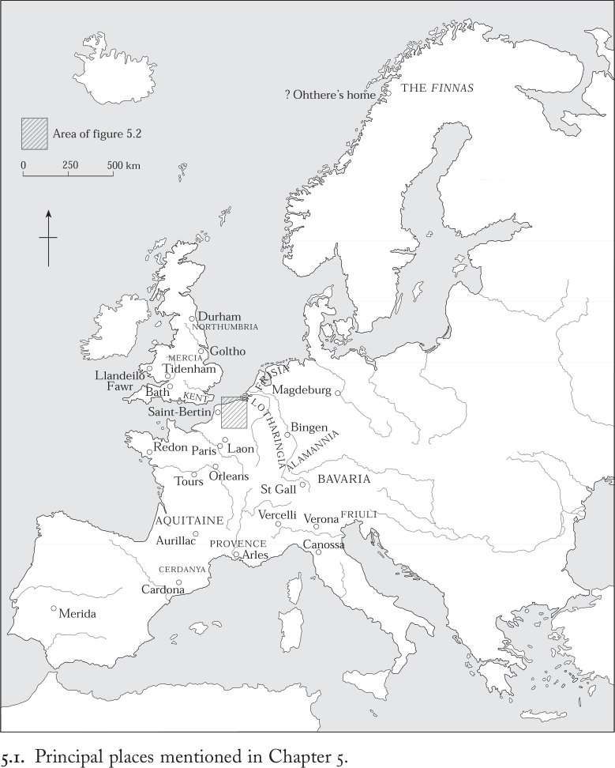
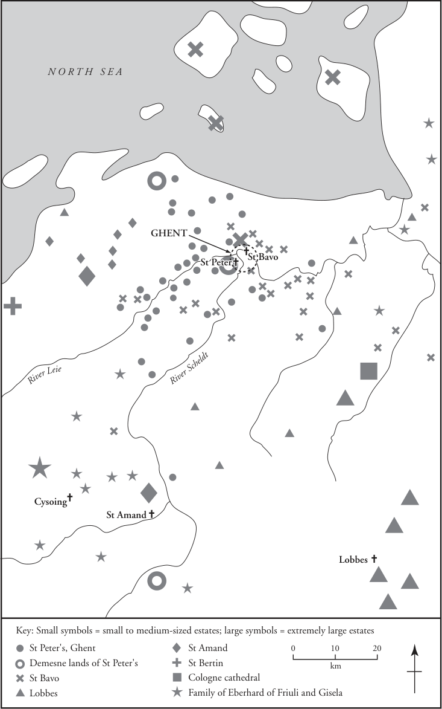

# 第5章 · 劳役与领主权

“耕夫，你说什么？你是怎样干你的活儿的？”

“哦，老爷，我干活儿极为辛苦。天一亮我就出门，赶着牛去田里，把它们套在犁上。无论冬天多么严酷，我都不敢赖在家里，因为惧怕我的老爷……是的，活儿苦得很，因为我不是自由人。”^1

人人当依附其领主；
人人当守护其领地。
人之顶为领主；
人之根为领地。^2

土地、在土地上劳作的人，以及对这些人施行统治的人，这些主题将我们引向社会、经济与政治关系的核心。约公元500年至1000年间，欧洲居民的绝大多数都生活于土地之上并直接耕作：他们的生活方式受到维持农业年节律所需的体力劳作的制约。同样重要的是，对地产的控制和对剩余产品的攫取，是个人与群体之间关系的核心。上一章已表明，中世纪早期的男女社会差别往往取决于对土地的不同权利；本章则承接社会分层的主题，探讨土地持有如何支撑起杂乱不齐的不平等等级。

本章的核心论点是：对人的控制与对土地的控制无法截然分开。这种结合几乎是所有中世纪早期共同体政治组织的基本要素，因为领主权同时涵盖了二者，或分或合。牲畜、奴隶或土地的所有者，凭其行使于其上的权力而为领主。家长亦然，凭其对于家中从最卑微到最显贵的所有成员的权威而为领主。

因此，领主权本质上是一种社会权力，根植于人际关系和对资源的控制，尤其是土地和牲畜。作为对主人、酋领、国王、皇帝或基督教上帝的称谓，“领主”一词承认了这种权力，暗含恭顺，并表达对居首位者的尊敬。因此，女性也可以是领主，只要她控制着庄园或以自己的名义进行统治。简言之，中世纪早期的不平等不仅是物质财富及其带来的生活方式上的不平等，也是社会影响力和政治权力上的不平等。

我们的出发点是一个直截了当的观察：中世纪早期人们所形成的各种群体——无论是孤立的村落共同体，还是大型王国与帝国——都显示出资源、财富、法律权利和身份上的差异。这些不平等并不彼此整齐对应，因为法律权利并不保证物质财富，正如司法等级并不反映人们对身份的主观认知一样。尽管男女生活在一个支配与从属的世界里，这一梯度却从来不是井然有序或系统化的，除非在某些法典和条理化法律论著条分缕析的措辞之中。毋宁说，它源于支配他人的现实：居于底层者通过习俗与传统、法律约束与制裁、形形色色的依附与庇护关系、威吓行为与实际暴力，或仅仅出于恐惧，而屈从于居于上层者。

“活儿苦得很，因为我不是自由人”：耕夫的哀叹提醒我们，土地、社会等级和权力的历史也牵动着自由与奴役这一动人心弦的问题。正因如此，这段历史常常引发争议。历史学作为一门学科，兴起于一个充斥着关于现代适当政治秩序之激烈论辩的环境中——绝对主义还是贵族政治，自由派还是保守派，资产阶级还是马克思主义。社会理论家、论战家与历史学家都在中世纪早期的过去中寻找他们所渴望的自由之先声、他们所反抗的压迫之根源，或他们所辩护的特权之正当性。在这种氛围中，他们构建出中世纪早期数个世纪的图式化、笼统化的概观，并轻易地将其视为农民自由的黄金时代，或是剥削与压迫的熔炉——也就是说，是此后人类生存“更好”或“更坏”阶段的前奏：这些旧日激情的阴影至今仍笼罩着关于中世纪早期农民的论辩。

本书采取的进路有所不同。它假定经验的多样性是中世纪早期的特征。它不寻求关于土地、劳役与领主关系的统一叙事，而是循着中世纪早期史料本身流动的术语和多元视角，去探寻各种各样的地方性形态。通过考察广泛的政治结构——大帝国、小酋领、紧凑而集约的政体、发展中的王国——本章论证，地区差异与历时变化是所有中世纪早期社会等级的标志。本章从阶梯的底层开始，探讨奴隶制与农奴制以及自由的意涵。第一节论证，尽管自由与不自由之别具有根本性的法律意义，社会现实却远比这一整齐的对立所暗示的更为复杂。中间一节聚焦于围绕土地控制组织起来的社会不平等。通过考察触及农民生活的形形色色的领主权形式，它主张应对变化的局部情势与政治语境保持敏感。最后一节转向社会的上层，探讨高等级身份如何被认知、维系或受到挑战，以及领主权如何也体现政治关系。

## 奴役与自由

“除了自由人和奴隶之外别无他类”：这是一句罗马法律格言，查理曼在裁决父母一方自由、一方不自由的子女的身份时发现它颇为有用。^3 与古代世界一样，自由与奴役之别仍是所有中世纪早期共同体中根本的法律分界。这是一对相反之物，是司法两极的彻底表述。最简单地说，它区分了生命与肢体不可侵犯之人，与身体安危及生存仍操于他人之手的另一类人。

然而在实践中，奴役与自由并不构成两极对立。毋宁说，它们构成一个光谱的两端。依附有程度之分，自由及其带来的好处亦有程度之分，因为奴役与自由都是相对的概念。一条支配与从属的滑动标尺贯穿整个光谱：在其顶端，各种依附形式组织着精英与其统治者之间的政治关系；在其底端，则构建着对乡村劳动力的剥削。强加于不自由者身上的屈辱义务没有任何荣耀可言，而权贵为国王所尽的服务却增进地位与荣耀。二者都向上级提供servitium（服务）。在社会梯度的每一点上，服务与领主权都是一枚硬币的两面：不同的只是其形式与社会价值。无论如何，依附与自由与其说是单一的概念，不如说是一束束限制与特权，可以以许多不同的方式组合在一起。其中突出的有：迁徙自由；对自己身体及其劳动的控制；携带武器的权利；诉诸法庭的权利；财产所有权；结婚或继承的权利；对自己子女的承认；以及追求荣耀。每一项都可通过司法程序、习俗或社会评价，以不止一种方式被剥夺或被承认。

然而，关键在于，其中一项欠缺并不意味着所有欠缺都随之而来。无论我们看向何处，都会发现大量的中间身份，将自由的某些方面与不同程度的依附结合在一起。这些身份无法归类；正如在许多其他方面一样，最好还是承认本地实践的无比多样性。出身奴仆却可身居高位，这是可能的，例如八世纪巴伐利亚的adalschalks（“高贵的非自由人”），以及十世纪末、十一世纪初德意志的ministeriales（仆役骑士）。这两个群体都缺乏法律上的自由，却为其领主履行荣耀而需要技艺的服务。自由却处于依附地位，这也是可能的；我们稍后将会见到一些自由人的例子，他们每年向大教堂或修道院缴纳款项，以承认其领主权。^4 这类情况的一个变体是十、十一世纪英格兰西部的骑行者（radcnihts、geneats）。这些是有财产的依附者，富裕到足以拥有马匹，例如蒂德纳姆巴斯修道院地产上的那些人，其义务包括“骑马、提供运送服务、供给运输、驱赶畜群以及做许多其他事情”。^5 他们与那个女奴的境况相去甚远——那个女奴的领主本人是个不自由的农民，却对她进行性剥削——这暗示了女性所遭受的从属处境甚至比男性更为悲惨。

查理曼致其官员的备忘录使用了自由人与奴隶的传统用语：liber与servus。前者相对直白：liber享有各种自由权（liberties），即行使某些权利的自由，无论其经济状况如何。后一个词则是出了名的难以界定。servus在古代的意义是 chattel slave，即财产奴隶，是主人占有之物，通常在战争中被俘并从远方贩运而来，当其劳作生涯结束时，会被另一个人类“进口品”所取代。在中世纪早期的进程中，它逐渐意指不自由的农奴：虽被承认为人，但权利极为有限，且通常世袭地束缚于其劳作的土地之上，其后代日后也将在这土地上劳作。然而在这一时期的大部分时间里，这个词既可以指前者，也可以指后者，或兼指两者。新的意义并未取代旧的意义，而各个作者对这个词语的确切用法也并不总是前后一致。语境也并非总是可靠的指南。造成这种语言上的不精确有两个主要原因：第一，其古代意义规定的是一种司法身份，而中世纪早期的文本通常用这个词描述一种社会经济状况而非法律状况。其次，其意义的转变与领主使用依附劳力耕作其地产的方式的变化密切相关。基于这两个原因，它留下了关于中世纪早期经济能否被归类为“奴隶经济”的争议残余。

这场论辩并无助益，原因有几个。重要的是，它有可能把这几个世纪的社会关系与农业经济化约为单一的、范式化的模式，并且妨碍人们领会即使在一个局部地区也并存的依附与不自由的多种形态。它还使人们的注意力从一群在许多地方无疑十分重要的人身上移开——即自由农民所有者，他们在史料中往往难以追踪，除非在他们把土地或部分自由让渡给领主的那一刻。此外，它倾向于抹去拉丁语和各地方言中通常用来指依附劳动者的许多其他词语——这些词或者单独使用，或者与servus连用，并各有其流动的含义。

但最重要的一点是：尽管奴役的词汇几乎未曾变动，其社会与政治维度在中世纪早期却与古代世界大不相同。罗马帝国在意大利及其他地中海行省的一些庞大农业庄园，曾由大批输入的奴隶成队耕作，他们被安置在兵营般的条件下，被剥夺了一切家庭生活，但这种剥削与人格贬损的方式在四世纪之前已然消失。被安置在各自地块上的四、五世纪奴隶，在两个方面日益类似于被束缚的依附农民：他们被承认为人而非物；以及他们贫困的经济状况、社会屈从地位和可继承的身份。然而，一套陈旧的司法词汇依然存在，散发着昔日气息，与较新的社会经济现实并不相符。

当中世纪早期的记载开始较为详细地向我们展示领主权与从属关系的典型形式时，农业奴隶制在后帝国时代的诸行省已成往事。在大陆的基督教地区，唯一能见到的奴隶是在贵族家庭和高等级的城市宅邸中，他们充当家仆或 skilled craftsman（技艺工匠）。相比之下，在英格兰，农业奴隶制与其他形式的奴役并存，社会实践与古英语词汇都表明了这一点。在不列颠群岛的其他地方及斯堪的纳维亚，奴隶制构成了非自由劳动力的主要来源，其供给靠劫掠与购买来补充。这种制度一直延续到1066年之后法国北部的征服者把他们自己的农业剥削传统和长期以来反对贩卖人口的道德约束带到英格兰，到该世纪末带到威尔士，最后在1169年之后带到爱尔兰。奴隶贸易的终结指出了中世纪早期农奴与奴隶之间的一个实际差别：尽管二者都可在田间劳作，但前者通常仍被束缚在其出生的特定地产上，并随土地一同被转让。而后者也可以在市场上被买卖，并被驱使到远离出生地的地方劳作。

无论是奴隶还是农奴，不自由的人口以各种方式进入领主的支配之下。这些方式不仅揭示了臣服的严酷现实，也让我们得以了解中世纪早期生活中的某些不安定与不确定因素。许多人从出生起就隶属于某位领主，仅仅因为他们的父母也是如此：从领主的角度来看，当跨越法律鸿沟的性关系或婚姻——这是常有的事——产生出必须确定其身份的后代时，自由与奴役的区分才最为重要。对领主而言，问题的关键在于保持对劳动力的控制。有些人因犯罪而丧失自由，因为他们无力凑足应缴的赔偿金；我们还遇到过另一些人，在极度的困苦和饥荒之下，他们将自身卖为奴役，把沦为奴隶当作换取少许粮食乃至某种庇护的可接受的代价。^6

在战争中站错一方可能导致被俘和奴役；事实上，在基督教欧洲的周边地区，战争与掳掠奴隶是不可分的。“我在边境之外俘虏了这个奴隶，当时公爵正率军出征”：这份声明在八世纪的巴伐利亚足以作为所有权的证据。^7

一个人可以在自由与奴役之间来回变动，有时一生中不止一次。身份的改变也会波及后世，正如这份十世纪末英格兰北部的感人文献所见证的：“ Geatfleda 为了对上帝之爱和她灵魂的缘故，[给予]铁匠 Ecceard、Ælstan 及其妻和所有他们已生与未生的子女，以及 Arkil、Cole、Ecferth [和] Aldhun 之女，还有在那邪恶的日子里她曾以自己的名义供给食物的所有人，以自由。”^8 这些忍饥挨饿的男男女女曾俯下身来，把头置于 Geatfleda 的双手之间，象征他们臣服于她的领主权；作为回报，她供养了他们。后来，她在达勒姆大教堂的祭坛前，以另一种同样具有象征意义的仪式解放了他们。

解放奴隶（manumission）在整个基督教欧洲都有实行，并受到神职人员作为一种虔诚行为的鼓励，这可能是个人法律身份被改变的最常见方式。然而，解放仍是一种领主权力的行为，在宗教意义上，受益的是主动发起解放的领主本人。在法律意义上，它免除了不自由者所承受的若干不利待遇。在欧陆，罗马的文书格式广泛可得，新获自由的人手握特许状，或可被称为“特许状之民”。相反，在不列颠诸岛，解放的记录通常写入福音书中，并诉诸神明的制裁来维护其效力。九世纪初，Bleddri 的四个儿子就是这样做的，他们授予 Bleiddudd ap Sulien 及其后裔“永久”自由。在威尔士大兰代洛（Llandeilo Fawr）圣泰洛教堂所藏的一部古老福音书的页边，他们声明：“凡维护此项授予 Bleiddudd 及其诸子之自由者，愿他蒙福。凡不维护此权利者，愿他被上帝和圣泰洛诅咒——本声明正是写于圣泰洛的这部福音书中。”^9

另一些时候，自由身份并非来自领主，而是源于农奴自身的行动。关于起义的记载极为罕见，但关于个人逃亡的提及则常见得多。有时，当地教会提供庇护——在这种情况下，逃亡很可能是与领主重新谈判的前奏。另一些时候，附近的边境提供了机会，而规范王国边界的协定有时明文规定归还逃亡者。此外，任何协助和唆使逃亡男女之人都要受到严厉惩罚。既然迁徙自由本身就是自由人的标志之一，成功地迁往新的地区就可能改变一个人的身份。较少见的是，人烟稀少地区的有魄力的领主会向所有前来定居的人提供自由：例如，880 年，塞尔达尼亚伯爵威弗雷德向所有能够逃离主人、前来比利牛斯山以南边境地区卡多纳定居的奴隶或农奴提供了自由。

赢得自由值得付出毕生积蓄，或冒逃亡的危险。捍卫自由甚至可能值得杀死一个可能否认自己身份的不自由亲属：查理曼规定，凡是采取如此极端手段者一律处以死刑，并进一步命令其自由亲属也一并沦为奴役。但自由也可以通过诉讼来捍卫，尤其因为自由人的特权之一就是能够进入王室法庭。自由还赋予携带武器的权利。然而，自由并非全是好处。它很可能带来更大的不安全感，而非生活条件的任何改善，因为灾荒之年，独立的自由农民几乎不可能从领主的粮仓中得到施舍。因此，获得法律自由的农民常常重新谈判出另一种形式的从属关系，以换取领主的持续庇护。自由在法律上的好处与经济上的不利可谓势均力敌，因为自由与奴役之间的区分按某些标准来说是轻微的，按另一些标准来说却是巨大的，这使得两种身份之间的社会屏障是可渗透的。

原则上，获得自由降低了遭受伴随从属地位而来的暴力的风险。法律常常规定，农奴或奴隶因偷窃、毁坏财物或破坏和平而被处以截肢、鞭笞甚至死刑，而自由人则相应地处以金钱赔偿，尽管若无力支付，他们也可能被降为奴役。然而，在法律条文的遥远世界之外，还存在着一种更为切近的习惯性暴力文化。偶尔，法典本身也会提及这种暴力，如巴伐利亚的这一条款：“若有奴隶妇女人任何人残害而致流产，若胎儿尚未胎动，应赔偿四索里达；若胎儿已经胎动，则应赔偿十索里达。”^10 不过，更常见的是，基督教道德家的疾呼让我们意识到这种暴力的普遍存在。奥尔良主教约纳斯（818–843年在任）在约820年提醒马特弗里德伯爵：只有人类社会才在人与人之间制造不平等，而所有人在出生之时都是一样的。“那些因奴隶的过失而被激怒、勃然大怒、狂怒不止，或者以野蛮的殴打惩戒他们，或者砍断其肢体致残的领主们”，不应误以为自己可以逍遥法外——而应记着天上只有一位上帝。^11 这样的主人很可能不太在意不自由的农奴与他所解放但仍依附于他的人之间的法律区分的细微之处。当极端的臣服生活意味着生活在暴力的阴影之下——对妇女而言，还有性剥削的阴影——时，法律身份的精确界定恐怕意义不大。

为了缓解等级世界较为残酷的现实，古代晚期的教士们宣扬负责任的权力伦理，并将其与精英获得基督教救赎的希望联系起来。其中一个方面是强调慈善捐赠的救赎效果。贝尔特希迪斯（Bertechildis）是莱茵河畔宾根一位显贵的妻子，生活于六或七世纪的某个未知时期。她汲取了这种精神，当她年仅二十岁、婚后仅一年便去世时，人们在她墓上刻下了铭文。铭文纪念她虔诚的慷慨：“深受民众爱戴的她，为了自身罪孽的缘故，向寡妇、孤儿和穷人施舍赈济。”^12 这类关于俗人施舍的直接见证十分罕见，但它揭示了我们已知普遍存在的现象：一种赋予穷人帮助富人得救之角色的观念。通过接受施舍，穷人帮助将救赎的天平向富人倾斜。

中世纪早期主教和道德家们继续想当然地接受 pauperes（“穷人”）的存在，这里不仅指寡妇、孤儿和贫困者，也包括所有容易受权势者剥削、缺乏领主权资源以维护自身利益的人。从九世纪起，他们扩大了所劝勉的 potentes（有权势者）对穷人应负的责任。后者虽无法消除社会不平等，却可以保护穷人；以公平价格、不作量器舞弊地购买农民的葡萄酒和谷物；并向赤贫者施舍——如此，便可拯救自己的灵魂。

于是，奴役与自由之间的区分具有社会的和道德的维度，其重要性不亚于任何法律上的差异或经济现实。它在法律理论上是分明的，但在社会实践中却是高度可渗透的，一方蕴含着成为另一方的可能。领主权处于这种关系的核心，因为奴役以支配为前提，而臣服并不限于法律上不自由的人。所有中世纪早期的道德家都接受权势者与穷人之间的鸿沟。他们只是劝勉各方各尽其被指定的角色，并尊重每一等级的权利。在理想世界中，不自由者劳作以供养自由者，领主则保护并捍卫所有人：

因为没有不自由者，自由人无法生存。
当人们真正指望某项工作完成时，
国王和主教们似乎在为他们的农奴服务。
领主由农奴供养，而本应是他供养农奴。

在基督教的道德经济中，领主权建立在对权力的审慎运用之上，因为它在带来权利、特权和财富的同时，也带来了社会责任。但写下这些诗行的年迈的拉昂主教阿达尔贝罗（977–约1031年在任）在十一世纪初也心知肚明。他紧接着补充道：

不自由者的呻吟与泪水没有尽头。^13

在隆冬严寒中不敢在家中逗留片刻的耕农想必会深表赞同；而且，既然在农业经济中，领主权依赖于对土地的开发利用，我们现在就转向这个问题。

## 农民与领主

那么，围绕生产农业剩余产品的需要，社会关系是如何组织的？在实际操作上，农民的劳动如何支撑领主的地位？领主权的社会和经济现实又是怎样的？四世纪作家帕拉迪乌斯的一句话提供了有益的起点：“既然土地类型如此繁多，便不可能有单一的劳作组织方式。”^14 帕拉迪乌斯以不同的土壤和气候来解释这种多样性；我们还应当补充：做法因大地产与小地产而异，而且随时间推移也在变化。古代晚期和中世纪早期的土地保有制的特征是区域性和地方性现实的纷繁多样，我们应当时刻牢记这一点。

多样性的一个方面是规模。小规模土地占有十分普遍但分布极不均衡，在文献中大多只在教会机构接管小土地持有者的部分或全部财产时才可见。大规模土地占有只有在大型政治体之内才有可能，而帕拉迪乌斯此语的背景正是罗马晚期精英土地占有的巨大规模。五世纪初，帝国西半部元老院贵族的某些成员在地中海各地拥有大片分散的地产，但随着那个世纪中日益加剧的不安全和西部帝国统一罗马统治的逐渐瓦解，他们的地产财富受到侵蚀：后帝国诸王国的建立伴随着财产占有规模的萎缩。

罗马在西部的统治终结还产生了其他影响。在古代晚期，各地区的城市土地寡头（库里亚勒斯，curiales）负责向小地产所有者和独立小农征税，并将其税款上缴国家。他们作为中间人的角色使其得以通过敲诈勒索、威胁或虚假的慷慨来扩展自己的影响。阿尔勒的凯撒利亚如此描述六世纪初普罗旺斯发生的事情：

如果[富人的]邻人是个穷人，被迫到了非卖不可的地步，或者可以被施压强逼出卖，他的目光便转向那个方向，指望能夺走其穷邻人的地产或佃农。于是他给对方制造麻烦。例如，他暗中说服当权者让税吏纠缠此人，或指派他担任某种足以倾家荡产的公职。……在必需品的驱使下，[穷人]去找那个因其恶行而正在压迫、折磨他的富人，却不知道自己正是因他的所作所为而受苦，对他说：“主啊，我求你借给我几枚索里达，我急需用钱；我正被债主围困。”

在试图借贷未果之后，穷人最终被迫变卖一切。“富人则表示愿意帮助他这位所谓的朋友”，并以远低于土地真实价值的价格买下了穷人的产业。^15

当有势力的地主将自己插在地方民众与国家之间时，自由农民和所有者都发现他们的独立性受到侵蚀。他们的缴纳逐渐演变为习惯性贡赋，而在此基础上，大地主得以逐渐把他们拉入更为严格界定、更为从属的依附地位。从小自由农到依附农民的转变几乎不可逆转；六至十一世纪间，大地产处处扩张，而小人物纷纷败落。

这一进程还以另一种方式加速。五、六世纪的不安全模糊了四世纪并行的文职与军事职业队伍之间的差别。常备驻军让位于农民民兵，土地所有者开始在入侵和不安全时期向佃户提供武装保护——或者自己干起保护费的勾当。为确保自身地位，地主变成了军阀。而且，继418年哥特武装队伍在阿基坦定居的先例（图0.2）之后，几支源自帝国边境以北的军队在各自首领的率领下被安置到西部罗马行省的乡村，起初或许只是抽取乡村地产所产生的一部分税收，但迟早会发展成拥有土地的军事精英。这进一步强化了领主对依附者和邻人的控制。 thus，贯穿整个中世纪乃至以后欧洲社会特征的社会精英与军事领导权之间的结合，便是在罗马政治秩序解体所带来的迅速变革中确立起来的。

农民与领主之间的关系总是隐含着一个更广阔的政治环境。兵役、王室恩庇，以及有时额外的财政摊派，对进入统治者随从行列的显贵们有直接影响。间接地，农民也感受到其冲击，因为领主权的压力以各种方式向下传导至他们身上。七、八世纪西北欧定居模式的变迁暗示了更严密的领主控制，可能伴随着对更多产品缴纳和更高捐税的要求，以及专业手工业品生产的增长。农民必然受到不利影响，尽管细节已难以考明。到八世纪末，领主普遍开始要求直接的劳役，在加洛林核心地带固然如此，在其他地区或许也是。虽然农民始终承受着生产超出自身温饱所需之物的压力，以便领主能从剩余产品中获利，但地产管理的趋势仍有变化，到十、十一世纪，许多领主似乎更偏好实物地租和实物缴纳而非直接劳役。

除了这些概括性的情况之外，我们对中世纪早期世俗土地占有的细节所知令人沮丧地少，因为没有任何俗人的或王室的产权契据、特许状、地籍册或地产备忘录合集完整保存下来。俗人签发的文件通常只有在当人们向教会捐赠财产时，凭据文书便随之产生。得以留存至今的档案都属于大教堂和修道院：正如下文所表明的，我们对于土地所有权和土地开发所拥有的最全面的视角，本质上是一种教会的视角。不过，在论述过程中，我们仍可留意世俗领主与其农民之间的关系。

凡是基督教得以确立的地方，各大教会自四世纪起便不断获得土地。早期阶段极难详细追溯，部分原因是纸草——晚期古代主要的记录材料——极易损毁。然而可以确定的是，虔诚捐赠的比率自八世纪初急剧上升，这是因为家族资源处置策略发生了转变，而对身后宗教纪念的追求也变得更加迫切。伴随这股高潮而来的文书意识的普及，恰逢基督教欧洲许多地区转用极为耐久的羊皮纸作为书写材料，因此，从八世纪开始，尤其是欧洲大陆上，世俗捐赠与教会土地持有变得远远更易察见。

到九世纪，加洛林帝国大约三分之一的耕地属于教会，尽管各地区差异很大，而且并非所有这些地产都被长期保留。在英格兰，诺曼征服前夕的比例与之相近——约占全部土地的四分之一。这些虽不精确却仍令人瞩目的数字，有几层值得注意的含义。

首先，随着教会土地财富的增长，教会成为景观经济组织及其居民的核心。教会地产上的区域专业化——例如葡萄酒、盐或羊毛，以及布匹、陶器等手工业制造——极大地推动了区域和跨区域贸易。教会从其财产中获得的财富也使其政治影响力日益增长。任何对领主权的研究都无法忽视这一制度性维度。

其次，世俗地产在每一任所有者死后往往面临重新分割、重新分配和争夺，而教会地产则通常享有持久的制度性所有权。诚然，国王和地方权贵偶发的、零敲碎打的掠夺造成过损失，但即便如此，一个因侵占某座教会土地而声名狼藉的领主，往往会被另一座教会作为慷慨的恩主加以纪念。另一种较轻的损耗来自租佃权世袭化的倾向；要遏制这种悄然的侵蚀，需要持续的管理警惕和坚定的意志。然而尽管如此，教会地产总体上仍是租佃关系流动性之海中相对稳定的孤岛。依靠精心保存的地契档案所形成的长久的制度记忆，教会土地的持久性远超中世纪早期的世俗地产。

最后，由于教会是在帝国的庇护下发展成有产的制度的，它们按照晚期罗马财产法运作。中世纪早期，基督教传教士无论走到哪里，都携带着罗马法关于完全所有权的个人产权预设、书面文件形式和专业术语。这些往往与传统财产关系相冲突，尤其是在土地权利与亲族成员身份紧密相连、并通过口述传统保存于社会记忆之中的地方。从罗马城本身的山地腹地到爱尔兰起伏的丘陵，中世纪早期文书中罗马化的语言常常掩盖了那些已大大适应本土惯例的租佃习俗。

因此，出于种种原因，领主与依附劳动者——无论奴隶、农奴还是自由人——之间的关系并不遵循任何单一模式。有些习俗相当普遍，但不存在某种规范或典范制度。多样性、流动性和演变是中世纪早期地产的标志，我们必须认识到这一点。由于这一系列实践既难以概括呈现，也难以找到代表性实例，以下将选取一个单独个案研究来说明这种多样性。

所涉及的地区是佛兰德斯北部，详见图5.2。该地区恰好位于前罗马边境线之内，横跨中世纪早期（以及现代）日耳曼语与罗马语之间的语言边界地带。目前我们关注的是一个约创建于629至639年间、奉献给圣彼得的宗教团体。其所在地名为布兰迪尼乌姆的山丘，俯瞰斯海尔德河与莱厄河交汇处的古老罗马定居点根特，靠近后来在九世纪发展出贸易中心的地点。

……即第九世纪将出现贸易中心之处。与大多数修道院一样，它经历了产业积累的时期，也经历了停滞或流失的时期。这些波动通常与“改革”周期相伴出现——即对教会礼仪和其成员行为规范的全面整顿，旨在拉大宗教生活与世俗生活之间的差距。几个世纪以来，根特的圣彼得修道院经历了数次这样的改革；从留存下来的文献中，我们可以追溯佛兰德斯这一隅领主权模式的变迁。

圣彼得修道院最初由国王达戈贝尔特（623–639年在位）捐赠了其附近的一块土地，之后逐渐在斯海尔德河和莱厄河上游获得其他地产，并在北面的森林以及更远处的沿海盐沼中获得产业。如图5.2所示，其土地规模不大，而且几乎全部位于修道院教堂30公里范围之内——这与许多地产散布极广的其他修道院不同。此后的墨洛温王朝诸王似乎对这座新教会失去了兴趣。到八世纪，当相互角逐的权贵势力争夺对高卢北部的控制时，圣彼得修道院曾试图保持中立，但未能成功。或许不可避免地，它被卷入了其中一方的庇护之下，但似乎因此失去了部分土地。

王权控制在查理曼统治时期得以重新确立。对根特的圣彼得修道院而言，一如对许多其他修道院和大教堂而言，加洛林领主权使其在任何诉讼中都能直接诉诸宫廷。此外，在其自身领地内，修道院院长取代了地方帝国行政和司法官员：实际上，他成为了国王在此的代理人。同样地，加洛林的控制也意味着脆弱性与义务，这在虔诚者路易于815年任命一位新院长时便显现出来，其任务是“改革”这个团体。此人就是艾因哈德——忠实的廷臣、著名的查理曼传记作者，而且是位在俗者。他代表着王室在这一宗教团体内部的领主权，是皇帝汲取修道院财富的渠道。尽管艾因哈德为个人或帝国利益经营着修道院的部分地产，他仍专门划出特定土地，用以维持居住在圣彼得修道院的二十四名教士的生计。他仔细登记了他们的份额，相关文献揭示了这一特定教会团体是如何组织和开发其土地的。

虽然艾因哈德或其九世纪的某位继任院长向教士兄弟们划拨了一处位于南方近50公里外的田庄，但他们的土地大部分紧邻修道院本身，是一个由耕地、割草草甸、养猪的林地以及一小块葡萄园的一部分组成的适度产业。与此相连的是沿海盐沼中的偏远牧羊场。所有这些被称为 terra indominicata，即直领地，意指它将被直接耕种以为其领主谋利，在这里即圣彼得修道院团体。教士们还被划拨了更大的一块土地，紧邻其直领地，这块地原本属于七世纪最初的捐赠。它当时如何组织经营已不得而知，但显然到九世纪初，租佃安排已发生了相当大的演变。到那时，它已被划分为若干单位，每个单位由一名依附劳动者耕种，此人须履行特定义务。

让我们来看一个特定的依附者——福尔克里克，他持有一份土地，即一个曼苏斯。每年他须向修道院缴纳定量的面包、啤酒、猪、木柴、屋顶木瓦、亚麻、鸡蛋和谷物。此外，每隔第三年，他在收获季节缴纳两索里达（合24便士），以替代他为直领地出劳役；在间隔的其中一年，他另行缴纳两索里达以资助修道院的军事开支；在另一年，他无须缴纳现金，只须缝制一件衬衣。由于我们既不知道福尔克里克曼苏斯的面积，也不知道他是否有妻子儿女帮忙，我们无法估计这些义务的沉重程度，也无法计算会有多少产品剩余下来供养他自己和家人。但我们可以肯定，管家会确保教士兄弟们获得稳定的面包、啤酒和其他产品的供应；而他们的管理手段会包括欺诈、勒索和鞭打。

福尔克里克的日常劳作必然局限于他耕种的田地、他前往砍伐和运送木柴的树林，以及他收割的亚麻——（大概）由他的妻子织成亚麻布再制成衣物，但他仍然是一个更大、更复杂的经济体的一部分。在查理曼时代，他的前辈可能曾被课以直领地上的劳役，但即使如此，到福尔克里克的时代，这些劳役已被折算成现金缴纳。在八世纪末和九世纪，依附农民常常须在地产的直领地上服劳役（繁重程度不一），从而将地产的各部分整合起来，但这远非普遍现象。领主可能改而索要现金，以更有效地开发其土地并提供更灵活的收入。但只有当农民能够进入市场、以少量剩余产品换取银便士时，他们才能这样做。由于居住在日益繁荣的市场中心根特附近，圣彼得修道院的依附者显然对此毫无困难，尤其是在840年后那里设立王室铸币厂之后。

在福尔克里克的田地之外，在地方市场之外，在修道院对他生活的控制之外，王权也发挥着自己的影响。通过每三年缴纳两索里达以支持圣彼得修道院的军事义务，福尔克里克为法兰克军队的开支作出了贡献。尽管九世纪征兵方式的细节仍有争议，但大型教会土地所有者和世俗贵族都必须提供分队。每支队伍的核心大概都是土地所有者（就教会而言则是其在俗代表）及其重装骑兵扈从。军事义务的影响在圣彼得修道院可见一斑。直领地草甸每年生产的五十车干草足以供马匹过冬，直领地部分田地种植的燕麦也是如此。从佃户处收取的部分木材，可能被用于维护810年在根特建造的沿海防御舰队。那么，院长是否将修道院众多依附者各自缴纳的小额款项汇集起来，用所得购置所需的装备、驮兽和战马，以便派遣重装骑兵出征？抑或他与王室约定定期缴纳一笔整款，以代替实际派兵？从福尔克里克的角度看，这无关紧要：他只须照章缴纳。以这样或那样的方式，修道院的领主权在他与统治者之间充当了中介。

另有约二十四名依附者各持有一个曼苏斯，条件与福尔克里克相同或相似。在艾因哈德任院长期间及其后，圣彼得修道院又为教士自用获得了若干土地，它们按同样的直领地加依附租佃的基础加以组织。这些捐赠的记录表明，随土地一同转让的还有其上的劳动力，农民从捐赠者的领主权转归受赠者。这些男女只能被描述为处于奴役状态。他们的子女随其而来，并继承其身份。到九世纪末，他们对修道院极度从属的标志更加清晰：除了每年的义务外，他们还须在结婚时缴纳一笔款项，在死亡时再缴纳一笔。因此，圣彼得修道院的支配具有三个主要特征：它是家父长制的，因为它触及修道院大家庭的所有成员；它是家产制的，因为它施于修道院的全部土地产业；它是强制性的，因为它无可回避。无论领主是教会、世俗领主还是国王，这些都是中世纪早期一切领主权的三个主要特征。

其他男男女女与圣彼得修道院的关系则截然不同。直领地由二十九名未婚者耕作——年轻的男女以及几名挤奶女工，他们未被分派单独的地块，想必住宿在修道院的附属建筑中。无论我们称之为农奴还是奴隶……并不影响他们完全依附的地位。而在另一个极端，有些人则与修道院保持着松散得多的、也更体面的关系。若干“自由人”只需缴纳可观的现金款项，外加有限的实物贡赋，通常是啤酒。他们可能以某种我们无从得知细节的方式持有佃地；也可能是小自由地产的所有者，其土地原先处于对国王的松散从属之下，如今改为向修道院缴纳习惯性贡赋。教会的领主权对这些人的束缚相当轻微，但圣彼得修道院仍然主张对其土地及其收益的权利。

教士与某些近期捐赠者之间的关系则又不同。诺德贝特便是一例：他购买了一份地产并将其赠予圣彼得修道院，但随后在830年，他与艾因哈德达成安排，继续占有并从该土地中获利，只需每年象征性地缴纳两便士，以示承认修道院的领主权。只有在他死后，教士们才能取得直接控制权：在那之前，诺德贝特与教士们对该地产拥有重叠的权利。这样一种安排是对教会有利的，即所谓“恩惠”，此类土地通常也被称为“恩地”（benefice）。这些好处应是社会性和政治性的，而非经济性的。诺德贝特是否充当过艾因哈德院长的武装护卫，或在圣彼得修道院的部队中作战？他是否在地方事务中运用影响力来保护并扶持修道院的利益？艾因哈德是否曾利用自己的地位帮助过诺德贝特？我们将在下一章看到，他确实曾这样帮助过自己的其他亲随。这些推测只是反映了我们对九世纪其他地区类似恩地的了解，但同时也提醒我们：领主权不仅关乎土地经营，也关乎个人忠诚与政治服务。它构成一个连续的光谱，从经济剥削，经过社会纽带，延伸到政治庇护。

因此，根特的圣彼得修道院团体与其依附者之间的关系并不符合任何单一的简单模式。土地及其劳动力的组织方式多种多样。像艾因哈德这样精明的院长行事灵活，在追求效率与尊重地方惯例之间寻求平衡。可得的自然资源提供了一系列机遇与限制，市场之可达——或偏远——则提供了另一系列。对修道院而言，对某些男男女女课以沉重的贡赋和义务，而对另一些人则宽松得多，这都是合宜的。有效的领主会随经济、人口或政治形势的变化而调整应对之策；领主们的决策，无论是个人的还是集体的，都参与塑造着一个不断变化的社会。

圣彼得修道院的土地在整体上如何融入北佛兰德斯的土地占有格局？附近还有其他大土地所有者，尤其是位于根特城内、富裕得多的圣巴沃修道院，其土地沿斯海尔德河和莱斯河上下游延伸，与圣彼得修道院的土地犬牙交错。不过，当地大部分地区由小地产者主导，每个男人或女人只拥有几块小块田地，依靠一两个依附者、至多五六个依附者的协助耕作。土地的零散化是常态：较富有的所有者的地产散布于多处。总体效果是，从林地中开垦出的小块田地和草场拼缀而成，河流沿岸则分布着水草场。而这些农民地产者向圣彼得修道院作出小额捐赠时，修道院在这里得一田、那里得一地的累积，也为不断变化的景观增添了新的要素。

莱斯河与斯海尔德河谷极宜种植亚麻，并以其高度集中的亚麻布生产而著称。在佛兰德斯的其他地区，自然环境及其开发方式则有所不同，如图5.2所示。在北面的沿海盐沼、泥炭沼泽以及斯海尔德河口各岛屿上，圣巴沃修道院拥有的领地规模之大，每处足以养活上千只羊。也许像更北面沿海弗里西亚一带经营牧羊业的修道院一样，他们对这里的农民要求甚少，只要求每年缴纳成品的布匹，因为畜牧经济通常催生截然不同的领主权形式。

在东北方向，以及南面沿斯海尔德河而上图尔奈周围的地区，分布着埃贝哈德与吉塞拉将在遗嘱中分配的部分土地。^16 这些是大规模、精耕细作的农业地产，极有可能数百年间一直属于王室领地，直到吉塞拉的父亲虔诚者路易将其划归她作为嫁妆。它们实行混合农业制度，生产多种谷物，同时饲养牛、大量猪和若干羊，还有家禽——甚至孔雀。

同样在西南方向，圣贝尔坦修道院是另一大土地所有者。在佛兰德斯南部起伏和缓的乡野，圣贝尔坦拥有庞大的谷物种植地产，其租佃制度在九世纪上半叶已得到系统化。这座修道院的农民与领主的关系比根特圣彼得修道院的农民更为沉重。除了规定的款项和贡赋外，每一份曼苏斯（mansus）的持有者还须在修道院的自营地上服劳役：身份为奴者每周三天，自由者每周两天。这是耕种大面积谷田最有效率的方式。即使这里曾有独立农民地产者的农庄，到九世纪中叶也已消失，被其强大的教会邻邦吞并了。

我们可以让佛兰德斯的这一隅作为早期中世纪乡村社会整体的缩影。它展示了农耕经济与畜牧经济的相互作用：虽然二者在整个欧洲范围内互为补充，但很少有哪些地区像佛兰德斯和弗里西亚沿海那样高度专注于养羊，或像从佛兰德斯向南延伸至巴黎盆地的谷物种植地产那样专注于种粮。区域间贸易重新分配了各地的盈余；在其他地方，酒或盐等其他区域性特产也被运往相当遥远的市场。佛兰德斯还提醒我们林地——在这里既出木材又为猪提供饲料——的经济重要性。而最重要的是，它展示了租佃制度如何适应不同环境。在这一特定地区，对依附劳动的控制形式依畜牧与耕作的不同需要而各异；在地中海欧洲，葡萄和橄榄的种植则以其他更适宜的租佃形式为特征，而在下一章，我们还将在爱尔兰的牧牛之乡遇到截然不同的形式。

在整个欧洲，领主们尽其所能地开发利用当地的自然环境，通过在本地可能性与自身不断变化的优先事项之间取得平衡来控制农民及其他依附者。但我们也应记住，他们同样回应着更广阔的政治环境。艾因哈德对根特圣彼得修道院的管理是加洛林帝国鼎盛时期的典型写照：当时王室庇护是台发电机，暂时将流动的区域性领主网络转化为一个异常庞大的政治体。然而到九世纪末，法兰克政治体陷入危机，其原因是王室王朝内部对权力的争夺，随后又迅速出现男性继承人的匮乏。九世纪中叶，国王之子太多，人人都觊觎一个王国；而到世纪末，却又少到不足以维持现有的次王国。随着这台发电机运转失灵，区域精英转而寻求别的权力经纪人，并重新组合成多个更小的政治体。

佛兰德斯便是其中之一，其伯爵与最后的加洛林人——十世纪的西法兰克国王——有姻亲关系和共同的政治利益。到九世纪末，根特崛起为中央要塞，伯爵们以此为根基统治一个新兴的政治体，其权力建立在当地一座新建的木制城堡之上。在其势力范围之内，他们的行事方式与加洛林人在其帝国内的权力经纪做派如出一辙，并成功地在其区域内对庇护——土地、官职和荣誉——的涨落保持了有效掌控，直至十二世纪。

牢记这一点，我们可以回到圣彼得修道院的教士、附近的世俗土地所有者和农民，考察变化的政治环境如何影响农民与领主之间的关系。940年代的又一轮“改革”留下了一批文献，不仅表明有待收回的失地，也昭示着一个迅速变化的世界。此时圣彼得修道院由阿努尔夫一世伯爵（918–965年在位）以保护人和俗人院长的身份执掌，而根特已成为迅速发展的城镇。例如在941年，阿努尔夫伯爵对圣彼得修道院的捐助就包括城中房屋的收益和对经过港口货船征收的税金。城外，景观也在变化，领主权获得了一种新的、商业性的维度。磨坊不断兴建，羊只在整个佛兰德斯大量饲养：圣彼得修道院从中兼获其利。随着十、十一世纪的推进，阿努尔夫的继任者大力推动林地的开垦和沿海洪泛平原的排水。

我们可以推知这对佛兰德斯农民的意涵。他们发现自己参与到一个日益扩张的货币经济之中，因为领主此时更偏好金钱缴纳而非劳役或实物贡赋。磨坊意味着家庭磨谷的终结，也意味着农民劳动力——通常是女性劳动力——得以解放去从事其他工作。但磨坊也意味着使用须付费的义务，这是领主“习惯权”扩散的一个例证，造就了新的依附形式。土地开垦意味着人口增长、与领主交往方式的改变，以及一定程度的乡村流动性。必定还有其他农民干脆离开了乡村，因为根特及其他佛兰德斯城镇的迅速增长只能源于乡村移民，伴随着移民带来的种种失序效应。留在乡村的人则须参与生产足够的粮食，以养活城镇居民，同时也养活自己的家庭和领主。最后，城市手工纺织业的出现引入了新的劳动与领主权形式。

通过这种种方式，佛兰德斯农民受到更广泛的经济潮流，以及圣彼得修道院和佛兰德斯伯爵们不断变化的领主权的影响。尽管这些发展为根特周边地区所特有，但各地的农民都被卷入并受制于领主“习惯权”的扩散以及精英之间不断变动的政治权力网络。我们不能在此之外再作概括而无视这些习惯权的巨大多样性，因为所有领主，无论世俗还是教会的，都推行各自偏好的技术，从土地上榨取剩余以维系其领主地位。殊途同归这一点，对同时代人来说并不足为奇。毕竟，一位十一世纪早期的盎格鲁-撒克逊庄园管理论者在概述了某一特定产业的组织之后，曾援引帕拉迪乌斯的话写道：“这一庄园法存在于某些庄园；如我所说，在有些地方它较重，在有些地方也较轻；因为各处的庄园习惯并不相同。……主持管理之人须留意，要始终明了该庄园的旧有安排以及民众的习惯是什么。”^17 变化世界中的地方习惯：这正是农民应对领主支配所依存的基质。

## 寻求地位

“告诉我，你的财富何在？”十世纪的道德家韦罗切利的拉特尔（卒于974年）在一篇文学对话中问一位虚构的富人。“在于我拥有的地产、农奴和女奴、马匹、牛和其他牲畜，在于我的追随者的服从，在于我对猎犬和猎鹰的喜爱，在于我丰裕的衣物、精美餐具、谷物、酒和油，以及武器、白银、黄金和珠宝。”^18 土地财产、奴役性的劳动力、忠诚的扈从、昂贵的财物和炫耀性的展示：富人的回答表明了获得崇高社会地位的复杂性。他被问及财富，其回答却将对他人的权力与物质资源结合在一起，正如我们所见，这正是领主权的典型方式。他提及自己如此享受的生活方式——狩猎、宴饮、个人服饰的奢华，以及其他种种使之凌驾于他人之上的炫耀性消费。自然，他的言辞预设了一种等级式的人际关系观，从奴隶到最富有、最有权势的领主。本节将探讨这种自我认知对早期中世纪社会秩序顶端者的若干意涵。

在上层同样存在巨大的多样性。那些以各种泛指领袖人物、大人物、有权者、最优秀者的名号（拉丁语中的primores、potentes、optimates；古英语及其他语言中也有类似的词汇系列）相称的人，享有最大限度的自由集群，但即便如此仍效忠于一位亲王、国王或皇帝。较低层级的显贵——享有区域性特权、家境殷实的自由人——有时自愿、有时被迫为其服务。在某些地方，紧密的等级制度将各群体牢固地束缚于其上与其下；在另一些地方，交往、义务和服务形式则较为松散和轻微。此外，效力于一位以领土扩张闻名的领主的人，与效力于统治一个稳定甚至正在萎缩的领地之领主的人，所面临的机会截然不同。就政体而言，因为王室或诸侯的恩庇在一定程度上取决于可动用的资源。

以我们前面遇到过的四位人物为例，他们都生活在830年代：阿巴、埃贝哈德、里瓦尔和诺德贝特。^19 里瓦尔和诺德贝特都是地方上的实力人物，却选择与当地的重要教会建立往来——里瓦尔与雷东修道院，诺德贝特与根特的圣彼得教堂。在布列塔尼，任何领主权对里瓦尔这类地方土地所有者来说都形同虚设；但正如我们刚刚看到的，在诺德贝特的时代，日益严密的领主义务正影响着佛兰德斯。阿巴和埃贝哈德都直接为国王效力——前者任肯特郡长，后者任弗留利藩侯——但两人在土地、财富和政治影响力上的规模毫无可比性。以肯特的标准衡量，阿巴虽有权有势，但与弗留利的埃贝哈德相比则微不足道。埃贝哈德的家族跻身加洛林超级精英之列，这使得他的父亲和他本人得以从查理曼治下法兰克人的领土扩张中获益，其地产从佛兰德斯一直延伸到意大利。

除了土地所有权之外，这四位精英人物及其家族之间几乎没有什么共同点——唯一的共同点是他们都利用土地与教会建立联系，而这正是我们得以了解他们的原因。这种多样性提示我们，应当仔细考察中世纪早期还可能存在哪些身份标志。我们将看到，资源上的悬殊差异和称谓上的多变，反映了上层社会的社会流动性，以及精英成员资格缺乏任何固定标准。由于获得或丧失高贵地位没有任何明确的成规，我们只能从多个方面去探寻。而中世纪早期的人们也正是这样做的，我们接下来就会看到。

首先，高贵身份是外人可见的。伊比利亚哥特人的国王莱奥维吉尔德（568–586年在位）将梅里达附近的一处地产赐给一位名叫南克图斯的修道院长，以供养其修道团体。修道团的居民前去拜见新主人，却大为震惊：“当他们前去见到他衣衫褴褛、头发蓬乱未剪时，便鄙视他，彼此说：‘我们宁可死，也不愿侍奉这样的主人’”——于是几天后他们把他杀了。^20 对南克图斯而言，不修边幅是苦修的标志，但他的佃户们不愿侍奉一个看起来像卑贱奴隶的主人，无论他多么圣洁。主人必须有主人的样子。

除了外表之外，举止和谈吐也彰显高贵身份，七世纪诺森布里亚人伊玛的经历便说明了这一点。679年他在战场上被麦西亚人俘虏，谎称自己不是国王的侍从，只是一个穷苦农民。俘虏他的人密切监视着他，过了一阵子，“从他的外貌、举止和谈吐中看出，他并非如他所说的出身平民，而是出身贵族之家”。^21 显然，在宫廷的历练使人养成优雅的仪态和文雅的谈吐，以及将精英与农民区分开来的着装规范。

宫廷气派还以其他方式塑造出独特的外表。最迟至查理曼时代，王室扈从的衣着已讲究时髦炫耀，购置昂贵的丝绸和毛皮，男性佩戴镶宝镀金的武器，女性则佩戴胸针、臂环、腰带和项链。虔诚者路易不得不劝说他的主教和修道院长们——他们几乎都出身高门——不要穿得像世俗贵族一样。他敦促他们舍弃“世俗荣耀的饰物”，即“缀有金剑饰和镶宝匕首的腰带、华美的衣裳以及装饰着马刺的精美鞋履”。^22 这些恰恰是弗留利的埃贝哈德遗赠给子女的那些彰显声望的物品，而且正如我们在下一章将看到的，它们被用来巩固恩庇与恩宠的纽带。这一切都标志着精英身份，其中剑带尤具特殊意义，因为无论镶宝还是素面，它们同时也是官职的徽记。这种宫廷风尚还颇具感染力：始于加洛林帝国宫廷的潮流在奥托王朝宫廷进一步发展，两者都树立起奢华高贵服饰的风尚，为各地人士所效仿。最迟至十世纪末，盎格鲁–撒克逊的国王、王后连同贵族及其妻子们也纷纷效仿，身着织花丝绸，饰以大量金线刺绣、珠宝和厚重的毛皮。

对排场的讲究还延伸到骏马及其马具上，饰以“雕花圆牌”。^23 教皇哈德良一世（772–795年在位）游行时所骑的，非“最负盛名的骏马”不可——膘肥体壮、“各方面都值得称道”。^24 而当（1036至1038年间）年届五十的卡诺萨的博尼法乔斯翻越阿尔卑斯山去迎娶约十八岁的新娘贝亚特丽斯时，他给马钉上了银掌。他故意把马掌钉得松松的，好让它们在途中脱落，供当地百姓拾取：“这样人们就能知道他是谁了。”^25 绝不放过任何彰显身份的机会。

精美的饮食是精英生活方式的另一个方面，正如我们前面所见。^26 除了猎物以及专门饲养以供宰杀的家畜的鲜美肉食之外，丰盛的餐桌上还有海鱼，如鼠海豚和鲱鱼，以及用进口香料烹制的菜肴。这些东西应有尽有、数量庞大：从布道者的抱怨来判断，大人物们喜欢大吃大喝、纵酒过度。尽管如此，饮食在原则上仍可区分身份的高低，因为当虔诚者路易为其办理帝国事务的代办规定口粮时，他精确地规定“按各人等级应给予多少”，无论其为 Bishop、修道院长、伯Count还是扈从。^27

精英成员资格还意味着社会距离。其表现之一是拥有由武装人员、家务官员和随从组成的私人扈从队伍。另一个表现可能是设防的宅邸，例如戈尔索十至十一世纪的盎格鲁–撒克逊大厅建筑群，其中主厅、附属建筑和庭院由土垒和壕沟环绕。它还要求他人毕恭毕敬，避免威胁性的举动。“仆人向主人递刀时，习惯上要[握着]刀尖。”^28 精心的策略可以强化等级秩序：马格德堡大主教塔吉诺（1004–1012年在位）就只看重“出身高贵和举止得体”，拒绝接纳出身低微者进入自己的随从行列。^29 然而，社会攀附者却力图消蚀这种距离，因为效仿贵族就是在博取贵族应得的礼敬。于是，圣加仑修道院的庄园管事们“学会了吹号角，其声与其他农民的不同”，并开始佩带擦得锃亮的武器，带着猎狗去打猎——起初只猎野兔，后来甚至猎狼、熊和野猪。“‘管田地和草场的事让膳房总管去操心吧，’他们说，‘我们必须顾及自身的好处，纵情狩猎，这才配得上真正的男子汉。’”^30

由此可见，精英身份意味着一种以个人炫耀和挥霍性消费为特征的生活方式与行为规范。一部八世纪的爱尔兰论著对此作了总结——它固然过分系统化，却忠实于其精神实质。一个拥有二十七名依附者随扈、一座29英尺长的主宅和一座19英尺长的附属房屋、陈设奢华——包括八张床和带坐垫毛毯的躺椅、厨房里有一口足以炖下一整头牛的大锅、十二副镀金马笼头和猎犬——而其妻子还养着一只宠物哈巴狗的人，便是“头等贵族”。^31

照此标准，我们开篇提到的那位虚构的富人有充分的资格被视为精英。他拥有必要的财富、生活方式和扈从。但是，巨额财富和得体的行为就足够了吗？未必。在中世纪早期的观念中，界定精英的是“高贵”。一份十一世纪初关于身份等级的盎格鲁–撒克逊论著承认：“如果一个商人生意兴隆，曾三次自费横渡公海，那么他此后便有资格享有塞恩的权利[即在盎格鲁–撒克逊语境中的贵族：见下文]”。^32 或许确有一些中世纪早期的商人成功跻身塞恩之列，但我们没有证据证明这一点。然而我们确有很多迹象表明，成为“高贵者”所涉及的远不止像那位富人那样坐拥财富。

“高贵”又是一个含义灵活的词语。它通常描述一个人的显赫等级及其权力与特权地位，但也可以指在当时的宗教和社会期待范围内高尚端正的品行。在特定语境中，这两种含义可能取其一，也可能兼而有之：它们共同蕴含着“显赫知名”之意。那位富人固然有资格在第一种意义上被称作高贵，但并非所有与他地位相当的人都必然如此看待他。这有一个根本原因：尽管“高贵”在欧洲中世纪和近代早期的社会等级体系中占据关键位置，但在中世纪早期，它并不是一个由客观、公认的标准所界定的等级。

毋宁说，它是一种品质。品行往往至关重要，“高贵”一词本身就暗示了这一点。此外，血统也举足轻重，原因有二。其一，世袭身份存在强烈的预设：知晓某人的父母出身即可确认其高贵身份。女性尤其如此——她继承父亲的等级，并且往往充当家族谱系资料的保管者。其二，除了偶有发迹的商人之外，获得支撑高贵生活方式所需资源的主要途径是继承。由于只有贵族才有机会积聚或继承超过极小规模的资源，拥有财富本身并不能自动使人成为贵族，毋宁说它确认了贵族身份。品行、血统、财富——所有这些都有助于一个人被公认为高贵。

想想奥里亚克的杰拉尔吧，他作为圣徒声名远扬，部分原因正在于他拒绝过贵族同侪那种奢华炫耀的生活方式。尽管如此，他却是货真价实的名门之后：“他的出身如此显赫，以至于在高卢诸家族中，他的家系无论在产业还是生活品德上都卓尔不群。……而散布各地、附有农奴的大量庄园，凭继承权归于杰拉尔，也见证了[其祖先]财富之巨。”“谦逊与虔敬”这种形式的“生活品德”同样是家传的。^33 不过，杰拉尔把高贵的生活推向了新的极端。一般而言，贵族被期待的行为方式要为自己、家族和领主带来荣耀：世俗男子须勇敢尚武，女子则须贞洁端方、善于持家。^34 而奥里亚克伯爵放弃复仇、不动干戈、保持贞洁，简直是颠覆了传统的性别行为范式。因此，杰拉尔拥有一切高贵的标志：家世、庞大的地产，以及另一项难以捉摸的标准——卓越的品行，尽管是颇为奇特的一种。他高贵到了这种程度，其传记作者暗示道，以至于无需靠炫耀财富来证明这一点。

通往高贵或提升高贵身份还有一条重要途径需要考虑：为王室效力。许多后来用以指称显赫等级的词原本意为仆人或家内扈从，这绝非偶然：“塞恩”/“塞恩勋爵”（分别是盎格鲁–撒克逊英格兰和苏格兰的主要精英等级）、“骑士”（古英语cniht）和“封臣”（古法语vassallus）的词根含义都是仆从。至少可以说，由于这种服务往往带有军事性质，一个人战死沙场可能为另一人在宫廷中晋升铺平道路；反之，战功卓著也可能带来奖赏、恩庇和更高的社会声望。服务也可能是较为和平的，即在支撑中世纪早期诸王国与帝国的世俗和教会行政体系中担任重任。而其回报——声望、影响力、地产，甚至是王室新娘——可以极为丰厚，弗留利的埃贝哈德对此深有体会。

接近这些职位造就了一批圈内人，他们得以利用与国王的亲近为自己和家族谋取好处。此外，虽然贵族血统传递贵族等级（前提是家族记忆得以延续、高贵的生活方式得以维持），但它未必是跻身高位的前提。维尔切利主教柳特瓦德（880–900年在位）同时例证了这两点。他出身低微，却凭才干晋升，在胖子查理（876–887年在位）的宫廷中身居最高的教会职位，“受到所有人的尊崇与畏惧，甚于皇帝本人”。他还成功地提携家族，“他毫无阻碍地夺走阿勒曼尼亚和意大利最高贵人家们的女儿，把她们嫁给自己的亲戚”。^35 与地位更高的女性通婚是既定的社会晋升途径，因为女性可以将身份连同资源一起代代相传。然而我们应当记住，特权、财富以及因接近统治者而产生的权力，绝非总是相伴而行。大贵族常常有不显达的兄弟：他们出身同样高贵、财富相当，却缺乏政治地位和影响力。

受宠于君王的近臣，也未必获得同侪的信任。570年代，勒达斯特任图尔伯爵。他获得这一职位靠的是赢得希贝王（561–567年在位）继而是其兄弟希尔佩里克王（561–584年在位）的垂青。该职位肩负代表国王管理财政、军事和司法的职责，并隐含贵族身份，但关于勒达斯特，我们只能透过其图尔城中影响力对手——主教格雷戈里的眼光来了解。后者宣称，勒达斯特是王室葡萄园一名奴隶的儿子，曾被派到御厨房做工。格雷戈里断言，作为一名厨房杂役，勒达斯特因企图逃跑而被割掉耳朵，但他最终还是设法在宫廷中博得欢宠，引起了夏里贝尔王后马尔科菲娃的注意。一旦被任命为伯爵，勒达斯特便“趾高气扬地四处招摇，身居高位使他愈发骄傲自负。他表明自己是一个贪婪的掠夺者、一个争吵不休的吹牛者、一个肮脏的通奸者。他四处挑拨离间、煽动恶念，聚敛了不小的财富。”^36 这或许是一个社会向上流动异常成功的故事；这无疑也是都尔的格雷戈里企图抹黑一个危险政敌的绝望之举——尽管此人无疑拥有财富、权力和王室恩宠，格雷戈里却全然否认他的贵族身份。这同时也是一场较量：一边是凭借为王室效力而发迹的暴发户，另一边则是地位古老、靠世袭获得、且常常与勒达斯特的王室庇护人相抵触的贵族。^37

由于整个中世纪早期任何时期都不存在明确而严格的贵族标准，新血与旧血之间的紧张关系几乎始终是王室宫廷的特色。毕竟，贵族身份是被严密守护的，须防范企图染指的新来者。“皇帝使你成为自由人，却不能使你成为贵族，因为那是不可能的”——这是九世纪的一位论战者向他憎恨的一个人抛出的指控，此人是一位大主教，出身卑微，却忠诚效力于其君主“虔诚者”路易。^38 “出身卑微”的指控也可以用来攻击那些虽为贵族却不属于“正统”类型的人，如哈加诺在十世纪初的遭遇所表明的那样。哈加诺出身于洛塔林基亚的一个重要地产家族——洛塔林基亚是东法兰克王国的一部分，于911年被西法兰克国王“天真汉”查理（898–922年在位）夺取——他很快赢得了这位新君主的信任。在他的本土圈子里，哈加诺无疑会因显赫的贵族出身而备受尊敬。但在“天真汉”查理的宫廷中，他遭遇了那些在西法兰克权力网络中拥有既得利益者的敌视，他们怨恨这个外来者闯入其间——这个“被国王扶植起来的中等人家的家伙”。旧精英们向查理抱怨他私下与哈加诺讨论王室事务的习惯，将其余那些合法的谋臣排除在外。他们威胁说，除非查理抛弃“这个出身晦暗不明的人——他仿佛世上没有贵族一般向国王进言，极大地损害了国王的尊严”，否则他们便拒绝再参与政务。^39 查理坚持信任哈加诺——结果在920年，批评者们终于反叛，并在不久后废黜了国王。

通过这些案例，我们触及了问题的核心。无论有多么显赫的品行或家系，无论有多少王室恩宠、财富、社会攀升或权力，都未必能使一个人在其对手眼中成为贵族。贵族身份的本质在于来自同侪的社会承认。没有任何法律公式量化其构成要素的相对比例：由于缺乏公认的、明确的身份资格，贵族身份始终是见仁见智之事。正因如此，它可能是脆弱的，甚至是转瞬即逝的。它需要通过复用祖先的名字来宣告家系。它需要通过财富、影响力和合宜举止的显赫展示来不断重申，并须防范被社会攀爬者取而代之的风险。精心经营朋友与亲族关系；时刻留意提升荣誉的途径；为自己和子孙安排战略性的联姻；以慷慨对待教会而博得名声；审慎处置家族祖产；在变幻莫测的恩宠体系中周旋：这些都是提升贵族身份的手段，或者至少是努力遏制其侵蚀的手段。

贵族身份在很大程度上取决于社会认知，这一点对于影响中世纪精英的最重要变革之一——骑士阶层的兴起——至关重要。尽管这一渐进过程的根源可以追溯到九、十世纪，但直到十二世纪，或某些地方直到十三世纪，它才宣告完成。这一过程有三条主要脉络：一条是意识形态的，一条是社会学的，一条是语义学的。

首先，加洛林帝国的武士贵族接纳了一种特有的基督教军事价值观的意识形态。在那些骑马披甲与基督教敌人作战的九世纪贵族中，形成了一种颂扬战争并为战争辩护的修辞。他们通过授予武器的仪式来划定这一精英群体的成员资格，这种仪式有时伴随宗教典礼。其次，随着十世纪的领主开始修建城堡并以武装随从驻守，一个以战争为生计方式、自由但非贵族的阶层日益引人注目。这些人被称为"milites"，按照该词的古典用法，其意不过是“士兵”。第三，在一场始于十世纪末法兰西部分地区、但在其他地方只能追溯到更晚时期的复杂语义转变中，贵族精英开始自视为"milites"，并被他人如此看待。与此同时，驻防的"milites"也开始为自己要求贵族身份。于是，"miles"从一个带有非贵族色彩的词，变成了一种贵族们乐于采用的体面身份。这三条发展线索只是逐渐融合，才形成了十二世纪及以后的骑士群体。如果说骑士制是中世纪盛期贵族最显著的特色之一，那么它的根源便在于中世纪早期的功能、流动性与主观认知之中。

因此，虽然某种精英的存在始终是社会事实，但其成员资格却没有任何严格界定的标准。它也不可能有这样的标准，因为统治者并非按照客观标准分配恩宠，而是随一时的情势而动——政治需要、忠诚、才能与友谊。所能作出的最概括的论断是：贵族身份是相对性的，既相对于社会等级中地位更高者，也相对于地位更低者。那些自称贵族并被同侪承认为贵族的人，从家境优渥但并不奢华之辈，到坐拥巨额地产的富豪，无所不包。他们既包括贵族身份可上溯多代的家族，也包括资历较新的家族，后者最常见的社会流动阶梯是为王室效力。精心挑选的婚姻对象和对家族祖产的精明处置，使妇女成为在无定形的亲缘网络之内及其相互之间、将祖先、土地和贵族身份主张世代传承的重要纽带。然而，对许多人而言，最重要的关系是与统治者的关系。那些没有机会直接引起国王注意的人，至少可以希望自己或自己的儿子能在国王某位朝臣的扈从中觅得一席之地。而且，随着恩庇与效力将人们引向王室宫廷，奢华生活的时尚与趣味也从宫廷向外、向下扩散。

如此看来，对身份地位的追求需要精力、努力，也需要花费。它既依赖继承的资源，也依赖友谊的力量，并且需要灵巧的政治运作，以维护声誉、提升荣誉、赢得高位和土地赏赐。当维罗纳的拉瑟在他的牧灵对话中虚构出一个富人时，他并不关心这个人物的野心或成功，只关心如此贪婪之人的灵魂将面临的命运。从拉瑟的观点看，没有什么比灵魂更珍贵。他暗示，对尘世地位的追求充满了灵性上的危险。

约在890年前后，威塞克斯国王阿尔弗雷德接待了一位访客，此人给他带来了一些精美的海象象牙。奥泰雷生活在挪威，位于定居农业活动的最北限。某年夏天，他的狩猎远行甚至比捕鲸者走得更远，沿斯堪的纳维亚的北极海岸一路航行，直抵白海，想看看那里是否有人居住。他献上的最上等的象牙便来自那些地方——那里除了芬纳斯人（即斯堪的纳维亚北极地区的萨米猎人和渔民）偶尔扎营之外，荒无人烟。奥泰雷对北方地理的详尽描述令西撒克逊人着迷。他们也询问了他本人的情况，得知“他是那个国家的主要首领之一，但他只有二十头牛、二十只羊和二十头猪，他耕种的那点土地是用马犁的”。他们起初惊讶于如此显赫的人物竟只有如此少的耕地和如此微薄的家畜，随即又意识到奥泰雷“在其财富所在之处，即野鹿……（他们称之为驯鹿）方面，是个非常富有的人”，惊讶之情便随之消减。奥泰雷报告说，该地区之人财富的主要来源，是从萨米人那里收取的贡赋——貂皮、驯鹿皮、熊皮大衣、成袋的羽毛、鲸骨和生皮绳，每个萨米人“各按其等级”缴纳。^40

无论是驯鹿群，还是纳贡者的个人依附关系，都不承认精确的领土边界。奥泰雷这类“驯鹿豪强”的财富更多来自游牧和征贡而非农业，这反映出可耕地稀少、土地贫瘠，以及如此遥远的北方缺乏严密组织的领主权。这里是一个不以土地控制为轴心的经济，维系上层等级的是猎人的劳动而非农夫的耕作。它与北法兰德斯高度规范化农耕、地块分明、严格臣服于王室、伯爵领和教会领主权、且交换迅速商业化的农业经济，形成了最大的反差。它们构成了中世纪早期劳动与领主权的两种极端模式，但尽管如此，两者仍有重要的共同特征。两者都是为了开发利用所在地区的自然资源而精心组织的——无论是海象长牙和熊皮，还是亚麻、燕麦和羊毛。两者都显示出财富与等级的地方性分层，虽然在绝对数量上差异极大，却都以区域规模显著的社会与政治不平等的形式表现出来。两者都贡献了国王及其扈从所珍视的资源：珍稀毛皮；用于珠宝、精巧小匣和珍贵书籍封面的象牙；喂马的燕麦；建造战船和城堡的木材。两者都表明，有权势者和统治者获取维系其领主权之资源的途径多种多样，以及他们在获得这些不同资源之后如何加以利用。下一章将更详细地讨论这些问题。
