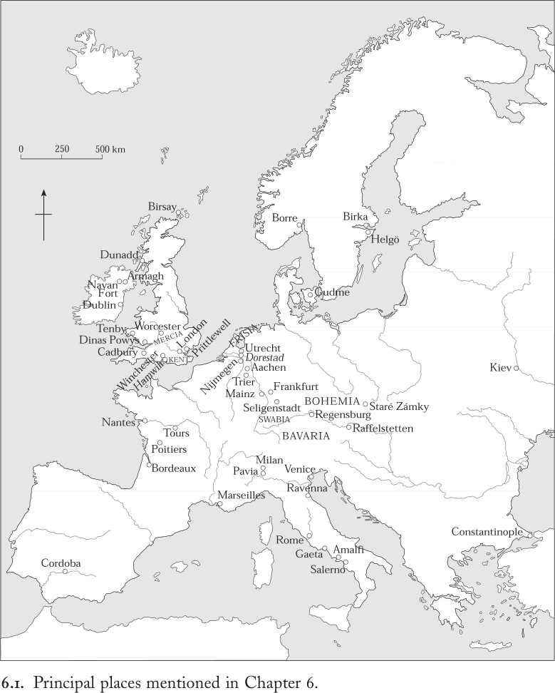

# 第6章 · 获取与给予

海岬上矗立着一座雄伟的堡垒，
每人都在那里慷慨地获得自己的一份。
·····
高地上矗立着一座雄伟的堡垒，
盛宴奢华，欢声喧腾，
四周美景环绕，那勇士的堡垒，
飞溅的浪花如翼：其翼何其长！^1

查理曼喜爱外国人，并悉心款待他们，以至于他们人数之众，可以说毫不冤枉地不仅成了宫廷的负担，甚至成了整个王国的负担。但由于查理曼天性宽宏，他不以此为虑，因为他以慷慨之名与良好声誉的回报，补偿了种种巨大不便。^2

查理曼深知统治者需要慷慨的名声。他的宫廷，如同威尔士“雄伟堡垒”滕比之主布莱杜德的宫廷一样，回荡着盛宴与欢宴之声，这是成功统治所需的奢华排场与炫耀性消费的一部分。根据当时人的一项估计，968年奥托一世的宫廷每日消耗“猪羊各一千头，酒十车，啤酒又十车，谷物一千斗，牛八头，此外还有大量的鸡、乳猪、鱼、蛋、蔬菜及其他食物”。^3 即使这一记载有所夸大，它也表明了统治所需资源的规模。查理曼的慷慨（尽管布莱杜德的并非如此）必定也达到了类似的规模：招致批评也就不足为奇了。真正慷慨的统治者可以无视这些抱怨，并期待从其奢靡开支中收获政治回报。

展示慷慨的盛况与维持精英的生活方式，只是领主和统治者动用其物质资源的两种方式。捐赠教会、赏赐追随者、支持王国行政、进行战争、修建宅邸、宫殿或城堡、从事外交、供养亲属：这一切都在消耗资源。因此，本章将探讨积累与分配各种形态物质资产的方式。本章以查理曼通过款待众多外国人来提升声誉这一事例为线索，聚焦于经济资本向象征资本的转化——即把财宝、货币、牲畜和农产品转化为荣誉、政治成功与神的嘉许。

从一种形态向另一种形态的转化充满困难。土地及其出产仍是所有中世纪早期精英最主要的支持来源，然而即便是国王，也仍受制于恶劣天气与疾病爆发的无常变幻，因为食物短缺可能使征战无法进行，而疾病的爆发则可能使军队十不存一。以易腐食品形式获得的收入无法储藏于宝库之中，必须转化为更为持久的东西。当然还有其他财富来源，但它们同样往往不稳定。战利品可在战斗中赢得，也可能失去。不加节制的慷慨可能耗尽资源与声誉。继承与联姻可能带来财富的增加；供养子女则可能使其耗竭。统治者可能以外交礼品的形式积累大量财宝——但同样地，也必须以某种方式慷慨回赠。因此，尽管成功君王的标志之一是装满的宝库，尽管其合法性部分建立在对珍贵祖传宝物的守护之上，我们却不应对着静态的窖藏黄金图景进行思考。毋宁说，财富向政治权力的转化是一个流通与再分配的动态过程，是持续不断的流入与流出。国王囤积是为了能够支出；他们给予是为了获取。

将物质资产转化为社会与政治优势，往往集中于特定的节点。本章第一部分将确定财富与权力趋于聚集的地点，将它们置于地理网络之中，并评述它们与所在政治体的关系。因此，这一部分将探讨在中世纪早期经济中积累与分配财富的方式，并考察国王及其他人如何利用这些方式。它还将考察商业模式的变迁及其与其他交换形式的关系。本章第二部分将焦点从地点转向人物，从地形网络转向社会网络。它将讨论馈赠与庇护作为策略，对于理解中世纪早期领主和统治者如何运用其资源以建立并维系权力至关重要。最后，本章认为物质财富有助于组织人界与超自然世界之间的关系，而对财富运用的考察也为我们洞察中世纪早期的宇宙观提供了途径。

## 权力的景观，财富的景观

在等级制组织的农业社会中，物质资源、政治领导权和超自然力量在地理上的不均衡分布，与在社会层面的不均衡分布同样显著。将文本与考古证据绘制成图，会呈现出一种复杂的景观：经济、宗教和政治功能在某些地点高度聚集，而其他地点则职能较少。为中世纪早期绘制若干此类 mental 草图，正是本节的任务。它揭示了巨大的变迁：绘制这些景观图是探索中世纪早期动态人文地理的有效方式。

我们必须从古代地中海世界谈起。在那里，罗马帝国将城市及其附属领地组成的镶嵌体编织成一个庞大且异常持久的政治经济体系。任何一幅相关地图都会凸显城市共同体作为政治、宗教和经济焦点的支配地位。细察之下则会发现，这些城市之所以重要，还在于它们是地方利益与帝国利益交汇、重叠或竞争的场所。农业、战争、贡赋以及国家组织的生产与供应，维持这个帝国所需的庞大资源由此而生。事实上，罗马国家的需求如此巨大，以致它从政治疆界之外极远的地方汲取资源，到处寻求金、铁等矿物，香料、毛皮等声望物品，以及奴隶或士兵等人力资源。其内部经济是一种指令性经济，由帝国征发驱动，运输体系专为军队各部提供给养，并为罗马和君士坦丁堡的稠密城市输送粮食。四至五世纪庞大的官僚机构与军队使资源紧张到极限，然而帝国与贵族在精致城市建筑和典礼仪式上的奢华支出仍持续美化着城市环境，并在此背景之下昭示帝国的意识形态。在古代晚期，城市依然是财富消费与展示以及政治活动的中心，这一点在地中海地区最为显著。尤为突出的是，罗马城本身将物质财富与政治影响集中于一处；即便324年在博斯普鲁斯海峡边的君士坦丁堡建立了第二座帝国都城，罗马的这种优势地位仍延续了很长时间。^4 即使四世纪西部宫廷先后迁往特里尔、米兰，并最终于408年迁至拉文纳，也无损于罗马作为首要权力舞台的突出地位。476年之后西部帝号的中断同样未能立即动摇其地位。尽管环绕地中海的城市在许多情况下人口与建成区面积都在缩减，但约500年时，它们仍构成了欧洲迄今最富庶的地带。国家驱动的交换仍定期将大量谷物、葡萄酒和橄榄油以及奢侈品从地中海一端运往另一端，补充帝国粮仓，维系城市的壮丽景象。

帝国在西部的控制土崩瓦解，一切都随之改变。帝国统治的终结意味着其庞大的军事与官僚体制以及维系这套体制的征敛、赋税和铸币体系逐渐解体——有时则是被蓄意肢解。城市公益捐赠与帝国纪念性建筑的传统也随之衰败，在某些地方迅速消亡，在另一些地方则较为缓慢。在这一变化了的环境中，边缘行省的城市艰难求生；而离地中海较近的大多数城市得以延续，尽管规模缩减。当武士精英从罗马领土上划出新的政体时，他们以乡村地产所有者的身份立足，但总体上对作为权力舞台的城市保持尊重的态度，即使这些城市中心已残破不堪、部分被废弃、经济凋敝。

五、六、七世纪的整体后果可以概述如下。世俗精英日益乡村化和军事化；各地城市里的公共展示、城市生活方式与文官意识形态充其量遭到严重削弱，而在西部的大部分地区（与东部不同）则完全崩溃。只有主教和教士继续在城市中兴建建筑；在他们的主导下，教堂的增殖改变了城市环境的面貌与性质。与此同时，昔日远距离贩运货物的交换体系走向瓦解。到七世纪中叶，连地中海经济也解体为若干大体自治的区域性活动圈，圈内有少量货物流通，各圈之间仅靠无规律的港口间航运相连。各个地中海微观区域的运转水平已不复相同；尤其在西地中海盆地，经济活动跌至远低于东端的水平。这也波及罗马：到八世纪，这座萎缩的城市仅靠其紧邻的腹地供养，城市公共展示也让位于教会的慷慨营造。

罗马国家驱动经济的终结是一个渐进而曲折的过程，无法精确断代，但其结果显而易见。虽然政治需要与资源需求曾促使帝国到遥远疆界之外寻求原料与珍稀物品，但军事边疆始终是罗马财政体系及其货币经济的明确界限。税收国家的终结和钱币规律性铸造的停止，实际上模糊了边疆内外经济体系之间的分野。此外，出现的并非一种新的统一经济，而是一系列相互重叠的地方性和区域性经济。除意大利外，这些经济的特征和节点更多是乡村性的而非城市性的，其货币也从黄金转向白银。

尽管这些变化大致与后帝国时期诸王国的形成同时发生，但新的政治与经济版图绝不相重合。这在高卢尤为明显：法兰克诸王向南谋求利用地中海贸易，直到七世纪，东方物品仍经由商贸城市马赛源源北流；但与此同时，他们也把目光投向北方，即莱茵河口及其以外地区。在这里，迅速扩张的弗里西亚人至迟在六世纪晚期已享有黄金富足的社会，并共享北海沿岸各地的共同文化；到七世纪初，弗里西亚成为把法兰克人愈益吸引进欧洲北部竞技场的磁石。因此，法兰克王国横跨地中海与北海两大经济区域。

在北海周围，新的交通与交换模式将昔日被罗马政治边疆所切分的各地区重新整合起来。其轮廓到七世纪初已清晰可见。从塞纳河口到大陆上日德兰半岛根部，以及在不列颠从索伦特到亨伯河流域，一批新的沿海或河口的生产与交换中心发展起来，即所谓“商站”（emporia）或“威克”（wics）。这些中心仅繁盛于七、八、九三个世纪，是滨水的手工业生产与贸易中心，将来自区域腹地的货物转运至海外其他领土和王国。例如，在特里尔以北的艾费尔山区开采的玄武岩磨石就这样运抵莱茵三角洲，向北穿越丹麦半岛进入波罗的海南部，又跨越海峡到达英格兰南部海岸——这种流通全然不受政治疆界的限制。

约800年时，商站已遍布斯堪的纳维亚南部和波罗的海地区，那里的琥珀、毛皮和象牙出口换取羊毛布匹、葡萄酒、陶器、陶瓷器和武器的输入。即使某些商站确实位于前罗马帝国领土之内，其选址也不是古老的罗马城市，而是一种新型的货物集散节点。它们没有防御工事，往往只在特定季节有人居住，居民多为不携妻儿的男子。其典型特征是，商站本身并非王室或贵族领权的中心，但通常与这类中心保持着紧密且很可能是直接的关系：如在索伦特，汉威克就位于西撒克逊王室中心温彻斯特（其本身即一座古罗马城市）以南不远处；又如在弗里西亚，多雷斯塔德位于罗马堡垒乌得勒支内的晚期墨洛温教会中心附近。

而且，随着自670年代起某些北海商站开始铸造小型银币，诸王也产生了兴趣，设法通过对其交易征税来分享其财富，并利用为自己获取声望物品以及出售自家庄园剩余产品以增加收入的可能性。王室的关注与鼓励，伴随着教会对财富和奢华的追求；各地大教堂和修道院兴起为财富中心兼政治影响中心，正是七八世纪的典型特征。例如，八世纪晚期，地处内陆的盎格鲁-撒克逊王国麦西亚的统治者们对在伦登威克（Lundenwic）交易的船只征收通行税；伦登威克是“万国商站，各族人等由陆路和海路而来”，位于伦敦古罗马城以西的开阔河滩上。）^4 （伦敦的“威克”很可能留存于街名“阿尔德威奇”之中。）特定获免税的是属于肯特若干教会以及伦敦主教和伍斯特主教的船只。尽管这些教会的贸易活动细节无从得知，但这些教会——正如授予其免税特许文书的诸王一样——发现商站对于自身财富与权力的发展至关重要。如此，几个不同群体的利益便交织重叠在一起。

不列颠东海岸各地点远距离交换的强化，恰与其西海岸一带的衰落同时发生。在古代晚期，贸易经由高卢的大西洋海岸把地中海与布列塔尼、进而与不列颠西南部以及整个爱尔兰海区域连接起来。谷物、葡萄酒和橄榄油由此输出，船只则运回不列颠的锡、银、铅，以及来自爱尔兰的奴隶和猎犬。与地中海的联系延续至六世纪中叶；此后直到约700年，这条路线只有北段仍在使用，从高卢西南部的波尔多和南特向爱尔兰海区域运送数量可观的食盐、葡萄酒、香料和染料。

商人是否曾经完成从地中海直航爱尔兰乃至苏格兰西南部的全程，抑或货物经由数道中间人之手转运，至今仍有争议。尽管以地中海的标准衡量，这项贸易规模极为有限，但对在爱尔兰海周边竞逐影响力和领土的诸王而言却意义重大。这些统治者以铁器时代建于制高山顶的要塞为基地，这类地点的人口想必以数十计，至多数以百计，其有限的经济作用远远不及它们在政治与象征上的重要性。这些高位阶地点包括不列颠的卡德伯里、迪纳斯波伊斯、邓阿德等中心，以及爱尔兰的纳万堡与阿尔马双重复合体。

从这些地点进行统治的人们——如滕比的布莱杜德——向臣民征发劳役和兵役义务。他们还豢养金匠、珠宝匠和珐琅匠等专业工匠，这些工匠在山顶要塞居所的安全环境中制作奢侈品，供其炫耀精英身份。此外，通过对来自地中海和高卢西南部货物的获取途径加以调控，他们进一步提升了自己的地位。

到八世纪初，这些设防山顶居址大多已被废弃。在爱尔兰，手工业生产转移至修道院地点，但其分配（如果确有分配的话）很可能仍处于王室控制之下。假以时日，爱尔兰海区域的经济与政治联系逐渐从高卢和比斯开湾转向，经由北方群岛转向斯堪的纳维亚和波罗的海。尽管原因仍不确定、年代学也只属近似，但在某种程度上，它们与影响整个八世纪欧洲的一场规模大得多的转变相关联：西地中海周围经济活动的暂时衰退与北方水域经济活动的强化。

获取北海、以及北海之外的波罗的海的财富，只是法兰克人八世纪持续不懈向北扩张的原因之一。在加洛林王朝的领导下，法兰克人到800年成功地建立了一个控制着领土面积的政体，其规模在十六世纪之前无任何后罗马政体可与之相比。其政治核心位于塞纳河与中莱茵河之间的地区，帝国的疆域从埃布罗河延伸到多瑙河，从台伯河延伸到易北河（图8.3）。它囊括了几十个经济上各不相同的区域，从相对城市化的波河流域到人烟稀少的德意志北部森林；它所控制的物质资源无疑远超任何其他中世纪早期政体，尽管远不及罗马国家之水平。事实上，比较也就到此为止，因为加洛林诸王完全缺乏国营指令性经济的机制。精心经营自家庞大庄园的农业剩余；灵巧地对帝国境内各地以及纵横交错、跨越疆界的区域间商路上不断增长的贸易征税；再加上对邻人的掠夺性劫掠，这些都促成了高水平财富积累。持续争取地方贵族与教会效忠的努力，需要将这笔财富的一部分再分配出去，但为国王间接地接触世俗与教会的土地财富，例如在根特就是如此。

加洛林王朝的国王与皇帝回避其罗马前辈所刻意营造的城市式权力展示。加洛林诸王在亲信贵族扈从的陪伴下于阿登森林中狩猎，而罗马皇帝则是在大都市的圆形竞技场中享受狩猎表演，由数以千计的观众围观。他们宁愿资助大型的乡村修道院——这些修道院充当着额外的权力中心与财宝积聚之所——而不愿在人口稠密的城市中慷慨赞助市民纪念建筑。即便他们的宫殿如亚琛、奈梅亨、法兰克福和雷根斯堡那样坐落在罗马时代的地基上，这些也只是罗马帝国北部边缘的小型半乡村居所或旧军营，而非其腹地的城市。

加洛林帝国还是多中心的。尽管查理曼在其统治后半期围绕亚琛的温泉发展出一座示范性宫殿，但除了晚年之外，这里从来不是他唯一的居所。它也从来不是唯一的行政中心，因为他及其后继者通常让诸子作为次王或副王统治一个或多个行省，并为每人配备自己的扈从与统治中心。九世纪下半叶，家族内部的争斗将这些临时的行政安排固化为更持久的王国，这些王国的统治者只得为自己另建新宫，或者将自己的扈从强加于修道院的款待之上。尽管亚琛仍是最具威望、最令人艳羡的统治之地，但统治者的众多意味着权力地理中节点的众多。加洛林时代与整个中世纪早期一样，权威始终是个人性的而非制度性的，因此国王身在何处，何处便是政治活动的中枢。

加洛林王朝成功地将诸多不同的地方政治影响网络与经济资源熔合在一起，而每一张网络都有自己的区域枢纽。如前所述，根特便是其中之一，现在让我们探访一个相当不同的枢纽：美因茨。作为一座古老的罗马边城，它位于莱茵河中游——这条大动脉水道由北海通往阿尔卑斯山口，进而抵达意大利与地中海。此地的主导力量并非王室，因为这里没有宫殿；而是教会势力，因为美因茨大主教区的起源可追溯至罗马时代晚期。统治者、权贵与教会或亲自出面，或更常见地通过其代理人，从这个城市所经手的利润丰厚的贸易中分一杯羹。城市景观是碎片化的：在罗马城墙之内，教会与世俗的居住建筑群各自在农业或葡萄种植区之间形成自己的院落。地方权贵以及各大乡村修道院的院长们都在此建有宅邸，以便他们或他们的庄头进城办理事务或将农产品送往市场时使用。城中有王室铸币厂，既刺激贸易又便于征税，城市因而也成为重要的生产与交换中心。在河岸边，“弗里西亚区”聚集着一个规模可观的弗里西亚商人殖民地的仓库与作坊，他们的船只往来于莱茵河上，输出内陆腹地的葡萄酒和谷物，以及这座城市本身出产的精美金属制品。到十世纪初，美因茨还是翻越阿尔卑斯山运来的货物——包括来自东方的香料——的转运点，并有穆斯林与犹太商人造访。但到那时，加洛林的政治实验已在区域分化和地方利益的礁石上搁浅。由于缺乏快速的通讯手段和可靠的强制方法，即便在地方农业产量上升、区域间贸易日趋 intensifies 之际，有效的政治体通常仍保持较小的规模。在加洛林晚期及之后的欧洲地方，经济活力并未受到政治分裂的影响。

法兰克沿海商站、乡村修道院、河港与地方市场的财富和不断增长的人口，是吸引维京人注意的众多目标中有据可查最充分者。他们的高度机动部队自八世纪晚期起对加洛林核心地区和不列颠群岛发动进攻，这些袭击的记载尤为详尽。整个九世纪，他们的劫掠愈发频繁且破坏力愈强：他们洗劫教会宝库、袭击市场、向统治者勒索贡金，攫取大量钱币与财宝，有时还有牲畜和人口。随着武装团伙的壮大，维京人也开始寻求可定居的土地，或通过彻底征服，或通过从地方统治者处强取的让步。

维京人自信善航海、精于贸易、狡黠而富于劫掠，从八世纪晚期直到十一世纪早期，足迹遍布四方。九、十世纪间，斯堪的纳维亚的船只称霸不列颠群岛与北方诸岛的海岸，沿欧洲西部沿海游弋，偶尔还穿越直布罗陀海峡进入地中海。他们横渡大西洋定居冰岛，有时甚至继续航行至格陵兰和纽芬兰。他们纵横波罗的海，沿东欧的河流水道抵达黑海。在那里，维京人接入了穆斯林世界的巨额财富，从而将大量伊斯兰银币吸引西流。受这种贸易的刺激，基辅（第聂伯河畔）等强大的贸易中心于860年代兴起。

瑞典赫尔戈居址的出土物显示了维京人直接或间接交往的广度：其中包括来自莱茵兰的玻璃器皿、工艺繁复的爱尔兰牧杖头、来自拜占庭的银盘和一批金币、一件产自科普特埃及的长柄勺，以及一尊佛陀青铜小像。关于北方航海活动这一戏剧性（有时被过分渲染）阶段的解释仍存争议。斯堪的纳维亚南部社会在六至八世纪经历了深刻变革，发展为一个等级秩序更加分明的社会，资源逐渐积聚于地方首领控制的中心，例如我们在西福尔的博勒已经遇到过的那种中心。这些强大酋邦的兴起，似乎与其开发并再分配来自贸易以及本地农业和手工业生产之资源的能力密切相关。波罗的海商站——如比尔卡，那里有“许多富商以及大量货物与钱财”^5——的财富无疑助长了这些酋邦的成长，正如北海商站滋养了七、八世纪盎格鲁-撒克逊和法兰克诸王一样。在这些酋邦中，丹麦的酋邦最早发展为王朝王国，并确立了延伸至日德兰半岛之外的海上霸权，将南斯堪的纳维亚诸酋邦和波罗的海沿岸的斯拉夫人社区纳入其中。

丹麦诸王手中权力与资源的日益集中，在其王国内部及周边都受到挑战：政治竞争催生了富有攻击性的武士集团和贵族精英。查理曼向北萨克森的扩张不仅摧毁了丹麦人与易北河以东斯拉夫邻居之间的传统联盟，帝国扶植附庸国王的政策还催生了新近获得地位与影响的强势地方王朝。大范围内的贸易往来、航海旅行的传统，加上政治动荡以及供养武士集团所需资源之无休止的积累压力：这些前提条件足以引发维京人对西欧积聚财宝的劫掠。

从北方的视角看，“维京时代”既是对西欧和穆斯林土地物质资源的榨取，也是斯堪的纳维亚权力结构的转型。从不列颠和大陆的视角看，它还是既有政治格局的动荡与重塑。这不仅仅是维京劫掠者索要贡物或构成军事挑战的问题。就此而言，评估其影响还相对简单，因为他们的劫掠恰恰证明了加洛林和盎格鲁-撒克逊的农业与手工业经济能够年复一年地持续产出资源。这些劫掠还促进了法兰克和英格兰铸币制度的发展——在严格控制下为王室利益而运营。在这方面，尽管局部破坏往往严重且总是令人创痛，维京劫掠的总体效果是转型性的而非毁灭性的。同样值得注意的是，法兰克人、布列塔尼人、盎格鲁-撒克逊人、威尔士人和盖尔人只要符合自身政治目的，便会毫不犹豫地与维京人联手。游动的维京武装团伙是加洛林家族内斗以及不列颠群岛内部诸王国争斗中颇受欢迎的参与者，其程度之深，令当时的编年史家极力遮掩。维京人的存在使地方政治惯例变得复杂甚至遭到破坏，此外还扰乱了农业生产的常规节奏、侵夺税收，并将教会宝库的财富释放到流通之中。

维京人的冲击在不列颠群岛尤为深远，那里众多相互竞争的国王随时乐意借助外力来压倒近邻对手。例如，九世纪中叶，昔日强大的皮克特王国被并入盖尔人的达尔里亚达王国，很可能正是盖尔人与维京人战术联盟的成果。或许，维京人在无意间促成了阿尔巴王国从盖尔人对皮克特人的支配中脱胎而出。可以肯定的是，到九世纪晚期，苏格兰东北部和奥克尼群岛兴起了一个 aggressive 而强大的诺斯人统治领地，其权力中心是位于比尔赛的前皮克特人聚落。在爱尔兰，诺斯劫掠者以迅速融入爱尔兰社会而著称。作为爱尔兰诸王之间暴力争斗的积极参与者、若干沿海贸易殖民地的建立者以及这些港口腹地的定居者，他们迅速通婚，在语言、聚落和政治上留下了印记。

对爱尔兰-诺斯人而言，一如对其他斯堪的纳维亚群体，劫掠与征服只是一系列活动谱系的一部分，这一谱系还包括殖民与贸易。九、十世纪赫布里底群岛密集的爱尔兰-诺斯人定居，几乎抹去了先前文化群体的所有痕迹，并留下了至今犹存于这些岛屿地名中的遗产。在冰岛，爱尔兰-诺斯定居者与来自挪威西部和北部的移民会合，后者发现了一片几乎无人居住的土地，约于870年至930年间在此大量定居。他们在那里复制了其斯堪的纳维亚北部故乡的政治组织——一个由小酋邦拼合而成的格局，各酋邦头人统治着大体自我调节的农耕社区——并因其始终没有王权而独具特色，直到1262年冰岛归于挪威王室控制。

从十世纪初到十一世纪初，都柏林——爱尔兰最富有、最具影响力的诺斯人殖民地——实际上已是另一个小王国，其政治意义因巨额商业财富的积累而增强。其统治者将劫掠、奴隶贩卖与军事征伐扩展到英格兰北部和苏格兰西南部，以此壮大自身。其居民无疑靠区域内产出的农业剩余维持生计，但跨越爱尔兰海及更远地区的贸易——尤其是奴隶贸易——将这个繁荣的港口纳入横跨北海和波罗的海、并最终与高加索和河中地区的穆斯林商人相连接的斯堪的纳维亚贸易网络。沿这些路线流动的贸易与贡物，多以碎银（被切割成大致均一重量的银项圈、银臂环等）或银币的形式进行；但为了便利其贸易事业，诺斯人先将外国钱币输入爱尔兰，随后开始在都柏林铸造自己的货币。地中海与近东自公元前七世纪以来便已熟悉以金属货币作为交换媒介以及统治者威望与权力的象征：而爱尔兰迟至997年才开始铸币，这正衡量出地中海与非罗马化的欧洲地区之间的文化差异。

早在那一日期之前，西撒克逊诸王已将维京军阀逐出英格兰，并将深受斯堪的纳维亚影响的东部低地纳入一个重塑后的君主政体，该政体强行宣称对英格兰西部和北部的威尔士人、不列颠人、盖尔人和诺斯人的宗主权。在南部，即其西撒克逊核心地带内外，他们建立起被称为 burhs 的大型防御中心，这些中心不仅在对抗维京人的斗争中服务于战略军事目的，还迅速成为新型城市发展的焦点。尽管与农业腹地保持紧密联系，这些晚期盎格鲁-撒克逊城镇既是复杂而人口稠密的贸易社区，也是王室和教会权力的中心。它们为本地出产的农业剩余和手工制品提供区域市场，并输入日益增多的丝绸和葡萄酒等声望商品，以满足讲究时尚的精英阶层。最重要的是，城镇中设有王室铸币厂和税收官，晚期盎格鲁-撒克逊诸王借此以银便士的形式从繁荣的英格兰经济中汲取巨额税金。

到1000年，盎格鲁-撒克逊的英格兰是否已成为欧洲最富有的王国？这一观点是有据可辩的。诚然，到十世纪晚期，当伊斯兰白银流入斯堪的纳维亚的供应逐渐枯竭，而复兴的丹麦王权的波罗的海扩张又被奥托帝国所阻时，英格兰成了最诱人的财富来源：大量银币在流通，地方性和区域性的城市市场欣欣向荣。由丹麦国王组织的新一轮对英格兰的进攻，最终于1016年导致西撒克逊统治王朝的覆灭以及克努特的即位，后者不久又兼任了丹麦王位。在此基础上，他建立起一个北海帝国，从都柏林出发，经苏格兰和斯堪的纳维亚，一直延伸到波罗的海；但这种个人霸权并未延续到其1035年去世之后(图8.4)。

克努特的北海帝国依赖的是此前两百年间丹麦人和挪威人所建立的海上联系与贸易财富。到十一世纪初，这种疆域辽阔的霸权是北欧的特征，而非卢瓦尔河和阿尔卑斯山以南地区的特征——后者正在形成的是区域密集型而非帝国扩张型的政治体。法国分裂为区域性的或地方性的领主领地，正是这一趋势的体现。然而，传统政治版图与新兴物质财富积累之间的脱节，在北意大利表现得最为尖锐。

到新千年之初，意大利城市正处于迅速扩张的城市经济与商业经济的枢纽，并开始主张自身的自治权。虽然意大利的城市生活从未像阿尔卑斯山以北那样几近消亡，但在约600年至约800年期间，意大利城市作为生产、交换和消费中心的作用却难以评估，尽管生产与交换的加速显然比北海地区要晚得多才出现。随着证据日渐丰富，我们可以 traced 出与罗马晚期及后罗马时代地中海不同的模式，尽管证据性质的改变(无论文献还是考古)可能夸大了经济变革的印象，这一点仍然成立。

北意大利于774年被并入法兰克王国。加洛林王朝的控制在888年之后瓦解，但到十世纪中叶，加洛林王朝的德意志继承者奥托王朝，从其遥远且经济落后的萨克森的主要权力中心，重新确立了跨阿尔卑斯山的统治权。在莱茵河东北，由于缺乏历史悠久的城镇或市场，也缺乏发达的货币使用经济，统治者不得不依赖其他方式来支撑其统治：巡行王权、庞大的地产、依附民族的贡赋，以及看似无穷无尽的边疆战争掠夺。难怪北意大利会吸引他们，因为这里的城市财富正在迅速发展。

尤其值得注意的是，九世纪期间，一些意大利沿海新兴城镇的成长，它们地理位置优越，便于发展远程贸易联系，却不利于农业。位于亚得里亚海顶端的威尼斯，利用其处于加洛林帝国与拜占庭帝国边境的位置，至少从840年起便实际独立，只需专注于自身利益。威尼斯人将精力投入贸易经济，使其在西欧、拜占庭与伊斯兰东方之间的商品运输中占据了关键地位，以至于到十世纪晚期，在穆斯林看来，亚得里亚海干脆就是“威尼斯湾”。^6 这一认知十分重要，因为威尼斯的显赫地位很可能大部分源于其作为奴隶贸易转口港的角色。在欧欧洲东部边缘俘获的奴隶在此装船运往埃及，再转运至主要的伊斯兰城市——在那里，与基督教世界不同，奴隶制是基本的社会与军事资源。作为回报，威尼斯商人进口“海外东方的全部财富”，并将这些奢侈品沿波河河谷向上贩运。^7

在第勒尼安海多岩石的南意海岸，阿马尔菲同样起源于六世纪晚期抵御陆路入侵者的要塞。九、十世纪时，阿马尔菲人以其舰队支持基督教邻邦对抗撒拉森海盗，或在最符合自身野心时帮助阿拉伯人对抗基督徒，在此过程中与伊斯兰地中海的各港口建立了利润丰厚的贸易联系。通过这些政治手段，精明的商人培育出一个新的、城市化的商业社会，其“富庶与奢华”引人注目。^8

那么，十世纪末那些较为古老的意大利城市状况如何？罗马城市帕维亚自六世纪晚期以来一直是伦巴德王国的首都，其王宫在加洛林王朝继而在奥托王朝统治下仍是意大利的王室政府所在地。出自王室金库的详细条例，记录了十世纪末这座城市——皇帝及其随从经常造访之时——的经济生活。皇帝通过其司库对经过帕维亚的贸易征收通行税，并管理其铸币和市场活动，既为自己牟取财政利益，也维持法律与秩序。该条例还告诉我们城中城市共同体及其工匠的情况——驾着小船的渔民、制革匠、船主、大船的水手、淘金者和制皂者——以及途经此城的商贩。其中有来自阿尔卑斯山以外的盎格鲁-撒克逊人和其他人——可能是法兰西人和德意志人——他们买卖马匹、奴隶、羊毛、亚麻布和帆布、锡和剑。意大利人也会前来：来自卡拉布里亚海岸的阿马尔菲、萨莱诺和加埃塔的商人，尤其是富有的威尼斯人，他们沿波河河谷向上贩运，购买葡萄酒和谷物，同时带来拜占庭和穆斯林世界的货物——香料、象牙梳、银镜之类。因此，帕维亚既是当地农产品的出口地，也是手工业品的生产地、进口奢侈品的集市，还是行政中心和帝国权力的展示场。奥托王朝的君主同一切统治者一样，发现贸易通行税是有利可图的收入来源，他们在帕维亚的金库也不例外。

但这一切未能持久。从十世纪晚期起，帕维亚市民开始反抗帝国控制，并多次发动叛乱。1024年，当他们听到皇帝亨利二世死讯时，他们将王宫彻底摧毁，以至于其位置如今已无从知晓。他们的起义标志着一个时代的终结。帝国在意大利的中央集权行政实际上已告终结，整个意大利争取城市自治的步伐在十一世纪中不断加快。罗马帝国瓦解后形成的政治格局，已再难以容纳意大利城市财富的新现实。

## 宝藏、馈赠与庇护

帕维亚通行税条例的作者还记录了一系列习惯性支付，它们并不属于十世纪末意大利蓬勃发展的商业经济。国王司库的妻子可以指望来自意大利其他城市的商人向她馈赠东方制成品和精美花纹丝绸。司库本人则须定期向帕维亚的主教座堂捐赠灯油，并向其看守人捐赠衣物。我们在此遇到的是其他形式的交换，女性往往是其中行家，但其目的并非商业利润。向宗教机构馈赠 prestige 礼物或慈善捐赠，代表的是截然不同的交易形式，其社会、政治或宗教维度居于首位。将焦点转向以庇护、馈赠或强制剥夺为特征的社会互动，我们便能更好地理解物质资源如何被转化为象征资本——即转化为荣誉、威望和政治影响。

这一场景不在罗马，而在帝国的拉文纳。六世纪圣维塔莱教堂中一块华丽的镶嵌画描绘了查士丁尼(527–565年在位)——最后一位在君士坦丁堡统治的操拉丁语的皇帝，他几乎实现了一个梦想：驱逐意大利、西班牙和北非的武士国王，将这些行省收归帝国直接控制。他身着紫金服饰，头戴嵌满宝石的巨大王冠，肩佩相配的胸针，两侧是衣着由奢华到朴素各依其等级的廷臣。他的皇后狄奥多拉在教堂另一侧与他相向而立，装束同样华贵，其随从的衣着也精心强调明确的等级。二人手捧同样华美的礼物：他托着一只巨大的金盘，她捧着一只镶满宝石的金杯。这对帝室伉俪的形象揭示出，在罗马晚期世界，炫耀性的展示与馈赠是权力的外在装饰。通过服饰、贵重物品、艺术与建筑来表达，古代晚期的权力与威望修辞中包含着一种有形财富的语言，男女两性以互补的方式娴熟地运用它。

那些装饰奢华的教堂——献给基督教上帝的礼物——至今仍矗立着，提醒我们罗马晚期皇帝与贵族所拥有的巨额可支配财富。它们也表明捐赠者的期望：慷慨或许能换来圣徒更多的庇护与保护，因为建造和捐赠教堂，是将支配人际关系的习俗与期望投射到超自然领域。在罗马人中，馈赠巩固个人间的友谊，并为政治恩惠的交换提供便利。在一个获取庇护是政治与社会晋升之关键的文化中，礼物可以巩固庇护人与被庇护人之间的支持流动。礼物之所以居于核心地位，反映了一个基本事实：在罗马晚期世界，真正的权力与影响的润滑剂是个人恩惠和直接接触，而非其笨重的官僚程序。

古代晚期的皇帝在即位时会向人群抛撒钱币，并向受宠的支持者分发精美的银盘和餐具作为赏赐。他们也常常向邻近的国王和军阀支付巨额款项，以换取和平或使其服从其他政治目标。就这样，罗马的威望物品——金币与金质奖章、奢华的银餐具、标志高级身份的嵌宝胸针——涌过帝国边境。考古学家从斯堪的纳维亚和波罗的海东部到黑海，到处都发现了它们的残余：四、五世纪罗马财富涌入北欧武士首领与多瑙河流域的宝库，提升了这些领袖相对于自身追随者的威望与权力。当这些威望物品流经古代晚期帝国的政治、社会和宗教血脉时，它们将官僚体制包装成直接的个人关系的外表，帮助赢得天上圣徒的支持，赋予合法性，并构建了帝国与其敌人和邻邦的关系。

中世纪早期西方的后帝国诸王国仍然牢牢处于这一政治秩序之中。国王们从帝国那里获得启示——以及大量宝藏。两个六世纪的事件揭示了其中所涉及的物质丰富性与政治象征意义。第一件关乎克洛维于507年对高卢西南部和西班牙的哥特人及其国王阿拉里克二世的胜利，后者被他所杀。此役使他得以将高卢西南部夺取为法兰克人的领地，从而将哥特人限制在伊比利亚半岛，这令阿拉里克的岳父、意大利国王狄奥多里克大帝(493–526年在位)极为恼怒。克洛维的军队尽可能夺取了阿拉里克的宝藏，但关键在于，未能夺走对其王朝认同至关重要的传家宝。其中包括古老的政治珍宝，是阿拉里克一世率哥特人于410年洗劫罗马时所夺：“其中有大卫和所罗门——希伯来人君王——的珍宝，蔚为奇观……它们大多饰以绿宝石，是古时候罗马人从耶路撒冷掠取的[即公元70年罗马洗劫耶路撒冷]。”^9 这些先后属于犹太人、罗马人、继而哥特人的古老政治认同标志，向世人昭示阿拉里克一世的继承者是罗马帝国政治中的合法玩家。这些珍宝太珍贵了，绝不能落入法兰克人之手，于是狄奥多里克将其置于自己的保管之下，待他的外孙阿玛拉里克成年即位时归还于他。无论其作为黄金宝石的价值如何，这些传家宝象征着威望、合法性与王朝的延续。

在胜利后不久，克洛维便获得了拜占庭皇帝阿纳斯塔修斯(491–518年在位)以传统帝国荣誉与庇护象征形式给予的回报，因为他的胜利也符合后者的政治策略。克洛维随即以一场戏剧性的王者慷慨之举，向其新臣民宣示了自己提升的地位：在一场仿罗马风格的胜利游行中，他将大量战利品赠予图尔的圣马丁教堂，并身着罗马服饰，“骑上马，亲自满怀最大的善意，将金银分发给庭院大门[圣马丁教堂]与城中大教堂之间道路两旁的人群”。^10 通过立即重新分配战利品，克洛维确立了自己作为慷慨统治者的声望，与该地区最重要的圣徒之一结成同盟，并将其新臣民置于一种道德义务以支持和忠诚回报他的义务。在这次以及许多其他场合，克洛维都是礼物与财宝象征意义的高明操纵者：通过给予，他有所收获。

我们的第二个插曲来自六世纪末，涉及克洛维的曾孙希尔佩贝特二世（575–596年在位）。584年，拜占庭皇帝莫里斯（582–602年在位）曾赠送他五万枚金币（索里达），以诱使他入侵意大利。半岛在仅仅一代人之前才被查士丁尼以巨大代价收复，随后又在568年遭到阿尔博因率领的伦巴德人入侵，后者在此后二十年间将其控制扩展到半岛整个北部。莫里斯的策略是由来已久的“花钱让一个武士国王攻打另一个”的伎俩；他希望法兰克人能将伦巴德人赶出意大利。

外交赠礼要奏效，须以赠受双方都承认其中隐含的道德准则为前提，并且双方在以财宝换取和平的交换中享有对等的政治利益。但在这个特定场合，它失败了。当希尔佩贝特进军意大利时，伦巴德人以臣服避免冲突，并献上他们自己的礼物以劝他离去。莫里斯认为希尔佩贝特违背了这笔酬金的条款，要求归还；但这位法兰克国王对自己的权势如此自信，甚至不屑回复。在这场政治扑克游戏中，希尔佩贝特两度获胜。他在经济上两度获利，因为莫里斯的酬金约重227.5公斤黄金，而伦巴德人的“许多礼物”必然也相当可观。^11 但他还在政治地位上两度提升：一次是拒绝了莫里斯礼物所暗含的服从帝国意志的从属关系，一次是接受了伦巴德人随礼物而来的臣服。由此他既增加了物质资本，也增加了象征资本。

正如507年和584年的事件所示，支撑后帝国时代政治的财宝数额巨大。它们还表明，能否获得并掌控财宝，在竞争的国王、臣民和拜占庭皇帝眼中，与政治合法性密切相关。然而莫里斯的经历提醒我们，发放政治补贴是难以预料且充满困难的：它可能实现、也可能无法实现捐赠者的目标。

作为达成政治目的的手段，赠礼不必达到整车黄金珠宝的规模：它甚至可以只需一片草地上采来的一束花，或一封用心写就的书信。为说明这一点，让我们在六世纪的高卢再多停留片刻。566年，一位意大利诗人来到西吉贝尔特（561–575年在位）、即希尔佩贝特二世之父的宫廷。维南提乌斯·福图纳图斯以极大的光彩开启了他的生涯：在西吉贝尔特与布伦希尔德成婚之际，他向国王献上了一首精心创作的婚颂。福图纳图斯迷人的拉丁诗歌通常被解读为后帝国时代高卢对古典文学文化持续推崇的标志。但这位意大利人不仅是一位出色的诗人，还相当圆滑机敏，以至于他最终吸引到的庇护为他带来了一顶主教冠。当我们注视他结交朋友、扩大影响时，也能窥见赠礼如何成为沟通个人之间关系的庇护体制的一部分。

饮食是福图纳图斯时常挂在心上的主题。他靠着宴会的邀请和食物的馈赠兴旺——实际上也是生存。他的回赠则是诗歌与颂词：

甘露、美酒、食物、衣裳、学识、良机：
戈戈啊，你以慷慨的馈赠令我心满意足。^12

戈戈是西吉贝尔特宫廷中的资深官员，交游广泛、颇具影响，是这位意大利诗人有用的庇护人。借助这层关系，福图纳图斯得以享受“友谊的果实”。^13 有一首诗写给孔达，此人出身寒微，却升至西吉贝尔特扈从中掌管财政与行政的关键人物，这首诗暗示了利益流动背后的政治现实。福图纳图斯评论说，西吉贝尔特已因孔达能干的效劳而赏赐他丰厚的礼物：“远比众人强大的国王恰如其分地给予了更好的酬报，你的情形正表明他更看重什么。”孔达自己的行为也以国王为楷模：“你以慷慨与仁慈向众人广施礼物，并以馈赠将人们凝聚在你身边。”^14 国王的榜样是整个社会等级都应效法的，因为在各个层级，慷慨的赠予都会造就义务。像戈戈和孔达这样的权力经纪人若愿意，极有条件操纵王室恩赏的流动：福图纳图斯的颂词可谓瞄准精准。

最终，福图纳图斯在两位特定的庇护人那里安顿下来。一位是境遇艰难的图尔主教Gregory（都尔的格里高利）。另一位是拉德贡德（卒于587年），她曾是克洛塔尔一世（511–561年在位）的王后，此时已在普瓦捷隐修。身为修女，她继续施展其宫廷技艺，并为了自己的目标，利用了华服与美食的传统女性联想。在图尔，维南提乌斯以特别的“谦卑仆人”身份向格里高利自荐。这位主教对这位写诗门生的支持，从鞋皮礼物直至地产田庄。作为回报，这位意大利人在重大政治危机的时刻运用其文学才华支持格里高利。在普瓦捷，拉德贡德和她的女修道院长艾格尼丝时常从自己的餐桌上给福图纳图斯送去食物——一壶牛奶、深色的李子、精致的点心。无论出自富有的王后、领主之妻，还是献身于修道院清贫的女子之手，食物都是一种滋养的不止是人的肠胃的礼物。福图纳图斯以同样朴素的信物回报——几束紫罗兰、一只手工编织的盛甜栗的篮子——并充分运用其修辞技巧，促成拉德贡德在互相仇杀的国王之间缔造和平以及收集天上不朽者地上圣髑的计划。在精巧的诗歌意象背后，福图纳图斯和格里高利、拉德贡德一样深谙宫廷赠礼游戏的不成文规则。三人都十分清楚，礼物、义务、酬报与影响是密不可分的，因为他们深谙如何将物质资源转化为社会权力、政治影响与圣徒的庇佑。600年前后不久，福图纳图斯如愿以偿——在普瓦捷当上了主教。

运用财富巩固政治友谊，或维持并更新既有的忠诚、依附与效劳的纽带，并非晚期罗马世界及其直接继承者所独有。事实上，五、六世纪的统治者之所以能如此迅速地将再分配与互惠的政治为己所用，原因之一就是类似的习俗本来就是那些在五世纪改变了罗马西部政治版图的武士集团文化的固有组成部分。莱茵河—多瑙河边境以北以及不列颠诸岛非罗马地区的酋邦组织，无疑远比帝国官僚制国家——连同其众多专业分工和庞大军事机器——简单。这些政体的国王缺乏行政的或强制的统治手段，所能依靠的几乎只有个人影响与义务的纽带。

他们用物质财富锻造这些纽带。这种纽带最著名的表达见于《贝奥武甫》，但在许多其他语言的早期中世纪史诗中都有密切的平行文本。史诗中贤明的军事领袖或国王对追随者慷慨大方，以丰厚的礼物酬报战场上的英勇，并由此投资于对未来效劳与支持的期待。一位能干的战争领袖会吸引雄心勃勃的年轻武士加入其扈从，在自己的厅堂中款待他们、设宴飨之、为之配备武器：在权力竞争中，互相争雄的领主用财宝、珍贵的武器和自己的声誉来扩充军队、争夺胜利。《贝奥武甫》中，赫尔福德纳之子赫罗斯加就是这样一位统治者：

后来赫罗斯加赢得了战场上的荣耀，
对疆场的掌控；于是朋友和族人
欣然服从他，他的队伍不断壮大，
成为一支庞大的军旅。^15

来自耶阿特人国土的王族武士贝奥武甫，便是投效赫罗斯加麾下者之一，他的功绩构成了对武术成功、财宝、酬报、荣誉与统治这一社会准则的长篇注解。当贝奥武甫诛杀了袭击鹿厅的怪物归来时，这位丹麦国王宣告：

你将不缺任何
我所能赐予的世间财物：
较低微的功绩也曾获得酬赏，
我们曾从宝藏中礼遇过不及你英勇的人，
在战争中远弱于你者。但你已用自己的双手
确保了不朽的荣誉，
让你的名字永世长存。
于是厅堂已为宴席布置停当——“金线绣成的
挂毯|在墙上熠熠生辉”——赫罗斯加前来入席：
没有一个民族聚集过更盛大的扈从，
围绕他们的赐环者举止更为得体。
以勇武著称的人们来到长凳旁，
在宴饮中欢欣；他们畅饮
一杯杯蜜酒，殷勤地舒展身心。
……
随后，作为胜利的象征，赫尔福德纳之子
授予贝奥武甫一面金饰的军旗，
一面绣纹的战旗，还有胸甲和头盔；
众人对那柄在英雄面前
捧持的奇剑赞叹不已。贝奥武甫在厅中
与众人共饮。他没有理由
在武士面前为如此精美的礼物感到羞愧！^16

赫罗斯加随后又加上八匹佩有黄金宝石辔头的战马，使礼物更为丰厚；而通过赠礼，二人的声望都得到提升：

于是这位荣耀的王储、宝藏的守护者，
以战马和铠甲酬报了这些功绩；
如此慷慨大方，任何正直的人
都无从加以贬损。^17

赫罗斯加和贝奥武甫都避免了那种在荣誉与酬报文化中令人畏惧的暗流——耻辱：贝奥武甫通过战斗赢得了财富与声誉，而赫罗斯加则展现了王者的慷慨。当英雄回到耶阿特人那里，珍贵武器的流通仍在继续，因为他随即把它们赠给亲族海格拉克国王，以此彰显自己慷慨的精神。贝奥武甫已证明自己有资格继承王位。

《贝奥武甫》是一部伟大的文学史诗，其主人公是传说人物。但其社会风气仍是早期中世纪尚武文化中围绕赠礼的仪式与价值观的真实写照——这一点得到来自欧洲各地的广泛史料的有力印证。这些史料以朴实无华的叙述记载劫掠远征，以生动的描述记载宴席及其他礼仪场合交换的礼物，为史诗的价值观提供了历史的具体性。战争、劫掠与宴饮都与其他交换形式并存：它们是领主或王庭据点上农业、手工业或商业财富集中形态的军事与政治补充。

在《贝奥武甫》篇章中如此显赫的珍宝，并不仅限于精工锻造的武器和镶宝的护身铠甲。它们还包括金制的杯盏与餐具、臂环与颈环。这些个人饰品由女子佩戴和馈赠，与男子无异，因为在塑造所有早期中世纪社会的夺取、再分配与互惠这一环环相扣的传统中，妇女扮演着不可或缺的角色。她们也是赠礼者，运用自己掌控的一切资源，为其选定的政治与宗教目的施行庇护，正如我们所见的狄奥多拉和拉德贡德那样。维护宫廷礼物与款待中的等级与社会位次之精妙，这一任务也常常落在她们肩上。一份九世纪关于查理曼王室家务复杂组织的指南对此有明确说明：“宫廷的妥善管理，尤其是王室尊严，以及每年赠予官员们的礼物（惟马匹的食水除外），主要归于王后，并在其之下归于宫伯。”^18 在监督礼物拣选的过程中，王后维护着宫廷仪式赖以运行的荣誉经济。

女性不仅是慷慨的施与者，也可能成为其对象。赫罗斯加曾将女儿弗雷亚瓦鲁许配给丹麦人的仇敌英格尔德，希望借此终结一切宿怨与致命的战争，凭借这位女子。^19

尽管《贝奥武甫》的作者怀疑联姻和亲的成效，此类做法在早期中世纪的文献史料中却屡见记载。一个早期事例即可说明：作为对507年克洛维击败伊比利亚哥特人的反制，东哥特的狄奥多里克大帝将侄女阿玛尔贝尔加嫁给法兰克人的仇敌、图林根人的赫尔米纳弗里德。狄奥多里克以交换“王室品位所要求的礼物”缔结这门婚事，并向赫尔米纳弗里德宣告：“愿神的眷顾伴随你的婚姻，既然友谊已将我们联结，愿亲族之爱也将我们的后代维系在一起。”^20 赫罗斯加定会认得这份情意——但他也会承认，联姻的结果和赠礼一样难以预料。

来自全欧各地的考古材料证实了早期中世纪金匠与铸剑师的技艺与工艺水平。它也向我们归还了那些界定财富、权力与威望的珍宝中的一小部分。但其中蕴含着一种反讽，因为考古学家发掘出的黄金珠宝大多是被人有意埋藏的，尤其是在欧洲较偏北的地区。撇开众多主人在动荡时期为日后取回而埋藏的窖藏不谈，有意的埋藏可能标记着具有仪式或宗教意义的地点与行为。埋藏的社会功能之一，是提供一种入藏的景观——供有幸观看的群体目睹。另一重功能则在于此后珍宝隐而不见、无形地在场的这一认知。这正是五世纪日德兰和瑞典南部将战利品沉入沼泽献祭的背景，它们间接地反映了交战酋邦纪念战胜敌人的方式。在丹麦菲英岛上一个五至六世纪的政治、宗教权力与贸易中心古姆（意为“诸神之家”）出土的众多黄金窖藏，也具有宇宙论意涵。在这里我们遭遇到财富与超自然之间一系列非罗马、非基督教的关联，由于缺乏揭示其宇宙观的文字证据，其完整的宗教或意识形态意涵已无法完全复原。这些窖藏虽然缄默，却耐人寻味。

同样出于有意为之的，还有随葬品——无论日常用品还是珍贵之物——的丧葬埋藏。考古学家已在英格兰和地中海以外的欧洲大陆发现（并仍在发现）约400年至700年间成千上万座有随葬品的土葬墓，另有少量出自地中海地区。这类墓葬从极为简朴直至极其豪华不等。以英格兰东南部普里特尔维尔的东撒克逊人墓地为例，那里已发现约20座六至七世纪的墓葬。有些墓中完全没有随葬品；另一些不过一把刀、一枚胸针或一两件陶器。其中一座墓葬包含一座非同寻常的墓室，其发现于2004年2月公布。一位武士于七世纪上半叶被安葬在这一大型墓室中，随葬有他的剑和盾，木构棺室。他下葬时身穿金线织物，系着一条配有巨大金带扣的腰带，脚穿金扣鞋，胸前放着两枚小型金箔十字架。他的墓室中陈设了种类繁多的器物，暗示着远方的联系：一件拜占庭水壶和一把有铭文的银匙；一只大型科普特碗；两枚来自墨洛温高卢的金币；来自爱尔兰或英格兰北部的悬吊碗；以及两对肯特玻璃罐。墓中还有种种器物，显示出一位喜欢以奢华方式款待扈从的统治者的气派：一把可能来自意大利的罗马式折叠座椅；一个高高的火把架（或许也是王旗架）；装饰过的饮酒角杯；配有镀金配件的木酒杯；一把里拉琴；棋子和骰子；此外还有悬吊的釜、木桶和一只匣子。

如同盎格鲁-撒克逊英格兰所知的少数几座随葬丰厚、可能属于王族的墓葬一样，普里特尔维尔的这座王侯之墓无疑兼具宗教与社会两重背景。一方面，它暗示了基督教传播过程中常见的复杂性与矛盾性。^20 另一方面，它呈现出一场体面的葬礼：有“司仪”操办其盛况，在世的亲族争夺遗产，旁观者则为场面所震撼。正如前文所见，随着罗马统治的崩溃与新王国的发展，丧葬仪式往往成为炫耀社会地位的场合——不仅是死者本人的地位，同样重要的是继承人的地位。^21 鉴于中世纪早期继承制度的流动性与不确定性，亲族群体中一位显要成员的去世，对其幸存亲属及其更广泛的共同体而言，很可能是一场重大危机，若死者是统治者则尤甚。因此，将哪些武器、珠宝及其他器物放入早期中世纪的墓葬，是对贵重物品用途的刻意抉择。在关键的政治时刻埋葬这些财宝，是对威望与影响力的宣示，而葬礼本身则是重新谈判权力、重构社会关系的合适舞台。

无论是加工成个人饰物、精美餐具，还是护甲与武器，黄金、白银和珠宝都是中世纪早期最耐久的动产财富形式之一。其他形式的财富则已消亡，只留下间接的痕迹。其中最突出的是欧洲北部和东部边缘地带劫掠与战争的受害者，那些地方掳掠奴隶成风。许多被奴役的人群被维京奴隶贩子从不列颠群岛船运至波罗的海，再转卖至穆斯林东方。另一些队伍则从中欧的斯拉夫地区被押往西方和南方。其中一些人随后在威尼斯和其他地中海港口登船，被运往穆斯林东方；另一些则经由凡尔登，再翻越比利牛斯山，供给科尔多瓦的倭马亚宫廷。这些不幸者存在的唯一物证，是他们被束缚用的颈箍、镣铐和锁链，例如出自喀尔巴阡山西端斯塔雷扎姆基要塞的那些遗物。一支从那里向西行进的奴隶队伍，很可能最终抵达巴伐利亚拉费尔斯泰滕的东法兰克边境税站。在这里，罗斯和波希米亚的奴隶贩子将他们转卖，很可能卖给了在中世纪早期欧洲奴隶贸易中地位显著的犹太人。这些奴隶队伍的商业价值必然相当可观，因为906年在拉费尔斯泰滕征收的关税记录表明，一名女奴与一匹战马等价。她是昂贵的商品，本身就具有威望，在生育方面有价值，以现金计，其价值是男奴（或母马）的四倍。

女奴的巨大价值在爱尔兰也得到承认，在那里她们构成一种常见的价值单位。例如，一部八世纪的论著估算，一位省级国王的荣誉价格为十四名女奴。然而，在爱尔兰用于支付的最普遍的通货形式是牛。牛是爱尔兰经济的核心，在政治和社会领域同样意义重大。爱尔兰法律文献展现了一个领主通过授予牛只将依附者束缚于自身的世界，这既是经济投资，也是政治投资。这可以通过两种方式之一实现，形成“自由”依附或“基础”依附关系。两者共同之处在于一种制度：将领主的大畜群广泛分散，从而降低营养不良或疾病的风险；并且在若干年间，领主将收回数量等于或大于原授畜群规模的小牛和小母牛。虽然牛只是混合的农耕—畜牧经济中的一个要素，但它们拥有其他牲畜所缺乏的政治意义和象征重要性，依附关系的其他方面也揭示了这一点。就基础佃农而言，其荣誉被并入领主自身的荣誉之中，形成明显的隶属关系。此外，基础依附者每年缴纳食物贡赋，在领主的土地和工事上服劳役，并通过每年冬季一次宴请领主及其扈从、以及在领主军队中为其作战来表明自己的臣服。相反，自由依附者与领主保持着一种体面的关系。他本人很可能具有贵族身份，并且在偿还所借牲畜时，其条件表明他拥有相当数量的自有畜群作为后备，以防领主的牛群繁殖不济。他的地位还有其他迹象可寻。与基础依附者不同，自由依附者不丧失任何独立性。他只需在领主于地方政治大会上起身时随之起立，以标示这种关系，或许还需承担相当轻微的劳役。通过牛只依附制度，领主不仅仅是安排畜牧。他获得食物供养，自己的耕地也有人代为耕种。他获得与其财富和身份相称的依附者和一支军事追随力量。凭借大群牛只，他可以具备“第一等贵族”的特征，享有该地位所蕴含的一切威望与权力。^22

这一切对于以牛为通货等价物、生活在特别适宜畜牧的自然环境中的人口而言是合理的。但法典所提示的这种条理化制度，必然受到其他更严峻现实的制约：席卷爱尔兰的牛瘟事件，领主之间争夺自由依附者的激烈竞争，以及劫牛行动——这是众多领主和小国王之间爱尔兰式的地位竞争所特有的、且往往致命的形式。吊诡的是，劫牛既是维持社会平衡不可或缺的一环，又对生命和肢体构成危险。但这种悖论只是表面的，因为劫牛与械斗一样有其自身的惯例。与械斗相同，同时代的人也将其存在理由视为理所当然。一次成功的袭掠会扩充领主的种牛群，从而可能使其招募更多依附者。它还提供了一个展示勇气与武技这类男子汉伦理的舞台，而引发报复性袭掠的可能性则使赌注升高。若袭掠失败，首领可能丧失威望，甚至可能丧命并导致其追随者群体的瓦解。劫牛使资源保持流通，并要求不断重申武力和内部团结。在此过程中，它们提供了商议荣誉准则、将领主与其追随者联结在一起的机会。

就现存的证据而言，已无法查明爱尔兰这种以牛为基础的恩庇制度在中世纪早期进程中发生了多大变化。但在其他地方，慷慨政治的显著发展则更容易追寻。其中最重要的，是地产作为恩庇对象——以及竞争对象——日益增长的重要性。其原因有许多已在前面提及：人口的增长；不可转让的教会捐赠的先例；对基督徒灵魂死后归宿的关注；以及从土地中获取可观现金收益的能力的逐渐增强。自七世纪起在欧洲大陆、八世纪起在英格兰，土地授予日益成为重要的酬赏形式。虽然威望物品始终是对另一位统治者的恰当馈赠，但它们在国王与其随从之间的关系中的作用，因获取土地的压力而有所调整。

不动产是最有力、但也最复杂的馈赠或恩庇形式。正因如此，它对维护荣誉至关重要，却也容易产生特殊的紧张关系。与劫掠品或贡赋不同，它无处不在但数量有限——除非存在招致侵略与夺地的开放边疆。作为收入、领主权和地位的来源，它具有潜在的持久重要性。但它通常附带种种限制，且往往受多重利益支配。若授予俗人，日后可能因行为不端而被没收。若授予教会，则附带祈祷和服军役的相应义务。此外还可能需要应对或顾及原主的继承人的期望，或考虑现有的佃户。而且，捐赠人将土地赠予教会，通常并非出于一时有限的虔诚之举，而是希望与一个宗教团体及其主保圣人建立持久的属灵纽带。世俗与宗教恩惠的交织，以及持续的义务承诺， thus 构成了地产恩庇政治的核心。

我们再次以艾因哈德为向导，得以罕见而生动地洞察以土地为基础的恩庇制度所固有的不安全感。在814年查理曼去世后的十五年间，精英阶层围绕继承、恩庇与酬赏的矛盾不断加剧，使关于帝国继承权的争端进一步激化，并在830年以及833—834年酿成严重的叛乱。在这种政治不稳定的氛围中，对土地的控制比以往任何时候都更是政治成功的关键：自此以后，对土地资源的竞争以前所未有的方式驱动着政治。这正是艾因哈德的书信如此有效地展示的背景。

通过他的书信，我们看到他与自己的私人助手和庄头进行交涉，以获取其地产的经济收益。读者立刻会注意到艾因哈德对细节的关注：他谈到诸如宰牛后内脏的分配安排之类的琐事，或蜜蜂连续两年产蜜不多后如何保障蜡烛供应的问题。这种细心是对“在恰当的时间将恰当的资源送达恰当的地方”这一巨大挑战的回应，无论是他前往亚琛宫廷期间供养扈从所需的食物，还是他在塞利根施塔特建造教堂时获取所需建材的困难。与根特圣彼得会牧师的领主权不同，艾因哈德的个人领主权没有单一的行政中心，而是随其庄园而流动。他还须保持警惕，因为他不得不与玩忽职守的庄园管事打交道，确保应得的收入足额收取，且收取的是成色良好的钱币。这类行政事务不可避免地带有政治色彩。加洛林时期的主教、修道院长和领主按传统——实际上是义务——每年向统治者呈献“礼物”，这些礼物通常采取威望物品的形式——马匹、猎鹰和武器，银器、金器和珠宝。这不仅有助于充实王室宝库，还界定了得以接近统治者的精英群体，也标志着他们对统治者的敬意。因此艾因哈德按时致函他的代理人，指示他们准备并向宫廷呈送他的献礼。在为充分利用地产而付出努力方面，他几乎不可能是独一无二的：只是他的书信比大多数其他史料更明确地揭示了这些困难。

艾因哈德还期望有所回报，通常以政治恩惠的形式。他曾数次致函虔诚者路易或其家族成员，请求他们在建造塞利根施塔特教堂一事上给予恩庇和积极帮助。他通常通过暗示安葬于此的罗马殉道者马塞利努斯和彼得将赐福于其恩庇者来施加额外的压力，因为加洛林时代的恩庇观念与古典晚期一样，将圣徒牢牢纳入其中。另一些时候，在尘世宫廷中建立的交情——“友谊”——也可被援引来达成他的目标，无论是为其建筑工程获取更多资源，还是为其政治追随者谋取恩惠。土地也常常出现在其中，因为在830年代不确定的政治气候下，艾因哈德的追随者害怕失去他们的恩地——他们仅拥有暂时权利的那些地产——而作为他们的恩主，他运用自己的影响力和名望的威望，尽力为其效劳。而且，由于恩庇政治是一种互惠的过程，他的许多书信也表明，他自己也不断受到他人的纠缠，这些人试图将他的影响力用于自己的目的。因此他也致函宫廷官员、修道院长、伯爵和主教，在这里美言几句、在那里陈述案情，或在别处为某一任命求情。

在这种不确定与任人唯亲的背景下，艾因哈德显现为一个其影响力值得结交的人物：一如既往，个人交情、恩庇与馈赠共同引导着权力和特权的流动，将友谊转化为政治。然而，在这方面，他巨大的政治资本与其相对有限的土地资源之间存在显著的不对称。或许，通过成为他心爱的天上殉道者在尘世的代言人，艾因哈德获得了有助于弥合这一差距的属灵资源。此外，他在宫廷中的漫长岁月，卓越的才华，以及对查理曼、继而对虔诚者路易坚定不移的忠诚，使他受益匪浅，因为这些品质为他在围绕帝国宫廷编织的社会权力之网中赢得了一个核心位置。与殉道圣徒和皇帝的亲近，弥补了他物质资源的匮乏。

艾因哈德若在宫廷政治的流沙中谨慎周旋，一方面凸显了建立在王室恩宠和封地赏赐之上的世俗生涯之脆弱，另一方面也强调了世俗庇护与超自然庇护之间的相互关联。国王与地位较低的世俗人士共同的主要愿望之一，便是赢得上天的眷顾与代祷。而代表他们获得眷顾、将虔敬愿望付诸实践、把土地化为祈祷的，往往是他们的遗孀。正因如此，阿巴的遗孀埃蕾吉丝将土地遗赠给坎特伯雷的基督堂修道院；也正因如此，吉赛拉将大量精力投入到她与埃贝哈德在西松创建的修道院中。^23

圣徒作为天上的庇护者具有强大力量，因此不仅是大量土地和财富的接受者，其本身也可能成为被奉献的对象。918年末，萨克森公爵亨利被德意志贵族选立为王，并于次年春天正式登基。由于缺乏对王位的世袭主张，亨利将其统治建立在精明的谈判、军事胜利，以及通过王室礼物交换积累圣物的基础之上。921年，他与硕果仅存的加洛林君主——糊涂查理——达成了一项平等条约，后者的承认提升了他的威望，有助于巩固他的地位。然而实际上，查理要弱得多，次年在战斗中战败并被自己的臣民废黜。急切寻求支持的查理送给亨利一件“信仰与真诚的信物”——即加洛林王朝特殊庇护圣徒、殉道者德尼的部分遗体。^24 这一举动既是对查理在西法兰克的对手们的示威，同时也等于承认亨利一世是古老加洛林王朝的合法继承人及其宗教传统的保护者。圣德尼的手臂将历代法兰克国王的光辉延续到了这位新的德意志统治者身上。

比圣徒或殉道者遗骸更为尊贵的，是与基督受难相关的圣物。在这一点上，亨利追随拉德贡德的足迹，获得了一件著名的珍宝。926年，他结束了与勃艮第国王鲁道夫二世（912–937年在位）的敌对关系，劝使其承认自己的宗主权，赠予他丰厚的礼物，并将士瓦本的一部分转让给他。两位国王的盟约以鲁道夫将“那件使上帝将尘世与天界联结起来的圣物”授予亨利而告成——即相传曾在受难时使用的“圣矛”，它曾为第一位基督教罗马皇帝君士坦丁所拥有。这件“对抗一切可见与不可见之敌人的无敌武器”，是鲁道夫短暂涉足意大利王位（922–926年）期间获得的礼物。^25 圣矛由他传入亨利之手，亨利又将它传给其子奥托一世，从此成为合法统治权与德意志帝国权威的持久象征，下一章将予以说明。人们携之临阵，视之为圣物和帝国的信物；它一直保存于亚琛，直至1806年德意志帝国终结，才与其余帝国权杖仪物一同被移送至维也纳，至今仍在那里展出。

古代兵器的象征意义、世俗与神圣的庇护关系，都在亨利一世的圣物搜集中融为一体。经济资本转化为象征资本；世俗领主权通过精神庇护得以表达。王室的赠礼与结盟政治动用了多种“通货”：物质财富、神圣器物、领土控制、威望与合法性，彼此皆可转换。尽管奥托一世的帝国与四百年前查士丁尼的帝国几乎少有相似之处，国王与皇帝们仍继续运用类似的策略，追求类似的目标。成功的统治者娴熟地驾驭着他们所有可转换的资产。

自十一世纪中叶起，其中某些观念开始发生变化。首先是在商品经济迅速发展的北意大利，随后扩展到其他地区，获取物质资源不再被视为蒙受神恩如此直截了当的标志。尽管中世纪早期的道德家曾谴责对财富的无度贪求，并将贪婪视为万恶之首，但他们从未质疑过有原则地积累财富的必要性，也从未质疑过界定并维系政治共同体的施予与回报之间的互惠关系。然而，在米兰、帕维亚等城市，货币交易与商业利润的激增，打断了礼物与恩惠往来的循环，也侵蚀了维系这种循环的共识。

教士们开始为那些以忠诚、尤其是以教会职位和利益换取礼物者的灵魂纯洁而担忧。主教与修道院长卷入礼物交换和庇护网络，逐渐被等同于道德败坏：人们察觉到了异端的污点。而后，随着物质财富水平进一步上升，贫穷在某些人眼中开始成为更敬虔的选择。

这一切在千年之交之前都是难以想象的。在中世纪早期，物质财富与政治权力沿着世俗、神圣、或兼而有之的渠道流动。两者都是多形态的、可变的、不稳定的，需要不断的强化。在面临匮乏之虞的共同体中，尘世的财富意味着上天的眷顾。如同土地一样，作为献给诸神和基督教圣徒的合宜祭品的珍宝，为其拥有者和奉献者带来宗教上与政治上的双重利益。在这个资源得之艰难、失之容易的世界里，拥有财富正是宗教精英与世俗精英的界定性特征之一。他们利用财富彰显地位；维护并强化自己的荣誉；建立并巩固与领主、统治者以及天上圣徒的联系。

因此，积累资源并慷慨地加以分配，乃是迫切的必需。这要求持续的关注，任何世俗或教会的权力中人都不敢稍有懈怠。满盈的宝库对缺乏能力管理其中财物、并将其象征意义转化为政治与宗教优势的领主而言，用处甚微；而陈设华美的祭坛，对其庇护圣徒只是捐助者利益的怠惰代言人的教会来说，也无多大助益。然而，赠礼与庇护的惯例并无明文规则。它们普遍公认的道德与政治期望始终是隐含的，是一种嵌入社会实践中、并在宫廷权力运作的童年训练中被吸纳为一部分的共识。竞争激烈，尘世荣誉与灵魂命运皆系于此——中世纪早期始终是一个施予与获取的习俗世界。在观察了国王们如何将其资源转化为政治优势之后，我们接下来必须追问：他们如何为这种权力辩护，并使之显得自然而然。
