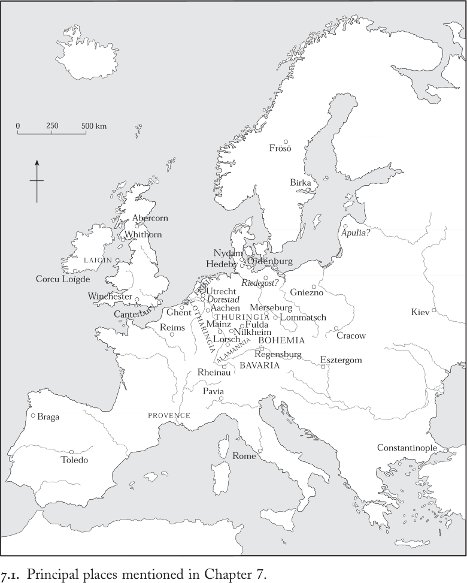
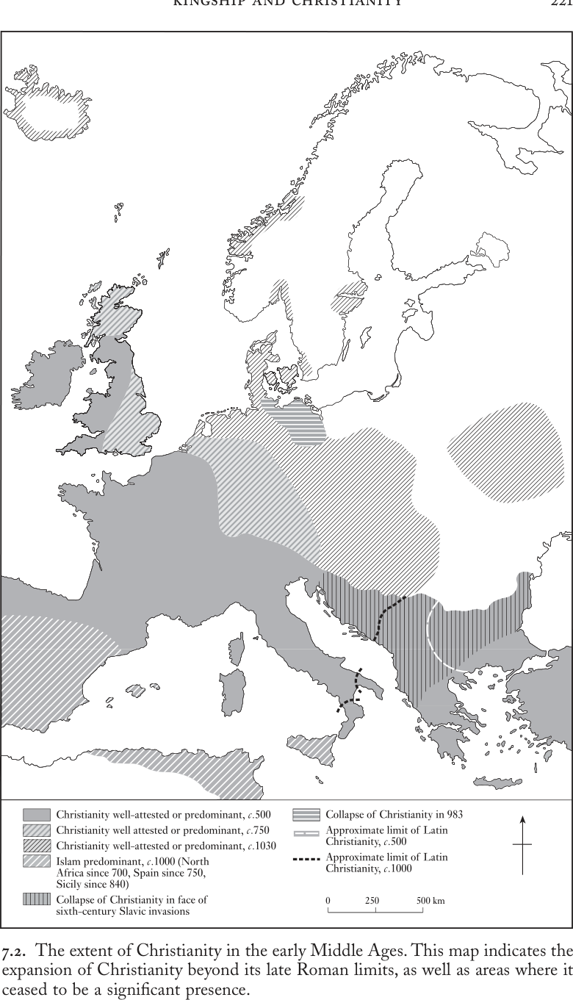

# 第7章 · 王权与基督教

我们祈求您赐予路易国王永世的昌盛。
我们祈求您赐予他生命、健康与胜利。垂听我们的祈祷！
……
我们祈求您钳制那固守残暴异教的蛮族。垂听我们的祈祷！
我们祈求您使异教蛮族降卑。垂听我们的祈祷！^1

首先，我最亲爱的儿子，我如此劝勉、建议并恳求你：如果你想荣耀王冠，就应当以如此勤勉和精心的态度维护使徒传下的公教信仰，为上帝托付给你的一切臣民树立榜样，使教会的众子有理由称你为一位真正践行基督信仰的人。你要确切知道：若没有这一点，你既不能被称为基督徒，也不能被称为教会的儿子。而且，因为没有行为的信仰是死的，那些信心虚假或不以善功实践信仰的人，既不能荣耀地统治，也不能分享永恒的国度及其冠冕。^2

当洛尔施皇家修道院的修士们为他们的国王日耳曼人路易（840–876年在位）向基督教的上帝祈求“永世的昌盛……生命、健康与胜利”时，他们所呼唤的是一种已经历数百年形成的王权意识形态。君主与臣民共同的繁荣；基督教的保卫与传播；对敌人的胜利；维护法治——这些共同构成了中世纪早期关于国王角色以及基督教在政治与社会中之地位思考的核心。到十一世纪初，欧洲已发展出一种以神圣权力与世俗权力相融合为特色的文化，其特征是：国王与基督教的人员和机构密切合作进行统治，自称“基督自身的代理人”，^3并主导推进他们各自对基督教社会的特殊愿景。到十一世纪初年已然成熟的基督教王权模式，在上面所引的劝诫手册中得到了生动体现，该书是匈牙利国王斯特凡（997–1038年在位）为其幼子所写。斯特凡向他的继承人提出了一个十点计划：国王本人要身体力行基督教信仰及其道德纲领，支持教会机构，并敬重教会人员。在这部简短而堪称典范的论著中，王权与基督教相互交织，既提供了一种强大的意识形态，也提供了一部实用的行为准则，以将未来的国王塑造成真正基督教的统治者。

这样的劝诫可谓恰逢其时：教皇西尔维斯特二世于1000/1001年将祝祷与王冠赠予斯特凡，使他成为首位加冕的匈牙利人基督教国王。奥托三世也表示了认可，赠予他一柄圣矛的复制品——该圣矛是他的曾祖父从勃艮第的鲁道夫手中获得并作为基督教统治权标志而挥舞的。在那一刻，斯特凡跻身于基督教诸侯的等级秩序之中，而奥托作为皇帝居于其巅，行使着至高无上的权威。^4然而仅仅一个半世纪之前，匈牙利人（在他们自己的语言中称为马扎尔人）还正是那“固守残暴异教的蛮族”——他们的袭扰曾令日耳曼人路易及其臣民极度恐惧，洛尔施的修士们曾为之祈求他们的败亡。他们从西亚草原上一群信奉萨满教和精灵崇拜的半游牧部落，转变为定居于喀尔巴阡山以西、凝聚成一个基督教王国的单一民族，其转变速度之快令人瞩目。值得注意的是，斯特凡于1000/1001年的加冕与膏立仪式，伴随着埃斯泰尔戈姆大主教区的建立，这种教会权威与基督教王权的共同制度化，常被视为匈牙利基督教王国的奠基时刻。此外，在其后数年间，斯特凡国王不仅为儿子撰写了劝诫手册，还颁布了两部法典，进一步强化王权、建立教会等级制度、推广基督教信仰，并铲除其基督教神职人员所不能接受的社会与宗教习俗。从这个角度看，他本人正是其子应当努力效仿的模范基督教统治者——这样一位国王，通过立法实现对真正基督教社会的愿景，让无数传教主教的梦想有了实现的可能。1083年，即他去世半个世纪后，当斯特凡被匈牙利主教们正式追认为圣人时，他作为国父的角色得以正式确立并被永久纪念。

在匈牙利人斯特凡身上，我们看到了一种简洁的例证，说明国王如何居于中世纪早期宗教生活的中心，既培育基督教，又得益于这一宗教所反过来推崇的意识形态。本章将探讨将统治者与宗教联系起来的三个主题：国王在促进基督教传播、压制其他宗教认同方面所扮演的角色；基督教与其他中世纪早期宗教形态在实践与认知上的区别，以及统治者对于确保“正确的”基督教信仰实践所做的贡献；还有国王在中世纪早期关于人与神圣世界关系的理解中所处的地位。

## 基督教的传播

1038年斯特凡去世时，基督教已历经整整一千年。它在此前数个世纪的传播形成了独特的面貌。基督教在四、五世纪成为罗马世界的主流宗教时，便与帝国、其治理模式及其特有的社会文化形态达成了契合。事实上，它已根基稳固，以至于五世纪西罗马帝国政府的覆亡，也仅使基督教在那些因长期军事动荡与外族入侵而致整个罗马生活方式崩溃的有限区域内衰退或消失。在其他地区，尤其在罗马城本身，教士们接管了原本由国家履行的诸多治理职能。而在那些社会凝聚力和认同原本就越来越不依赖中央政府的行省，基督教团体及其领袖迅速调整自身以适应新王国的建立，在他们尚武的国王身上看到了他们昔日习于享受的帝国庇护下的保护与恩庇的可能。公元500年前后基督教的分布范围见图7.2。

到五世纪末，基督教的信仰实践已遍布罗马世界内外，以至于它的存在导致了选择的收窄。取古代宗教多元主义而代之的，是一种强制性——甚至是胁迫性——的基督教，其本质在于否认任何其他宗教的合法性。然而，七世纪中叶，阿拉伯征服者将新的伊斯兰教带入拜占庭帝国的亚非行省，这既使宗教间的概念边界更加固化，也极大地改变了其地理边界。面对阿拉伯人的进军，拜占庭帝国在七世纪失去了大部分非欧领土，而711年西班牙的被征服，使半岛只剩多山的北部仍在基督教控制之下。诚然，此后仍有广大的基督教团体处于伊斯兰统治之下，拜占庭也设法保住了小亚细亚的古代基督教城市，但从七世纪后期起，一条宗教边界实际上贯穿了地中海。这条边界既是宗教的，也日益成为文化与政治的边界，除微小波动外，一直保持不变直至十一世纪。它的存在以崭新而更加尖锐的方式界定了各种认同。

在地中海以北，另一场同样深刻的地理变迁正在发生：帝国沿多瑙河、莱茵河以及横贯不列颠北部的旧边界，不再标志着基督教教会——其组织依照罗马行政模板、将帝国划分为教区与行省——的界限。如图7.2所示，从四世纪到七世纪，基督教传遍不列颠群岛的各个角落；八、九世纪间，它从莱茵河扩展到易北河；十世纪至十一世纪初，又从多瑙河延伸到第聂伯河和波罗的海。事实上，匈牙利只是千年之交新建立的几个基督教王国之一：波兰、波希米亚、丹麦、挪威以及基辅罗斯公国的统治者，都在970年至1030年的数十年间皈依了基督教。在遥远的北大西洋，甚至定居于冰岛的、已由维京人转为农民的社团，也在999/1000年集体决定皈依基督教。在中世纪早期，基督教“赢得了许多王国，战胜了最强大的君王，并以其自身的力量折断了傲慢者与尊贵者的颈项”。当乌得勒支主教拉德博德（899–917年在任）于十世纪初写下这些话时，他不可能知道这些话既是回顾，也是预言。^5

这一切是如何且为何发生的？中世纪早期基督教的三个显著特征有助于解释：它小规模的组织形式、多元的社会界定以及教义上的灵活性。就第一点而言，到约500年，基督徒已发展出相当标准的组织形式：地区性的崇拜团体（教区）由一位主教监管，主教对服务于地方教会的职业仪式专家（司铎）拥有管辖权。罗马主教——即教皇——被广泛尊为西方基督徒的最高领袖：他受到尊重，是出于敬意，因为正如下一章将说明的，在约1050年之前，他并不拥有管辖性的服从权威。当主教们联合行动时，是在地区层面，有时是在民族层面，而非普世层面。中世纪早期形成惯例：教皇认可新的大主教区（如埃斯泰尔戈姆）作为全国性或地区性的“超级主教区”而设立，但新教区的建立、新乡村教堂的修建与配备人员，均可视需要随处进行，无需教皇授权。此外，过独身生活的男女团体也聚居共处，在基督教扎根之处建立起修院。尽管在中世纪早期……

中世纪时期，尽管这些形式往往趋于规范化为一种共同模式，大多数修道院仍然保持着自治。因此，就制度而言，基督教的组织方式仍然是分散的，并且很容易在任何地方被复制。

在社会和教义层面，中世纪早期的基督教表现出相当大的流动性。关于“基督徒”究竟意味着什么，除了指一个通过接受洗礼这一入门仪式公开宣认这一身份的人，或由他人代其作出这种宣认的人之外，尚未形成共识。从神学上讲，这种宣认意味着此人对死后获得永生的可能性持开放态度。正如托莱多主教尤利安（680–90年在任）所断言的：“凡真正为基督徒者，绝不应怀疑一切已出生或将出生、已死亡或将死亡之人的肉体都将复活。”^6 在这一点上，确实存在一致意见。然而，洗礼宣认的实际含义仍然模糊不清。对作为基督徒的更严格界定强调伦理行为、脱离世俗社会的纽带，以及对信仰的智性理解。在其最完整的意义上，基督教在寻求永恒救赎的过程中，将人类现世存在的所有方面都与神圣者联系起来。而其确切的教义含义也仍然是可以商榷的。在起源于巴勒斯坦之后的五百年里，该宗教的教导并未被系统化为一个意义无可争议的单一、连贯的教义体系。这种情况在中世纪早期也没有发生：辩论和著述其教义的人们在某些问题上观点一致，但在另一些问题上则不然。事实上，很少有人有资格或有意参与这类学术讨论——不过，对于一个出生时就在与世隔绝的乡村社区受洗、偶尔有一位几乎不识字的司铎到访的人来说，这些辩论本来也不会有任何意义。中世纪早期的“基督徒”身份无法用标准化的定义来界定。

因此，在约1100年之前，基督教的组织方式是地方性的，却可以在任何地方复制。此外，对于作为基督徒意味着什么，存在着一系列不同的定义；对于教义的核心信条，也存在着各种不同的诠释。实际上，中世纪早期的基督教既没有中央集权，也没有系统化。它不是一个可以作为一个整体被采纳或拒斥的单一、统一的文化包裹，而是由一系列信仰、社会实践和组织形式构成的储备库，可以被零散地采纳和改造。因此，基督教从一个文化和政治语境跳到另一个语境，在保持其核心特征的同时，不断地变异和重塑自身。换句话说，一种公开宣称普遍性讯息的宗教，成功地在众多文化语境中实现了本地化。多元性和多种可能性始终是中世纪早期基督教的特征——或者更准确地说，是中世纪早期诸种基督教的特征——并使这一普世宗教得以呈现出无穷变化的本地形态。基督教由此强化了中世纪早期极具特色的地方主义。

关于基督教传播的传统叙事并没有充分考虑这些地方性差异。它们讲述的是基督教从古代地中海权力中心向外扩散的故事，借助的是著名人物——皇帝、国王、传教士，有时甚至还有教皇——的活动。这种解释中蕴含着一整套关于何为规范基督教的时代错置的假设。当我们从基督教世界的边缘而非其中心出发来观察时，那些地方特殊性就变得明显得多。国王和传教士的问题我们稍后再来讨论。

作为文化和经济交流地带，中世纪早期的边疆和罗马边疆一样具有渗透性。在旅行、贸易等日常活动中形成的跨境接触，可能成为基督教得以渗入的相遇或传播渠道。接待过往的商人、传教士或政治使节，提供了互动的契机，早在采纳基督教之前就产生了对这一宗教的一定程度的熟悉。因此，当法兰克人和丹麦人于811年在艾德河畔会盟宣誓和平时，双方使团各自“依照自己的仪式和习俗”宣誓，前者采用明确带有基督教色彩的誓词，后者则另有一套做法。^7 马扎尔人提供了另一个例证：早在拜占庭和日耳曼传教士于十世纪来到他们中间之前，这个民族就已与基督教有过接触，因为在880年代初，希腊传教士美多德沿多瑙河穿过匈牙利领土往返于君士坦丁堡和斯拉夫诸地之间，并在那里受到其首领“以尊荣、隆重的礼节和喜悦”的接待，后者还向他馈赠了大量礼物。^8 这类相遇属于长途旅行的世界，发生在精英和政治领袖层面。但地方性的跨境接触也可能促使其腹地出现基督徒社团。这或许可以解释为何在五、六世纪时，不列颠罗马边疆以北的怀特恩和阿伯康等地，或墨洛温高卢东部边缘之外的尼尔克海姆在八世纪初，会存在有组织的教会。

贸易是有充分文献记载的了解另一种宗教的途径。毫无疑问，旅行至基督教世界之外的基督徒商人的祈祷和仪式偶尔会引起议论。然而记载更为清楚的，是非基督教商人在前往基督教地区贸易时的经历。九世纪，来自斯堪的纳维亚各商埠的商人在旅途中接触到了基督教。例如，海泽比这个波罗的海商埠的一些人曾在杜里斯特受洗。还有人记住了法兰克传教士主教安斯加尔（卒于865年）所宣讲教义的大意，以至于当瑞典人试图洗劫波罗的海东岸的阿普利亚定居点、而自己的神明不愿相助时，他们提议向基督教的上帝求助。

另一种值得注意的基督教相遇与传播形式是跨境劫掠和掠奴。晚期罗马作家十分清楚，基督徒奴隶有时会将基督教传给掳获他们的人：最著名的例子是帕特里克，这位被爱尔兰劫掠者掳为奴隶的罗马—不列颠基督徒逃脱后，于五世纪的某个时候重返爱尔兰，向昔日的主人传教。在这方面，罗马帝国的政治解体并未带来任何改变，因为中世纪早期强权政体边缘普遍存在的掠奴活动，继续充当着宗教互动的渠道。值得注意的是，安斯加尔抵达比尔卡时，发现那里有相当数量的基督徒俘虏。一则840年代的故事揭示了这些人如何在欧洲边缘辗转流徙。芬坦是一名基督徒，是爱尔兰莱金地区一位小统治者的儿子，其亲族正忙于与邻近一位军阀争斗。为阻止进一步的报复，他的对手们施以诡计：他们邀请芬坦到海滩上赴宴，并安排附近的一伙维京人上演一场突袭将他掳走。芬坦被迅速地从一个维京人转卖到另一个维京人手中，直到他成为一名准备返乡者的财产，此人将他与其他俘虏一同装船运走。在返回斯堪的纳维亚途中，船员们在奥克尼群岛一座无人居住的小岛过夜，芬坦在那里设法逃脱。他发誓永不返乡，游到附近一座岛上安全之处，最后于881年在莱瑙阿尔卑斯山麓以隐士身份终老。

边疆暴力最臭名昭著的形式当然是战争，而战争也以其自身的方式促进了基督教的传播。250年代，居住在克里米亚罗马边疆附近的哥特人经常袭掠黑海南岸的罗马一侧。有时他们带着基督徒俘虏归来，正是从这种不光彩的开端中，哥特人第一次接触到了基督教。一些哥特人皈依了；俘虏社团无疑将他们的信仰保持了好几代，直到340至350年代由帝国支持的乌尔菲拉传教团使哥特人转向当时帝国圈子中流行的基督教阿里乌派。^9 另一种或许更为常见的情形，是从边疆民族掳获的俘虏和质子在帝国羁押期间接触基督教。查理曼对萨克森人的战争以血腥和坚不妥协地摧毁萨克森社会与宗教、以刀剑强制推行基督教而臭名昭著。^10 一份805至806年的简短行政备忘录为我们记录了三十七名萨克森质子的姓名，他们被单独或成对地托付给阿拉曼尼亚的主教、修道院长和伯爵看管。他们的命运不得而知，但这些显然是重要到足以被留下一命的人物——为的是把他们改造成征服者皇帝的基督徒臣民。加洛林王朝和奥托王朝对异教敌人的许多其他成功战役，想必也以类似方式告终。

从四世纪末起，基督教罗马帝国的边缘地带不仅是个体和小群体流动的区域，有时也是军队和整个民族迁移的区域。当军阀及其扈从队伍跨越边疆、在帝国内寻找新家园时，他们便发现自己定居在基督徒中间。有些人，如五世纪初定居于帝国内的哥特人和汪达尔人，原本就已是基督徒，尽管是阿里乌派基督徒。而对另一些人来说，皈依基督教是在迁入帝国之后才发生的。法兰克人在五世纪期间将其政治控制区和定居地扩展到高卢北半部时，必然与该地区根基深厚的城市基督徒社团以及现存的乡村社团有着广泛的接触。在这里，宗教的改变不是经由旅行者或传教士，而是经由日常生活的持续互动而来。通婚便是其中一方面：每当一名法兰克武士迎娶一位基督徒女子，这个家庭就成为宗教改变的焦点。在高卢和其他地方，基督徒妻子和母亲在传播其宗教方面的重要性无论如何估计都不为过。然而，只有王室层面的相关情况，现存证据才使我们能够多少详细地追踪这一过程。法兰克国王克洛维——他在（大概）508年接受基督教，使其成为对同时代人和后世都意义重大的标志性皈依者——早已娶了一位基督徒勃艮第公主。克洛蒂尔德坚持要给孩子们施洗，以及她对克洛维的个人影响，促成了他接受基督教的决定，并使她在后世传说中赢得“法兰西之母”的地位。从农庄到宫廷，家庭是宗教改变与文化涵化最有效的焦点之一——尽管也是文献记载最少的焦点之一。

除了下莱茵地区之外，法兰克人逐渐适应基督教的过程并未对高卢—罗马基督教造成实质性破坏。如果说有什么影响的话，那反而是增强了教会领袖人物的影响力。然而在其他地方，军队和移民的流动往往造成更具破坏性的后果。到四世纪末，基督教已传遍不列颠，但当盎格鲁—撒克逊移民在五、六世纪跨过北海而来时，其制度组织在不列颠东南部全面崩溃。这里残存的基督教只以几个孤立的小据点形式存在，丧失了教士的领导。十世纪的多瑙河平原或许也发生了同样的情况，因为马扎尔人占据的该地区西部包括了根基稳固的基督徒社团，他们似乎将自己本土语言的宗教词汇传给了征服者。

与这种缓慢的、几乎不见于史册的文化渗透相反，在新环境中启动基督教的政治冲击在史料中十分醒目。这构成了该宗教传播的第二种截然不同的方式：有权势的男女人物所采取的决定性行动，其影响往往是迅速而广泛的。无论是作为统治者皈依的叙事——追溯到皇帝君士坦丁（306–37年在位）的皈依——还是作为说服其配偶改变权力观念的王后们的叙事，抑或是服从基督诫命“你们要去使万民作我的门徒，奉父、子、圣灵的名给他们施洗”（《马太福音》28:19）的传道者的叙事，基督教的传播同时也是一部高层政治史，也是那些声名被基督徒社团恪尽职守地培育传承的人物的历史。

作为一种王室行动，接受——或拒绝——新宗教，通常是在霸权政治的背景下发生的。宗主对小统治者施加影响的主张、小邦君主寻求强大邻国的支持，或仅仅是对效仿已被证明行之有效的成功为王之道的渴望，都发挥了各自的作用。传教士无论出于自身主动还是奉王命而行，都循着同样的沟通渠道移动，很少前往与其故乡即便间接也没有关联的地方。他们随身带来的有政治人脉、贵重的礼物、举行盛大仪式的经验，以及——同样重要的是——对成功皈依仪式的权威脚本的既有了解。

在这种情况下，接受基督教带有精心安排的政治展演的一切特征。597/598年，当肯特国王埃塞尔伯特从奥古斯丁——一位在肯特的法兰克宗主的扶持下开展工作的罗马修士——那里接受基督教时，据称有一万人随之受洗。从人口统计上看这纯属荒谬，但

富于修辞效果的形象表明，这是一个引人注目、具有直接意义的事件。845年，十四位波希米亚王公及其随从在日耳曼人路易位于雷根斯堡的宫廷接受洗礼，这一场面必定蔚为壮观。有时，宗主国王会为皈依的统治者充当教父，主持其身份的转变，并从洗礼盆前接纳他，借此借助洗礼确立一种尊卑等级。韦塞克斯的阿尔弗雷德在878年为其战败的敌人、维京首领古特鲁姆充当洗礼教父，便是这样的情形。王室的洗礼还可以旨在将未来的统治者纳入联盟：1000年奥托三世访问格涅兹诺期间，他成为基督教波兰王公“勇敢者”波列斯瓦夫（992–1025）新生儿子教父，这场仪式充满象征意义。他还通过赠予波列斯瓦夫一顶王冠和另一件圣矛复制品（至今仍可在克拉科夫看到）来巩固这一纽带。

追问此类洗礼背后是宗教动机还是政治动机，本就是提错了问题，因为在一个身份认同既属社会又属个人、宗教表达通常更具共同体性质而非个人性质的年代，这种区分毫无意义。无论势微还是强大，统治者都需要以视觉上富有戏剧性的形式展演其与上级和下属之间的政治关系。事实上，国王只有在其显贵们的支持下方能行使职能。因此，对皈依的焦虑，或皈依后复又叛教的现象，乃是统治集团内部冲突的症状。在西北欧，接受或排斥新宗教之间的紧张关系可能反映了对宗主权的选择，或许也反映了统治精英中年长成员与年轻成员之间的冲突。616年肯特的埃塞尔伯特去世后，由其子兼继承者带领出现了一次向异教旧俗的回潮；而一个世纪之后，弗里西亚统治者拉兹博德（卒于719年）在被告知其异教祖先不会陪伴他进入基督教天堂后，竟从洗礼盆前退了出来。在此，集体身份问题是以生者与死者之间的社会凝聚力的方式表达的，但严酷的现实是，法兰克人的侵略在弗里西亚精英内部催生了冲突。

九、十、十一世纪的中欧统治者在加洛林诸帝及其奥托继承者所支持的基督教与拜占庭皇帝的基督教之间面临抉择的额外困境。如第一章所强调，前者以拉丁语为圣礼语言，以罗马为正统乃至领导之所在；后者则愿意将当地土语用于礼仪用途，其管辖中心设于君士坦丁堡。这一选择必然也关乎政治利益，在东西两大帝国积极争夺盟友与影响力的数十年间，这一两难处境尤为尖锐。在多瑙河下游流域，保加尔人可汗鲍里斯（852–89）既是法兰克人也是拜占庭人的军事威胁和潜在盟友：双方都笼络他，力图对其施加影响。这正是鲍里斯决定皈依基督教并于864/5年受洗的背景。但政治与文化的取向仍是一个问题，鲍里斯与罗马和君士坦丁堡长期谈判之后，才于870年选择希腊基督教。大约一个世纪之后，新兴的匈牙利王国面临类似的压力。十世纪晚期，德意志和拜占庭传教士同时在马扎尔人中间活动：在斯提芬国王于教皇和奥托的主持下加冕之后的很长一段时间里，希腊教士依然活跃。

我们应当简要回溯斯提芬的统治。他是一位基督教国王，统治着这样一群臣民：在这些人中间，传播基督教的地方性的、不为人注意也不引人注目的传教工作正在逐渐推进，并将长期继续，在随后的几十年里不时被异教暴动所打断。埃斯泰尔戈姆大主教区的建立之后，必须逐步建立起一个全国性基督教的建制性基础设施——一个主教网络、修道院的创建与捐赠（男女修士团体在其中过着有纪律的清修与祈祷生活）、对本地教士进行礼仪专长和拉丁语的培训。传统程序必须重新协商，以满足基督教教士对法律保护、特权地位以及永久保有土地赠予的期待。而且，还必须启动在传统马扎尔社会习俗与基督教教义的伦理要求之间进行漫长而缓慢的调适过程。在这一切之中，匈牙利 斯提芬的特殊之处仅在于其热心推行基督教所产生的文献记载，以及他行事之迅速。他的统治不过是将此前数个世纪中许多皈依国王所面临的问题，浓缩为一个记载详备的高速版本。

实现这些目标需要时间和政治决心。在基督教的传播仍限于非正式接触的地区，建制化并未发生。在缺乏教士等级体系和完全的读写能力的情况下，我们看到一些即兴式的基督教生活方式，它们以其践行者自有意义的方式蓬勃发展，却往往遭到最终追上这些人群的传教士的怀疑或断然谴责。其中一人是弗里德堡，九世纪中叶生活在以非基督徒为主的瑞典人中间的一位基督教妇女。她知道有一种临终者啜饮葡萄酒的仪式（即临终圣体，由教士向临终者授予祝圣的酒，作为帮助基督徒灵魂升入天堂的仪式的一部分），于是买来葡萄酒备好，并嘱咐女儿在她临终时给她饮下。另一例是 Ørlygr Hrappson，一位挪威人，少年时代曾在赫布里底群岛由一位爱尔兰主教抚养。十世纪初，他前往冰岛，携带着建造教堂的木料、一本礼仪书，以及要埋在教堂角柱之下的“祝圣过的泥土”。这最后一项会使任何受过正确祝圣新教堂程序训练的人大为惊骇。Ørlygr 以盖尔圣徒科伦巴之名命名其教堂，三代之后，他的后裔仍“信仰科伦巴，尽管他们并未受洗”。^11 这种“自己动手”式的基督教，是在缺乏有组织的教士阶层的情况下，宗教变革经由非正式接触渠道缓慢渗透的伴生物：尽管文献记载稀少，它必定在制度化基督教世界的边缘地带以及偏远的内陆角落蓬勃存在。

无论我们把注意力集中于基督教以非正式还是正式方式的传播，我们都不断被提醒：宗教变革总是发生在社会情境之中，而这些情境往往也是政治性的。它影响到家庭和家户、宫廷、军队、商人社群，且对各者的影响方式各不相同、各具特色。尽管如此，仍可提出两点概括性意见。第一，如果中世纪早期的男男女女在接受新宗教时，将关于基督教教义“真理”的看法与政治或现实动机相权衡，我们并不会从他们自己的话语中听闻此事。诚然，虔信的基督教作者认为皈依者理应如此，有时也把他们描绘成这样做的，但宗教变革背后实际的理由对我们而言始终隐而不显。然而我们可以确信，对某些人而言，作出决定的必要性远比其他人更为迫切——对统治者（或反叛者）而言比对忠诚的追随者更为迫切，对父母而言比对子女更为迫切。第二，统治者及其随从的受洗，或者家庭层面对某些基督教习俗的采纳，都未必带来迅速而彻底的精神、道德和社会转型。如前几章所述，丧葬仪式、性行为、对疾病的应对以及其他诸多方面的转变确实发生了，但过程缓慢、反复无常，且极难强制推行。无论在地理还是时间维度上，我们都无法察觉一种均匀的推进：基督教的传播循着许多不同的路径与节律。它高度依赖于特定时空情境的不断变化的组合，对不同的人意味着不同的事物。总之，中世纪早期的基督教由地方性知识构成，而非普世的“真理”。

## 异教徒与基督徒

尽管中世纪早期欧洲的诸种基督教形态在组织、礼仪和社会实践上地方形式繁多，它们仍有许多共同之处。基督教世界观的中心是这样一种主张：唯有这一宗教提供了关于超自然（或神圣）、自然（或尘世）与人类（或社会）之间关系的唯一可能的真理。这些普世化的观念之所以吸引统治者及其谋士，是因为它们重构了共同体的观念，塑造了新的身份认同，指认了新的敌人，并为王权提供了新的正当性依据。随着反对基督徒与非基督徒对立的思维定式日益固化，在一切可能之处根除“谬误”便成了各地国王和教士的任务。由此，基督教改变了其采纳社会的想象图景。通过提供一套共有的普世价值，它为各社会提供了新的彼此联结的方式。通过许诺尚武的国王们以新的意识形态和交流方式，它鼓励他们走向共同的伦理乃至共同的目标。^12 事实上，它如此成功地提供了一种包罗万象的伞状身份认同，以至于到十一世纪初，“基督教世界”与“欧洲”实际上已成为同义词。到第一个千年末，散居的犹太人社群构成了欧洲唯一重要的非基督教存在；他们受到忽视、容忍与敌意交织的暧昧对待，这考验着中世纪早期欧洲作为一个强制性基督教共同体的身份认同的边界。

强制性基督教奠基于承自古代晚期的观念，即基督教不仅是普世宗教，而且还是唯一“正确”的宗教。在这种凯旋主义的视角下，基督教的传播常被描绘为对“错误”宗教的铲除。拉巴努斯 毛鲁斯一语道破：“基督教摧毁一切谬误。”^13 这一修辞立场否认一切其他宗教的任何有效性。它们的神祇被径直重新定义为魔鬼，其道德教诲与崇拜实践被斥为堕落败坏。

于是魔鬼及其仆从恶魔们……开始以各种形式向人类显现，与他们交谈，并要求他们向它们献祭，献于高山之上和繁茂的森林之中，并把它们当作上帝来崇拜。……有一个魔鬼自称朱庇特，他曾是一个魔法师，犯下如此多的通奸罪行，竟娶了自己的妹妹朱诺为妻，玷污了自己的女儿密涅瓦和维纳斯，甚至与他的甥女们及所有女性亲属犯下污秽的乱伦之罪。另一个魔鬼自称玛尔斯，他曾四处播撒争斗与不和。……还有一个魔鬼自以为维纳斯；她曾是娼妓，不仅参与无数通奸，甚至与父亲朱庇特和兄弟玛尔斯卖淫苟合。……这些魔鬼甚至诱使人们为他们建造神庙，在其中安放恶人的形象或塑像，并为他们设立祭坛，在坛上为他们倾洒牲畜乃至人的鲜血。^14

布拉加主教马丁（556–79）就这样颠倒了传统罗马诸神的宗教意涵，使其失去本性，并嘲讽任何宣称它们具有真实性的企图。他的观点在中世纪早期广泛流传，并以各种方式被重申。例如，八世纪末至九世纪，在德国富尔达传教据点附近施行洗礼时，接受基督的新皈依者要承诺“弃绝魔鬼托纳尔、沃坦和萨克森诺特的一切言行，以及所有与它们为伴的邪魔”。^15

基督徒处理本土神祇的另一种方式是否认其超人的地位。通过将诸神贬低为凡人，基督徒试图使与之竞争的神祇变得无害。温彻斯特主教丹尼尔（约705–44）曾就其在德国的一次布道使命向博尼法斯提出如下建议：“你不应当在诸神的谱系问题上与他们争论，尽管那些神是虚假的，而应任由他们按照自己的信仰宣称一些神由另一些神通过男女交合所生，这样你便至少可以表明，以人类方式诞生的男女神明是人而非神，并且由于他们此前并不存在，故有其开端。”^16 如此被贬至人的地位后，诸神可能发现自己被放逐到遥远的过去。沃坦是受崇拜最广的日耳曼神祇之一，便遭遇了这一命运，尤其在各个盎格鲁-撒克逊民族之中。在基督教传教士将宗教引入英格兰南部两个半世纪之后，沃坦已从神贬黜为王室王朝的创业始祖，从诸王的原始缔造者降为亚当的后裔——而按照圣经传统，亚当是由犹太-基督教上帝所创造的第一个人类。在别处——尤其是爱尔兰、冰岛和斯堪的纳维亚——史诗、萨迦和神话常常使这些形象在文学的来世中又存活了许多个世纪，透过漫长的基督教经验过滤了对异教过去的呈现。

从五世纪起，基督教的对抗性修辞还将除犹太人之外的所有非基督徒一概而论，以贬抑的方式将其斥为“异教徒”（pagans）。当然，从来不会有人以此作为自我认同的称谓。这一用语的使用遮蔽了中世纪早期欧洲本土宗教传统的丰富多样性，以及

蓄意遮蔽了对其实际性质的任何理解。在评估这一点时，我们必须谨慎行事。罗马世界诸非基督教宗教的信奉者的思想和声音，有时以文字形式直接流传至今，而对于中世纪早期那些非基督徒的男女，却不存在任何可与之相比的途径来探知其宗教态度或经验，因为正如第一章已阐明的，除简短刻划的铭文之外，书写文化乃是基督教的引入物。我们只能依赖可能具有宗教意义的物质遗存、语言痕迹（例如地名），或基督教作家所记述的非基督教信仰与习俗。

尽管如此，只要谨慎从事，我们仍可大致勾勒出基督教传教士在罗马世界以外所遭遇的那些传统宗教形态的轮廓。与犹太教、基督教或伊斯兰教不同，它们无一依赖于圣典文本的集成、先知传统，或对独一普遍神祇的认信。它们没有任何需要捍卫的教义与正统，也没有表达“宗教”这一复杂抽象概念词语。它们并非围绕一位全能的人物、甚至一对对立的二元神祇来安排宇宙，而是认为宇宙中栖居着无数精灵，这些精灵既影响凡间事务，又可为人所操纵。从最深的地底到最遥远的星辰，自然与超自然、形体与精灵无处不在地相互交织、相互作用。在这一框架之内，人类的位置通过神话、仪式、神圣知识的储备，或萨满、占卜者、德鲁伊等从业者的活动而得以确立。它们的仪式还提供了理解和试图掌控生死、生育与疾病、战争与繁荣等根本性力量的途径。通过献祭安抚神灵与精灵、以护符和避邪物对其进行约束或召唤；借助占卜等手段预测未来；以及通过禁忌规约人的行为——这些似乎都是普遍存在的。因此，神圣活动与人类生存的其他方面——家族的、家宅的、农业的、政治的、军事的——如此紧密地纠缠在一起，以致任何把“宗教”视为一种独立经验范畴的尝试都归于徒劳。

尽管有上述概括，而且尽管存在若干神祇（如日耳曼人的沃坦）表面上广泛流行的崇拜，宗教传统在很大程度上仍然关乎地方认同，无论这种认同属于群体还是地域。许多地域上的具体情形已无从考知，尤其是因为我们对某些地区宗教传统的了解远胜于其他地区。但显而易见的是，一位神祇可能是武士精英的始祖；一棵古树之类的自然景物可能凝结着一个共同体的本质；一处圣地可能是一个政体的礼仪中心或献祭之所。因此，七世纪的伦巴德人相信，当沃坦允诺“长须之人”伦巴德人在战斗中获胜时，他们便得到了自己的族名；而爱尔兰南端则由“牛犊女神之家”科库·洛伊格德（Corcu Loígde）统治。德意志地区的洛马奇（Lommatsch）得名于一处圣泉，当地民众崇奉它，因为它能通过撒出小麦、燕麦和橡子来宣告和平与丰收以预言未来，但“当战争的狂风暴雨威胁时，它便以血与灰烬清楚地预示结局”。^17八世纪的弗里西亚人栖居于北海沿岸潮汐沼泽之上的人工高丘（terpen）中，他们在涨潮的力量中辨认出一位需要以人祭加以安抚的神。与此形成对照的是，在983年推翻奥托王朝统治之后的那个世纪里，柳蒂齐斯拉夫人将其对德意志统治者及其宗教的抵抗组织起来，围绕其主神殿——里德戈斯特圣区中的斯瓦罗齐茨神祠。

考古学有助于充实这一粗略的描述。尤其在斯堪的纳维亚和中北欧，人们发现了仪式性献祭的痕迹——动物、人类、武器——有时见于专门的祭祀围场，有时则作为祭品 deposited 于沼泽、湖畔或树木周围。物质遗存与文字记载同样证实，神圣区域内还可以设有木制或石制的柱状偶像，但人形的神像仅发现于斯堪的纳维亚南部和西斯拉夫地区。诸如丹麦尼达姆遗址及其四、五世纪大批武器和船只的祭祀沉积；奥尔登堡（今德国波罗的海沿岸的一座斯拉夫要塞）出土的神祇小像和十世纪马祭的遗存；以及瑞典北部岛屿祭祀中心弗勒瑟岛上堆积在树干周围的十至十一世纪动物遗骸——这些发现都生动地提醒我们，基督教终将摧毁的那些信仰与习俗曾经存在。

由于现代学者无法通过内部的文字证据来研究这些本土宗教形态，严格说来，它们属于史前状态。但不应因此假定它们是超历史的。它们随时间演变的方式确实可以被察觉，尤其是通过与邻近霸权文化或基督教的互动。前基督教时期爱尔兰人发明的欧甘字母便是已遇到的一个例子。在五、六世纪，定居于不列颠的盎格鲁-撒克逊人可能已开始使用专门的崇拜建筑，或是接管旧的罗马神庙和教堂，或是刻意模仿而自建木构圣所。在十世纪末和十一世纪初的丹麦，如尼石碑有时会以措辞透露出基督教影响的套语召唤雷神托尔的力量。而丹麦人的邻居柳蒂齐人并非一直在神庙中礼拜，其境内也并非一直由某一圣所凌驾于其他圣所之上：随着对德意志统治的反抗日益强硬，他们的本土宗教获得了一种模仿对手宗教的结构与组织。就政治权力与神圣权力的相互强化而言，没有比基督教更好的样板了。

本土宗教传统回应邻近基督教的影响，本不足为奇，因为中世纪早期边界的可渗透性已有所论述。在实践中，宗教信仰与习俗从来不是密封隔绝的体系，而是在与其更广阔的社会环境的创造性互动、涵化或对抗中发展起来的。因此，无论基督教真理与异教谬误之间凯旋式的对立多么鲜明，这一概念上的二分法通常并不渗透于日常的宗教经验——对于那些被专门鼓动去击败异教徒的基督教军队则属例外。就多数情形而言，个人的现实处境并不符合传教士意识形态所描绘的图景，即皈依基督教是一种彻底的个人转向，伴随着对前基督教过去的完全弃绝。

关于皈依君主的叙事常常清楚地表明这一点：我们可以回到匈牙利来说明。国王伊什特万的父亲盖萨（约970—997年在位）在匈牙利人正处于拜占庭与德意志两大帝国之间抉择的时刻掌权；在他的统治下，匈牙利人果断地将政治忠诚转向西方。来自巴伐利亚的德意志传教士补充了已在匈牙利人中间活动的希腊传教士，并于972年为盖萨本人施洗。然而，在与其他酋长争战以确立自己对匈牙利人的最高领导权时，他不惜采取一切手段来巩固地位。盖萨是个脾气暴躁的杀人者，如今已皈依基督教的他“将自己的怒火转向那些不情愿皈依的臣民，以强化这一信仰。就这样，他满怀着对上帝的热忱，洗刷了自己的旧罪。他既向全能的上帝献祭，也向各种虚假的神祇献祭。当司铎为此责备他时，他却辩称这种做法给他带来了财富和巨大的权势”。^18如同许多被传教士纠缠的其他统治者一样，盖萨宁可要宗教的多元并存，也不愿弃绝旧的道路。基督教洗礼补充而非取代了传统崇拜。他似乎已认识到，匈牙利人承袭的宗教信仰与习俗同他们的认同和生活方式紧密相连，若将其抛弃，必将瓦解他所力图建立的一切。因此，盖萨提醒我们：洗礼本身并没有根除传统习俗，也没有改写过去。皈依基督教应被理解为不同宗教与文化体系之间一场漫长的遭遇与互动，而非凯旋式史学所暗示的一种体系对另一种体系的替换。

在古代晚期，基督教领袖们已逐渐认识到，以洗礼为标志的基督教共同体成员身份不足以将基督徒与异教徒区别开来。他们开始移动标准，主张人类行为的一切形式都必须有独特性。“如果我们不照基督徒的方式行事，仅仅领受基督徒之名是不够的”，阿尔勒的凯撒利乌斯如此告诫他六世纪的听众。^19于是，基督教逐渐成为一种日常道德的宗教；如前所述，它既关注日常生活的规律节律——劳作与崇拜、宴饮与斋戒、性事与禁欲的时辰——也关注生活中不可预测的危机，如发烧的孩子、瘸腿的马匹或恶劣的天气。因此凯撒利乌斯告诫其信众，面对疾病不可采用基督教以外的方式来应对。普罗旺斯那位农妇——喝草药汤剂以堕胎、带患病的孩子去找占卜者或精通草药的女人、或把书写的符咒挂在孩子脖子上——所依赖的做法，无疑世代相传、久经验效。求助于基督教司铎或圣人圣龛，只是她应对疾病与灾祸的若干治疗策略之一。然而对凯撒利乌斯而言，所有其他策略都是“魔鬼的诱惑”。^20他要求听众抛弃其传统宇宙观——在那种宇宙观中，超自然与人通过形形色色的人物和场所相聚并互动——转而只寻求主教所认可者：教堂、圣徒和司铎。即便如此，去对的地方也还不够，因为他还告诉会众，在圣人圣龛外手舞足蹈乃是“以基督徒之身进入教堂，却以异教徒之身离开”。^21

凯撒利乌斯为基督教设置了防疫线，从而在“正确”的基督教与“错误”的基督教之间划出了明确的界限。在界定这一区别时，他把从前针对非基督教习俗的谴责性修辞扩展到其受洗会众所做的任何令他不悦之事上。这种语言便是关于“迷信”与“谬误”的传统论战话语。“迷信”标志教会精英认为有害于其基督教羊群得救的任何行为。随着在人神之间充当媒介的人物、场所、仪式和言语逐渐尽入教会的规管要求之下，“迷信”便成了对任何逃脱此种控制、因而处于正确与错误基督教之间概念边界错误一侧之物的贬称。

当拉班努斯·毛鲁斯宣称“基督教摧毁谬误”时，他把这些谬误界定为“偶像崇拜、贪婪及其他恶行”，而不屑于区分非基督教习俗与基督徒的不当行为。^22对于错误的基督教，拉班努斯无疑有着大量直接经验。但对于偶像崇拜及其他非基督教习俗，他至多只有从阅读或与传教司铎的通信中获得的二手或三手知识。他的异教徒全在他心中，但这并未阻止他就如何处置他们高谈阔论。方法很清楚：那是君王的方法。作为美因茨大主教，拉班努斯与他的国王“德意志人”路易密切协作。君王之职在于协助教会人士根除谬误，这一点已由路易的祖父查理曼确立。得益于英语无法再现的一个词源关联，塞维利亚的伊西多尔那部流行的百科全书式手册《词源》将纠正臣民规定为君王的基本职责：Reges a regendo vocati... Non autem regit qui non corrigit（“王因统治而得名……不纠正者不为王”）。^23这一点远不止于文字游戏：它勾勒出整套道德纲领。这一关于君王负有纠正宗教谬误之责的观念，先由伊西多尔同时代的伊比利亚哥特诸王转化为有力的立法纲领，一个半世纪后为查理曼所采纳，随后又传播到其治世理想所及之处，从而使基督教徒与异教徒之间的区分获得了新的意涵。像“德意志人”路易这样精力充沛的基督教君王，不仅在战场上“令异教蛮族屈膝”，还与其首要主教们紧密合作，向臣民灌输正确的基督教。在这样的环境中，边远地区的自行其是的基督教，无论对其践行者多么真切，都可能显得可疑。“迷信”与“谬误”取决于旁观者而非践行者的眼光，因为在整个中世纪早期，教会精英攫取了规定何为正确基督教的权利。拉班努斯·毛鲁斯的前任美因茨大主教之一，博尼法斯，曾在八世纪的第二个二十五年间旅行并传教于法兰克的莱茵兰、图林根和巴伐利亚。在这里，他遭遇的并非基督教与异教之间截然分明的边界，而是一系列习俗的光谱。其一端是他本人所受训练的那种规整的修道主义；另一端则是一些过于偏远、此前从未与

基督教世界。然而，大多数人介于这两个极端之间——随和的主教，其价值观念更接近其贵族亲属而非苦修士；受洗的农民向基督教圣徒献祭，或试图从马粪中占卜未来；自行其是的基督徒甚至不知道自己的孩子在受洗时使用的是讹误的仪式祷文。到754年博尼法斯去世时，他已经运用凯撒利乌斯关于“迷信”的观念，将这一模糊的光谱简化为正确与错误基督教之间的鲜明概念对立。

博尼法斯之所以重要，是因为他在制定正确基督教的规范以及鼓励统治者支持这些规范方面发挥了关键作用。随着八世纪下半叶欧洲广大地区迅速落入加洛林王朝统治之下，这些规范由与国王携手合作的主教们颁布并进一步阐发，而这些国王已将“纠正”的任务铭记于心。查理曼及其继承者竭力推行正确的基督教，而这种理想在晚期盎格鲁-撒克逊英格兰和奥托-萨利安王朝德意志所受到的热烈响应，确保了它长期保持影响力。到十一世纪初，我们发现“纠正”的任务甚至出现在欧洲的东部边缘——它体现在匈牙利国王伊什特万的立法之中。正确的基督教——自博尼法斯以来所界定的——正稳步走向成为唯一被允许的基督教。

那么欧洲的最西端又如何呢？爱尔兰于五世纪基督教化，始终未受加洛林或奥托王朝政治或文化霸权的影响。爱尔兰的基督教早已使其组织模式适应了小规模王国以及围绕牲畜与亲缘关系的政治，并以对当地有意义的方式改造了圣经诫命。它只是中世纪早期众多基督教形态中的一种，而且证明了极为持久。但是，在那些认为只存在一种正确基督教的人眼中，到了十一世纪后期，爱尔兰的版本已显得十分怪异。1070年，征服者威廉任命了一位新的坎特伯雷大主教。兰弗朗克约于1010年出生于意大利旧都帕维亚，他既熟悉国王对基督教福祉的传统责任，也熟悉自十一世纪中叶以来逐渐形成的关于中央集权化、统一基督教的新理想。约1074年，兰弗朗克主动向爱尔兰至高国王、芒斯特国王托德尔巴赫·乌阿·布赖恩（1063–86年在位）指出，他的基督教是错误的那种。洗礼的施行方式不合兰弗朗克所认定的规范，婚姻不符合大陆教会人士制定的要求，主教的祝圣方式也与其他地方不同。托德尔巴赫必须“纠正”这些“骇人听闻的……做法”和“邪恶习俗”。^24 爱尔兰人确实做出了回应，但进展缓慢，显然不足以消除他们执迷于谬误的印象。1155年，在十二世纪已然变化的氛围中——其变化源于普世教皇君主制主张的出现，以及此前数世纪众多地方基督教共同体融合为一个同质性更强的单一基督教世界——教皇阿德里安四世授权英格兰国王亨利二世（1154–89年在位）入侵爱尔兰，理由是“扩张教会的疆界，向仍未受教化而野蛮的民族昭示基督教信仰的真理，并将罪恶的杂草从主的田地里连根拔除”，这将使亨利获得永恒的荣光。^25 由此，爱尔兰人几乎成了彻底的异教徒，被置于教会之外：他们缺乏正确的基督教，这为入侵和征服提供了正当理由。当多元的地方基督教形态在刀剑逼迫下让位于单一的、标准化的、规范化的基督教时，中世纪早期便真正终结了。

## 贤君与暴君

961年春，奥托一世准备踏上从德意志翻越阿尔卑斯山前往罗马的危险征程。作为准备的一部分，他让年仅六岁的儿子加冕为王，以确保万一自己不能生还能顺利继承。仪式于5月26日在查理曼在亚琛建造的宫殿礼拜堂中举行——正是二十五年前奥托本人在其统治之初受祝圣的同一地点。幼童——即未来的奥托二世——被涂上圣油，随后被授予象征性的剑、权杖和权杖杆，加冕，最后登基。仪式的言语、礼仪和姿态都有悠久的历史，与地点本身一样散发着传统的气息。在一个层面上，这是一场家族事务，因为主持祝圣的三位大主教中，一位是新王的叔父，另一位是他已成年的异母兄长，第三位则是另一名亲族。在另一个层面上，仪式将年幼与年长的两位奥托都紧密地与王国的显贵们联系在一起，这些人被正式询问是否愿意服从新王的统治、遵行他的命令。更为复杂的是，仪式将国王、王国与基督教上帝联系成一种紧密的纽带，因为奥托被问及：“你是否愿意依照你祖先的正义之道，统治并捍卫上帝赐予你的王国？”他以正式的誓言作答，承诺将在上帝的帮助及所有忠于他者的支持下如此行事。^26 随着祝圣仪式的进行，它唤起了到十世纪末已发展成熟的基督教王权的一切复杂观念与意识形态。国王的角色应当是最勤勉的君王、敌人的征服者、教会与教士的守护者和保卫者。人们祈求上帝以“正义与虔敬的冠冕”为他加冕，赐他战胜一切有形与无形之敌的胜利，并赐予他丰收、健康、和平以及亲生继承人。人们还祈求上天的护佑，使臣服的民族保持忠诚、使权贵们安分平和。在仪式进行过程中，奥托听到自己被比作古以色列人的统治者——犹太-基督教圣经将这些领袖描绘为奉上帝之名征战、以正义与智慧统治、居间于上帝与人民之间的受膏君王。

这其中蕴含着多重意义。奥托一世曾花费多年镇压由其至亲——他的兄弟、儿子和女婿——领导的严重叛乱，因此他试图将自己的亲属和臣民与他选定的继承人捆绑在一起。而祝圣仪式通过将一项政治决定转化为别的东西化解了这些紧张关系：它将年幼奥托的王权纳入了上帝所赋予、因而是“自然”的世界秩序之中。通过将新王与其他人分别开来，使他成为一个特别亲近上帝的人，它使人为的选择显得无可置疑。在一个暴力的世界里，它赋予了一个人颁布暴力的合法权利。总而言之，它使王权这一事实本身变得可以接受——即一个人对所有人的至高权力，这正是整个中世纪早期政治组织的基本形式。

实际上，它不仅使王权变得可以接受，而且使之成为人们所渴望的。在仪式过程中，新统治者被告知等待着他的职责、道德责任与回报。这里有适用于每个人的内容。他应当是一位勇武的战士，教会与教士的护卫者，寡妇与穷人的保护者，王国中一切正义的源泉。为此，他既要通过击败基督教的敌人，又要通过教导和引导其臣民来弘扬基督教信仰。战争的目的在于带来和平——不仅是没有战争的消极意义，更是其更深刻的含义：一种以基督教原则和行动为根基的和谐社会秩序。这正是许多代法兰克统治者所奉行、洛尔施修道院僧侣在为日耳曼人路易祈祷时（见章首引文）所赞颂、并得到有权势者支持的那种尚武的基督教。这里同样是一位誓愿“纠正”其臣民的国王——通过促进上帝教会的福祉，并在“迷信”与“谬误”潜藏之处将其铲除。在这一切之中，主旨是“正义”一词，它超出了在诉讼中作出裁决的司法含义，涵盖实现那种正当社会秩序所必需的道德公平。因此，王权应当是国王与其教俗显贵臣属之间利益的汇聚，以造福王国中所有人——无论权贵还是穷人。于是，祝圣仪式便以宏伟的仪式华彩阐明了这一共识。

为新国王诵念的祷文还暗示，履行这些职责将为统治者和王国带来和平、繁荣与子嗣这些神圣祝福。因此，尽责的国王——贤君——是那种视人类社会秩序为整个宇宙更大秩序之组成部分的世界观的关键支点。而既然到十世纪后期，这个宇宙早已在基督教的参照框架内被理解，它也要求贤君在这一社会秩序的愿景中发挥作用，其终极目标乃是所有人的永恒救赎。那么，统治者应当怀着为自己赢得“永恒福乐中的永世喜乐”的希望而行事。^27 国王由此将当下与永恒联系起来。通过明确的圣经类比，他还将《旧约》的过去与奥托王朝的现在联结起来，成为受上帝护佑、以上帝之名施行统治的历代君主中的又一位。于是，祝圣仪式展演了关于人类与神圣、圣俗两界正当秩序的信仰。

由于承载着浓重的政治、仪式和宇宙论意义，中世纪早期的国王登基典礼是一个高度特定的事件。作为宫廷政治日常纷争之中一场仪式明晰性的戏剧性插曲，它明确昭示：统治既是一项实践事业，也是一项意识形态事业。正因如此，它既使那些往往更为流动不居的观念变得清晰鲜明，又为衡量一位国王的成就设定了标准。让我们再看一眼奥托二世，因为史家梅泽堡的蒂特马尔对其统治所作的评判正说明了这一点。蒂特马尔亲身经历了奥托二世的统治，他将军事上的失败与基督教道德相联系，将臣民的状况与国王的境况相联系，以此作出评价：

奥托，此名的第二位承继者……
……被拥立登上其伟大父亲的宝座
他帮助一切困苦之人，配得称颂。
……
他的青年时代幸福而顺遂，但悲哀在他晚年降临
因我们罪孽的沉重重担。
于是，这个邪恶的世界为拒斥真理而忏悔。^28

在蒂特马尔看来，奥托二世因其臣民的罪而受苦：国王失去了好运，社会的正当秩序已然崩坏。

奥托竭力维护的这些崇高的王权理想，是在查理曼及其直接继承者的统治时期，从更为古老的仪式传统和政治思想传统中臻于成熟的。它们之所以凝结成形，正是因为加洛林王朝所行使的前所未有的权力需要前所未有的正当化论证。查理曼的权力呈现为多种不同的形式——军事上的成功、对日常生活诸多方面进行规制的努力、通过对领地集约的经济开发和对贵族亲缘网络的娴熟操控而展现的强势领主权——所有这些对他的臣民都提出了巨大的要求。基督教王权的意识形态和仪式为此提供了验证，将人们的注意力从权力的严酷现实上转移开。通过强调宇宙秩序而非人的压迫，神圣的认可使臣服于如此强势的统治者变得可以接受。而且，它为国王们提供了一种无论多少财宝或战士都无法带来的权力形式，因为超自然的认可远比单纯的政治共识、父亲的指定或战场上的胜利更为有效的合法性来源。而当九世纪中叶以后，大主教们确立了一项角色——在他们看来是一项特权——即通过教会的膏立仪式向国王传达神圣认可时，基督教与王权的综合便告完成。得益于教士阶层的主动推动，中世纪早期的国王成为一个超越性的、明确的基督教社会秩序的象征中心。

从九世纪中叶起，这一基督教秩序还明确地将国王的妻子纳入其中。一项缺乏圣经先例的创新——为王后祝圣的新仪式——赋予她在维护这一秩序中的正式角色。除了她有充分记载的宫廷职能——宫廷的内部事务管理不仅包括物资供应，还包括调控宾客与礼物的往来——王后还成为多产、繁荣与良好品行的一尊活的圣像。王后身份恰好在加洛林道德家们坚持对婚姻作出新的、更严格的界定并要求国王在自身生活中加以维护的那几十年里，变得既具有官方性质又明确基督教化，这绝非巧合。通过她作为终身唯一配偶和未来继承人指定母亲的新角色，王后的品行直接关系到其丈夫的名声。她性方面的贞洁提升他的声誉，并体现社会的正当秩序；她的端庄得体表明国王择她为妃的智慧；她的良言善劝使国王趋向仁慈；她的多产则印证丈夫的。反之，她的不育可能威胁政治稳定，并似乎是天谴的征兆；任何不当干政的迹象或性放荡的指控，都会损害并摧毁一位国王掌控局面的声誉、

自身、家庭乃至整个社会。因此，祝圣赋予王后以公正统治的重任，并使她参与维护超验秩序的角色正式化。

一旦以这些方式被赋予意识形态权力，便会带来额外的益处。保护教会同时意味着慷慨地资助它们。法兰克人的圣马丁墓、苏格兰人的圣哥伦巴墓、爱尔兰人的圣帕特里克墓——这些以及其他许多圣墓都享有源自王室的地产财富。作为回报，国王和王后获得了他们所供奉圣徒的强大精神庇佑。与此同时，教会和修道院也以其巨额地产财富以各种方式支持王权，如根特的圣彼得教堂的教士们为虔诚者路易所做的那样。皇家修道院在这些网络中也占有一席之地：它们本身是重要的土地所有者，是国王的女儿或寡妇的居所，也是为女赞助人及其家族进行代祷的来源。此外，教会将其可观的 法律与行政专才供王室驱使，从而将至少一部分晚期罗马的官僚技能与司法原则传给了中世纪早期的统治者。王室事务与教会事务的密切共生，正是中世纪早期基督教统治意识形态的实际体现。

其必然结果之一是教士们乐于对国王训诫其职责。无论应王室之请还是出于自身主动，教士们撰写书信、论著和劝诫致予国王，或鼓励、或告诫、或斥责。而且有足够证据表明，至少有些国王确实听从并铭记这些建议。查理秃头就是这样一位国王，他是查理曼之孙，统治其帝国西部的三分之一。他也确实需要如此：他的统治是一场漫长的斗争，要应对与兄弟、侄子和儿子们的反复冲突、维京人劫掠带来的日益严峻的外部威胁，以及内部资源的日渐匮乏。此外，他还面临强势的贵族和自信的主教。其中最有力、最善表达的是兰斯的欣克马尔，他对国王义务的见解与其对婚姻义务的见解一样清晰。^29 查理曾读过欣克马尔早先关于王权的一组评论，并就此向他提问，时间大约在873年。这位大主教以一篇题为《论国王之人与王者职分》的论著作答，他猜想其中言辞可能会让国王颇为恼火。其内容可以概括如下：基督教上帝立立国王，既允许恶王存在，也使善王成为可能。善王以正义统治，惩罚罪犯，保卫教会，审判公平，因而为其臣民带来福祉，赐予他们和平、丰饶的土地与富庶。相反，恶王带来的只有苦难、压迫、入侵和饥荒。在另一篇论著中，欣克马尔称这样的国王为暴君：尽管如此，他在宇宙秩序的整体中仍占有一席之地，因为上帝允许他统治，作为对其人民罪恶的惩罚。欣克马尔笔下的善王强大而充满活力，无论在战场上还是在法律上皆是如此。他实行道德上的自我克制，拒绝屈服于谄媚、偏袒或骄傲。谦卑是善治的根本前提，正义则是其日常体现。由此，国王成为臣民良好行为的典范。这完全可能与流血相容——如果战争能够保卫基督教，或者其臣民所犯的滔天罪行足以判处死刑。在欣克马尔看来，善治就是为整个基督教社会秩序的福祉而积极践行的道德。它是一种ministerium，一种职事：一种对他人负责任的服务义务。借助善王的统治，人类社会得以拥抱神启的和谐，国王则作为基督在世上的代理人进行统治。

《论国王之人与王者职分》标志着中世纪早期王权思想发展的一个晚期且成熟的阶段。在这一传统中，来源各异的思想逐渐融合，但这部论著仍使我们能够确切辨识其构成要素，因为欣克马尔的写作方式是点明其文献来源并大量引用。由此，他揭示了他自己——以及许多其他中世纪早期思想家——关于权力的性质与运用的思想渊源。首先是《圣经》，既包括阐述古代以色列上帝、国王与人民之间关系的旧约诸书，也包括新约中基督及其追随者在罗马帝国境内关于社会与政治义务的教导。其次是古代晚期和中世纪极早期伟大的神学家和道德家。安布罗斯和奥古斯丁写作时，罗马帝国仍是一个强大的政治实体；大格列高利则既经历了东部拜占庭帝国持久的活力，也目睹了意大利稳定的瓦解。这些作者各自以独特的方式，将圣经思想与罗马人关于权力伦理和法律本质的强烈观念相结合。欣克马尔大量借鉴的第四位作者，他误认为是迦太基的居普良（卒于258年）。实际上，他是一位匿名的七世纪爱尔兰人，其思想是圣经、教父与爱尔兰本土智慧文献的迷人混合。

尽管有过度简化之虞，我们仍可将中世纪早期关于善王与恶王的观念的起源定位于三种不同的文化传统：罗马的、圣经的和爱尔兰的。三篇致国王的劝诫文献，均成文于六世纪末至七世纪，有助于我们厘清它们各自的贡献。第一篇的作者是布拉加的马丁，收件人是苏维汇国王米罗（570—583年在位）。苏维汇人于409年定居伊比利亚西北部，在那里维持着一个独立王国，直到585年被其强大的哥特邻居吞并（见图0.2和8.2）。马丁的《诚实生活之规范》旨在为国王及其“协助其王者职分之人”提供简明的建议，并明确独立于基督教教义之外。他概述了应当指导国王一切行动的四种基本美德：审慎、精神的宽宏、自我克制与正义。如此，马丁强调了自我约束、合乎伦理的行为、为他人服务以及在一切事务中公正行事的必要。国王应避免恶行，成为他人“无可指责的匡正者”和良好行为的典范。所有这些观念都直接源自罗马哲学家塞涅卡（约公元前4年—公元65年）的著作；它们以这样或那样的方式，全部在欣克马尔致查理秃头的建议中重现。马丁这部质朴的论著在整个中世纪广受欢迎，这提醒我们罗马信念的持久遗产：自我克制的道德行为是行使统治他人之权的必要前提。^30

第二条脉络，即圣经脉络，内容丰富、复杂，且被不断重新诠释。尽管如此，大格列高利601年致肯特国王埃塞尔伯特的信表明了它得以简明表述的一种方式，正如这里所适用的那样——针对一位刚刚接受基督教的军事领袖。格列高利简明的前提将整部圣经历史的要旨凝缩为一条不言自明的真理：“全能上帝兴起某些善人作为列国的统治者，以便借他们之手，将其公义的恩赐赐予他们所治理的众人。”这句话背后是对古代以色列宇宙观的认知：国王被视为神圣人物，受上帝保护，并通过祭司以油膏抹而祝圣。正如格列高利所暗示的，国王是神人之间的管道；他的善治带来上帝的恩赐——丰饶、繁荣与和平。在格列高利的思想中，这一古老前提引出某些必然推论。其一，埃塞尔伯特对上帝负有职责——推进基督教的传播，以身作则示范基督徒的行为，并通过“劝诫、震慑、诱导和纠正”来改变其人民的行为。^31 其二，如果他这样做，上帝将以荣耀、显赫的名声以及许诺给基督徒的永生报偿他。在这里，国王是基督教政体的枢纽，同时对基督教上帝和自己的臣民负有义务。这是格列高利思想的核心，除这封信之外，他还在许多其他著作中表达了他对统治者职责的看法。这些著作的广泛流传，使他的思想也成为中世纪早期政治思想的共同财富；欣克马尔只是众多承认得益于格列高利贡献者中的一位。

第三条脉络也许最出乎意料。我们在七世纪的一部论著《莫兰的遗嘱》中遇到它，这是爱尔兰智者、费里（fili）莫兰致国王费拉达赫·芬德·费赫特纳赫的一部训诫之作。两人都是传说人物，但这是以古爱尔兰语写成、面向国王的智慧文献的一个样本。莫兰的目的是向国王传达“正直之德，| 每位统治者必须具备”。^32 他借其信使之口，向费赫特纳赫讲述fír flathemon，即“王者之正义”，这个词内涵丰富，意指融合了真理与正直的公平。

告诉他，正是凭借统治者的正义，瘟疫和巨雷才远离人民。
正是凭借统治者的正义，他审判大部落，裁决大财富。
正是凭借统治者的正义，他赢得和平、安宁、喜悦、安逸与舒适。
正是凭借统治者的正义，他派遣大军赴敌对邻邦的边境。
正是凭借统治者的正义，每位继承人在其公正的继承地上竖起房柱。
正是凭借统治者的正义，大森林中丰硕的果实得以品尝。
正是凭借统治者的正义，大牲畜的产奶量得以维持。
正是凭借统治者的正义，一切高大挺拔的谷物丰茂繁盛。^33

莫兰进而详细阐明真正的统治者必须如何行事，以维护社会的正当秩序，并为人民赢得这些丰饶。他还提到了其对立面，即“非王”或篡位者，其统治充斥暴力与战争，与之相伴的则是“号角声声长鸣”。^34

我们再次发现，王者的行为与人民的福祉、土地的丰饶，以及通过对外战争和对内善治维持和平密不可分。善治预设国王的“正义”将有效而公平地调节社会关系。这些观念属于基督教传入之前爱尔兰流行的更广泛传统的一部分，这些传统赋予国王极高的象征价值，视其为社会秩序与超自然秩序的化身。正如在古代以色列一样，国王被视为一种思维方式的核心：这种思维方式认为社会福祉不过是更广大世界——其土地、其气候、其统治者——福祉的一个侧面，并在政治失序与宇宙失谐之间画出紧密的类比。

不出所料，《莫兰的遗嘱》因其以古爱尔兰语写成而始终不为爱尔兰以外所知。但它关于真王与非王的对照，以及关于国王“正义”之重要性的思想，渗透进一篇同样成文于七世纪爱尔兰的拉丁文论著中。这部论著从八世纪到十二世纪在英格兰和欧洲大陆被广泛阅读，通称《论世界的十二种弊害》。这正是欣克马尔认为是居普良所写的那部著作，他也全文引用了其中关于善王与恶王的界定。

古代以色列、基督教之前的爱尔兰和九世纪的加洛林帝国当然都是截然不同的社会。然而，它们都拥有众多的国王，并将王制视为唯一可能的政治秩序。它们都以各自的方式假定超自然、尘世与社会之间的相互渗透，这一假定在每个文化中的表现形式各不相同。但它们共享一个前提：国王是这种相互作用的关键节点之一，其行为是神圣、自然与人类彼此影响的管道。正因如此，源自《旧约》和爱尔兰学问的关于王制本质的信念，得以顺利地从罗马帝国废墟中兴起的武士王国所吸收。即便早期讲日耳曼语的民族曾在宇宙论框架下看待其国王，四五世纪的巨大动荡与变革也早已使这种信念难以为继。取而代之的是，罗马基督教的遗产以及关于权力行使的古典伦理标准，提供了一个乐于吸纳其他关于善王与恶王的文本和思想的文化环境。

这一融合早在罗马皇帝君士坦丁皈依基督教之后便已开始，而欣克马尔所借鉴的教父神学家们在其中功不可没。但关于王者职责的思考从未停滞不前，五世纪西罗马帝国的政治转型又提供了新的推动力。随着帝国让位于诸王国，以及基督教在这些王国中的传播，制定基督教王权规范的冲动变得不可抗拒。欣克马尔的数部关于王权的论著，正是这一漫长而缓慢过程的顶点。

使欣克马尔如此重要的，不仅是他精深的政治思想和浩繁的著述。他还专长于创制王室礼仪

以戏剧的形式来演绎他所信奉的政治神学。正是他精明的政治判断，将国王对其人民作出正式承诺的环节引入了加冕典礼；而且，比任何其他人都更重要的是，他规范了为国王和王后行膏油礼的传统。奥托二世以及后世许多以同样的话语和宗教仪式开启统治的中世纪统治者，都参与了一场神圣的戏剧，而这出戏剧在很大程度上是兰斯的辛克马尔丰富心灵的产物。虽然由大主教之手行加冕礼本身并不能造就一位好国王，但它确实造就了一位国王，并且确实教导他如何成为好国王。而对于已经结婚的统治者——不像年幼的奥托二世——他王后的加冕礼也使她卷入了维护良好统治的责任之中。

这些理想对统治实践究竟产生了什么影响？它们无法取代来之不易的经验，更不是战场上免于失败灵药。毋宁说，它们的重要性在于确立了一种公认的衡量国王表现的标尺，并为批评提供了标准——无论批评者是心怀不满的世俗臣民、教士批评者，还是急于排挤对手的人。中世纪早期的国王之所以恶劣，并不仅仅因为他们狡诈、淫乱、无能或在战争中屡遭失败：当他们失去其世俗与教界主要臣民的尊重与合作时，他们才是恶劣的。简言之，恶劣的统治就是蓄意摧毁使治理得以运转的共识性伙伴关系。从宇宙论的角度看，这是对神圣秩序的败坏。

恶劣统治可以表现为多种形式。其一是性与性别的层面。统治者的自我约束必须从控制自己的身体开始，以免“受欲望支配，[因]荒淫与通奸之罪[玷污其]荣耀之名于上帝与世人面前”。博尼法斯在746至747年间警告麦西亚国王埃塞尔鲍尔德（716–757年在位）说，这种行为“既是对上帝的羞辱，也毁掉了你在人间的声誉”。然而更为严重的指控是，埃塞尔鲍尔德竟将淫欲发泄在他本应保护的人身上——即他王国中修道院里献给上帝的修女：这种行为是“死亡的罗网、地狱的深坑和毁灭的漩涡”。^35 相反，好的统治者“首先应以合理而有德行的纪律约束自己；其次约束他的妻子、儿女和家室；再次约束托付给他的人民”，而恶劣的国王则将缺乏自制与放荡的妻子结合在一起。“愚昧的妻子是家庭的毁灭、财富的耗竭、罪行的渊薮，以及一切邪恶与恶德的居所。”^36 对王后通奸的指控成为攻击国王的武器，正如“虔诚者”路易与他美丽的皇后尤迪丝在830年代共同付出代价后所发现的那样。事实真相无关紧要，因为王后的贞洁已成为良好统治如此不可分割的组成部分，以致针对王后的暗示与指控便足以认定国王的恶劣。

恶劣统治的另一种形式是采纳不良的忠告，或者根本不听取忠告。最好的建议来自上帝，正如《圣经》所阐明的。此外还有两条箴言：“审慎之人召集其他审慎之人共同商议，没有他们的建议便不采取行动；而愚昧之人独自思量，不经他人商议便仓促行其所欲。……在谋议中应遵守的第三条准则是：公正的统治者不应有奸诈邪恶的谋臣。谁会信任恶人的谋划呢？……善谋使国家上升，恶谋则将它压向毁灭性的灾难。”^37 如果谋臣阻塞他人接近国王的途径——如“天真者”查理统治时期的哈加诺那样——或者出身于错误的社会阶层——如“胖子”查理的谋臣韦尔切利的柳特瓦德那样——他们便可能被斥为邪恶。其政治后果可能十分严重：洛林国王兹温提博尔德（895–900年在位）之所以被废黜，不仅因为他劫掠教会财产，还因为“他与地位低贱的男女共同处理王国事务，贬抑其较为尊贵高贵的追随者，并剥夺了他们的官职与尊严”。^38

然而，最危险的恶劣统治形式，早在七世纪就已被伪西普里安所指出：即对正义的漠视。作为“十二种弊政”之一的“不义之王”羞辱其臣民，无视他们的权利与利益。这正是辛克马尔日后将要警告“秃头”查理的那种压迫性的暴政。但查理是以惨痛的代价吸取这一教训的，因为他早年统治过于严厉，以致858年其臣民揭竿而起，抱怨他的统治已沦为“暴政”——据称，他以“邪恶的残暴”摧毁他们的财产，并背弃他对人民立下的誓言与承诺。简言之，“所有人对他是否守信都已绝望”。^39 他的反对者断言，查理的统治无视共同福祉，忽视了统治者与被统治者之间利益与目标平等一致的原则——而这一原则正是良好统治与成功治理的核心。

对恶劣统治的指控会催生激烈的政治对抗；而出自史家笔端，则会使被指控者在后世声名扫地。梅泽堡的蒂特马尔——或为其提供消息的人——对丹麦国王“八字胡”斯韦恩（约987–1014年在位）这位基督徒毫无好感。他谴责这个丹麦人不仅因为他进攻英格兰，还因为他糟蹋自己的王国：他“不是统治者而是毁灭者……他以不断漂泊换取安稳，以战争换取和平，以流亡换取王国，以魔鬼换取天地之主上帝”。^40 实际上，蒂特马尔把斯韦恩塑造成恶劣统治的一个典型形象，他在基督教宇宙论体系的败坏中展示了与好君主品质完全相反的特质。

恶劣统治提醒我们，良好统治乃是一个极为精致的政治与意识形态建构。作为一种建立在义务、正义与自我约束之上的道德事业，它极大地受益于教会对社会世界正当秩序的构想，但它并非纯粹由教士的要素拼凑而成，因为王权太过根本，不能完全留给教会人士来界定。它始终植根于战争领导权的严酷现实之中，并以世俗精英的同意与合作为前提。没有这些，国王便无法行使职能：他将沦为无用之人，一个“不统治者”。因此，我们应当谨慎，不要以二元对立的方式思考——即认为教士有一套王权准则，俗人另有另一套。教会需要强大的武士国王来保卫他们的土地并传播基督教；贵族也乐于让王权的部分神圣光环沾染到自己身上。正义与自我约束的原则，对渴望提升自身地位的贵族而言，既是一种精明的政治策略，对国王而言，也是一部行为准则。

毕竟，正如奥尔良的约纳斯、拉昂的阿达尔贝罗等人所强调的，基督教关于权力责任的伦理，已不仅适用于国王，也适用于构成统治精英的“权贵者”（potentes）。^41 在其意识形态效力最强的时刻，王权预设了国王与其主要臣民之间公正行使权力的互补平衡：良好统治是植根于更广泛意义上的良好领主统治的社会秩序在意识形态与宇宙论上的抽象。没有人比阿达尔贝罗的同时代人、约克的伍尔夫斯坦更明白这一点——他关于市民社会崩溃与盎格鲁-撒克逊人道德堕落之间联系的名言，前文已经引用。^42 大约在他痛斥盎格鲁-撒克逊精英、阐明自然灾害与社会失序之间关联的同一时期，他也尖锐地阐明了这同一关系中属于国王的那一面：

为基督教的君王，
极为相宜的是
他处于父亲之位
面对基督教的人民。
在守望与护卫他们时
做基督的代表，
正如他所被称呼的那样。^43

这些写于约1010年的诗句，总结了对基督教社会中王权的任务与性质长达数个世纪的思考。几年之后，伍尔夫斯坦进一步阐明了其中的基本逻辑：

借由愚昧的君王，
人民将变得悲惨，
不止一次，而是屡屡，
因其治理之失。
借由君王的智慧，
人民将蒙受福佑，
繁荣昌盛，战无不胜。
因此智慧的君王
必须扩展和高举
基督教与王国，
而对异教，他当永远
阻遏与憎恶。^44

中世纪早期将国王描绘为“基督代表”的利益汇合，在1020年代的英格兰与德意志达到了顶峰，但此后不久便不再能安然无争。1070年代，一场激烈的意识形态战争首先在德意志帝国爆发，继而蔓延至他处，争论的核心是国王与上帝及教士之间的适当关系。随之而来的是制度变革，到十二世纪末，改变了教士权威的行使方式以及实施王室司法的手段。约克的伍尔夫斯坦若泉下有知，定会觉得“基督代表”的角色竟被专属地归于教皇是何等奇怪；然而司法的行使始终是基督教王权的基石。另一方面，兰斯的辛克马尔则会在任何新君主的即位典礼上感到全然自在，因为用于奥托二世的加冕仪式文辞直接承袭自他的构想，并在之后许多世纪里仍是一个活的传统。

在古典时代，“欧罗巴”指代已知世界三大洲之一。但在约500年至约1000年间的几个世纪里，这片大陆的大部分地区逐渐采纳了一种新的身份认同——基督教世界（Christendom），即所有受洗信奉基督与基督教上帝的信徒共同体。从地中海到北极圈的男男女女，如今有了共同之处。而且，正如任何群体认同的本质那样，基督教世界既相对于其内部成员、也相对于外部他者来界定自身。凭借有力的言辞与锋利的刀剑共同传播，基督教世界竭力压制关于世界的其他构想。作为信仰与价值观的核心主体，它影响了此后数个世纪欧洲乃至更广阔世界的历史。

这些都是不言自明的。但中世纪早期出现的国王与基督教之间联盟的意义，比这更为深远。中世纪早期的基督教，与其说是穷人的（pauperes）宗教，不如说更是有权势者（potentes）的宗教。在古典时代，罗马帝国边界以外的欧洲居住着众多小民族及其脆弱易变的联盟。然而到千年纪末期，强大而持久的王国已在那里兴起。前几章已勾勒出其中的一些原因：基督教的影响对此有所补充，因为它提供了资源、基础设施、意识形态，以及——同样重要的是——身份认同。换言之，基督教带来了晚期罗马制度化权力的遗产：资源充足、意识形态上有理据，且具有宇宙论意义。

在欧洲那些于五世纪从帝国官员手中转入武士国王之手而结构上少有破坏的地中海地区，基督教与统治权的结合早已根深蒂固。世俗与教会生活中行政与官僚体制的延续性助长了这一点。但即便在这里，基督教也为国王的统治带来了新的正当理由、新的任务与义务、新的可行使的权力。而当十世纪末十一世纪初法兰西南部和意大利的有效王权政府崩溃时，伦理性权力的理想与义务由教会加以维护和主张。与此同时，富有战斗性的基督教为西班牙北部的小王国提供了一个现成的正当理由，开始对伊比利亚半岛中部和南部的穆斯林军阀展开稳步的进攻。无论十一世纪末和十二世纪基督教世界的意识形态纷争与司法重组造成了多大的动荡，中世纪早期武士国王与基督教的联盟始终未受撼动。
