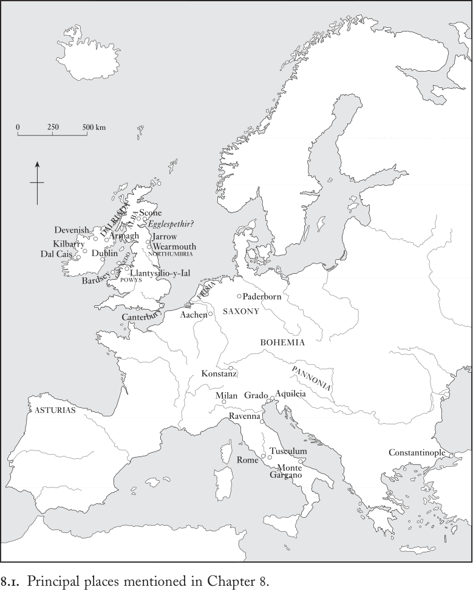
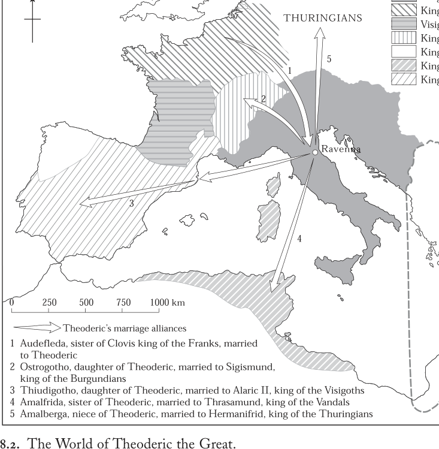
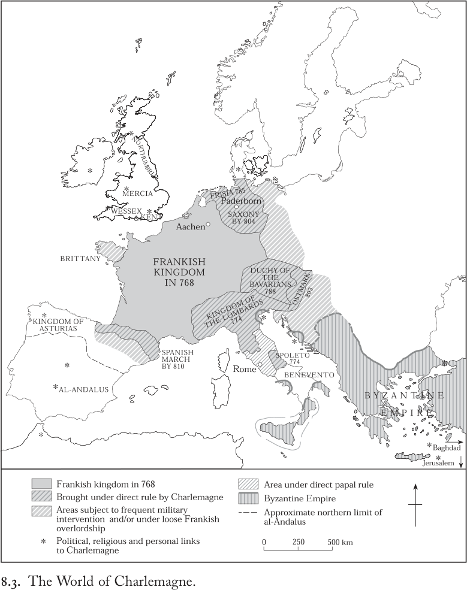
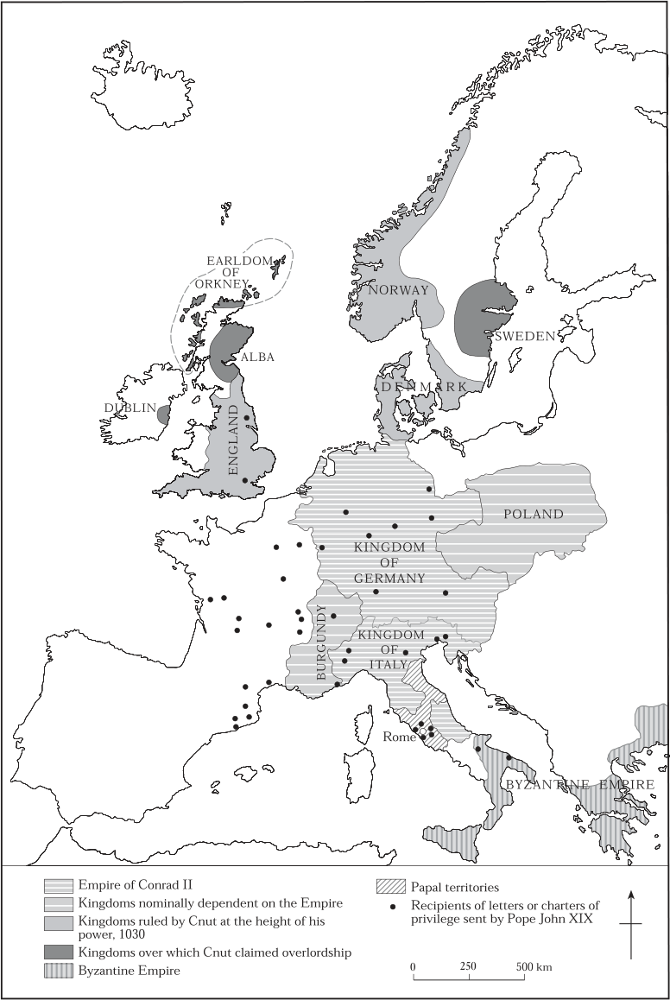
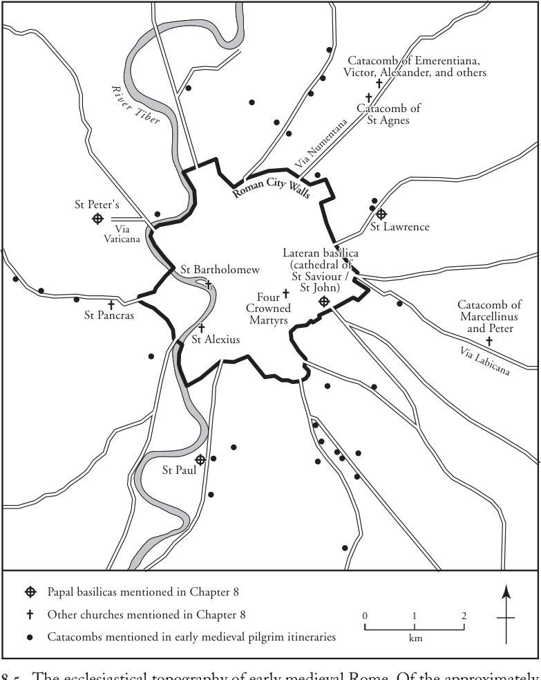
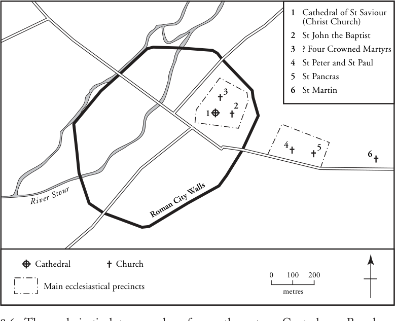
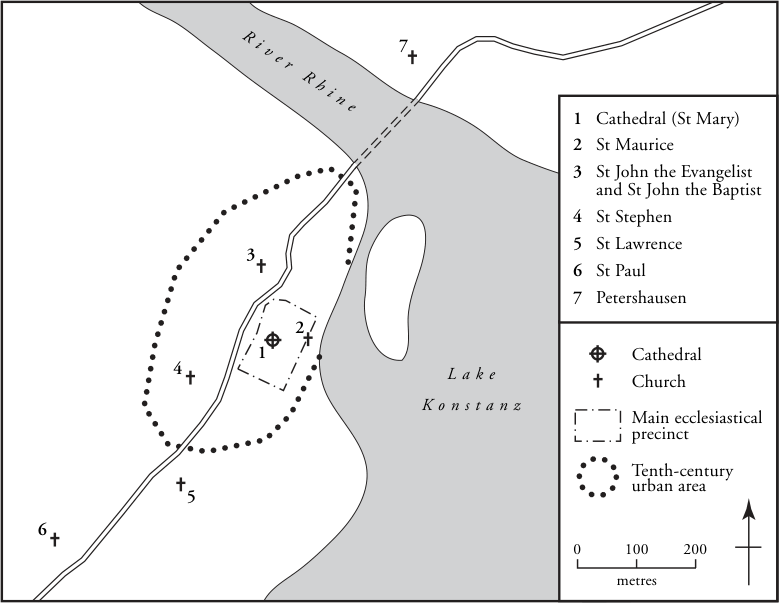
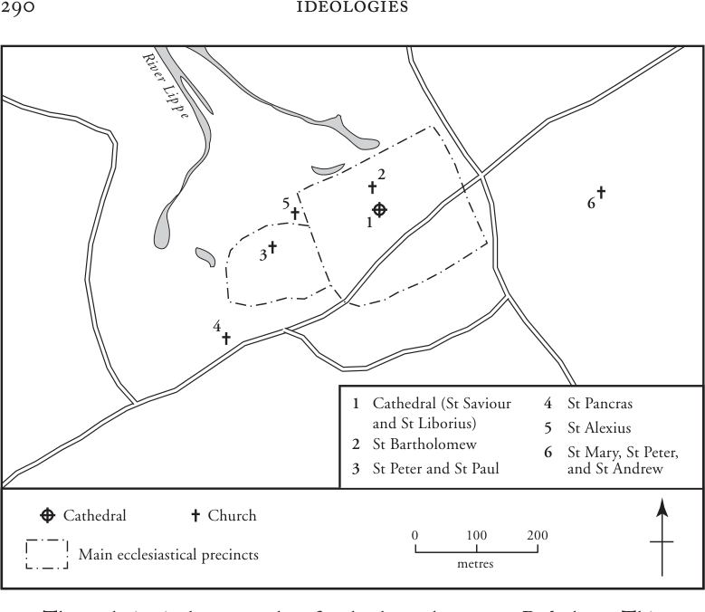

# 第8章 · 罗马与欧洲诸民族

那片……浩瀚的大海在其北极海域中……有一座名为斯堪扎的大岛，我的叙述（蒙上帝恩典）便将从那里发端……据说，哥特人很久以前便在他们的国王率领下，从这座斯堪扎岛出发——它犹如民族的工场，诸族的母腹。^1

那位曾经热衷于征战的国王，心中生出了远行的渴望，手持朝圣者的手杖。这位为皇帝所亲爱、为彼得之友的主教，收获了罗马荣耀的一份。^2

很少有慷慨的君王会如此以双足丈量南下之路。^2

罗马帝国的中心是“大海”（Great Sea），帝国的行省绵延于其阳光普照的沿岸。罗马地理学家正是以这一地中海的视角来组织他们关于世界的知识：mare nostrum——“我们的海”——将大陆划分为三大洲：欧罗巴、亚细亚和阿非利加。环绕整个世界流淌的是大洋（Ocean），那是潮汐的环带，“如花环般环绕着大陆的海岸”。^3 在欧罗巴最遥远的边缘，大洋中散布着岛屿，罗马人仅熟悉其中一些：不列颠，他们曾加以统治；爱尔兰，他们偶有造访；奥克尼群岛，他们仅凭传闻而知。在这些岛屿之外，“与其他岛屿相隔一段无法确定的距离……几乎无人知晓”，坐落着图勒——那座夏日有午夜之日、冬夜长达整整六个月的岛屿，那里海水幽暗而冰封。^4 人们还相信，大洋在其北极海域中包含着“名为斯堪扎的大岛”，亦称“斯卡迪纳维亚”。这里便是世界最遥远的边缘。

从罗马到斯堪的纳维亚，是一段遥远的想象之旅。在古代，罗马的民族志学者用“想象的共同体”填满了帝国边疆以外的空间，这些共同体之名号、数目、形貌

以及他们在有限的知识和大量刻板印象的基础上详细描述的道德特征。那些生活在帝国边境之外的人们留下了丰富的考古证据，证明其存在，包括其特有的聚落形式、随葬品墓葬以及精英财富和武器的窖藏，然而我们无法有把握地利用这类物质遗存来推断他们的政治组织，更遑论他们的自我认知了。^5 由于这些社群没有任何文献记录留存——他们仅偶尔使用如尼文字或欧甘文字——历史学家只能通过罗马评论家的诠释来接触他们：塑造边境之外生活的精神状态和社会认同实际上仍不为人知。

无论这些民族各自不可复原的个性如何，罗马人都将其归为“蛮族”，仅区分定居而无文化的与游牧而完全异质的。正如有人所强调的，“蛮族”扮演着一种重要的文化角色：他们集中体现了罗马生活方式及其更为“文明”的价值观之有益影响的缺失。^6 然而这些群体的意义远超根深蒂固的偏见所塑造的本质化“他者”，因为他们在帝国政治中也占据着关键（尽管矛盾）的位置。他们的不安分既是西部行省军事机器持续存在的存在理由，而他们的人力又是罗马军队补充兵员的关键。而当五世纪时其中一些军队越过边境并最终建立新的王国时，那个在地中海的想象中人们在漫长冬季里除了生育别无所事的无限遥远的斯堪扎，便呈现出“民族之子宫”的面貌。于是，六世纪的作家们将五世纪间使西部罗马帝国行省转变为由各自统治者统治的独立王国的民族迁徙、战争和政治动荡的第一因，定位于此地。

罗马与斯堪的纳维亚构成了本章的地理参照框架。其概念维度则由两个转变来体现。第一个转变涉及斯堪的纳维亚——晚期罗马民族志想象中的“民族之子宫”，自十世纪晚期起基督教王国在那里迅速发展。十世纪初的局势颇具象征意义：从斯堪的纳维亚到罗马之路对国王克努特而言是一段真实的旅程，他是丹麦人首位基督教国王之孙；正是这位国王被诗人西格瓦特描述为1027年“以双足丈量南行之路”的王。到他朝圣之时，欧洲文化与政体的地缘政治版图已呈现出此后数世纪内不会发生根本改变的形态。随着拉丁基督教的传播，基于族群组合的王国的发展以及新帝国霸权的兴起，已将欧洲的政治版图重新组织，以致旧的想象框架完全失效。斯堪的纳维亚曾是未知的边缘地带，如今已以与其他地区大致相同的条件被纳入拉丁基督教世界的政治共同体之中。

罗马本身也已发生转变。尽管自帝国鼎盛时期约五十万人口的规模以来已大为缩减，克努特所造访的这座城市的人口仍远多于拉丁基督教世界的任何其他城市。与众多访客和朝圣者一样，克努特会在昔日住宅区的遗址上、在园圃与葡萄园之间，遇到一片片密集的定居点。在前往圣所与教堂（其中许多已历史悠久、备受尊崇）的途中，他也会经过帝国往昔那些崩塌殆尽、瓦砾堆积的纪念建筑。因为罗马在中世纪早期经历了深刻的变化。约公元500年时，尽管已不再是帝国的行政首都，罗马仍保有古老的威望，并继续是元老院的所在地——元老院自最古老的时代起便参与治理作为城市、王国、共和国和帝国的罗马。这座城市仍是古老家族贵族政治生活的舞台，他们赞颂它是“雄辩的丰饶之母，一切美德的宏大殿堂，不能被称作异邦的那座城市”，^7 同时它又是教皇的驻地和拉丁基督教世界最神圣的圣所之所在。教会的存在对五、六世纪罗马的政治和物质面貌施加了稳步增长的影响，以致到八世纪后期，它已成为一座教皇教会的城市。然而到克努特造访之时，就政治而言它已是一座边缘城市，是北方诸政权在南方的前哨，夹在与南意大利拜占庭人之间动荡不安的边境上，仅偶尔迎来权力根基远在阿尔卑斯山以北的皇帝。元老院治理的辉煌传统早已让位于通过教皇官僚机构行使控制的统治精英。在十世纪末和十一世纪初，融合教会与世俗利益的利益集团，在以贵族派系斗争、民众骚乱和偶尔的帝国干预为特征的城市政治中豪赌下注。

即便如此，罗马对基督教欧洲全体居民想象力的支配早已确凿无疑。北方作家继续做着梦想，尘世的现实从不打断他们对“诸城女王”^8 的理想化图景。“受法兰克人、忠实的基督徒和皇帝们称颂于三界之间”，它稳居“诸王之母、意大利人之荣耀”^9、“殉道者之母、使徒之居所”^10、“世界之都……众教会之母”^11 的声望。到第二个基督教千禧年之初，罗马已成为欧洲卓越的“想象的共同体”——地理上处于边缘，象征上居于中心；是一个强大的观念，却是一场破败的城市体验。罗马作为历史上政治权力之 seat 与当代基督教圣地的双重角色，表达了同一过去的两个不同侧面。

在斯堪的纳维亚与罗马这两个极点之间，本章将阐述整个中世纪早期政治、宗教和文化认同如何形成与重构。本章拒绝将约500年至约1000年这一时期主要视为后来时代诸事件之奠基的观点，摒弃“民族起源”和“教皇制兴起”之类的叙事。它也拒绝以“蛮族入侵”或“帝国理想”这类以罗马为中心的规范性评价来书写中世纪早期的历史。相反，本章的核心是对罗马作为城市实在之角色的探讨——它拥有如此丰富的政治、文化和宗教过去，以致对直接或间接接触它的所有人的想象力施加了强大的控制。每一节呈现这一中心主题的不同侧面；每一节都以一次前往或离开罗马的旅程开篇。第一节论证中世纪早期发展起来的基于族群的王国绝非原始之物，这些政治认同与基于亲缘、性别或宗教的认同一样，都是特定文化配置和历史时刻的产物。本节特别关注罗马和基督教文学对那些解释并传播中世纪早期族群认同的起源神话所做的贡献。第二节从王国转向帝国——既作为概念，也作为政体。通过追问帝国如何建立并获得合法性，本节评估“罗马性”在何种程度上是一种塑造中世纪早期政治秩序的政治意识形态。在此语境下，本节还考察罗马作为帝国首都之角色的转变。造访这座城市的访客构成最后一节的线索。他们的经历将帝国礼仪置于具体情境之中，也让基督教的罗马成为焦点。本章最后将城市访客所体验的罗马与基督教欧洲许多地方所再造的罗马之召唤并置对照，论证这座城市的基督教认同构成了中世纪早期文化表达中反复出现的主题。由此可以见出，罗马帝国的政治与文化遗产以多种方式构成了对罗马之后欧洲特有的各种特殊主义和地方认同的一种平衡力量。

## 罗马，公元500年

公元500年，一位哥特战士国王造访了罗马。自493年起便毫无争议地统治着意大利的东哥特王狄奥多里克，将其军事宫廷设于拉文纳——前帝国军队的总部，且自408年起作为罗马的辅助首都。五世纪的罗马仍是一座平民城市，其守护者仍是元老院贵族阶层的成员。然而到五世纪末，他们对城市政治和庇护权的传统支配日益面临教皇官员以及城内众多基督教教堂不断增长的财富的挑战，其中最重要的一座教堂安放着使徒之首圣彼得的陵墓。因此500年，狄奥多里克首先前往位于古城台伯河对岸的圣彼得大教堂以表达他的敬意：在那里，“教皇西玛库斯与罗马全体元老和民众欢欣鼓舞地出城迎接他”。此后他才进入城市本身，在元老院发表演说，并“承诺在上帝的帮助下，他将不可侵犯地维护历代罗马皇帝所颁布的一切”。随后，他以传统的皇帝方式，举行凯旋式穿城巡行至宫殿，为民众举办竞技赛会，分发食物，并拨款修缮城墙。^12

狄奥多里克深谙操控罗马统治惯例之道，他原本是一个边境军阀，其性格形成的青少年岁月是在君士坦丁堡的帝国宫廷中作为人质度过的。他可能生于451年，其母或许可以设想是罗马人，其哥特父亲当时统领着定居于帝国潘诺尼亚土地上的一支哥特军队的一部分；狄奥多里克逝于526年，去世时堪称实质上的西罗马皇帝（见图8.2）。489年，他率领追随者从巴尔干进入意大利，这支队伍由出自不同族群战团的成员构成，但在他的强力领导下，迅速获得了作为“哥特人”的连贯的群体认同。应拜占庭皇帝芝诺（474–491年在位）之请，他从自476年西罗马幼帝罗慕路斯·奥古斯都路斯被废黜以来一直支配半岛的军阀奥多亚克手中夺取了意大利的控制权。芝诺的继任者阿纳斯塔修斯随后承认狄奥多里克为意大利的合法统治者；这位哥特人也始终谨慎地对阿纳斯塔修斯以皇帝之礼相待。治理罗马人与“哥特人”——原住民与来自各种背景的外来者——的混合人口，狄奥多里克赢得了强力统治者的声誉，在其在位的大部分时间里，他在旧元老院精英敏感的自尊与自己麾下军事暴发户扈从之间维持着审慎的平衡。在他的统治下，拉文纳宫廷远比末代皇帝时期更为稳定、恢宏并受人敬重，而在罗马，元老院则享有其影响与学术的晚秋余晖。尽管狄奥多里克信奉阿里乌派基督教，教皇也从哥特人与元老的融洽关系中获益。同时代人的评价是明确的：

“一位极为好战而强悍之人……事事出众、心怀善意，他在位三十三年。在他的时代，意大利享受了三十年的太平

……福运与昌盛，使从事各业的人们得享太平，他行事无一处不当。就这样，他将两个民族合而为一地加以统治，即罗马人与哥特人；他虽属阿里乌派，却从未对天主教徒有任何加害之举，以致罗马人称他为另一位图拉真或瓦伦提尼安，而哥特人……则认定他是一位万事全能的最强大君王。^13

在整个西地中海周边，其他军事首领也在五世纪中后期凭借其军事才能攫取了制度性的权威，成为国王；他们既受益于罗马行政与法律传统的持久活力，也受益于其武装追随者的有效战斗力。在这样的情势下，罗马人与非罗马人之间的区分，即便在意识形态或言辞上仍被坚持，在实践中也必然变得模糊。从更长远的视角看，狄奥多里克或许算不上最成功者，但他的统治无疑是这些六世纪王国中文献记载最完备的。在诸统治者争夺土地、影响与声誉的无休止竞争中，他通过军事才能、无情政治与王朝联姻——包括与赫尔米纳弗里德和阿拉里克二世的联姻——的精明组合，确立了自己的卓越地位。

因此，无论在内政还是外务上，狄奥多里克都复现了传统的权力话语，并成功地将自己嵌入帝国的势力网络之中。然而，从六世纪中叶君士坦丁堡的东帝国宫廷视角来看，半个多世纪前快速变幻的西方政治渐渐被视作完全不同的东西：旧秩序的终结。在事后回顾之下，针对罗慕路斯·奥古斯都路斯的政变成了一道分水岭，狄奥多里克统治末期的一位君士坦丁堡宫廷官员即如此强调。“随着这位奥古斯都路斯之死，罗马人民的西帝国灭亡了；这座城建成后七百零九年，第一位奥古斯都屋大维开始统治它。此事发生于已故诸帝王之国的第五百二十二年，此后哥特诸王据有罗马。”^14 总之，狄奥多里克的一生横跨了四分之三个世纪的巨大而不可逆转的政治变迁：他公元500年对罗马城的造访，正是一个便于审视罗马与欧洲诸民族之间互动变迁的绝佳视点。

要做到这一点，就必须既考察政治形态与集体族群认同之间的关系，也同样重要的是考察中世纪早期对这一关系的认知。从十九、二十世纪欧洲的政治与激情的视角来看，这一关系成了高度敏感的问题；但必须明确的是，政治体与族性之间的概念区分在中世纪早期的思想中并不存在，文化建构的族性与生物学决定的种族之间的现代二分法同样不存在。恰当的做法是从政治词汇入手。首先，罗马的与犹太—基督教的政治组织观念都把整个世界视为由众多民族构成。从罗马人的视角看，其中一些民族已被纳入其自称普世统治的帝国；而在圣经传统中，所有民族共同源自神话中的始祖诺亚诸子——尽管唯有承认犹太—基督教之神者才可自称“上帝的子民”。其次，拉丁语及中世纪早期各种地方语言的核心词汇中，有一些词不加区分地表示其成员共有以下一项或多项特征的群体：推定的共同始祖、共同的文化属性、组成单一政治体。这些词可译作“民族/人民”，包括拉丁语的gens、genus、natio、plebs；日耳曼语族的folk（古高地德语）、iuda（哥特语）、eod（古英语）；凯尔特语族的tuath、cenél（古爱尔兰语）、tud（古威尔士语）。普吕姆的雷吉诺在906年至913年间写作时，延续了一个千年之久的传统，并概括了这套词汇所蕴含的假设：“各民族相互区别的依据是世系、风俗、语言和法律。”^15 这种对常识的常规性重申凸显出：古代与中世纪早期思想中，对以（真实或虚构的）生物世系确定成员资格的群体，与以共享的行为特征、名称、政治认同或信仰等社会构成要素界定的群体，二者之间并无任何区分。这些词汇也都没有指明中世纪早期欧洲各民族的规模、内部组织或文化特征。必须着重指出：现代政治与文化术语中的种种细微差别，在中世纪早期的视角下将毫无意义。

尽管如此，前面各章已暗示了评判中世纪早期何谓一个民族所涉及的某些问题。在雷吉诺的族群认同判据中，第一章考察了语言，第三、四章讨论了法律与“风俗”：虽然语言共同体和/或法律共同体有时与族群大致重合，但多数情况下并不如此。同样重要的是第三章的论证：世系组织起了带有性别色彩 power 主张，首先是国王们的主张，而如第七章所示，这些主张往往带有宇宙论的意味。世系无论多么虚构，就这样作为一种有说服力的隐喻，在男性统治精英中运作，用以说明权力与地位的合法传承；同样道理，它也为解释整个民族的认同提供了神话上的说服力。至于女性，她们作为家族与文化再生产之媒介的角色通常隐而不显，但我们将看到，世系神话偶尔也会将其明示出来。

中世纪早期史料为欧洲的许多——实际上是大多数——民族记述了起源神话。这类故事将一个民族的原始故乡、最终定居地与统治王朝的世系连结起来；也可能解释关键的社会与道德属性，如发式、兵器、高贵或勇敢。有些神话出自其所叙述的族群自身成员之笔：在回答“我们是谁”这一问题时，它们为承认集体认同和为领导权提供合法性提供了载体。另一些则提供了外人的视角，或强调差异性，或寻求对中世纪早期多族群现实的图式化解释。无论其视角是内部的还是外部的，这些神话都通过差异来宣示认同，并操纵过去以服务于现在。通过援引一个通常更多是想像而非真实的过去来解释现在，它们为将权威限定于特定家族的做法辩护，并以自然、原始的隐喻外衣掩盖政治生活的流变。

不可避免的是，我们只有在这些神话被付诸文字之后才得以知晓。它们或许包含前文字时代的传统成分——无论这些故事是武士们在营火旁讲述，是母亲讲给孩子，还是宫廷诗人作为娱乐领主的作品——但流传至今的这一文类，是上一章所述基督教与欧洲诸民族长期相遇过程的产物。由于基督教是罗马世界文学文化传播的主要载体，教会是其保存的主要机构，这些神话的形式与内容容易受到圣经与古典起源故事的影响。^16 例如，七、八、九世纪的作家常把法兰克人描绘为特洛伊人的后裔。根据罗马自身的起源神话，如公元前一世纪史诗诗人维吉尔所述，特洛伊英雄埃涅阿斯来到拉丁人的土地上，其继承者在那里建立了罗马。维吉尔这个广受欢迎的神话将罗马史纳入古特洛伊史之中，从而邀请法兰克读者通过共同的特洛伊起源来宣称与罗马人地位相当。相比之下，爱尔兰的神话编纂者则强调，盖尔语的发明者、爱尔兰人菲尼的得名始祖菲尼乌斯·法尔赛德，享有源自诺亚之孙、雅弗之子玛各的圣经世系。^17

这一宽泛的文化模板——由人们熟悉的圣经与古典范式构成，有时掺有难以估量的口头传统成分——被应用于极为广泛的场景。考察欧洲各民族的起源传说，最好从远超先前帝国边界之处起步，然后逐渐移近罗马本身。在西北欧大西洋边缘的盖尔语世界里，爱尔兰人清楚地知道，其语言、法律与文化上的一致性，恰与他们分裂为相互竞争的诸王国这一现实互为补充；五、六世纪时这种王国大概超过一百个，到十世纪时具有政治重要性的已不足十余个。他们认为，在世系层面上把每个王国认定为一个基于世系的群体（如科尔库·洛伊格德），同时又表达爱尔兰人作为一个族群的共同特征，二者之间并无张力。爱尔兰学者通过积累起一套令人惊叹的神话体系而做到了这一点：他们将数百个真实与传说中的爱尔兰统治王朝纳入一个源自圣经的历史框架。在此过程中，他们为爱尔兰人在普遍史中确保了一个位置，并赋予他们一个可与世界上所有其他民族相比拟的已知起源。

这项始于七世纪、对输入爱尔兰教会图书馆的拉丁文本的学术性运用，到十一世纪时终于发展成一个广泛流传的起源神话。这是一段英雄祖先历经非洲、亚洲与欧洲辗转迁徙、最终定居于原本无人居住的爱尔兰岛的连续迁徙故事。其采用的方法有三：叙事、纪年与谱系词源学。取自《旧约》的叙事原型提供了文学脚手架；推算技术使之与四世纪基督教编年史家构造的世界史轮廓相吻合；看似合理的词源学则为始祖命名，菲尼乌斯·法尔赛德即是一例。

至九世纪初，爱尔兰起源神话的所有主要元素均已成形，并在爱尔兰及其他地方以各种体裁和不同细节广泛流传。以下是其中一部分传入不列颠听众时的形态：

“当以色列的子孙渡过红海时，埃及人前来追赶，被淹没，如《律法》所载［即《旧约》，见《出埃及记》14:21–31］。埃及人中有位西徐亚贵族，随从众多，因被逐出自己的王国而在场；埃及人被淹时，他并未参与追赶上帝的子民。幸存者商议将他驱逐，以免他攻击并占据他们的王国，因为他们的力量已淹没于红海之中。他被逐后，在非洲漂泊了四十二年，其后抵达非利士人的祭坛……［以及许多其他有名有姓之地］，他们的人口极为繁盛。在他们到达西班牙之后，即埃及人淹毙于红海之后的第一千零二年，他们来到了达尔里亚达之地，其时布鲁图斯正统治罗马人。”^18

鉴于欧亚草原的西徐亚人是希腊—罗马民族志中（真实的与想象中的）高贵野蛮人的原型，而布鲁图斯是传说中罗马共和国的第一位执政官与建城者，这个故事巧妙地将爱尔兰人同时嵌入了罗马史与圣经史。当别出心裁的词源学为这位无名西徐亚贵族配置了一位妻子——“埃及王法老之女斯科塔”——这一联系更加牢固：她明确地成为斯科提人的得名始祖，从而成为全体爱尔兰人的原初之母。^19 经扩展以纳入斯科塔与西徐亚人的联姻之后，这一起源神话在爱尔兰与不列颠北部共有的盖尔文化区内获得了其定形。而在不列颠北部，当盖尔人的阿尔巴王国演变为中世纪盛期的苏格兰人王国时，古老的神话为这个多族群、多语言王国的统治者们很好地效劳，提供了无可挑剔的世系合法性。的确，1249年年幼的国王亚历山大三世在斯昆加冕为苏格兰人之王时，人们完整宣诵了他的谱系——一直追溯到法老之女斯科塔。

与爱尔兰人一样，不列颠人既对自身历史与族群认同有强烈意识，又面对着分裂为离散且常相竞争的诸王国这一现实。但与爱尔兰人不同，他们无需发明与罗马过去的联系。在传说中的布鲁图斯身上，他们找到了显而易见的得名始祖；经由布鲁图斯（或有时被称作布里托），他们轻而易举地宣称自己是特洛伊人的后裔。此外，不列颠罗马统治时代的历史人物也演变为早期威尔士王朝的传奇祖先，其中最突出的是四世纪晚期的将领、篡位未遂者马格努斯·马克西穆斯（卒于388年）。迁徙、入侵与定居为不列颠族群起源神话的发展提供了政治背景，但在这个背景中不列颠人是受害者而非胜利者。面对南部与东部不列颠的霸权沦于围绕日耳曼语精英聚合而成的六世纪诸王国，不列颠人自称岛上原住民与正当居民的主张，既为他们提供了族群起源，也为他们预言可恨的入侵者终将被驱逐提供了依据。

威尔士兰蒂西利奥-伊阿尔一处引人注目的纪念碑表明了不列颠起源神话、基于血统的王权与领土主张合法化三者之间的不可分割。波伊斯国王Cyngen（卒于854年）竖立了一根2.4米高的刻铭石柱，以纪念他的曾祖父Eliseg——后者曾从英格兰人手中夺回波伊斯诸王的祖传产业。Cyngen以列举自己四代世系开篇，颂扬Eliseg的功绩，并阐明其显赫的（尽管带有传说色彩）家世。这把历史人物的名字转化为统治者的祖先，使Eliseg的地位（并暗示Cyngen的地位）不仅因出自Britu、还因出自“杀死罗马人之王的马克西姆斯（Maximus）”而获得合法化。^20 在此我们可以清楚地看到，波伊斯特定王朝目的如何挪用一个共同的不列颠传说，其方式与爱尔兰各个王国将自身与共同的族源故事相联系如出一辙。

以上对中世纪早期出现于爱尔兰和不列颠的起源传说的讨论，强调了罗马历史与基督教拉丁文本作为文化瓦砾的重要意义——即便在前帝国统治的边缘地带或其之外，人们也能从这些瓦砾中建起截然不同的大厦。这一讨论还引人注意到迁徙与定居这一主题，它们构成起源神话的背景或内容——或兼而有之。当我们从大西洋欧洲的凯尔特语区转向日耳曼语各族群时，会发现这两个方面的不同变体；这些族群是在四、五世纪莱茵河—多瑙河边境地带的军事压力与文化渗透之中兴起的。

在那样的环境中，与罗马帝国的军队和制度的长期接触促成了此类故事的形成——这尤其是因为，在战争、迁徙、定居与通婚过程中族群的不断形成与重组所造成的失稳效应，强化了宣示集体认同的必要性。这种不稳定性在五世纪和六世纪初尤为突出。此后——从七世纪起——起源神话在变化了的形势下发展。在某些情形中，它们为成功的王国提供了意识形态黏合剂；这些王国的人口实际上始终是罗马人与各种非罗马因素的混合体，但其政治认同却逐渐取自其统治王朝的族群自我认知。显著的例子不仅包括法兰克王国；还包括不列颠东南部盎格鲁人、撒克逊人和朱特人的诸王国；伦巴德人的王国——他们于568年确立了意大利半岛中北部的统治权；以及五、六世纪间在阿拉里克王朝领导下兴起、后来获得“西哥特”之称的伊比利亚王国，以此区别于狄奥德里克（Theoderic）统治下的意大利的哥特人。在另一些情形中，有说服力的日耳曼起源传说之形成或铺陈是政治失败而非成功的产物，是对那些文化认同在其作为独立政体消亡之后仍然延续的民族的回顾：勃艮第人即是显著例子，其罗讷河谷王国于534年被法兰克人征服。同样地，伦巴德起源神话恰好在774年法兰克人消灭伦巴德王国之后不久达到其文学巅峰。这两个例子也表明，法兰克人的政治霸权直接或间接地涉及操纵被吸纳进其极具扩张性的成功政体中的各民族的族群认同。

唯一不符合这两种模式的王国是狄奥德里克的王国。在五、六、七世纪的诸王中，唯独他积极鼓励形成一种族群神话，宣称他因出自哥特人的建国始祖而享有哥特王位的权利。作为意识形态的谱系学体现在他为子女所起的名字上，即那些假定的祖先英雄之名。他甚至委托学识渊博的、曾担任财务官和近卫大区长官等宫廷高职的罗马元老卡西奥多鲁斯（Cassiodorus）撰写一部十二卷的哥特人历史；此书不幸已佚，但众所周知，它赋予这个新兴民族一部古老的历史，并炫耀狄奥德里克那据称源远流长的家世。至于这位国王为何如此执意为自身及其王朝塑造一个无懈可击的哥特认同，我们只能猜测：或许是暴发户的不安；或许是将他那派系纷杂、成分各异的扈从武队熔铸成一个更有秩序的整体这一政治上的优先考量；或许是作为新来者统治罗马帝国故地所面临的挑战——在那里，“罗马性”看上去必定远比其实际情形更为不言自明和浑然一体。

这种哥特认同在狄奥德里克宫廷圈子之外赢得了多少接受，仍无从评估。但可以肯定的是，当536年其王朝覆灭、十六年后其王国在拜占庭为重新征服意大利半岛而发动的漫长而具有破坏性的战役的致命打击下崩溃时，这种认同的神话建构并未停止。君士坦丁堡有一位本人具有哥特血统的官员，在阅读了卡西奥多鲁斯的《哥特史》之后，以撰写自己关于哥特人“起源与事迹”的记述来标记拜占庭在意大利统治的恢复。约达尼斯（Jordanes）以其环绕三个已知大陆的大洋开篇，因为“同一片浩瀚之海在其北极区域，即北方，有一座名为斯堪德扎（Scandza）的大岛，从那里起，”他宣称，“蒙上帝恩典，我的叙述将开始”。从斯堪德扎，“如同从民族之工厂或诸族之母腹，据说哥特人很久以前在其名为贝里格（Berig）的国王带领下走出……直到今天那地方据说仍被称为哥提斯坎德扎（Gothiscandza）。”^21 约达尼斯声称，比起他所听到的哥特人的“老妪之谈”，他更偏爱古代民族志和自该城神话般的特洛伊起源开始的罗马史的丰富（尽管互相矛盾）传统，^22 他将哥特人等同于斯基泰人，并提及他们出自玛各（Magog）后裔的理论，从而将哥特人纳入罗马史与圣经史的地理与年代框架之中。他赋予哥特人辉煌的过去：这段过去始于从斯堪德扎原始起点出发的迁徙，历经在多瑙河口与亚洲边界之间广阔地带的漂泊与磨难，继而与匈人和罗马人相遇交战，最终以狄奥德里克从巴尔干凯旋进军征服意大利而告终。这是一个充满传奇国王之名的过去——这些名字正是狄奥德里克自己子女所拥有的——也是充满祖先的过去——“如此英雄，连满怀敬意的古人也几乎不敢自诩拥有”——关于其功绩，“在太古之时，他们[哥特人]便以歌谣吟唱”。^23

如同狄奥德里克的王国一样，约达尼斯的记述是其自身时代与地域的产物。由于狄奥多里克及其直系继承人均已故去，其王国也已复归帝国直接统治，这部作品是在意大利建立可行的哥特王国失败之后的产物。尽管叙述绵密、轶事详尽，约达尼斯对过去的构想发挥着一切起源故事都具备的功能：将当下的政治秩序投射到遥远的过去；而其成效之大，竟使一代又一代读者为其对哥特起源的动人解释所倾倒。此外，它迅速赢得如此广泛的流行，以致成为此后若干其他民族起源故事的范本，例如伦巴德人——他们也在斯堪德扎获得了一处神话故乡。尽管写作的政治语境迥异，约达尼斯与那些匿名的爱尔兰神话作者在目的、叙事布局、口头传统与文献史料的平衡乃至其故事所赖以编织的某些名字上，都有诸多共同之处。同爱尔兰神话作者的作品一样，他的著作在后世也被用于截然不同的目的。然而，他——以及他们——的伟大成就在于表明：族群史与罗马史无法剥离，其一以另一为前提。没有罗马——没有罗马的文学、传说和基督教信仰——六世纪欧洲的各族人民便没有过去，没有现在——也没有未来。

## 帕德博恩，公元799年

799年夏，教皇利奥三世（Leo III，795–816年在位）北上前往萨克森的帕德博恩拜访查理曼。不久之后，一位技艺高超的诗人构想了两人的会面。他以拉丁文写作，首先介绍查理曼，“欧罗巴的灯塔”：

查理，强大的武士、仁慈的胜利者、凯旋的君王，
在善德上超越世间所有君王，
比他们所有人都更为公正、更为强大。
……
查理王，世界之首脑，其人民之所爱与荣饰，
欧罗巴可敬的顶峰，至善之父，英雄，
在座新城中威严之主，那里第二罗马方绽新花，
以其巍峨城墙拔地而起，直上高天，
以高耸穹顶触摸星辰。
^24 随后，在生动叙述利奥此行的情形之后，诗人将听众的注意力重新引向正在等候旅途劳顿的利奥的查理曼。头戴金盔的法兰克国王跨坐战马之上，高踞众人之上，其军队各单位列成圆阵，举行盛大的阅兵式。毗邻的唱诗班祭司身着长袍，高举带有最基督教的象征——十字架——的旗帜。当利奥走近时，“他对来自世界各地的各个民族在习俗、语言、服饰和装备上的多样感到惊叹”。此时已下马的统治者和教皇相会：“欧洲之父国王”与“世界的首席牧者利奥”相互拥抱。^25

这部所谓的《帕德博恩史诗》刻意使用古典化的表达和丰富的古代帝国意象词汇，以将查理曼表现为基督教的世界统治者——一位统治如此众多民族的君王，以至于其统治等同于对欧洲的统治。这位君主权势如此显赫，以致查理曼新建的威仪宫殿建筑群亚琛已成为“第二罗马”。唯有借助这种帝国式的类比，才能准确表述其地位。这首诗对法兰克国王与罗马教皇之间帕德博恩“峰会”的诗意描绘，由此提醒我们注意：罗马的帝国过去作为早期中世纪政治理念与态度的一个要素而被挪用。它为我们展开两个主题供考察：早期中世纪在权力表述中的“帝国”话语，以及作为帝国之都的罗马城。

为将这些宽泛的主题置于语境之中，我们应当花时间考察799年国王与教皇各自的处境，以确立为何利奥的帕德博恩之行构成如此有用的切入点。我们从八世纪末的罗马城和教皇长途跋涉的情势说起。利奥身后留下的是一座人口已远低于狄奥德里克时代、或许仅余约两万五千人的城市，但它仍然明显地具有世界主义的色彩。其常住人口除本地罗马后裔的家族外，还包括源自希腊、叙利亚和西西里的家族。人口还因流动的朝圣者——盎格鲁-撒克逊人、爱尔兰人、弗里西亚人、法兰克人、希腊人——以及商人——包括阿拉伯人、威尼斯人和南意大利人——而增加。

此时，罗马正在发展为一个颇具规模的工匠与商贸中心：陶器和金属制品的生产已有相当数量，东方货物——纺织品、香料、贵金属——似乎被用来交换奴隶。可以肯定，到八世纪末，已有充足资金可用于大规模翻修日渐倾颓的城市建筑。利奥三世效法其前任哈德良一世（Hadrian I），积极修复城中古迹，修葺古老教堂并督建新教堂。他对新旧教堂的慷慨捐建使他跻身罗马伟大营造者之列；他委托兴建的规模空前宏大的教皇宫殿居所亦然。然而，利奥毕竟是从一座动荡不安的城市出逃的：就在当年早些时候，他在一次穿行城内街道的大型宗教游行中遭到人身攻击。这次攻击似乎伴随着正式废黜他的行动以及对严重失德行为的指控，但未能造成那将使其丧失任职资格的可怖而不可逆的毁伤。教皇之位正迅速成为罗马贵族派系野心的目标——这是一种典型的罗马式政治。对利奥而言，离城前往帕德博恩进行四至五个月的往返旅行，意味着其地位要冒更大的风险。

帕德博恩同样是一处建筑工地，尽管性质截然不同。自772年以来，查理曼不断对法兰克人的北方邻族萨克森人发动军事征讨；伴随其残酷征服而来的强迫皈依基督教，前文已有述及。^26 这座于776年在战略要地建立、作为在萨克森进行军事与传教事业基地的新城urbs Karoli——“查理之城”——已两次毁于萨克森人之手：799年，一座“规模惊人”的新教堂落成，王宫也得以重建，比先前更为宏大。^27 凭借坚固的防御工事、石砌建筑、彩色玻璃、壁画墙面、高架露台和进口的豪华餐具，这座教堂与宫殿建筑群对萨克森人新统治者和新宗教的威力作出了毫不含糊的宣示。

而他确实威力强大（见图8.3）。到799年，查理曼已克服法兰克人内部对其统治的一切反对，成功地将世俗与教俗精英的忠诚和资源收归己用。他已将迅速定型的基督教王权理想纳为己有。

自己的领土，并如第七章所述，从中制定了一份“正确基督教”的纲领，敦促全体臣民遵行。他赞助学者——如盎格鲁-撒克逊人阿尔昆、西哥特人特奥杜尔夫、伦巴德人执事保罗，以及《帕德博恩史诗》的无名作者——既是为其对建设基督教王国的贡献，更是为了增添自己更大的声望。四面八方的使节和流亡者纷纷前来投靠，进一步扩展了他的影响力和声誉。他那庞大的军事与文化帝国主义工程，以其地理范围、经济投入和人命代价而著称——也由此为他赢得了威望。但在利奥到访之时，旷日持久的萨克森人抵抗仍在严重挑战着查理曼的野心；而且，正如查理曼的传记作者艾因哈德后来所说：“法兰克人进行的战争中，从没有哪一场比这场更漫长、更艰苦、更可怕。”^28 799年帕德博恩的重建，象征着国王面对“萨克森人的背信弃义”所表现的“精神之伟大与坚定决心”。^29

对萨克森的征服直到804年才告完成，其特别之处只在于它的残酷与持久。法兰克统治的强制推行，标志着萨克森人政治组织与族群认同发展的新阶段，使萨克森的境况与查理曼庞大帝国其他地区相似。凡查理曼及其贵族扩展统治之处，旧的族群认同或者被重新塑造，或者催生出新的认同。法兰克的统治当然没有消灭其他族群——远非如此。如果有什么效果的话，反而是强化了它们，尽管是以日益将特定民族与特定地区和特定法律传统相联系的方式。因此，加洛林统治促成了以地域为界的族群的产生，每个族群都有以法律形式编纂的自身惯例。至于法兰克人本身，其族群认同的表达方式极为流动，却又在政治上极具说服力，以致它发挥着一种“超级族群性”的功能，与被纳入其轨道的各民族是互补而非对立的关系。当《帕德博恩史诗》的诗人（词句借自维吉尔）借利奥之口表达对构成查理曼军队的众多不同民族的惊叹时，他不过是在言说这种使法兰克政体如此独特的多族群特质。

利奥的到访并非查理曼第一次与教皇会面——那发生在754年，当时查理曼只有5岁。那一年，教皇斯德望二世（752–757在位）翻越阿尔卑斯山，一方面为751年使查理曼之父丕平三世登上法兰克王位的政变赋予合法性，另一方面为他自己争取法兰克的政治与军事援助。754年时，教皇的困境源自伦巴德侵略的现实威胁，而拜占庭对意大利中部行政管理的近来瓦解使局势雪上加霜——自查士丁尼收复半岛以来，该行政体系一直在此存续。斯德望向新兴的加洛林王朝求助，表明他承认罗马的教会官僚无力采取足够的军事措施来保护他们的城市。然而在799年，查理曼本人已是伦巴德人的国王，并曾于781年和787年确认罗马 hinterland 的广袤领土应归教皇直接统治。因此，利奥三世只得继续哈德良一世未竟的事业，探索直到约750年仍是拜占庭帝国行政臣属的教皇们如何使自己成为自治的领土统治者。教皇这一迅速变动而界定不清的地位导致罗马城内派系斗争和街头械斗，由此可想见政治赌注之高。

帕德博恩的会晤使一位极其强大、因家族传统而对罗马主教心怀敬重的国王，与一位被削弱、乞求援助的教皇走到一起。无论如何都不能说这是一次平等者的会晤。然而，要更精确地加以定性却不可能。我们不知道他们谈了些什么，但这并未妨碍历史学家们种种猜测的尝试。我们也不知道这次会晤与查理曼于800年12月25日在罗马一场教皇主持的弥撒上加冕称帝之间究竟有何关联——当时这位法兰克国王南下，决心采取决定性行动以恢复利奥的地位。如果说帕德博恩会晤提出的问题多于答案，那么查理曼的帝国加冕更是如此。两位关键人物各自矛盾的观点与抱负，很快就被教皇和法兰克双方的“宣传高手”炮制的造作而有倾向性的报道所遮蔽。因此，799–800年事件本身固有的解释之争的政治，与事后立即开始的追溯性意义计算结合在了一起。

查理曼获得皇帝头衔，为后世热衷效仿树立了先例。直到850年才确立起这样的惯例：通向皇帝头衔的唯一途径是在罗马由教皇加冕；这一传统断断续续延续至1452年；此后帝国头衔脱离了与罗马的任何联系，在阿尔卑斯山以北一直延续到拿破仑时代。

由于后世历代教皇、皇帝和历史学家反复援引利奥的僵局和查理曼的加冕，来为截然不同的情境下的行动辩护或主张正当地位，799年帕德博恩的事件及翌年罗马的事件因此遭受了极端的目的论式过度诠释。然而，只要保持本节开头所用的比喻性视角，聚焦于“罗马”与“帝国”作为塑造中世纪早期思维的强大想象装置的运用，我们就能避免这一点。另一首诗（很可能出自同一位诗人之手）强调了这样一个要点：两者都是可以移植的概念，作为隐喻与作为制度同样有力：

我的帕莱蒙【查理曼】从新罗马的高耸城堡眺望，
看见诸王国经由他的胜利熔铸成一个帝国。
我们的时代正蜕变为古典文明。
金色的罗马重生，向世界焕然一新！

^30 此处起作用的转变，当然不是约800年的世界“蜕变为古典文明”，而是从古代世界撷取的词句、观念与价值观，转变为法兰克霸权王权的雄辩辞令。君士坦丁堡自381年起就被正式命名为“新罗马”，但这丝毫减损这一称号之于亚琛的贴切：“罗马”是一个代号，代表着帝国的首都，连同其建筑的宏伟和政治的重要性。

加洛林作家运用帝国的、罗马式的场景布置，来为其时代的政治现实增添光彩与合法性，这迎合了源远流长的思维习惯，因为帝国（imperium）一词是古代拉丁政治词汇的核心。由于中世纪早期的作者经常依赖塞维利亚的伊西多尔的《词源学》作为古典文化的简明指南，我们也应如此。该书包含一部世界史概要，引导读者注意两个要点。在确认两个“比其他一切更荣耀”的政体——亚述和罗马——的过程中，伊西多尔解释说，“其他王国和其他国王”与它们的关系“犹如附录”。^31 对附属王国的宗主权或其他形式的霸权，因此是一个关键特征。另一个特征更专门针对罗马本身的历史，即“皇帝”的头衔。伊西多尔正确地指出，imperator一词原本指统率军队的将领，但元老院将其作为头衔授予奥古斯都（卒于公元14年），“以使他与其他民族的国王相区别”，其继承者也保留了这一头衔。^32

如果“皇帝”成为一个独特的罗马头衔，指其地位建立在军事征服和统治附属王国之上的统治者，那么帝国就更宽泛地指任何这样的政体。拉丁《圣经》的读者会接触到许多古代帝国的指称，罗马不过是其中最近的一个。《圣经》与伊西多尔共同确保了“帝国”观念成为基督教学问的有机组成部分。《旧约》尤其表明了这个术语的价值，用以指任何军事强大、多族群的王国，尤其是成功使其他国王臣服于其统治者的王国。《新约》则为四五世纪的思想家提供了神学论证的基础，将帝国的存在论证为上帝安排的人类救赎的基督教方案中不可或缺的部分。

因此，“帝国”（imperium）是个有用的词，可用来指称中世纪早期各种各样基督教和非基督教的政治情境。它可以中立地描述一位异常强大的统治者，例如比德将imperium归于六七世纪的一系列成功“统治亨伯河及周围地域以南【不列颠的】所有王国”的盎格鲁-撒克逊国王。^33 同样，比德在记述更接近他自己时代但发生在大陆的事件时，将赫斯塔尔丕平——“法兰克人的公爵”——描述为690年驱逐弗里西亚南部统治者并吞其领土之后，在那里行使“帝国权威”。^34 另一方面，国王的仰慕者和宣传家也可以用这个词作为“夸饰”，来抬高诸如东哥特的狄奥多里克大帝等国王的影响和威望。

imperator（皇帝）一词也可用于颂扬的目的，尤其是在军事场合。诺森布里亚国王奥斯瓦尔德（634–642年在位）确实对不列颠北部大半地区行使霸权，其统治始于634年对“不列颠人最强大的国王”、格温内斯的卡德瓦隆的伟大胜利。奥斯瓦尔德死后，人们着重强调他的成功：“奥斯瓦尔德战后作为胜利者归来，随后被上帝立为全不列颠的皇帝。”^35 在十世纪的德意志，奥托一世955年在莱希河畔击败马扎尔人，后来也被认为同样具有决定性：“他抓住盾牌和圣矛，拨转马头迎向敌军，扮演了最强战士和最佳统帅（imperator）的角色。”^36

然而，事后的追认并非这类奉承的必要前提。芒斯特的达尔凯斯国王布莱恩·博鲁（976–1014年在位）打破了爱尔兰政治的传统格局，不仅击败了爱尔兰岛南部的小国王们和都柏林的爱尔兰-诺斯殖民地，还击败了北半爱尔兰传统的宗主国王们——乌尼尔家族。他到处收取贡赋、人质和战利品，在全爱尔兰确立了强而有力的宗主地位。1005年，他在阿尔马圣帕特里克祭坛上奉献了一份丰厚的黄金礼物——该圣所通常处于乌尼尔家族的庇护之下。一位教士在教堂古老的福音书中记录了这次捐赠，“在爱尔兰人的皇帝布莱恩见证下”。^37 布莱恩当然没有获得任何正式授予的皇帝职位或头衔，但教士的夸饰准确地抓住了他地位的本质：他是支配当时所有其他爱尔兰国王的国王。

总之，帝国与皇帝常常取决于旁观者的眼光。奥斯瓦尔德、骑马迎战马扎尔人的奥托一世以及布莱恩·博鲁，在各自时代有识之士的眼中都是皇帝，正如狄奥多里克、赫斯塔尔的丕平等人享有imperium一样。那些熟读《圣经》和伊西多尔的人，掌握着一套适于描述中世纪早期特有政治形态——建立在依附民族之上的形态——的词汇。这种依附关系可以通过战争确立，通过从诸附庸国王处索取贡赋、人质和军队来维持，或通过直接吞并和清除当地国王来巩固：所有这些都是中世纪早期imperium的常规形式。当查理曼在帕德博恩下马迎接利奥三世时，他的王权正是如此。只有查理曼翌年在罗马举行的仪式性登基称帝才是新颖之事。它以一个令人联想到罗马古代的受任命职位，补充了传统的描述性的帝国与皇帝词汇，并赋予教皇在授予该头衔过程中的关键角色。

早在几个世纪之前，在崩溃中的西罗马帝国各行省建立王国的军阀们，就曾热切挪用罗马统治的象征——钱币上的肖像、印章、服饰、官职徽章、阿谀的称号——来使其地位合法化。正如狄奥多里克对阿纳斯塔修斯所言：“我们的王权是对你们王权的模仿，以你们的良好制度为范本，是唯一帝国的摹本。我们越是追随你们，就越领先于所有其他民族。”^38 如果在约500年的意大利，直接的帝国模仿是最诚挚的奉承形式，那么后世的、更遥远之地的咄咄逼人的竞争性国王们，也竭力从中渔利。帝国象征主义就这样被从其原有语境中抽离，跨越数个世纪，作为一套王室程序与特质的剧目而传承。

查理曼800年称帝为这一古老得多的实践注入了新的动力，因为教廷官员正是拜占庭帝国礼仪的专家。法兰克宫廷与拜占庭宫廷之间日益增多的外交接触也使直接的观察与效仿成为可能，因为“罗马人”（Romaioi，拜占庭人对自我的理解）的威望在整个中世纪早期——以及此后很长一段时间——引发了既勉强钦佩又热切模仿的复杂态度。无论在加洛林宫廷还是后来的奥托宫廷，对拜占庭宫廷文化与礼仪诸方面的挪用，都是在一种相互戒备的氛围中进行的，这种竞争因角逐而愈发尖锐。

争夺政治与宗教影响力的斗争，从巴尔干半岛一直延伸到波罗的海。

正如拜占庭宫廷的文化威望是其政治影响力的映射，我们在西方皇帝——加洛林与奥托王朝——的宫廷中也发现了同样的现象。与查理曼在亚琛、帕德博恩等地对来访者的盛大款待相呼应的，是其他王国对加洛林统治模式的借鉴。九世纪时，阿斯图里亚斯的阿方索二世（791–842）和韦塞克斯的阿尔弗雷德都在加洛林的王权意识形态中找到了有用的先例；十世纪末，奥托霸权对中欧新兴基督教王国——波兰、匈牙利和波希米亚——的影响同样显著。

因此，我们不应仅从两个特定的中世纪早期政体——拜占庭以及（800年之后的）西方政体——的角度来理解“帝国”，尽管其统治者在形式上被授予皇帝头衔。远不止如此，“帝国”是一个被广泛使用的术语，用以指称某种特定的成功王国。它意味着支配与霸权——军事的、政治的、文化的。此外，帝国的实践提供了一整套传承下来的、用于展示和演绎王权的手段，以作炫耀性的呈现并增强合法性：几乎各地的国王都热衷于借用这一母题库，为不那么宏伟的现实增添一层帝国的光辉。

尽管统治者通常以同时代的帝国为参照，但他们偶尔也会转向过去，首先是罗马帝国。801年春，当查理曼在他的印章上刻上“罗马帝国的复兴”这一格言时，他早已离开罗马且再未返回——他显然不是在勾画一项切实的政治纲领。毋宁说，他是在为其新获得的头衔披上历史认证的修辞外衣。此后的皇帝大多效法他的榜样，除奥托三世外，很少在罗马城久留。奥托三世以略有改变但意义重大的形式——“罗马人的帝国的复兴”——复活了查理曼的口号，并试图按字面而非隐喻的意义来践行它。998年，他重建了罗马的旧皇宫，并开始在那里施政，成为四世纪初以来第一位这样做的皇帝。然而，无论怎样的“复兴”都无法使他免受罗马城市政治的纷扰，这座城市的传统统治者很快终结了他的雄心，于1001年初将他驱逐。

奥托至死未能吸取教训：对于一个阿尔卑斯山以北的皇帝而言，罗马作为一种观念比作为统治中心更有用。作为一种观念，它借助古代过去赋予一种强有力的合法性形式；作为权力的场所，它最好敬而远之——遥远却威力巨大的感召。虽然“罗马性”的修辞为八世纪末以来在北欧新兴的霸权式王权增添了一层古老体面的色彩，但大多数中世纪早期的意识形态家非常清楚如何区分“罗马”与“帝国”。二者以各自的方式都是强有力的主导观念：但我们永远无法确切知道，教皇利奥三世的帕德博恩之行，在将二者融合为一种崭新制度形式的决定中究竟起了多大作用。

## 罗马，公元1027年

最后，我们来看克努特从斯堪的纳维亚到罗马的旅程。他凭继承成为丹麦国王，凭征服成为英格兰国王，并觊觎挪威王位，他力图保护和扩展其北海帝国。这使他有机会从爱尔兰海到波罗的海南部和东部（图8.4）的广阔区域内行使宗主权或采取军事行动。1025年，他与新当选的德意志国王康拉德二世就双方在波兰和波罗的海斯拉夫各民族的战略利益达成协议；随后，克努特于1026年在瑞典南部度过整个夏天，迎战挪威与瑞典的联合进攻。此后，他“用双脚丈量南下的路程”，^39一路来到罗马。他确实是一位“慷慨的君主”，沿途向所访问的教会慷慨赠礼，并于1027年及时抵达罗马参加复活节庆典。与勃艮第国王鲁道夫三世（993–1032）、德意志和意大利贵族以及约七十位大主教、主教和修道院院长一道，复活节主日克努特坐在圣彼得大教堂的会众之中，见证教皇约翰十九世（1024–33）为康拉德及其妻子吉泽拉加冕。此次庆典的盛况超过了此前任何一次中世纪早期的皇帝加冕礼，或许是因为康拉德的统治一直面临持续的挑战。为了震慑反叛的德意志和意大利贵族，他需要竭尽全力争取一切外部政治支持：在这场帝国威仪的盛大展示中，他的两位王室邻邦君主克努特与鲁道夫护送新皇帝走出大教堂前往其下榻处，以及那里无疑已备好的宴会。

如果说康拉德是一位需要与诸王随从一同露面的皇帝，那么克努特也因身处康拉德身旁的荣耀之位而获益良多。在返回丹麦途中，他写信给他的英格兰臣民，宣布自己刚刚到过罗马。

“你们须知，复活节庆典时，我们尊贵的主教皇约翰与皇帝康拉德在那里举行了盛大的贵族集会，即从加尔加诺山（意大利南部）到这最近之海（北海）的所有各民族王公，他们都恭敬地欢迎我，并以华美的礼物尊崇我。尤其是，皇帝以各种礼物和珍贵赠品荣宠于我：金银器皿、极其贵重的织物和袍服。”^40

帝国的礼物与教皇的尊荣，为一个以征服为基础统治英格兰的国王增添了王权的威仪：那些未曾随克努特前往罗马的人，也应当知晓他们的国王所获得的名望。作为“皇帝所亲爱的人”，克努特确实“分得了罗马的荣光”。

对于那年复活节在罗马的许多人而言，康拉德的加冕礼是一个处理事务的机会。无论在地方、王国还是帝国层面，中世纪早期的治理都不是一个持续不断的过程，而是在特定有限时段的场合中集中爆发的高强度活动：1027年的复活节集会便是其中一例。在康拉德逗留的三周里，罗马实际上充当了欧洲的政治中心。事实上，此次场合的活动之所以格外繁忙，正是因为列席的世俗与教会显贵人数空前之多。十世纪和十一世纪初的统治者在召集臣民商议重大决策或颁布正式书面文件时，通常都是在重要宗教节庆的场合进行，康拉德的加冕集会也不例外。首先，教皇与皇帝在拉特兰大教堂共同主持了一次大型教会会议，试图解决意大利傲慢的高级教士之间两起关于地位与优先权的争端。米兰大主教与拉文纳大主教之间突然爆发了应由谁引领康拉德进入圣彼得大教堂的失态争执，而阿奎莱亚大主教与格拉多大主教之间的积怨则已延续数百年。一份正式记录详细记载了此次会议众多参与者的姓名、审议与决议。这种程序与文书上的隆重本身就构成一种政治行动，是一种共识的表达，其重要性远胜于随后备受争议的结果。

此外，来自各地的主教和修道院院长为他们各自的教会向教皇和皇帝请愿，请求确认其地产、续展或扩展其法律权利与特权。在康拉德逗留罗马期间，他与约翰十九世都颁发了许多此类特许状。这些帝国与教皇文书格式宏大、官僚体散文的套语华丽、外观正式，其源头最终都可追溯到标准化的晚期罗马官僚程序，如前文所述。^41 对教皇和皇帝而言，颁发此类特许状是政治善意的标志，也是整饬联盟网络的手段；对受领者而言，这些文件作为一时亲近权力中心的纪念品的价值，通常超过将教皇或皇帝的恩宠转化为任何实质性政治利益的可能性。而且，此类特权内容的执行往往有赖于教皇或皇帝本人在场。这样的机会极为难得：康拉德二世的宫廷不断巡行各地，而约翰十九世的随从则仅活动于罗马及其近郊，那些攥着恩赏与确认文书离开罗马的人，很少有人知道自己是否还能再见到颁发者。

克努特也是那些在皇帝加冕礼的庆典——以及街头的斗殴——之中追求政治目标的人之一。他与康拉德和鲁道夫谈判，为翻越阿尔卑斯山前往意大利的盎格鲁-撒克逊和丹麦商人及朝圣者争取减免通行税，并与约翰十九世商谈巨额勒索之事——每逢盎格鲁-撒克逊大主教领取 Pallium（教皇授予每位新任大主教作为职务象征的服饰）时都须缴纳此款。“我为我的人民之利益，向我主教皇、皇帝、鲁道夫国王以及前往罗马途中须经其领地的其他王公所提出的全部请求，都获得了慨然允准，并由四名大主教、二十名主教以及在场的大量公爵与贵族作证，以誓言确认了这些让步”，他自豪地向英格兰人报告。^42 公开的仪式与众多见证人，是克努特所达成的交易未来得以履行的唯一真正保障。

克努特的罗马之行不仅让我们注意到新兴的斯堪的纳维亚和斯拉夫政体被纳入欧洲政治，还提醒我们荣誉与馈赠在中世纪早期政治中的核心地位。它也提供了一个极具代表性的例子，展示戏剧化呈现的基督教统治的实际运作。然而，它在此还与我们相关，另有其原因——它的宗教维度。在致英格兰臣民的信中，克努特开篇便宣告其精神关切：“谨告尔等，我近来前往罗马，为救赎我的罪孽、为我的诸王国及臣服于我统治的各族人民的福祉而祈祷。”这次旅程是为履行一项久已许下的誓愿，是一场朝圣，他不仅前往罗马的两位使徒主保圣人彼得与保罗的教堂，还造访了“罗马城内外我所知的每一处圣所”。^43 对克努特而言，正如对中世纪早期的许多人一样，罗马的重要性首先在于宗教。

这座基督教城市有两个截然不同的维度——教皇的维度与朝圣者的维度——我们将按此顺序加以考察。无论更宏观的政治环境如何，每一位教皇首先是罗马的主教，其时间与精力被两大挑战所分割。一是主持围绕其运转的城市礼仪生活的繁复崇拜仪式，并监管城内约二百座教堂。二是管理主教辖区广袤的土地，将其收益用于城市设施的维护和居民的供养，并在此过程中应对教会土地落入地方权贵控制之手的倾向。当罗马周边地区的直接统治权于780年代移交教皇时，又积累了额外的职责。不仅需要周旋于贵族政治的复杂纠葛之中——利奥三世曾为此付出代价——而且由于八世纪末以来的教皇本就出身于地方贵族家庭，还须照应其亲属的事务。保卫教皇领地是另一项要务。从九世纪初到十一世纪初，主要威胁来自穆斯林统治下的北非和西西里发起的萨拉森人劫掠与掳奴袭击：846年圣彼得大教堂遭洗劫一事，促使教皇们在意大利沿海各地采取行动。从十世纪末起，拜占庭在意大利南部复兴的统治又带来了略有不同的问题。在此背景下，修筑城市防御工事、集结军队、装备舰船、缔结军事联盟，都成了教皇的紧迫事务。

面对这些地方性和区域性的要务，以下事实对十世纪和十一世纪初的教皇并无直接意义：在遥远的过去，约400年至约700年间，他们的前任也曾专注于在一个已不再由罗马直接统治的帝国中主张卓越地位，也曾积极投身于关于基督教教义正确定义的激烈的古代晚期论争。诚然，无人怀疑教皇在教士中位居首位，但在中世纪早期，这种崇高尊号既不赋予普遍权威，也不能令人服从。如果中世纪早期的主教、修道院院长、平信徒和国王愿意就具体事务寻求教皇的建议或支持，教皇自会回应。但除非受到请求，他们的角色并非干预更广阔的世界，更遑论主动发起。而且，他们实际上没有任何手段强制执行其决定，或许在罗马附近除外：当一份有利于某教会的教皇特权文书触犯另一方的利益，或关于基督教行为规范的建议与地方既定习俗相冲突时，教皇的声明往往沦为一纸空文。

在所有这些方面，约翰十九世都极具代表性。他是罗马附近图斯库卢姆伯爵之子，放弃参议员的世俗生涯，于1024年继其兄弟之后成为教皇，并将其出色的政治才能用于教皇事业。与其他中世纪早期的教皇一样，他与欧洲大片地区并无接触。

西方基督教世界的大部分地区即是如此，因为只有在盎格鲁-撒克逊英格兰、昔日加洛林帝国故地以及如今由德意志皇帝统治的诸邦，才存在哪怕偶尔与罗马联络的传统。大多数获准觐见教皇的教会人士只是寻求对既有教会地产和特权的确认；最受恩宠者则带着被有力重申的权利和更为隆重的仪式排场启程归国。另有一些人携带着当地颁发的特许状前来，希望教皇的副署能增强其合法性。图8.4显示了这类交往的范围。只有在罗马城内外，教皇才能拿出精言美辞之外的实质之物，而受惠者则是其随行的高级教士。康拉德二世的加冕是已知唯一一次使欧洲统治者与约翰十九世发生直接个人接触的事件；其余时间里，他在罗马公爵领之外的联系渠道与其前任们大致相同。除了教会使团之外，来自阿尔卑斯山以北的访客中还包括少数违反了有关婚姻或使用暴力的教会行为规范的世俗权贵。有些人已被当地主教处以绝罚，于是来到罗马寻求教皇的赦免；另一些人则希望直接从教皇那里获得忏悔苦修的判决，而不愿冒险接受地方法庭和教士的审判。不过，约翰十九世大部分时间都在履行其职责范围内的教会礼仪，重组罗马周边教会的官僚等级体系，并与其家族一道管理教皇领地，使自己和家族共同受益。

在中世纪早期造访罗马的人中，只有一部分是专程求见教皇的。大多数人并非作为请愿者觐见教宗，而是作为朝圣者前来，在城中众多的圣所祈祷。我们在其他语境中已经遇到过其中几位，包括欧里亚克的热拉尔、赖瑙的芬坦，以及波伊斯的国王肯根。作为中世纪早期众多朝圣中心之一，罗马城有时与其他圣所（如图尔的圣马丁教堂）处于直接的竞争之中，但罗马城内及周边教堂所尊崇的众多殉道圣徒，其累积的吸引力超过其他任何地方。自达马苏斯一世（366–384年在位）以降，历代教皇一直鼓励信徒在城外墙外墓地及其附属教堂中的数十处早期基督徒坟墓进行礼拜。殉道者是这座城市的精神装饰，是其与早期基督教时代的纽带，也是充满圣徒的天堂在尘世的预演。居于众圣徒之首的是使徒彼得和保罗：“幸运的罗马啊，你被如此伟大的君主的宝贵鲜血染成紫色，你超越世上一切美景——不在于对你的赞颂，而在于你的圣徒的功德，你却曾用染血的刀剑将他们杀害。”^44

到六世纪，罗马已不再仅仅是地方性或区域性朝圣的中心（图8.5）。朝拜者跋涉的距离越来越远，到七世纪上半叶，罗马教士已建立起接待制度，提供住宿和指南。631年抵达罗马时，爱尔兰修士们发现他们“与一个希腊人、一个希伯来人、一个斯基泰人和一个埃及人同住在圣彼得教堂的一处居所里”；^45 到八世纪末，盎格鲁-撒克逊人、法兰克人、弗里西亚人、希腊人和伦巴德人都各自拥有满足其需要的常设机构。朝圣者从各自的客栈出发，手持精确的路线指南，巡游各处圣地。“你向东走，直至抵达神圣的殉道者埃梅伦提亚娜的墓地，她葬于上方的教堂中，下方墓穴里则葬着维克托和亚历山大两位殉道者。然后沿努门塔纳大道前行至圣阿涅塞教堂，这座教堂十分美丽，她独自安息其中。教皇霍诺留斯以精湛的工艺修复了这座教堂。”^46 这是霍诺留斯一世（625–638年在位）任教皇期间一部指南书的典型内容，以细致的描述引导朝圣者游览全城。要遍访所有地下墓穴和教堂，需要长期逗留，并非人人都愿如此，而朝圣者涂鸦集中的地点表明，某些圣地确实比其他地方更受欢迎。在七、八世纪，盎格鲁-撒克逊女子法吉希尔德、希腊女子阿纳斯塔西娅等女性，与伦巴德人安瓦尔德、法兰克人洛塔里乌斯等男性以及许多其他人一起，把自己的名字刻在拉比卡纳大道上马塞利努斯和彼得地下墓穴的墙壁上，成为这一圣地广受欢迎的永恒见证。“……由此你进入瓦蒂卡纳大道，直至来到圣彼得大殿，它由全世界的皇帝君士坦丁所建，在所有教堂中最为卓异。这座美丽教堂的西端，安放着他的圣体。”任何罗马之行的高潮都是圣彼得之墓，朝圣者将在那里“倾洒忏悔之泪”。^47 正如西格瓦特尔所描述的，克努特是“彼得的朋友”，他对在此祈祷的好处直言不讳：“我从智者那里得知，神圣的使徒彼得从我们的主那里领受了捆绑与释放的伟大权能，并且正是他执掌天国之门的钥匙；因此我认为，特别寻求他在上帝面前的代祷是极有益处的。”^48 克努特的话呼应了基督教《圣经》的记载，其中声称基督曾对他的门徒彼得说：“我要把天国的钥匙给你，凡你在地上所捆绑的，在天上也要捆绑；凡你在地上所释放的，在天上也要释放”（《马太福音》16:19）。约公元900年的一首巴伐利亚之歌以朴实而有力的语言表达了使圣彼得的“代祷”如此为人渴求的根本信仰：

我们的主已将权柄授予圣彼得，
使他得以拯救那寄望于他的人。
主啊，怜悯我们；基督啊，怜悯我们。
他以自己的话语看守天国之门，
能将他欲拯救之人安置其中。
主啊，怜悯我们；基督啊，怜悯我们。
让我们齐声一同恳求上帝的爱者，
愿他垂怜我们这些罪人。
主啊，怜悯我们；基督啊，怜悯我们。
^49

简言之，在弥漫着罪的基督教世界图景中，圣彼得是帮助罪人获得救赎的最有力的助佑。正因如此，胜过其他一切缘由，男男女女甘冒阿尔卑斯山间的强盗、萨拉森海盗，以及企图愚弄外来者而趁机渔利的奸商与娼妓之险，踏上了通往罗马的艰辛旅程。

作为圣彼得之城，罗马对于那些从未亲临其地的人而言也是极为熟悉的。以“罗马的方式”礼拜，就是采用最正宗的礼仪形式。^50 关于罗马殉道者受难和早期教皇生平的记述在中世纪早期广为流传：阅读这些文字，就是在心目中步入这座城。有一位完全凭想象完成朝圣的修士，是基尔巴里修道院中一位无名的爱尔兰人。他曾发誓要去罗马朝圣，却未能获得上级的许可。忧心的院长把这位修士叫到自己的小室，以便他们能一同祈祷和斋戒三天三夜。然而，当师长祈祷时，弟子却睡着了。醒来后，他讲述了睡梦中所见的情景：

“我看见自己踏上了朝圣之旅，一位非常俊美的青年一路陪伴我。渡过海洋之后，我抵达了罗马，这位同伴始终引领我走在正路上。我在这位青年的陪伴下，依照我的心愿，按部就班地完成了自己所许诺的朝圣。随后，同一位青年沿原路把我带回到这里。他满怀喜悦地向我告别，宣告自己是上帝的天使，并说着我已完全履行了自己所许诺的朝圣。”^51

在欧洲的边缘地带，除了最富有的少数人之外，罗马对所有人来说都遥不可及。然而，作为一个虔诚的基督徒逝者大量安葬的圣地，它却可以被复制，从而变得触手可及。爱尔兰人的做法是用“罗马”一词来指称修道院墓地。在厄恩湖的德文尼什岛上，莫莱塞（卒于564/571年）建立了“一处供盖尔人使用的公共墓地[ruaim]”：^52 这里是“天父自己的领地”。在不列颠最西部也做了同样的事情。巴德西岛位于威尔士西北海岸外，难以抵达。一位十二世纪的威尔士作家解释了它为何被称为“不列颠的罗马”：

按照古代不列颠的习俗，它因渡海路途的遥远与艰险而被形象地称为“不列颠的罗马”，因为它恰坐落于国土的极边缘；同时也因为此地的神圣与宜人：其神圣在于两万名圣徒——精修圣人与殉道者——的遗体安葬于此；其宜人在于它四面环海，东侧是高耸的悬崖，西侧是平缓肥沃的土地，还有一股甘泉流淌。海岸上盛产海豚，岛上则完全没有蛇和蛙。^53

这座罗马是大西洋岛屿上的人间天堂。其他的复制形式则强调尘世之城的另外一些方面，最突出的是其建筑、教堂的奉献对象或地形格局。让我们在不列颠群岛再稍作停留，将注意力转向东海岸沿线的盎格鲁-撒克逊诸社团，整个七世纪的大部分时间里，教皇的传教士都在那里活动。坎特伯雷本身就是一座昔日具有区域重要性的罗马城市，是最早的传教士开展工作的大本营。在这里，奥古斯丁和他同行的罗马修士们营造出了一个如家一般的家园。如图8.6所示，他们的做法是把自己创建的教堂奉献给罗马新旧各教堂的主要主保圣人，并仿效它们与城墙围起的城区之间的地形关系。罗马的主教座堂拉特兰大殿位于城墙之内，奉献给救世主基督，其相邻的洗礼堂则奉献给圣约翰：于是奥古斯丁也在坎特伯雷的罗马防御工事之内修建了他的主教座堂——基督堂，他的继任者库斯伯特（740–760年在位）又在旁边增建了施洗者圣约翰教堂。在罗马，圣彼得和圣保罗两座教皇大殿都位于城墙之外：在坎特伯雷，奥古斯丁则在城外建立了一座安葬用的教堂，一并奉献给圣彼得和圣保罗。而且，既然派出的传教使团前往坎特伯雷的教皇们——大格里高利一世和霍诺留斯一世——是罗马城外圣潘克拉斯教堂和城中心四加冕殉道者教堂的特别主保，那么七世纪的坎特伯雷很快也拥有了一座城外的圣潘克拉斯教堂和一座城内的四加冕殉道者教堂。在所有这些教堂中，奥古斯丁及其直接继任者都安放了罗马殉道者的圣髑，并遵循独具罗马特色的礼仪咏唱方式：罗马时代的坎特伯雷废墟已被改造成一个基督教罗马的复制品。

然而，一座罗马城市废墟的存在，对这类仿效罗马的做法而言并非必不可少。在更北的地方——昔日罗马帝国在此逐渐消没于军事化的边疆地带——一位诺森布里亚修士在泰恩河河口附近创建了双修道院，674年建于维尔茅斯，681年建于贾罗。本笃·比斯科普此前已多次远赴罗马，并决心复制他在那里目睹的视觉盛景和礼拜模式。为此，他引进石匠和玻璃工匠，按照“他一向钟爱的罗马样式”建造教堂，并用他从罗马带回的书籍、礼仪祭衣和图画充实其中。^54 他从罗马请来一位咏唱名师，教导他的诺森布里亚初学生演唱罗马圣咏，并把两座教堂分别奉献给罗马最重要的两位主保圣人——维尔茅斯奉献给圣彼得，贾罗奉献给圣保罗。

在这座诺森布里亚的罗马之后，又一座罗马随之而来。约713/714年，内克坦……

皮克特人的国王写信给韦尔茅斯—贾罗修道院院长，请求提供罗马礼拜仪式的详细规程和建筑工匠，“以便按照罗马样式为其人民建造一座石头教堂，并承诺将其奉献以荣耀使徒之首”。十二世纪一条偶然提及雷斯滕尼斯附近一个叫埃格尔斯佩西尔（意即彼得教堂）的地方的记载，就是这座“苏格兰的罗马”留下的全部痕迹。内克坦承诺，“尽管皮克特人远离罗马人民及其语言”，他们仍将复制罗马教会的做法。^55 在遥远的北方，没有任何罗马传教士曾涉足，当地的建筑技术依赖于枝条和木材，一座供奉圣彼得且奉行罗马教会习俗的石头教堂，的确会是对罗马本身的强有力的召唤。

这类对罗马的地方性再现并不限于不列颠群岛，但它们是那些基督教社团缺乏与罗马时代自身直接联系的地区的一个特征——无论这种联系是通过在古老教堂中崇敬本地殉道者来表达，还是通过延续至三、四世纪的连续主教序列来体现。在缺乏本地可资证明的证据的情况下，通过名称移植、建筑形式、礼拜仪式、奉献以及输入的殉道者圣髑来复制罗马，表明了人们渴望依附于有关基督教起源和使徒正统性的权威叙事的强烈愿望。

另一个基督教社团以富有想象力的方式把罗马引入本地的地区主要是德意志。九世纪时，修道院院长和主教们有时会不遗余力地获取罗马殉道者的遗骨圣髑，作为这种努力的一种表现。一些人还直接复制了罗马教会建筑中最独特的特征：圣彼得大教堂的平面图，及其不同寻常的西向布局和围绕使徒坟墓的环形地下墓室。建造这样的地下墓室，就是刻意以罗马风格进行建造。到十世纪，德意志的主教们找到了更为精致的方式将罗马移植到自己的地区。一个很好的例子是康斯坦茨，这座位于莱茵河上游河畔的城市，如图8.7所示。在这里，康拉德主教（934—975）重建了他的主教座堂所在地，其方式与奥古斯丁建立坎特伯雷的方式颇为相似，既反映了罗马的宗教地理布局，也显示了他与奥托一世的密切关系。在圣马利亚主教座堂旁边，一座新教堂供奉传道者圣约翰和施洗者圣约翰，令人联想到拉特兰教堂——到八世纪晚期，拉特兰教堂原本对救世主基督的奉献已被对两位约翰的崇敬所取代。在建成区之外，供奉圣劳伦斯和圣保罗的教堂则令人想起罗马城外供奉这些圣人的教皇巴西利卡。圣劳伦斯与圣毛里求斯一起，曾在955年为奥托一世带来对马扎尔人的胜利，因此一座供奉奥托特别的主保圣人圣毛里求斯的圆形教堂，为康拉德的营造活动画上了句号。他的隔任继任者格布哈德（979—995）走得更远。由于圣彼得大教堂位于台伯河对岸、与罗马城隔河相望，格布哈德也费尽心力在他的主教城市对岸的莱茵河畔获得了一块土地。他在那里建立了一座修道院，“其构造依照罗马使徒之长教堂的布局”——采用西向布局并设有圣髑地下墓室——“因此他将此地命名为彼得斯豪森［意为“彼得之家”］”。格布哈德还通过在其中供奉教皇格里高利一世的部分头骨，确认了与罗马的联系。^56

最后我们回到帕德博恩，那里在1000年毁于一场大火。迈恩韦克主教（1009—1036）着手以远超以往的宏大规模重建该城，其方式也反映出他早年作为奥托三世最受信任的教廷侍臣之一的经历。图8.8显示了他去世时该城的面貌。他计划“以十字架的形式”建造五座教堂，以重建的主教座堂为中心，四个宗教团体分踞十字之臂：这样，通过祈祷，“该城便可被十字架所标记，抵御仇敌的一切飞镖”。^57 在新教堂中，东面那座是对耶路撒冷圣墓教堂的仿建：它奉献给圣母马利亚以及圣彼得和圣安德烈，收藏着从圣地取回的圣髑，浓缩了基督的生平事迹，是天上耶路撒冷在人间的映照。与它相对，在西面，是早期基督教罗马的缩影——一座奉献给圣彼得和圣保罗的本笃会修道院，设有西面半圆形后殿和环形圣髑地下墓室。迈恩韦克在其中安放了一座利奥三世在799年访问时祝圣的祭坛。由于它与教皇有着深厚的关联，迈恩韦克将其用作主教安葬教堂，将前任主教的遗骸重新安葬于此，而他自己日后也长眠于此。在帕德博恩以北和以南，还计划再建两座教堂。在规划他的主教城市时，迈恩韦克还明确参照了当代的罗马——即奥托三世治下的罗马——他将另外两座新礼拜堂奉献给奥托本人在罗马发起崇拜的圣人：圣阿莱克修斯和圣巴多罗买。迈恩韦克未能完成他这一雄心勃勃的基督教主题公园便溘然长逝，但这丝毫无损于这一事实：罗马乃至耶路撒冷都可以被随意迁址重置。通过建筑的类比、圣人的圣髑和主教的礼拜仪式，基督教世界最神圣的场所可以在别处重建，与之相关的事件也可以在别处重演。在中世纪早期，罗马就是基督教圣地的理想范型。

据传说，罗马是特洛伊英雄埃涅阿斯的后裔所建的城市，后来征服了一个横跨已知世界大部分地区的帝国。正是这座城市使其最早的基督教居民殉道，随后又成为一个基督教帝国的首都。其漫长、血腥而光荣的过去的历史、神话与传说，沉重地压在中世纪早期男女的心头。君士坦丁堡新帝国首都的建立，以及西部行省内外新王国和族群认同的形成，先后使罗马作为那个古代帝国首都的角色归于过时——然而其核心意义依然延续。

从斯堪的纳维亚的视角出发，西格瓦特尔准确地辨识出克努特在罗马收获的“荣耀”：这荣耀来自成为“皇帝之亲、彼得之友”。无论欧洲的政治版图在约500年至约1000年间经历了怎样的剧变，罗马都无法摆脱它与帝国的关联。毋宁说，它的帝国维度被重新配置，被重新塑造以适应中世纪早期北欧强大武士国王的需要。荣耀、合法性、可凭依的过去以及文化遗产——罗马为志在称帝者及其臣民提供了这一切乃至更多。最重要的是，帝国这一观念本身提供了一种组织政治生活的方式，这种方式或许有一定机会克服中世纪早期一切政治权力的地方性根基。

而如果说帝国是这座城市持久不变的政治属性，彼得则始终处于其宗教认同的核心。使徒之长从其位于台伯河对岸梵蒂冈山上的坟墓出发，影响着中世纪早期基督徒在本地教堂中的信仰与虔敬，也影响着他们追寻基督教救赎的漫长旅程。这种对圣彼得的爱戴体现在礼拜仪式与典礼、地名与建筑之中，超越了中世纪早期社会特有的地方主义与特殊性。

这些认同与依附在各地激起广泛的共鸣。中世纪早期的男女不仅在旅行中，而且在其故事与藏书、建筑与典礼中，移植罗马、赋予其历史新的意义、以新的方式想象它、重新构建它。无论是通过书籍与文献，还是通过砖石与灰泥 encountered的罗马，都是一座汇聚了各种可想象的文化资源的宝库，是可供人们随心所欲地加以转化和搬运的思想与器物的储藏所。通过滋养人们的想象力，这座城市——尽管它是独特而特殊的——昭示着一种共享的文化。在罗马之中，欧洲各民族找到了共同的迷恋。
